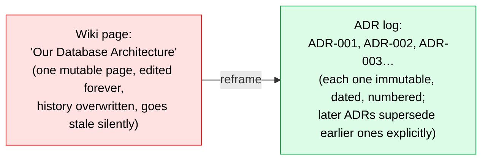
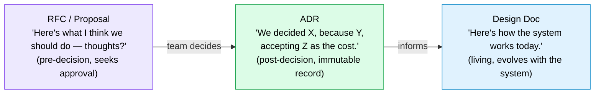
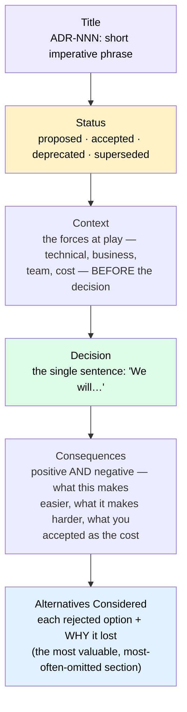
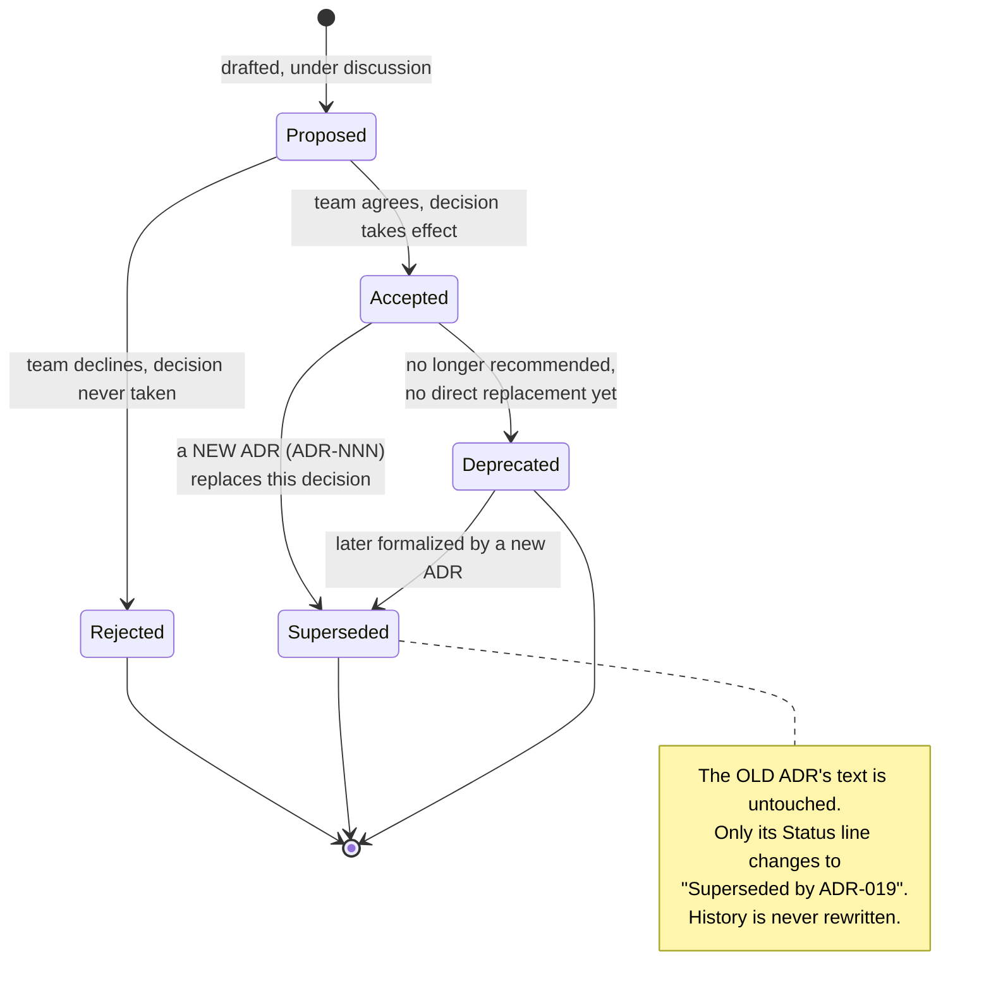
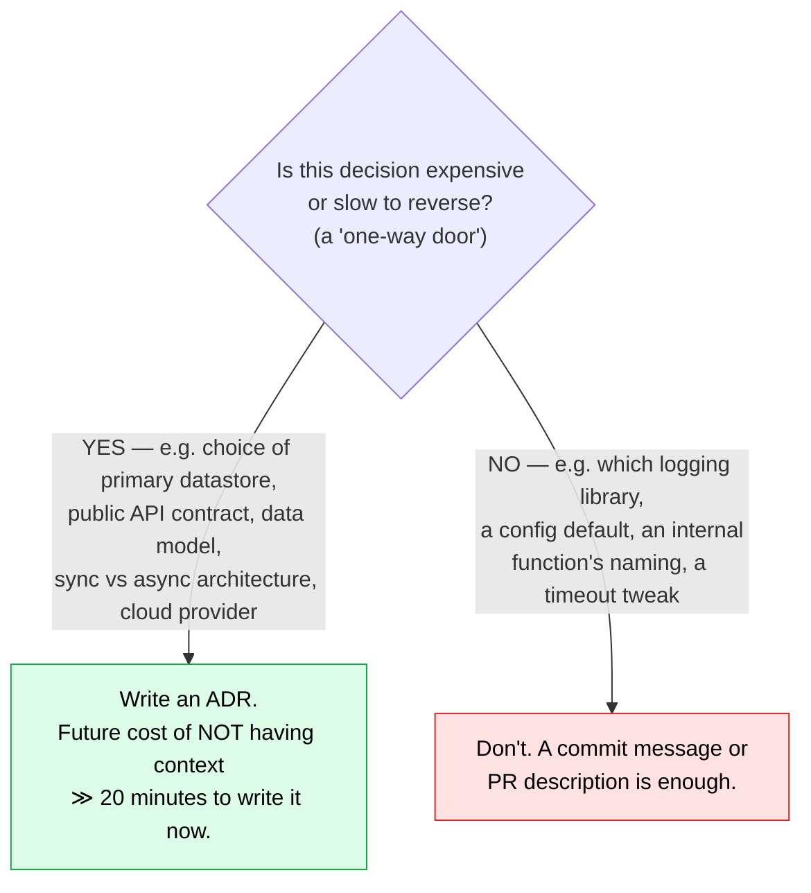
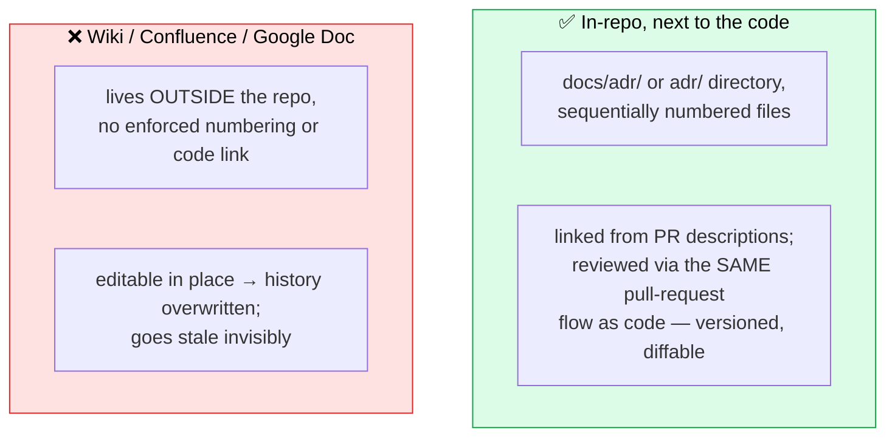
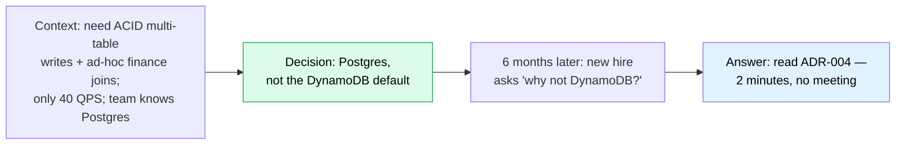
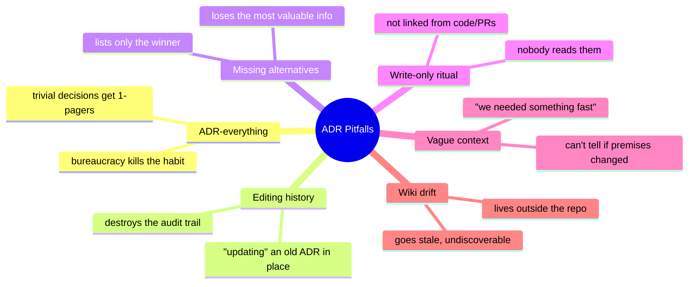

# Architecture Decision Records

> **One line:** An ADR is a short, numbered, *immutable* document that answers one question forever — "why did we do it this way?" — so the next engineer (often you, in eighteen months) doesn't have to reverse-engineer the decision from git blame and Slack archaeology.

---

## Table of Contents
1. [Why You Must Master This](#1-why-you-must-master-this)
2. [The Mental Model](#2-the-mental-model)
3. [What an ADR Precisely Is (and Isn't)](#3-what-an-adr-precisely-is-and-isnt)
4. [Anatomy of an ADR](#4-anatomy-of-an-adr)
5. [The Lifecycle — Status as a State Machine](#5-the-lifecycle--status-as-a-state-machine)
6. [When to Write One (and When Not To)](#6-when-to-write-one-and-when-not-to)
7. [Lightweight Formats Survey](#7-lightweight-formats-survey)
8. [Where ADRs Live and How They're Discovered](#8-where-adrs-live-and-how-theyre-discovered)
9. [Worked Example — ADR-004: Postgres over DynamoDB](#9-worked-example--adr-004-postgres-over-dynamodb)
10. [Real-Life Use Cases](#10-real-life-use-cases)
11. [Failure Modes](#11-failure-modes)
12. [🏋️ Practice Drills](#-practice-drills)
13. [🎤 Interview Q&A Bank](#-interview-qa-bank)
14. [🎯 Staff+ Nuances](#-staff-nuances)
15. [Cheat Sheet](#15-cheat-sheet)
16. [Connections & Further Reading](#16-connections--further-reading)

---

## 1. Why You Must Master This

- **Decision amnesia is expensive.** Without a written record, every "why is it built this way?" question costs a meeting, a Slack thread, or a re-litigation of a decision the team already made — often reaching the *same* conclusion after burning a day.
- **The most valuable information is the one everyone throws away.** Nobody forgets what was chosen. Everyone forgets what was *rejected and why* — and that's precisely the information that stops a new hire from re-proposing MongoDB for the third time in two years.
- **It's how you tell a decision is stale.** A decision made when the team was 5 engineers and traffic was 100 QPS may be actively wrong at 50 engineers and 100K QPS — but you can only notice if the *original premises* were written down to compare against.
- **It's a Staff+ interview and promotion staple.** "Walk me through a decision you made and would reconsider" is a direct probe for whether you think in ADRs, even if you've never used the term.

> **The core problem it solves:** knowledge that lives only in people's heads (or a closed Slack thread) evaporates the moment those people leave the room, the company, or just forget. An ADR makes the *reasoning* — not just the outcome — a durable, versioned artifact.

**Prerequisites:** [[Trade_off_Analysis]] (./Trade_off_Analysis.md) — an ADR is the written form of that reasoning process; read that file first if you haven't. [[Constraints_Assumptions]] (./Constraints_Assumptions.md) helps too, since constraints are exactly what an ADR's Context section records.

---

## 2. The Mental Model

The naive view treats documentation as a wiki page you keep "up to date" — endlessly edited to reflect the current state of the world. ADRs invert that: they are a **append-only ledger of decisions in time**, like git commits, not a living description of the present.



> **Hold onto this:** you don't *edit* an ADR to reflect a new decision — you write a **new** ADR that supersedes the old one and leaves the old one's text untouched. The value is in being able to read ADR-003 today and see exactly what the team believed to be true in March 2022, even though ADR-019 has since overturned it.

---

## 3. What an ADR Precisely Is (and Isn't)

An **Architecture Decision Record (ADR)** is a short document capturing **one** significant architectural decision: the context that forced it, the decision itself, and its consequences — *including the ones you didn't want.* The term and format come from Michael Nygard's 2011 blog post "Documenting Architecture Decisions."

It is easiest to define by contrast with the two documents people confuse it with:

| | **ADR** | **Design Doc / RFC (pre-decision)** | **Design Doc (broad, evolving)** |
|---|---------|--------------------------------------|-----------------------------------|
| **Scope** | One decision | One proposal seeking approval | A whole system/component |
| **When written** | *After* (or at) the moment of decision | *Before* the decision — to gather feedback | Continuously, as the system evolves |
| **Mutability** | Immutable once accepted — superseded, never edited | Mutable during review; frozen once approved | Actively maintained, expected to go stale without upkeep |
| **Length** | ~½–1 page | Several pages, often with alternatives debated live | Many pages, diagrams, API specs |
| **Question it answers** | "Why did we do X?" | "Should we do X? Convince me." | "How does this system currently work?" |
| **Audience** | Future engineers, auditors, your future self | Reviewers/approvers, right now | Onboarding engineers, ongoing reference |



> An RFC is a *question*; a design doc is a *snapshot*; an ADR is a *verdict, filed away permanently.* Many teams write all three for a big decision: RFC to converge, ADR to record the verdict, design doc updated to reflect the outcome.

**What breaks without ADRs, concretely:**

- **Decision amnesia.** Six months after choosing Kafka over SQS, a new hire asks "why don't we just use SQS, it's simpler?" Without an ADR, the team re-runs the entire trade-off analysis from scratch — or worse, someone just switches it, unaware of the original constraint (ordering guarantees) that ruled SQS out.
- **Losing the rejected alternatives.** This is the single most commonly lost — and most valuable — piece of information. The decision itself is usually visible in the code. The *reasons the alternatives lost* live nowhere unless written down.
- **Inability to detect staleness.** A decision is a function of its inputs: team size, cost, scale, available tooling. If those inputs were never recorded, you cannot tell whether a 3-year-old decision is still correct or whether the world moved out from under it.

---

## 4. Anatomy of an ADR

A real ADR is short — deliberately so, to keep the barrier to writing one low. Nygard's original template has six sections; nearly every lightweight variant since (see §7) keeps this shape:



- **Title** — `ADR-NNN: <imperative phrase>`, e.g. "ADR-004: Use Postgres for the orders table." Numbered sequentially, never reused even if rejected or superseded — the number is a permanent address, like a commit hash.
- **Status** — one word: `proposed`, `accepted`, `deprecated`, or `superseded by ADR-NNN`. The *only* field allowed to change after the ADR is written (see §5).
- **Context** — the forces in tension *before* the decision: the constraint that mattered, the scale at the time, team size and skills, the cost ceiling, the deadline. This is exactly the material [[Constraints_Assumptions]] (./Constraints_Assumptions.md) teaches you to elicit. Get this wrong (too vague, or silently updated later) and you lose the ability to tell whether the decision is stale.
- **Decision** — one clear sentence, stated as a commitment, not a hedge: "We will use Postgres with a single primary and read replicas" — not "We're leaning towards maybe using something like Postgres."
- **Consequences** — the full, honest list: what gets easier, what gets *harder*, what you're accepting as an ongoing cost. Nygard's template insists on *negative* consequences too — an ADR listing only upside is marketing copy, not a decision record. The direct written analogue of [[Trade_off_Analysis]] (./Trade_off_Analysis.md)'s "name the sacrifice."
- **Alternatives Considered** — every option seriously on the table, and the *specific* reason it lost (not "we didn't like it" — "DynamoDB requires access patterns fixed upfront; ours change monthly"). The section teams skip under time pressure, and the one future readers miss most.

---

## 5. The Lifecycle — Status as a State Machine

Status is the one field an ADR is allowed to change, and even that follows a strict, one-directional state machine — you never delete an ADR or edit its Decision/Context/Consequences to reflect new thinking. You write a **new** ADR and point the old one at it.



- **Proposed** — drafted, circulated for review (often as a PR — see §8). Not yet in effect.
- **Accepted** — the team has committed; the decision is now load-bearing. The terminal "happy path" state for most ADRs, often for years.
- **Deprecated** — no longer recommended, but nothing has formally replaced it yet.
- **Superseded by ADR-NNN** — the clean, explicit end state: a specific later ADR replaces this one. Prefer this over "deprecated" — a future reader lands on the old ADR, sees "superseded by ADR-019," and jumps straight to the current answer.

> **Immutability is the whole point.** Editing ADR-004 in place when the team migrates off Postgres destroys the historical record of what the team believed and why — exactly the information that lets you tell whether a *different* decision made under similar reasoning is also due for reconsideration. Append-only, like a ledger, not a wiki.

---

## 6. When to Write One (and When Not To)

Not every decision earns an ADR — writing one for every config value or variable name kills the practice through sheer bureaucratic weight, and then nobody writes them for the decisions that matter. The threshold test borrows Amazon's **one-way door / two-way door** framing (introduced in [[Trade_off_Analysis]] (./Trade_off_Analysis.md)'s Staff+ Nuances):



**Write one when:**
- Reversing it later means a **data migration**, a **breaking API change**, or **months of rework** (database choice, message broker, service boundaries, auth model, multi-region strategy).
- The decision will be **questioned repeatedly** — anything a new hire is statistically likely to ask "why not X instead?" about.
- Multiple **credible alternatives** existed and the team spent real time weighing them — that debate is exactly the content worth preserving.
- The decision trades away something valuable (an explicit [[Trade_off_Analysis]] (./Trade_off_Analysis.md) sacrifice) that a future reader needs to know was *intentional*, not an oversight.

**Skip it when:**
- The choice is a **two-way door** — cheap to reverse, low blast radius (an internal helper library, a linter rule, a variable name, a timeout value you can tune in one PR).
- It's a **pure implementation detail** with no architectural surface — nobody outside the immediate PR will ever ask "why."
- You're prototyping/spiking — the code itself is disposable, so the decision doesn't need to outlive the branch.

> **The failure mode runs both directions.** Too few ADRs and the team relearns the same lessons repeatedly (decision amnesia). Too many — an ADR for every trivial choice — and engineers start skipping the ritual entirely, so the practice dies exactly when a *real* one-way-door decision comes along. Calibrate to "would I want to read this in two years?"

---

## 7. Lightweight Formats Survey

The 2011 Nygard template is the ancestor, but several lighter variants exist for different team sizes and decision weights. Picking the right *weight* of format matters as much as picking the right decision to record — over-formatting a small decision is its own way of killing the practice.

| Format | Shape | Best for | Trade-off |
|--------|-------|----------|-----------|
| **Nygard (original, 2011)** | Title · Status · Context · Decision · Consequences | The default; most tooling (`adr-tools`, `adr-log`) assumes this shape | Slightly more ceremony than MADR's decision-focused framing, but the most universally recognized |
| **MADR (Markdown ADR)** | Adds explicit `Decision Drivers`, `Considered Options`, and a `Pros and Cons of Each Option` sub-list per alternative | Decisions with 3+ genuinely competitive options you want to score transparently | More structure = more upfront writing time; overkill for a 2-option call |
| **Y-Statement** | One dense sentence: *"In the context of `<use case>`, facing `<concern>`, we decided for `<option>` to achieve `<quality>`, accepting `<downside>`."* | Fast capture during a design session, or as a one-line summary atop a fuller ADR | Great for scanning a log of many ADRs at a glance; too compressed as the *only* record for a complex decision |
| **Nano-ADR** | One short paragraph, no headers: what, why, what we gave up | Small/medium decisions that clear the "write one" bar in §6 but don't need a full page — the on-ramp that keeps the practice lightweight | Loses the scannable structure; harder to grep/index at scale, so teams often "graduate" a nano-ADR to full format if it gets referenced often |

> **Rule of thumb:** match the format's weight to the decision's weight. A "should this service own its own database" decision earns full Nygard or MADR. A "we're standardizing on UUIDv7 instead of UUIDv4 for new tables" decision is a perfect nano-ADR — three sentences, done in the same PR that makes the change.

**Y-Statement example (nano-scale, dense):**
> *In the context of the checkout service's idempotency key, facing duplicate-charge risk from client retries, we decided for a client-generated UUID stored with a unique constraint, to achieve exactly-once charge semantics, accepting the extra column and a unique-index write cost on every request.*

---

## 8. Where ADRs Live and How They're Discovered

An ADR that nobody finds is worth exactly as much as no ADR at all — discoverability is not an afterthought, it's the second half of the design.



- **In-repo (`adr/` or `docs/adr/`), sequentially numbered** — the dominant modern convention (`0001-record-architecture-decisions.md`, `0002-use-postgres-for-orders.md`, …). Numbering is permanent; a rejected or superseded ADR keeps its number rather than being renumbered.
- **Linked from code and PRs** — a comment near the relevant module (`// see docs/adr/0004-postgres-orders.md`) and a line in the PR description that introduced the change. This is how a future engineer *finds* the ADR without already knowing it exists.
- **Reviewed like code** — proposing an ADR as a pull request means it gets the same review, diff, and merge history as everything else; "Accepted" often literally means "the PR was merged."
- **Why not a wiki:** a wiki page is mutable by default (defeating immutability), lives in a different tool than the code (so it's never in the diff, never shows up in `git blame`, never gets reviewed alongside the change it explains), and has no natural numbering or supersession convention — so it silently rots. Every team that has tried "the wiki has our architecture decisions" eventually admits nobody trusts it's current.

---

## 9. Worked Example — ADR-004: Postgres over DynamoDB



**ADR-004: Use Postgres instead of DynamoDB for the orders table**

**Status:** Accepted (2024-03-11)

**Context:**
The orders service is being split out of the monolith. Company-wide default for new services is DynamoDB (per ADR-001, for operational uniformity and near-zero-ops scaling). The orders domain, however, needs: (a) ad-hoc joins across `orders`, `line_items`, `inventory_holds`, and `refunds` for the finance reconciliation job, which runs unpredictable analytical queries that change monthly; (b) multi-row ACID transactions when an order is placed (decrement inventory + create order + charge payment intent must all succeed or all fail); (c) current write volume is ~40 QPS peak, far under the threshold where DynamoDB's scaling advantage matters. Team has 6 backend engineers, all with 3+ years of Postgres experience and zero production DynamoDB experience.

**Decision:**
We will use a single-primary Postgres instance (with two read replicas for the finance job) for the orders table and its related tables, rather than DynamoDB.

**Consequences:**
- ✅ **Positive:** Multi-table ACID transactions are native — no need to hand-roll a saga or two-phase commit for order placement. Finance's ad-hoc joins work out of the box, with zero ramp-up time versus 2–3 weeks learning DynamoDB's data-modeling discipline.
- ❌ **Negative:** We deviate from the company-wide DynamoDB default (ADR-001), adding a second database technology to the SRE team's operational surface.
- ❌ **Negative:** Vertical scaling ceiling — past ~5,000 QPS sustained we must shard or migrate, a materially harder migration *away* from cross-table transactions than migrating *up* from DynamoDB would have been.
- ❌ **Negative:** We accept single-primary write availability risk (a CP-leaning choice per [[CAP_Theorem_PACELC]] (./CAP_Theorem_PACELC.md)) — a primary failover causes a brief write outage that DynamoDB would not have had.

**Alternatives Considered:**
- **DynamoDB (the company default)** — rejected: the finance job's query patterns are analytical and change monthly; DynamoDB requires access patterns fixed at table-design time, and we couldn't commit to GSIs that wouldn't need monthly migration.
- **DynamoDB + a Redshift OLAP mirror** — rejected as premature complexity: solves the join problem but doubles the operational surface to serve 40 QPS of writes, and delays shipping ~3 weeks for the ETL pipeline.
- **MongoDB** — rejected: no compelling advantage over Postgres here, and lacks the same multi-document ACID maturity our team already trusts.

> Notice what this closes off six months later: when a new hire asks "why isn't this on DynamoDB like everything else," the answer is two clicks away, dated, and names the exact scale (~5,000 QPS) at which the decision should be revisited — which is precisely how you tell a decision is stale rather than guessing.

---

## 10. Real-Life Use Cases

| Situation | How ADRs apply | The decision it forces |
|-----------|-----------------|--------------------------|
| **New engineer onboarding** | Reading `docs/adr/` in numeric order *is* the fastest way to learn why the system looks the way it does — faster than reading all the code. | Point onboarding docs at the ADR log, not just the README. |
| **Migrating off a legacy choice** | You write ADR-019 "Migrate order search from Postgres full-text to Elasticsearch," which supersedes ADR-004's search-related consequences. | Old ADR's status flips to `superseded by ADR-019`; text untouched. |
| **Vendor/tooling audit** | Compliance or a new CTO asks "why do we use three different message brokers?" — the ADR log answers per-service, with dates and context. | Decisions become auditable artifacts, not tribal memory. |
| **Post-incident review** | An outage traces back to a design choice; the ADR shows whether the failure mode was a known, *accepted* consequence or a genuine surprise. | Distinguishes "we knew and accepted this risk" from "we missed this." |
| **Interview / promo packet** | "Tell me about a decision you'd reconsider" is answered crisply by pointing at an ADR and its dated context — a candidate who thinks in ADRs stands out immediately. | Signals structured reasoning, not just outcome-recall. |

> Real-world habit: when you make (or inherit) a one-way-door decision, ask "if I got hit by a bus tomorrow, could the next engineer reconstruct why this exists?" If not, write the ADR before you move on — not after, when the context has already faded from memory.

---

## 11. Failure Modes



- **ADR-everything.** SYMPTOM: engineers start skipping ADRs entirely, even for big decisions. ROOT CAUSE: the team wrote ADRs for trivial, reversible choices until the ritual felt like paperwork. FIX: apply the one-way/two-way door test from §6; reserve full ADRs for decisions genuinely expensive to reverse.
- **Editing history instead of superseding.** SYMPTOM: an ADR's Context subtly contradicts what old PRs and Slack threads say it originally claimed. ROOT CAUSE: someone "updated" the ADR in place instead of writing a new one. FIX: enforce immutability by PR review — the only allowed edit to an accepted ADR is its Status line.
- **Missing "Alternatives Considered."** SYMPTOM: a rejected technology gets re-proposed every 6 months, and the team re-runs the same debate each time. ROOT CAUSE: the ADR recorded the winner but not why the losers lost. FIX: make "Alternatives Considered" mandatory, not optional — it's the highest-value part of the document.
- **Write-only ritual (nobody reads them).** SYMPTOM: the `adr/` folder exists but engineers still ask "why is it built this way?" in Slack. ROOT CAUSE: ADRs aren't linked from code, PRs, or onboarding docs — discoverable only if you already know to look. FIX: link the ADR number in code comments and the PR description that implements it; put "read `adr/`" in onboarding.
- **Vague Context sections.** SYMPTOM: years later, nobody can tell if a decision is stale because nobody can tell what changed. ROOT CAUSE: Context written as generic prose ("we needed something scalable") instead of concrete premises. FIX: require at least one concrete number or constraint in every Context — it's what you'll compare against later.
- **Wiki drift.** SYMPTOM: the "architecture decisions" Confluence page contradicts the actual code, and nobody trusts it. ROOT CAUSE: the record lives outside the repo, is trivially mutable, and isn't reviewed alongside the code it explains. FIX: move it in-repo under `docs/adr/`, numbered, reviewed via pull request (§8).

---

## 🏋️ Practice Drills

> *Cover the solutions and attempt first — active recall is the point.*

**Drill 1 — Spot the missing section.** A teammate shows you this "ADR": *"ADR-012: We're using Redis for session storage. It's fast and everyone knows it."* What's missing, and why does it matter?

<details><summary>Solution</summary>

Missing: **Status** (is this even accepted?), **Context** (what forced this — session TTL requirements? read latency budget? existing Redis footprint?), full **Consequences** (only a vague positive is given — what's the downside? e.g., session loss on a Redis restart without persistence configured, or the cost of running a separate cache tier), and critically **Alternatives Considered** (why not the database, why not a JWT-only stateless approach?). Without these, a future engineer can't tell if this decision is still valid or was ever well-reasoned — it reads as an assertion, not a decision record.
</details>

**Drill 2 — One-way or two-way door?** Classify each and say whether it earns a full ADR, a nano-ADR, or nothing: (a) switching the primary datastore from MySQL to Cassandra, (b) renaming an internal helper function, (c) choosing a retry backoff multiplier (1.5x vs 2x) for an internal RPC client, (d) deciding all new services will be gRPC instead of REST.

<details><summary>Solution</summary>

(a) **One-way door → full ADR.** Data migration is expensive and slow to reverse; needs full Context/Alternatives. (b) **Trivial → nothing.** No architectural surface, purely a naming choice. (c) **Two-way door, low stakes → nano-ADR at most** (or just a code comment) — cheap to change in one PR later, but worth a sentence if it was tuned based on a specific incident. (d) **One-way door (affects every future service's contracts, tooling, and client libraries) → full ADR**, since reversing it means rewriting every service built under the new default.
</details>

**Drill 3 — Design a nano-ADR.** Your team just decided to use ULIDs instead of auto-incrementing integers for all new primary keys, to allow client-side ID generation before insert. Write a 3-sentence nano-ADR.

<details><summary>Solution</summary>

*"In the context of needing client-generated primary keys (to support offline-first writes and multi-region insert without a coordinator), facing the collision risk and unsortability of random UUIDv4, we decided to use ULIDs for all new tables' primary keys, accepting a small migration cost for existing auto-increment tables that adopt this later and a 26-character key instead of an 8-byte integer."* This fits the Y-statement shape and captures context, decision, and cost in one breath — appropriate weight for a decision that's real but not deeply irreversible (a "medium" door).
</details>

---

## 🎤 Interview Q&A Bank

**Q1. What is an ADR, precisely?**
> A short, numbered, immutable document recording one significant architectural decision: the context that forced it, the decision made, and its consequences — positive and negative — plus the alternatives considered and why they were rejected. It's a permanent record, not a living page.

**Q2. How is an ADR different from a design doc or an RFC?**
> An RFC is a pre-decision proposal seeking approval — a question. A design doc is a broad, continuously-evolving description of how a system currently works — a snapshot that's expected to be kept current. An ADR is a narrow, post-decision verdict on one choice, and once accepted it's never edited — only superseded by a later ADR.

**Q3. Why is "Alternatives Considered" the most important section?**
> Because it's the information everyone forgets to preserve otherwise. The decision itself is usually visible in the code; the reasons the rejected options lost are not. Omitting this section is why teams re-litigate settled decisions every time someone new joins.

**Q4. When should you write an ADR, and when is it overkill?** *(signal: calibration, not just knowing the format)*
> Use Amazon's one-way-door test: if reversing the decision is expensive or slow (data migration, API breakage, months of rework), write one. If it's a cheap, two-way-door choice (an internal helper, a config default), don't — writing an ADR for every trivial decision buries the ones that matter and kills the practice through bureaucracy.

**Q5. Can you edit an ADR after it's accepted?**
> Only its Status field, to move it to `deprecated` or `superseded by ADR-NNN`. The Context, Decision, and Consequences sections are immutable — if the decision changes, you write a *new*, separately numbered ADR and point the old one at it. This preserves an honest historical record of what the team believed at the time.

**Q6. How do you know if a past architectural decision is stale?**
> Compare its Context section's stated premises (team size, scale, cost, available tooling) against today's reality. If those premises have moved by an order of magnitude, the decision is a candidate for re-evaluation — which is only possible because the premises were written down in the first place.

**Q7. Where should ADRs live, and why not a wiki?**
> In-repo, under `adr/` or `docs/adr/`, sequentially numbered, reviewed as pull requests and linked from the code/PRs they explain. A wiki page is mutable by default (destroying the audit trail), lives outside the code (so it's never in a diff or code review), and has no numbering/supersession convention — it silently rots and nobody trusts it's current.

---

## 🎯 Staff+ Nuances

- **The number is a permanent address, not a sequence to keep tidy.** Never renumber ADRs, even a rejected one — `ADR-007: Rejected` is still a valid, citable historical fact ("we considered event sourcing in 2023 and rejected it — see ADR-007"). Renumbering to "clean up" destroys exactly the citability that makes ADRs valuable.
- **Supersession chains are themselves a signal.** An ADR superseded twice in two years (ADR-004 → ADR-019 → ADR-041, all about the same subsystem) tells a staff engineer the *domain* is genuinely volatile — worth treating as a standing area of technical risk, not just three isolated decisions.
- **The Context section is where staff engineers add the most value.** Junior ADRs often state the Decision crisply but leave Context thin ("we needed something scalable"). A staff-level ADR names the *specific* number that mattered (this specific query pattern, this specific QPS, this specific team constraint) — because that specificity is what lets someone in three years correctly judge whether the decision is stale.
- **ADRs are a lagging indicator of a healthy trade-off culture, not a substitute for one.** A team that writes beautiful ADRs but never seriously weighs alternatives before deciding is just producing well-formatted post-hoc justification. The rigor has to happen in the [[Trade_off_Analysis]] (./Trade_off_Analysis.md) process; the ADR just makes the output durable.
- **Treat "we should write more ADRs" complaints as a process signal, not a discipline problem.** If a team isn't writing them for real one-way-door decisions, the friction is usually structural (no template in the repo, no PR checklist item) — fix the friction before assuming the team lacks discipline.
- **ADRs interact with the interview Wrap-Up phase directly.** [[System_Design_Interview_Overview]] (./System_Design_Interview_Overview.md)'s Phase 5 — trade-offs, bottlenecks, what you'd revisit with more time — is functionally an ADR narrated out loud. A wrap-up structured as "Context → Decision → Consequences (incl. downside) → what I rejected and why" is ADR-shaped thinking, and it reads as senior.

---

## 15. Cheat Sheet

```
ADR = one immutable record of ONE architectural decision.
NOT a design doc (broad, evolving) or an RFC (pre-decision proposal).

ANATOMY (Nygard, 2011):
  Title       ADR-NNN: <imperative phrase>, permanently numbered
  Status      proposed → accepted → deprecated | superseded by ADR-NNN
  Context     the forces THEN: scale, team, cost, deadline (be concrete)
  Decision    one committed sentence: "We will…"
  Consequences  positive AND negative — the sacrifice, named
  Alternatives  each rejected option + WHY (the most-often-lost info)

LIFECYCLE (append-only — supersede, never edit):
  proposed -> accepted -> deprecated -> superseded by ADR-NNN
  Only the Status line may change after acceptance.

WHEN TO WRITE ONE: one-way door (expensive/slow to reverse)
  YES: datastore choice, public API contract, data model, sync/async arch
  NO:  two-way door — internal helper, config default, naming
  Too many ADRs -> bureaucracy kills the habit. Too few -> amnesia.

FORMATS BY WEIGHT (light -> heavy):
  Nano-ADR (1 paragraph) -> Y-statement (1 sentence) ->
  Nygard template (~half page) -> MADR (scored options, full page)

WHERE THEY LIVE: docs/adr/ or adr/, IN-REPO, numbered, reviewed as a PR,
  linked from code + PR descriptions. NOT a wiki (mutable, undiscoverable,
  goes stale silently, never reviewed alongside the code it explains).

STALENESS CHECK: compare Context's ORIGINAL premises (scale/team/cost)
  to today. Premises moved an order of magnitude? -> re-evaluate,
  write a NEW ADR, mark the old one superseded.

INTERVIEW: Wrap-Up phase = an ADR spoken aloud.
  "Context -> Decision -> Consequences (incl. downside) -> rejected -> why."
```

---

## 16. Connections & Further Reading

**Prerequisites (learn first):**
- [Trade_off_Analysis.md](./Trade_off_Analysis.md) — the reasoning method this file gives a durable written form to. That file's §7 briefly introduces ADRs as a tool alongside the Pugh matrix and spider chart; this file is the full treatment — anatomy, lifecycle, formats, and real examples.
- [Constraints_Assumptions.md](./Constraints_Assumptions.md) — constraints and assumptions are exactly what an ADR's Context section should capture; if you can't state your constraints precisely, your ADR's Context will be too vague to later judge as stale or current.

**Builds toward / pairs with:**
- [System_Design_Interview_Overview.md](./System_Design_Interview_Overview.md) — the interview's Wrap-Up phase (Phase 5: trade-offs, risks, what you'd revisit) is essentially an ADR narrated out loud; practicing ADR-shaped thinking here makes that phase come naturally.
- [03_High_Level_Design](../03_High_Level_Design/) — this is where major HLD decisions (data model, service boundaries, sync vs async, which datastore) actually get ADR'd on real teams; treat every irreversible HLD choice there as an ADR candidate.

**Gaps this topic exposes (candidates for the section's Gap Analysis):**
- A dedicated file on **design-doc / RFC review culture** (how proposals get socialized *before* the ADR is written) would complement this one — currently only briefly contrasted here in §3.

**External classics:**
- Michael Nygard, *"Documenting Architecture Decisions"* (2011) — the original blog post that defined the format used across the industry today.
- *MADR (Markdown Architectural Decision Records)* — the widely-adopted open-source template extending Nygard's with explicit decision drivers and scored options.
- ThoughtWorks Technology Radar — repeated entries recommending "Lightweight Architecture Decision Records" as a standard practice.
- *Fundamentals of Software Architecture* (Richards & Ford) — situates ADRs within the broader discipline of architectural decision-making and trade-off analysis.

---

## TL;DR
An ADR is a **short, immutable, numbered record of one architectural decision** — Context (the forces then), Decision (the one-sentence commitment), Consequences (positive *and* negative), and Alternatives Considered (the section everyone forgets and the one that matters most). Write one only for **one-way-door** decisions — expensive or slow to reverse — and skip it for trivial, reversible choices, or the practice collapses under its own bureaucracy. **Never edit an accepted ADR** — supersede it with a new, separately numbered one, because the old one's stated premises are exactly what let a future engineer judge whether the decision has gone stale. Keep them **in-repo, numbered, and linked from the code and PRs they explain** — not in a wiki, where they silently rot.
