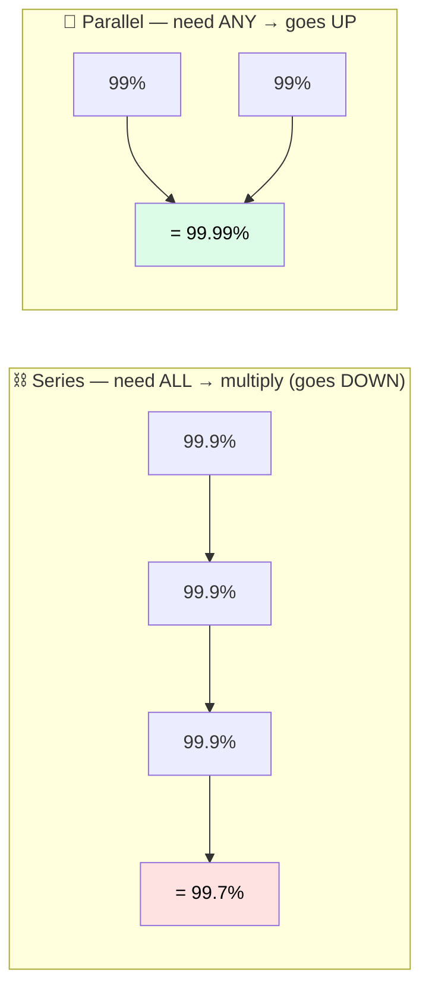
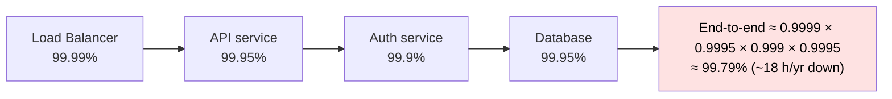
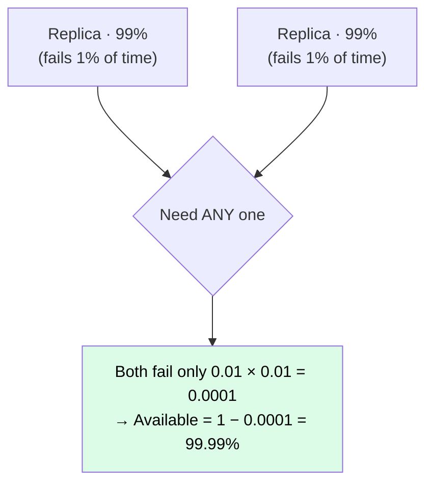
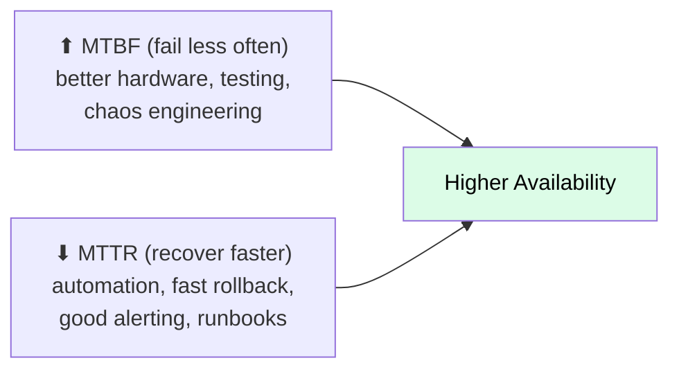
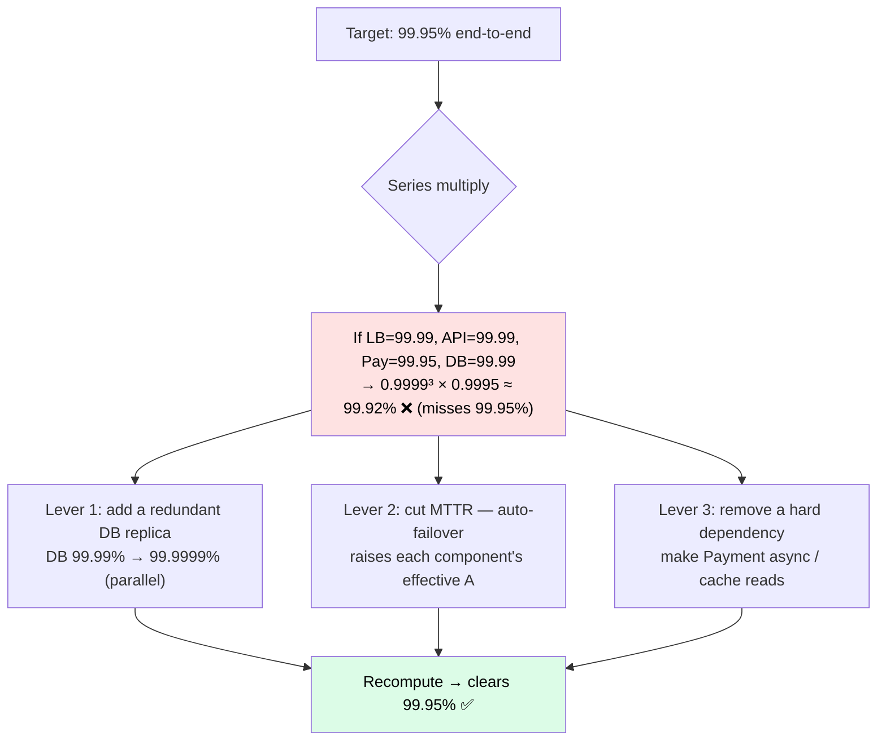
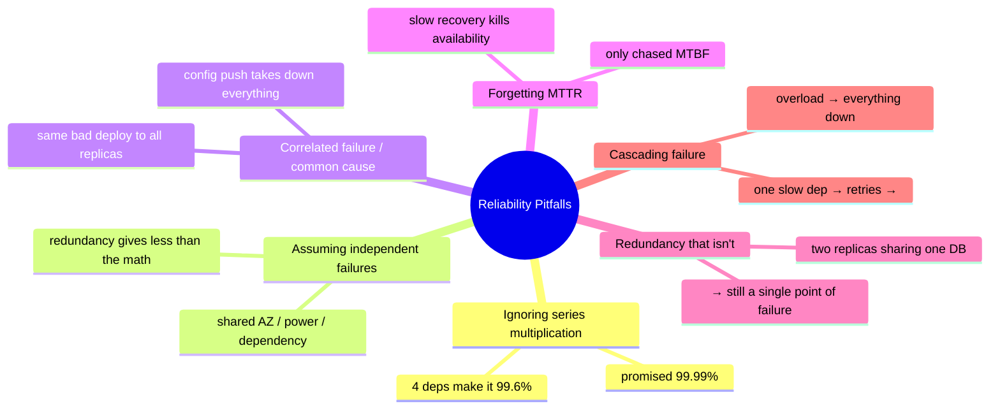

# Availability & Reliability Math

> **One line:** Availability isn't a vibe — it's arithmetic. Dependencies in series **multiply** (so every component you add makes the system *less* available), and the only way back up is **redundancy**, which turns two cheap 99% parts into a 99.99% whole.

---

## Table of Contents
1. [Why You Must Master This](#1-why-you-must-master-this)
2. [The Mental Model](#2-the-mental-model)
3. [The Nines & Downtime Budget](#3-the-nines--downtime-budget)
4. [Series: Dependencies Multiply (and shrink)](#4-series-dependencies-multiply-and-shrink)
5. [Parallel: Redundancy Adds Nines](#5-parallel-redundancy-adds-nines)
6. [MTBF, MTTR & the Availability Formula](#6-mtbf-mttr--the-availability-formula)
7. [Availability vs Durability vs Reliability](#7-availability-vs-durability-vs-reliability)
8. [Worked Example — Budgeting a Service's Nines](#8-worked-example--budgeting-a-services-nines)
9. [Real-Life Use Cases](#9-real-life-use-cases)
10. [Failure Modes](#10-failure-modes)
11. [🏋️ Practice Drills](#-practice-drills)
12. [🎤 Interview Q&A Bank](#-interview-qa-bank)
13. [🎯 Staff+ Nuances](#-staff-nuances)
14. [Cheat Sheet](#14-cheat-sheet)
15. [Connections & Further Reading](#15-connections--further-reading)

---

## 1. Why You Must Master This

"We'll make it highly available" is meaningless without the math behind it. Reliability math tells you *exactly* how many nines your design can achieve and what it costs to add more.

- **Dependencies are silent availability taxes** — every synchronous call to another service *lowers* your ceiling, and most engineers never do the multiplication.
- **Redundancy is the only lever up** — and it follows a precise formula, so you can prove "two replicas gets me four nines" instead of hoping.
- **Each nine ~10×'s the cost** — the math shows when chasing 99.999% is worth it and when it's vanity.

> **The core problem it solves:** turning "highly available" from a wish into a budget — a concrete number you can design to, defend, and price.

---

## 2. The Mental Model

A system is a chain and a web. **Where components are needed *together* (series), failures compound** — the chain is weaker than its weakest link. **Where components are *alternatives* (parallel/redundant), failures must coincide** — and coincidence is rare, so reliability soars.





---

## 3. The Nines & Downtime Budget

Availability is the fraction of time a system is usable. "Nines" is the shorthand — and you should know the downtime each allows by heart.

| Availability | Downtime / year | Downtime / month | Downtime / day |
|--------------|-----------------|------------------|----------------|
| 90% (one nine) | 36.5 days | 3 days | 2.4 h |
| 99% (two nines) | 3.65 days | 7.2 h | 14.4 min |
| 99.9% (three nines) | 8.76 h | 43.2 min | 1.44 min |
| 99.99% (four nines) | 52.6 min | 4.3 min | 8.6 s |
| 99.999% (five nines) | 5.26 min | 26 s | 0.86 s |

> Five nines = **~5 minutes of downtime per *year*** — including every deploy, patch, and incident. That's why it usually demands multi-region active-active and roughly **doubles** cost per nine. (See [SLA_SLO_SLI.md](./SLA_SLO_SLI.md).)

---

## 4. Series: Dependencies Multiply (and shrink)

When a request **needs every component to work** (a hard dependency chain), availabilities **multiply**:

```
A_total = A₁ × A₂ × A₃ × … × Aₙ
```



> **The hard lesson:** every hard dependency you add can only *lower* availability. A chain of four "pretty good" 99.9% services yields only **99.6%** end-to-end — worse than any single link. This is why microservice graphs that fan out synchronously are an availability liability, and why you remove hard dependencies (async, caching, graceful degradation, fallbacks) wherever you can.

---

## 5. Parallel: Redundancy Adds Nines

When **any one of N redundant copies suffices**, the system fails only if **all** fail simultaneously. Multiply the *failure* probabilities:

```
A_total = 1 − (1 − A)ⁿ
```



| Redundancy | Each 99% | Each 99.9% |
|------------|----------|------------|
| 1 (no redundancy) | 99% | 99.9% |
| 2 in parallel | 99.99% | 99.9999% |
| 3 in parallel | 99.9999% | nine nines |

> Two cheap 99% nodes in parallel → **99.99%**. Redundancy is the *only* way to build a system more available than its parts. **Caveat:** this assumes **independent** failures — see Staff+ Nuances for why correlated failures break the math.

---

## 6. MTBF, MTTR & the Availability Formula

Availability also derives from how often things break and how fast you fix them:

```
              MTBF                    Mean Time Between Failures
A  =  ─────────────────      =  ───────────────────────────────────
         MTBF + MTTR              (uptime) + Mean Time To Recover
```



> **The under-appreciated lever is MTTR.** You can't prevent all failures, but you can recover fast. Halving MTTR (faster detection + automated rollback/failover) improves availability just as much as doubling MTBF — and is usually cheaper. *Design to recover, not just to avoid failing.*

---

## 7. Availability vs Durability vs Reliability

These get conflated constantly; keep them distinct:

| Term | Question it answers | Example target |
|------|---------------------|----------------|
| **Availability** | Is it up and responding *right now*? | 99.99% uptime |
| **Durability** | Will my stored data *ever* be lost? | 99.999999999% (S3's 11 nines) |
| **Reliability** | Does it behave *correctly* over time (right answers, no corruption)? | low error rate, no data corruption |


> Durability is almost always held **far stricter** than availability — a brief outage is recoverable; lost data is forever. That's why S3 targets *11 nines of durability* but only ~4 nines of availability.

---

## 8. Worked Example — Budgeting a Service's Nines

**Goal:** a checkout service with a 99.95% SLO. The path is: LB → API → Payment service → DB.



The math turns "make checkout reliable" into specific moves: **redundancy on the weakest link, faster recovery, or fewer hard dependencies.** You can prove the design hits the target before building it.

---

## 9. Real-Life Use Cases

| Situation | How the math decides it |
|-----------|-------------------------|
| **Setting a realistic SLO** | Multiply your dependencies' availabilities — your SLO *cannot* exceed that ceiling without adding redundancy. |
| **Justifying multi-AZ / multi-region** | Parallel formula: replicas in independent failure domains turn 99.9% into 99.9999%. Quantifies the value of redundancy. |
| **Prioritizing reliability work** | If MTTR is your bottleneck, invest in automation/rollback over more hardware — the formula shows equal payoff for half the cost. |
| **Vendor SLA evaluation** | A dependency at 99.9% caps *your* availability; you need redundancy or a fallback to promise more than it. |
| **Removing a synchronous dependency** | Each hard dependency removed (via async/cache/fallback) raises the ceiling — the series math proves the gain. |
| **N+1 / N+2 capacity decisions** | Tied to redundancy: enough replicas that losing one (or two) still serves load *and* keeps the availability target. |

> Real-world habit: **annotate each component on your diagram with its availability, then multiply the hard path.** The product is your ceiling; the weakest link and the longest hard chain are your first targets.

---

## 10. Failure Modes



- **Ignoring series multiplication** — promising more nines than your dependency chain's product allows.
- **Assuming independence** — the parallel formula *only* holds if failures are independent. Shared power, AZ, network, deploy pipeline, or a common dependency break the assumption (see Nuances).
- **Forgetting MTTR** — chasing fewer failures while ignoring slow recovery; both matter equally.
- **"Redundancy" that shares a single point of failure** — two app replicas pointing at one database is not redundant at the DB layer.
- **Cascading failures** — retries and overload turning one component's blip into a system-wide outage; circuit breakers and backpressure contain it.

---

## 🏋️ Practice Drills

> *Multiply for series, `1 − (1−A)ⁿ` for parallel. Round freely.*

**Drill 1 — Series ceiling.** Your request hits 5 services, each 99.9% available (independent). What's the end-to-end availability, and roughly how much downtime per year?

<details><summary>Solution</summary>

`0.999⁵ ≈ 0.995` = **99.5%** ≈ `0.005 × 365 days ≈ 1.8 days/year` down. Five "three-nines" parts give barely two-nines end-to-end — dependencies are an availability tax.
</details>

**Drill 2 — Redundancy gain.** A component is 99% available. You run 3 independent copies behind a load balancer; any one suffices. New availability?

<details><summary>Solution</summary>

`1 − (1 − 0.99)³ = 1 − (0.01)³ = 1 − 0.000001 = 99.9999%` — six nines from three cheap parts. (Assuming truly independent failures.)
</details>

**Drill 3 — MTTR vs MTBF.** A service fails on average every 30 days (MTBF) and takes 6 hours to recover (MTTR). What's its availability, and which lever helps more: halving MTTR or doubling MTBF?

<details><summary>Solution</summary>

MTBF = 720 h, MTTR = 6 h → `A = 720 / 726 ≈ 99.17%`. Halve MTTR (→3 h): `720/723 ≈ 99.59%`. Double MTBF (→1440 h): `1440/1446 ≈ 99.59%`. **Equal gain** — and halving MTTR (automation) is usually cheaper than making hardware fail half as often.
</details>

**Drill 4 — Spot the fake redundancy.** Two stateless API replicas (each 99.9%) both depend on a single database (99.9%). What's the real availability, and what's wrong?

<details><summary>Solution</summary>

The API tier is redundant (`1−(0.001)² ≈ 99.9999%`), but everything funnels through one DB at 99.9%, so end-to-end ≈ `0.999999 × 0.999 ≈ 99.9%`. The DB is an un-redundant single point of failure — the "redundancy" doesn't help past it. Add a DB replica/failover.
</details>

---

## 🎤 Interview Q&A Bank

**Q1. If a request depends on 4 services each at 99.9%, what's the end-to-end availability?**
> Multiply (series): `0.999⁴ ≈ 99.6%` — worse than any single component. Dependencies compound downward.

**Q2. How does redundancy improve availability? Give the formula.**
> Parallel/redundant components fail only if all fail: `A = 1 − (1−A)ⁿ`. Two 99% copies → 99.99%. It's the only way to exceed the availability of your parts.

**Q3. What's the availability formula in terms of MTBF/MTTR?**
> `A = MTBF / (MTBF + MTTR)`. Increase mean time between failures or decrease mean time to recover — both raise availability.

**Q4. Why is reducing MTTR often the better investment?**
> You can't prevent every failure, but fast detection + automated rollback/failover cuts downtime directly, and it's usually cheaper than making components fail less often. Halving MTTR ≈ doubling MTBF.

**Q5. Availability vs durability — distinction?**
> Availability = is it up and responding now. Durability = will stored data ever be lost. Durability is held far stricter (S3 = 11 nines durability vs ~4 nines availability) because lost data is unrecoverable.

**Q6. What breaks the redundancy math?**
> Correlated/common-cause failures: shared AZ, power, network, a bad deploy pushed to all replicas, or a shared dependency. The `1−(1−A)ⁿ` formula assumes *independent* failures, which redundancy in the same failure domain violates.

**Q7. Your SLO is 99.99% but a critical vendor dependency is 99.9%. Possible?**
> Not directly — that dependency caps you at 99.9%. You'd need redundancy (a second provider/path), a cached fallback, or graceful degradation so a vendor outage doesn't fail your request.

**Q8. How many nines is "about 4.3 minutes of downtime per month"?**
> Four nines (99.99%) ≈ 52 min/year ≈ 4.3 min/month.

---

## 🎯 Staff+ Nuances

- **The independence assumption is where reliability math meets reality — and usually loses.** Real redundant systems share *something*: an availability zone, a power feed, a config pipeline, a DNS provider, a base image. A single bad config push to all "independent" replicas is the classic correlated failure. Design redundancy across *independent failure domains*, and remember the math is an optimistic ceiling.
- **Tail availability vs average availability.** "99.99% over a year" can hide a brutal 50-minute outage during your peak hour. Stakeholders care about *when* you're down (Black Friday vs 3am Tuesday), not just the annual fraction. Weight downtime by business impact.
- **Graceful degradation beats binary up/down.** A system that serves stale/read-only/partial results during a dependency outage is "available" for most users even when a backend is down. Designing degraded modes raises *effective* availability far more cheaply than another nine of redundancy.
- **Each nine is exponentially more expensive — know when to stop.** Going 99.9% → 99.99% may need multi-AZ; 99.99% → 99.999% needs multi-region active-active plus eliminating human-in-the-loop recovery (humans can't react in the ~5 min/year budget). Match the target to the business cost of downtime, not engineering pride.
- **Your SLO is bounded by your dependencies' SLOs (the series ceiling).** You cannot promise customers more availability than the product of everything on the hard path — unless you add redundancy or fallbacks. This is a direct, quantitative constraint on [SLA_SLO_SLI.md](./SLA_SLO_SLI.md) commitments.
- **MTTR is dominated by detection + decision, not the fix.** Often the repair is seconds (rollback) but detection took 20 minutes and paging/deciding took 20 more. Invest in fast, accurate alerting and automated remediation — that's where MTTR actually lives.
- **Reliability and the CAP trade interact.** A CP system sacrifices availability *during partitions* by design — that's a deliberate, bounded availability cost in exchange for correctness (see [CAP_Theorem_PACELC.md](./CAP_Theorem_PACELC.md)). Don't double-count it as "unreliability."

---

## 14. Cheat Sheet

```
SERIES (need ALL):     A = A₁ × A₂ × … × Aₙ        → goes DOWN, every dep is a tax
PARALLEL (need ANY):   A = 1 − (1 − A)ⁿ             → goes UP, the only lever up
MTBF/MTTR:             A = MTBF / (MTBF + MTTR)      → fail less OR recover faster

THE NINES (downtime/yr):
  99%     → 3.65 days     99.99%  → 52 min
  99.9%   → 8.76 hours    99.999% → 5.26 min   (incl. all deploys!)

KEY TRUTHS
  • 4 deps @ 99.9% in series → only 99.6% end-to-end
  • 2 copies @ 99% in parallel → 99.99% (IF failures independent)
  • halving MTTR ≈ doubling MTBF (and usually cheaper)
  • your SLO ≤ product of dependency SLOs (unless redundant)

WATCH OUT
  correlated failures (shared AZ/power/deploy) break parallel math
  "redundancy" funneling into 1 DB = still a SPOF
  durability ≫ availability in strictness (data loss is forever)
LEVERS UP: redundancy · faster recovery (MTTR) · remove hard deps ·
           graceful degradation · independent failure domains
```

---

## 15. Connections & Further Reading

**Within this repo:**
- [SLA_SLO_SLI.md](./SLA_SLO_SLI.md) — the nines, error budgets, and turning this math into targets.
- [Capacity_Planning.md](./Capacity_Planning.md) — N+1/N+2 redundancy and failure-domain utilization math.
- [CAP_Theorem_PACELC.md](./CAP_Theorem_PACELC.md) — availability sacrificed for consistency during partitions.
- [Trade_off_Analysis.md](./Trade_off_Analysis.md) — nines vs cost is a core trade-off.
- [12_Monitoring_Logging_Observability](../12_Monitoring_Logging_Observability/) — detection time drives MTTR.

**External classics:**
- *Site Reliability Engineering* (Google) — availability, error budgets, and eliminating toil.
- *Designing Data-Intensive Applications* (Kleppmann) — reliability, faults vs failures.
- *Release It!* (Michael Nygard) — cascading failures, circuit breakers, bulkheads.

---

## TL;DR
Availability is arithmetic. **In series, availabilities multiply** — every hard dependency lowers your ceiling, so four 99.9% services yield only ~99.6%. **In parallel, redundancy adds nines** via `A = 1 − (1−A)ⁿ` — two 99% copies make 99.99%, *if failures are independent* (they often aren't). The third lever is `A = MTBF/(MTBF+MTTR)`: **recovering faster (MTTR) is usually cheaper than failing less often (MTBF)**. Keep **availability, durability, and reliability** distinct, design for **graceful degradation and independent failure domains**, and remember your **SLO can't exceed the product of your dependencies'**.
