# Back-of-the-Envelope Estimation

> **One line:** Rough math that turns "build me a Twitter" into "you need ~25k QPS, ~110 PB of storage over 5 years, a CDN, and a cache — here's why" — *in under five minutes, on a napkin.*

---

## Table of Contents
1. [Why You Must Master This](#1-why-you-must-master-this)
2. [The Mental Model](#2-the-mental-model)
3. [The Numbers Every Engineer Must Memorize](#3-the-numbers-every-engineer-must-memorize)
4. [The Estimation Funnel (the repeatable recipe)](#4-the-estimation-funnel-the-repeatable-recipe)
5. [Latency Numbers, Made Human](#5-latency-numbers-made-human)
6. [The 80/20 Rule & Why Caches Exist](#6-the-8020-rule--why-caches-exist)
7. [Worked Example A — Design Twitter](#7-worked-example-a--design-twitter)
8. [Worked Example B — Design a URL Shortener](#8-worked-example-b--design-a-url-shortener)
9. [Worked Example C — Netflix / Video Streaming](#9-worked-example-c--netflix--video-streaming)
10. [Real-Life Use Cases (beyond interviews)](#10-real-life-use-cases-beyond-interviews)
11. [Common Traps & Failure Modes](#11-common-traps--failure-modes)
12. [Impact on Scalability, Reliability & Cost](#12-impact-on-scalability-reliability--cost)
13. [Interview Playbook](#13-interview-playbook)
14. [Cheat Sheet (print this)](#14-cheat-sheet-print-this)
15. [🏋️ Practice Drills](#-practice-drills)
16. [🎤 Interview Q&A Bank](#-interview-qa-bank)
17. [🎯 Staff+ Nuances](#-staff-nuances)
18. [Connections & Further Reading](#18-connections--further-reading)

---

## 1. Why You Must Master This

Back-of-the-envelope (BotE) estimation is the **single highest-leverage skill** that separates a coder from an engineer/architect. It is the act of using rough, order-of-magnitude arithmetic to validate a design *before* building it.

| Without it | With it |
|---|---|
| "We'll just scale it later." | "At 25k peak QPS a single Postgres leader caps out — we shard or add read replicas now." |
| "Let's store everything." | "110 PB at $0.02/GB/mo = **$2.2M/month**. We tier cold data to object storage." |
| "The cache should help." | "20% of items serve 80% of reads → a 64 GB cache fronts a 320 GB hot set. Worth it." |
| Builds something physically impossible | Discards impossible designs in seconds |

Three things it buys you:

- **🧭 A Reality Check** — Can 10 years of logs fit on one SSD? Do the math *first* or you'll build something that physically can't run.
- **💰 Budget Foresight** — "10 servers" vs "10,000 servers" is the difference between a $5k/month and a $5M/month project. That conversation must happen on day one.
- **🏗️ Design Validation** — It tells you whether you need a cache, a CDN, sharding, or a different database *before* you write a line of code.

> **The core problem it solves:** *unbounded design.* Designing for "infinite traffic" is wasteful; designing for "minimal traffic" crashes on launch day. BotE finds the right ballpark.

---

## 2. The Mental Model

The whole discipline rests on one idea:

> **You don't need the exact answer. You need the right order of magnitude.**

You are never asked "is the storage 4.2 TB or 4.8 TB?" You are asked **"is it 5 TB or 500 TB?"** — because:

- **5 TB** → fits on a single drive. Buy a bigger disk. Done.
- **500 TB** → impossible on one machine. You need a *distributed storage cluster*, replication, sharding, and a totally different architecture.

That boundary — "fits on one machine" vs "needs a fleet" — is the decision BotE exists to make.


> 📈 *Each rung is ×1000. The jump from TB ("one disk") to PB ("a cluster") is the most consequential boundary in system design.*

### Round aggressively — precision is the enemy

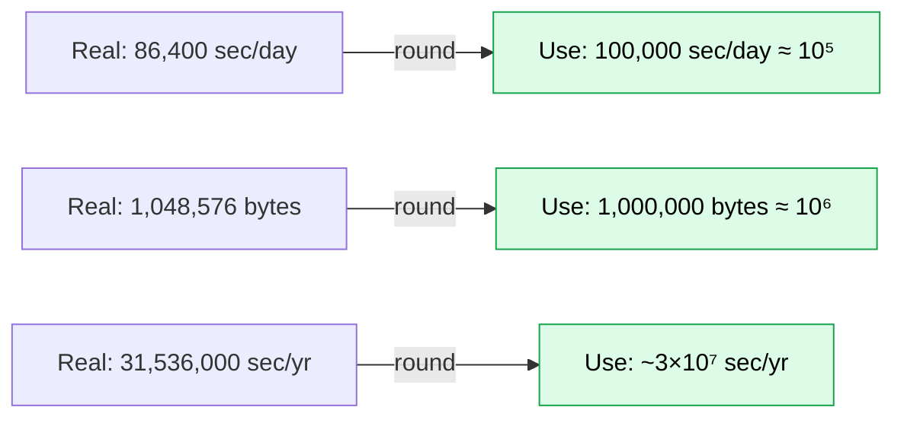

Spending 20 minutes computing `1024 × 1024` instead of `1,000,000` is the classic rookie mistake. The 5% error is irrelevant; the lost time and broken flow are not.

---

## 3. The Numbers Every Engineer Must Memorize

### Powers of 10 (the SI ladder)

| Power | Name | Symbol | "Feels like…" |
|------:|------|:------:|---------------|
| 10³ | Thousand | K | a paragraph of text |
| 10⁶ | Million | M | a hi-res photo, an MP3 song |
| 10⁹ | Billion | G | a 1080p movie, laptop RAM |
| 10¹² | Trillion | T | a large SSD — *fits on one disk* |
| 10¹⁵ | Quadrillion | P | a data-center cluster — *must distribute* |

### Data size building blocks

| Item | Rough size |
|------|-----------|
| `char` / 1 ASCII byte | 1 B |
| Integer / timestamp | 4–8 B |
| UUID | 16 B (36 B as string) |
| A tweet / short text row | ~ 0.3–1 KB |
| A typical web page (HTML) | ~ 100 KB |
| A compressed photo | ~ 200 KB – 2 MB |
| One minute of HD video | ~ 50 MB |

### Time, rounded

| Period | Seconds | Use |
|--------|---------|-----|
| 1 day | 86,400 | **≈ 10⁵ (100k)** |
| 1 month | ~2.6M | **≈ 2.5 × 10⁶** |
| 1 year | ~31.5M | **≈ 3 × 10⁷** |

### Availability ("the nines") — memorize the downtime budget

| SLA | Downtime / year | Downtime / day |
|-----|-----------------|----------------|
| 99% ("two nines") | 3.65 days | 14.4 min |
| 99.9% ("three nines") | 8.76 hours | 1.44 min |
| 99.99% ("four nines") | 52.6 min | 8.6 sec |
| 99.999% ("five nines") | 5.26 min | 0.86 sec |

> Each "nine" costs roughly 10× more to achieve. See [SLA_SLO_SLI.md](./SLA_SLO_SLI.md).

---

## 4. The Estimation Funnel (the repeatable recipe)

Every capacity estimate follows the same top-down flow. Memorize this funnel and you can estimate *any* system.


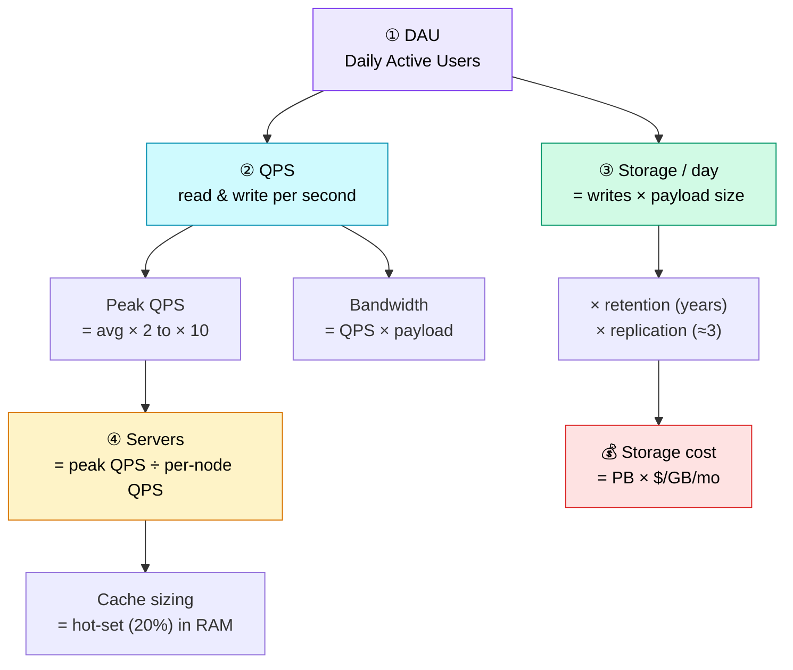

### The four steps, explained

**① Start with DAU (Daily Active Users).** This is your single anchor input. Everything else is derived from it. Ask the interviewer for it; if they won't say, propose one (e.g., 100M) and state your assumption out loud.

**② Derive QPS (Queries Per Second).**
```
actions/day  = DAU × actions_per_user_per_day
avg QPS      = actions/day ÷ 100,000      (seconds in a day, rounded)
peak QPS     = avg QPS × peak_factor       (2× for steady apps, 10× for spiky)
```
Always split **read QPS vs write QPS** — they hit different systems (caches/replicas vs the leader). A typical social app is read-heavy, often **100:1 reads:writes**.

**③ Estimate Storage.**
```
storage/day        = write_QPS_per_day × avg_payload_size
storage_over_time  = storage/day × 365 × retention_years
real_storage       = storage_over_time × replication_factor (usually 3×)
```
> ⚠️ **Never forget the 3× replication multiplier and metadata overhead.** This is the #1 thing juniors miss.

**④ Derive Servers, Bandwidth & Cache.**
```
servers     = peak_QPS ÷ QPS_one_node_handles   (e.g. ~1k QPS/node app server)
bandwidth   = QPS × payload_size                 (bytes/sec → check NIC limits)
cache_RAM   = hot_set_size (≈ 20% of working data)
```

---

## 5. Latency Numbers, Made Human

You cannot reason about performance without internalizing **how much slower each layer is than the one above it.** These are the famous "Latency Numbers Every Programmer Should Know" (Jeff Dean / Peter Norvig), scaled into human time so they actually *mean* something.

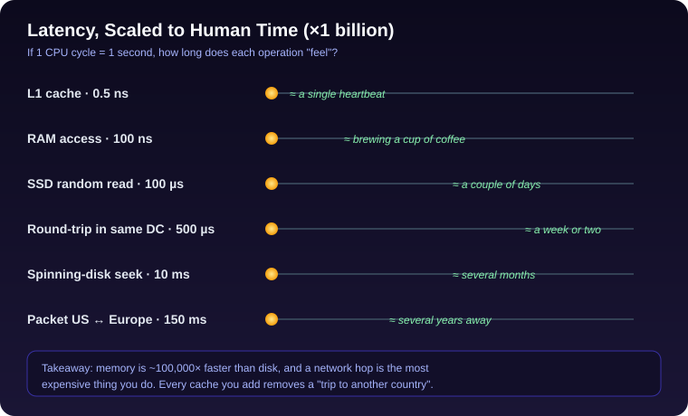

| Operation | Real latency | If 1 ns = 1 second… |
|-----------|-------------:|---------------------|
| L1 cache reference | 0.5 ns | half a second |
| Branch mispredict | 5 ns | 5 seconds |
| L2 cache reference | 7 ns | 7 seconds |
| Mutex lock/unlock | 25 ns | 25 seconds |
| **Main memory (RAM) reference** | **100 ns** | **~1.5 minutes** |
| Compress 1 KB (Zippy/Snappy) | 3 µs | ~1 hour |
| Send 1 KB over 1 Gbps network | 10 µs | ~3 hours |
| **SSD random read** | **100 µs** | **~1 day** |
| Read 1 MB sequentially from RAM | 250 µs | ~3 days |
| **Round trip within same datacenter** | **500 µs** | **~6 days** |
| Read 1 MB sequentially from SSD | 1 ms | ~11 days |
| **Disk seek (spinning HDD)** | **10 ms** | **~4 months** |
| Read 1 MB sequentially from disk | 20 ms | ~8 months |
| **Packet round trip CA ↔ Netherlands** | **150 ms** | **~5 years** |

### The three lessons baked into this table

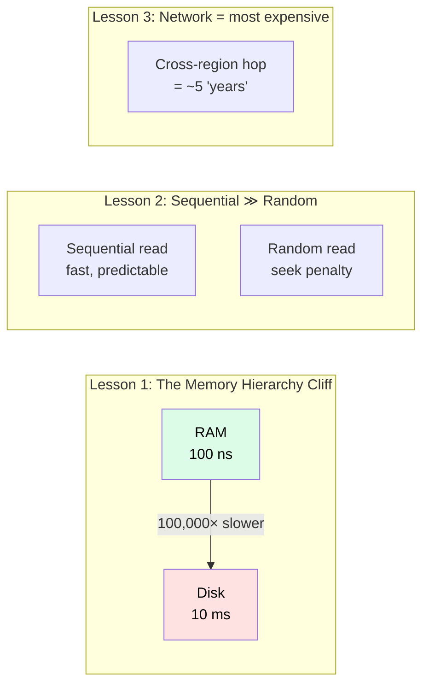

1. **Memory is ~100,000× faster than disk.** This is *why caches exist.* Every cache hit saves a "trip to disk" that, in human terms, is months long.
2. **Sequential access crushes random access.** Databases, log-structured storage (LSM trees), and Kafka are all designed around turning random writes into sequential ones.
3. **The network is the most expensive thing you do.** A cross-continent round trip is ~5 "years." This is why CDNs, edge caching, and data locality matter so much.

---

## 6. The 80/20 Rule & Why Caches Exist

The **Pareto Principle**: roughly **20% of your data serves 80% of your traffic.** A small set of "hot" items (viral tweets, trending videos, popular products) absorbs the bulk of requests.


This single observation is the entire justification for a caching layer:

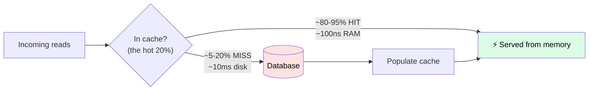

**Worked sizing example:**
```
Working set         = 320 GB
Hot set (20%)       = 64 GB
→ A single 64 GB Redis/Memcached node can front the whole hot set.
→ At a 90% hit rate, you cut DB load by 10× and p99 latency from ~10ms to ~1ms.
```

That `64 GB` number — derived in 10 seconds of BotE math — is exactly what you put in your capacity plan. See [Capacity_Planning.md](./Capacity_Planning.md) and the caching chapter ([06_Caching_Performance](../06_Caching_Performance/)).

---

## 7. Worked Example A — Design Twitter

> *The canonical interview question. Let's estimate it end-to-end.*

**Assumptions (state these out loud):**
- 300M Monthly Active Users → **~150M DAU**
- Each user posts **~2 tweets/day** on average
- Each user reads their timeline **~5 times/day**, each load = ~20 tweets
- Average tweet = **~300 bytes** of text + metadata; 10% include media (~1 MB)
- Retention: **5 years**, replication factor **3×**

### Step ② — QPS

```
Writes (new tweets):
  150M users × 2 tweets = 300M tweets/day
  300M ÷ 100,000 sec    = 3,000 write QPS (avg)
  Peak (×2)             ≈ 6,000 write QPS

Reads (timeline loads):
  150M × 5 loads        = 750M loads/day
  750M ÷ 100,000        = 7,500 read QPS (avg)
  Peak (×2)             ≈ 15,000 read QPS
```
> **Read:write ≈ 2.5:1 on loads — but each load returns ~20 tweets, so actual tweet-reads dwarf writes.** This screams: *fan-out, cache timelines, use read replicas.*

### Step ③ — Storage

```
Text per day:   300M tweets × 300 B  = 90 GB/day
Media per day:  300M × 10% × 1 MB    = 30 TB/day   ← media dominates!
Total/day      ≈ 30 TB/day

Over 5 years:   30 TB × 365 × 5      ≈ 55 PB
× 3 replicas:                        ≈ 165 PB
```

### Step ④ — Architecture conclusions

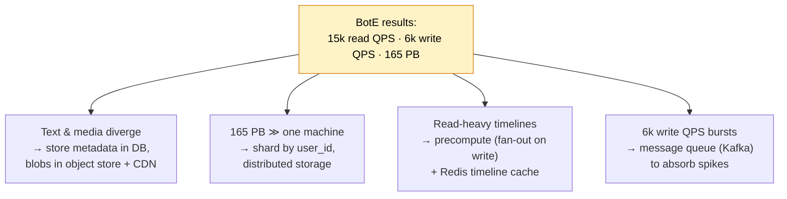

The math *forced* every major decision: sharding, object storage + CDN, timeline caching, and a write buffer. That's the power of BotE.

---

## 8. Worked Example B — Design a URL Shortener

> *A storage-and-read-ratio problem — different shape from Twitter.*

**Assumptions:** 100M new URLs/month, 100:1 read:write ratio (people click far more than they create), each record ~500 B, retention 10 years.

```
Writes:  100M ÷ (30 × 100,000 sec) ≈ 33 write QPS    (tiny!)
Reads:   33 × 100                  ≈ 3,300 read QPS
Peak reads (×2)                    ≈ 6,600 QPS

Storage/yr:  100M × 12 × 500 B     = 600 GB/yr
Over 10 yr:  600 GB × 10           = 6 TB
× 3 replicas                       = 18 TB
```

**Conclusion:** Writes are trivial. The whole **6 TB fits comfortably** — *no sharding needed for years*. The design is dominated by **read latency**: front it with a cache (the 80/20 rule applies — a few links go viral) and you're done. This is why a URL shortener is "easy" — the BotE math proves it.

> 💡 *Notice how the same recipe produced opposite conclusions: Twitter needs a 165 PB distributed fleet; a URL shortener fits on a couple of disks. **The math, not intuition, told you which.***

---

## 9. Worked Example C — Netflix / Video Streaming

**Why central streaming is physically impossible:**

```
200M users, assume 10% watching at peak = 20M concurrent streams
Average stream bitrate (HD)             ≈ 5 Mbps
Total egress = 20M × 5 Mbps             = 100,000,000 Mbps
                                        = 100 Tbps  (terabits/sec)
```

**100 Tbps** is more bandwidth than entire countries' internet exchanges can carry, let alone a single datacenter's egress. The BotE math *proves* you cannot serve video from a central origin.

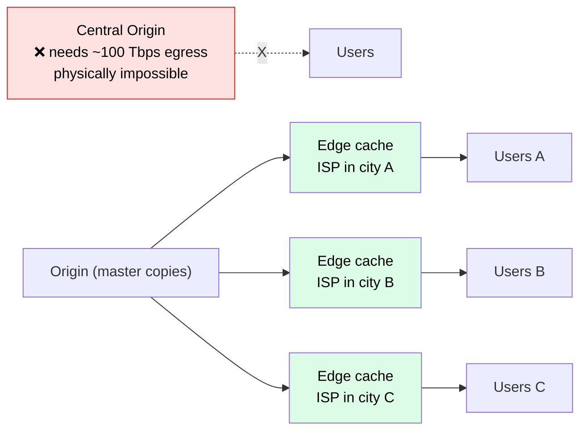

This is precisely why Netflix built **Open Connect** — placing CDN appliances *inside* ISP networks so the popular 20% of content (80/20 rule again!) streams from a box meters away from the viewer. **BotE math is the origin story of the entire CDN industry.**

---

## 10. Real-Life Use Cases (beyond interviews)

BotE is not just an interview trick — it is a daily working tool:

| Scenario | The estimate that saves you |
|----------|------------------------------|
| **Picking a database** | "We'll do 50k write QPS." A single Postgres leader tops out ~10k → you *know* to evaluate Cassandra/DynamoDB/sharding *before* a migration crisis. |
| **Cloud bill sanity check** | "Logs = 5 TB/day × 90-day retention = 450 TB. At S3 prices ≈ $10k/mo just for logs." Catches runaway costs in the design review, not the invoice. |
| **Capacity planning for a launch** | "Marketing expects 1M signups on launch day = ~12 signups/sec avg, but a 30× morning spike = ~350/sec. Provision and load-test for 350." |
| **Kafka partition sizing** | "1 GB/s ingest ÷ ~10 MB/s safe per partition = ~100 partitions minimum." (See [09_Message_Queues](../09_Message_Queues_Event_Streaming/).) |
| **'Will it fit in memory?'** | "100M users × 100 B session = 10 GB → yes, a single Redis node holds all sessions." |
| **Incident triage** | "p99 jumped to 200ms. That's a cross-region round trip — someone added a synchronous call to another region." The latency table tells you *where* to look. |
| **Index vs full scan** | "Table = 500M rows. A full scan reads ~500 GB from disk ≈ minutes. Must have an index." |

> The habit: **whenever someone proposes a design, silently run the funnel.** If a number lands in the wrong order of magnitude, you've found the risk before it ships.

---

## 11. Common Traps & Failure Modes

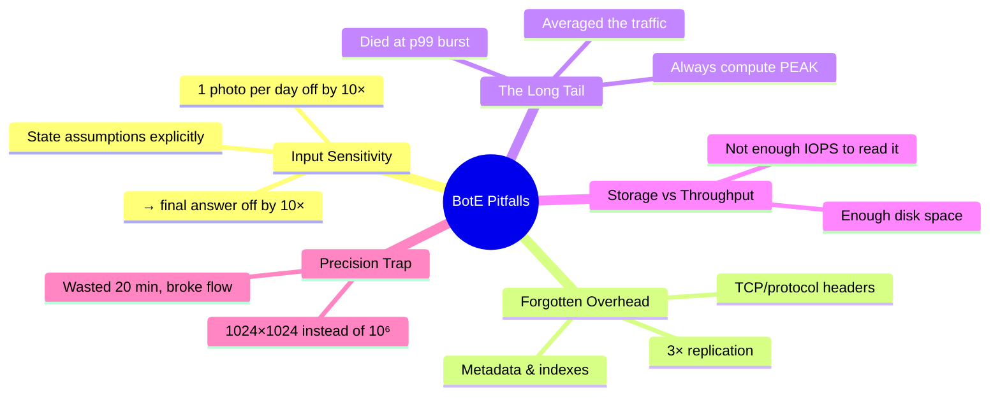

- **Input sensitivity** — Your output is only as good as your assumptions. If "1 photo/day" is really 10/day, everything downstream is off by 10×. *Say your assumptions out loud so they can be corrected.*
- **Forgetting overhead** — Real storage = raw data **× replication (≈3) × (1 + index/metadata overhead)**. Bandwidth includes protocol headers. Skipping these under-provisions by 3–4×.
- **Averaging away the spike** — Systems don't fail at average load; they fail at the **99th-percentile burst** (the "long tail"). Always carry a peak factor.
- **Storage ≠ throughput** — You can have room for 100 TB but not the **IOPS** to read it fast enough. Capacity and throughput are *separate* budgets.
- **Precision trap** — Round to powers of 10. Always.

---

## 12. Impact on Scalability, Reliability & Cost

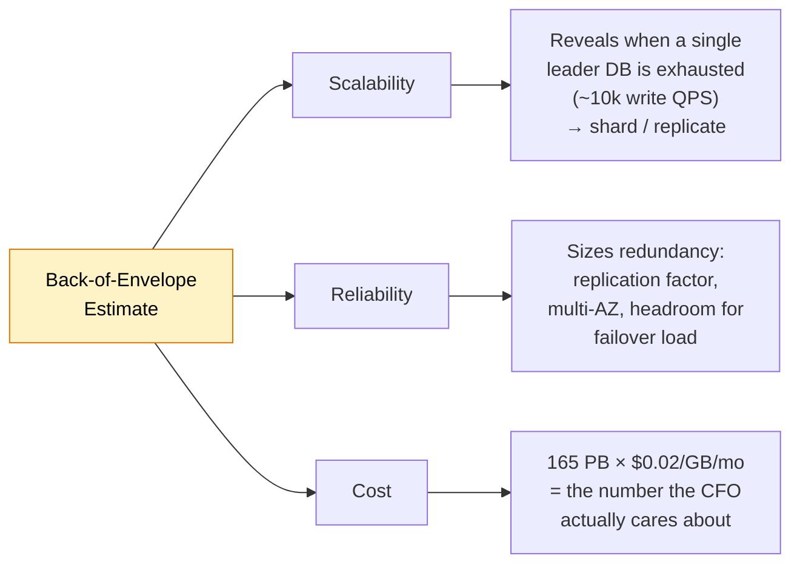

- **Scalability** — BotE tells you the *exact threshold* where a vertical solution dies and you must go horizontal. (Single-leader write ceiling ≈ 10k QPS is the classic trigger → see [Trade_off_Analysis.md](./Trade_off_Analysis.md) and sharding in [05_Databases_Storage](../05_Databases_Storage/).)
- **Reliability** — Replication factor (3×) and failover headroom are *capacity* decisions. If one of three nodes dies, the other two must absorb its load — did you leave room?
- **Cost** — Storage and egress dominate cloud bills at scale. `PB × $/GB/month` and `bandwidth × $/GB egress` are the two numbers that make or break a budget. BotE produces them in minutes.

---

## 13. Interview Playbook

**What interviewers are actually testing:** not arithmetic, but *whether you think in scale.* They want to see clean powers-of-10 math and the *judgment* of which estimate matters.

### The 5-minute script
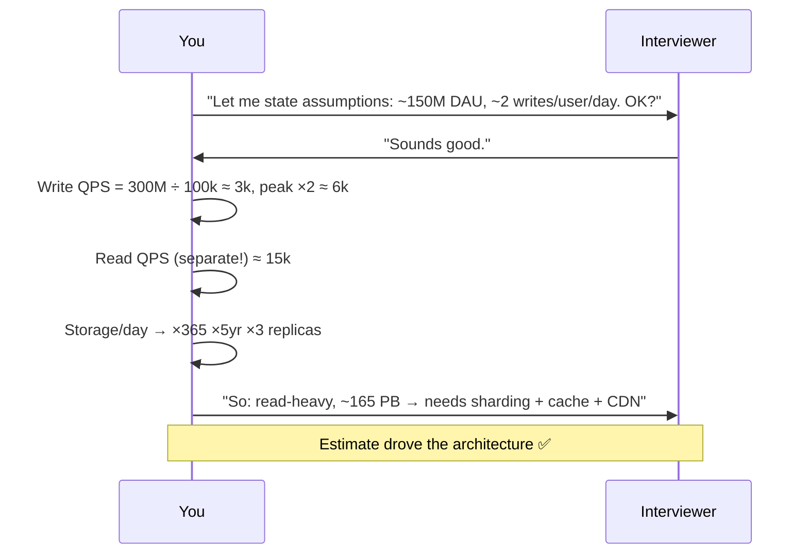

**✅ Do:**
- State every assumption out loud and get a nod before computing.
- Round hard: 86,400 → 100,000; 1 year → 3×10⁷ sec.
- **Separate reads from writes** — it shows you know they hit different systems.
- Always compute **peak**, not just average.
- End with **"so therefore…"** — connect the number to a design decision. The number alone is worthless; the *implication* is the point.

**🚩 Red flags (instant signal of inexperience):**
- Can't compute storage for 100M × 1KB records (it's ~100 GB — and ~300 GB with 3× replication).
- Forgetting the replication multiplier.
- Reaching for a calculator / computing `1024²`.
- Giving a number with no design conclusion attached.

**Must-know anchors:** RAM ≈ 100 ns · SSD read ≈ 100 µs · same-DC round trip ≈ 500 µs · disk seek ≈ 10 ms · cross-region ≈ 150 ms · day ≈ 10⁵ sec · year ≈ 3×10⁷ sec.

---

## 14. Cheat Sheet (print this)

```
┌─────────────────────── POWERS OF 10 ───────────────────────┐
│ K=10³  M=10⁶  G=10⁹  T=10¹²  P=10¹⁵   (each step = ×1000)   │
└─────────────────────────────────────────────────────────────┘

TIME (rounded)            DATA SIZES
  1 day  ≈ 100,000 sec      char .......... 1 B
  1 month≈ 2.5M sec         int/timestamp.. 4–8 B
  1 year ≈ 30M sec          UUID .......... 16 B
                            tweet/row ..... ~0.3–1 KB
                            web page ...... ~100 KB
                            photo ......... ~200 KB–2 MB
                            min of HD video ~50 MB

THE FUNNEL                 LATENCY (memorize!)
  DAU                        L1 cache ...... 0.5 ns
   → QPS = acts ÷ 10⁵        RAM ........... 100 ns
   → peak = avg × 2..10      SSD read ...... 100 µs
   → storage = QPS×size      same-DC RTT ... 500 µs
       × 365 × yrs × 3       disk seek ..... 10 ms
   → servers = peak÷node     cross-region .. 150 ms
   → cache = hot 20%

DON'T FORGET            │  AVAILABILITY
  × 3  replication      │   99%   → 3.65 days/yr down
  + index/metadata      │   99.9% → 8.76 hrs/yr
  PEAK not average      │   99.99%→ 52 min/yr
  reads ≠ writes        │   99.999→ 5 min/yr
```

---

## 🏋️ Practice Drills

> *Cover the solutions. Do the math out loud in powers of 10 — the goal is speed and the right order of magnitude, not precision.*

**Drill 1 — Instagram-style photo service.** 500M DAU, each uploads 2 photos/day at ~1.5 MB, photos kept 5 years with 3× replication. Estimate (a) write QPS, (b) daily storage, (c) 5-year storage.

<details><summary>Solution</summary>

(a) `500M × 2 = 1B uploads/day ÷ 100k sec ≈ 10k write QPS` (peak ×2 ≈ 20k). (b) `1B × 1.5 MB = 1.5 PB/day` raw. (c) `1.5 PB × 365 × 5 × 3 ≈ 8,200 PB ≈ 8 EB`. Conclusion: media dwarfs everything → object storage + CDN + aggressive tiering of cold photos.
</details>

**Drill 2 — Will it fit in RAM?** A session store holds 200M active sessions at ~500 bytes each. Does it fit on one 128 GB cache node?

<details><summary>Solution</summary>

`200M × 500 B = 100 GB`. Yes — fits on a single 128 GB node with headroom (but you'd still run 2+ for redundancy). This is exactly the kind of 10-second check that kills a "we need a distributed cache" over-design.
</details>

**Drill 3 — Bandwidth sanity.** A video service streams to 2M concurrent viewers at 5 Mbps each. How much egress, and what does that imply?

<details><summary>Solution</summary>

`2M × 5 Mbps = 10,000,000 Mbps = 10 Tbps`. Far beyond any single origin's egress → you *must* use a CDN / edge caching. The math forces the architecture (see [Worked Example C](#9-worked-example-c--netflix--video-streaming)).
</details>

**Drill 4 — The cost line.** You computed 8 EB of storage. At ~$0.02/GB/month, what's the monthly bill, and what do you do about it?

<details><summary>Solution</summary>

`8 EB = 8 × 10⁹ GB × $0.02 ≈ $160M/month`. Absurd → tier 80% of cold photos to cheaper archival storage (~$0.004/GB), drop replication on cold tier, and compress. BotE surfaced a budget crisis before a line of code.
</details>

---

## 🎤 Interview Q&A Bank

**Q1. How much storage for 100M records of 1 KB each?**
> `100M × 1 KB = 100 GB` raw, ~300 GB with 3× replication. (Being unable to do this instantly is a classic red flag.)

**Q2. How many seconds in a day, and why does the rounding matter?**
> 86,400, which I round to 10⁵ (100k). The ~15% error is irrelevant for order-of-magnitude work, and it keeps the math fast and mental.

**Q3. Why multiply by a peak factor?**
> Traffic isn't uniform — it clusters (lunchtime, evenings, events). Systems fail at the peak second, not the daily average. I use 2–5× for steady apps, 10×+ for spiky events.

**Q4. What overheads do juniors forget in storage estimates?**
> Replication (usually 3×), index/metadata overhead, and protocol headers on bandwidth. Forgetting replication alone under-provisions by 3×.

**Q5. Walk me through estimating QPS for a 100M-DAU app.**
> `100M × ~10 actions = 1B/day ÷ 100k sec ≈ 10k avg QPS`, peak ×2.5 ≈ 25k. Then I split reads vs writes since they hit different systems.

**Q6. When does estimation tell you to shard?**
> Roughly when write QPS exceeds a single leader's ceiling (~10k) or when total storage exceeds one machine's capacity (TB→PB boundary).

**Q7. SSD vs disk — why care in an estimate?**
> Random reads: SSD ~100 µs vs disk ~10 ms — a 100× difference. If my access pattern is random and large, that decides the storage medium and whether I need a cache.

---

## 🎯 Staff+ Nuances

- **Estimates are inputs to decisions, not deliverables.** The number itself is worthless; the *"...so therefore we shard / cache / use a CDN"* is the entire point. Always close the loop from number → architectural consequence.
- **Sensitivity analysis beats precision.** A staff engineer asks "which assumption, if wrong by 10×, breaks the design?" — and pressure-tests *that* one. Usually it's payload size or the peak factor, not the user count.
- **Throughput and storage are independent budgets.** You can have petabytes of space but lack the IOPS to read it. Always estimate *both* capacity and access rate; the bottleneck is whichever saturates first (ties into [Capacity_Planning.md](./Capacity_Planning.md)).
- **The "hot set" is what actually sizes your cache and RAM.** Total data size is almost irrelevant for cache planning — the 20% hot set is. Confusing the two leads to wildly over-sized (or useless) caches.
- **Amortize, then check the spike.** Daily averages hide flash-crowd events. The dangerous number is the 99th-percentile *second*, not the mean — a system can be fine on paper and die at noon (see [QPS_TPS_Estimation.md](./QPS_TPS_Estimation.md)).
- **Re-estimate at each order of magnitude.** A design valid at 1M users often breaks at 10M and again at 100M. The assumptions (single leader, one cache node, fan-out-on-write) silently expire; revisit the math at every 10× of growth.

---

## 18. Connections & Further Reading

**Within this repo:**
- [QPS_TPS_Estimation.md](./QPS_TPS_Estimation.md) — deeper dive on the QPS step.
- [Capacity_Planning.md](./Capacity_Planning.md) — turning estimates into provisioning plans.
- [Constraints_Assumptions.md](./Constraints_Assumptions.md) — how to choose the assumptions you feed the funnel.
- [SLA_SLO_SLI.md](./SLA_SLO_SLI.md) — the "nines" and downtime budgets.
- [Trade_off_Analysis.md](./Trade_off_Analysis.md) — using estimates to choose between designs.
- [05_Databases_Storage](../05_Databases_Storage/) · [06_Caching_Performance](../06_Caching_Performance/) · [07_Load_Balancing_Scalability](../07_Load_Balancing_Scalability/) — where the estimates lead.

**External classics:**
- *Latency Numbers Every Programmer Should Know* — Jeff Dean / Peter Norvig (the interactive "colin scott" visualization).
- *Designing Data-Intensive Applications* — Martin Kleppmann (Ch. 1 on scalability metrics).
- *System Design Interview* Vol. 1 — Alex Xu (the "Back-of-the-envelope estimation" chapter).
- *High Scalability* blog — real-world capacity write-ups.

---

## TL;DR

Back-of-the-envelope estimation is your **engineering compass.** It won't give you exact coordinates, but in five minutes it tells you whether you're heading toward a workable system or off a cliff — and it makes every downstream decision (shard or not, cache or not, CDN or not, $5k or $5M) *fall out of the math* instead of out of a hunch.

> **Master the funnel (DAU → QPS → Storage → Servers), memorize the latency table, never forget the ×3 and the peak factor, and always end with "so therefore…"**
