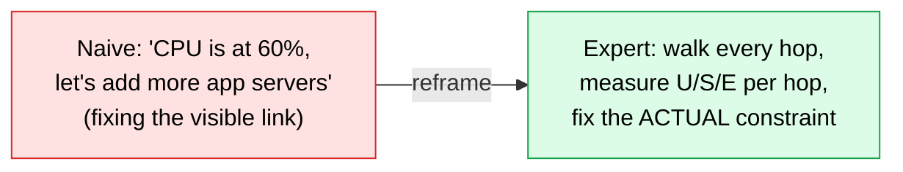
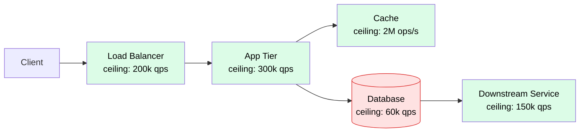
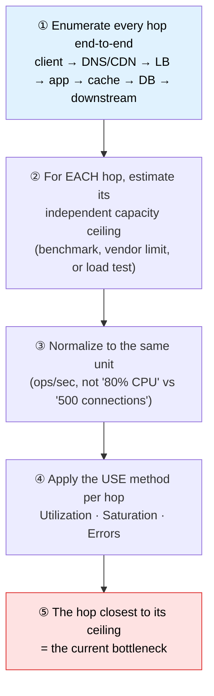
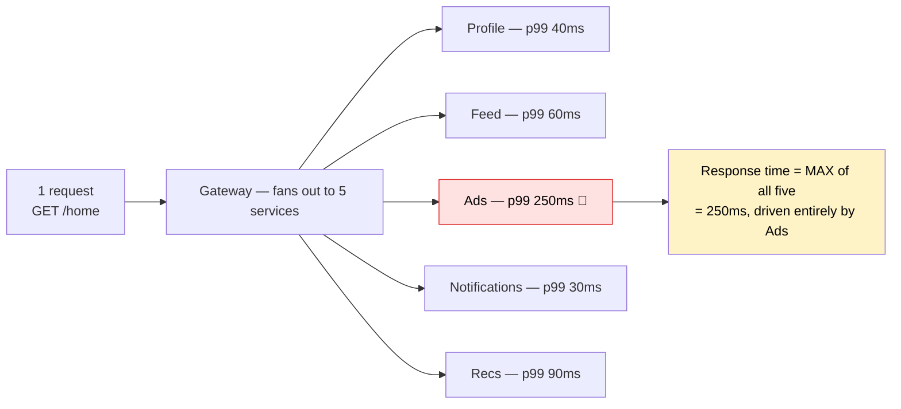
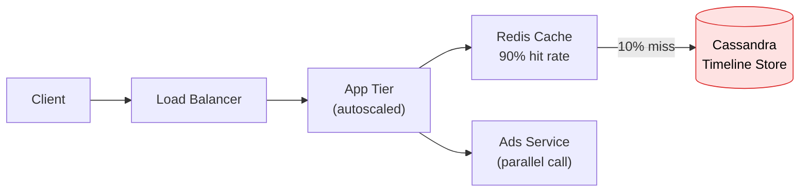
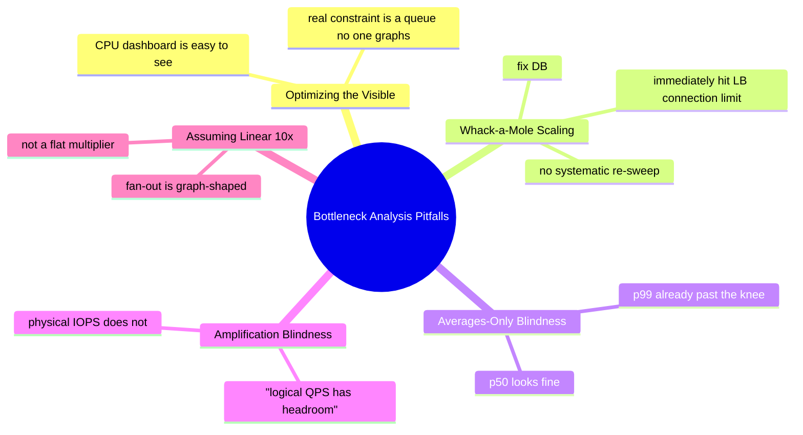

# Bottleneck Analysis

> **One line:** A system's throughput ceiling is set by exactly **one** component — the rest is decoration; find that component before you optimize anything, or you're just rearranging deck chairs.

---

## Table of Contents
1. [Why You Must Master This](#1-why-you-must-master-this)
2. [The Mental Model](#2-the-mental-model)
3. [The Method — Walk the Request Path](#3-the-method--walk-the-request-path)
4. [The USE Method](#4-the-use-method)
5. [Read vs Write Amplification](#5-read-vs-write-amplification)
6. [Fan-Out Multipliers & Tail Latency](#6-fan-out-multipliers--tail-latency)
7. ["What Breaks First at 10×/100×?" — The Interview Move](#7-what-breaks-first-at-10100--the-interview-move)
8. [Worked Example — Social Feed at 10×](#8-worked-example--social-feed-at-10)
9. [Real-Life Use Cases](#9-real-life-use-cases)
10. [Failure Modes](#10-failure-modes)
11. [🏋️ Practice Drills](#-practice-drills)
12. [🎤 Interview Q&A Bank](#-interview-qa-bank)
13. [🎯 Staff+ Nuances](#-staff-nuances)
14. [Cheat Sheet](#14-cheat-sheet)
15. [Connections & Further Reading](#15-connections--further-reading)

---

## 1. Why You Must Master This

- **It's the interviewer's favorite follow-up.** Every well-run system-design interview eventually asks *"OK — where does this break first, and what's your bottleneck?"* Candidates who can only describe boxes and arrows stall here; candidates with a method answer in 30 seconds with numbers.
- **Theory of constraints, applied to systems.** Goldratt's manufacturing insight transfers exactly: a production line's output is capped by its slowest station, and speeding up any *other* station does **nothing** — the finished-goods rate doesn't move. Distributed systems obey the same law: doubling your app-server fleet while the database connection pool is the constraint buys you **zero** extra throughput.
- **Money and time get wasted on the wrong fix.** Teams routinely 2x the component that's easiest to see on a dashboard (CPU, usually) while the real ceiling — a saturated thread pool, a single-leader database, a downstream service's rate limit — sits untouched. This is the single most common root cause of "we scaled it and nothing changed."
- **It's a chain, not a sum.** A request path with ten hops, nine of which run at 20% utilization and one at 95%, has the throughput ceiling of the 95% hop — full stop. Headroom everywhere else is irrelevant until that one hop is fixed.

> **The core problem it solves:** *knowing WHICH component to fix.* Without a systematic method, engineers optimize the component they can see, understand, or own — not necessarily the one that's actually constraining the system.

**Prerequisites:** [QPS_TPS_Estimation.md](./QPS_TPS_Estimation.md) (the saturation "knee" and Little's Law — this file turns those ideas into a repeatable walk of the request path) and [Capacity_Planning.md](./Capacity_Planning.md) (the four resource dimensions and the "invisible bottleneck" — this file gives the general method that finding one instance of it deserves).

---

## 2. The Mental Model

Think of the request path as a **chain of links**, not a pile of parts. A chain's strength is the strength of its **weakest link** — reinforcing every other link changes nothing about where it snaps. The naive instinct is to strengthen the link you can *see* is under stress (usually CPU, because every dashboard shows it by default); the expert move is to find the link that is actually closest to its own breaking point, which is very often a link nobody put a dashboard on.





> **Hold onto this:** the system's throughput ceiling equals the **minimum** of every hop's independent ceiling, not the average and not the sum. In the diagram above it doesn't matter that the cache can do 2M ops/sec — the whole system tops out at 60k qps, the database's ceiling.

---

## 3. The Method — Walk the Request Path

Bottleneck analysis is a **sweep**, not a guess. Skipping a hop is exactly how the "invisible bottleneck" from [Capacity_Planning.md §10](./Capacity_Planning.md#10-failure-modes--the-invisible-bottleneck) gets missed.



1. **Draw the full path** — not just the boxes you own. Client → DNS/CDN → load balancer → API gateway → application tier → cache → primary database (and its replicas) → message queue → every downstream/third-party service the request touches. Skipping a hop because "it's someone else's service" is exactly how a partner API's rate limit becomes your incident.
2. **Estimate each hop's ceiling independently.** Don't infer one hop's limit from another's; a load balancer rated for 200k qps tells you nothing about the database behind it. Use vendor specs, a single-node benchmark (see [Capacity_Planning.md §3](./Capacity_Planning.md#3-the-method--step-by-step)), or a load test that isolates that one hop.
3. **Normalize units.** "500 max connections," "80% CPU," and "10k IOPS" aren't comparable until you convert them to the same currency — usually **requests/sec at the SLO latency**, since that's the unit the whole system is measured in.
4. **Score each hop with USE** (next section) — a hop can look fine on utilization alone and still be the bottleneck because it's saturated or erroring.
5. **The bottleneck is the hop with the least headroom to its ceiling right now** — not the hop that's hardest to scale, not the hop your team owns, not the hop with the prettiest dashboard.

---

## 4. The USE Method

Brendan Gregg's **USE method** (Utilization, Saturation, Errors) is the systematic checklist for step 4 above — for *every* resource, ask all three questions, because each catches a different failure that the others miss.

| Letter | Precise definition | What it catches | Misses if you skip it |
|--------|--------------------|------------------|------------------------|
| **U — Utilization** | Average % of time the resource was busy doing useful work over a window | Sustained load, capacity headroom | A resource can be 100% utilized and *not* be a problem (e.g., a batch job saturating a spare core) |
| **S — Saturation** | The amount of extra work queued that the resource *couldn't* service immediately — queue depth, run-queue length, backlog | The resource is already past its comfortable ceiling even if utilization looks moderate | This is the one most dashboards omit — and it's usually the earliest warning of the knee from [QPS_TPS_Estimation.md §5](./QPS_TPS_Estimation.md#5-the-saturation-curve--the-knee) |
| **E — Errors** | Count of error events — rejections, timeouts, retries, dropped packets | Hard failures that utilization/saturation alone won't show (e.g., a connection pool that fails fast instead of queuing) | A resource can show low utilization *because* it's rejecting work before it's ever counted as "busy" |

**Per-resource cheat table — the tool/metric that answers each letter:**

| Resource | Utilization | Saturation | Errors |
|----------|-------------|------------|--------|
| **CPU** | `mpstat` / `top` — % busy across cores | Run-queue length vs core count (`vmstat` `r` column); load average ≫ core count | Rare directly; shows up as context-switch storms or throttling (cgroup CPU throttling %) |
| **Disk** | `iostat -x` `%util` | `iostat -x` `avgqu-sz` (average queue depth) | Device I/O errors, `EIO`, SMART pre-fail counters |
| **Network** | `sar -n DEV` — bytes/sec ÷ NIC rated bandwidth | NIC ring-buffer drops, TCP retransmit rate, socket backlog (`netstat -s`) | Packet drops, CRC errors, `ECONNRESET` counts |
| **DB connection pool** | Active connections ÷ pool max | Threads/requests *waiting* for a free connection (pool wait-queue depth) | "Too many connections," connection-acquisition timeouts |
| **Thread pool / executor** | Active threads ÷ pool size | Work-queue length (e.g., `ThreadPoolExecutor` queue size climbing) | `RejectedExecutionException`, HTTP 503s from load shedding |
| **Message queue / topic** | Consumer throughput ÷ producer throughput | Consumer lag (offset delta), backlog size | Dead-letter rate, publish timeouts |

> **Why all three matter together:** a database can show 40% CPU utilization (looks fine) while its connection pool has a 200-request wait queue (badly saturated) and is throwing "connection timeout" errors on 5% of requests. Utilization alone would have cleared it as healthy — this is exactly the invisible-bottleneck trap from [Capacity_Planning.md §10](./Capacity_Planning.md#10-failure-modes--the-invisible-bottleneck).

---

## 5. Read vs Write Amplification

The **logical** operation rate your application issues and the **physical** operation rate a component actually performs can differ by an order of magnitude or more — and the bottleneck lives wherever the *physical* rate lands, not the logical one.

**Amplification factor** = physical operations triggered ÷ one logical operation.

| Logical operation | Physical multiplier | Real mechanism |
|--------------------|---------------------|-----------------|
| 1 row `INSERT` with 5 secondary indexes | ×6 writes | 1 heap-page write + 5 B-tree index writes (each index is its own physically-ordered structure that must be updated) |
| 1 write to an LSM-tree store (Cassandra, RocksDB) | ×10–30 over time | Compaction rewrites the same logical key many times as it merges SSTable levels — "write amplification" is a named, measured metric in every LSM engine |
| 1 write with replication factor 3 | ×3 physical writes (+ quorum acks) | Every logical write is shipped to N replicas before it's durable; RF=3 literally triples disk and network write load |
| 1 social-media post from a user with 10M followers | up to ×10,000,000 | Fan-out-on-write pushes a copy of the post ID into every follower's precomputed timeline — the "celebrity problem" |
| 1 "find nearby drivers" query on an unindexed geo field | ×(table size) reads | A missing index turns one logical query into a full scan — read amplification from a schema gap, not a fan-out |
| 1 cache-miss request | ×(number of backend calls needed to rebuild the value) | A single miss can trigger several downstream reads/joins to reconstruct the cached object |

> **Why this matters for bottleneck analysis specifically:** your monitoring might show "the app issues 5,000 writes/sec — well under any ceiling." But if each write touches 3 indexes and is replicated 3×, the database's **disk** is absorbing `5,000 × 6 × 3 = 90,000` physical I/Os/sec. If that disk's ceiling is 40,000 IOPS, the database *is* the bottleneck — and nothing in the "logical QPS" number would have told you that. Always ask *"amplified by what?"* before declaring a component has headroom.

---

## 6. Fan-Out Multipliers & Tail Latency

[QPS_TPS_Estimation.md §7](./QPS_TPS_Estimation.md#7-fan-out-why-internal-qps--user-qps) already showed *why* internal QPS explodes past user-facing QPS. Here the question is different: **once you know the internal QPS, which downstream service becomes the bottleneck first — and how does fan-out also punish latency, not just throughput?**



**Throughput angle:** once fan-out has multiplied user QPS into internal QPS per downstream (e.g., 500 user-qps × varying fan-out to each service), line up each downstream's ceiling against *its own* incoming load — not the user-facing number. The service with the least headroom relative to its own ceiling is the one that breaks first, and it's rarely the one with the biggest raw traffic number.

**Latency angle — order statistics make tail latency the norm at scale.** A parallel fan-out's response time is the **maximum** of all branches, not the average. If a single call has a 1% chance of exceeding your latency budget, the odds that *at least one* of N parallel calls exceeds it are:

```
P(at least one slow) = 1 − (1 − p)^N

p = 1%, N = 1    →  1%
p = 1%, N = 10   →  1 − 0.99¹⁰  ≈ 9.6%
p = 1%, N = 100  →  1 − 0.99¹⁰⁰ ≈ 63%
```

> At a fan-out of 100 parallel calls, a "rare" 1%-tail event becomes the **common case** for the aggregate request. This is why the bottleneck for *user-perceived latency* is often not the service with the worst average, but the service with the fattest tail multiplied by the widest fan-out. Mitigations — hedged requests, timeouts + fallback, reducing fan-out width — are latency-bottleneck fixes, distinct from throughput fixes.

---

## 7. "What Breaks First at 10×/100×?" — The Interview Move

This is the direct, repeatable answer to the question every interviewer eventually asks. Treat it as a checklist you narrate out loud:

```
① List every hop from step 3's method, with TODAY'S load and TODAY'S ceiling.
② Compute today's headroom per hop:  headroom = ceiling ÷ current_load
③ Project load at 10× (and 100×) — but don't assume linear scaling blindly:
     • stateless tiers (LB, app servers) scale ~linearly with node count
     • fan-out-driven load (celebrity posts, graph traversals) can scale
       SUPER-linearly — it depends on the shape of the graph, not just QPS
     • fixed infrastructure (a single-leader DB, a third-party rate limit)
       does NOT scale at all without a re-architecture
④ For each hop, find the multiplier at which projected_load = ceiling.
⑤ The hop with the SMALLEST breaking multiplier is what breaks first.
⑥ State it as a sentence with numbers: "At ~12×, the Cassandra read
   tier crosses its 60k qps ceiling before anything else — here's the fix."
```

> **What to actually say in the room:** name the component, show the arithmetic that gets you there, and immediately pair it with a mitigation ("shard the DB," "raise cache hit rate," "async the write path"). A confident wrong number beats a vague "it depends" — the interviewer is scoring your *method*, not whether you memorized the exact ceiling of a real Cassandra cluster.

---

## 8. Worked Example — Social Feed at 10×

**System:** a home-timeline feed, `GET /home`, currently serving **20,000 QPS** user-facing. Timelines are precomputed via fan-out-on-write; a Redis cache holds hot timelines with a 90% hit rate; cache misses fall through to a Cassandra cluster that stores per-user timelines.



| Hop | Current ceiling | Current load | Headroom | Load at 10× | Breaks at ~ | Verdict |
|-----|-----------------|---------------|----------|--------------|-------------|---------|
| Load balancer | 200,000 qps | 20,000 qps | 10× | 200,000 qps | ~10× | Exactly at ceiling, not yet broken |
| App tier (autoscaled, 800 qps/node) | scales with nodes | 20,000 qps | effectively unbounded (cost aside) | 200,000 qps | — | Not the constraint; autoscaling absorbs it |
| Redis cache (5-shard cluster) | 2,000,000 ops/sec | 100,000 ops/sec (5 ops/request × 20k) | 20× | 1,000,000 ops/sec | ~40× | Comfortable |
| **Cassandra read tier** (cache-miss reads) | **60,000 qps** | 10,000 qps (10% miss × 5 fan-out ops) | **6×** | **100,000 qps** | **~6×** | **Breaks first** |
| Ads service (parallel, per-request) | 150,000 qps | 20,000 qps | 7.5× | 200,000 qps | ~7.5× | Second to break |

**The arithmetic:** a cache miss on the home load isn't one Cassandra read — it fans out to roughly 5 physical reads per miss (timeline shard + 3 metadata lookups + a counter read). At today's 10% miss rate, that's `20,000 × 0.10 × 5 = 10,000 qps` hitting Cassandra against a measured cluster ceiling of 60,000 qps — only **6× headroom**. Every other hop in the path has 7.5×–40× headroom or scales elastically.

> **X is the bottleneck because Y:** the **Cassandra read tier is the bottleneck at 10×**, because read amplification (5 physical reads per logical miss) leaves it with the *smallest* multiplier to its ceiling (6×) of any hop in the path — it breaks before the load balancer, the app tier, the cache, or even the ads service. The fix that matters is raising the cache hit rate (bigger cache, longer TTL, or a second-tier cache) or adding Cassandra read replicas — not adding more app servers, which is the naive first instinct and would spend money against a hop that was never the constraint.

---

## 9. Real-Life Use Cases

| Situation | How bottleneck analysis applies | The decision it forces |
|-----------|----------------------------------|-------------------------|
| **APM dashboards (Datadog, New Relic, Grafana)** | Pre-built USE dashboards surface utilization/saturation/errors per host and per resource side by side | Which panel is closest to red *right now* — not which one is biggest |
| **Profiling a slow endpoint** | A flame graph shows where wall-clock time is spent per request; combined with USE on the resources it touches | Whether the slowness is CPU-bound code or a saturated downstream dependency |
| **Quarterly capacity reviews** | Re-run the request-path walk with updated traffic projections | Which hop needs budget/headcount *this* quarter, not the one that's loudest |
| **Incident postmortems** | "What actually saturated first?" reconstructed from USE metrics at the time of the incident | Whether the fix is a config change, a scale-out, or an architecture change |
| **Load testing before a launch** | Ramp load and watch which resource's saturation metric bends first — that's the empirical bottleneck | Where to focus load-test iterations instead of guessing |
| **Chaos/game-day exercises** | Deliberately push one hop to its ceiling and observe whether the *expected* hop fails first | Validates (or corrects) the mental model of where the system's ceiling actually is |

> Real-world habit: when a dashboard says "everything looks fine" during a slow incident, the missing metric is almost always **saturation**, not utilization — go look for a queue depth before concluding there's no bottleneck.

---

## 10. Failure Modes



- **Optimizing the visible, not the saturated.** *Symptom:* team doubles the app-server fleet; latency doesn't improve. *Root cause:* CPU utilization was the only metric anyone looked at, while the real constraint — a database connection pool wait queue — was never measured. *Fix:* run the full USE sweep (§4) across every hop before spending on any single one.
- **Whack-a-mole scaling.** *Symptom:* fixing the database bottleneck immediately surfaces a load-balancer connection-limit error a week later. *Root cause:* the team fixed the one bottleneck it found without re-walking the *entire* path — the second-tightest hop was always going to become the new ceiling. *Fix:* treat step ⑤ of the method as iterative: after removing a bottleneck, re-run the sweep, because the new bottleneck is now whichever hop had the *second*-smallest headroom.
- **Averages-only blindness.** *Symptom:* "our p50 latency is 40ms, nothing's wrong" while users report timeouts. *Root cause:* saturation and tail latency (§6) are invisible in an average; a resource can be fine 95% of the time and pegged during the exact seconds that generate complaints. *Fix:* always pair utilization with saturation and p99/p999 latency, per [QPS_TPS_Estimation.md §11](./QPS_TPS_Estimation.md#11-failure-modes).
- **Amplification blindness.** *Symptom:* "we're only issuing 5k writes/sec, the DB should be fine." *Root cause:* nobody multiplied by index count, replication factor, or compaction overhead (§5) to get the *physical* rate the disk actually absorbs. *Fix:* always ask "amplified by what?" before declaring headroom from a logical rate alone.
- **Assuming linear scaling at 10×.** *Symptom:* the 10× projection says every hop has 3×+ headroom, then a viral post takes the system down at 4×. *Root cause:* fan-out-driven load (a celebrity's follower count, a graph traversal) scales with the *shape* of the data, not a flat multiplier applied to average QPS. *Fix:* model fan-out-sensitive hops against worst-case fan-out width (the biggest follower count, not the average), not just the average multiplied by 10.

---

## 🏋️ Practice Drills

> *Walk the path, apply USE, multiply by amplification — don't guess.*

**Drill 1 — USE method recall.** For a message-queue consumer group, name one concrete metric that answers Utilization, Saturation, and Errors respectively.

<details><summary>Solution</summary>

Utilization: consumer throughput ÷ available consumer capacity (or CPU busy % on the consumer). Saturation: consumer lag — the offset delta between the latest produced message and the latest committed offset, which grows when consumers can't keep up. Errors: dead-letter-queue rate or message-processing exception count. All three matter: a consumer group can show low CPU (utilization) while lag climbs into the millions (saturation) — CPU alone would miss the problem entirely.
</details>

**Drill 2 — Amplification math.** An application issues 8,000 writes/sec. Each write updates 4 secondary indexes and the table is replicated with RF=3. If the underlying disk's measured ceiling is 150,000 IOPS, is the disk the bottleneck?

<details><summary>Solution</summary>

Physical IOPS = `8,000 × (1 heap write + 4 index writes) × 3 replicas = 8,000 × 5 × 3 = 120,000 IOPS`. Against a 150,000 IOPS ceiling that's 80% utilization — not yet broken, but only 1.25× headroom, likely the tightest hop in the system and the first thing to re-check before scaling anything else.
</details>

**Drill 3 — Tail latency at fan-out.** A request fans out to 20 parallel downstream calls, each with a 2% chance of exceeding the latency SLO. What's the probability the aggregate request breaches its SLO, and what does that imply about where the "bottleneck" for latency actually is?

<details><summary>Solution</summary>

`P(at least one slow) = 1 − (1 − 0.02)^20 = 1 − 0.98^20 ≈ 1 − 0.668 ≈ 33%`. A third of aggregate requests will breach the SLO even though each individual call is "healthy" 98% of the time. The latency bottleneck here isn't any single downstream service — it's the *fan-out width itself*; reducing N or hedging the slowest calls does more than optimizing any one service's average latency.
</details>

**Drill 4 — Find the bottleneck at 10×.** Given: LB ceiling 100k qps / current 15k qps; App tier autoscales linearly (not a constraint); Cache ceiling 500k ops/sec / current 60k ops/sec; DB ceiling 20k qps / current 4k qps (with a 3× read-amplification factor already applied). At 10× user load, which hop breaks first and at roughly what multiplier?

<details><summary>Solution</summary>

Headroom multiples: LB = 100k ÷ 15k ≈ 6.7×; Cache = 500k ÷ 60k ≈ 8.3×; DB = 20k ÷ 4k = 5×. The DB has the smallest headroom multiplier (5×), so it crosses its ceiling first — before the LB or cache — meaning the system as a whole breaks at roughly **5×**, not 10×. The DB is the answer to "what breaks first," and it breaks *before* you even reach the 10× target load.
</details>

---

## 🎤 Interview Q&A Bank

**Q1. What exactly is "the bottleneck" in a system?**
> The single component whose capacity ceiling is reached first as load grows — it then caps the throughput of the *entire* system regardless of how much headroom every other component has. It's a chain-is-as-strong-as-its-weakest-link problem (theory of constraints), not an averaging problem.

**Q2. Walk me through how you'd find the bottleneck in an unfamiliar system.**
> Enumerate every hop end-to-end (client, LB, app, cache, DB, downstream), estimate each hop's independent capacity ceiling, normalize to the same unit (ops/sec at the SLO), and apply the USE method per hop. The hop with the least headroom relative to its own ceiling right now is the current bottleneck.

**Q3. State the USE method precisely.**
> For every resource, measure Utilization (% time busy), Saturation (queued work that couldn't be serviced immediately — queue depth/backlog), and Errors (rejections, timeouts). All three matter independently: a resource can look healthy on utilization while badly saturated, or saturated without erroring yet.

**Q4. What's the difference between logical and physical load, and why does it matter here?**
> Logical load is what the application issues (e.g., "5k writes/sec"); physical load is what the underlying resource actually absorbs after amplification — index writes, replication factor, compaction. The bottleneck lives at the physical rate, so a component can look like it has headroom on the logical number while it's actually saturated.

**Q5. How does fan-out affect the bottleneck search?**
> Two ways: it multiplies user-facing QPS into a much larger internal QPS per downstream service (so you must line up each downstream's *own* incoming load against its *own* ceiling), and it multiplies tail latency — the response time of a parallel fan-out is the max of all branches, so a rare per-call slow event becomes common as fan-out width grows.

**Q6. An interviewer asks "what breaks first at 10×?" What's your move?**
> List every hop with today's load and ceiling, project each forward (linearly for stateless tiers, non-linearly for fan-out/graph-driven load), compute the multiplier at which each hop's load reaches its ceiling, and name the smallest one with the arithmetic behind it — then immediately pair it with a mitigation.

**Q7. Why can a component show low CPU and still be the bottleneck?**
> Because CPU utilization only answers one of the three USE questions. The component might be saturated (a full connection-pool wait queue) or erroring (rejecting work before it's ever counted as "busy") while CPU sits idle. Always check all three letters.

**Q8. You fixed the database bottleneck last quarter. Are you done?**
> No — removing one bottleneck exposes whichever hop had the second-smallest headroom, which is now the new ceiling. Bottleneck analysis is a sweep you re-run after every fix ("whack-a-mole" scaling is what happens when you don't).

---

## 🎯 Staff+ Nuances

- **The bottleneck moves — plan for where it goes next, not just where it is.** Fixing today's constraint doesn't finish the job; it promotes the component with the next-smallest headroom into the new ceiling. Staff engineers present a *sequence* of bottlenecks ("fix the DB now, the cache tier is next at ~15×"), not a single fix.
- **Amplification factors compound across layers.** Write amplification from indexes, replication, *and* LSM compaction don't add — they multiply. A write that looks like 5k logical ops/sec can become 150k+ physical ops/sec once every layer's multiplier is applied; always chain the multipliers rather than eyeballing one.
- **Fan-out width is often the real lever, not per-service latency.** Once N parallel calls is large enough that `1-(1-p)^N` approaches 1, no amount of optimizing any single downstream's average latency fixes the aggregate tail — you have to reduce N (batch calls, remove non-critical branches) or hedge the slowest ones.
- **The "easiest to see" component is a trap, not a coincidence.** Dashboards default to CPU and memory because they're cheap to collect; saturation metrics (queue depths, wait times) require deliberate instrumentation. The bottleneck is disproportionately likely to be the metric nobody bothered to graph — treat an "everything looks fine" dashboard as a *prompt* to check saturation, not a conclusion.
- **10×/100× projections must respect the shape of the load, not just its magnitude.** Linear scaling is a convenient lie for stateless tiers and a dangerous one for anything graph-shaped (social graphs, recommendation fan-out) — model against worst-case shape (the biggest follower count, the widest fan-out), not the average multiplied by 10.
- **Once a component becomes the bottleneck, its behavior under overload matters more than its ceiling.** Does it queue (adding latency), reject (shedding load), or fall over (cascading failure)? That answer determines whether hitting the ceiling is a graceful degradation or an outage — see [Backpressure_Throttling.md](../09_Message_Queues_Event_Streaming/Backpressure_Throttling.md) for what a saturated downstream actually does about it.
- **Finding the bottleneck is only half the interview answer — naming the fix's scale-cube axis is the other half.** "The database is the bottleneck" is incomplete; "the database is the bottleneck, and I'd fix it by sharding (Z-axis) rather than adding read replicas (Y-axis) because our workload is write-heavy" is the Staff-level finish.

---

## 14. Cheat Sheet

```
BOTTLENECK = the ONE hop whose ceiling caps the WHOLE system.
Headroom everywhere else is irrelevant until that hop is fixed.

THE METHOD
  ① enumerate every hop, client → ... → downstream
  ② estimate each hop's ceiling INDEPENDENTLY
  ③ normalize to the same unit (ops/sec @ SLO)
  ④ apply USE per hop
  ⑤ smallest headroom-to-ceiling = current bottleneck
  (repeat after every fix — the bottleneck MOVES)

USE METHOD (Brendan Gregg)
  U tilization  = % time busy               (top, mpstat, iostat %util)
  S aturation   = queued work backlog        (run queue, avgqu-sz, pool wait queue)
  E rrors       = rejections/timeouts        (RejectedExecutionException, EIO, 503s)
  → a resource can fail on S or E while U looks perfectly healthy

AMPLIFICATION (logical ops ≠ physical ops)
  +1 index          → +1 physical write each
  RF = 3             → ×3 physical writes
  LSM compaction     → ×10–30 over time
  fan-out-on-write   → × follower count (up to millions)
  ALWAYS ask: "amplified by what?" before trusting a logical rate

FAN-OUT & TAIL LATENCY
  response time = MAX(all parallel branches)
  P(≥1 slow) = 1 − (1−p)^N   → grows fast as N grows
  N=100, p=1% → 63% chance the aggregate breaches SLO

"WHAT BREAKS FIRST AT 10×?"
  project each hop's load forward (NOT always linear — fan-out is graph-shaped)
  find the multiplier where load = ceiling, per hop
  smallest multiplier wins → say it with numbers + a fix

DON'T: fix the visible metric (CPU) instead of the saturated one.
DON'T: stop after one fix — re-sweep, the bottleneck moved.
DON'T: trust logical QPS without applying amplification factors.
```

---

## 15. Connections & Further Reading

**Prerequisites (learn first):**
- [QPS_TPS_Estimation.md](./QPS_TPS_Estimation.md) — the "knee" and Little's Law this file's USE method operationalizes: the knee tells you *that* a hop is approaching saturation, this file gives you the repeatable walk of the whole request path that tells you *which* hop.
- [Capacity_Planning.md](./Capacity_Planning.md) — its §10 "invisible bottleneck" failure mode is the single motivating example for this entire file; that section shows one instance (CPU fine, connection pool dead), this file gives the general, systematic method for finding *any* instance of it before it surprises you.

**Builds toward / pairs with:**
- [Scalability_Fundamentals_Scale_Cube.md](./Scalability_Fundamentals_Scale_Cube.md) — bottleneck analysis tells you *which* component is the constraint; the scale cube tells you *which axis* (X-clone, Y-functional-split, Z-shard) actually relieves that specific constraint. Finding the bottleneck without knowing the scale cube leaves you unable to answer "OK, so how do you fix it?"
- [../09_Message_Queues_Event_Streaming/Backpressure_Throttling.md](../09_Message_Queues_Event_Streaming/Backpressure_Throttling.md) — this file finds the bottleneck; that file covers what the bottlenecked component actually *does* once it's saturated (queue, shed load, or push back on its caller) — the runtime behavior this file's method predicts but doesn't itself describe.
- [../06_Caching_Performance/](../06_Caching_Performance/) — in the vast majority of real systems (as in §8's worked example), caching is the single highest-leverage lever for relieving whichever hop bottleneck analysis identifies, because it reduces both the logical load *and* the amplification factor hitting the backing store.
- [../12_Monitoring_Logging_Observability/](../12_Monitoring_Logging_Observability/) — this file's USE method is only as good as the instrumentation behind it; that section covers building the dashboards and alerts that make utilization, saturation, and errors actually visible per component in production, instead of reconstructed after the fact in a postmortem.

**Gaps this topic exposes (candidates for the section's Gap Analysis):**
- A dedicated queueing-theory primer (M/M/1, Erlang-C) would sharpen the "why does saturation explode past the knee" intuition this file leans on but doesn't derive from first principles.

**External classics:**
- *Systems Performance* (Brendan Gregg) — the canonical source for the USE method, with per-resource metrics for Linux, disks, networks, and cloud instances.
- *The Goal* (Eliyahu Goldratt) — the Theory of Constraints, in manufacturing form; the "fixing a non-bottleneck buys nothing" insight this file applies to distributed systems.
- *Designing Data-Intensive Applications* (Martin Kleppmann) — read/write amplification in storage engines (B-trees vs LSM-trees), covered rigorously.

---

## TL;DR
A system's throughput ceiling is set by exactly **one** component — the one whose capacity is reached first — and no amount of headroom anywhere else changes that ceiling. Find it by **walking the full request path**, estimating each hop's independent ceiling, and scoring every hop with the **USE method** (Utilization, Saturation, Errors) rather than trusting utilization alone. Always convert **logical** load to **physical** load using the real amplification factors (indexes, replication, compaction, fan-out) before declaring a component has headroom, and remember that **parallel fan-out makes tail latency the norm**, not the exception, as width grows. When asked "what breaks first at 10×?", project every hop forward, find the smallest breaking multiplier, and **say it with numbers** — then immediately pair it with the fix.
