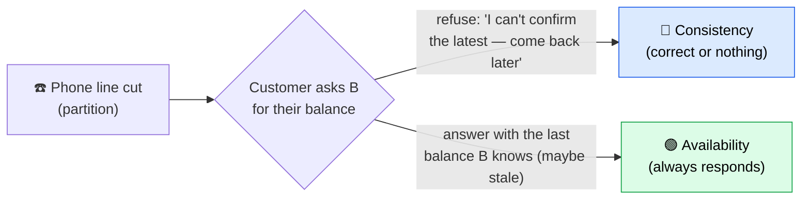
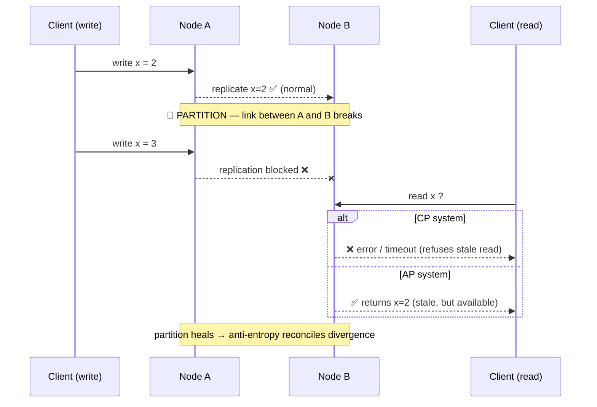
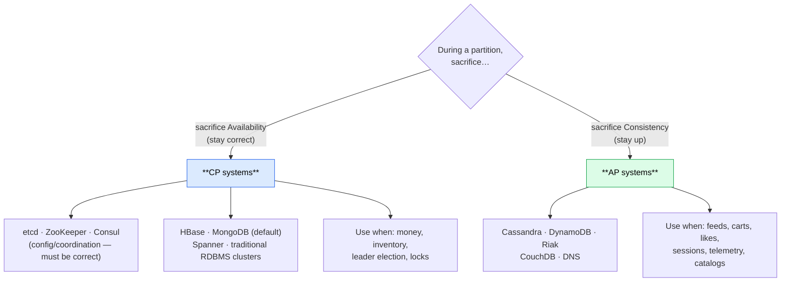
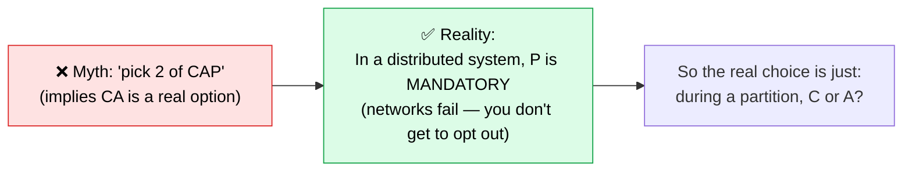
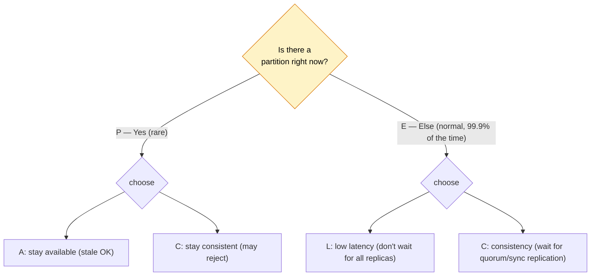
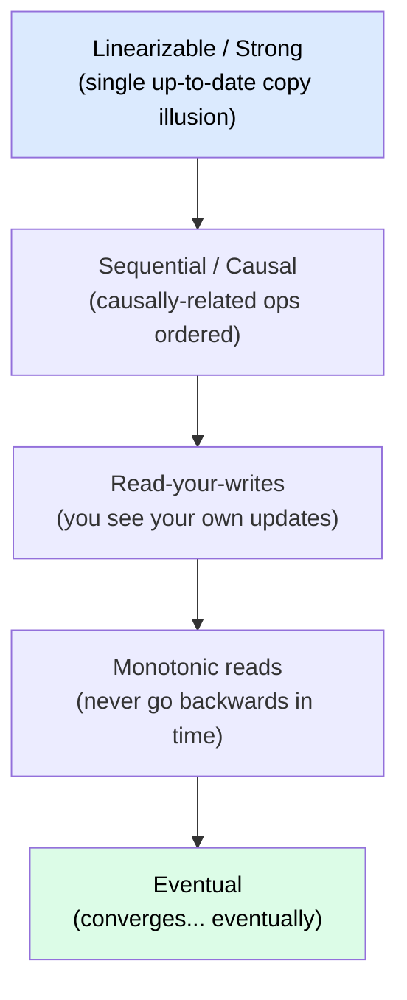
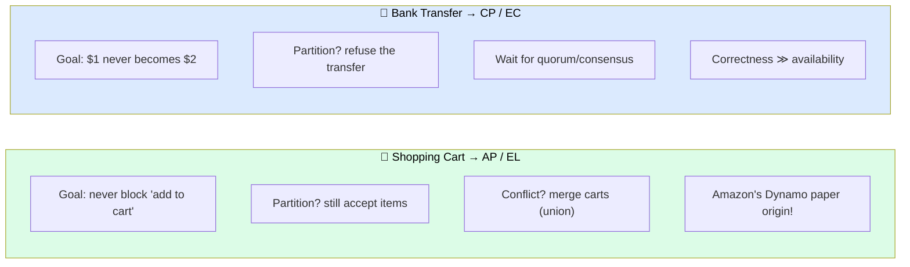
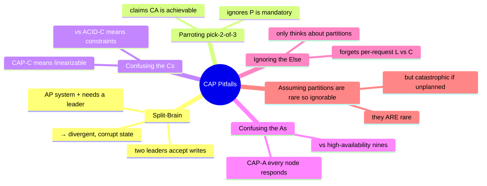

# CAP Theorem & PACELC

> **One line:** When a network partition splits your distributed system, you get to keep *either* every reply being correct (Consistency) *or* every node still answering (Availability) — not both. PACELC adds the part everyone forgets: **even when there's no partition, you're still trading latency for consistency on every request.**

---

## Table of Contents
1. [Why You Must Master This](#1-why-you-must-master-this)
2. [The Mental Model](#2-the-mental-model)
3. [The Three Letters, Precisely Defined](#3-the-three-letters-precisely-defined)
4. [The Partition Scenario (where the choice happens)](#4-the-partition-scenario-where-the-choice-happens)
5. [CP vs AP — Real Systems](#5-cp-vs-ap--real-systems)
6. [The Biggest Misconception: "Pick 2 of 3"](#6-the-biggest-misconception-pick-2-of-3)
7. [PACELC — The Complete Picture](#7-pacelc--the-complete-picture)
8. [Consistency is a Spectrum, Not a Switch](#8-consistency-is-a-spectrum-not-a-switch)
9. [Worked Example — Shopping Cart vs Bank Transfer](#9-worked-example--shopping-cart-vs-bank-transfer)
10. [Real-Life Use Cases](#10-real-life-use-cases)
11. [Failure Modes](#11-failure-modes)
12. [🏋️ Practice Drills](#-practice-drills)
13. [🎤 Interview Q&A Bank](#-interview-qa-bank)
14. [🎯 Staff+ Nuances](#-staff-nuances)
15. [Cheat Sheet](#15-cheat-sheet)
16. [Connections & Further Reading](#16-connections--further-reading)

---

## 1. Why You Must Master This

CAP is the **fundamental law of distributed systems** — the physics that governs every multi-node database, cache, and service you will ever design. It is referenced by [Trade_off_Analysis.md](./Trade_off_Analysis.md), [Constraints_Assumptions.md](./Constraints_Assumptions.md), and [SLA_SLO_SLI.md](./SLA_SLO_SLI.md) because *every* consistency/availability decision traces back to it.

- **It's not academic** — "should the like-count be instantly correct, or should the app stay up during a network blip?" *is* a CAP decision, made dozens of times in any real design.
- **It's the most-misquoted theorem in our field** — "pick 2 of 3" is technically wrong and saying it flags you as a beginner. (See §6.)
- **PACELC is the senior-level upgrade** — knowing the *else* branch (latency vs consistency *without* a partition) separates strong candidates from textbook ones.

> **The core problem it solves:** it tells you, *before* you pick a database, which guarantee you must sacrifice — so you sacrifice the one your domain can actually tolerate.

---

## 2. The Mental Model

Imagine two bank tellers in two cities who normally sync every transaction. The phone line between them is cut (a *partition*). A customer walks up to teller B and asks for their balance. Teller B has two choices:



There is no third option that is both always-correct *and* always-answering while the line is down. That impossibility *is* CAP.

---

## 3. The Three Letters, Precisely Defined

| Letter | Means | Precise definition |
|--------|-------|--------------------|
| **C — Consistency** | Every read sees the latest write | *Linearizability*: the system behaves as if there's a single, up-to-date copy. (Note: this is **not** the "C" in ACID.) |
| **A — Availability** | Every request gets a (non-error) response | Every *non-failing* node returns a response — not necessarily the latest data. |
| **P — Partition tolerance** | The system keeps operating despite dropped/delayed messages between nodes | The network *will* lose messages; the system can't just give up. |

> ⚠️ **Two famous traps:** (1) CAP's *Consistency* (linearizability) is different from ACID's *Consistency* (constraints/invariants). (2) CAP's *Availability* is a strict formal property — it does **not** mean "high availability / lots of nines." A system can be CAP-unavailable yet have 99.99% uptime.

---

## 4. The Partition Scenario (where the choice happens)

The choice **only** arises *during* a partition. The rest of the time you can have both C and A. This animation shows the exact decision point:





---

## 5. CP vs AP — Real Systems



| | **CP (Consistency + Partition)** | **AP (Availability + Partition)** |
|---|----------------------------------|-----------------------------------|
| During partition | Rejects/blocks requests it can't serve correctly | Serves possibly-stale data, never errors |
| Mantra | "Better no answer than a wrong one" | "Better a stale answer than none" |
| Cost | Reduced availability under partition | Must handle/reconcile conflicts later |
| Examples | etcd, ZooKeeper, HBase, Spanner | Cassandra, DynamoDB, Riak, DNS |
| Good for | Payments, locks, inventory, coordination | Shopping carts, feeds, likes, sessions |

---

## 6. The Biggest Misconception: "Pick 2 of 3"

You'll see CAP drawn as a triangle where you "pick 2 of 3." **This framing is misleading**, and explaining *why* is a strong senior signal.



- **"CA" is not a meaningful distributed choice.** A single-node database is "CA" trivially — but the moment you have more than one node communicating over a network, partitions are possible, so P is forced on you.
- **When there's no partition, you get both C and A.** CAP only forces a sacrifice *during* the partition. This is exactly the gap PACELC fills.

> Say this in an interview: *"CAP is really 'if Partitioned, choose C or A.' Partition tolerance isn't optional in a distributed system — so 'CA' just describes a single node."*

---

## 7. PACELC — The Complete Picture

Daniel Abadi's **PACELC** (2012) extends CAP to cover the *normal* case — when nothing is broken:

```
if (Partition):  choose  Availability  or  Consistency
Else:            choose  Latency       or  Consistency
   P    A   C        E         L            C
```



**Why this matters more than CAP in practice:** partitions are *rare*; the latency-vs-consistency trade happens on **every single request**. Every time you choose synchronous replication (wait for replicas → consistent but slow) vs asynchronous (reply immediately → fast but may serve stale), you're making the "ELC" choice.

| System | PACELC classification | Reading |
|--------|----------------------|---------|
| **DynamoDB / Cassandra** | **PA/EL** | On partition: available. Normally: favors latency. |
| **Spanner** | **PC/EC** | Always consistency (uses TrueTime + sync replication; pays latency). |
| **MongoDB** | **PC/EC** (tunable) | Defaults to consistency; can relax with read preferences. |
| **Cassandra (QUORUM)** | **PA/EC** | Available on partition; consistent normally via quorum. |

> The tunability in the last row is the real lesson: modern databases let you **dial the knob per-query** (consistency level), so PACELC is a *spectrum you choose per operation*, not a fixed label.

---

## 8. Consistency is a Spectrum, Not a Switch

"Consistency" isn't binary. There's a ladder from strongest (most expensive) to weakest (cheapest/fastest):



- **Strong/linearizable** — correct, but needs coordination (quorum/consensus) → higher latency, lower availability under partition.
- **Eventual** — fastest and most available, but reads may be stale and conflicts must be resolved (last-write-wins, CRDTs, vector clocks).
- **Read-your-writes / monotonic** — pragmatic middle grounds that fix the *most jarring* user-visible anomalies cheaply (e.g., you always see the comment you just posted).

> The art is choosing the **weakest consistency your domain can tolerate** — because weaker is cheaper, faster, and more available.

---

## 9. Worked Example — Shopping Cart vs Bank Transfer



Same company (say, Amazon) runs **both**: the cart is AP (Dynamo/DynamoDB — accept writes always, merge conflicts), the payment ledger is CP (strongly consistent). **The CAP choice is per-service, not per-company.** This is the single most important takeaway.

---

## 10. Real-Life Use Cases

| Decision | The CAP/PACELC reasoning |
|----------|--------------------------|
| **Picking a database** | "Need strong consistency for balances" → CP/EC (Spanner, Postgres). "Need always-on writes at global scale" → AP/EL (DynamoDB, Cassandra). |
| **Multi-region deployment** | Cross-region sync replication = consistent but adds ~150ms (the cross-continent RTT). Async = fast but stale. A direct ELC choice. |
| **Setting a quorum (R + W > N)** | Tuning read/write replica counts in Cassandra/Dynamo *is* dialing the CAP knob per-operation. |
| **Leader election / locks** | Always CP (etcd/ZooKeeper) — a "split-brain" with two leaders is catastrophic; you must sacrifice availability. |
| **Feature flag: "show stale data during outage"** | Explicitly choosing AP behavior for a UI surface so the app degrades gracefully instead of erroring. |
| **Caches** | A cache is an AP layer in front of a CP store — it trades freshness for latency and availability (the ELC trade, materialized). |

> Real-world habit: for every datastore in your architecture diagram, **label it CP or AP and write down the consistency level.** When something serves stale or rejects writes during an incident, that label tells you whether it's a bug or the design working as intended.

---

## 11. Failure Modes



- **Split-brain** — running an AP system where you actually needed a single leader; during a partition both sides accept conflicting writes and corrupt state.
- **Parroting "pick 2 of 3"** — instantly signals you don't really understand it (see §6).
- **Conflating the two C's / two A's** — CAP-C ≠ ACID-C; CAP-A ≠ "high availability."
- **Forgetting the ELC branch** — optimizing only for the rare partition while ignoring the latency-vs-consistency cost paid on *every* request.

---

## 🏋️ Practice Drills

> *Work these before reading the solutions. Active recall is how this becomes instinct.*

**Drill 1 — Classify the system.** For each, decide CP or AP and justify in one sentence: (a) a distributed lock for "only one worker processes this job," (b) a global product catalog, (c) an airline seat-booking ledger, (d) a "trending hashtags" widget.

<details><summary>Solution</summary>

(a) **CP** — two workers holding the "lock" = duplicate processing; correctness wins, block if unsure. (b) **AP** — a stale price/description for a few seconds is fine; never block browsing. (c) **CP** — selling the same seat twice is unacceptable. (d) **AP** — trending counts are inherently approximate; availability and latency win.
</details>

**Drill 2 — PACELC a database.** Your team picks Cassandra with `QUORUM` reads and writes. State its PACELC classification and what happens (i) during a partition and (ii) normally.

<details><summary>Solution</summary>

**PA/EC.** (i) During a partition, if a quorum is still reachable it stays available; if not, that operation fails — but it leans **available** overall. (ii) Normally, `QUORUM` (R+W>N) gives strong-ish consistency at the cost of waiting for a majority → it favors **consistency** over lowest latency. Drop to `ONE` and it becomes **EL** (fast, possibly stale).
</details>

**Drill 3 — Spot the mistake.** A candidate says: *"I'll use a CA database so I get consistency and availability without worrying about partitions."* What's wrong, and what should they say?

<details><summary>Solution</summary>

In a distributed (multi-node) system, partitions **will** happen — P isn't optional. "CA" only describes a single node. They should say: *"I'll choose CP or AP depending on whether this service can tolerate stale reads during a partition, and I'll pick the consistency level per-query."*
</details>

---

## 🎤 Interview Q&A Bank

**Q1. State CAP in one sentence.**
> In a distributed system that must tolerate network partitions (P), when a partition occurs you can guarantee either consistency (every read sees the latest write) or availability (every node still responds) — but not both.

**Q2. Why is "pick 2 of 3" misleading?** *(signal: depth)*
> Because P isn't a free choice — networks fail, so partition tolerance is mandatory for any real distributed system. The genuine choice is only between C and A, and only *during* a partition. "CA" effectively means a single node.

**Q3. What does PACELC add?** *(signal: seniority)*
> The "else" branch: even with no partition, you trade Latency vs Consistency on every request (sync vs async replication). Since partitions are rare and requests are constant, ELC often matters more day-to-day than the PAC part.

**Q4. Is CAP's Consistency the same as ACID's Consistency?**
> No. CAP-C is linearizability (a single-copy illusion across nodes). ACID-C is preserving database invariants/constraints within a transaction. Different concepts that unfortunately share a letter.

**Q5. Give a system that is AP and one that is CP, with the reason.**
> AP: DynamoDB/Cassandra — designed to always accept writes at global scale and reconcile later. CP: etcd/ZooKeeper — coordination/locks must be correct, so they sacrifice availability under partition.

**Q6. Can one company/app be both?** *(signal: pragmatism)*
> Yes — per service. Amazon's cart is AP (merge conflicting writes), its payment ledger is CP. The CAP choice is made per datastore, not globally.

**Q7. How do quorums (R + W > N) relate to CAP?**
> They're how AP databases let you dial toward consistency per-operation. Requiring overlapping read/write quorums guarantees a read sees the latest acknowledged write, trading latency/availability for stronger consistency.

**Q8. What's "split-brain" and how does CAP relate?**
> During a partition, an AP system may let both sides accept writes, creating divergent state ("split-brain"). If correctness requires a single source of truth (leader election, locks), you must choose CP to avoid it.

---

## 🎯 Staff+ Nuances

- **CAP availability ≠ your SLA's availability.** A CP system that briefly rejects writes during a rare partition can still hit 99.99% uptime. Don't let the formal term scare you away from CP for critical data — partitions are rare; correctness is forever. Tie this back to [SLA_SLO_SLI.md](./SLA_SLO_SLI.md).
- **The interesting frontier is conflict resolution, not the binary choice.** Once you pick AP, the real engineering is *how you reconcile*: last-write-wins (simple, loses data), version vectors / vector clocks (detect concurrency), or **CRDTs** (mathematically guaranteed convergence — used by Riak, Redis, collaborative editors like Figma).
- **Spanner "beat" CAP by engineering away partitions, not by breaking the theorem.** Google's TrueTime (GPS + atomic clocks) makes partitions rare and short enough that Spanner can be CP/EC while *appearing* highly available. It's a reminder that CAP is about behavior *during* a partition — shrink the partition window and the trade-off rarely bites.
- **Consistency is per-operation, not per-database.** Mature systems (DynamoDB, Cosmos DB, Cassandra) expose 5+ consistency levels you choose per query. The staff-level skill is mapping *each read path* to the weakest level it can tolerate — strong for "show my new balance," eventual for "show the global like count."
- **PACELC's EL trade is where most latency budgets are won or lost.** Synchronous cross-region replication adds a full RTT (~150ms) to every write. Teams that don't realize they chose "EC" wonder why their p99 is terrible. Most user-facing writes should be EL with read-your-writes guarantees layered on top.
- **Network partitions are often *partial* and *asymmetric*.** Real partitions aren't a clean split — A can reach B but B can't reach A, or a slow link looks like a partition ("gray failure"). Robust systems treat high latency and partial reachability as partition-like and degrade accordingly.

---

## 15. Cheat Sheet

```
CAP:  if (Partition) → choose C or A      (P is MANDATORY in distributed systems)
PACELC: if (P) A or C ; Else (E) L or C   ← the part seniors quote

C = linearizable (latest write visible)   ≠ ACID's C (constraints)
A = every node responds                   ≠ "high availability / nines"
P = survives dropped messages

CP "no answer > wrong answer": etcd, ZooKeeper, HBase, Spanner → money/locks/inventory
AP "stale answer > no answer": Cassandra, DynamoDB, DNS        → carts/feeds/likes/sessions

PACELC labels:
  DynamoDB/Cassandra = PA/EL    Spanner = PC/EC    MongoDB = PC/EC (tunable)

CONSISTENCY LADDER (strong→weak, expensive→cheap):
  linearizable → causal → read-your-writes → monotonic → eventual
RULE: pick the WEAKEST consistency your domain tolerates, PER operation.
QUORUM: R + W > N  → tune the CAP knob per query.
DON'T SAY: "pick 2 of 3" or "I'll use a CA database."
```

---

## 16. Connections & Further Reading

**Within this repo:**
- [Trade_off_Analysis.md](./Trade_off_Analysis.md) — CAP is the canonical distributed-systems trade-off.
- [Constraints_Assumptions.md](./Constraints_Assumptions.md) — your consistency requirement is a hard constraint.
- [SLA_SLO_SLI.md](./SLA_SLO_SLI.md) — availability/durability targets interact with the CAP choice.
- [05_Databases_Storage](../05_Databases_Storage/) — replication, quorums, consensus (Raft/Paxos) in depth.
- [10_Microservices_Distributed_Systems](../10_Microservices_Distributed_Systems/) — partitions, split-brain, and coordination.

**External classics:**
- Eric Brewer, *"CAP Twelve Years Later: How the Rules Have Changed"* (the canonical clarification).
- Daniel Abadi, *"Consistency Tradeoffs in Modern Distributed Database System Design"* (the PACELC paper).
- Martin Kleppmann, *Designing Data-Intensive Applications* — Ch. 9 (Consistency & Consensus); his "Please stop calling databases CP or AP" essay.
- Amazon's *Dynamo* paper (2007) — the origin of the AP/eventual-consistency design for shopping carts.

---

## TL;DR
CAP: in a distributed system, **P is mandatory**, so during a partition you choose **C (correct, may reject) or A (always answers, maybe stale)** — never "2 of 3." **PACELC** completes it: *Else* (no partition), you still trade **Latency vs Consistency** on every request, which in practice matters more. Consistency is a **spectrum chosen per-operation**, the CAP choice is **per-service** (cart = AP, ledger = CP), and the real engineering lives in **conflict resolution** (CRDTs, version vectors) once you pick AP. Pick the **weakest consistency your domain can tolerate.**
