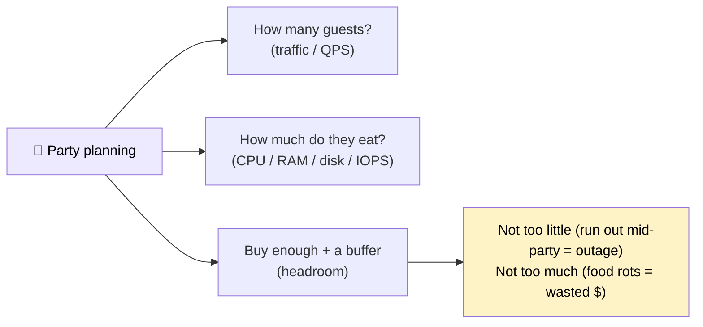
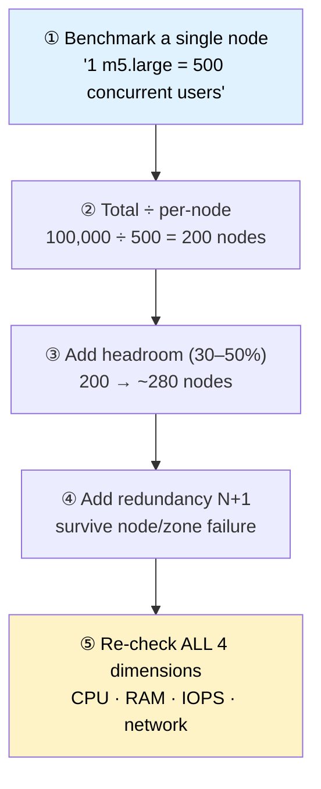
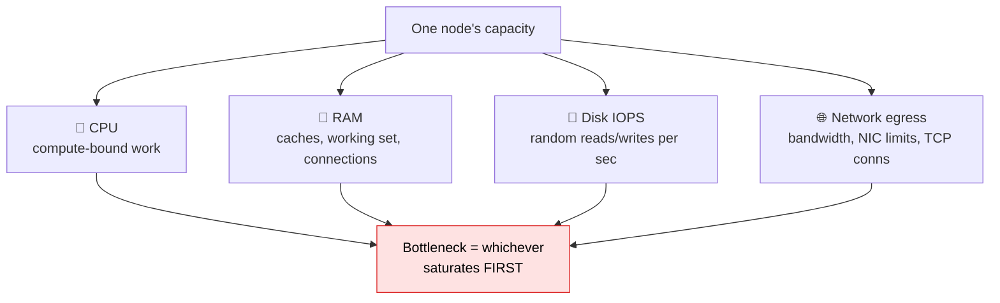
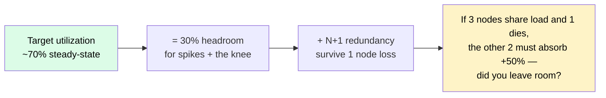
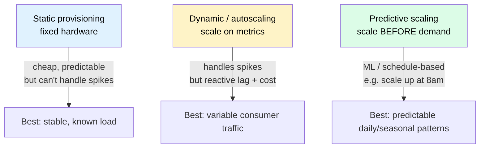
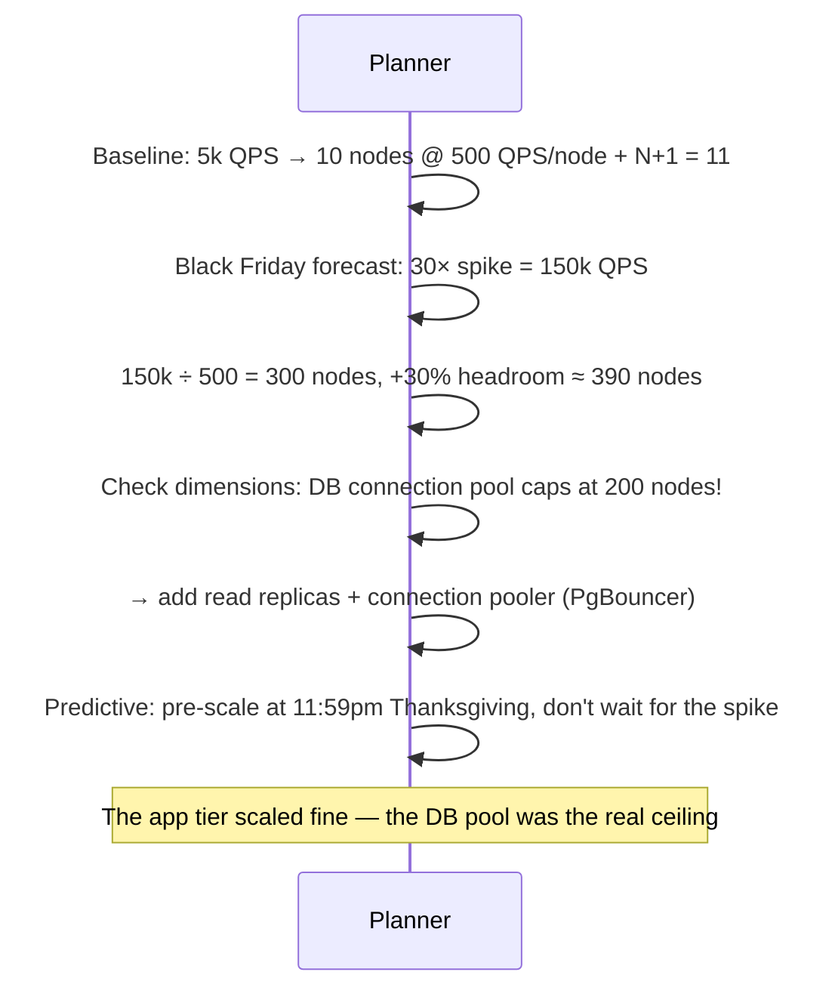
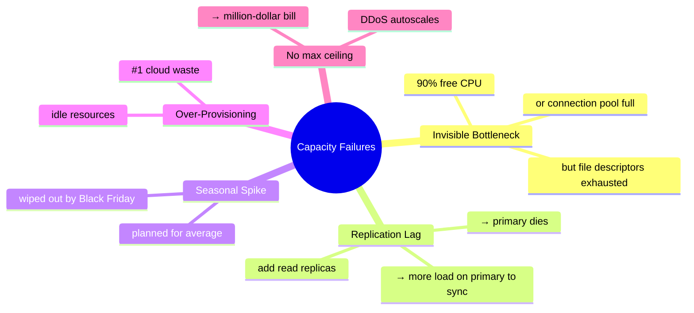

# Capacity Planning

> **One line:** Capacity planning is buying groceries for a party — estimate the guests (traffic), how much they eat (CPU/RAM/disk/IOPS/bandwidth), and provision enough that you never run out mid-party, but not so much that half the food rots (wasted spend).

---

## Table of Contents
1. [Why You Must Master This](#1-why-you-must-master-this)
2. [The Mental Model](#2-the-mental-model)
3. [The Method — Step by Step](#3-the-method--step-by-step)
4. [Capacity is Discrete, Demand is Smooth](#4-capacity-is-discrete-demand-is-smooth)
5. [The Four Dimensions (check them independently)](#5-the-four-dimensions-check-them-independently)
6. [Headroom, N+1, and Utilization Targets](#6-headroom-n1-and-utilization-targets)
7. [Static vs Dynamic vs Predictive](#7-static-vs-dynamic-vs-predictive)
8. [Worked Example — Black Friday](#8-worked-example--black-friday)
9. [Real-Life Use Cases](#9-real-life-use-cases)
10. [Failure Modes — The Invisible Bottleneck](#10-failure-modes--the-invisible-bottleneck)
11. [Interview Playbook](#11-interview-playbook)
12. [Cheat Sheet](#12-cheat-sheet)
13. [🏋️ Practice Drills](#-practice-drills)
14. [🎤 Interview Q&A Bank](#-interview-qa-bank)
15. [🎯 Staff+ Nuances](#-staff-nuances)
16. [Connections & Further Reading](#16-connections--further-reading)

---

## 1. Why You Must Master This

A system that runs out of disk or memory doesn't gracefully slow down — it **crashes**, often corrupting the database on the way down. Capacity planning prevents three catastrophes:

- **Operational death** — "disk full" / "out of memory" → hard crash, data corruption.
- **Bill shock** — uncontrolled autoscaling turns a viral moment (or a DDoS) into a million-dollar AWS invoice overnight.
- **Lead-time surprises** — even in the cloud, spinning up 10,000 instances hits **regional quota limits**; on-prem it took *months*.

> **The core problem it solves:** *resource exhaustion.* And note: "just add more app servers" fails when the real bottleneck is the **database connection pool** or **network bandwidth**, which don't scale by adding stateless nodes.

---

## 2. The Mental Model



---

## 3. The Method — Step by Step



1. **Define the single-node limit** — benchmark *one* server honestly under realistic load.
2. **Calculate total requirement** — `total demand ÷ per-node capacity`.
3. **Add headroom** — 30–50% buffer for spikes and the latency knee.
4. **Add redundancy (N+1)** — if you need 10, run 11 so one can die with no impact (N+2 for higher tiers).
5. **Check every dimension** — CPU, RAM, disk IOPS, and network egress *independently*; the bottleneck is whichever saturates first.

---

## 4. Capacity is Discrete, Demand is Smooth

Demand grows as a smooth curve; capacity is added in **discrete blocks** (whole servers/shards). The gap between the staircase and the curve *is* your headroom — and the moment the curve nears a step, you must already be provisioning the next one.



> This mismatch is why **autoscaling has lag**: a new node takes minutes to boot and warm up, but a traffic spike arrives in seconds. You provision *ahead* of demand, not in reaction to it.

---

## 5. The Four Dimensions (check them independently)

A server can have 90% idle CPU and still fall over — because a *different* resource saturated first.



| Dimension | Saturates when… | Real-world example |
|-----------|-----------------|--------------------|
| **CPU** | Compute-heavy (encoding, crypto, serialization) | Video transcoding farm |
| **RAM** | Large working set / many connections | In-memory cache, JVM heap |
| **Disk IOPS** | Lots of small random reads/writes | Database under random-access load |
| **Network** | High-bandwidth or high-connection-count | Dropbox sync — bottleneck is *concurrent TCP connections at the LB*, not disk space |

> **Storage ≠ throughput.** You can have room for 100 TB but lack the IOPS to read it fast enough. Capacity and throughput are separate budgets — plan both.

---

## 6. Headroom, N+1, and Utilization Targets



The classic mistake: provisioning to 100% utilization with no redundancy. When one of three nodes fails, the survivors get +50% load, cross the knee, and you get a **cascading failure** — the outage you were trying to prevent.

```hcl
# Capacity planning expressed as an autoscaling policy (Terraform / AWS)
resource "aws_autoscaling_group" "app_asg" {
  min_size         = 10   # calculated floor (handles baseline + N+1)
  max_size         = 100  # safety ceiling (caps the bill during a spike/DDoS)
  desired_capacity = 20   # based on current DAU

  target_tracking_configuration {
    target_value = 70.0   # keep CPU at 70% → 30% headroom
    predefined_metric_specification {
      predefined_metric_type = "ASGAverageCPUUtilization"
    }
  }
}
```

> Note the `max_size` ceiling — that's your **bill-shock circuit breaker.** Without it, a DDoS or runaway loop autoscales you into bankruptcy.

---

## 7. Static vs Dynamic vs Predictive



| Strategy | Cost model | Strength | Weakness |
|----------|-----------|----------|----------|
| **Static** | Pay fixed | Cheapest if load is steady | Wastes money off-peak, dies on spikes |
| **Dynamic** | Pay-as-you-go | Follows demand | Reactive lag (boot/warm-up time), variable bill |
| **Predictive** | Scheduled / ML | Provisions *ahead* of known spikes | Needs predictable patterns to work |

---

## 8. Worked Example — Black Friday



The lesson: the app tier is rarely the limit. The **invisible bottleneck** (here, the DB connection pool) is what actually caps you — which is why you check all four dimensions.

---

## 9. Real-Life Use Cases

| Situation | How capacity planning applies |
|-----------|-------------------------------|
| **Product launch** | "Marketing expects 1M signups day one = ~12/sec avg but ~350/sec morning spike" → provision and load-test for 350/sec, not 12. |
| **Kafka cluster sizing** | "1 GB/s ingest ÷ ~10 MB/s safe per partition = ~100 partitions" → set partition count + broker count up front. |
| **Database disk growth** | "20 TB/day × 90-day retention × 3 replicas = 5.4 PB" → tier cold data to object storage before the disk fills. |
| **Cloud budget forecasting** | Node count × instance price × hours = the number Finance signs off on *before* the quarter. |
| **Quota requests** | Spinning up 10k instances? File the regional quota increase *weeks* ahead — it's not instant. |
| **On-call runbooks** | "Scale out when CPU > 70% for 5 min" encodes the headroom decision into automated response. |

> Real-world habit: capacity planning is a **continuous** activity, not a one-time estimate. You re-forecast every quarter as growth, hardware prices, and traffic patterns change.

---

## 10. Failure Modes — The Invisible Bottleneck



- **The invisible bottleneck** — CPU at 10% but **file descriptors / connection pool / ephemeral ports** are exhausted. Monitor *all* resources.
- **Replication lag trap** — adding read replicas increases the *write* load on the primary (it must ship changes to each), eventually killing the thing you tried to protect.
- **Seasonal spikes** — planning for the average and getting wiped out by Black Friday / the Super Bowl.
- **Over-provisioning** — the #1 source of cloud waste; idle reserved capacity you pay for 24/7.

---

## 11. Interview Playbook

**✅ Do:** talk in terms of **per-node capacity + headroom + N+1**, not raw server counts. Say: *"I'll assume each node handles 500 QPS, we need 25k peak ÷ 500 = 50 nodes, +30% headroom ≈ 65, +N+1 redundancy."* Mention checking **all four dimensions**.

**🚩 Red flags:** "I'll just use 100 servers" (no derivation); forgetting **replication (3× storage)** and that **indexes consume space too**; assuming app servers are always the bottleneck.

**Common follow-up:** *"What if the database disk fills faster than expected?"* → tiering cold data, alerting at 70% disk, sharding before the primary hits its size limit.

---

## 12. Cheat Sheet

```
THE METHOD
  ① benchmark 1 node      ② total ÷ per-node
  ③ +30–50% headroom      ④ +N+1 redundancy
  ⑤ check ALL 4 dimensions

FOUR DIMENSIONS (bottleneck = first to saturate)
  CPU · RAM · DISK IOPS · NETWORK egress

NUMBERS TO REMEMBER
  target utilization ~70%  → 30% headroom
  N+1 minimum redundancy   (N+2 for critical)
  storage ≠ throughput (space vs IOPS)
  ×3 replication + index overhead

GUARDRAILS
  set autoscaling max_size = bill-shock breaker
  file quota increases WEEKS ahead
  watch: FDs, connection pool, replication lag
```

---

## 🏋️ Practice Drills

> *Turn load into a node count — with headroom and redundancy — and check every dimension.*

**Drill 1 — Node count.** Peak load is 40,000 QPS; one node safely serves 800 QPS. With 30% headroom and N+1 redundancy, how many nodes?

<details><summary>Solution</summary>

`40,000 ÷ 800 = 50 nodes` at full utilization. Add 30% headroom → `50 ÷ 0.7 ≈ 72`. Add N+1 → **73 nodes**. (Provisioning exactly 50 means crossing the knee on any spike or single failure.)
</details>

**Drill 2 — The failure-absorption check.** You run 4 nodes at 75% utilization each. One node dies. Do the survivors cope?

<details><summary>Solution</summary>

The dead node's 75% load redistributes over 3 nodes → each gains 25% → `75% + 25% = 100%`. They're now saturated/at the knee. Lesson: at 4 nodes you should run nearer ~65% so a single loss keeps you under ~87%. N+1 only helps if there's *room* to absorb the load.
</details>

**Drill 3 — Find the real bottleneck.** A fleet shows 30% CPU, 40% RAM, but requests are timing out. Where do you look?

<details><summary>Solution</summary>

A non-CPU/RAM dimension: exhausted DB connection pool, file descriptor limit, ephemeral port exhaustion, or network/NIC saturation. The bottleneck is whichever resource saturates first — and it's usually the invisible one.
</details>

**Drill 4 — Storage forecast.** Logs accumulate at 8 TB/day, retained 90 days, replicated 3×. How much storage, and what do you do?

<details><summary>Solution</summary>

`8 × 90 × 3 = 2,160 TB ≈ 2.2 PB`. Tier old logs to cheap object/archival storage, drop replication on cold tier, compress, and alert at 70% disk. Logs are a classic silent budget-killer.
</details>

---

## 🎤 Interview Q&A Bank

**Q1. How do you size a fleet?**
> Benchmark one node's safe capacity, divide total peak load by it, add ~30% headroom, add N+1 (or N+2) redundancy, then re-check CPU, RAM, IOPS, and network independently.

**Q2. What's "headroom" and why ~30%?**
> Spare capacity (target ~70% utilization) so traffic spikes and the loss of a node don't push you past the latency knee. Running at 100% has zero margin for failure.

**Q3. Why check four dimensions separately?**
> A node can have idle CPU yet fail because RAM, disk IOPS, or network/connection limits saturated first. The bottleneck is whichever maxes out first.

**Q4. What's the invisible bottleneck?**
> A non-obvious limit — file descriptors, connection pool size, ephemeral ports, NIC bandwidth — that caps you while CPU/RAM look fine. Dropbox-style sync is often limited by concurrent TCP connections at the LB, not disk.

**Q5. Static vs dynamic vs predictive scaling?**
> Static = fixed (cheap, can't spike). Dynamic = autoscale on metrics (handles spikes, reactive lag). Predictive = scale ahead of known patterns (e.g., pre-scale before a sale). Use predictive for known events, dynamic for variable traffic.

**Q6. Why cap autoscaling max_size?**
> It's the bill-shock circuit breaker. Without a ceiling, a DDoS or runaway loop autoscales you into a massive bill. The cap bounds worst-case cost.

**Q7. What's the replication-lag trap?**
> Adding read replicas increases write load on the primary (it must ship changes to each replica), which can eventually overwhelm the primary you were trying to protect.

**Q8. The DB disk is filling faster than expected — what do you do?**
> Alert at ~70%, tier/archive cold data, enable compression, and shard before the primary hits its size ceiling. Re-forecast growth.

---

## 🎯 Staff+ Nuances

- **Capacity planning is continuous, not a launch-day event.** Growth, hardware price changes, and shifting traffic patterns mean you re-forecast every quarter. A static plan is stale within months.
- **Demand is smooth; capacity is discrete — so you provision *ahead* of the curve.** A new node takes minutes to boot and warm; a spike arrives in seconds. The gap between the staircase and the demand curve *is* your headroom, and it must lead, not lag.
- **The bottleneck moves as you scale.** Fix CPU and the database becomes the limit; shard the DB and the network or a downstream service becomes the limit. Plan for *where the bottleneck goes next*, not just today's.
- **Utilization targets must account for failure-domain math.** With N nodes, surviving one loss means staying below `N-1/N` utilization. Small clusters (3–4 nodes) need much lower target utilization than large ones — a subtlety juniors miss.
- **Over-provisioning is the #1 cloud waste; right-sizing is real money.** Idle reserved capacity costs 24/7. Staff engineers treat utilization and cost-per-request as first-class metrics, not afterthoughts (ties to FinOps).
- **Quotas and lead times are real constraints even in the cloud.** "Just spin up 10k instances" hits regional quota limits and warm-up storms (cold caches, JIT, connection ramp). File quota increases weeks ahead and pre-warm before big events.
- **Stateful capacity is harder than stateless.** Adding app servers is easy; adding database/shard capacity involves rebalancing, resharding, and replication lag. Plan stateful headroom far more conservatively.

---

## 16. Connections & Further Reading

**Within this repo:**
- [QPS_TPS_Estimation.md](./QPS_TPS_Estimation.md) — the peak QPS that feeds the server count.
- [Back_of_the_Envelope_Estimation.md](./Back_of_the_Envelope_Estimation.md) — the storage/bandwidth numbers.
- [SLA_SLO_SLI.md](./SLA_SLO_SLI.md) — availability targets that dictate redundancy.
- [07_Load_Balancing_Scalability](../07_Load_Balancing_Scalability/) · [13_Cloud_Native_Infrastructure](../13_Cloud_Native_Infrastructure/) — autoscaling implementation.

**External classics:**
- *Site Reliability Engineering* (Google) — Ch. 18, Software Engineering in SRE; the capacity-planning chapters.
- *Cloud Strategy* (Gregor Hohpe) — dynamic vs fixed capacity.
- Datadog / New Relic capacity-monitoring guides.

---

## TL;DR
Capacity planning is **forecasting resource needs** to stay available while minimizing waste: benchmark one node, divide total by per-node, add **30% headroom + N+1 redundancy**, and check **CPU, RAM, IOPS, and network independently** — because the real bottleneck is usually the invisible one (connection pool, file descriptors). Demand is smooth, capacity is discrete: provision *ahead* of the curve. It's better to have it and not need it than to need it and watch the site go dark.
