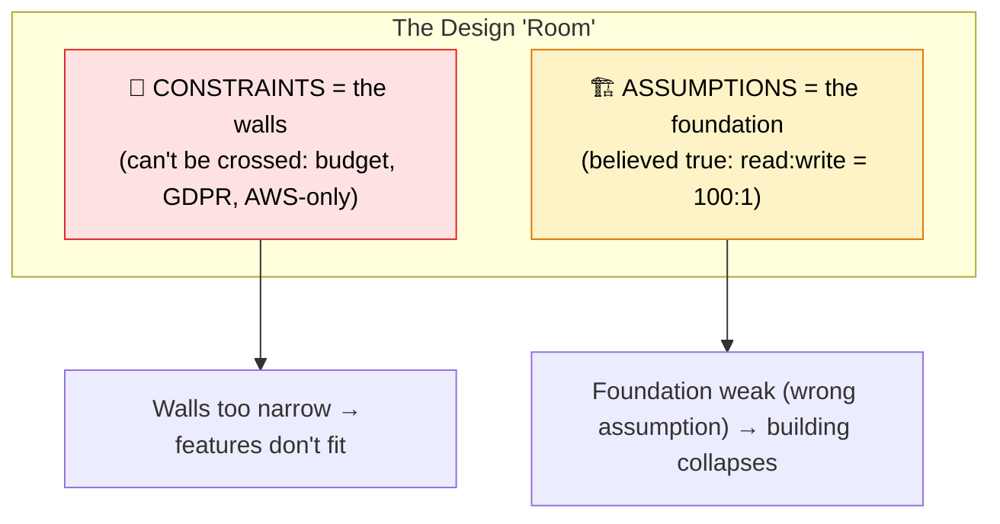
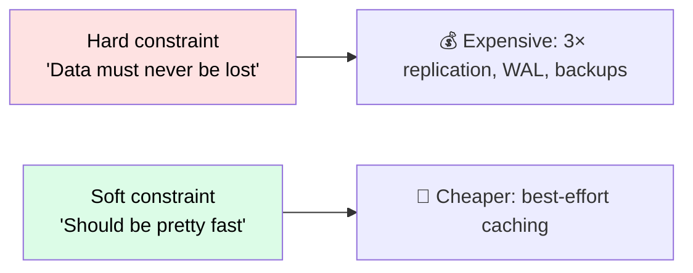
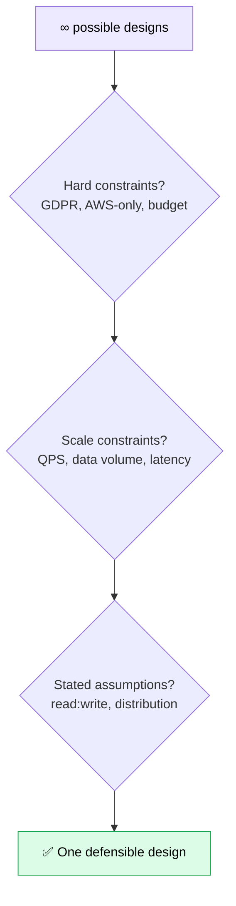
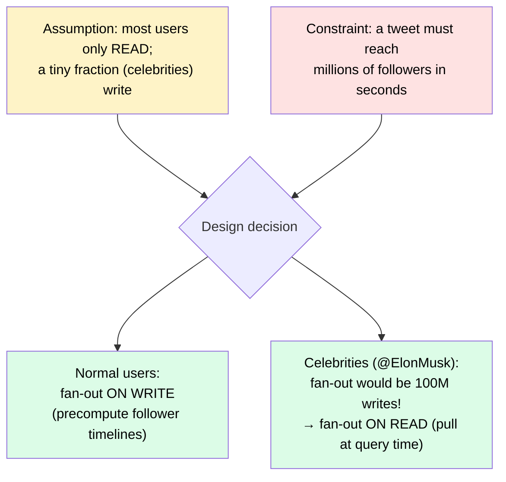
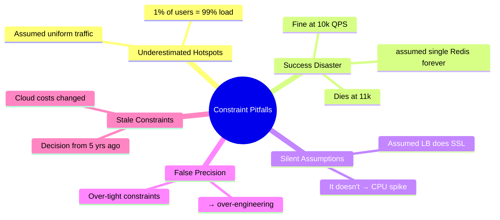
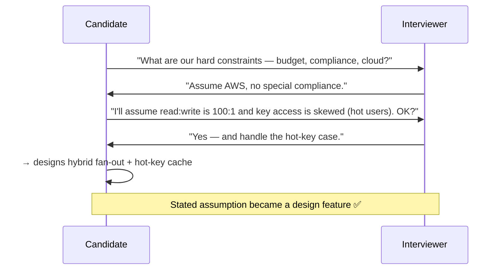

# Constraints & Assumptions

> **One line:** Constraints are the *walls of the room* you build in; assumptions are the *foundation* you build on. Name them explicitly — because an unstated constraint becomes an impossible design, and an unstated assumption becomes a hidden point of failure.

---

## Table of Contents
1. [Why You Must Master This](#1-why-you-must-master-this)
2. [The Mental Model](#2-the-mental-model)
3. [Constraints vs Assumptions](#3-constraints-vs-assumptions)
4. [The Constraint Funnel](#4-the-constraint-funnel)
5. [How to Surface Them — In Depth](#5-how-to-surface-them--in-depth)
6. [Worked Example — Twitter's Fan-Out](#6-worked-example--twitters-fan-out)
7. [Real-Life Use Cases](#7-real-life-use-cases)
8. [Failure Modes](#8-failure-modes)
9. [Interview Playbook](#9-interview-playbook)
10. [Cheat Sheet](#10-cheat-sheet)
11. [🏋️ Practice Drills](#-practice-drills)
12. [🎤 Interview Q&A Bank](#-interview-qa-bank)
13. [🎯 Staff+ Nuances](#-staff-nuances)
14. [Connections & Further Reading](#14-connections--further-reading)

---

## 1. Why You Must Master This

Without constraints, the design space is *infinite* — should this be a single SQL server or a globally distributed Spanner cluster? You can't choose. Constraints make the choice possible. And every design rests on assumptions ("the network is reliable," "reads outnumber writes 100:1"); if you don't state them, they become **silent landmines** that detonate in production.

> **The core problem it solves:** *unbounded design + hidden risk.* Constraints prune the option tree; explicit assumptions turn invisible risks into reviewable decisions.

Constraints are what separate **senior architects from dreamers** — you never have infinite time, money, or hardware, and acknowledging that is the start of real engineering.

---

## 2. The Mental Model



---

## 3. Constraints vs Assumptions

| | **Constraints** | **Assumptions** |
|---|----------------|-----------------|
| **What** | Non-negotiable limits imposed on you | Things you *believe* true but haven't proven |
| **Source** | Business, legal, physics, budget | Your reasoning about usage |
| **Examples** | "Must use AWS", "GDPR", "$10k/mo budget", "10 MB max upload" | "Read:write = 100:1", "network is reliable", "uniform key distribution" |
| **Risk if ignored** | Design is literally impossible to ship | Design works in theory, fails in production |
| **How to handle** | Treat as hard boundaries | State out loud, validate, plan for being wrong |



---

## 4. The Constraint Funnel

Each constraint you add removes whole *categories* of designs — funneling many possibilities down to one.




> **The payoff:** once constraints are set, ~90% of tech choices ("should we shard?", "SQL or NoSQL?") become *obvious*. Constraints are **enabling limitations** — they don't restrict creativity, they focus it.

---

## 5. How to Surface Them — In Depth

1. **Identify hard constraints** — the non-negotiables. Compliance (GDPR/HIPAA/PCI), platform mandates ("must be on Azure"), budget caps, hardware limits, legacy integration.
2. **Define scale constraints** — QPS, total data volume, latency budget, geographic spread. These come straight from [Back_of_the_Envelope_Estimation.md](./Back_of_the_Envelope_Estimation.md).
3. **State assumptions explicitly** — read:write ratio, access distribution (uniform vs hot-key), payload size, growth rate. *Say them out loud so they can be corrected.*
4. **Sanity-check against reality** — does the assumption match the actual use case? "Mostly reads" fits Twitter; it does *not* fit an IoT ingestion pipeline.

Constraints often become **guard rails** in code:

```python
# Constraints enforced at the boundary
def process_upload(file_data):
    # Hard constraint: max 10 MB upload
    if len(file_data) > 10 * 1024 * 1024:
        raise ValueError("File exceeds 10MB limit")

    # Assumption: most uploads are JPEGs → optimize the fast path
    if file_data.startswith(JPEG_HEADER):
        return fast_path_optimization(file_data)
    return standard_processing(file_data)
```

---

## 6. Worked Example — Twitter's Fan-Out



The *assumption* (read-heavy, skewed authorship) plus the *constraint* (seconds-latency to millions) directly produced Twitter's famous **hybrid fan-out** model. Change the assumption — say, an even authorship distribution — and the design changes entirely.

---

## 7. Real-Life Use Cases

| Situation | The constraint/assumption that decides it |
|-----------|-------------------------------------------|
| **Choosing a cloud region** | Constraint: "EU user data must stay in EU" (GDPR) → forces regional deployment + data residency. |
| **Database licensing** | Constraint: "Oracle license is per-core" → caps how many cores you provision, pushing you toward fewer, bigger nodes or an open-source swap. |
| **Hot-key / celebrity problem** | Assumption "uniform distribution" is *wrong* for social/gaming → must special-case hot keys, or you get a single overloaded shard. |
| **Mobile / emerging markets** | Constraint "users on 2G/3G" → small payloads, offline-first, aggressive client caching. |
| **Architecture Decision Records (ADRs)** | The real-world artifact for *documenting* constraints & assumptions so future engineers know *why* a choice was made. |
| **Cost reviews** | Every constraint has a price tag: "zero data loss" costs far more than "99.9% durability." Naming the constraint exposes the cost. |

> Real-world habit: **write down your assumptions in the design doc.** When the system breaks at scale, the first question is always "which assumption stopped being true?" — and you want that list to exist.

---

## 8. Failure Modes



- **Underestimating hotspots** — assuming uniform distribution when 1% of users generate 99% of traffic (the celebrity/viral problem).
- **The "success disaster"** — works perfectly at 10k QPS, catastrophically fails at 11k because you assumed one node would suffice forever.
- **Silent assumptions** — e.g., assuming the load balancer terminates SSL when it doesn't, spiking app-server CPU.
- **False precision** — over-tight constraints lead to over-engineering and wasted money.

---

## 9. Interview Playbook

**Ask, then assume out loud.** Both behaviors are strong signals.



**✅ Do:** ask about scale and budget; state your read:write and distribution assumptions; flag hard vs soft constraints.
**🚩 Red flags:** designing without asking about scale or budget; assuming uniform distribution silently; ignoring that "zero data loss" has a cost.
**Common follow-up:** "What if the storage constraint changes from 10 TB to 10 PB?" — be ready to explain which decisions flip.

---

## 10. Cheat Sheet

```
CONSTRAINTS (walls)          ASSUMPTIONS (foundation)
  budget / cost                read:write ratio
  compliance (GDPR/HIPAA)      access distribution (hot keys?)
  platform ("AWS only")        payload size
  payload / size limits        growth rate
  latency budget               network reliability
  → can't be crossed           → state out loud, validate, plan to be wrong

HARD vs SOFT:  "must not lose data" (hard, $$$)
               "should be fast"      (soft, best-effort)
RULE: write assumptions in the doc — at scale,
      the first question is "which one stopped being true?"
```

---

## 🏋️ Practice Drills

> *Practice separating hard limits from beliefs — and pressure-testing the beliefs.*

**Drill 1 — Constraint or assumption?** Classify each: (a) "max upload 10 MB," (b) "read:write is 100:1," (c) "must run on AWS," (d) "key access is uniform," (e) "budget is $20k/month."

<details><summary>Solution</summary>

(a) Constraint (hard limit), (b) Assumption (belief about usage), (c) Constraint (platform), (d) Assumption (and a *dangerous* one — usually false for social/gaming), (e) Constraint (budget). Constraints are imposed; assumptions are what you believe and must validate.
</details>

**Drill 2 — Find the silent assumption.** A design assumes uniform key distribution for a gaming leaderboard. Why is that risky and what breaks?

<details><summary>Solution</summary>

Gaming traffic is heavily skewed — a few viral games/players get 99% of traffic (hot keys). Uniform-distribution assumption → one shard melts while others idle. Fix: special-case hot keys (dedicated cache, key splitting, replication of hot partitions).
</details>

**Drill 3 — Price the constraint.** A stakeholder demands "zero data loss." What does that constraint cost, and what's the cheaper alternative to offer?

<details><summary>Solution</summary>

Zero loss → synchronous replication across zones, WAL + frequent backups, quorum writes — adds latency and ~2–3× storage/infra cost. Cheaper alternative: "99.999% durability with async replication and a small RPO (e.g., a few seconds)" — often acceptable and far cheaper. Name the price so the business can choose.
</details>

---

## 🎤 Interview Q&A Bank

**Q1. Difference between a constraint and an assumption?**
> A constraint is a non-negotiable limit imposed on you (budget, compliance, platform, payload size). An assumption is something you believe true but haven't proven (read:write ratio, access distribution). Ignored constraints make a design impossible; ignored assumptions make it fail in production.

**Q2. Why state assumptions out loud in an interview?**
> So the interviewer can correct a wrong one before it cascades through the whole design. A wrong assumption stated silently can invalidate everything downstream.

**Q3. Give an example where an assumption shaped a famous design.**
> Twitter assumed read-heavy traffic with skewed authorship (celebrities) → hybrid fan-out: fan-out-on-write for normal users, fan-out-on-read (pull) for celebrities to avoid 100M writes per tweet.

**Q4. What's a hard vs soft constraint?**
> Hard: "data must never be lost" (must be satisfied, expensive). Soft: "should be reasonably fast" (best-effort, negotiable). Treat them differently when budgeting.

**Q5. How do constraints speed up design?**
> Once set, ~90% of tech choices become obvious — "GDPR + EU users" forces regional deployment; "single-node license" forces vertical scaling. Constraints prune the option tree.

**Q6. What is the "success disaster"?**
> When a system works perfectly at the assumed scale (10k QPS) but catastrophically fails just beyond it (11k) because an assumption ("one Redis node is enough forever") quietly expired.

**Q7. Where do you document assumptions in real projects?**
> In the design doc and in Architecture Decision Records (ADRs), so future engineers know *why* a choice was made and can detect when an assumption no longer holds.

---

## 🎯 Staff+ Nuances

- **At scale, every outage traces to an assumption that stopped being true.** The first incident question is "which assumption broke?" — uniform distribution, reliable network, bounded payload, single-region. Keeping an explicit, reviewable assumptions list turns mysteries into checklists.
- **The most expensive constraint is usually invisible: organizational.** Conway's Law, team boundaries, on-call capacity, and existing tech investments constrain architecture as hard as any latency budget. Senior architects name these too.
- **Assumptions decay; constraints drift.** A 5-year-old "we can't afford multi-region" was true when bandwidth was expensive; cloud economics may have flipped it. Re-validate constraints periodically — stale ones cause over- *and* under-engineering.
- **Hot keys / skew is the assumption that breaks most distributed designs.** "Uniform distribution" is almost never real for human-driven traffic (Zipfian). Plan for skew explicitly: hot-key caching, key splitting, request coalescing.
- **Distinguish RPO from RTO when pricing durability/availability constraints.** "Zero data loss" (RPO=0) and "instant recovery" (RTO=0) are *different* constraints with different costs; clients often conflate them. Teasing them apart often reveals a cheaper acceptable target.
- **Constraints are a negotiation surface, not a wall.** The highest-leverage move is sometimes relaxing a constraint with the business ("can the SLA be 99.9% instead of 99.99%?") — it can halve cost and complexity. Treat constraints as inputs you can push back on, with data.

---

## 14. Connections & Further Reading

**Within this repo:**
- [Requirement_Gathering.md](./Requirement_Gathering.md) — constraints are the third requirement bucket.
- [Back_of_the_Envelope_Estimation.md](./Back_of_the_Envelope_Estimation.md) — the math behind scale constraints.
- [SLA_SLO_SLI.md](./SLA_SLO_SLI.md) — turning constraints into measurable targets.
- [Trade_off_Analysis.md](./Trade_off_Analysis.md) — choosing between designs the constraints allow.

**External classics:**
- *The Art of Scalability* (Abbott & Fisher).
- AWS Well-Architected Framework — constraints as design pillars.
- *Architecture Decision Records (ADRs)* — the standard way to document constraints & assumptions.

---

## TL;DR
Constraints are the **walls**; assumptions are the **foundation**. Constraints prune infinite designs down to one; assumptions, when stated, turn hidden risks into reviewable decisions. Constraints are **enabling limitations** — they stop you from trying to build everything and force you to build something that actually works. Always write your assumptions down: at scale, every failure traces back to one that quietly stopped being true.
