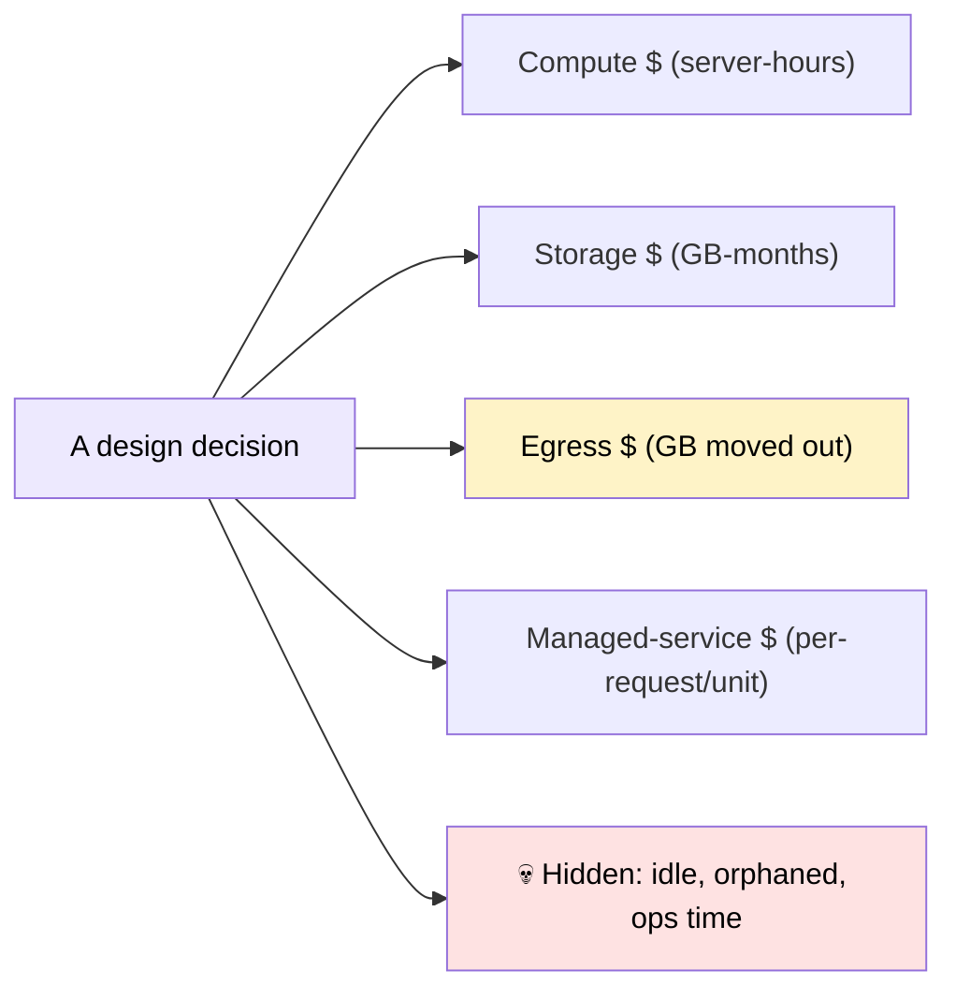
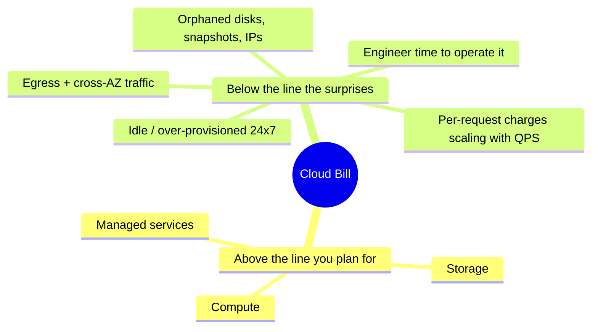
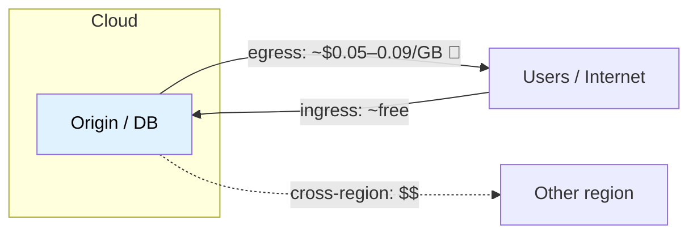
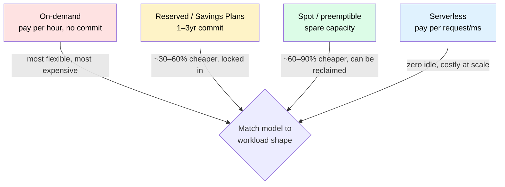
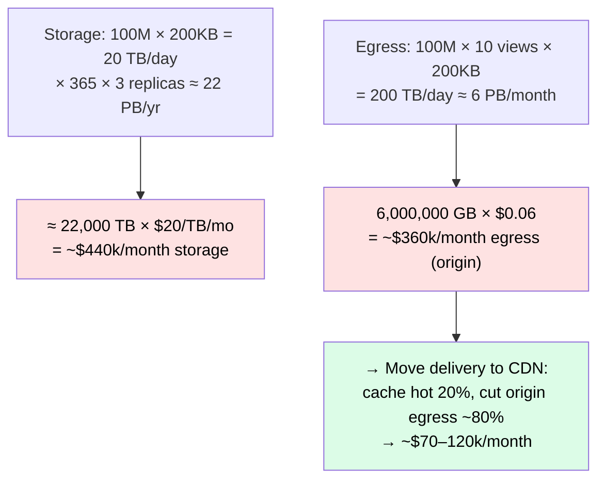
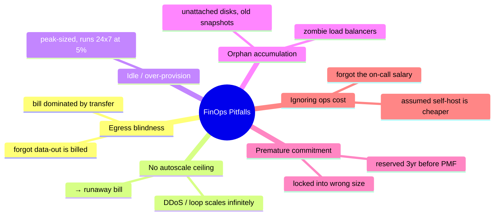

# Cost Estimation & FinOps

> **One line:** Every architectural decision is also a line on a bill — knowing the rough price of a GB stored, a GB moved, and a server-hour lets you turn "looks fine technically" into "$5k/month or $5M/month" *before* the invoice arrives.

---

## Table of Contents
1. [Why You Must Master This](#1-why-you-must-master-this)
2. [The Mental Model](#2-the-mental-model)
3. [The Price List You Should Carry](#3-the-price-list-you-should-carry)
4. [Anatomy of a Cloud Bill (the iceberg)](#4-anatomy-of-a-cloud-bill-the-iceberg)
5. [Egress — The Silent Killer](#5-egress--the-silent-killer)
6. [Pricing Models & The Cost Knobs](#6-pricing-models--the-cost-knobs)
7. [Worked Example — Napkin Bill for a Photo App](#7-worked-example--napkin-bill-for-a-photo-app)
8. [Real-Life Use Cases](#8-real-life-use-cases)
9. [Failure Modes](#9-failure-modes)
10. [🏋️ Practice Drills](#-practice-drills)
11. [🎤 Interview Q&A Bank](#-interview-qa-bank)
12. [🎯 Staff+ Nuances](#-staff-nuances)
13. [Cheat Sheet](#13-cheat-sheet)
14. [Connections & Further Reading](#14-connections--further-reading)

---

## 1. Why You Must Master This

Architecture *is* economics at scale. The same back-of-the-envelope math that sizes your servers also sizes your bill — and the bill is what gets projects cancelled.

- **Bill shock is real and fast** — a viral moment, a DDoS, or a misconfigured autoscaler can 100× a bill overnight. The CFO remembers that, not your elegant design.
- **Cost is a first-class design constraint** — "this is correct but costs $2M/month" is a *failed* design. FinOps makes cost visible at design time.
- **The cheapest-looking option often isn't** — serverless looks cheap until 50k QPS; a managed service looks expensive until you price the engineers to run it yourself.

> **The core problem it solves:** designs that are technically sound but economically impossible. Estimating cost on a napkin catches them in the design review, not the quarterly finance review.

**FinOps** = the practice of bringing financial accountability to cloud spend, so engineers make cost-aware decisions instead of treating infra as free.

---

## 2. The Mental Model

Think of the cloud like utilities for a house you rent: you pay for **space** (storage), **electricity** (compute), and — the surprise — **every time you ship a package out the door** (egress). The sticker price (compute) is visible; the real bill is dominated by things below the waterline.



---

## 3. The Price List You Should Carry

Rough, order-of-magnitude cloud prices (USD; varies by provider/region — memorize the *magnitudes*, not the cents):

| Resource | Rough price | Mental anchor |
|----------|-------------|---------------|
| **Object storage (S3 standard)** | ~$0.02 / GB / month | $20/TB/mo · $20k/PB/mo |
| **Archival storage (Glacier-class)** | ~$0.004 / GB / month | ~5× cheaper than standard |
| **Block storage (SSD/EBS)** | ~$0.08–0.10 / GB / month | ~4–5× object storage |
| **Data egress to internet** | ~$0.05–0.09 / GB | **ingress is usually free; egress is not** |
| **Cross-region / inter-AZ transfer** | ~$0.01–0.02 / GB | your own services chatting costs money |
| **Compute (general VM vCPU)** | ~$0.03–0.05 / vCPU / hour | a small always-on VM ≈ $30–70/mo |
| **Serverless (Lambda-class)** | ~$0.20 per 1M requests + compute-ms | cheap at low QPS, costly at high QPS |
| **Managed DB** | ~2–3× the raw VM cost | you pay for ops you don't do |
| **CDN delivery** | ~$0.01–0.08 / GB | cheaper than origin egress + faster |

> **Two anchors that win most arguments:** `1 PB of standard object storage ≈ $20k/month`, and `egress is the line item nobody budgets for`.

---

## 4. Anatomy of a Cloud Bill (the iceberg)

The visible cost (compute) is rarely the whole story. The costs that blow budgets live below the waterline.




- **Idle capacity is the #1 cloud waste** — instances provisioned for peak running at 5% at 3am, billed at 100%.
- **Orphaned resources** — unattached volumes, forgotten snapshots, idle load balancers — quietly accrue forever.
- **Your own services talking** across AZs/regions is billed traffic, not free.

---

## 5. Egress — The Silent Killer

The asymmetry that surprises every team: **data IN is usually free; data OUT is billed per GB.** At scale this dominates.



**Why it matters:** a video/file service serving 1 PB/month to users pays roughly `1,000,000 GB × $0.06 ≈ $60,000/month` in egress *alone* — often more than compute + storage combined. This is precisely why **CDNs** (cheaper per-GB + cached at the edge) exist, and why "multi-region active-active" carries a hidden replication-traffic tax.

---

## 6. Pricing Models & The Cost Knobs



| Model | Discount | Best for |
|-------|---------:|----------|
| On-demand | baseline | spiky, unpredictable, short-lived |
| Reserved / Savings Plans | ~30–60% | steady, predictable baseline load |
| Spot / preemptible | ~60–90% | fault-tolerant batch, stateless workers |
| Serverless | n/a (per-use) | low/bursty traffic, zero-idle requirement |

**The cost knobs you turn:** right-sizing (stop over-provisioning), autoscaling with a `max` ceiling, storage tiering (hot→cold→archive), compression, caching/CDN (cut egress + compute), reserved commitments for the steady base, and killing orphans.

---

## 7. Worked Example — Napkin Bill for a Photo App

From the [estimation funnel](./Back_of_the_Envelope_Estimation.md): 100M DAU, 1 photo/day at 200 KB, served back ~10× as views.



**Takeaways the napkin reveals:** (1) egress rivals storage as a cost center; (2) a CDN isn't just a latency win, it's a *cost* win (cuts origin egress); (3) tiering cold photos to archival storage (~5× cheaper) can slash the $440k storage line. None of this needs a spreadsheet — just the price anchors.

---

## 8. Real-Life Use Cases

| Situation | How cost estimation decides it |
|-----------|--------------------------------|
| **CDN vs serve-from-origin** | Egress math: CDN is cheaper per-GB *and* offloads origin → almost always wins for static/media at scale. |
| **Log retention policy** | "5 TB/day × 90 days × 3× = 1.3 PB ≈ $26k/mo just for logs" → set retention + tiering before it balloons. |
| **Reserved vs on-demand** | Steady baseline → reserve it (~40% off); spiky top → on-demand. Splitting the two is free money. |
| **Multi-region active-active** | Doubles infra + adds cross-region replication egress. Price it before promising it for availability. |
| **Serverless vs containers** | Cheap under ~a few hundred QPS; past that, always-on containers/reserved instances win. Estimate the crossover. |
| **Data-pipeline design** | Cross-AZ shuffles in big-data jobs are billed traffic; co-locating compute and data cuts the bill. |

> Real-world habit: put a **rough $/month next to each component** on your architecture diagram. The biggest number is your first optimization target — and it's usually egress or idle compute, not the thing you expected.

---

## 9. Failure Modes



- **Egress blindness** — designing as if data movement is free; the transfer line dominates and shocks everyone.
- **No autoscaling ceiling** — a `max_size` cap is your bill-shock circuit breaker; without it a spike/DDoS scales you into bankruptcy.
- **Idle / over-provisioning** — the single biggest source of waste; right-size and scale to demand.
- **Orphaned resources** — set up cost alerts and periodic sweeps; they accrue silently.
- **Premature reservation** — committing to 3-year reserved instances before you know your steady size locks in the wrong bet.

---

## 🏋️ Practice Drills

> *Use the price anchors: storage ~$0.02/GB/mo, egress ~$0.06/GB, 1 PB storage ≈ $20k/mo.*

**Drill 1 — Storage bill.** You store 500 TB in standard object storage, replicated 3×. Monthly cost?

<details><summary>Solution</summary>

Replicated: `500 TB × 3 = 1,500 TB = 1.5 PB`. At ~$20k/PB/mo → **~$30k/month**. (Tiering the cold 80% to archival at ~5× cheaper could cut this toward ~$10k.)
</details>

**Drill 2 — Egress shock.** A media service streams 2 PB/month to users from origin. Egress cost, and the fix?

<details><summary>Solution</summary>

`2,000,000 GB × $0.06 ≈ $120k/month` in egress alone. Fix: a CDN — cache the hot content at the edge so most bytes never leave origin; cuts origin egress dramatically and is cheaper per-GB delivered.
</details>

**Drill 3 — Serverless crossover.** Lambda costs ~$0.20/1M requests + compute. At 5,000 QPS sustained, is serverless still the cheap option?

<details><summary>Solution</summary>

`5,000 QPS × 2.6M sec/month ≈ 13 billion requests/month`. Just the request charge: `13,000 × $0.20 ≈ $2,600/mo` plus compute-ms (often far more). At sustained high QPS, always-on reserved containers are typically much cheaper — serverless wins at *low/bursty* traffic, not steady high throughput.
</details>

**Drill 4 — Idle waste.** You run 100 on-demand VMs sized for peak, but average utilization is 20%. Roughly what fraction of spend is waste, and what do you do?

<details><summary>Solution</summary>

If sized for peak but averaging 20%, ~80% of capacity is idle most of the time → most of the bill is waste. Fix: autoscale to demand (scale in at night), reserve only the steady baseline, and right-size instances. Could cut the bill by half or more.
</details>

---

## 🎤 Interview Q&A Bank

**Q1. Roughly what does 1 PB of object storage cost per month?**
> ~$20,000/month at ~$0.02/GB. A handy anchor for any storage-heavy design.

**Q2. What's the cost line teams most often forget?**
> Egress — data leaving the cloud is billed per GB while ingress is usually free. At scale it can exceed compute and storage combined; it's why CDNs are a cost win, not just a latency win.

**Q3. When is serverless cheaper than always-on servers, and when not?**
> Cheaper for low or bursty traffic (you pay nothing when idle). At sustained high QPS the per-request + compute-ms charges exceed reserved/always-on containers — there's a crossover you should estimate.

**Q4. How do reserved instances and spot fit in?**
> Reserve the steady baseline (~30–60% off, 1–3yr commit); use spot/preemptible for fault-tolerant batch (~60–90% off, can be reclaimed); keep on-demand for the unpredictable top.

**Q5. What's the #1 source of cloud waste?**
> Idle/over-provisioned capacity running 24/7 — provisioned for peak, used at a fraction. Right-sizing and autoscaling are the fixes.

**Q6. How do you prevent bill shock from a traffic spike?**
> An autoscaling `max_size` ceiling (bill circuit breaker), budget alerts, rate limiting, and a CDN/cache to absorb load cheaply.

**Q7. Name three concrete cost levers for a storage+media system.**
> Tier cold data to archival storage (~5× cheaper), put a CDN in front to cut origin egress, and compress + dedupe. All three fall straight out of the napkin math.

**Q8. Why include "engineer time" in cost analysis?**
> Operating self-hosted infra (patching, on-call, scaling) often costs more in salaries than the managed-service premium it was meant to avoid. Total cost of ownership > sticker price.

---

## 🎯 Staff+ Nuances

- **Total Cost of Ownership (TCO) ≠ sticker price.** The "expensive" managed service is often cheaper once you price the engineers, on-call, and risk of running it yourself. Always compare TCO, including human cost.
- **Cost is a non-functional requirement with an exponential tail, just like availability.** The last 20% of a workload (the peak) often drives a disproportionate share of cost; shaving peaks (queueing, rate limits, caching) is high-leverage.
- **Unit economics beat total spend.** "$2M/month" is meaningless without "per what?" — cost-per-active-user or cost-per-request is the metric that tells you if you're getting better or worse as you scale. Track the unit, not just the total.
- **Egress lock-in is a strategic constraint, not just a line item.** High egress fees deliberately make leaving a cloud expensive; it shapes multi-cloud and data-gravity decisions at the architecture level.
- **The cheapest byte is the one you never move or store.** Compression, dedup, sampling (for logs/metrics), and shorter retention often beat any pricing optimization. Question whether you need the data at all.
- **Co-locate compute with data.** In data-intensive pipelines, cross-AZ/region shuffle traffic can dominate; data gravity (move compute to data, not data to compute) is both a performance and a cost principle.
- **FinOps is continuous and cultural.** Tag resources by team/feature, show engineers the cost of their services, and review spend like you review latency. Cost awareness at design time prevents the cleanup project later.

---

## 13. Cheat Sheet

```
PRICE ANCHORS (magnitudes, not cents)
  object storage .... $0.02/GB/mo  → 1 PB ≈ $20k/mo
  archival .......... $0.004/GB/mo (~5× cheaper)
  block/SSD ......... $0.08–0.10/GB/mo
  EGRESS (out) ...... $0.05–0.09/GB   ← the silent killer
  cross-region/AZ ... $0.01–0.02/GB   (your own services!)
  compute vCPU ...... $0.03–0.05/hr   (~$30–70/mo per small VM)
  serverless ........ $0.20 / 1M req + compute-ms

THE BILL ICEBERG
  visible: compute, storage, managed services
  hidden:  egress · idle 24x7 · orphans · per-req charges · ops time

PRICING MODELS
  on-demand (flex, $$$) · reserved (-30–60%, steady)
  spot (-60–90%, batch) · serverless (zero idle, costly at scale)

LEVERS: right-size · autoscale (+max ceiling) · tier storage ·
        compress · CDN/cache (cut egress) · reserve the base · kill orphans
RULE: put $/month on every box. biggest # first. track UNIT cost.
```

---

## 14. Connections & Further Reading

**Within this repo:**
- [Back_of_the_Envelope_Estimation.md](./Back_of_the_Envelope_Estimation.md) — the storage/bandwidth numbers that become dollars.
- [Capacity_Planning.md](./Capacity_Planning.md) — right-sizing, headroom, and the autoscaling `max` ceiling.
- [Trade_off_Analysis.md](./Trade_off_Analysis.md) — cost is a first-class trade-off axis.
- [13_Cloud_Native_Infrastructure](../13_Cloud_Native_Infrastructure/) · [14_Performance_Optimization_Scalability](../14_Performance_Optimization_Scalability/) — where cost levers are implemented.

**External classics:**
- *Cloud FinOps* (J.R. Storment & Mike Fuller) — the canonical FinOps book.
- AWS / GCP / Azure pricing calculators and the *Well-Architected* cost-optimization pillar.
- *The Cost of Cloud, a Trillion Dollar Paradox* (a16z) — the strategic view on cloud economics.

---

## TL;DR
Architecture is economics at scale. Carry a few price anchors — **object storage ~$0.02/GB/mo (1 PB ≈ $20k/mo), egress ~$0.06/GB, a small VM ~$30–70/mo** — and you can estimate any design's bill on a napkin. The costs that sink budgets live **below the waterline: egress, idle/over-provisioned capacity, orphans, and ops time.** Match the **pricing model to the workload shape**, put a **`$/month` on every box** (the biggest is usually egress or idle compute), cap autoscaling to prevent bill shock, and track **unit cost (per user/request)**, not just total spend.
