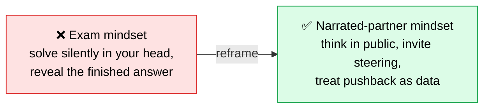
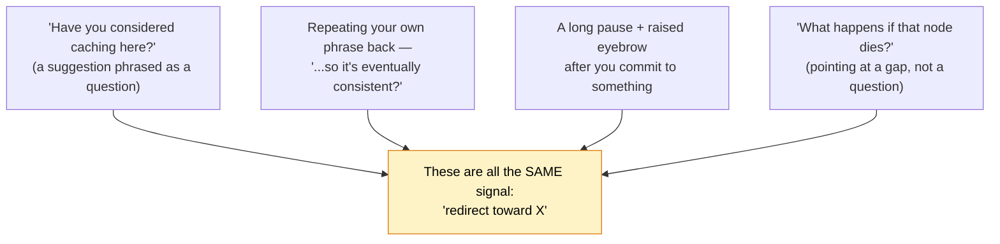
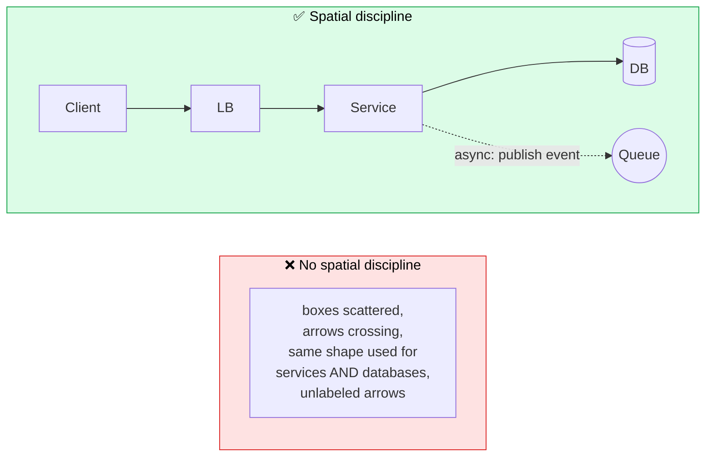
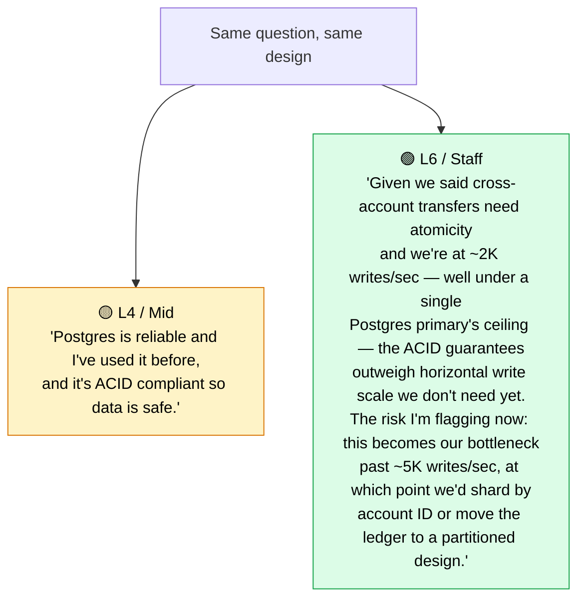
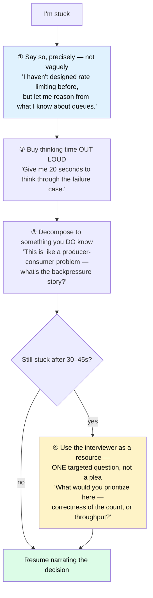
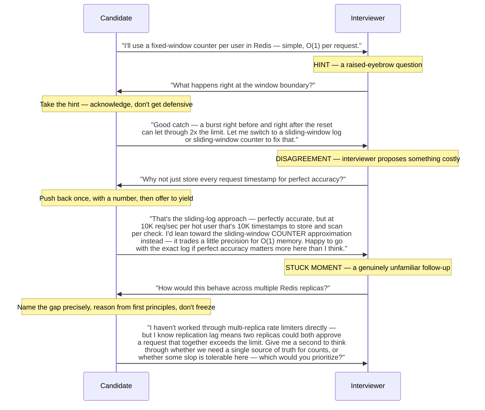
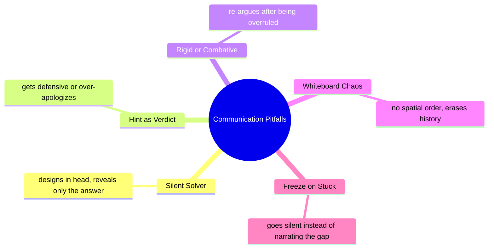

# Interview Communication Framework

> **One line:** In a system design interview, *how* you say something is scored as heavily as *what* you say — a correct design delivered in silence loses to a good-enough design narrated with judgment.

---

## Table of Contents
1. [Why You Must Master This](#1-why-you-must-master-this)
2. [The Mental Model](#2-the-mental-model)
3. [Think Out Loud — The Core Technique](#3-think-out-loud--the-core-technique)
4. [Taking Hints Gracefully](#4-taking-hints-gracefully)
5. [Disagreeing With the Interviewer, Productively](#5-disagreeing-with-the-interviewer-productively)
6. [Whiteboard & Diagramming Hygiene](#6-whiteboard--diagramming-hygiene)
7. [Seniority Signals — L4 vs L6](#7-seniority-signals--l4-vs-l6)
8. [Recovering When Stuck](#8-recovering-when-stuck)
9. [Worked Example — One Deep Dive, Three Communication Tests](#9-worked-example--one-deep-dive-three-communication-tests)
10. [Real-Life Use Cases](#10-real-life-use-cases)
11. [Failure Modes](#11-failure-modes)
12. [Cheat Sheet](#12-cheat-sheet)
13. [🏋️ Practice Drills](#-practice-drills)
14. [🎤 Interview Q&A Bank](#-interview-qa-bank)
15. [🎯 Staff+ Nuances](#-staff-nuances)
16. [Connections & Further Reading](#16-connections--further-reading)

---

## 1. Why You Must Master This

An interviewer cannot see your design — they can only see and hear the *signals* you emit while producing it. [System_Design_Interview_Overview.md](./System_Design_Interview_Overview.md) gives you the 5-phase script (what to do, when). This file is about the layer running on top of that script every single minute: **how you talk while you do it.**

- **Interviewers are literally simulating a future coworker.** The internal question they're answering is *"would I want to design a real system with this person, in a room, under time pressure?"* A flawless architecture from someone who never explains themselves fails that test — an engineer who reasons silently in a real incident call or design review is not a collaborator, they're a bottleneck.
- **Silence is unscoreable, and unscoreable defaults to a fail.** If a candidate stares at the whiteboard for 90 seconds and then writes the *correct* answer, most rubrics have no signal to credit — the interviewer has no evidence of *how* the candidate got there, which is the entire thing being tested. A silent-but-correct candidate consistently scores lower than a talkative candidate who recovers from a wrong turn.
- **It's the highest-leverage, cheapest skill to fix.** Unlike "know Cassandra's internals," which takes weeks, most communication failures are 3–4 specific bad habits (going silent, treating hints as failure, freezing when stuck, a tangled whiteboard) fixable in an afternoon of deliberate practice.

> **The core problem it solves:** the interviewer's *evidence gap*. Your design lives in your head; the only way it gets into theirs is through what you say, draw, and how you react to pushback.

**Prerequisites:** [System_Design_Interview_Overview.md](./System_Design_Interview_Overview.md) — this file assumes you already know the 5-phase clock; here we go deep on the conversational texture *inside* every phase.

---

## 2. The Mental Model

The naive model treats the interview like a written exam: solve internally, then transcribe the final answer. The correct model treats it like **pair-architecting with a colleague who is grading your judgment, not your memory.**



> **Hold onto this:** every silence, every reaction to a hint, and every line on the whiteboard is a data point the interviewer is scoring *in real time* — not a private scratchpad you reveal at the end.

---

## 3. Think Out Loud — The Core Technique

**What it is:** continuously narrating your reasoning *as you form it*, not summarizing it after you've already decided. It is a running commentary track over your own thought process.

**Why it exists / what breaks without it:** a technically perfect design narrated as a monologue of conclusions ("I'll use a message queue here. And a cache here.") gives the interviewer zero visibility into *why* — which is the only thing that's actually hard to fake and the only thing that's actually being graded. Without narration, an interviewer has to interrupt and interrogate every choice, which eats the clock and reads as a candidate who can't self-explain.

**How it actually sounds — verbatim examples:**

| Situation | Weak (silent or conclusion-only) | Strong (narrated) |
|---|---|---|
| Choosing a datastore | *(long pause)* "I'll use Postgres." | "We need strong consistency for account balances and the query patterns are relational — joins across users and transactions — so I'm leaning Postgres over a document store. Let me confirm: are we ever doing multi-region writes? That would change this." |
| Hitting an unknown | *(freezes, says nothing for 20s)* | "I haven't worked with this exact system, so let me reason from first principles — I know consistent hashing solves the 'add a node without reshuffling everything' problem, so I'd expect a similar structure here. Let me sketch it and you tell me if I'm off." |
| Mid-calculation | *(scribbles silently)* | "So that's 50 million users, say 10% daily active — 5 million DAU. At 20 requests a day each, that's 100 million requests over 86,400 seconds, roughly 1,200 QPS average. I'll assume a 3x peak factor, so design for around 3,500 QPS at peak." |

**Decisions vs. uncertainty — narrate both, differently.** These are two distinct narration modes and conflating them is itself a mistake:
- **Narrating a decision** commits: *"I'm choosing X because Y."* Confident, forward-moving.
- **Narrating uncertainty** flags it honestly without freezing: *"I'm not 100% sure this holds under concurrent writes — let me think through a race condition out loud."* This is not weakness; pretending certainty you don't have is worse, because a probing follow-up will expose it anyway.

**Avoiding dead air — the concrete trick:** if you need silent thinking time (and you will), you must announce the silence itself: *"Give me 15 seconds to work through the numbers"* — then think, then resume narrating. Three to five seconds of unexplained silence feels like thirty to an interviewer waiting for a signal; naming the pause converts dead air into a data point ("this person manages the room") instead of a void.

**The trade-off:** over-narrating trivial steps ("I'm now drawing a box for the load balancer... now I'm drawing an arrow...") wastes the clock and reads as padding. Narrate *decisions and reasoning*, not motor actions. Save the dense narration for moments where a choice is being made.

---

## 4. Taking Hints Gracefully

**What it is:** correctly reading and incorporating an interviewer's redirect signal instead of treating it as evidence you've failed.

**Why it exists:** interviewers steer on purpose — to keep you on the track they need to score (usually the deep-dive area their rubric cares about), to rescue you from a rabbit hole before it burns the clock, or to test whether you can take feedback at all. **Taking feedback well is itself a scored skill** — a staff engineer who can't be redirected in a 45-minute interview is a preview of one who can't be redirected in a real design review.

**How interviewers actually signal a redirect** (rarely as a direct command):



**Why treating a hint as failure is wrong:** a candidate who hears "have you considered a cache?" and thinks *"I got it wrong, I'm failing"* often responds by getting flustered, over-apologizing, or defensively justifying the original choice instead of listening. But most hints aren't "you're wrong" — they're "go deeper here" or "I want to see you reason about this specific thing," which is frequently a sign the interviewer thinks you're doing *well enough* to be worth steering into the interesting territory.

**The correct response pattern — acknowledge, incorporate, don't get defensive:**
1. **Acknowledge without over-apologizing:** *"Good point — let's dig into that."* (not "Oh no, you're right, I completely missed that, I'm so sorry.")
2. **Incorporate concretely:** actually change the diagram or reasoning — don't just verbally agree and move on unchanged.
3. **Show you understand *why*:** *"Right — without a cache the DB takes every read, and at our QPS that's the first thing to fall over."* This proves you integrated the hint rather than just complying.

> A hint taken well is scored as *higher* signal than getting it right unprompted and never being tested at all — the interviewer got to see your recovery, which they can't see if you never needed one.

---

## 5. Disagreeing With the Interviewer, Productively

This happens more often than candidates expect: the interviewer proposes something ("what if we just used a single Postgres instance for all of this?") that you believe is actually wrong for the stated requirements. Going silent and complying anyway is a failure mode — so is digging in and refusing to move.

**A concrete phrasing framework — the "yes, and the cost is" push-back:** ① restate their proposal so they know you understood it, ② name the SPECIFIC condition under which it's wrong (tied to a stated requirement or number), ③ offer the alternative and its own cost, ④ explicitly invite them to overrule you.

**Example, verbatim:** *"So the proposal is a single Postgres instance for the whole write path. Given we said 50,000 writes/sec at peak, a single instance would saturate — Postgres tops out around a few thousand writes/sec on typical hardware — so I'd expect it to become the bottleneck almost immediately. I'd lean toward sharding by user ID instead, which costs us cross-shard joins. But if you want to explore the single-instance path anyway — say, if that number is actually smaller than I think — I'm happy to go there."*

**When to yield vs. hold your ground:**

| Signal | Read it as | Response |
|---|---|---|
| "Sure, but let's go with mine for now and see where it leads" | A deliberate steerability test, not a "who's right" contest | Yield fully, note the risk once, then move on. |
| You're only anchored on your first idea, not actually confident | Ego, not judgment | Yield — don't manufacture disagreement to look assertive. |
| The proposal violates a hard requirement stated earlier | A real correctness issue worth 20 seconds | Hold your ground once, with the number — then yield if they still insist. |

> **The rule of one push:** state your objection once, clearly, with a reason tied to a requirement or a number — then follow their call. Repeating the same objection after being overruled reads as inflexible, not principled.

---

## 6. Whiteboard & Diagramming Hygiene

Whether it's a physical whiteboard, a shared doc, or a tool like Excalidraw/Miro, the diagram is a second communication channel running in parallel with your speech — and a messy one actively works against you, because the interviewer is reading it while you talk.



**The concrete rules:**
- **Left-to-right request flow.** Client on the far left, storage on the far right — an interviewer should trace a request with their eyes without you narrating "no, follow this arrow, not that one."
- **Consistent shapes for consistent concepts.** Pick a shape per concept once (rectangle = service, cylinder = database, circle = queue/cache) and hold it all session; switching mid-interview forces a re-parse.
- **Label every arrow with the real protocol or payload**, not a bare line: `HTTP/gRPC — GetUser(id)`, `async — OrderPlaced event`. An unlabeled arrow invites "wait, is that sync or async?" — a question you want pre-empted.
- **Leave room to expand.** Sketch high-level boxes small and centered, not edge-to-edge — the deep dive will bolt a cache, replica, or queue onto whichever box gets picked, and cramped layouts force an illegible rewrite.
- **Don't erase history.** Gray out a rejected approach instead of deleting it — in Excalidraw/Miro drag old shapes aside and dim their opacity. The interviewer may refer back to it ("why did you switch off the synchronous call?"), and deleting it removes the reasoning trail being scored.
- **Remote-tool specifics:** name layers/frames if the tool supports them, keep the whole diagram visible on camera, and periodically re-center so the interviewer isn't hunting for what changed.

---

## 7. Seniority Signals — L4 vs L6

The single fastest way to see the gap: the *same question*, answered at two levels.

**Prompt: "Why did you choose Postgres for this service?"**



| Dimension | L4 / Mid sounds like | L6 / Staff sounds like |
|---|---|---|
| **Requirement-shaping** | Waits to be told the requirements | Proactively surfaces the one that matters: *"Is this ledger append-only, or do we mutate balances in place? That changes everything."* |
| **Risk-naming** | Silent on downsides unless asked | Names the failure mode unprompted, with a number: *"Fine until ~5K writes/sec, then it's the bottleneck — flagging that now."* |
| **Ownership of trade-offs** | Presents the choice as obviously correct | States the cost unprompted: *"We're trading write scale for atomicity — right for a ledger, wrong for a chat app."* |
| **Confidence calibration** | Over-hedges everything, or over-commits with false certainty | Commits when clear, flags uncertainty precisely: *"Confident on the schema; less sure how this behaves under a partition — let me reason through that."* |

> **The pattern underneath all four rows:** L6 answers *pull the future problem into the present sentence.* L4 answers describe the system as it is today; L6 answers describe the system as it is today **and** name the exact number or condition at which today's decision stops being correct.

---

## 8. Recovering When Stuck

Everyone gets stuck — on a component they've never designed, a number they can't recall, or a question that exposes a gap. The failure isn't being stuck; it's going silent while stuck.



**The recovery script, verbatim:**
- *Naming it precisely* (not "I don't know," but "I haven't worked with X directly, but here's the closest thing I do know and how I'd reason from it") shows you can locate the edge of your knowledge — itself a maturity signal.
- *Buying time without going silent*: "Let me think through this for a moment" said out loud, followed by *actual* visible thinking (muttering the sub-problem, sketching), not a wordless stare.
- *Using the interviewer as a resource without reading as helpless* — the difference is asking a **narrow, technical** question that shows you've already framed the problem, versus a broad **"what should I do?"** that hands the whole problem back to them. Compare: ❌ *"I'm not sure what to do here, can you help?"* vs. ✅ *"There's a trade-off between exact and approximate counts here — is correctness or throughput the priority for this feature?"* The second is still asking for help, but it proves you've already done the analysis and only need one input to finish it.

> The candidates who fail on "stuck" moments aren't the ones who hit a wall — everyone does. They're the ones whose wall produces silence instead of a narrated, structured retreat to firmer ground.

---

## 9. Worked Example — One Deep Dive, Three Communication Tests

A single five-minute stretch of a real deep dive typically exercises all three interpersonal skills back to back. Designing a rate limiter, mid-interview:



> Notice the outcome isn't "the candidate knew everything" — it's that every gap became a *visible, narrated* recovery instead of a silent stall. That visibility is what got scored.

---

## 10. Real-Life Use Cases

| Situation | How this framework applies | The decision it forces |
|---|---|---|
| **Design review / RFC meeting** | Narrating reasoning live instead of presenting a finished doc; incorporating a reviewer's concern instead of defending against it | Whether the room trusts your judgment enough to approve without a second pass |
| **Incident bridge / on-call** | Narrating your diagnosis lets others correct a wrong hypothesis before you act on it; the recovery script prevents silent flailing | Whether the team can course-correct you in real time during an outage |
| **Disagreeing with your manager on an architecture call** | The "yes, and the cost is" framework applies unchanged | Whether you're seen as principled, versus someone who caves or digs in |
| **Remote interviews (Excalidraw/Miro/CoderPad)** | Whiteboard hygiene rules apply identically; add explicit narration since body language is lost over video | Whether the interviewer can follow without constant "wait, which arrow?" |

> Real-world habit: the interview is not a special-case performance — it's the *only* moment where these habits are made explicit and graded. Practicing them in the interview is practicing how you'll actually operate in every design review, incident, and 1:1 that follows.

---

## 11. Failure Modes



- **Silent solver.** *Symptom:* long pauses, then a fully-formed answer with no reasoning trail. *Root cause:* treating the interview as an exam solved internally. *Fix:* practice narrating even easy decisions until it's automatic — record a mock interview and count seconds of silence.
- **Hint as verdict.** *Symptom:* over-apologizing or defending the original answer instead of incorporating feedback. *Root cause:* misreading a steering signal as a failure signal. *Fix:* pre-decide any "have you considered..." is a gift, and drill the acknowledge → incorporate → explain-why pattern.
- **Rigid or combative disagreement.** *Symptom:* re-arguing after the interviewer has clearly moved on, or conceding instantly on a real correctness issue. *Root cause:* no framework for *when* to push vs. yield. *Fix:* the "rule of one push" — object once with a number, then follow their call.
- **Whiteboard chaos.** *Symptom:* interviewer keeps asking "wait, which connects to which?" *Root cause:* no spatial or shape discipline. *Fix:* fix a shape vocabulary and left-to-right flow before the first box; dim rejected ideas instead of deleting them.
- **Freeze on stuck.** *Symptom:* 30+ seconds of quiet, or "I don't know" followed by silence. *Root cause:* treating an unknown as disqualifying instead of normal. *Fix:* rehearse the recovery script (name the gap → buy time out loud → decompose → one targeted question) until it's a reflex.

---

## 🏋️ Practice Drills

> *Cover the solutions and attempt first — active recall is the point. Better yet, say your answers out loud to a wall or a recorder; this is a verbal skill.*

**Drill 1 — Narrate the pause.** You need 20 seconds of silent thinking to work out a QPS calculation mid-interview. Write the exact sentence you'd say immediately before going quiet, and the sentence you'd say immediately after.

<details><summary>Solution</summary>

Before: *"Let me work through the math for a second — give me about 20 seconds."* After: *"Okay — 5 million DAU × 20 requests/day ≈ 100 million requests over 86,400 seconds, about 1,200 QPS average; at a 3x peak factor that's ~3,500 QPS."* The arithmetic doesn't matter here — what matters is the silence is announced and bookended, so it reads as controlled thinking, not a stall.
</details>

**Drill 2 — Respond to a hint.** The interviewer says: *"Interesting — so if that service restarts, what happens to the in-flight requests?"* right after you described an in-memory queue. Write your verbal response.

<details><summary>Solution</summary>

Acknowledge without over-apologizing, then incorporate concretely: *"Good point — an in-memory queue loses everything on restart, which is exactly the durability gap. I'd move that to a durable queue like Kafka or SQS so in-flight work survives a restart; the cost is a bit more latency and operational overhead versus the in-memory version."* Notice: no "oh no, I completely missed that" — just acknowledge, fix, and state the new cost.
</details>

**Drill 3 — Push back, then yield.** The interviewer suggests storing all analytics events in the same primary database as the transactional order data, "to keep things simple." You believe this will cause resource contention. Write the push-back, following the four-step framework from Section 5.

<details><summary>Solution</summary>

*"So the idea is one database for both order transactions and analytics events. My concern: analytics workloads run large scans and aggregations, which would compete for I/O and locks with transactional writes — at scale that risks slowing down checkout itself. I'd lean toward streaming events to a separate analytics store instead — the cost is added infrastructure and some replication lag. But if analytics volume here is genuinely small, the shared database might be fine — happy to go with your call."* Then: if they say "let's go with shared for now," commit fully and don't re-raise it.
</details>

---

## 🎤 Interview Q&A Bank

**Q1. Why does communication matter as much as the technical design?**
> Because the interviewer only has access to what I say and draw — a correct design that's never explained gives them no evidence of the judgment they're actually hiring for. They're simulating "would I want to design a real system with this person," and a silent-but-correct answer fails that simulation.

**Q2. The interviewer says "have you considered a cache here?" How do you take that?**
> As a redirect, not a verdict. I acknowledge briefly without over-apologizing, then actually change the design and explain why the cache helps — for example, that it takes read load off the DB before it becomes the bottleneck at our QPS. (Signal: does the candidate defensively justify the original answer, or genuinely incorporate the hint?)

**Q3. What do you do if you disagree with something the interviewer proposes?**
> State the objection once, tied to a stated requirement or number, offer my alternative and its cost, then explicitly invite them to overrule me. If they insist, I yield fully and design well inside their choice — repeating the objection after being overruled reads as inflexible, not principled.

**Q4. What does a staff-level answer sound like versus a mid-level one, for the same question?**
> Mid-level describes the system as it is today and stops. Staff-level does that *and* proactively names the requirement that shaped the choice, states the cost of the decision unprompted, and gives the specific condition or number at which today's decision stops being correct. (See Section 7 for the Postgres example side-by-side.)

**Q5. You get asked about something you genuinely don't know. What do you say?**
> I name the gap precisely rather than freezing — "I haven't worked with X directly, but here's the closest concept I know and how I'd reason from it" — then, if still stuck, I ask one narrow technical question rather than a broad "what should I do?"

**Q6. How do you avoid dead air when you need to think?**
> I announce the pause — "give me 15 seconds to work through this" — instead of going silent unexplained; a few unexplained seconds feel much longer to someone waiting for a signal than a named, bookended pause does.

**Q7. Does whiteboard hygiene actually get scored?**
> Indirectly, yes — a messy diagram forces the interviewer to interrupt and re-parse instead of following my reasoning. Left-to-right flow, consistent shapes, and labeled arrows keep the diagram and my narration reinforcing each other instead of competing.

---

## 🎯 Staff+ Nuances

- **Silence has an exchange rate.** Interviewers unconsciously convert every unexplained second of silence into doubt about your process; announced silence ("let me think for 15 seconds") doesn't carry that cost. It's nearly free to fix and shows up in every interview regardless of the prompt.
- **A hint taken well outscores a hint never needed.** An interviewer who never has to redirect you learns less about your steerability than one who redirects you once and watches you incorporate it cleanly. Don't manufacture mistakes, but don't panic when a genuine one surfaces.
- **Calibrated confidence is a distinct skill from correctness.** Two candidates can reach the same wrong conclusion; the one who said "I'm fairly confident, but let's sanity check the write path" scores better than the one who stated it as unshakeable fact — calibration is what interviewers extrapolate to production judgment.
- **The best disagreements name a number, not a feeling.** "I don't think that's a good idea" is weak; "at 10K req/sec that store saturates around a few thousand writes/sec" is a disagreement the interviewer can actually evaluate and correct you on with equal precision.
- **Whiteboard history is an audit trail — protect it like one.** Staff+ candidates instinctively preserve rejected paths (grayed out, not deleted), the same instinct behind keeping the rejected option in an [ADR](./Trade_off_Analysis.md#7-tools-pugh-matrix-spider-chart-adrs) — a future reviewer will ask what you considered and rejected.
- **These are the same muscles a real design review uses, just compressed.** The interview is a stress-test of narrating trade-offs, taking review comments without defensiveness, and disagreeing with a senior reviewer respectfully — the exact behaviors that determine whether your RFCs get approved and your incident retros are trusted.

---

## 12. Cheat Sheet

```
SCORED AS HEAVILY AS THE DESIGN ITSELF: how you say it, not just what you say.
Simulation being run: "would I want to design a system with this person?"

THINK OUT LOUD
  narrate DECISIONS ("X because Y")  +  narrate UNCERTAINTY ("not sure, reasoning from...")
  need silent time? ANNOUNCE it first: "give me 15 seconds" — never unexplained silence

TAKING HINTS  (signals: "have you considered...", repeated phrase, raised eyebrow, a pointed gap-Q)
  ACKNOWLEDGE (briefly, no over-apology) → INCORPORATE (change the diagram) → EXPLAIN WHY
  a hint ≠ a verdict — it's often "you're doing well enough to steer deeper"

DISAGREEING — "yes, and the cost is" framework
  ① restate their proposal  ② name the SPECIFIC cost, tied to a number/requirement
  ③ offer your alternative + ITS cost  ④ invite them to overrule
  RULE OF ONE PUSH: object once with a reason, then follow their call — don't re-litigate

WHITEBOARD / EXCALIDRAW HYGIENE
  left-to-right request flow · one shape per concept, held all session
  label EVERY arrow with the real protocol/payload · leave room to expand
  grey out rejected paths, never delete — it's the reasoning audit trail

SENIORITY SIGNAL (L4 → L6)
  L4: answers what's asked, silent on risk, no cost owned
  L6: shapes requirements FIRST, names the risk UNPROMPTED with a number,
      owns the trade-off cost out loud, calibrated (not blanket) confidence

STUCK? THE RECOVERY SCRIPT
  ① name the gap precisely (not "I don't know")
  ② buy time OUT LOUD ("give me a moment to think through...")
  ③ decompose to something you DO know
  ④ if still stuck: ONE narrow question ("what would you prioritize — X or Y?")
     never a broad "what should I do?"

RED FLAGS: dead air · hint = panic · re-arguing after being overruled ·
           tangled/erased whiteboard · "I don't know" followed by silence
```

---

## 16. Connections & Further Reading

**Prerequisites (learn first):**
- [System_Design_Interview_Overview.md](./System_Design_Interview_Overview.md) — owns the WHAT and WHEN: the 5-phase clock this file's communication layer runs on top of. That file briefly names "drive, but stay steerable" in its Staff+ Nuances; this file is the deep dive on the entire steering/narration/disagreement layer it deliberately keeps out of scope.
- [Requirement_Gathering.md](./Requirement_Gathering.md) — the clarifying-questions phase is the first big communication test of the interview; the "think out loud" and "proactive requirement-shaping" techniques here apply immediately to how you ask those questions, not just how you answer later ones.

**Builds toward / pairs with:**
- [Trade_off_Analysis.md](./Trade_off_Analysis.md) — that file owns the *content* of a trade-off (the dimensions, the weighing method); this file owns *how you say it out loud* under pushback or disagreement — the "yes, and the cost is" framework in Section 5 is the spoken form of naming a sacrifice.
- [04_Low_Level_Design](../04_Low_Level_Design/) — whiteboard/diagramming hygiene (Section 6) applies unchanged to coding and LLD interviews: consistent notation, left-to-right data flow, and preserving a rejected approach instead of erasing it matter just as much when the "diagram" is a class hierarchy or a sequence of function calls.

**Gaps this topic exposes (candidates for the section's Gap Analysis):**
- A dedicated file on **remote-interview mechanics** (screen-share etiquette, tool-specific Excalidraw/Miro shortcuts, coping with lag/audio issues) would sit naturally alongside this one but is a narrower, more logistical topic than the communication substance covered here.

**External classics:**
- *Cracking the Coding Interview* (Gayle Laakmann McDowell) — the "communicate clearly" chapters apply near-verbatim to system design rounds.
- *The Staff Engineer's Path* (Tanya Reilly) — influence without authority, disagreeing productively, and owning trade-offs in real design reviews: the exact muscles this file compresses into interview form.

---

## TL;DR
**A correct design delivered in silence scores worse than a good-enough design narrated with judgment** — because the interviewer can only grade what they can see and hear. Think out loud continuously (narrate decisions with confidence, narrate uncertainty honestly, and announce any silence before taking it); treat hints as steering, not verdicts, and incorporate them without getting defensive; disagree at most once, with a number tied to a real requirement, then yield fully if overruled; keep the whiteboard spatially disciplined (left-to-right, consistent shapes, labeled arrows, nothing erased); and when you're genuinely stuck, name the gap precisely, buy thinking time out loud, and ask one narrow question instead of freezing. These habits aren't interview theater — they're the same behaviors that make design reviews, incidents, and RFCs trustworthy in the real job.
