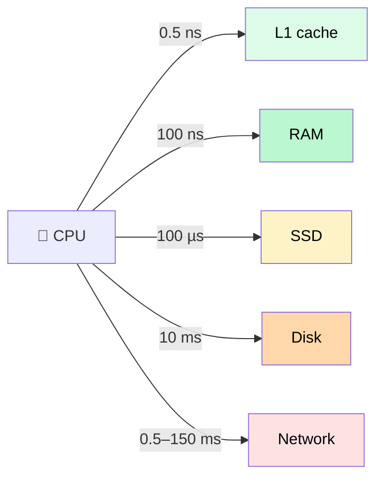
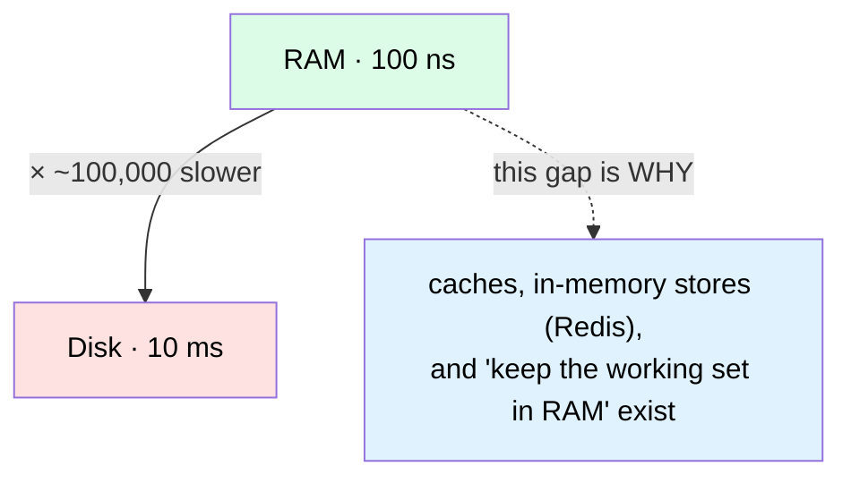
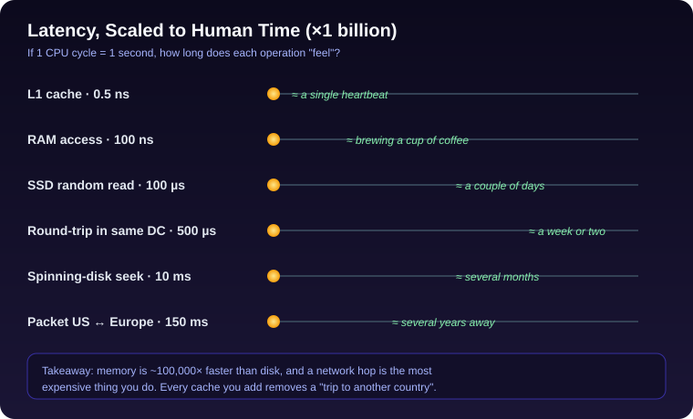
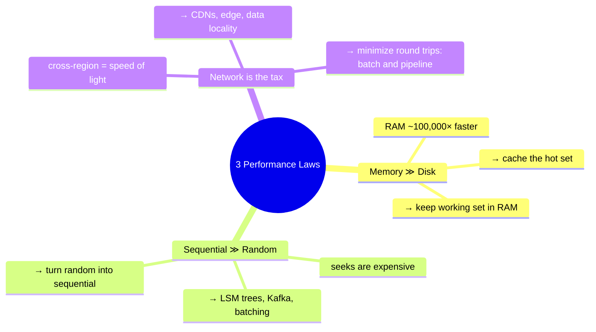
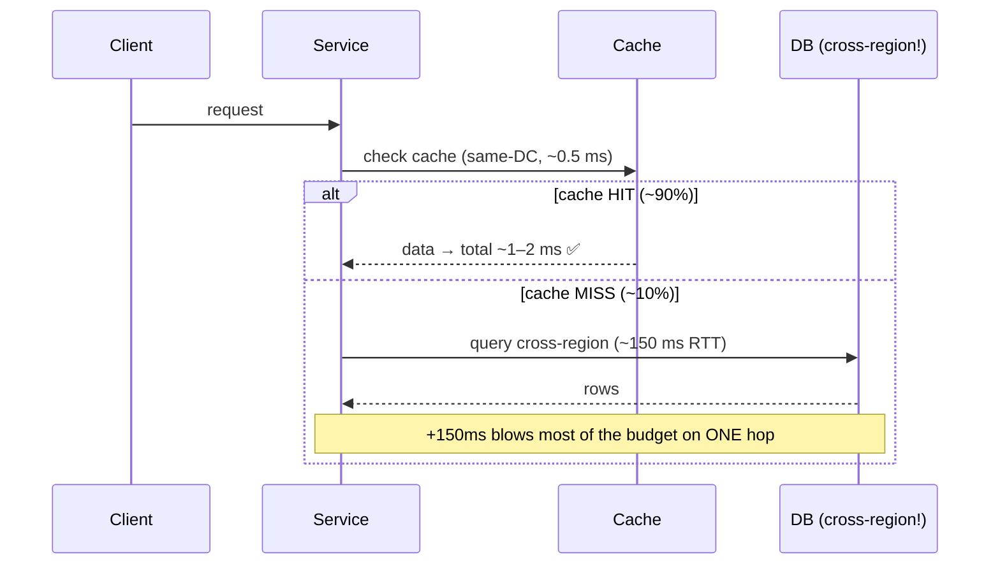
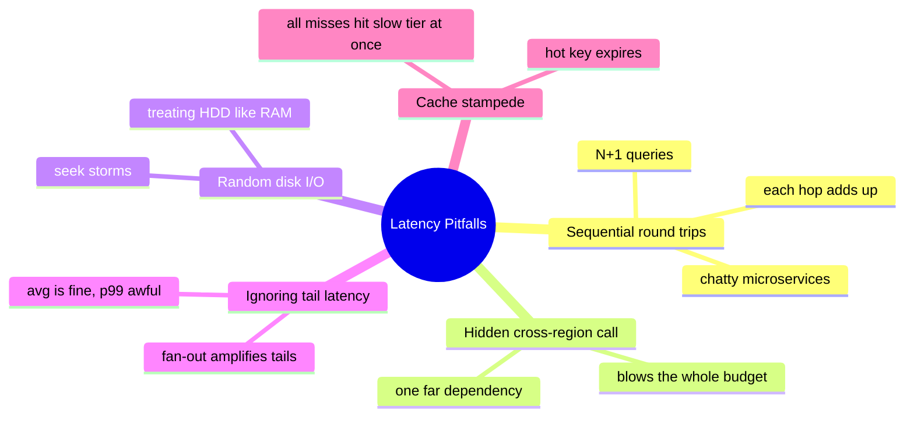

# Latency Numbers Every Programmer Should Know

> **One line:** A handful of memorized latencies — RAM is ~100 ns, SSD ~100 µs, disk ~10 ms, a network hop ~0.5–150 ms — lets you predict, in your head, whether a design will be fast or slow *before you build it.*

---

## Table of Contents
1. [Why You Must Master This](#1-why-you-must-master-this)
2. [The Mental Model](#2-the-mental-model)
3. [The Canonical Table](#3-the-canonical-table)
4. [The Memory Hierarchy & "The Cliff"](#4-the-memory-hierarchy--the-cliff)
5. [Scaled to Human Time](#5-scaled-to-human-time)
6. [Three Laws Baked Into the Numbers](#6-three-laws-baked-into-the-numbers)
7. [Worked Example — Read Path Budget](#7-worked-example--read-path-budget)
8. [Real-Life Use Cases](#8-real-life-use-cases)
9. [Failure Modes](#9-failure-modes)
10. [🏋️ Practice Drills](#-practice-drills)
11. [🎤 Interview Q&A Bank](#-interview-qa-bank)
12. [🎯 Staff+ Nuances](#-staff-nuances)
13. [Cheat Sheet](#13-cheat-sheet)
14. [Connections & Further Reading](#14-connections--further-reading)

---

## 1. Why You Must Master This

These numbers (popularized by Jeff Dean and Peter Norvig) are the **fundamental constants of computing** — like a physicist knowing the speed of light. They turn vague performance hunches into arithmetic.

- **Predict latency without benchmarking** — "this endpoint does 3 sequential cross-region calls" instantly reads as "≥450 ms, too slow," before any code exists.
- **Justify every cache, CDN, and replica** — each exists *because* a number above it is 100–100,000× faster than the one below.
- **Diagnose incidents fast** — "p99 jumped to 150 ms" points straight at a cross-region hop; "10 ms" smells like a spinning disk; "1 ms+" inside a request smells like a missing cache.

> **The core problem it solves:** reasoning about performance *quantitatively and instantly*, instead of guessing and measuring after the fact.

---

## 2. The Mental Model

Every operation your code does is really a **trip to fetch data**, and the trips differ in cost by *orders of magnitude*. The whole game of performance engineering is **keeping data as close to the CPU as possible** and **avoiding long trips** (especially the network).



---

## 3. The Canonical Table

Memorize the **bold rows** — they're the ones you'll actually use in design.

| Operation | Latency | Notes |
|-----------|--------:|-------|
| **L1 cache reference** | **0.5 ns** | the baseline "1 unit" |
| Branch mispredict | 5 ns | |
| **L2 cache reference** | **7 ns** | ~14× L1 |
| Mutex lock/unlock | 25 ns | |
| **Main memory (RAM) reference** | **100 ns** | ~200× L1 |
| Compress 1 KB (Snappy) | 3 µs | |
| Send 1 KB over 1 Gbps network | 10 µs | |
| **SSD random read** | **100 µs** | ~1,000× RAM |
| Read 1 MB sequentially from RAM | 250 µs | |
| **Round trip within same datacenter** | **500 µs** | |
| Read 1 MB sequentially from SSD | 1 ms | |
| **Disk seek (spinning HDD)** | **10 ms** | ~100× SSD |
| Read 1 MB sequentially from disk | 20 ms | |
| **Packet round trip CA ↔ Netherlands** | **150 ms** | bounded by speed of light |

> **Order-of-magnitude anchors (the ones to truly memorize):**
> `RAM ≈ 100 ns` · `SSD ≈ 100 µs` · `same-DC RTT ≈ 500 µs` · `disk seek ≈ 10 ms` · `cross-region ≈ 150 ms`

---

## 4. The Memory Hierarchy & "The Cliff"

Each level down is bigger, cheaper, and dramatically slower. The brutal jump is **RAM → disk**, where you fall off a ~100,000× cliff.





The entire reason Redis, Memcached, page caches, and "hold the hot set in memory" exist is this single cliff. Every cache hit *avoids* a fall off it.

---

## 5. Scaled to Human Time

Numbers in nanoseconds are impossible to feel. Multiply everything by ~1 billion (so 1 ns → 1 second) and the hierarchy becomes visceral:



| Operation | Real | If 1 ns = 1 second |
|-----------|-----:|--------------------|
| L1 cache | 0.5 ns | half a second |
| RAM | 100 ns | ~1.5 minutes |
| SSD read | 100 µs | ~1 day |
| Same-DC round trip | 500 µs | ~6 days |
| Disk seek | 10 ms | ~4 months |
| Cross-region packet | 150 ms | **~5 years** |

> A cross-continent network call, in human terms, is like waiting **five years** for an answer you could have gotten from RAM in **a minute and a half.** That is why data locality and caching dominate performance work.

---

## 6. Three Laws Baked Into the Numbers



1. **Memory beats disk by ~100,000×** → cache aggressively; keep the working set in RAM.
2. **Sequential beats random** → a 1 MB *sequential* read is cheap; many small *random* reads are not. Databases (LSM-trees), logs (Kafka), and batch I/O are all designed to convert random access into sequential.
3. **The network is the dominant tax** → a cross-region round trip dwarfs everything local. Minimize the *number* of round trips (batch, pipeline, parallelize) and move data closer to users (CDNs, edge, regional replicas).

---

## 7. Worked Example — Read Path Budget

Your SLO is **p99 < 200 ms** for an API. You're considering this read path:



**Reading the numbers:** the hit path is trivially under budget. The miss path spends ~150 ms on a single cross-region hop — so your p99 is dominated by misses to a far DB. **Fix:** put a read replica in-region (same-DC RTT ~0.5 ms instead of 150 ms), and raise the hit rate. The latency table told you *where* the budget goes before you wrote a line.

---

## 8. Real-Life Use Cases

| Situation | How the numbers decide it |
|-----------|---------------------------|
| **Choosing storage medium** | Random-heavy access → SSD (100 µs), not HDD (10 ms). The 100× gap is the whole decision. |
| **Cache vs no cache** | If a DB read is ~1–10 ms and RAM is ~100 ns, a cache hit is ~10,000× faster — trivially worth it for hot data. |
| **Multi-region design** | Synchronous cross-region writes add ~150 ms each. That single number drives async replication / regional write decisions. |
| **N+1 query smell** | 100 sequential DB round trips × 0.5 ms = 50 ms wasted; batch into one query. The numbers quantify the anti-pattern. |
| **Incident triage** | "p99 = 10 ms" → disk seek somewhere; "p99 = 150 ms" → a cross-region call sneaked in; "p99 = 1 ms" inside a hot loop → maybe a lock or RAM-bandwidth issue. |
| **gRPC/fan-out tuning** | A request waiting on 10 parallel calls is as slow as the slowest; the numbers tell you whether to parallelize or reduce fan-out. |

> Real-world habit: **annotate your architecture diagrams with the latency of each hop.** The sum is your latency budget; the biggest hop is your first optimization target.

---

## 9. Failure Modes



- **Sequential round trips** — N+1 queries and chatty service-to-service calls; each hop's latency *adds*. Batch and parallelize.
- **A hidden cross-region call** — one far dependency silently added to a hot path blows the entire budget.
- **Random disk I/O** — treating a spinning disk like RAM causes seek storms; use SSDs or sequential access patterns.
- **Ignoring tail latency** — average looks fine while p99 is terrible, especially with fan-out (the request waits on the slowest of N).

---

## 🏋️ Practice Drills

> *Estimate from memory before checking. Round to orders of magnitude.*

**Drill 1 — Ratios.** How many times slower is a disk seek than a RAM reference? An SSD read than RAM?

<details><summary>Solution</summary>

Disk seek (10 ms) ÷ RAM (100 ns) = `10,000,000 ÷ 100 = 100,000×`. SSD (100 µs) ÷ RAM (100 ns) = `100,000 ÷ 100 = 1,000×`. RAM ≫ SSD ≫ disk, each ~3 orders of magnitude apart.
</details>

**Drill 2 — Budget a request.** An endpoint makes 5 sequential same-DC service calls (0.5 ms RTT each) and 1 cache lookup (0.2 ms). Ignoring compute, what's the floor latency?

<details><summary>Solution</summary>

`5 × 0.5 ms + 0.2 ms = 2.7 ms`. Fine for a 200 ms SLO — *unless* one of those calls is actually cross-region (150 ms), which would dominate everything. Always check where each hop physically lives.
</details>

**Drill 3 — Cache the cliff.** A query reads 1 MB randomly from a spinning disk on every request. Quantify the win from serving it from RAM instead.

<details><summary>Solution</summary>

Disk: a seek (~10 ms) plus ~20 ms to read 1 MB ≈ ~30 ms. RAM: read 1 MB sequentially ≈ 250 µs. Win ≈ `30 ms ÷ 0.25 ms ≈ 120×` faster — and it removes IOPS pressure on the disk. This is the cache business case in one calculation.
</details>

**Drill 4 — Fan-out tail.** A request calls 20 services in parallel; each has p99 = 10 ms but p50 = 2 ms. Roughly what's the request's p99-ish latency?

<details><summary>Solution</summary>

With 20 parallel calls you're very likely to hit at least one call's slow tail, so the *whole request* trends toward the per-call p99 (~10 ms+), not the p50. High fan-out amplifies tail latency — reduce fan-out or hedge requests.
</details>

---

## 🎤 Interview Q&A Bank

**Q1. Roughly how long is a main-memory reference vs an SSD read vs a disk seek?**
> RAM ≈ 100 ns, SSD random read ≈ 100 µs, disk seek ≈ 10 ms. Each is about 3 orders of magnitude apart.

**Q2. Why is RAM so much faster than disk, and why does it matter?**
> ~100,000× faster. It's the reason caches and in-memory stores exist — every cache hit avoids a far slower disk/network trip.

**Q3. Sequential vs random access — why care?**
> Sequential reads avoid seek/latency overhead and are far cheaper per byte. Systems (LSM-trees, Kafka, batch I/O) are designed to convert random access into sequential to exploit this.

**Q4. How long is a cross-region round trip and what does it imply?**
> ~150 ms (CA↔Europe), bounded by the speed of light. It implies you avoid synchronous cross-region calls on hot paths and use regional replicas/CDNs.

**Q5. An endpoint's p99 is 150 ms but p50 is 3 ms. What's your first hypothesis?**
> A cross-region network call (or a far dependency) hit on the slow path — the 150 ms signature is unmistakable. Likely a cache miss falling through to a distant store.

**Q6. How do you keep a 200 ms SLO with a cross-region database?**
> Add an in-region read replica/cache (turning a 150 ms hop into a ~0.5 ms one), do writes async, and minimize round trips on the request path.

**Q7. Why does high fan-out hurt tail latency?**
> A request waiting on N parallel calls completes only when the *slowest* finishes, so its latency trends toward the per-call tail. More fan-out → more chances to hit a slow tail.

---

## 🎯 Staff+ Nuances

- **The exact nanoseconds change yearly; the *ratios* are timeless.** Hardware gets faster, but RAM-to-disk and local-to-network ratios stay ~100,000× and ~1000×. Reason in ratios, not absolutes, and your mental model never goes stale.
- **Bandwidth and latency are different axes.** A disk can have great *throughput* (sequential MB/s) and terrible *latency* (random seek). Cloud network links have high bandwidth but fixed latency floors. Optimize for whichever your workload is bound by.
- **Latency has a hard floor: the speed of light.** ~5 µs per km round trip in fiber. No amount of engineering makes NYC↔London faster than ~28 ms one way. This is why CDNs/edge exist — you move the *computation* closer, you can't speed up the photons.
- **Tail latency, not average, is what users feel and what fan-out amplifies.** A service with 1% slow requests becomes a near-certainty of slowness once you fan out to 100 of them. Hedged requests, timeouts, and reducing fan-out are the levers (see [QPS_TPS_Estimation.md](./QPS_TPS_Estimation.md)).
- **Coordinated omission corrupts latency measurements.** Naive load tests stop sending during stalls and under-report the tail. Trust percentiles only from tools that correct for it (HdrHistogram-style).
- **These numbers feed straight into back-of-the-envelope estimation.** Capacity, cache sizing, and "shard or not" decisions all rest on them — they're the unit constants of [Back_of_the_Envelope_Estimation.md](./Back_of_the_Envelope_Estimation.md).

---

## 13. Cheat Sheet

```
MEMORIZE THE ANCHORS
  L1 cache .......... 0.5 ns
  RAM ............... 100 ns      (~200× L1)
  SSD random read ... 100 µs      (~1,000× RAM)
  same-DC RTT ....... 500 µs
  disk seek ......... 10 ms       (~100× SSD)
  cross-region RTT .. 150 ms      (speed-of-light bound)

THE CLIFF:  RAM → disk ≈ 100,000× slower → CACHE.

THREE LAWS
  1. memory ≫ disk        → cache hot set, keep working set in RAM
  2. sequential ≫ random  → LSM trees, Kafka, batch I/O
  3. network is the tax   → CDNs, regional replicas, fewer round trips

HUMAN SCALE (1 ns = 1 sec)
  RAM = 1.5 min · SSD = 1 day · disk = 4 months · cross-region = 5 YEARS

DIAGNOSE BY SIGNATURE
  p99 ~10 ms  → disk seek      p99 ~150 ms → cross-region hop
  reason in RATIOS (timeless), not absolute ns (changes yearly)
```

---

## 14. Connections & Further Reading

**Within this repo:**
- [Back_of_the_Envelope_Estimation.md](./Back_of_the_Envelope_Estimation.md) — these numbers are its unit constants.
- [QPS_TPS_Estimation.md](./QPS_TPS_Estimation.md) — tail latency, fan-out, and the saturation knee.
- [Capacity_Planning.md](./Capacity_Planning.md) — IOPS vs storage, the throughput-vs-latency distinction.
- [06_Caching_Performance](../06_Caching_Performance/) · [05_Databases_Storage](../05_Databases_Storage/) — where these numbers drive design.

**External classics:**
- *Latency Numbers Every Programmer Should Know* — Jeff Dean / Peter Norvig (and Colin Scott's interactive, year-by-year visualization).
- *Designing Data-Intensive Applications* (Kleppmann) — storage engines, sequential vs random.
- *The Tail at Scale* (Dean & Barroso, CACM 2013) — the definitive tail-latency paper.

---

## TL;DR
Memorize a handful of constants — **RAM ≈ 100 ns, SSD ≈ 100 µs, same-DC RTT ≈ 500 µs, disk seek ≈ 10 ms, cross-region ≈ 150 ms** — and you can predict any design's performance in your head. Three timeless laws fall out: **memory crushes disk (~100,000×) so cache; sequential crushes random so batch; the network is the tax so minimize round trips and stay local.** Reason in **ratios**, watch the **tail**, and annotate every hop of your design with its latency.
