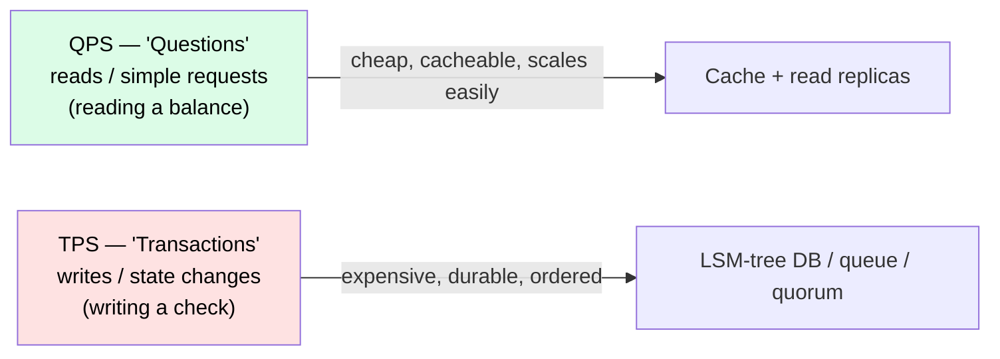
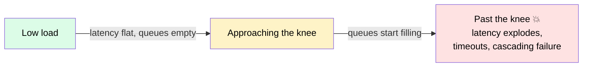
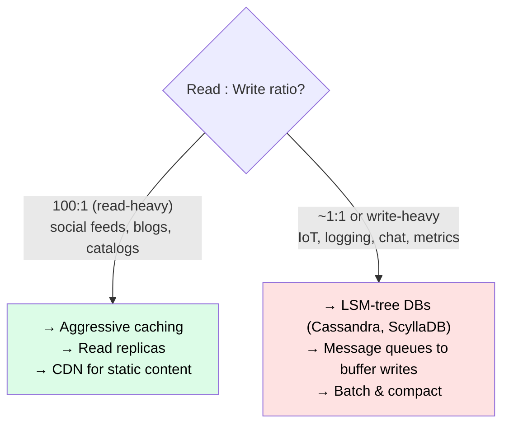
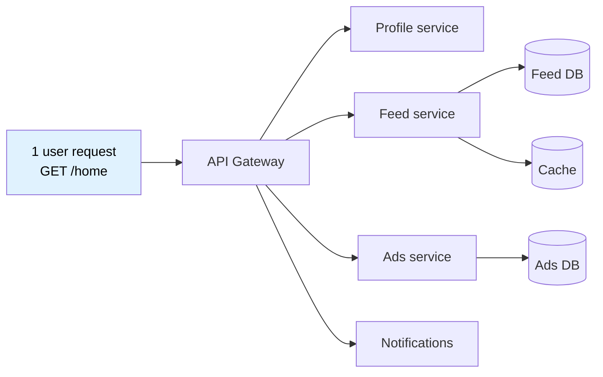
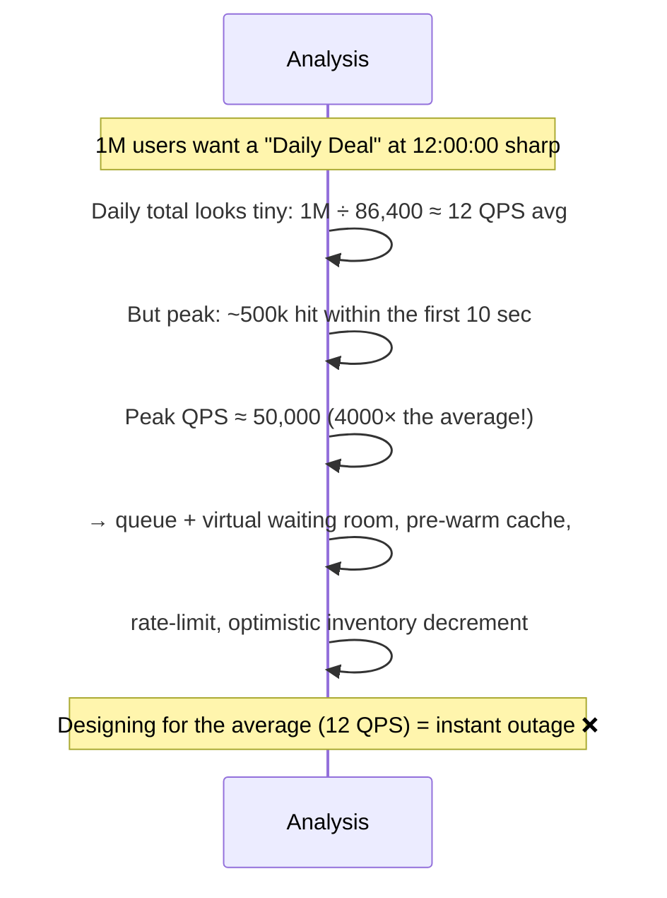
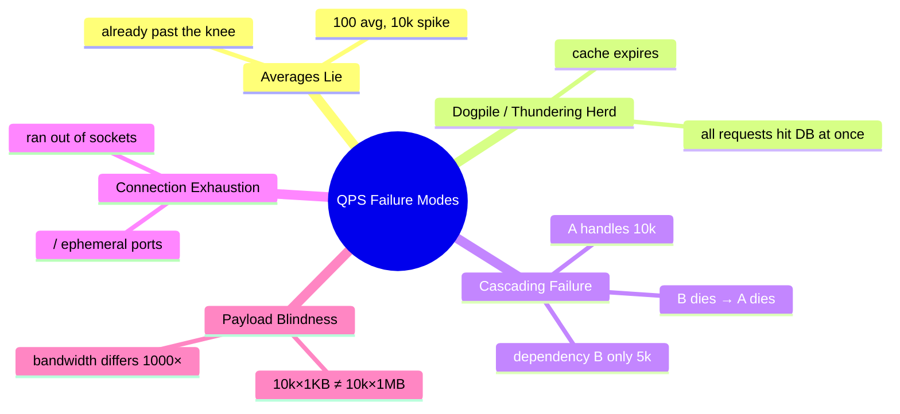

# QPS / TPS Estimation

> **One line:** QPS/TPS is the *speedometer* of your system — it tells you not just whether your design works, but how fast it must work *per second* to stay alive. And every component has a cliff (the "knee") past which latency explodes.

---

## Table of Contents
1. [Why You Must Master This](#1-why-you-must-master-this)
2. [The Mental Model](#2-the-mental-model)
3. [QPS vs TPS vs Concurrency](#3-qps-vs-tps-vs-concurrency)
4. [How to Calculate It](#4-how-to-calculate-it)
5. [The Saturation Curve & the "Knee"](#5-the-saturation-curve--the-knee)
6. [Read/Write Ratio Drives Everything](#6-readwrite-ratio-drives-everything)
7. [Fan-Out: Why Internal QPS ≫ User QPS](#7-fan-out-why-internal-qps--user-qps)
8. [Little's Law](#8-littles-law)
9. [Worked Example — Flash Sale](#9-worked-example--flash-sale)
10. [Real-Life Use Cases](#10-real-life-use-cases)
11. [Failure Modes](#11-failure-modes)
12. [Interview Playbook](#12-interview-playbook)
13. [Cheat Sheet](#13-cheat-sheet)
14. [🏋️ Practice Drills](#-practice-drills)
15. [🎤 Interview Q&A Bank](#-interview-qa-bank)
16. [🎯 Staff+ Nuances](#-staff-nuances)
17. [Connections & Further Reading](#17-connections--further-reading)

---

## 1. Why You Must Master This

Every component — database, load balancer, API framework, even a single thread pool — has a **maximum requests-per-second** it can serve. Exceed it and requests *queue*, latency spikes, timeouts cascade, and the system collapses. QPS/TPS estimation tells you that ceiling *before* it hits you.

- **The throughput barrier** — a single Python web server handles < 1,000 req/s, not 100,000. Know the limits of your tools.
- **Concurrency ≠ throughput** — "1M users logged in" is *not* "1M requests/sec." Conflating them is the #1 rookie error.
- **Database selection** — 1M read QPS needs a fundamentally different database than 1k write TPS.

> **The core problem it solves:** *designing for the wrong number.* A system handles 1M users/day easily but dies at noon when all of them hit a "Daily Deal" in the same second. You must design for the **peak second**, not the daily total.

---

## 2. The Mental Model



Reading a balance (QPS) is cheap and infinitely cacheable. Writing a check (TPS) must be durable, ordered, and consistent — it's **always slower and harder.** Keep them separate in your head.

---

## 3. QPS vs TPS vs Concurrency

| Term | Measures | Analogy | Scaled by |
|------|----------|---------|-----------|
| **Concurrency** | How many users/connections are active *right now* | People in the restaurant | Connection pools, memory |
| **QPS** | Read/simple requests served per second | Questions answered per second | Caches, read replicas, stateless app nodes |
| **TPS** | Write/transactional ops completed per second | Bills paid per second | Sharding, write-optimized DBs, queues |

> 1 million concurrent users does **not** mean 1 million QPS. If each user acts once every 30 seconds, that's ~33k QPS. Concurrency tells you about connections and memory; throughput tells you about CPU and I/O work.

---

## 4. How to Calculate It

```
① Average QPS = total daily requests ÷ 86,400   (≈ ÷ 100,000 rounded)
② Peak QPS    = average QPS × peak_factor
                  • 2–5×   for steady consumer apps
                  • 10×+   for spiky events (flash sales, ticket drops, sports)
③ Split reads vs writes by the read:write ratio
④ Multiply by fan-out for internal/downstream QPS
```

**Worked anchor:** DAU = 100M, 10 actions/user/day →
```
1,000,000,000 actions/day ÷ 100,000 sec ≈ 10,000 avg QPS
Peak (×2.5) ≈ 25,000 QPS  →  "I'll plan for 25k–50k peak."
```

> Always *round to powers of 10* and state your peak factor out loud. See the funnel in [Back_of_the_Envelope_Estimation.md](./Back_of_the_Envelope_Estimation.md).

---

## 5. The Saturation Curve & the "Knee"

This is the single most important graph in throughput engineering. Latency stays flat as load rises — until you hit the **knee**, where queues build and latency goes vertical.





> **Why averages lie:** a system averaging 100 QPS but receiving 10,000 in one second and 0 the rest of the minute has *already crossed the knee* in that spike. This is why capacity planning targets the **peak**, keeps **~30% headroom**, and stays left of the knee. See [Capacity_Planning.md](./Capacity_Planning.md).

---

## 6. Read/Write Ratio Drives Everything

The ratio of reads to writes is the single biggest input to your database and caching strategy.



| Workload | Typical ratio | Strategy |
|----------|--------------|----------|
| Twitter timeline | ~100:1 reads | Cache timelines, read replicas |
| Bank ledger | write-critical | Strong consistency, ACID, quorum writes |
| IoT sensor ingest | write-heavy | Time-series/LSM DB, queue buffer |
| URL shortener | ~100:1 reads | Cache the viral 20% |

---

## 7. Fan-Out: Why Internal QPS ≫ User QPS

One user request often explodes into many internal service calls. Your *internal* QPS is what actually overloads downstream systems.



```
User-facing QPS = 100
Fan-out factor  = 10 internal calls per request
→ Internal QPS  = 1,000   (the number your databases actually feel)
```

> A famous real-world version: **ad-tech** (Google/Facebook Ads). One page load triggers a millisecond auction fanning out to many bidders — these systems run at **millions of internal QPS**, and the bottleneck is often *network throughput*, not the database.

---

## 8. Little's Law

The mathematical glue between concurrency, throughput, and latency:

```
   L = λ × W
   (concurrency) = (throughput) × (latency)

   Concurrent requests in system  =  arrival rate (QPS)  ×  avg time each spends
```

**Example:** at 1,000 QPS with 200 ms average latency → `1000 × 0.2 = 200` requests in flight at once. That tells you the thread-pool / connection-pool size you need. If latency rises to 1 s, you suddenly need 1,000 concurrent slots — and pool exhaustion is exactly how the knee turns into an outage.

---

## 9. Worked Example — Flash Sale



The flash sale is the canonical proof that **the daily average is a dangerous lie.** The peak factor here is in the thousands.

---

## 10. Real-Life Use Cases

| Situation | How QPS/TPS estimation decides it |
|-----------|-----------------------------------|
| **Load testing (k6, Locust, JMeter)** | You set a target QPS and ramp until latency crosses your SLO — finding the knee empirically. |
| **Autoscaling thresholds** | "Scale out at 70% of single-node QPS capacity" keeps you left of the knee. |
| **Database capacity** | "50k write TPS projected; a single Postgres leader caps ~10k" → you *know* to shard or pick Cassandra *before* the crisis. |
| **Rate limiting** | You cap per-client QPS to protect shared downstream capacity (see [11_Security_Identity](../11_Security_Identity/)). |
| **Cloud cost** | Lambda/API Gateway bill *per request* — QPS × seconds-per-month = your invoice line item. |
| **Incident diagnosis** | "Latency spiked but CPU is at 40%" → you're knee-deep in queueing or connection exhaustion, not CPU saturation. |

```javascript
// k6 load test: find the QPS where p99 latency exceeds 500ms
import http from 'k6/http';
import { sleep } from 'k6';

export const options = {
  stages: [
    { duration: '1m', target: 100 },   // ramp to 100 VUs
    { duration: '2m', target: 1000 },  // push toward the knee
    { duration: '1m', target: 0 },     // ramp down
  ],
  thresholds: { http_req_duration: ['p(99)<500'] }, // SLO guardrail
};

export default function () {
  http.get('https://api.myapp.com/v1/resource');
  sleep(1);
}
```

---

## 11. Failure Modes



- **Averages lie** — design for the peak second, not the daily mean.
- **Dogpile / thundering herd** — a popular cache key expires and thousands of requests slam the DB simultaneously. Mitigate with request coalescing, jittered TTLs, and lock-on-miss.
- **Cascading failure** — A handles 10k QPS but its dependency B handles only 5k; a spike to A kills B, which then kills A. Use **circuit breakers** and **backpressure**.
- **Connection exhaustion** — high QPS runs you out of ephemeral ports / file descriptors even with idle CPU.
- **Payload blindness** — 10k QPS of 1 KB messages vs 10k QPS of 1 MB images differ by 1000× in bandwidth. QPS alone is incomplete; always pair it with payload size.

---

## 12. Interview Playbook

**✅ Do:**
- Compute **peak**, not just average: "DAU 100M × 10 = 1B/day ÷ 100k ≈ 10k avg, peak ~25k."
- Separate read QPS from write TPS — they hit different systems.
- Apply fan-out for internal QPS.
- Connect the number to a decision: "25k write TPS exceeds one leader → shard."

**🚩 Red flags:** confusing QPS with number of users; ignoring the peak factor; quoting QPS without payload size.

**Common follow-up:** *"How does your design change if write QPS doubles?"* — be ready to talk sharding, queue buffering, and write-optimized storage.

---

## 13. Cheat Sheet

```
QPS = reads/simple req per sec    TPS = writes/txns per sec
CONCURRENCY ≠ THROUGHPUT (1M users ≠ 1M QPS)

avg QPS  = daily requests ÷ 100,000
peak QPS = avg × (2–5× steady | 10×+ spiky)
internal QPS = user QPS × fan-out factor

LITTLE'S LAW:  L = λ × W
  in-flight = QPS × latency(sec)   → sizes your pools

READ:WRITE   100:1 → cache + replicas
             ~1:1   → LSM DB + queues

STAY LEFT OF THE KNEE → keep ~30% headroom
ALWAYS pair QPS with PAYLOAD SIZE
```

---

## 🏋️ Practice Drills

> *Compute peak, separate reads from writes, and apply Little's Law.*

**Drill 1 — Peak from DAU.** 50M DAU, each makes 20 requests/day, peak factor 3×. What's average and peak QPS?

<details><summary>Solution</summary>

`50M × 20 = 1B/day ÷ 100k sec = 10,000 avg QPS`. Peak `× 3 = 30,000 QPS`. Design for 30k, not 10k.
</details>

**Drill 2 — Little's Law sizing.** Your service handles 2,000 QPS at 150ms average latency. How many requests are in flight, and what does that tell you?

<details><summary>Solution</summary>

`L = λ × W = 2000 × 0.15 = 300` concurrent requests. So your thread/connection pool must hold ~300 with headroom. If latency degrades to 1s, you'd suddenly need 2,000 slots — pool exhaustion is how the knee becomes an outage.
</details>

**Drill 3 — Fan-out trap.** A home-feed endpoint at 500 user-QPS calls 8 downstream services per request. What internal QPS hits those services, and which number do you capacity-plan against?

<details><summary>Solution</summary>

`500 × 8 = 4,000 internal QPS`. You plan downstream capacity against 4k (peak-adjusted), not the 500 user-facing QPS. Fan-out is why internal load dwarfs user load.
</details>

**Drill 4 — Flash sale.** 2M users want a deal at 12:00:00; ~80% arrive in the first 5 seconds. Estimate peak QPS and one mitigation.

<details><summary>Solution</summary>

`1.6M ÷ 5 sec = 320,000 QPS` peak — thousands of times the daily average. Mitigations: virtual waiting room/queue, pre-warmed cache, rate limiting, optimistic inventory decrement. Designing for the daily average would mean instant collapse.
</details>

---

## 🎤 Interview Q&A Bank

**Q1. Difference between QPS and TPS?**
> QPS = reads/simple requests per second (cheap, cacheable). TPS = write/transactional operations per second (durable, ordered, harder). Reads scale with caches and replicas; writes need sharding or write-optimized stores.

**Q2. Does 1M users mean 1M QPS?**
> No — that conflates concurrency with throughput. If each user acts once every 30s, 1M users ≈ 33k QPS. Concurrency sizes connection pools/memory; throughput sizes CPU/IO work.

**Q3. Why design for peak instead of average?**
> Systems fail at the peak second, not the daily mean. A system averaging 100 QPS but receiving 10k in one burst has already crossed the latency "knee."

**Q4. State Little's Law and its use.**
> `L = λ × W`: concurrent requests = throughput × latency. It sizes thread/connection pools and explains why rising latency causes pool exhaustion.

**Q5. What's the "knee" of the throughput curve?**
> The load level where queues start filling and latency goes from flat to vertical. Capacity planning keeps you left of it with ~30% headroom.

**Q6. How does read:write ratio change your DB choice?**
> 100:1 read-heavy → caching + read replicas (maybe SQL). Write-heavy/1:1 → LSM-tree stores (Cassandra/ScyllaDB) + queues to buffer writes.

**Q7. What's a dogpile / thundering herd?**
> A hot cache key expires and thousands of requests hit the DB simultaneously. Mitigate with request coalescing, jittered TTLs, and lock-on-miss (single flight).

**Q8. Why isn't QPS alone enough?**
> Payload matters: 10k QPS of 1 KB vs 10k QPS of 1 MB differ by 1000× in bandwidth. Always pair QPS with payload size.

---

## 🎯 Staff+ Nuances

- **Queueing theory, not averages, governs tail latency.** Past ~70–80% utilization, latency rises super-linearly (the M/M/1 wall). This is *why* the headroom rule exists — it's physics, not caution.
- **Coordinated omission hides your worst latencies.** Many load tests under-report tail latency because they stop sending requests when the system stalls. Tools/methodology (e.g., HdrHistogram, corrected load generators) matter or your p99 is a fiction.
- **Backpressure beats unbounded queues.** When a dependency is past its knee, buffering more requests just converts a latency problem into an OOM crash. Bounded queues + load shedding + circuit breakers degrade gracefully instead of collapsing.
- **Fan-out amplifies tail latency, not just throughput.** A request that waits on 10 parallel calls is as slow as the *slowest* of the 10 — so p99 of the whole is driven by p99 of each downstream. Reducing fan-out or hedging requests is a tail-latency lever.
- **Read and write QPS often need entirely different datastores.** It's common to split a system's read path (cache + replicas + search index) from its write path (leader + queue), accepting eventual consistency between them — a direct consequence of asymmetric QPS.
- **Autoscaling reacts in minutes; spikes arrive in seconds.** For known spiky events (sales, sports), pre-scale or use a waiting room. Reactive autoscaling alone will let the first wave cross the knee before new capacity boots.

---

## 17. Connections & Further Reading

**Within this repo:**
- [Back_of_the_Envelope_Estimation.md](./Back_of_the_Envelope_Estimation.md) — the funnel that produces QPS.
- [Capacity_Planning.md](./Capacity_Planning.md) — turning peak QPS into a server count with headroom.
- [SLA_SLO_SLI.md](./SLA_SLO_SLI.md) — latency SLOs define where the knee is unacceptable.
- [06_Caching_Performance](../06_Caching_Performance/) · [07_Load_Balancing_Scalability](../07_Load_Balancing_Scalability/) — how you handle the QPS.

**External classics:**
- *Little's Law* — the concurrency/throughput/latency relationship.
- k6 / Locust documentation — load-testing best practices.
- *High Scalability* — Pinterest & WhatsApp QPS-journey case studies.

---

## TL;DR
QPS/TPS measures **workload intensity** per second. Compute the **peak**, keep reads and writes separate, multiply by fan-out for internal load, and remember **Little's Law** (`L = λ × W`). Every component has a **knee** past which latency explodes — capacity planning is the art of staying left of it. And never forget: **the daily average is a lie; design for the peak second.**
