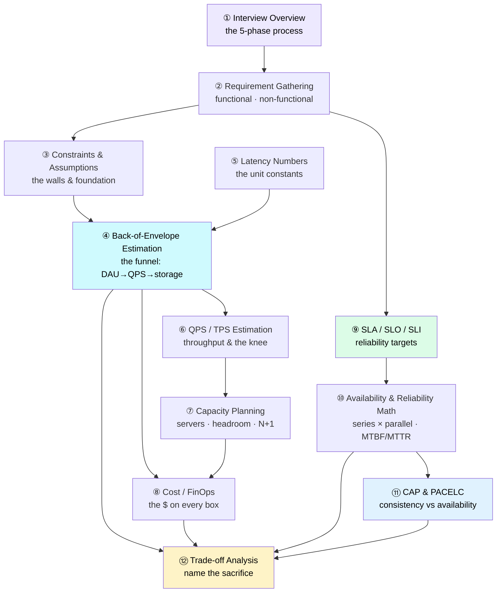
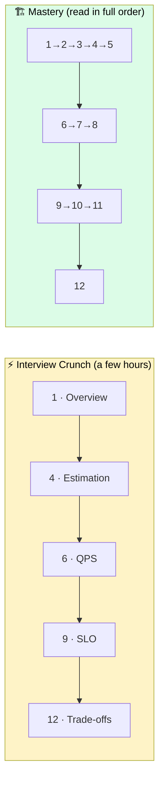

# 01 · Planning & Foundations 🧭

> **The blueprint phase.** Before a single box is drawn or a database chosen, this is how you turn an ambiguous prompt ("design Twitter") into a defensible plan: gather requirements, run the numbers, set reliability targets, and make trade-offs you can justify. Master this section and you have the *vocabulary and instincts* every later section builds on.

---

## 🎯 What You'll Be Able To Do

After this section you can, on a whiteboard and in production:

- **Drive a system design conversation** through its 5 phases without freezing on the blank page.
- **Estimate scale in your head** — QPS, storage, bandwidth, servers, and the monthly bill — in powers of 10.
- **Predict performance before building** using memorized latency numbers.
- **Set and defend reliability targets** (SLOs, error budgets, the "nines") with actual math.
- **Choose between designs** by naming the trade-off — including the CAP/PACELC choice — instead of guessing.

---

## 🗺️ How the 12 Topics Interlock

These aren't 12 isolated notes — they form one pipeline. Requirements feed estimation; estimation feeds capacity, cost, and reliability; everything converges on trade-offs.



> **The spine:** *Requirements → Estimation → (Capacity · Cost · Reliability) → Trade-offs.* Latency Numbers are the constants the estimates use; CAP/PACELC is the deepest trade-off of all.

---

## 📚 The Complete File Index

| # | Topic | One-line | Key takeaway you'll keep |
|---|-------|----------|--------------------------|
| 1 | [System Design Interview Overview](./System_Design_Interview_Overview.md) | The 5-phase process for any design question | Clarify → Estimate → HLD → Deep Dive → Wrap; *drive the clock* |
| 2 | [Requirement Gathering](./Requirement_Gathering.md) | Sorting needs into 3 buckets | Non-functional reqs shape architecture more than features |
| 3 | [Constraints & Assumptions](./Constraints_Assumptions.md) | The walls you build in + foundation you build on | State assumptions out loud; at scale, every outage traces to one that broke |
| 4 | [Back-of-the-Envelope Estimation](./Back_of_the_Envelope_Estimation.md) | Order-of-magnitude math | The funnel: DAU → QPS → storage → servers; *is it 5GB or 5PB?* |
| 5 | [Latency Numbers Every Programmer Should Know](./Latency_Numbers_Every_Programmer_Should_Know.md) | The fundamental constants of computing | RAM ≈ 100ns, SSD ≈ 100µs, disk ≈ 10ms, cross-region ≈ 150ms |
| 6 | [QPS / TPS Estimation](./QPS_TPS_Estimation.md) | Throughput per second | Design for the *peak* second; mind the latency "knee" |
| 7 | [Capacity Planning](./Capacity_Planning.md) | Turning load into a server count | Benchmark a node, ÷ total, +30% headroom, +N+1; check all 4 dimensions |
| 8 | [Cost Estimation & FinOps](./Cost_Estimation_FinOps.md) | The bill behind the design | 1 PB ≈ $20k/mo; egress is the silent killer; put $/mo on every box |
| 9 | [SLA / SLO / SLI](./SLA_SLO_SLI.md) | Defining "reliable enough" | SLI=meter, SLO=goal, SLA=contract; error budget = velocity vs stability referee |
| 10 | [Availability & Reliability Math](./Availability_Reliability_Math.md) | The arithmetic of uptime | Series multiplies (down), redundancy adds nines; A = MTBF/(MTBF+MTTR) |
| 11 | [CAP Theorem & PACELC](./CAP_Theorem_PACELC.md) | The law of distributed systems | During a partition pick C or A; *else* trade Latency vs Consistency |
| 12 | [Trade-off Analysis](./Trade_off_Analysis.md) | The core senior skill | No best solutions — name what you sacrificed and why |

---

## 🧭 Suggested Study Paths

Pick the route that matches your goal — every file is self-contained, but order helps.



| Goal | Path | Why |
|------|------|-----|
| **⚡ Interview in 48h** | 1 → 4 → 6 → 9 → 12 (+ skim 5, 11) | The phases, the math, the targets, the trade-offs — the load-bearing 80% |
| **🏗️ Deep mastery** | 1 → 2 → 3 → 4 → 5 → 6 → 7 → 8 → 9 → 10 → 11 → 12 | Follows the dependency pipeline top to bottom |
| **🔢 "I freeze on the math"** | 5 → 4 → 6 → 7 → 8 | Latency constants → estimation → throughput → capacity → cost |
| **🛡️ Reliability focus** | 9 → 10 → 11 → 3 | Targets → the math → the distributed-systems law → constraints |

> **How to study each file:** read the concept sections, then *do the* 🏋️ **Practice Drills before peeking at solutions*, rehearse the* 🎤 **Interview Q&A out loud, and skim* 🎯 **Staff+ Nuances for the depth that impresses senior interviewers.**

---

## 🔑 The Numbers Worth Memorizing (whole-section cheat card)

```
LATENCY    RAM 100ns · SSD 100µs · same-DC RTT 500µs · disk 10ms · cross-region 150ms
TIME       1 day ≈ 10⁵ sec · 1 year ≈ 3×10⁷ sec
POWERS     K=10³ M=10⁶ G=10⁹ T=10¹² P=10¹⁵   (each step ×1000)
THE FUNNEL DAU → QPS(÷10⁵, ×peak) → storage(×365×yrs×3) → servers(÷per-node)
COST       1 PB storage ≈ $20k/mo · egress ≈ $0.06/GB · small VM ≈ $30–70/mo
NINES      99%→3.65d/yr · 99.9%→8.76h · 99.99%→52m · 99.999%→5.26m
AVAIL MATH series: A₁×A₂×…  ·  parallel: 1−(1−A)ⁿ  ·  A = MTBF/(MTBF+MTTR)
CAP        if Partition → C or A ; Else → Latency or Consistency  (PACELC)
```

---

## 🎨 Conventions & Authoring

- **Every file follows the same structure** — see the root [TEMPLATE.md](../TEMPLATE.md). Copy it to author a new topic.
- **Animated diagrams** live in [/assets](../assets/) (SVG with SMIL + CSS animations) and are embedded throughout.
- **The three mastery sections** — 🏋️ Practice Drills, 🎤 Interview Q&A Bank, 🎯 Staff+ Nuances — appear in every file near the end.

---

## ➡️ Where This Leads

Once the blueprint is set, the design gets built in the next sections:

- [02 · API & Interface Design](../02_API_Interface_Design/) — the contracts between services.
- [03 · High-Level Design](../03_High_Level_Design/) — boxes, arrows, load balancers, CDNs.
- [05 · Databases & Storage](../05_Databases_Storage/) — where CAP, sharding, and replication get real.
- [06 · Caching & Performance](../06_Caching_Performance/) — acting on the latency numbers.
- [12 · Monitoring & Observability](../12_Monitoring_Logging_Observability/) — measuring the SLOs you defined here.

---
*Part of the [System Design & Architecture Master Repository](../README.md). Built for engineers who want to reason from first principles, not memorize answers.*
