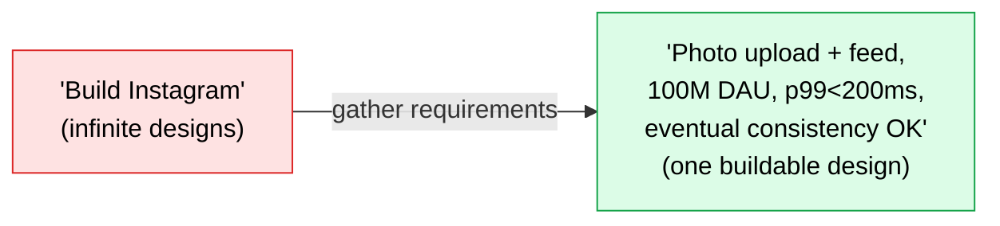
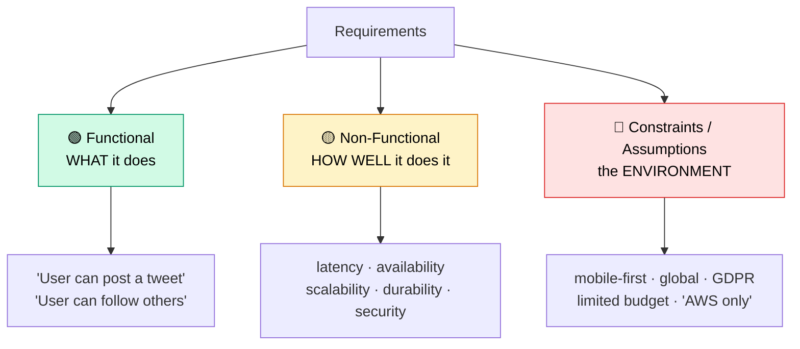
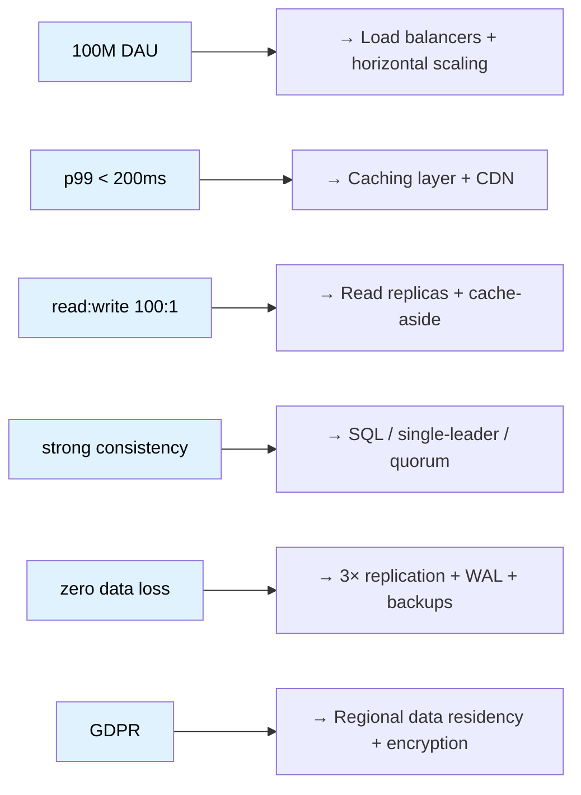
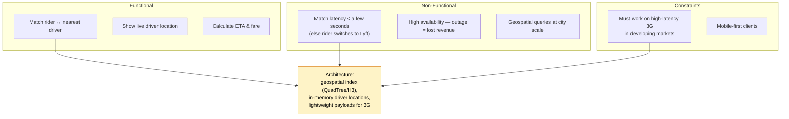
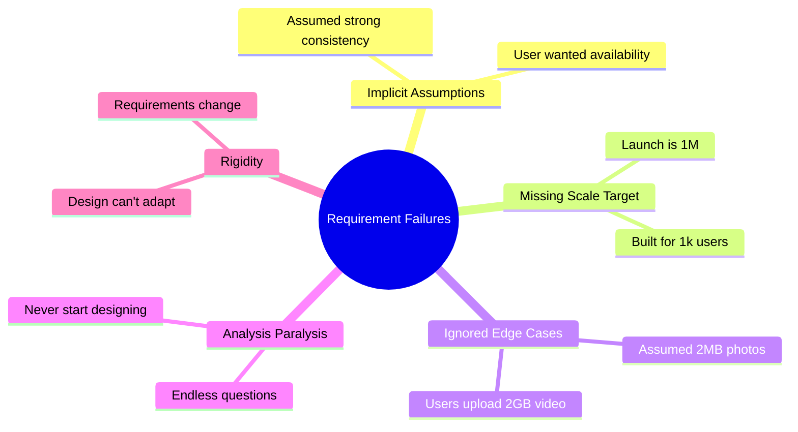
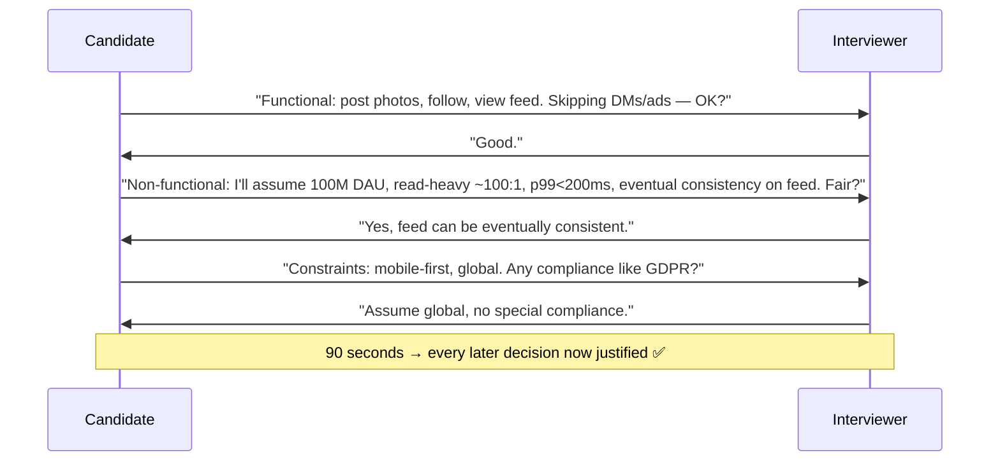

# Requirement Gathering

> **One line:** Before a single box is drawn, you separate *what the system does* (functional) from *how well it must do it* (non-functional) and *the world it lives in* (constraints) — because every architectural decision downstream is justified by one of these three.

---

## Table of Contents
1. [Why You Must Master This](#1-why-you-must-master-this)
2. [The Mental Model](#2-the-mental-model)
3. [The Three Buckets](#3-the-three-buckets)
4. [Functional Requirements — In Depth](#4-functional-requirements--in-depth)
5. [Non-Functional Requirements — In Depth](#5-non-functional-requirements--in-depth)
6. [How Requirements Drive Architecture](#6-how-requirements-drive-architecture)
7. [Worked Example — Uber Dispatch](#7-worked-example--uber-dispatch)
8. [Real-Life Use Cases](#8-real-life-use-cases)
9. [Failure Modes](#9-failure-modes)
10. [Interview Playbook](#10-interview-playbook)
11. [Cheat Sheet](#11-cheat-sheet)
12. [🏋️ Practice Drills](#-practice-drills)
13. [🎤 Interview Q&A Bank](#-interview-qa-bank)
14. [🎯 Staff+ Nuances](#-staff-nuances)
15. [Connections & Further Reading](#15-connections--further-reading)

---

## 1. Why You Must Master This

Building a beautifully scalable system that solves the *wrong* problem is the ultimate waste of engineering. Requirement gathering prevents three disasters:

- **The Wrong Product** — scaling something nobody needs.
- **Scope Creep** — the "simple chat app" silently grows to need 4K video and million-user calls mid-design.
- **Wrong Tech Choice** — you literally cannot choose SQL vs NoSQL until you know whether the system needs strong consistency or high availability.

> **The core problem it solves:** *ambiguity.* "Build Instagram" is meaningless. "Upload photos, follow people, view a feed, p99 < 200ms, 100M DAU" is a design you can actually build.

---

## 2. The Mental Model

Requirement gathering is **defining the playing field before the game starts.** You need the *goal* (functional) and the *rules* (non-functional + constraints). Skip the rules and you're playing a game you can't win.



---

## 3. The Three Buckets

Every requirement falls into exactly one of three buckets. Sort them deliberately.




> **The trap:** beginners over-focus on functional ("what features?") and ignore non-functional. But it's the **non-functional** requirements (scale, latency, consistency) that actually *shape the architecture.* Two apps with identical features but different scale need completely different designs.

---

## 4. Functional Requirements — In Depth

These describe observable behavior — usually expressible as **user stories** or **API endpoints**.

- Write them as verbs: *upload, follow, search, like, pay, notify.*
- Convert each into a rough API: `POST /tweets`, `GET /feed`, `POST /follow`.
- **Aggressively cut scope.** State what's *out*: "I'll handle posting and the feed, but skip DMs and ads for now." This shows judgment and keeps you on the clock.

## 5. Non-Functional Requirements — In Depth

These are the *quality attributes* — the "-ilities." They're what separate a toy from a production system.

| Attribute | The question it answers | Example target |
|-----------|------------------------|----------------|
| **Latency** | How fast per request? | p99 < 200 ms |
| **Availability** | How much uptime? | 99.99% (≈52 min/yr down) |
| **Scalability** | How much growth? | 100M DAU, 10× spikes |
| **Consistency** | How fresh must reads be? | strong (banking) vs eventual (likes) |
| **Durability** | Can we ever lose data? | 11 nines (S3) for uploads |
| **Security/Compliance** | What rules bind us? | GDPR, PCI-DSS, encryption at rest |

```yaml
# How non-functional requirements crystallize into config/SLOs
service_requirements:
  feature: user_feed
  latency_p99: 200ms        # Non-Functional: latency
  availability: 99.9%       # Non-Functional: availability
  max_payload: 5MB          # Constraint
  write_consistency: eventual  # Trade-off chosen from requirements
```

These map directly onto [SLA_SLO_SLI.md](./SLA_SLO_SLI.md) — non-functional requirements *become* your SLOs.

---

## 6. How Requirements Drive Architecture

This is the whole point — every requirement forces a concrete design decision:



> If you can't trace a component back to a requirement, you're over-engineering. If a requirement has no component, you've missed something.

---

## 7. Worked Example — Uber Dispatch



The constraint "must work on 3G" alone forces small payloads, aggressive client caching, and tolerance for intermittent connectivity — none of which you'd discover by listing features.

---

## 8. Real-Life Use Cases

| Situation | Why requirement gathering decides the outcome |
|-----------|----------------------------------------------|
| **SQL vs NoSQL decision** | "Need ACID transactions for payments" → SQL. "Need 100M writes/sec, eventual OK" → NoSQL. The requirement *is* the answer. |
| **Sprint planning / PRDs** | A good Product Requirements Doc is exactly the three buckets; engineering estimates flow from non-functional targets. |
| **Vendor / build-vs-buy** | "Must be GDPR + SOC2 compliant" (constraint) often rules out building in-house and points to a managed service. |
| **Cost negotiation** | "Do we *really* need 99.999%?" Dropping one nine can halve infra cost — a requirements conversation, not a tech one. |
| **API design** | Functional requirements become endpoints; non-functional ones become rate limits, pagination, and SLAs. |

> The discipline in real life: **whenever someone says "build X," respond with the three-bucket questions before estimating effort.** It's the cheapest risk reduction in engineering.

---

## 9. Failure Modes



- **Implicit assumptions** — silently assuming consistency when the user cares about availability (or vice-versa). *Say assumptions out loud.*
- **Missing scale targets** — designing for today's users while marketing plans a 1M-user launch next month.
- **Ignored edge cases** — "users upload photos" → forgot someone uploads a 2 GB video.
- **Analysis paralysis** — asking forever and never designing. Time-box it.

---

## 10. Interview Playbook

**Take the lead.** Don't wait to be handed requirements — propose them and get confirmation.



**✅ Do:** propose assumptions, ask for the read/write ratio early, separate the three buckets explicitly.
**🚩 Red flags:** starting to draw within the first 2 minutes; never asking about scale; picking a database before knowing the consistency requirement.

---

## 11. Cheat Sheet

```
┌─────────────── THE THREE BUCKETS ───────────────┐
│ FUNCTIONAL    what it DOES   → user stories/APIs │
│ NON-FUNCTIONAL how WELL      → the "-ilities"     │
│ CONSTRAINTS    the WORLD     → budget/compliance  │
└───────────────────────────────────────────────────┘
THE "-ILITIES": latency · availability · scalability
                consistency · durability · security
ASK EARLY:  DAU? · read:write ratio? · consistency?
            payload size? · compliance? · spikes?
RULE: every component traces to a requirement, and
      every requirement maps to a component.
```

---

## 🏋️ Practice Drills

> *Practice sorting requirements into the three buckets and turning them into design forces.*

**Drill 1 — Sort the bucket.** Label each as Functional (F), Non-Functional (NF), or Constraint (C): (a) "users can DM each other," (b) "feed loads in under 200ms," (c) "must store EU data in the EU," (d) "99.99% uptime," (e) "works on 2G."

<details><summary>Solution</summary>

(a) F, (b) NF (latency), (c) C (compliance/residency), (d) NF (availability), (e) C (environment). Notice it's the NF + C items that will actually shape the architecture, not the single F item.
</details>

**Drill 2 — Requirement → architecture.** A requirement says "read:write ratio is 100:1." Name two concrete design decisions this drives.

<details><summary>Solution</summary>

Read replicas + a cache-aside caching layer (and likely a CDN for static reads). The write path can stay simple (single leader) since writes are rare. The ratio is one of the highest-leverage requirements you can extract.
</details>

**Drill 3 — Spot the missing requirement.** A candidate designs a photo app handling "2 MB uploads." What edge case did they likely miss, and how does it change the design?

<details><summary>Solution</summary>

Video / large files (2 GB, not 2 MB). That changes everything: chunked/resumable uploads, multipart storage, async transcoding pipeline, different CDN strategy. Always ask about the *largest* payload, not the typical one.
</details>

---

## 🎤 Interview Q&A Bank

**Q1. What are the three types of requirements?**
> Functional (what it does — user stories/APIs), Non-Functional (how well — the "-ilities": latency, availability, scalability, consistency, durability, security), and Constraints/Assumptions (the environment — budget, compliance, platform).

**Q2. Which matters more for architecture, functional or non-functional?**
> Non-functional. Two apps with identical features but different scale/latency/consistency targets need completely different architectures. Features rarely dictate the design; quality attributes do.

**Q3. What's the single most valuable requirement to extract early?**
> The read:write ratio and rough scale (DAU/QPS) — they drive database choice, caching, and sharding more than anything else.

**Q4. How do you handle a vague prompt like "Build Instagram"?**
> Take the lead and propose scope: "I'll support photo upload, follow, and feed; skip DMs, ads, stories. Assume 100M DAU, read-heavy, p99<200ms, eventual consistency on the feed — OK?" Then confirm and proceed.

**Q5. Functional vs non-functional — give a one-line distinction.**
> Functional = *what* the system does ("post a tweet"). Non-functional = *how well* it does it ("the timeline loads in <200ms at 100M DAU").

**Q6. How do requirements connect to SLOs?**
> Non-functional requirements become measurable SLOs: "feed loads in <200ms" → an SLI/SLO of p99 latency < 200ms over a 30-day window (see SLA/SLO/SLI).

**Q7. What's a red flag in this phase?**
> Drawing boxes within the first 2 minutes, or never asking about scale/consistency before picking a database.

---

## 🎯 Staff+ Nuances

- **The dangerous requirements are the *implicit* ones.** "The network is reliable," "users won't upload video," "traffic is uniform" — unstated assumptions become production incidents. Surface and write them down (ties to [Constraints_Assumptions.md](./Constraints_Assumptions.md)).
- **Requirements are negotiable levers, not fixed facts.** "Do we *really* need strong consistency here?" or "can the feed be eventually consistent?" — challenging a requirement can collapse the design's complexity and cost by an order of magnitude. Senior engineers negotiate requirements, not just satisfy them.
- **Every component must trace to a requirement, and vice versa.** A component with no requirement is over-engineering; a requirement with no component is a gap. This bidirectional check is a fast design-review heuristic.
- **Non-functional requirements have exponential cost curves.** Going from 99.9% → 99.99% availability, or from "p99 200ms" → "p99 50ms," can multiply infra cost. Always ask "what's the business reason for this number?" before designing to it.
- **Scope is a feature.** Explicitly cutting scope ("v1 skips video and ads") is a senior move — it shows you optimize for shipping, not for covering every imaginable case.
- **Requirements drift; design for the second-order ask.** "Just photos" today often means "and video, and live, and stories" next quarter. Leave seams (abstractions, async pipelines) where you can predict growth — without over-building for it now.

---

## 15. Connections & Further Reading

**Within this repo:**
- [System_Design_Interview_Overview.md](./System_Design_Interview_Overview.md) — this is phase ①.
- [Constraints_Assumptions.md](./Constraints_Assumptions.md) — the third bucket, in depth.
- [SLA_SLO_SLI.md](./SLA_SLO_SLI.md) — non-functional requirements become measurable SLOs.
- [Capacity_Planning.md](./Capacity_Planning.md) — turning scale requirements into resources.

**External classics:**
- *Software Requirements* (Karl Wiegers) — the requirements bible.
- *The Mythical Man-Month* (Fred Brooks) — why getting requirements right early matters.
- Google SRE Book — the Service Level Objectives chapter.

---

## TL;DR
Measure twice, cut once. Sort every requirement into **functional** (what), **non-functional** (how well), and **constraints** (the world). The non-functional bucket shapes your architecture more than the features do. Gather requirements so that **every line of your design has a reason to exist** — and every requirement has a home in the design.
