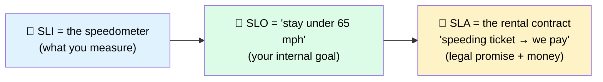
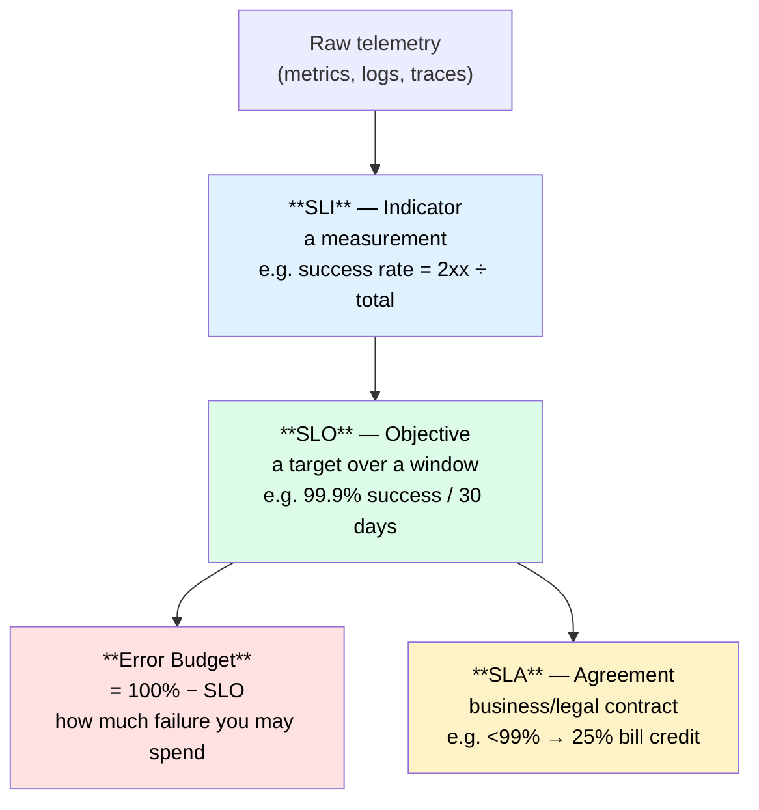
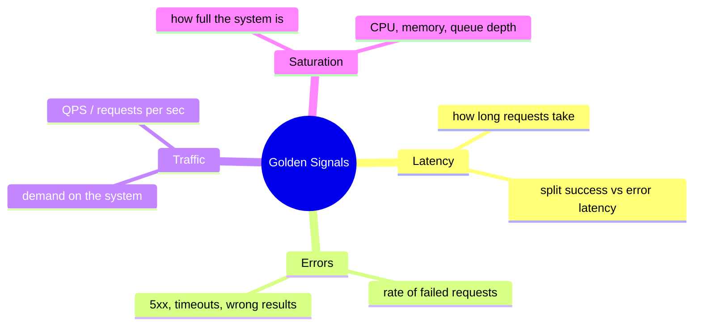
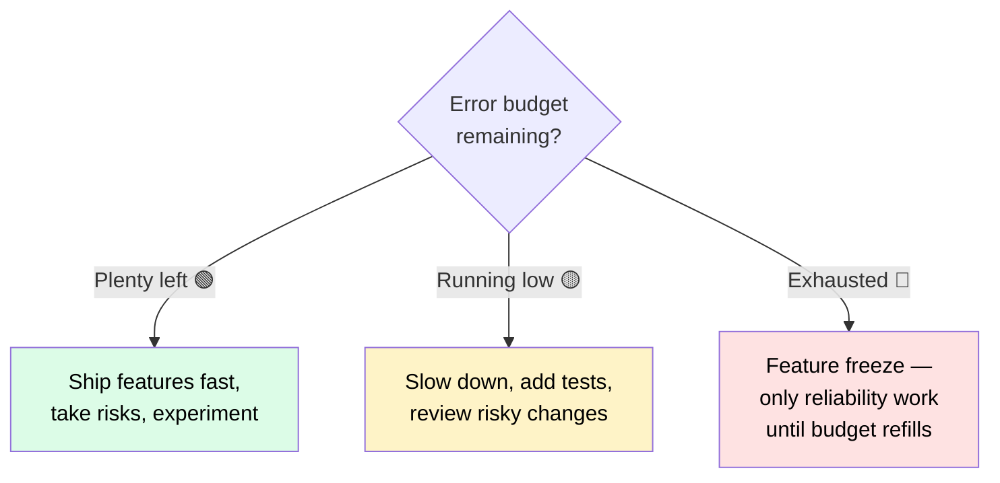
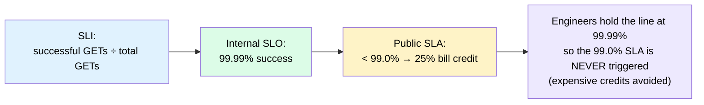
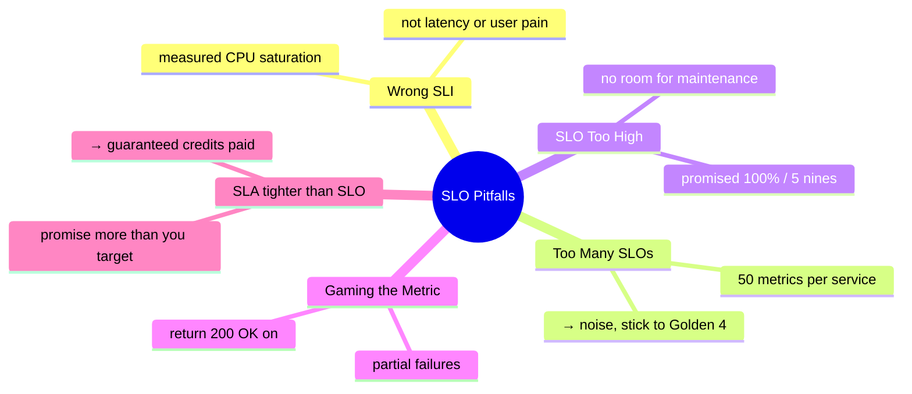

# SLA / SLO / SLI

> **One line:** SLI is the *meter* (what you measure), SLO is the *goal* (the target you hold), SLA is the *contract* (what you owe customers if you miss) — and the **error budget** derived from the SLO is the mathematical peace treaty between "ship fast" and "stay stable."

---

## Table of Contents
1. [Why You Must Master This](#1-why-you-must-master-this)
2. [The Mental Model](#2-the-mental-model)
3. [The Three Terms, Layered](#3-the-three-terms-layered)
4. [The Four Golden Signals (choosing SLIs)](#4-the-four-golden-signals-choosing-slis)
5. [The "Nines" — Your Downtime Budget](#5-the-nines--your-downtime-budget)
6. [Error Budgets — In Depth](#6-error-budgets--in-depth)
7. [Worked Example — Amazon S3](#7-worked-example--amazon-s3)
8. [Real-Life Use Cases](#8-real-life-use-cases)
9. [Failure Modes](#9-failure-modes)
10. [Interview Playbook](#10-interview-playbook)
11. [Cheat Sheet](#11-cheat-sheet)
12. [🏋️ Practice Drills](#-practice-drills)
13. [🎤 Interview Q&A Bank](#-interview-qa-bank)
14. [🎯 Staff+ Nuances](#-staff-nuances)
15. [Connections & Further Reading](#15-connections--further-reading)

---

## 1. Why You Must Master This

Designing for **100% uptime is impossible and infinitely expensive.** These three metrics let you decide *exactly how much unreliability is acceptable* — and turn that into a number everyone agrees on.

- **The "reliability at any cost" fallacy** — every extra "nine" roughly **10×'s** the cost. You must choose deliberately.
- **The dev-vs-SRE conflict** — developers want to ship features (risky); SREs want stability (safe). The **error budget** resolves this mathematically instead of politically.
- **Trust** — if you can't define "healthy," you can't prove dependability to customers.

> **The core problem it solves:** *vague goals and alert fatigue.* "The system should be fast" is unactionable. "99% of requests < 200 ms over 30 days" is measurable, alertable, and arguable with data — not opinion.

---

## 2. The Mental Model

The car analogy makes the three terms click instantly:



---

## 3. The Three Terms, Layered



> **Critical relationship:** your **SLA is always looser than your internal SLO.** If you promise customers 99.0% (SLA) but target 99.99% internally (SLO), you have a huge buffer before you ever owe a refund. Engineers chase the SLO so the SLA is never even threatened.

| Term | Audience | Consequence of breach | Example |
|------|----------|----------------------|---------|
| **SLI** | Engineers | — (it's just a number) | `2xx ÷ total requests` |
| **SLO** | Eng + Product | Freeze features, fix reliability | 99.9% over 30 days |
| **SLA** | Customers / Legal | **Money** (refunds, credits) | <99% → 25% credit |

---

## 4. The Four Golden Signals (choosing SLIs)

Don't measure everything — measure the four that predict user pain (from Google's SRE book):



| Signal | Measures | Good SLI example |
|--------|----------|------------------|
| **Latency** | Speed | p99 request duration < 200 ms |
| **Errors** | Correctness | success rate ≥ 99.9% |
| **Traffic** | Demand | requests/sec (context, not usually an SLO) |
| **Saturation** | Fullness | CPU/queue depth — leading indicator of trouble |

> **Pick user-facing SLIs.** Measure *request latency* (what users feel), not *CPU usage* (what they don't). A box at 90% CPU still serving fast requests is *fine*; an SLO on CPU would page you for nothing.

```promql
# SLI: availability (success rate) in Prometheus
sum(rate(http_requests_total{status=~"2.."}[5m]))
/
sum(rate(http_requests_total[5m]))

# Multi-window burn-rate alert: fire when we're spending
# error budget fast enough to exhaust it before the window ends
```

---

## 5. The "Nines" — Your Downtime Budget

Memorize this table — it's the most-quoted thing in reliability engineering:

| SLO | Downtime / year | Downtime / month | Downtime / day |
|-----|-----------------|------------------|----------------|
| 99% (two nines) | 3.65 days | 7.2 hours | 14.4 min |
| 99.9% (three nines) | 8.76 hours | 43.2 min | 1.44 min |
| 99.99% (four nines) | 52.6 min | 4.3 min | 8.6 sec |
| 99.999% (five nines) | 5.26 min | 26 sec | 0.86 sec |

> **Five nines = 5 minutes of downtime *per year*** — and that has to include *every* deploy, patch, and incident. It typically requires multi-region active-active and roughly **doubles** infrastructure cost versus four nines. Most products are perfectly served by three or four nines.

---

## 6. Error Budgets — In Depth

The error budget is the genius of the SRE model: it converts reliability from an argument into accounting.

```
Error budget = 100% − SLO
99.9% SLO → 0.1% budget → ~43 minutes of allowed "downtime" per 30-day month
```

You "spend" this budget on failures, risky deploys, and experiments. As long as budget remains, **ship freely**. When it's exhausted, **stop shipping and harden** until it refills.





> **Burn rate** is how fast you're spending the budget. A single bad incident can burn half your monthly budget in minutes — multi-window burn-rate alerts catch that *while it's happening*, not at month-end.

---

## 7. Worked Example — Amazon S3



The gap between the **99.99% SLO** and the **99.0% SLA** is the safety margin. Note also that S3's *durability* (11 nines — losing your data) is held far stricter than its *availability* (being reachable) — losing data is unforgivable; a brief outage is recoverable.

---

## 8. Real-Life Use Cases

| Situation | How SLA/SLO/SLI applies |
|-----------|-------------------------|
| **Deploy/feature freeze decisions** | Error budget exhausted → automatic freeze. No politics; the number decides. |
| **On-call alerting** | Alert on **SLO burn rate**, not raw CPU → kills alert fatigue, pages only on real user impact. |
| **Vendor selection** | Compare cloud providers by their *published SLA* and credit terms — and assume their real availability is higher (the SLO). |
| **Postmortems** | Quantify incident impact as "burned X% of the monthly error budget" → prioritizes which reliability work matters. |
| **Roadmap negotiation** | "We have budget to spare → greenlight the risky migration this sprint." Reliability becomes a planning input. |
| **Customer contracts** | SLA credits are a real financial liability; legal and finance care about the exact threshold. |

> Real-world truth: SLOs are how mature orgs **balance velocity and stability without endless meetings.** The error budget is a shared, objective currency both devs and SREs accept.

---

## 9. Failure Modes



- **Wrong SLI** — measuring saturation (CPU) instead of user experience (latency/errors).
- **Too many SLOs** — 50 metrics per service drowns the signal. Stick to the Golden 4.
- **SLOs set too high** — promising 100% or five nines you can't sustain (5 nines = 5 min/year, *including maintenance*).
- **Gaming the metric** — returning `200 OK` for partial failures to flatter the success rate. The metric must reflect *real* success.
- **SLA stricter than SLO** — promising customers more than you internally target guarantees you'll pay credits.

---

## 10. Interview Playbook

**✅ Do:** distinguish **availability** (uptime) from **durability** (never losing data) — and note durability is usually held far stricter. Mention **error budgets** as the dev-vs-SRE tiebreaker. Quote the nines table from memory.

**🚩 Red flags:** saying "the SLA will be 100%"; conflating SLA and SLO; alerting on CPU instead of user-facing signals.

**Common follow-up:** *"How do you decide between shipping a feature and fixing a bug?"* → **"Check the error budget. Budget left → ship. Budget gone → freeze and fix."**

---

## 11. Cheat Sheet

```
SLI = measurement   (speedometer)
SLO = target        (stay under 65)
SLA = contract+$    (ticket → refund)
ERROR BUDGET = 100% − SLO = how much failure you may spend

GOLDEN SIGNALS:  Latency · Errors · Traffic · Saturation
                 (measure USER-FACING ones for SLOs)

THE NINES (downtime/yr):
  99%     → 3.65 days     99.99%  → 52 min
  99.9%   → 8.76 hours    99.999% → 5.26 min

RULES
  SLA looser than SLO (always keep a buffer)
  durability >> availability in strictness
  budget left → SHIP · budget gone → FREEZE
  alert on burn RATE, not raw CPU
```

---

## 🏋️ Practice Drills

> *Convert nines to downtime, compute error budgets, and reason about burn rate.*

**Drill 1 — Nines to minutes.** Your SLO is 99.95% monthly. How much downtime does that allow per 30-day month?

<details><summary>Solution</summary>

`0.05% × 30 days = 0.0005 × 43,200 min ≈ 21.6 minutes/month`. (Halfway between 99.9% = 43 min and 99.99% = 4.3 min.)
</details>

**Drill 2 — Budget burn.** With a 99.9% SLO (≈43 min/month budget), a single incident causes 20 minutes of full outage. What fraction of the budget is gone and what should happen?

<details><summary>Solution</summary>

~47% of the monthly budget burned in one incident. Policy response: heightened caution — slow risky deploys, prioritize reliability work; if another similar incident hits, you'd exhaust the budget and trigger a feature freeze.
</details>

**Drill 3 — Pick the SLI.** For a checkout service, which is the better SLI: average CPU utilization, or the ratio of successful checkout requests under 1s? Why?

<details><summary>Solution</summary>

The success-ratio-under-1s — it's *user-facing* (it measures whether customers can actually buy). CPU is a saturation signal (useful for capacity), but a box at 90% CPU serving fast checkouts is fine; an SLO on it would page you for non-problems.
</details>

**Drill 4 — SLA vs SLO gap.** Why would a company publish a 99.0% SLA but target 99.99% internally?

<details><summary>Solution</summary>

The gap is a safety margin. Holding the internal SLO at 99.99% means the 99.0% contractual threshold (which triggers customer refunds) is essentially never breached. SLA is always looser than SLO.
</details>

---

## 🎤 Interview Q&A Bank

**Q1. Define SLI, SLO, SLA in one line each.**
> SLI = a measurement (e.g., success rate). SLO = an internal target over a window (99.9%/30 days). SLA = a customer contract with financial penalties for breaching a (looser) threshold.

**Q2. What's an error budget?**
> `100% − SLO`. It quantifies how much failure you're allowed. Budget remaining → ship features freely; budget exhausted → freeze and fix reliability. It's the objective referee between velocity and stability.

**Q3. Why is SLA looser than SLO?**
> So engineers chase the stricter internal SLO and never come close to triggering the expensive contractual SLA penalties. The gap is deliberate margin.

**Q4. What are the Four Golden Signals?**
> Latency, Errors, Traffic, Saturation. Pick user-facing ones (latency/errors) for SLOs; saturation is a leading capacity indicator.

**Q5. How many nines is "5 minutes of downtime per year"?**
> Five nines (99.999%). And that 5 minutes must include all deploys, patches, and incidents — usually requiring multi-region active-active.

**Q6. Availability vs durability?**
> Availability = is the service reachable/responding (uptime). Durability = will we ever lose stored data (e.g., S3's 11 nines). Durability is held far stricter — an outage is recoverable, lost data isn't.

**Q7. "How do you decide between shipping a feature and fixing reliability?"**
> Check the error budget. Budget left → ship. Budget gone → freeze features and harden until it refills. The number decides, not politics.

**Q8. What's a burn-rate alert and why is it better than a threshold alert?**
> It fires when you're *spending* error budget fast enough to exhaust it (e.g., 14.4× normal over 1 hour), catching incidents in progress rather than after the SLO is already blown. It also cuts alert fatigue.

---

## 🎯 Staff+ Nuances

- **CAP "availability" ≠ your SLA's availability.** A CP datastore (etcd, Spanner) can reject writes during a rare partition and still post 99.99% uptime. Don't avoid CP for critical data out of fear of the formal term — see [CAP_Theorem_PACELC.md](./CAP_Theorem_PACELC.md).
- **The error budget is a *policy*, not just a number.** Its power comes from a pre-agreed consequence (freeze on exhaustion). Without an enforced policy, SLOs become vanity dashboards everyone ignores.
- **Measure SLIs at the point closest to the user.** Server-side success rates miss client timeouts, DNS failures, and edge errors. Mature orgs blend server metrics with real-user monitoring (RUM) so the SLI reflects actual experience.
- **Beware the metric you can game.** "Return 200 with a partial/empty result" flatters the success rate while users suffer. Good SLIs encode *correct* success (right data, within latency), not just an HTTP code.
- **Multi-window, multi-burn-rate alerting is the SRE state of the art.** A fast-burn alert (page now) plus a slow-burn alert (ticket) balances catching real incidents against waking people for noise. Single static thresholds either over-page or miss slow leaks.
- **SLOs should be set from user journeys, not per-microservice.** A user's "checkout works" may span 6 services; a per-service 99.9% can multiply into a much worse end-to-end number. Define critical-journey SLOs and derive component budgets from them.
- **Dependencies compound — your SLO can't exceed your dependencies'.** If you call three services each at 99.9%, your theoretical ceiling is ~99.7% unless you add redundancy/fallbacks. Reliability math (series vs parallel) is a real design input.

---

## 15. Connections & Further Reading

**Within this repo:**
- [Requirement_Gathering.md](./Requirement_Gathering.md) — non-functional requirements *become* SLOs.
- [Capacity_Planning.md](./Capacity_Planning.md) — availability targets dictate redundancy (N+1, multi-region).
- [Trade_off_Analysis.md](./Trade_off_Analysis.md) — each extra nine is a cost trade-off.
- [12_Monitoring_Logging_Observability](../12_Monitoring_Logging_Observability/) — the telemetry that feeds SLIs.

**External classics:**
- *Site Reliability Engineering* (Google) — Ch. 4 (Service Level Objectives) & 5 (Eliminating Toil); *The SRE Workbook* on error-budget policy.
- *The Art of Monitoring* (James Turnbull).
- SLOconf resources.

---

## TL;DR
- **SLI** is a measurement, **SLO** is a target, **SLA** is a legal contract with money attached.
- **Error budget = 100% − SLO** — it's how much risk you can afford, and the objective referee between shipping fast and staying stable.
- Keep your **SLA looser than your SLO**, hold **durability stricter than availability**, measure **user-facing Golden Signals**, and remember every extra nine roughly **10×'s the cost**.
