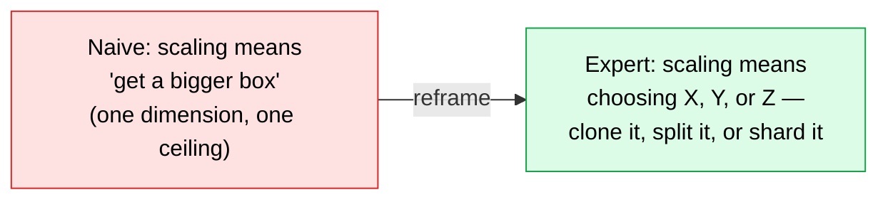
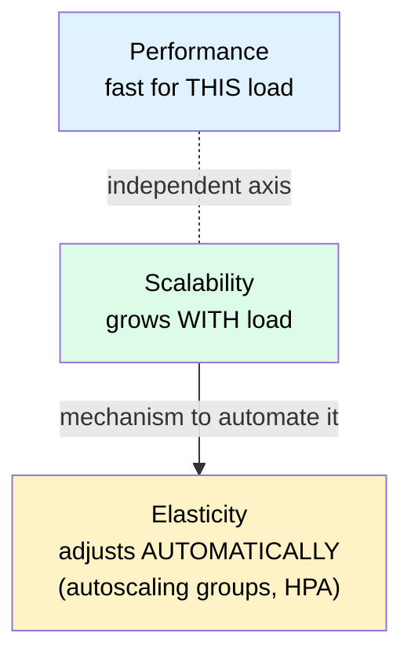
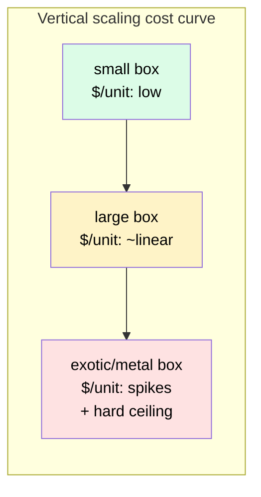
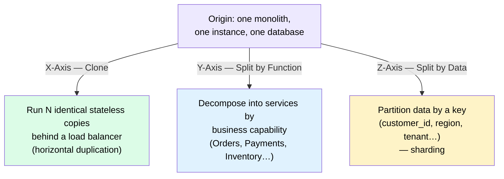
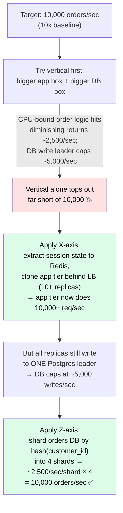
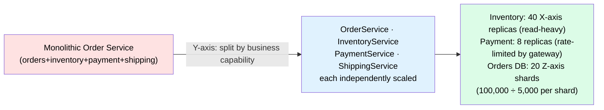
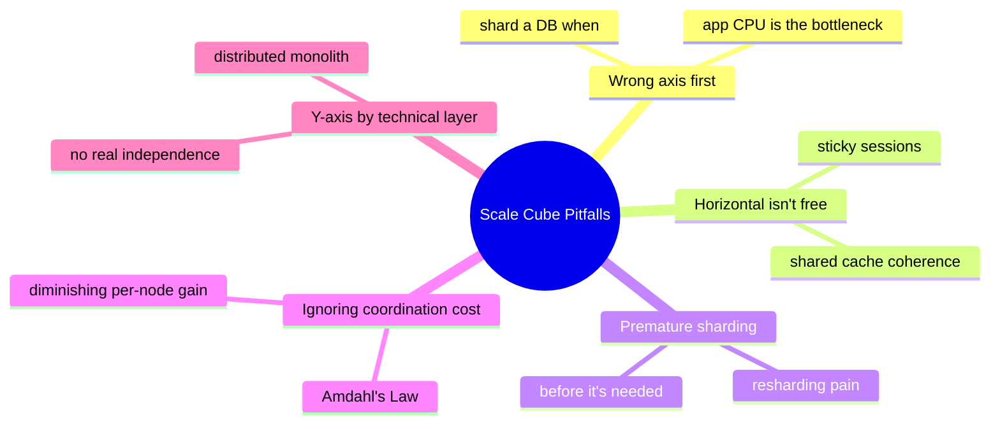

# Scalability Fundamentals & the AKF Scale Cube

> **One line:** Scalability isn't "make it fast" — it's "add resources and get proportionally more capacity"; the AKF Scale Cube gives you the three *specific* axes (clone it, split it, shard it) an interviewer expects you to name when asked "how would you scale this 10x?"

---

## Table of Contents
1. [Why You Must Master This](#1-why-you-must-master-this)
2. [The Mental Model](#2-the-mental-model)
3. [Scalability vs Performance vs Elasticity](#3-scalability-vs-performance-vs-elasticity)
4. [Vertical vs Horizontal Scaling — The Real Trade-off](#4-vertical-vs-horizontal-scaling--the-real-trade-off)
5. [The AKF Scale Cube](#5-the-akf-scale-cube)
6. [Worked Example — Scaling an Order Service 10x, Then 100x](#6-worked-example--scaling-an-order-service-10x-then-100x)
7. [Real-Life Use Cases](#7-real-life-use-cases)
8. [Failure Modes](#8-failure-modes)
9. [🏋️ Practice Drills](#-practice-drills)
10. [🎤 Interview Q&A Bank](#-interview-qa-bank)
11. [🎯 Staff+ Nuances](#-staff-nuances)
12. [Cheat Sheet](#12-cheat-sheet)
13. [Connections & Further Reading](#13-connections--further-reading)

---

## 1. Why You Must Master This

- **It's the first real design question in most interviews.** After the happy-path HLD, the interviewer almost always asks "now scale it 10x / 100x" — and "add more servers" without naming *which* axis and *why* reads as junior.
- **Confusing scalability with performance is the #1 rookie mistake.** Candidates say "we'll optimize the query" (performance) when asked to *scale* (add capacity by adding resources) — these solve different problems and an interviewer notices instantly.
- **Wrong-axis scaling wastes real engineering-quarters.** Sharding a database (Z-axis) when the actual bottleneck is a CPU-bound monolith (needs X-axis cloning) is a multi-month migration that fixes nothing — this is a common, expensive, real-world failure, not a hypothetical.
- **It's the conceptual layer underneath every scaling mechanism you'll ever operate.** Auto-scaling groups, Kubernetes HPA, database read replicas, and sharding are all *implementations* of one of three ideas — learn the three ideas once, recognize them everywhere.

> **The core problem it solves:** knowing *which dimension* to add resources along, before you reach for a mechanism to do it automatically.

**Prerequisites:** [Trade_off_Analysis.md](./Trade_off_Analysis.md) (scaling-axis choice is a trade-off), [QPS_TPS_Estimation.md](./QPS_TPS_Estimation.md) (you need a throughput number before you can talk about scaling it).

---

## 2. The Mental Model

The naive mental model is "scaling = buying a bigger machine." The expert model is "scaling = choosing which of three independent axes to stretch along."



> **Hold onto this:** every "how do we scale this?" answer should name an axis — *"this is a Z-axis problem, I'd shard the orders table by customer_id"* — not just gesture at "more infrastructure."

---

## 3. Scalability vs Performance vs Elasticity

These three get conflated constantly, and interviewers test the distinction directly.

| Term | Definition | The question it answers | What improves it |
|------|------------|--------------------------|-------------------|
| **Performance** | How fast the system responds *for a given, fixed load* | "How long does one request take?" | Better algorithms, indexes, caching, faster hardware per unit |
| **Scalability** | How capacity grows as you *add resources* | "If I 10x the load, can I 10x the resources and stay at the same latency?" | Removing shared bottlenecks: statelessness, partitioning, decoupling |
| **Elasticity** | How *quickly and automatically* capacity adjusts to *changing* load | "Does capacity shrink back down when traffic drops, without a human?" | Auto-scaling groups, K8s HPA, serverless — the *mechanism* |

A system can be fast but not scalable: a single, beautifully-tuned Postgres instance can answer a query in 2ms — but at 50,000 concurrent writers it falls over regardless of how well-indexed it is, because scalability is about what happens when you **add more resources**, not how fast the existing resource is. Conversely, a system can be scalable but slow: a badly-written but fully stateless service scales linearly by adding boxes, even if each individual request takes 500ms.

**Elasticity is a subset of scalability's *mechanism*, not the concept itself.** A system can be perfectly horizontally scalable (stateless, shardable) yet have zero elasticity if you provision it with a fixed fleet size and never automate the add/remove decision. This is precisely the split this repo makes: **this file is "what does scaling mean and which dimension do I stretch" (the conceptual/interview-framing layer); [../07_Load_Balancing_Scalability/Auto_scaling_Horizontal_vs_Vertical.md](../07_Load_Balancing_Scalability/Auto_scaling_Horizontal_vs_Vertical.md) is "how do I mechanically autoscale that dimension" (the operational layer — scaling policies, cooldowns, CloudWatch/K8s HPA triggers).** You need both, but they are asked about, and answered, differently in an interview.



---

## 4. Vertical vs Horizontal Scaling — The Real Trade-off

This is not "horizontal always wins" — it's a genuine architectural trade-off with real costs on both sides.

| Dimension | Vertical (scale-up) | Horizontal (scale-out) |
|-----------|----------------------|--------------------------|
| **Mechanism** | Bigger CPU/RAM/disk on the *same* machine | *More* machines of the same (or similar) size |
| **Code changes needed** | Usually none | Requires **statelessness** — no in-memory session, sticky local caches, or local file writes that another node can't see |
| **Ceiling** | Hard — AWS's largest general instance tops out around 448 vCPUs / 24 TiB RAM (`u-24tb1.metal`); there is no bigger box to buy past that | Practically unbounded — add another node |
| **Downtime to scale** | Often requires a reboot/resize window | Zero — new nodes join a load-balanced pool live |
| **Cost curve** | **Non-linear** past a point (see below) | Roughly linear — Nth node costs the same as node 1 |
| **Operational complexity** | Low — still "one thing" to monitor, patch, back up | Higher — distributed consistency, service discovery, load balancing, partial failure |
| **When it wins** | Early-stage systems, simplicity is the priority, load hasn't proven a real ceiling yet | Load has outgrown any single machine, or availability requires no single point of failure |

**The diminishing-returns curve is real and priced into cloud bills.** On AWS, moving up the *commodity* instance families is close to linear: an `m5.2xlarge` (8 vCPU / 32 GiB) at roughly $0.384/hr is exactly 4× an `m5.large` (2 vCPU / 8 GiB) at ~$0.096/hr — 4× the resources for 4× the price. But once you exceed the commodity family and need specialized high-memory metal (few vendors build boards with terabytes of RAM, so it's low-volume, high-margin hardware), the curve bends sharply: an `m5.16xlarge` (64 vCPU / 256 GiB) runs ~$3.07/hr (~$0.048 per vCPU-hr), while a high-memory `u-6tb1.metal` (224 vCPU / 6 TiB) runs on the order of $50+/hr on demand — roughly **5× the price per vCPU** for hardware that's only ~3.5× bigger. You're not just paying for more silicon, you're paying to leave the commodity curve.



> **Statelessness is the real price of admission for horizontal scaling**, and it's why teams underestimate the migration: session state must move to a shared store (Redis/Memcached), local file uploads must move to object storage (S3), and "sticky" in-process caches must become a shared or replicated cache. Skipping this and calling a fleet "horizontally scaled" while still relying on sticky sessions just hides a vertical bottleneck behind a load balancer.

---

## 5. The AKF Scale Cube

The AKF Scale Cube (from Abbott, Fisher, and Keeven's book *The Art of Scalability*, formalized out of their real work scaling eBay) gives you exactly three independent axes. Any scaling strategy is a point somewhere in this cube — most large systems use all three simultaneously.



| Axis | What it does | What it solves | What it does NOT solve |
|------|---------------|-----------------|--------------------------|
| **X — Clone** | Run identical copies of the whole app behind a load balancer | Raw request volume / CPU-bound traffic; cheap, no code redesign beyond statelessness | A single shared DB or cache still bottlenecks — every clone hits the *same* backing store |
| **Y — Functional split** | Decompose the monolith into services by business capability (microservices) | Codebase/team complexity, independent deploys, independent *scaling* of hot vs cold functions | A single service's own data-volume ceiling — Orders can still drown in order volume alone; introduces network calls, partial failure, eventual consistency between services |
| **Z — Data partition (shard)** | Split data across multiple stores by a key (customer_id, geography, tenant) | Data-volume and write-throughput ceilings; per-tenant isolation and blast-radius limits | Compute-bound logic; a skewed key creates a **hot shard** that's just as overloaded as before; adds cross-shard query/join and rebalancing complexity |

**Why order matters:** X-axis cloning is the cheapest and least invasive (just needs statelessness) — always the first lever. Y-axis buys you team/deploy independence and lets you scale hot services separately from cold ones, but it's a real distributed-systems tax. Z-axis is the most invasive — a shard key is close to a one-way door (see [../07_Load_Balancing_Scalability/Consistent_Hashing.md](../07_Load_Balancing_Scalability/Consistent_Hashing.md)) — and should be reached for only once a *single* partition (one service instance's own database) is provably the bottleneck, not before.

---

## 6. Worked Example — Scaling an Order Service 10x, Then 100x

**Baseline:** a monolithic Order Service — validation, inventory check, payment call, and shipping calc all in one codebase — running on a single `m5.4xlarge` app box in front of a single Postgres leader. It sustains **1,000 orders/sec** before p99 latency blows up.

**Target: 10x → 10,000 orders/sec.**



The arithmetic that forces the decision: a single Postgres write leader realistically ceilings around 5,000–10,000 simple TPS depending on row size and index count — you *cannot* vertically scale past that ceiling by buying a bigger box indefinitely (diminishing returns, then a hard instance-size wall), so **10,000 orders/sec requires distributing writes**, which is a Z-axis move, layered on top of an X-axis-scaled, now-stateless app tier.

**Target: 100x → 100,000 orders/sec.**

At this scale a new bottleneck appears that neither X nor Z fixes: the monolith still does inventory checks, payment calls, and shipping estimates *inside* the order request — a slow third-party payment gateway call blocks order-processing threads, and inventory reads (called 20x more often than payment calls) can't scale independently of payment logic while they're the same deployable.



`100,000 orders/sec ÷ 5,000 orders/sec-per-shard ≈ 20 shards` — and because Inventory is read 20x more often than Payment is called, Y-axis decomposition lets you run 40 Inventory replicas next to just 8 Payment replicas instead of over- or under-provisioning one monolith uniformly. **This is the pattern to say out loud in an interview: X first (cheap), then Z when a single data store is the wall, then Y when *independent scaling and deploy cadence of different functions* — not raw throughput — becomes the constraint.**

---

## 7. Real-Life Use Cases

| Situation | How the Scale Cube applies | The decision it forces |
|-----------|------------------------------|---------------------------|
| **eBay (late 1990s–2000s)** | The Scale Cube itself was formalized by AKF Partners from lived eBay scaling pain: a single Perl-then-C++ monolith was functionally split (search, bidding, checkout — Y-axis), cloned behind load balancers (X-axis), then user/item data was partitioned by ID ranges (Z-axis) as listings grew into the billions. | Y+X+Z applied in sequence, not all at once — the origin story of the framework. |
| **Netflix** | 700+ microservices, each owning one business capability (playback, recommendations, billing) | Canonical Y-axis at extreme scale — independent deploy cadence per team is as important as raw throughput. |
| **Instagram / Pinterest** | User data sharded across many Postgres instances by `user_id` via consistent hashing | Canonical Z-axis — a single social-graph database could never hold hundreds of millions of users' data or throughput. |
| **Twitter fan-out service** | Thousands of stateless fan-out workers behind a load balancer (X), writing to tweet stores sharded by tweet ID (Z) | X handles the compute burst of fan-out; Z handles the storage volume — two axes solving two different ceilings. |
| **Stack Overflow (mid-2010s)** | Served the entire site's *read* traffic for years off a handful of large SQL Server boxes — deliberately staying vertical | A real counter-example: vertical scaling was the *right* first move because their read-heavy, cacheable workload never proved it needed distributed complexity. |
| **07_Load_Balancing_Scalability/Auto_scaling_Horizontal_vs_Vertical.md** | Implements the *mechanism* (ASG policies, HPA thresholds) once you've decided X-axis cloning is the right dimension | This file answers "which axis"; that file answers "how does the fleet size adjust automatically." |

> Real-world habit: before proposing a scaling change, say which axis it is out loud — "this is an X-axis problem" or "this needs Z-axis sharding" — it forces you to justify the invasiveness against the actual bottleneck.

---

## 8. Failure Modes



- **Scaling the wrong axis first.** *Symptom:* a multi-quarter database-sharding project ships and p99 latency barely moves. *Root cause:* the real bottleneck was CPU-bound business logic on a single app instance (an X-axis problem), not data volume. *Fix:* profile first — CPU/thread saturation with idle DB connections points to X; DB write-queue saturation with idle app CPU points to Z.
- **Assuming horizontal scaling is "free."** *Symptom:* adding more app nodes doesn't increase throughput, or intermittently loses user sessions. *Root cause:* sessions are still held in local memory (sticky-session dependency), or every node hits one shared cache/DB, so you've added compute without removing the shared bottleneck. *Fix:* externalize session state (Redis), verify true statelessness before counting on X-axis cloning.
- **Premature sharding.** *Symptom:* the team is debugging cross-shard joins and rebalancing scripts for a dataset that comfortably fits on one modern DB instance. *Root cause:* Z-axis was applied speculatively, "because we'll need it eventually," before a real, measured ceiling was hit. *Fix:* reach for a read replica or a bigger box first; shard only when write throughput or data volume on a *single* partition is the proven wall.
- **Ignoring coordination overhead.** *Symptom:* going from 10 to 100 nodes gives nowhere near 10x throughput. *Root cause:* Amdahl's Law — the serial/shared portion (a single DB leader, a distributed lock, cache-invalidation broadcast, consensus for leader election) caps the achievable speedup no matter how many nodes you add. *Fix:* find and shrink the serial fraction (more Z-axis partitioning, less cross-node coordination) before adding more X-axis clones.
- **Y-axis split along technical layers, not business capability.** *Symptom:* "microservices" that must all be deployed together because "UI-service" calls "logic-service" calls "DB-service" for every single request. *Root cause:* splitting by technical layer instead of bounded business context gives you all the network-hop cost of microservices with none of the independent-scaling or independent-deploy benefit — a distributed monolith. *Fix:* draw service boundaries around business capabilities (Orders, Payments) so each owns its data and can scale/deploy alone.

---

## 🏋️ Practice Drills

> *Name the axis. Every answer here should be "this is an X/Y/Z-axis problem because…"*

**Drill 1 — Spot the non-answer.** An interviewer asks "how would you scale this service 10x?" and a candidate answers "we'd just turn on auto-scaling." Why is this an incomplete answer even though it's not wrong?

<details><summary>Solution</summary>

Auto-scaling is the *elasticity mechanism* for the X-axis (adding more clones automatically) — it says nothing about whether X-axis cloning is even the right lever, or whether the real bottleneck is a shared database (needs Z-axis sharding) or a monolith whose functions need independent scaling (needs Y-axis split). A complete answer identifies the bottleneck, names the axis, *then* mentions autoscaling as the mechanism for the X-axis piece.
</details>

**Drill 2 — Shard count arithmetic.** Your orders database's single write leader ceilings at 8,000 TPS (verified by load test). Your target is 64,000 TPS. How many roughly-equal shards do you need, and what do you need to be true about your shard key for this to actually work?

<details><summary>Solution</summary>

`64,000 ÷ 8,000 = 8 shards` (with headroom, plan for slightly more, e.g. 10–12). This only works if the shard key (e.g. `customer_id`) distributes load *evenly* — a skewed key (e.g. sharding by `merchant_id` when one merchant does 40% of all orders) creates a hot shard that's still bottlenecked at 8,000 TPS no matter how many shards exist.
</details>

**Drill 3 — Design a small thing.** A monolithic `UserService` (auth + profile + notifications, one DB) runs on a single 16-core box at 5,000 req/sec, CPU-saturated. Target: 50,000 req/sec. Walk through which axis you'd apply first, second, and why, assuming reads dominate and the DB is not yet the bottleneck.

<details><summary>Solution</summary>

**First: X-axis.** The bottleneck is CPU-bound compute on one box, which is embarrassingly parallel — extract session state to a shared store, clone the app behind a load balancer. Since the DB isn't yet the bottleneck (reads, cacheable), this alone can plausibly reach 10x (50,000 req/sec) with enough replicas. **Only if the DB later becomes the ceiling** would Z-axis (shard by `user_id`) be justified. **Y-axis** (splitting auth/profile/notifications into separate services) is worth doing later mainly for *team and deploy independence* — e.g., notifications has bursty, unrelated load and different on-call ownership — not because raw throughput demands it yet.
</details>

**Drill 4 — Diminishing returns math.** An `m5.2xlarge` (8 vCPU) costs ~$0.384/hr (~$0.048/vCPU-hr). A high-memory `u-6tb1.metal` (224 vCPU) costs roughly $55/hr (~$0.245/vCPU-hr). What does the $/vCPU ratio tell you about pure vertical scaling as a long-term strategy?

<details><summary>Solution</summary>

`$0.245 ÷ $0.048 ≈ 5.1×` — you pay roughly 5x more per unit of compute once you leave the commodity instance family for specialized high-memory hardware, even though you're not getting 5x more "value" per core. This is the diminishing-returns curve made concrete: vertical scaling looks linear for a while, then the per-unit cost jumps as you move into rarer, lower-volume hardware tiers — and there's still a hard ceiling above that (no bigger box exists).
</details>

---

## 🎤 Interview Q&A Bank

**Q1. What's the difference between scalability and performance?**
> Performance is how fast the system responds *for a fixed load* (better algorithms, indexes, caching). Scalability is whether adding resources proportionally increases the capacity the system can handle. You can have a fast system that doesn't scale (a beautifully tuned single Postgres box that falls over at 50k concurrent writers) and a scalable system that isn't fast (a stateless service that's slow per-request but scales linearly by adding boxes).

**Q2. How does elasticity relate to scalability?**
> Elasticity is the *automated mechanism* layered on top of scalability — it's how quickly and automatically capacity adjusts to changing load (auto-scaling groups, K8s HPA). A system must be scalable (usually meaning stateless/partitioned) before elasticity is even possible; elasticity without underlying scalability just automates hitting the same wall faster.

**Q3. Walk me through the AKF Scale Cube.**
> Three independent axes from one origin (a single-instance monolith): X-axis clones the whole app behind a load balancer (solves raw request volume, needs statelessness); Y-axis splits the app into services by business function (solves codebase/team complexity and lets you scale hot functions independently, at the cost of distributed-systems complexity); Z-axis partitions data by a key like customer_id (solves data-volume/write-throughput ceilings, at the cost of cross-shard complexity and rebalancing). Real systems combine all three.

**Q4. When would you choose vertical scaling over horizontal, even today?**
> When simplicity matters more than headroom you haven't proven you need — early-stage products, workloads with a hard consistency requirement that's much simpler on one box, or when the team is small and distributed-systems complexity (partial failure, coordination) is a worse cost than a bigger EC2 instance. Stack Overflow ran on a handful of large SQL Server boxes for years by design.

**Q5. "How would you scale this 10x?" — give me your framework.**
> Get a number (10x of *what* — QPS, TPS, storage?), find the current bottleneck by profiling (CPU-bound app vs saturated DB writes vs one overloaded function), then name the cheapest applicable axis: X-axis cloning first if it's compute-bound and stateless-capable, Z-axis sharding if a single data store is the proven ceiling, Y-axis functional split if independent scaling/deploy of different capabilities is the actual constraint. Show the arithmetic connecting the target number to the axis choice.

**Q6. What's the hidden cost of X-axis scaling that people forget?**
> Statelessness. Every clone must be interchangeable — session state has to move to a shared store (Redis), local file writes to object storage, and local caches either become shared or accept staleness. Skipping this and just adding a load balancer in front of stateful nodes gives you sticky-session dependency, not real horizontal scalability.

**Q7. Why not just shard everything from day one?**
> Sharding (Z-axis) is close to a one-way door — the shard key choice constrains every future query pattern, cross-shard joins become expensive or impossible, and resharding a skewed key later is a live-migration project. Premature sharding pays that cost before load has proven you need it; a read replica or a bigger box is almost always cheaper first.

**Q8. How does the Scale Cube relate to the microservices-vs-monolith debate?**
> Y-axis functional splitting *is* the formal name for what microservices decomposition does. The cube frames it correctly: it's one of three levers, chosen when independent scaling or independent deploy cadence of different business functions is the actual bottleneck — not a default "microservices are modern" choice. Splitting along technical layers instead of business capability gives you the network cost of microservices with none of the benefit (a distributed monolith).

---

## 🎯 Staff+ Nuances

- **Real systems occupy a point in the cube, not a single axis.** eBay, Netflix, and Amazon all run X, Y, and Z simultaneously — cloned stateless services (X), decomposed by business capability (Y), each backed by sharded data stores (Z). The interview skill is picking the *next* axis to move along given the current bottleneck, not picking one forever.
- **Amdahl's Law puts a ceiling on X-axis returns.** Speedup from N parallel workers is bounded by `1 / (S + (1-S)/N)` where S is the serial (non-parallelizable, shared) fraction. A shared single-leader database, a distributed lock, or a consensus round for leader election is exactly that serial fraction — it's why going from 10 to 100 nodes rarely gives 10x, and why shrinking the serial fraction (more Z-axis partitioning, less cross-node coordination) is often a better lever than adding more clones.
- **Vertical scaling is still the correct first move for most systems.** The senior instinct isn't "always scale out" — it's "scale up until it demonstrably doesn't work, because a bigger box is operationally free compared to the distributed-systems tax of X/Y/Z." Reaching for microservices or sharding before a single, well-indexed instance is proven insufficient is a very common and expensive overreach.
- **A shard key is a one-way door; a service boundary is a two-way door (barely).** Changing a Z-axis shard key requires a live resharding migration touching every row. Changing a Y-axis service boundary is painful but reversible with enough refactoring. Weight the rigor of the decision accordingly — see [Trade_off_Analysis.md](./Trade_off_Analysis.md) on reversible vs irreversible decisions.
- **Coordination cost grows with fleet size, not just load.** Gossip protocols, consensus algorithms (Raft/Paxos) for leader election, and distributed cache invalidation all have their own practical node-count ceilings — a fleet of thousands of X-axis clones may need its *own* internal partitioning (effectively a meta-Z-axis) just to keep coordination overhead from swamping the gain.
- **Y-axis boundaries should mirror bounded contexts (DDD), not org charts or technical layers.** The most common real-world Y-axis failure is decomposing by "frontend / API / data access" layers instead of by business capability — you get network hops and deployment coordination overhead without the actual benefit of independent scaling or independent release cadence.
- **The axis you choose changes your consistency model.** X-axis cloning is consistency-neutral (same DB). Y-axis splitting typically introduces eventual consistency between services (no more cross-service transactions). Z-axis sharding removes the ability to do cheap cross-shard transactions or joins. "How do we scale this" and "what consistency do we give up" are usually the same conversation — connect this back to [CAP_Theorem_PACELC.md](./CAP_Theorem_PACELC.md).

---

## 12. Cheat Sheet

```
SCALABILITY ≠ PERFORMANCE ≠ ELASTICITY
  performance  = fast for a FIXED load
  scalability  = capacity grows as you ADD resources
  elasticity   = capacity adjusts AUTOMATICALLY (the mechanism)

VERTICAL (scale-up)                 HORIZONTAL (scale-out)
  no code change                      needs STATELESSNESS
  hard ceiling (biggest box exists)   ~unbounded, add nodes
  cost bends non-linear past a point  ~linear cost per node
  simple to operate                   distributed-systems tax

AKF SCALE CUBE — pick the axis, then the mechanism
  X = CLONE     → identical copies + load balancer
                  solves: raw traffic/CPU   fails to solve: shared DB
  Y = SPLIT     → decompose by business capability (microservices)
                  solves: team/deploy/independent scaling
                  fails to solve: one service's own data ceiling
  Z = SHARD     → partition data by key (customer_id, tenant)
                  solves: data volume / write throughput
                  fails to solve: compute-bound logic, hot shards

ORDER OF ATTACK (cheapest → most invasive):
  1. Vertical (until proven insufficient)
  2. X — clone (needs statelessness)
  3. Z — shard (once ONE data store is the proven wall)
  4. Y — split (once independent scaling/deploy is the constraint)

AMDAHL'S LAW:  speedup ≤ 1 / (S + (1-S)/N)
  S = serial/shared fraction → caps gains from more X-axis nodes

INTERVIEW: "This is a Z-axis problem — I'd shard orders by customer_id
            because [bottleneck], and the trade-off is [cross-shard cost]."
```

---

## 13. Connections & Further Reading

**Prerequisites (learn first):**
- [Trade_off_Analysis.md](./Trade_off_Analysis.md) — choosing a scaling axis is itself a weighted trade-off (cost, complexity, reversibility).
- [QPS_TPS_Estimation.md](./QPS_TPS_Estimation.md) — you need a concrete throughput number before "scale it 10x" means anything.

**Builds toward / pairs with:**
- [Capacity_Planning.md](./Capacity_Planning.md) — turns the scaling-axis decision into an actual server count and headroom budget.
- [Bottleneck_Analysis.md](./Bottleneck_Analysis.md) — finding *what* is actually saturated before deciding *how* to scale it; do this before picking an axis.
- [../07_Load_Balancing_Scalability/Auto_scaling_Horizontal_vs_Vertical.md](../07_Load_Balancing_Scalability/Auto_scaling_Horizontal_vs_Vertical.md) — the operational/mechanism layer: once you've decided X-axis cloning is the right dimension, this file covers *how* the fleet size adjusts automatically (scaling policies, cooldowns, HPA/ASG triggers). This file answers "what does scaling mean and which dimension do I scale"; that file answers "how do I mechanically autoscale it."
- [../10_Microservices_Distributed_Systems/](../10_Microservices_Distributed_Systems/) — Y-axis functional decomposition in full practice (service boundaries, inter-service communication, eventual consistency).
- [../05_Databases_Storage/](../05_Databases_Storage/) — Z-axis data partitioning in full practice (sharding strategies, shard keys, resharding, hot partitions).

**Gaps this topic exposes (candidates for the section's Gap Analysis):**
- A dedicated "Bounded Contexts / Domain-Driven Design for Service Boundaries" note — Y-axis in this file assumes DDD-shaped boundaries but doesn't teach how to find them.

**External classics:**
- *The Art of Scalability* (Abbott & Fisher) — the book that formalized the AKF Scale Cube from real eBay scaling history.
- *Designing Data-Intensive Applications* (Kleppmann) — partitioning and sharding trade-offs in depth.
- AKF Partners blog — the Scale Cube applied to numerous real case studies.

---

## TL;DR
Scalability is **capacity growing proportionally as you add resources** — not raw speed (performance) and not automatic adjustment (elasticity, a separate mechanism layer covered in [Auto_scaling_Horizontal_vs_Vertical.md](../07_Load_Balancing_Scalability/Auto_scaling_Horizontal_vs_Vertical.md)). Vertical scaling is simple but hits a hard ceiling and a non-linear cost curve; horizontal scaling is unbounded but demands statelessness. When asked "how would you scale this 10x/100x," **name the axis**: **X** (clone identical stateless copies) for raw traffic, **Z** (shard data by key) once a single data store is the proven wall, and **Y** (split by business function) once independent scaling or deploy cadence — not throughput — is the real constraint. Attack cheapest-to-most-invasive, and remember Amdahl's Law: the shared, serial fraction of your system caps how much any single axis can buy you.
