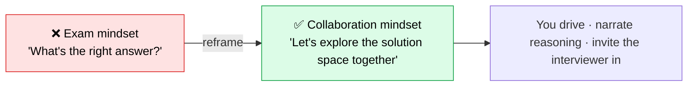
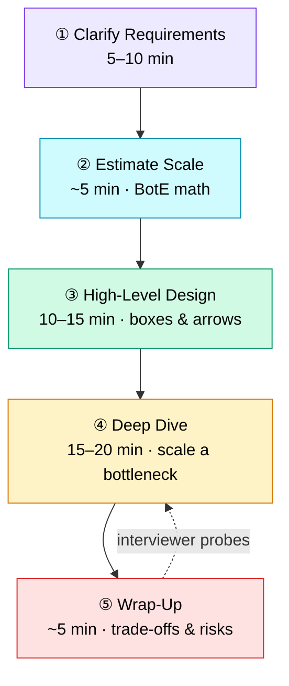
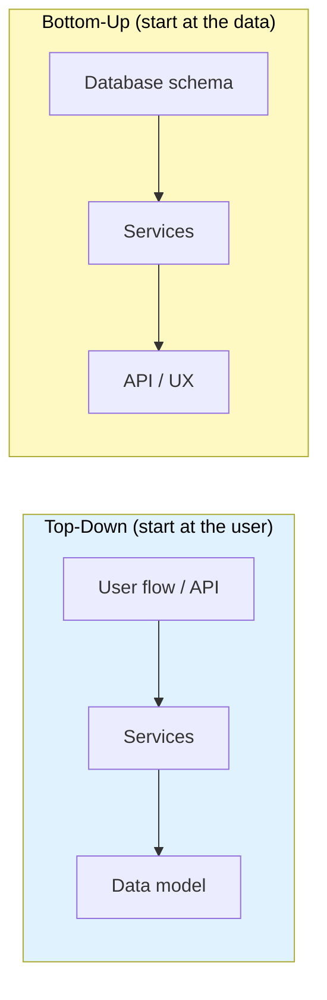
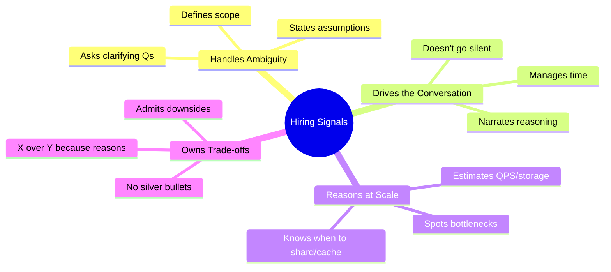
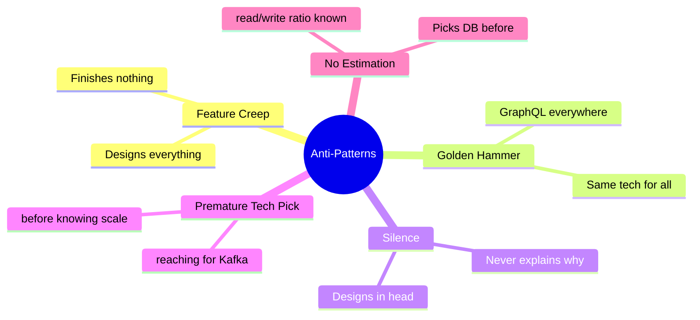

# System Design Interview Overview

> **One line:** A system design interview is a *collaborative architecture conversation* — and there's a repeatable 5-phase script that turns "Design WhatsApp" from a panic-inducing blank page into a controlled 45-minute walkthrough.

---

## Table of Contents
1. [Why You Must Master This](#1-why-you-must-master-this)
2. [The Mental Model](#2-the-mental-model)
3. [The 5-Phase Flow (the script)](#3-the-5-phase-flow-the-script)
4. [Each Phase, In Depth](#4-each-phase-in-depth)
5. [Top-Down vs Bottom-Up](#5-top-down-vs-bottom-up)
6. [The Signals Interviewers Score](#6-the-signals-interviewers-score)
7. [Worked Mini-Walkthrough — "Design a URL Shortener"](#7-worked-mini-walkthrough--design-a-url-shortener)
8. [Real-Life Use Cases (this isn't just interviews)](#8-real-life-use-cases-this-isnt-just-interviews)
9. [Failure Modes & Anti-Patterns](#9-failure-modes--anti-patterns)
10. [When NOT to Use the Full Ritual](#10-when-not-to-use-the-full-ritual)
11. [Cheat Sheet](#11-cheat-sheet)
12. [🏋️ Practice Drills](#-practice-drills)
13. [🎤 Interview Q&A Bank](#-interview-qa-bank)
14. [🎯 Staff+ Nuances](#-staff-nuances)
15. [Connections & Further Reading](#15-connections--further-reading)

---

## 1. Why You Must Master This

Many brilliant coders **freeze** when asked to "Design WhatsApp." They jump straight into a database schema without knowing whether it's for 100 users or 100 million. The interview is not testing whether you can code — at senior/staff level that's *assumed*. It's testing whether you can:

- **Navigate ambiguity** — real requirements are never clear; you narrow infinite possibilities into a concrete plan.
- **Manage trade-offs out loud** — there is no "right answer," only defensible decisions.
- **Avoid architectural debt** — designs built without structure create problems that cost millions to fix later.

> **The core problem it solves:** the *blank page*. A structured flow gives you somewhere to start and a path to follow, so you're never staring at nothing.

---

## 2. The Mental Model

Think of it as a **collaborative brainstorming session between two architects** — not an exam.



You're not giving *an answer*; you're sending *signals* — about how you think, how you handle scale, and how you reason about cost and failure. The interviewer is imagining *what it would be like to design a real system next to you.*

---

## 3. The 5-Phase Flow (the script)

Memorize this clock. It's the spine of every system design interview.





---

## 4. Each Phase, In Depth

### ① Requirement Clarification (5–10 min)
Define the boundaries. List **functional** ("user can send a message"), **non-functional** ("p99 < 200ms, 99.99% available"), and what's **out of scope**. *Propose* requirements rather than waiting — "I'll assume 1-on-1 and group chat, but skip voice calls. OK?" See [Requirement_Gathering.md](./Requirement_Gathering.md).

### ② Estimation (5 min)
Run the back-of-the-envelope funnel: **DAU → QPS → storage → bandwidth → servers.** This number *drives* every later decision (shard or not, cache or not, CDN or not). See [Back_of_the_Envelope_Estimation.md](./Back_of_the_Envelope_Estimation.md).

### ③ High-Level Design (10–15 min)
Draw the **boxes and arrows**: clients → load balancer → app services → databases/caches/queues. Define the **API contract** and the **data model**. Keep it simple first; you'll scale it in the next phase.

### ④ Deep Dive (15–20 min) — *where you win or lose*
The interviewer picks (or you propose) a bottleneck and you scale it: database sharding, cache strategy, fan-out, hot-key handling, consistency model. **This is where seniority shows.** Go deep on *one or two* components, not shallow on ten.

### ⑤ Wrap-Up (5 min)
Summarize, name the **bottlenecks and single points of failure**, state the **trade-offs** you made, and what you'd do with more time. This leaves a strong final impression of maturity.

> **Time discipline is itself a signal.** Spending 25 minutes clarifying requirements and never drawing a box is an instant fail.

---

## 5. Top-Down vs Bottom-Up

There are two valid entry points after requirements:



| Approach | Start from | Best for | Trade-off |
|----------|-----------|----------|-----------|
| **Top-Down** | User flow / API | Feature-heavy apps (Facebook, Uber) | Great UX & API ergonomics; data integrity considered later |
| **Bottom-Up** | Database schema | Data-heavy apps (Analytics, ledgers) | Strong data integrity; risk of awkward APIs |

Most strong candidates go **top-down**: clarify → API → high-level boxes → then deep-dive the data layer.

---

## 6. The Signals Interviewers Score



- **Proactivity** — you lead; you don't wait to be told the scale.
- **Justification** — *why* a load balancer over DNS round-robin, *why* Cassandra over Postgres.
- **Trade-off awareness** — acknowledging the downside of your own design is a top-tier signal.

---

## 7. Worked Mini-Walkthrough — "Design a URL Shortener"

```mermaid
sequenceDiagram
    participant C as Candidate
    participant I as Interviewer
    C->>I: ① "Functional: shorten URL, redirect. Non-func: low-latency redirect, high availability. Custom aliases — in scope?"
    I->>C: "Skip custom aliases."
    C->>C: ② Estimate — 100M new/mo → ~33 write QPS, ~3.3k read QPS, ~18 TB / 10 yr (with replicas)
    C->>I: ③ "Client → LB → API → KV store (hash→URL). Cache hot links. 7-char base62 key."
    I->>C: "How do you avoid collisions on key generation?"
    C->>C: ④ Deep dive — pre-generated key service / counter + base62 vs hash+retry; cache for the viral 20%
    C->>I: ⑤ "Trade-off: counter is simple but a SPOF; I'd shard the counter range. SPOF = the KV store → replicate."
    Note over C,I: Drove all 5 phases, ended on trade-offs ✅
```

> Notice the estimation step (②) *proved* this system fits on a couple of disks and is read-dominated — which made caching the headline decision and ruled out premature sharding. See the full numbers in [Back_of_the_Envelope_Estimation.md](./Back_of_the_Envelope_Estimation.md#8-worked-example-b--design-a-url-shortener).

---

## 8. Real-Life Use Cases (this isn't just interviews)

The same 5-phase muscle is exactly how senior engineers run real design work:

| Situation | How the flow applies |
|-----------|----------------------|
| **Writing a design doc / RFC** | The doc *is* the 5 phases on paper: context & requirements → scale estimates → proposed architecture → deep dives → risks & alternatives. |
| **Kicking off a new service** | Clarify scope with PM, estimate load, sketch components, identify the risky part, list trade-offs — before any code. |
| **Architecture review board** | Reviewers probe exactly like interviewers: "what's the bottleneck? what happens if this DC dies? what did you trade off?" |
| **Incident postmortem design changes** | Re-run the deep-dive phase on the component that failed; re-estimate its real load. |
| **Onboarding to a legacy system** | Reverse the flow: read the boxes & arrows, infer the requirements and trade-offs that produced them. |

> The interview is a *compressed simulation* of the most valuable thing a senior engineer does: **turn ambiguity into a defensible architecture.**

---

## 9. Failure Modes & Anti-Patterns



- **Feature creep** — trying to design everything; finish nothing. Scope ruthlessly.
- **Golden hammer** — forcing one favorite tech onto every problem.
- **Silence** — designing in your head. If the interviewer can't hear your reasoning, it didn't happen.
- **Premature commitment** — naming Kafka/Mongo because they're trendy, before scale justifies them. Over-engineering is as bad as under-engineering.

---

## 10. When NOT to Use the Full Ritual

- **Small-scale / internal tools** — a tool for 5 people doesn't need a distributed 14-step design. That's over-engineering.
- **Frozen specs** — if requirements are already 100% locked, move to implementation.
- **Spikes / prototypes** — when the goal is "is this even possible?", heavy upfront design kills momentum.

---

## 11. Cheat Sheet

```
┌──────────────── THE 45-MINUTE CLOCK ────────────────┐
│ ① CLARIFY   5–10m  functional · non-func · scope     │
│ ② ESTIMATE   ~5m   DAU → QPS → storage → servers     │
│ ③ HLD      10–15m  boxes+arrows · API · data model   │
│ ④ DEEP DIVE 15–20m scale ONE bottleneck deeply       │
│ ⑤ WRAP       ~5m   trade-offs · SPOFs · next steps   │
└──────────────────────────────────────────────────────┘
DO: drive · narrate · estimate before designing · justify every choice · name trade-offs
DON'T: go silent · feature-creep · pick tech before scale · skip the estimate
SIGNALS: ambiguity-handling · scale reasoning · trade-off ownership
```

---

## 🏋️ Practice Drills

> *Practice the meta-skill: driving the 5 phases. Time yourself — the clock is part of the test.*

**Drill 1 — Phase budget.** You're 25 minutes into a 45-minute interview and still clarifying requirements with no boxes drawn. What went wrong and what do you do *right now*?

<details><summary>Solution</summary>

You over-invested in phase ①. Clarification should be 5–10 min. Recover immediately: "Let me lock our assumptions and move to a high-level design" — state any open questions as assumptions and start drawing. Spending too long on requirements is a top failure mode.
</details>

**Drill 2 — Order the moves.** Put these in the right order: *draw boxes & arrows · estimate QPS · clarify scope · scale the database · summarize trade-offs.*

<details><summary>Solution</summary>

Clarify scope → estimate QPS → draw boxes & arrows → scale the database (deep dive) → summarize trade-offs. (The estimate must come *before* the design so it can drive the design.)
</details>

**Drill 3 — Pick the deep-dive target.** You've drawn a high-level design for a photo-sharing app. With 15 minutes left, which *one* component do you deep-dive, and why not all of them?

<details><summary>Solution</summary>

Pick the component the scale estimate stressed most — likely the read path / timeline (read-heavy) or media storage + CDN. Going deep on one or two shows seniority; going shallow on ten shows you can't prioritize. Ask the interviewer if they have a preference.
</details>

---

## 🎤 Interview Q&A Bank

**Q1. How do you start when asked to "Design WhatsApp"?**
> I don't draw yet. I clarify functional scope (1:1, groups, media?), non-functional targets (latency, availability, scale), and what's out of scope — then estimate before designing.

**Q2. The interviewer is silent and just watching. What do you do?**
> Keep narrating my reasoning and check in: "I'm choosing a load balancer here because X — does that match what you'd like me to focus on?" Silence on my side is the real risk.

**Q3. How much time on each phase?**
> Roughly: clarify 5–10, estimate ~5, high-level 10–15, deep dive 15–20, wrap ~5. I manage the clock actively.

**Q4. Top-down or bottom-up?**
> Usually top-down (user flow → API → components → data) for feature-heavy systems; bottom-up (schema first) for data-heavy/analytics systems. I state which I'm using and why.

**Q5. What's the single biggest red flag interviewers watch for?**
> Picking technology before knowing scale — e.g., "I'll use Kafka/Mongo" before establishing the read/write ratio or QPS. It signals pattern-matching instead of reasoning.

**Q6. How do you wrap up strongly?**
> Summarize the design in 3–4 sentences, name the bottlenecks and single points of failure, state the key trade-offs I made, and what I'd do with more time. It leaves an impression of maturity.

**Q7. They say "now 10× the traffic." How do you respond?**
> Re-run the estimate at the new scale, find which component breaks first (usually the DB write path or a single cache node), and propose the specific scaling move (shard, add replicas, partition the cache).

---

## 🎯 Staff+ Nuances

- **The interview simulates a design review, not a quiz.** What's really scored is *"would I want this person making architecture decisions next to me?"* — collaboration, judgment under ambiguity, and honest trade-offs beat encyclopedic recall.
- **Drive, but stay steerable.** Strong candidates lead the conversation *and* read the interviewer's cues — when they probe a component, that's a hint to go deep there, not to stick rigidly to your plan.
- **Depth over breadth wins at senior+.** Junior candidates try to cover everything shallowly; senior candidates pick the one or two genuinely hard parts and demonstrate real mastery (consistency, hot keys, fan-out, failure modes).
- **"It depends" is a strong opener — but never a full answer.** Name *what* it depends on, then commit to a decision for the stated assumptions. Hedging without committing reads as indecision.
- **Explicitly call out single points of failure and blast radius.** Naming "this DB leader is a SPOF; here's the failover plan" unprompted is exactly the instinct that separates staff-level thinking.
- **Know when the full ritual is over-engineering.** For an internal tool with 5 users, saying "this doesn't need a distributed design — a single managed Postgres is right" is itself a senior signal. Matching effort to scale is the meta-skill.

---

## 15. Connections & Further Reading

**Within this repo:**
- [Requirement_Gathering.md](./Requirement_Gathering.md) — phase ① in depth.
- [Back_of_the_Envelope_Estimation.md](./Back_of_the_Envelope_Estimation.md) — phase ② in depth.
- [Constraints_Assumptions.md](./Constraints_Assumptions.md) · [Trade_off_Analysis.md](./Trade_off_Analysis.md) — the reasoning behind your decisions.
- [03_High_Level_Design](../03_High_Level_Design/) · [04_Low_Level_Design](../04_Low_Level_Design/) — phases ③ and ④.

**External classics:**
- *System Design Interview – An Insider's Guide* (Alex Xu) — the canonical phase-by-phase playbook.
- *Designing Data-Intensive Applications* (Martin Kleppmann) — the deep-dive bible.
- *High Scalability* blog — real architectural case studies.

---

## TL;DR
System design is the art of **managing trade-offs under constraints**, performed live. Follow the 5-phase clock (Clarify → Estimate → HLD → Deep Dive → Wrap), drive the conversation, justify every choice, and always name what you're giving up. Don't build a Ferrari when the user needs a bicycle — but don't build a bicycle that collapses when a second person sits on it.
