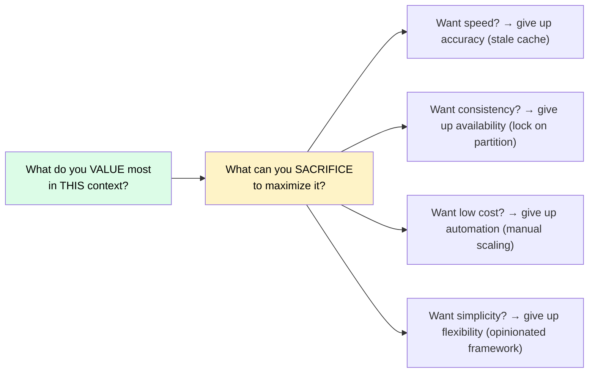
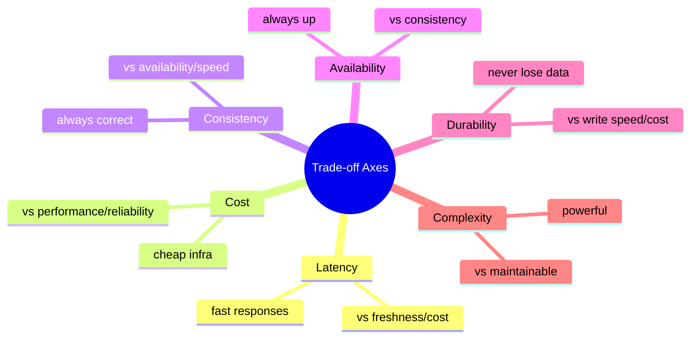
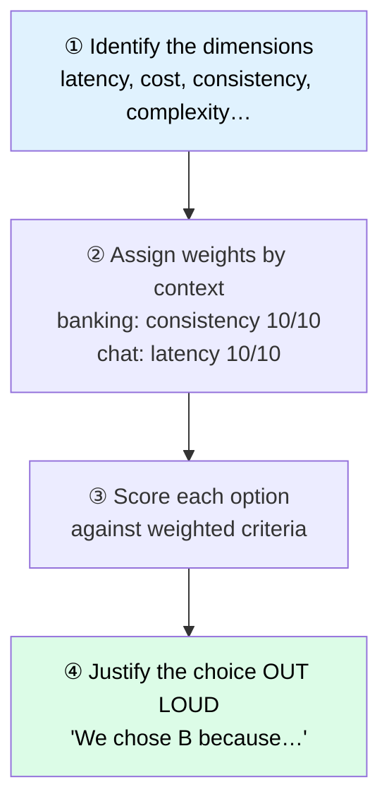
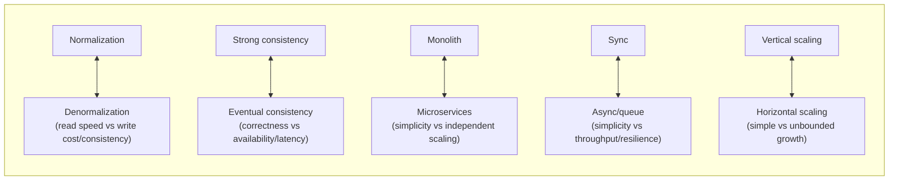
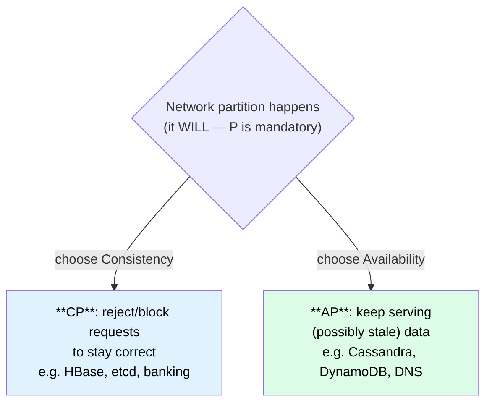
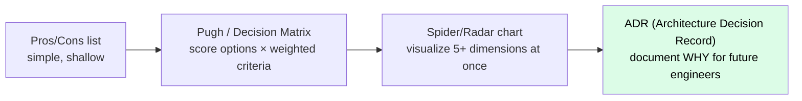
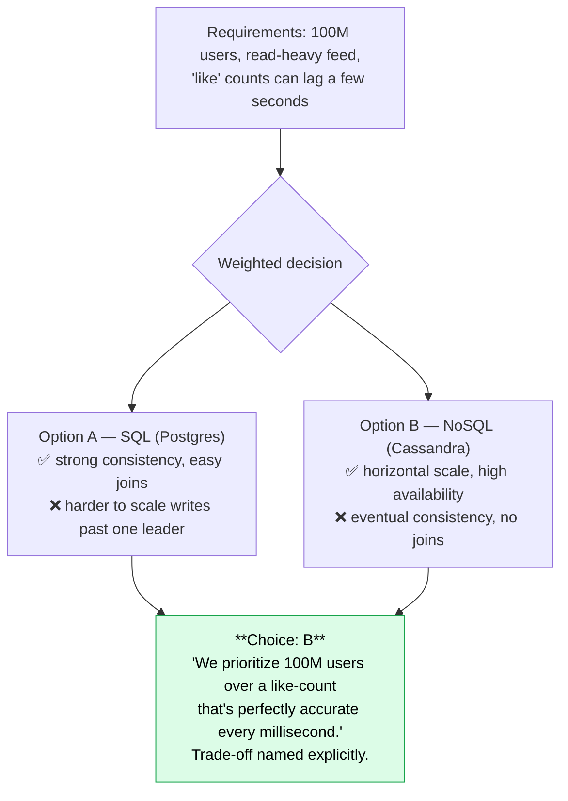
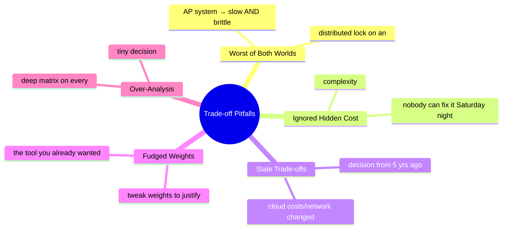
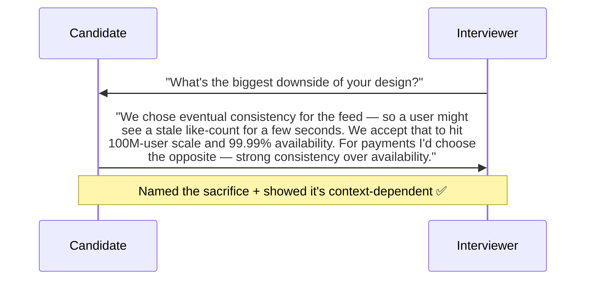

# Trade-off Analysis

> **One line:** There are no best solutions — only trade-offs. Architecture is the *art of intentionally giving something up to get something you value more*, and if you can't name what you sacrificed, you haven't finished the design.

---

## Table of Contents
1. [Why You Must Master This](#1-why-you-must-master-this)
2. [The Mental Model](#2-the-mental-model)
3. [The Dimensions of Trade-off](#3-the-dimensions-of-trade-off)
4. [The Method — Weighted Decision](#4-the-method--weighted-decision)
5. [Canonical Trade-offs Every Engineer Knows](#5-canonical-trade-offs-every-engineer-knows)
6. [CAP, PACELC & the "Pick Two" Triangles](#6-cap-pacelc--the-pick-two-triangles)
7. [Tools: Pugh Matrix, Spider Chart, ADRs](#7-tools-pugh-matrix-spider-chart-adrs)
8. [Worked Example — SQL vs NoSQL for a Feed](#8-worked-example--sql-vs-nosql-for-a-feed)
9. [Real-Life Use Cases](#9-real-life-use-cases)
10. [Failure Modes](#10-failure-modes)
11. [Interview Playbook](#11-interview-playbook)
12. [Cheat Sheet](#12-cheat-sheet)
13. [🏋️ Practice Drills](#-practice-drills)
14. [🎤 Interview Q&A Bank](#-interview-qa-bank)
15. [🎯 Staff+ Nuances](#-staff-nuances)
16. [Connections & Further Reading](#16-connections--further-reading)

---

## 1. Why You Must Master This

This is the **single most important skill** an interviewer scores, and the one that defines senior engineering. Any tool claiming to be "fast, cheap, *and* reliable" is either lying or hiding a cost.

- **No best solutions** — only trade-offs. The job is choosing the *right* sacrifice for *this* context.
- **Defeats decision paralysis** — a framework lets you make a choice *and defend it*, instead of agonizing.
- **Protects architectural integrity** — a system built without conscious trade-offs becomes a "Big Ball of Mud" where half-consistent, half-available philosophies make it impossible to debug.

> **The core problem it solves:** *one-dimensional thinking.* Picking a database because it's "fast" while ignoring that it loses data on power failure. Or using Kafka for a 10-message-per-day pipeline — drowning a trivial need in complexity.

---

## 2. The Mental Model



Architecture is **giving something up to get something you value more.** The skill is making that sacrifice *consciously* and *defensibly*.

---

## 3. The Dimensions of Trade-off

Almost every engineering decision pulls on a few competing axes:



> **The hidden axis is almost always Complexity.** A technically superior design that no one on the team can debug at 2am on a Saturday is a *worse* design. Weight maintainability explicitly.

---

## 4. The Method — Weighted Decision



The weights are **context-dependent** — there is no universal answer:

| Dimension | Banking app | Chat app | Analytics pipeline |
|-----------|:-----------:|:--------:|:------------------:|
| Consistency | 🔴 10/10 | 🟡 4/10 | 🟢 2/10 |
| Latency | 🟡 5/10 | 🔴 10/10 | 🟢 2/10 |
| Throughput | 🟡 5/10 | 🟡 6/10 | 🔴 10/10 |
| Durability | 🔴 10/10 | 🟡 6/10 | 🟡 5/10 |

> Same options, different weights → different "right" answer. That's why "it depends" is the correct *start* of every senior answer (followed immediately by "...on X, so here's my choice").

---

## 5. Canonical Trade-offs Every Engineer Knows



```python
# Trade-off made concrete: consistency level on every write (Cassandra)
def save_comment(comment):
    # LOCAL_ONE: fastest, but data lost if that node dies immediately
    # QUORUM:    slower, survives minority node loss (the balanced choice)
    # ALL:       slowest, perfectly consistent, dies if ANY replica is down
    consistency = "QUORUM"   # chosen: balance durability vs availability
    db.write(comment, consistency_level=consistency)
```

---

## 6. CAP, PACELC & the "Pick Two" Triangles

The most famous trade-off in distributed systems — and the broader truth that *every* project balances cheap/fast/good.





> **CAP is often misquoted.** In a distributed system, partition tolerance (P) is *not optional* — networks fail. So the real choice during a partition is **C or A**. **PACELC** extends it: *even when there's no partition (E, else), you still trade Latency vs Consistency.* That's the more complete modern framing.

**Real examples:**
- **Cassandra** (AP) — Facebook built it for Inbox Search: traded "knowing exactly where every message is" for "1 billion people search at once without crashing."
- **Financial ledger** (CP) — traded "writing at light speed" for "$1 never becomes $2 in a race condition."

---

## 7. Tools: Pugh Matrix, Spider Chart, ADRs



- **Pugh / Decision Matrix** — score each option against weighted criteria; forces objectivity.
- **Spider/Radar chart** — compare options across 5+ dimensions visually.
- **ADRs** — the most valuable real-world artifact: a short doc recording *what* was decided, *why*, and *what was rejected*. Future engineers (including you) will thank you when constraints change.

---

## 8. Worked Example — SQL vs NoSQL for a Feed



The answer isn't "NoSQL is better" — it's "for *these weights* (scale ≫ instant consistency), B wins, and here's exactly what we gave up." Flip the requirement to a bank ledger and A wins.

---

## 9. Real-Life Use Cases

| Situation | The trade-off being made |
|-----------|--------------------------|
| **Choosing a database** | Consistency vs availability vs scale — the CAP/PACELC decision, weighted by domain. |
| **Build vs buy** | Control & cost-at-scale vs speed-to-market & maintenance burden. |
| **Caching strategy** | Latency & DB-load relief vs stale data & cache-invalidation complexity. |
| **Sync vs async API** | Simplicity & immediate response vs throughput, resilience, and decoupling. |
| **Monolith vs microservices** | Operational simplicity vs independent deploy/scale (and distributed-systems complexity). |
| **Reserved vs on-demand cloud** | Lower unit cost & commitment vs flexibility. |
| **ADRs in the repo** | The real artifact teams use to make trade-offs *durable* and reviewable over years. |

> Real-world habit: for any non-trivial decision, write a 1-page ADR naming the options, the weighted criteria, the choice, and **the downside you accepted.** It prevents re-litigating decisions and exposes *stale* trade-offs when the world changes.

---

## 10. Failure Modes



- **Worst of both worlds** — e.g., bolting a distributed lock onto a high-availability system, getting something both slow *and* brittle.
- **Ignoring the hidden cost (complexity)** — the technically superior option no one can operate.
- **Stale trade-offs** — clinging to a 5-year-old decision after cloud costs, network speed, or scale changed the math.
- **Fudged weights** — quietly tuning the criteria to justify the tool you already wanted (confirmation bias dressed as analysis).
- **Over-analysis** — running a full matrix on trivial decisions. Match the rigor to the stakes.

---

## 11. Interview Playbook

**This is the headline skill interviewers want.** Every strong answer sounds like *"I chose X over Y because, given our priority on Z, we can accept the cost of W."*



**✅ Do:** lead with "it depends on X" then *commit* to a choice; always volunteer the downside of your own design.
**🚩 Red flags:** "There are no downsides" / "this solution is perfect." Nothing signals inexperience faster.

---

## 12. Cheat Sheet

```
ARCHITECTURE = intentional sacrifice.
If you can't name what you gave up, you're not done.

METHOD
  ① list dimensions  ② weight by CONTEXT
  ③ score options    ④ justify out loud

AXES: latency · cost · consistency · availability
      durability · COMPLEXITY (the hidden one)

CAP (during a partition, pick one):
  CP = correct but may reject (banking, etcd)
  AP = available but maybe stale (Cassandra, DNS)
  PACELC: even WITHOUT partition → Latency vs Consistency

CANONICAL TRADE-OFFS
  normalize ↔ denormalize     strong ↔ eventual
  monolith ↔ microservices    sync ↔ async
  vertical ↔ horizontal

INTERVIEW: "X over Y because Z; the cost is W."
DOCUMENT: write an ADR — name the rejected option too.
```

---

## 🏋️ Practice Drills

> *Name the sacrifice. Every answer here is "X over Y because Z; the cost is W."*

**Drill 1 — Name the trade-off.** For each choice, state what's gained and what's given up: (a) denormalizing a database, (b) adding a cache, (c) switching from a monolith to microservices.

<details><summary>Solution</summary>

(a) Gain read speed (no joins); give up write simplicity + consistency (must update copies). (b) Gain latency + DB-load relief; give up freshness + add invalidation complexity. (c) Gain independent scaling/deploys; give up operational simplicity (now a distributed system with network failures).
</details>

**Drill 2 — Weight by context.** A team must choose between strong and eventual consistency. How does the right answer differ for (a) a bank ledger vs (b) a "likes" counter?

<details><summary>Solution</summary>

(a) Bank ledger: weight consistency ~10/10 → strong consistency (CP); a wrong balance is unacceptable. (b) Likes counter: weight latency/availability high, consistency low → eventual consistency (AP); a count that's off by a few for a second is fine. Same options, opposite choice — driven by weights.
</details>

**Drill 3 — Spot the "worst of both worlds."** Why is putting a strongly-consistent distributed lock in front of a high-availability, low-latency service often a mistake?

<details><summary>Solution</summary>

You inherit the lock's coordination latency and partition-time unavailability *and* the HA system's complexity — ending up both slow and brittle, defeating the reason you chose an HA system. Either commit to CP or design the HA path to not need the lock (idempotency, optimistic concurrency).
</details>

---

## 🎤 Interview Q&A Bank

**Q1. "What's the biggest downside of your design?"**
> (Never say "none.") Name a real one: "We chose eventual consistency, so users may briefly see a stale count. We accept that for availability and scale; for payments I'd choose the opposite." Acknowledging the downside is the signal.

**Q2. How do you choose between two technologies objectively?**
> Identify the dimensions (latency, cost, consistency, complexity), weight them for *this* domain, score each option (a Pugh matrix), and commit — documenting why in an ADR.

**Q3. What's the hidden dimension teams forget?**
> Complexity / operability. A technically superior design no one can debug at 2am is worse than a simpler "good enough" one. Weight maintainability explicitly.

**Q4. SQL vs NoSQL — how do you decide?**
> By the requirements' weights: need ACID/joins/strong consistency → SQL; need horizontal write scale + high availability and can tolerate eventual consistency → NoSQL. It's a CAP/PACELC-shaped decision, not a fashion choice.

**Q5. State CAP correctly.**
> During a network partition (which is unavoidable in distributed systems), you choose Consistency or Availability — not "2 of 3." PACELC adds: even without a partition, you trade Latency vs Consistency. (See CAP & PACELC.)

**Q6. Why is "it depends" both right and insufficient?**
> Right because the answer genuinely depends on weighted context; insufficient because you must then name *what* it depends on and commit to a choice. Hedging without committing reads as indecision.

**Q7. What's an ADR and why use one?**
> An Architecture Decision Record: a short doc capturing the decision, the options considered (including rejected ones), and the reasoning. It prevents re-litigating decisions and exposes stale trade-offs when constraints change.

**Q8. Give a real-world trade-off made by a famous system.**
> Amazon's cart is AP (Dynamo — always accept writes, merge conflicts) while its payment ledger is CP. Same company, opposite trade-offs, made per service.

---

## 🎯 Staff+ Nuances

- **Complexity is the trade-off that compounds.** Every added component, abstraction, or service is a permanent tax on understanding, onboarding, and debugging. The senior instinct is to ask "what can we *remove*?" as often as "what should we add?" (Ousterhout's thesis).
- **Reversible vs irreversible decisions deserve different rigor.** Amazon's "one-way vs two-way doors": spend deep analysis on hard-to-reverse choices (data model, core datastore, public API contract); move fast and iterate on easily-reversible ones. Over-analyzing reversible decisions is its own failure mode.
- **Trade-offs go stale.** A decision optimal under 2019's cloud prices, network speeds, and team size may be wrong now. ADRs let you detect when the *premises* changed, not just the conclusion. Schedule periodic re-evaluation of load-bearing decisions.
- **Beware fudged weights (motivated reasoning).** It's easy to tune criteria weights to justify the tool you already wanted. Guard against it by setting weights *before* scoring options, and by having someone argue the opposing choice.
- **The "worst of both worlds" is a real and common outcome.** Half-consistent/half-available systems, distributed monoliths, and caches-without-invalidation-strategy arise from trying to avoid *any* sacrifice. Picking a clear side is usually better than straddling.
- **Local optima vs global optima.** A component-level "best" choice can be globally wrong (e.g., the fastest datastore that forces every service to handle eventual consistency). Evaluate trade-offs at the system boundary, including the cost imposed on *neighbors*.
- **CAP/PACELC is the canonical, but every layer has its own trade triangle.** Caching (freshness vs latency), replication (consistency vs availability), indexing (read vs write speed), normalization (integrity vs read speed). Recognizing the *shape* lets you reason about new ones quickly.

---

## 16. Connections & Further Reading

**Within this repo:**
- [Constraints_Assumptions.md](./Constraints_Assumptions.md) — constraints define which trade-offs are even available.
- [Requirement_Gathering.md](./Requirement_Gathering.md) — requirements set the *weights*.
- [SLA_SLO_SLI.md](./SLA_SLO_SLI.md) — each extra nine is a cost-vs-reliability trade-off.
- [05_Databases_Storage](../05_Databases_Storage/) — CAP/PACELC in practice; [10_Microservices_Distributed_Systems](../10_Microservices_Distributed_Systems/).

**External classics:**
- *Fundamentals of Software Architecture* (Richards & Ford) — "architecture is about trade-offs" is its thesis.
- *A Philosophy of Software Design* (John Ousterhout) — complexity as the core cost.
- *Designing Data-Intensive Applications* (Kleppmann) — CAP/PACELC done rigorously.
- Netflix Tech Blog — "evolution of design" posts that are trade-offs end to end.

---

## TL;DR
Professional engineering is **making intentional sacrifices.** There are no best solutions, only trade-offs weighted by context: identify the dimensions, weight them for *this* domain, score the options, and **commit** — then state the downside you accepted. Remember **CAP** (during a partition, pick C or A), **PACELC** (even without one, latency vs consistency), and that **complexity is the hidden cost** in every decision. If you haven't named what you're giving up, you haven't done the design.
