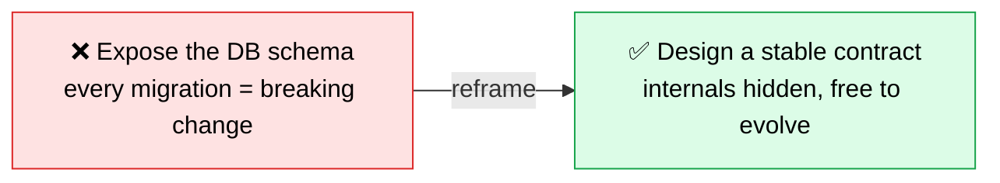
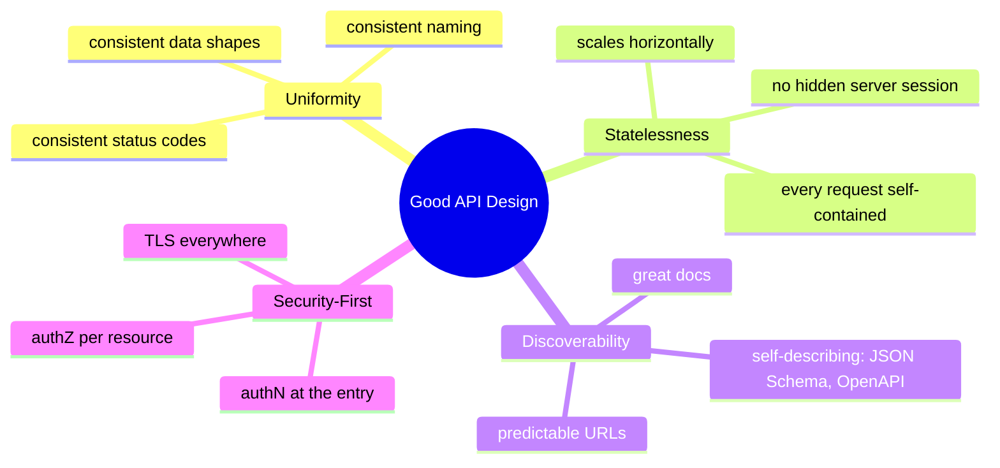
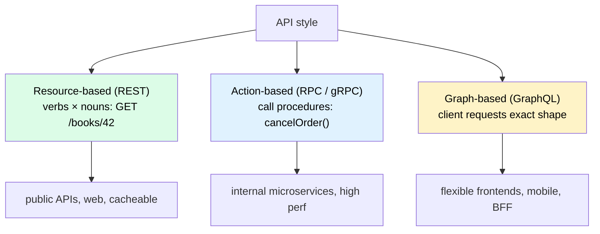
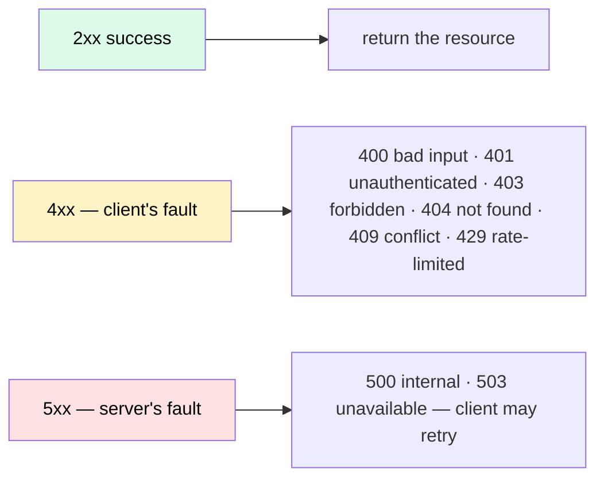
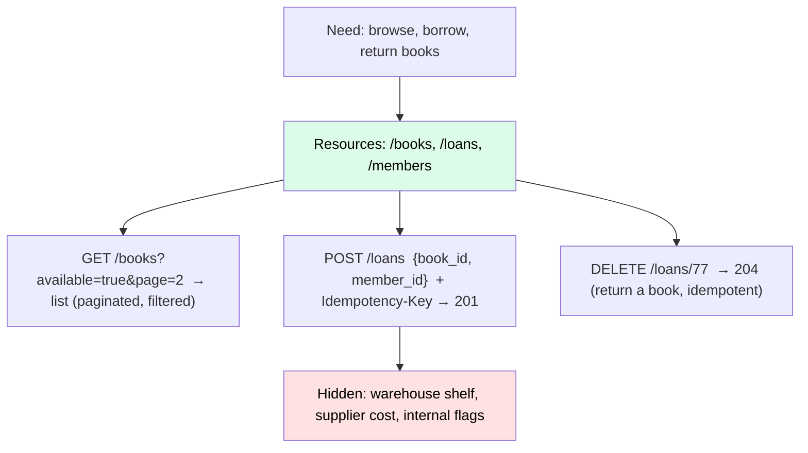
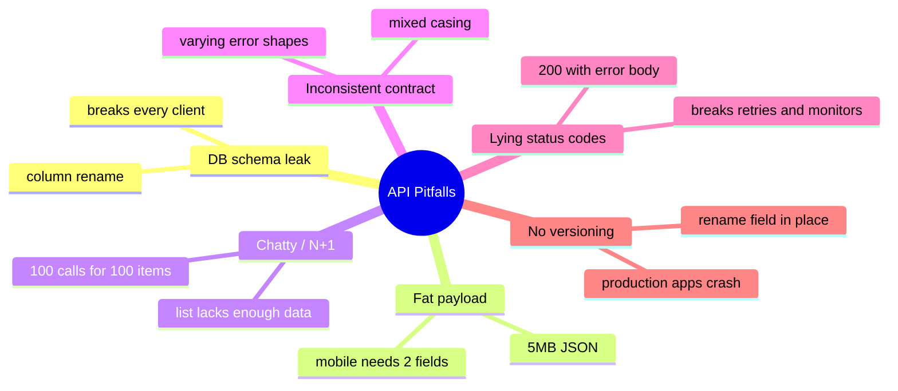

# API Design Fundamentals

> **One line:** An API is a *promise to the consumer* — a stable contract that hides your messy internals behind a clean, predictable interface, so you can rewrite the engine without breaking anyone driving the car.

---

## Table of Contents
1. [Why You Must Master This](#1-why-you-must-master-this)
2. [The Mental Model](#2-the-mental-model)
3. [The Four Pillars of Good API Design](#3-the-four-pillars-of-good-api-design)
4. [Resource vs RPC vs Graph](#4-resource-vs-rpc-vs-graph)
5. [Designing the Contract (not the database)](#5-designing-the-contract-not-the-database)
6. [Errors, Status Codes & Consistency](#6-errors-status-codes--consistency)
7. [Worked Example — A Library API](#7-worked-example--a-library-api)
8. [Real-Life Use Cases](#8-real-life-use-cases)
9. [Failure Modes](#9-failure-modes)
10. [🏋️ Practice Drills](#-practice-drills)
11. [🎤 Interview Q&A Bank](#-interview-qa-bank)
12. [🎯 Staff+ Nuances](#-staff-nuances)
13. [Cheat Sheet](#13-cheat-sheet)
14. [Connections & Further Reading](#14-connections--further-reading)

---

## 1. Why You Must Master This

An API (Application Programming Interface) is a **contract**. Once third parties build on it, you can't change it without breaking their business — which makes bad API design an expensive, multi-year legacy burden.

- **It's the external foundation** — a public API is forever; a leaked database column becomes a breaking change for thousands of clients.
- **Developer friction kills adoption** — if an engineer can't "get" your API in 5 minutes, they switch to a competitor. Confusing APIs generate endless support cost.
- **It enforces decoupling** — a well-designed interface stops the internals of Service A from spilling into Service B (a "leaky abstraction"), so both can evolve independently.

> **The core problem it solves:** *inconsistency and coupling.* It prevents the chaos where one endpoint uses `snake_case`, another `camelCase`, error formats vary, and — the cardinal sin — your **database schema is exposed directly**, so every migration breaks your users.

---

## 2. The Mental Model

An API is the **dashboard of a car.** Drivers don't need to understand fuel injection — they need a steering wheel, pedals, and a speedometer that behave *predictably* in every car they sit in. Your job is to design that dashboard, not to expose the engine.




---

## 3. The Four Pillars of Good API Design



1. **Uniformity** — consistent naming, status codes, pagination, and data structures everywhere. A consumer should never be surprised.
2. **Statelessness** — every request carries everything needed to process it; no "hidden" server-side session. This is what lets you scale horizontally behind a load balancer.
3. **Discoverability** — high-quality docs (OpenAPI/Swagger), self-describing formats, predictable resource URLs.
4. **Security-first** — authentication (*who are you?*) and authorization (*what can you do?*) designed in at the entry point, not bolted on.

---

## 4. Resource vs RPC vs Graph

The three dominant interface styles — the rest of this section drills into each:



| Style | Maps to | Best for | Deep dive |
|-------|---------|----------|-----------|
| **REST** | nouns + HTTP verbs | public APIs, browser, cache-friendly | [REST_API_Design.md](./REST_API_Design.md) |
| **RPC / gRPC** | procedures | internal, low-latency, typed | [gRPC.md](./gRPC.md) |
| **GraphQL** | a typed graph the client queries | mobile, complex/changing frontends | [GraphQL.md](./GraphQL.md) |

---

## 5. Designing the Contract (not the database)

The golden rule: **design around what consumers need (resources), not your internal constraints (tables).** Expose a curated *view*, hide warehouse internals, and add hypermedia links so clients can navigate.

```python
# API Layer — the clean contract, decoupled from the DB
class BookAPI:
    def get_book(self, book_id: str):
        raw = db.fetch_book_record(book_id)   # messy internal row
        return {                               # curated public view
            "id": raw.uuid,
            "title": raw.display_name,
            "status": "available" if raw.stock > 0 else "out_of_stock",
            "links": {                          # HATEOAS: navigable
                "self": f"/v1/books/{raw.uuid}",
                "author": f"/v1/authors/{raw.author_id}"
            }
        }
        # NOTE: physical warehouse_location, internal_cost, etc. are NEVER exposed
```

> The client sees `status: "available"`, not `stock: 0`. You can change how stock is computed, move warehouses, or switch databases — the contract is untouched.

---

## 6. Errors, Status Codes & Consistency

A consistent error shape is as important as the success shape — it's what makes clients able to retry, alert, and recover automatically.



> **Cardinal sin:** returning `200 OK` with a body `{"error": "not found"}`. It breaks every automated retry, monitor, and cache. The status code *is* part of the contract — use it honestly. Adopt a single error envelope (e.g. `{ "error": { "code", "message", "request_id" } }`) across every endpoint.

---

## 7. Worked Example — A Library API



Notice the design decisions that *fall out* of the fundamentals: nouns not verbs (`/loans`, not `/borrowBook`), filtering + pagination on the list endpoint (avoid the fat payload), an idempotency key on the create (safe retries), honest status codes, and internals hidden. Each connects to a dedicated topic in this section.

---

## 8. Real-Life Use Cases

| Situation | How API fundamentals decide it |
|-----------|--------------------------------|
| **Public platform API (Stripe-style)** | Consistent resources (`/charges`, `/customers`), uniform errors, a test mode — the predictability that wins markets. |
| **Microservice contracts** | Each service exposes a stable interface so teams deploy independently without coordinating every change. |
| **Backend rewrite** | A clean contract lets you swap Python → Go, or Postgres → DynamoDB, with zero client impact. |
| **Mobile app** | Right-sized payloads + pagination avoid the fat-payload/N+1 problems that drain battery and data. |
| **Partner integrations** | A versioned, documented contract is a legal/commercial asset — partners build businesses on it. |
| **Internal platform / SDK** | Good naming and discoverability cut onboarding from days to minutes and slash support tickets. |

> Real-world habit: **design the API request/response *before* writing the implementation.** Sketch the contract, review it with a consumer, *then* build — it forces a consumer-first design and surfaces breaking changes early.

---

## 9. Failure Modes



- **Exposing the DB schema** — the original sin; couples your storage to every consumer.
- **The fat payload** — returning 5 MB when the client needs 2 fields; wastes bandwidth and battery.
- **Chatty / N+1 design** — forcing 100 round trips to assemble one screen because the list endpoint is too thin.
- **Inconsistency & lying status codes** — mixed casing, varying error shapes, `200 OK` on failure — all break automation.
- **No versioning strategy** — see [API_Versioning.md](./API_Versioning.md).

---

## 🏋️ Practice Drills

> *Design the contract first. Attempt before opening the solution.*

**Drill 1 — Fix the leaky endpoint.** An endpoint returns `{ "usr_pwd_hash": "...", "internal_flag": 3, "created_ts": 1699... }`. List three problems and a better shape.

<details><summary>Solution</summary>

Problems: (1) leaks a password hash — *never* expose it; (2) exposes internal-only fields (`internal_flag`) coupling clients to internals; (3) cryptic naming + raw epoch timestamp. Better: `{ "id": "...", "name": "...", "created_at": "2023-11-04T...Z" }` — curated, consistent casing, ISO-8601 time, no secrets.
</details>

**Drill 2 — Resource vs RPC.** Rewrite these RPC-style endpoints as RESTful resources: `POST /createUser`, `POST /getUserById`, `POST /deactivateUser`.

<details><summary>Solution</summary>

`POST /users` (create), `GET /users/{id}` (read), `PATCH /users/{id}` with `{"status":"inactive"}` or `DELETE /users/{id}` (deactivate). Nouns + standard verbs instead of bespoke procedure names.
</details>

**Drill 3 — Pick the style.** For each, choose REST, gRPC, or GraphQL and justify: (a) a public payments API, (b) two internal services exchanging millions of calls/sec, (c) a mobile app feed pulling nested user/post/comment data.

<details><summary>Solution</summary>

(a) REST — universal, cacheable, low friction for external devs. (b) gRPC — binary + HTTP/2 multiplexing for internal performance. (c) GraphQL — one query for the exact nested shape, avoids over/under-fetch on mobile.
</details>

---

## 🎤 Interview Q&A Bank

**Q1. What makes an API "good"?**
> Uniformity (consistent naming/status/shapes), statelessness, discoverability (great docs/OpenAPI), and security-first design. Above all, it's designed around consumer needs, not the database schema.

**Q2. Why is exposing your database schema as an API a bad idea?**
> It couples every consumer to your storage. A column rename or table migration becomes a breaking change for all of them. The API should be a stable contract that hides internals.

**Q3. REST vs RPC vs GraphQL — when each?**
> REST for public, cacheable, resource-oriented APIs; gRPC for high-performance internal service-to-service; GraphQL for flexible/changing frontends that need to fetch exact nested shapes.

**Q4. Why does statelessness matter?**
> Each request is self-contained, so any server can handle any request — that's what lets you scale horizontally behind a load balancer and survive node failures.

**Q5. What's wrong with returning 200 OK and an error in the body?**
> It breaks automated reasoning — retries, monitoring, caching, and client error handling all rely on the status code. The code is part of the contract; use it honestly.

**Q6. What is a "chatty" API and how do you fix it?**
> One that needs many round trips to do one task (N+1). Fix by enriching list endpoints, supporting field expansion/embeds, or using GraphQL/batch endpoints.

**Q7. How do you design an API consumer-first?**
> Write the request/response examples and error shapes before implementing, review with an actual client, and design resources around user tasks — not around tables.

---

## 🎯 Staff+ Nuances

- **The contract is the product; the implementation is disposable.** Stable interfaces are what let an org refactor freely for years. Treat the public schema as a versioned, reviewed artifact (OpenAPI in source control, contract tests in CI) — not an accident of the code.
- **Design for evolvability, not perfection.** You will get the contract partly wrong. Bake in seams: additive-only changes, optional fields, tolerant readers (ignore unknown fields), and a versioning strategy — so you can grow without breaking. See [API_Versioning.md](./API_Versioning.md).
- **Consistency beats cleverness.** A predictable, slightly-verbose API that behaves the same everywhere beats a clever one with special cases. Publish a style guide (Google/Microsoft/Zalando guidelines) and enforce it with linters (Spectral).
- **The "narrow waist" principle.** A small, stable, well-chosen interface at the boundary lets unbounded complexity flourish on both sides independently — the same idea as IP for the internet or syscalls for an OS. Keep the surface area minimal.
- **Idempotency and pagination are contract concerns, not afterthoughts.** Whether `POST` is safely retryable and how lists are bounded are part of the *promise* — clients design around them. Decide early (see [Idempotency.md](./Idempotency.md), [Pagination_Filtering.md](./Pagination_Filtering.md)).
- **Backward compatibility is a discipline, not a feature.** The hard part isn't adding v2 — it's never silently breaking v1. Consumer-driven contract tests (Pact) catch breaks before they ship.

---

## 13. Cheat Sheet

```
AN API IS A CONTRACT — design the dashboard, hide the engine.

4 PILLARS  uniformity · statelessness · discoverability · security-first
STYLES     REST (public/cacheable) · gRPC (internal/fast) · GraphQL (flexible frontend)

DO
  design contract before implementation (consumer-first)
  curate the response — hide DB columns, secrets, internal flags
  one consistent error envelope: {code, message, request_id}
  honest status codes (2xx/4xx/5xx) · paginate lists · idempotency keys on writes
DON'T
  expose the DB schema · return 200 on errors · build chatty/N+1 APIs
  mix snake_case/camelCase · break the contract without a new version

STATUS  200 OK · 201 Created · 204 No Content · 400 · 401 · 403 · 404 · 409 · 429 · 500 · 503
```

---

## 14. Connections & Further Reading

**Within this repo:**
- [REST_API_Design.md](./REST_API_Design.md) · [GraphQL.md](./GraphQL.md) · [gRPC.md](./gRPC.md) — the three implementation styles.
- [API_Versioning.md](./API_Versioning.md) · [Idempotency.md](./Idempotency.md) · [Pagination_Filtering.md](./Pagination_Filtering.md) — core contract concerns.
- [Authentication.md](./Authentication.md) · [Authorization.md](./Authorization.md) · [Rate_Limiting.md](./Rate_Limiting.md) · [API_Gateway.md](./API_Gateway.md) — the security & edge layer.
- [01 · Trade-off Analysis](../01_Planning_Foundations/Trade_off_Analysis.md) — choosing a style is a trade-off.

**External classics:**
- [Google API Design Guide](https://cloud.google.com/apis/design) · [Microsoft REST API Guidelines](https://github.com/microsoft/api-guidelines) · [Zalando RESTful Guidelines](https://opensource.zalando.com/restful-api-guidelines/).
- [Stripe API docs](https://stripe.com/docs/api) — the gold standard to emulate.
- *Web API Design* (Brian Mulloy / Apigee).

---

## TL;DR
An API is a **promise to the consumer** — design it around their needs (resources), not your internal constraints (database tables). Follow the four pillars (**uniformity, statelessness, discoverability, security-first**), pick the right style (**REST / gRPC / GraphQL**), use **honest status codes and one consistent error shape**, hide your internals so you can evolve them, and treat **backward compatibility as a discipline**. The contract is the product; the implementation behind it is disposable.
