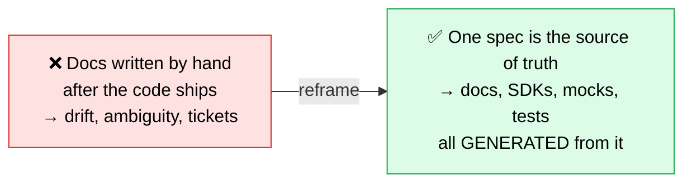
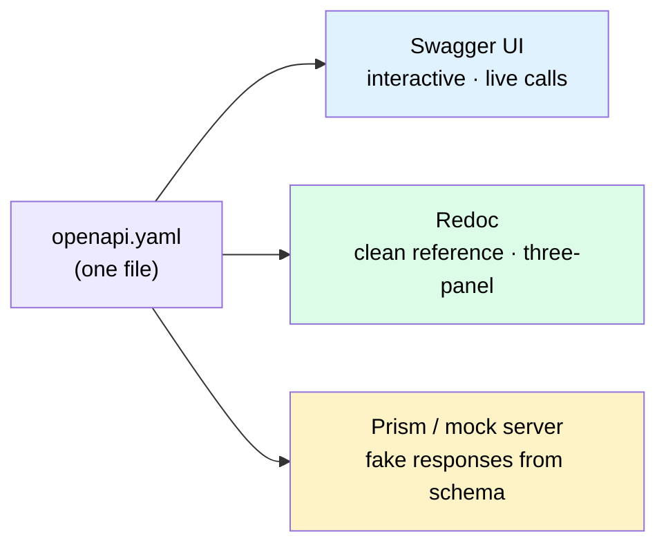
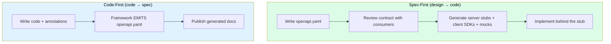
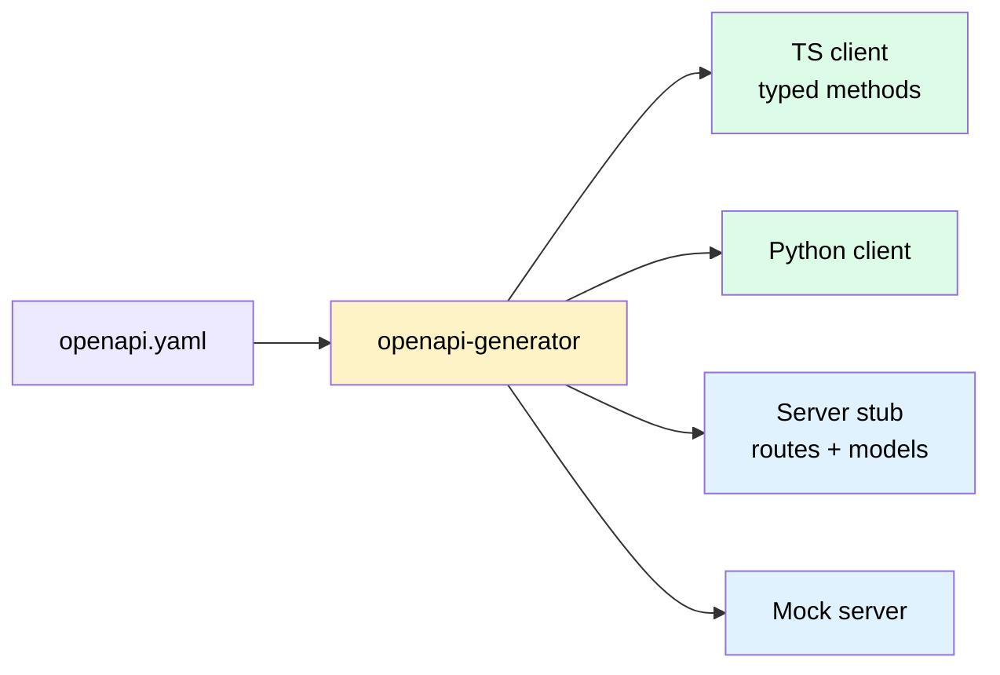
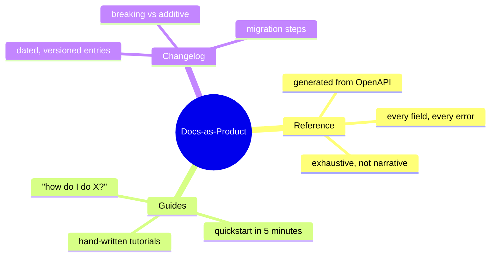
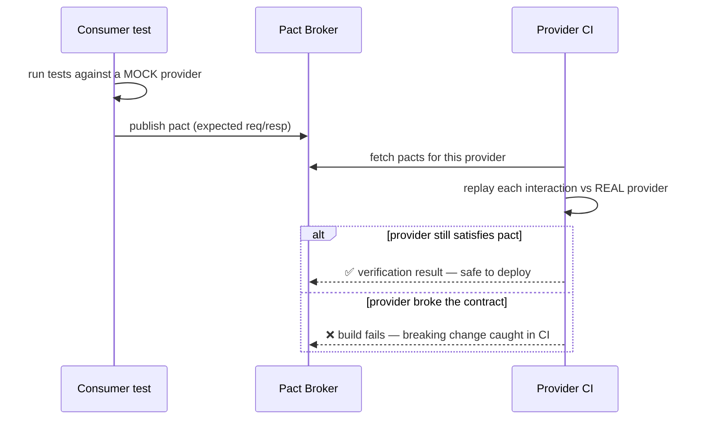
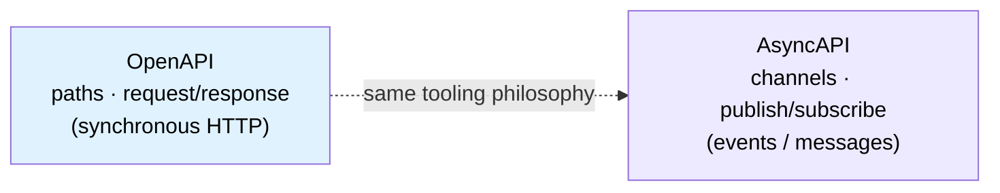
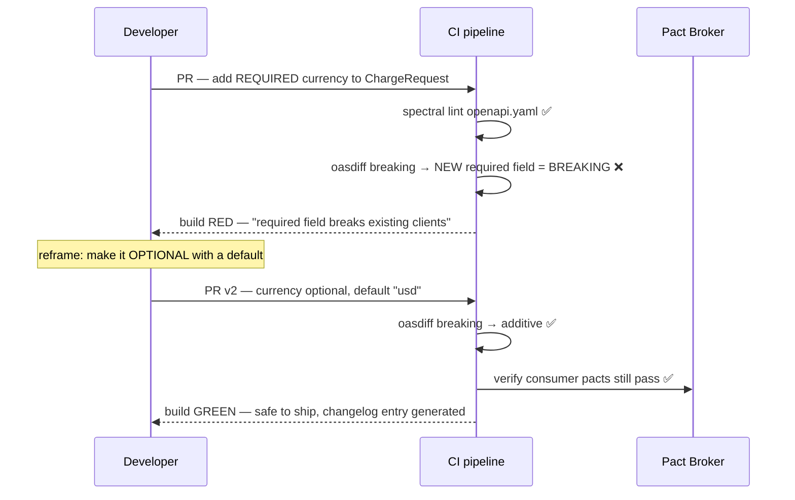
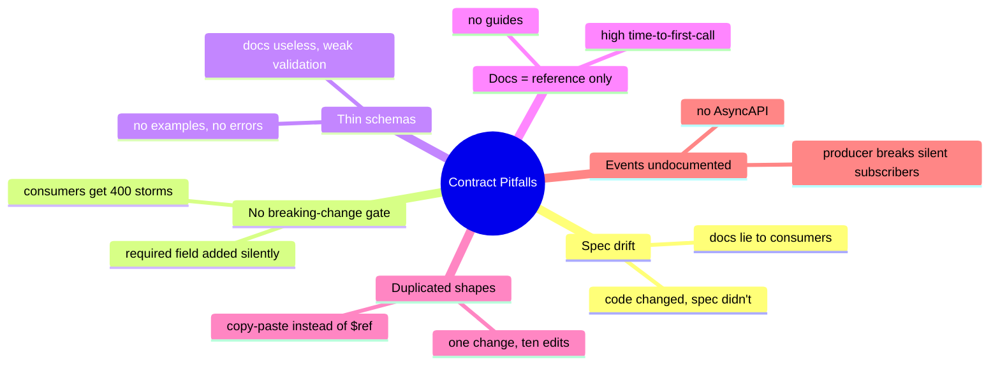

# API Documentation & OpenAPI

> **One line:** OpenAPI turns your API from tribal knowledge into a machine-readable *contract* — one YAML file that renders the docs, generates the client SDKs, mocks the server, and fails CI when you break it, so "the contract" and "the product" become the same thing.

---

## Table of Contents
1. [Why You Must Master This](#1-why-you-must-master-this)
2. [The Mental Model](#2-the-mental-model)
3. [OpenAPI Structure — Paths, Schemas, Components](#3-openapi-structure--paths-schemas-components)
4. [Rendering the Contract — Swagger UI vs Redoc](#4-rendering-the-contract--swagger-ui-vs-redoc)
5. [Spec-First vs Code-First](#5-spec-first-vs-code-first)
6. [Code Generation — SDKs & Server Stubs](#6-code-generation--sdks--server-stubs)
7. [Docs-as-Product — Reference, Guides, Changelogs](#7-docs-as-product--reference-guides-changelogs)
8. [Consumer-Driven Contract Testing in CI](#8-consumer-driven-contract-testing-in-ci)
9. [AsyncAPI — Contracts for Events](#9-asyncapi--contracts-for-events)
10. [Worked Example — Shipping a Versioned Endpoint](#10-worked-example--shipping-a-versioned-endpoint)
11. [Real-Life Use Cases](#11-real-life-use-cases)
12. [Failure Modes](#12-failure-modes)
13. [🏋️ Practice Drills](#-practice-drills)
14. [🎤 Interview Q&A Bank](#-interview-qa-bank)
15. [🎯 Staff+ Nuances](#-staff-nuances)
16. [Cheat Sheet](#16-cheat-sheet)
17. [Connections & Further Reading](#17-connections--further-reading)

---

## 1. Why You Must Master This

An API without a machine-readable contract is a private agreement you *hope* everyone remembers. The moment a second team, a partner, or your future self consumes it, ambiguity becomes outages.

- **Integration cost is the real product.** Stripe, Twilio, and GitHub win developers because their docs let you make a working call in five minutes. The API *is* its documentation — nobody adopts an endpoint they can't understand.
- **Drift is silent and expensive.** Hand-written docs rot the instant code changes. A field renamed in v2.3 but still documented as v2.1 sends every integrator down a debugging rabbit hole — and generates a support ticket per consumer.
- **The contract enforces the boundary.** When the spec is the source of truth, a breaking change *fails CI* instead of failing in a partner's production at 2 a.m.
- **It unlocks automation.** One spec → rendered docs + typed SDKs in six languages + a mock server + contract tests. Skip the spec and you hand-write all five, forever out of sync.

> **The core problem it solves:** *keeping the promise your API makes verifiable and executable.* The contract stops being prose humans interpret differently and becomes an artifact machines validate, generate from, and test against.

**Prerequisites:** [API_Design_Fundamentals.md](./API_Design_Fundamentals.md) (what a good contract contains) and [REST_API_Design.md](./REST_API_Design.md) (resources, methods, status codes the spec describes).

---

## 2. The Mental Model

Think of OpenAPI as the **architect's blueprint**, not the photo of the finished house. A photo (hand-written docs) describes what got built *after the fact* and drifts the moment you renovate. A blueprint is the single authority everyone builds *from* — the plumber, the electrician, and the inspector all read the same sheet, so the walls line up.



> **Hold onto this:** the spec is not documentation *about* the API — it is the API's contract, and everything else (docs, clients, servers, tests) is a projection of it. Change the spec, everything downstream regenerates; change the code without the spec, everything downstream lies.

---

## 3. OpenAPI Structure — Paths, Schemas, Components

**What it is.** OpenAPI (formerly Swagger; the spec was donated to the Linux Foundation in 2015 and renamed at 3.0) is a JSON/YAML document describing every operation your API exposes: the paths, the methods, the request/response shapes, the auth, and the errors. The current line is 3.1, which aligns fully with JSON Schema.

**Why it exists.** Without a formal grammar, "the user object has an email" means five different things to five teams (required? nullable? max length? format?). OpenAPI forces those answers into a schema a validator can check.

**How it works under the hood.** The document has a few top-level keys that do all the work:

- `paths` — the URL templates and their operations (`get`, `post`, …). Each operation lists `parameters`, a `requestBody`, and a map of `responses` keyed by status code.
- `components` — a reusable library: `schemas` (data shapes), `responses`, `parameters`, `securitySchemes`. You define `User` once and `$ref` it everywhere, so there is exactly one definition to change.
- `$ref` — a pointer (`#/components/schemas/User`) that de-duplicates. This is the difference between a maintainable spec and a 4,000-line copy-paste swamp.

```yaml
openapi: 3.1.0
info:
  title: Payments API
  version: 2.3.0
paths:
  /charges:
    post:
      operationId: createCharge
      summary: Create a charge
      parameters:
        - name: Idempotency-Key
          in: header
          required: true
          schema: { type: string, format: uuid }
      requestBody:
        required: true
        content:
          application/json:
            schema: { $ref: '#/components/schemas/ChargeRequest' }
      responses:
        '201':
          description: Charge created
          content:
            application/json:
              schema: { $ref: '#/components/schemas/Charge' }
        '402': { $ref: '#/components/responses/PaymentRequired' }
components:
  schemas:
    ChargeRequest:
      type: object
      required: [amount, currency]
      properties:
        amount:   { type: integer, minimum: 1, description: "Amount in cents" }
        currency: { type: string, enum: [usd, eur, gbp] }
    Charge:
      allOf:
        - $ref: '#/components/schemas/ChargeRequest'
        - type: object
          properties:
            id:     { type: string, examples: ["ch_3Ple"] }
            status: { type: string, enum: [succeeded, pending, failed] }
```

**Trade-off.** A rich spec (examples, descriptions, every error) is more upfront work; a thin spec generates poor docs and weak validation. The other choice wins only for a throwaway internal endpoint — for anything a second team touches, invest in components and examples.

**Real number.** Stripe's public OpenAPI spec is ~6 MB / 100k+ lines of JSON and drives their entire docs site, SDKs, and CLI. That scale is only survivable because everything `$ref`s a shared component library rather than repeating shapes inline.

> The `components` block is the DRY heart of the spec: define each shape once, reference it everywhere, change it in one place.

---

## 4. Rendering the Contract — Swagger UI vs Redoc

**What it is.** The same spec renders into interactive HTML docs by two dominant tools: **Swagger UI** (the "Try it out" playground) and **Redoc** (a polished three-panel reference).



**How it works.** Both parse the spec and walk `paths` → operations → schemas, rendering each as a section. Swagger UI additionally builds a live request form from the parameter/body schema and fires real `fetch` calls from the browser — great for exploration, but it means CORS and a real (or sandbox) backend must be reachable.

| Dimension | Swagger UI | Redoc |
|-----------|-----------|-------|
| Killer feature | "Try it out" — execute real calls | Beautiful, readable static reference |
| Layout | Single expandable column | Three-panel (nav · docs · samples) |
| Best for | Sandboxes, internal exploration | Public product docs |
| Live calls | ✅ built in | ❌ read-only (by design) |
| Large specs | Can get sluggish | Handles huge specs well |

**Trade-off.** Interactivity vs polish. Swagger UI's live console is a learning accelerator but exposes a callable surface (people *will* fire test charges); Redoc is static and safe but read-only. Many teams ship Redoc publicly and Swagger UI behind auth for internal use.

**Real system.** Twilio and GitHub render Redoc-style reference docs from OpenAPI; most internal service portals default to the Swagger UI bundled with frameworks like FastAPI and springdoc.

> One spec, many renderers — never write the reference by hand; generate it and choose the skin.

---

## 5. Spec-First vs Code-First

This is the workflow question that decides whether your contract *leads* or *trails* your code.



**Spec-first (design-first).** You author the YAML before any implementation, review it with consumers, and generate stubs. The contract is agreed *before* code exists, so front-end and back-end teams build in parallel against a mock. Cost: discipline and a linter, because a hand-edited spec can describe things the code never implements.

**Code-first.** You annotate handlers (FastAPI type hints, springdoc annotations, `swagger-jsdoc`) and the framework emits the spec at build time. The spec can never drift from code because it *is* derived from code. Cost: design happens implicitly while coding, so the contract reflects whatever got typed — including accidental leaks and inconsistent naming — and consumers can't review it until the code is written.

| Dimension | Spec-first | Code-first |
|-----------|-----------|------------|
| Source of truth | The YAML | The code |
| Parallel dev (FE/BE) | ✅ against mock day one | ❌ waits for handlers |
| Drift risk | Spec can outrun code | Near-zero (derived) |
| Design review | ✅ before code | ⚠️ after code exists |
| Best for | Public / partner / multi-team APIs | Internal, single-team, fast-moving |
| Enforcement needed | Contract test spec ↔ impl | Lint the emitted spec for quality |

**Trade-off / when the other wins.** Spec-first wins whenever *consumers exist before the code* (public APIs, cross-team boundaries) — you cannot let three teams wait for one to finish coding. Code-first wins for a single team iterating on an internal service where the overhead of maintaining a separate YAML isn't worth it and drift is the bigger enemy.

**Real number.** Stripe and GitHub are spec-first at the boundary (the public contract is reviewed and frozen before implementation); most internal microservices in a typical shop are code-first via FastAPI/springdoc because the same team owns both sides.

> Spec-first buys **parallelism and review**; code-first buys **zero drift**. Pick by who reads the contract and when.

---

## 6. Code Generation — SDKs & Server Stubs

**What it is.** From one spec, generators emit typed client SDKs (Python, TS, Go, Java…) and server skeletons (route handlers with request/response types wired up). The dominant tool is `openapi-generator` (60+ targets); vendors like Stripe hand-tune their own generators for idiomatic SDKs.



**How it works under the hood.** The generator parses the spec into a model, then applies per-language *templates* (Mustache) to that model. `operationId: createCharge` becomes a method `createCharge(body)`; a `ChargeRequest` schema becomes a class/interface with the right field types and validation. Regenerate on every spec change and the client is always in lockstep with the contract.

```bash
# generate a typed TypeScript client from the spec
openapi-generator-cli generate \
  -i openapi.yaml -g typescript-fetch -o ./sdk/ts
```

**Trade-off.** Generated code is consistent and free but often verbose and un-idiomatic; hand-written SDKs are ergonomic but expensive to keep in sync across six languages. Big vendors (Stripe, Twilio) invest in *customized* generators to get both. For most teams, raw `openapi-generator` output is good enough for internal clients.

**Real number.** A single well-factored spec regenerates SDKs for 6+ languages in one CI job of a couple minutes — versus 6 separate hand-maintained repos that inevitably drift. `operationId` uniqueness matters here: it's the method name in every generated client, so a missing or duplicated one produces ugly `path_get_1` names.

> Generation is why the spec pays for itself: write the contract once, ship clients everywhere, and never let a client lie about the API.

---

## 7. Docs-as-Product — Reference, Guides, Changelogs

Great API docs are not one artifact — they're three, and confusing them is the most common docs failure.



- **Reference** answers *"what exactly does `POST /charges` accept?"* — exhaustive, generated from the spec, always current. This is what OpenAPI gives you for free.
- **Guides / tutorials** answer *"how do I take my first payment?"* — narrative, hand-written, task-oriented. A generator can never write these; they're the difference between a spec and an onboarding experience. Stripe's "accept a payment" quickstart is a guide, not reference.
- **Changelog** answers *"what changed and will it break me?"* — dated entries marking each change as **breaking** or **additive**, with migration steps. Consumers subscribe to this; it's how you keep trust across [API_Versioning.md](./API_Versioning.md).

**Why treat docs as a product.** Docs have users (developers), a funnel (land → first call → integrate), and metrics (time-to-first-call, support tickets). The reframe: measure and iterate on docs like a feature. Twilio and Stripe staff dedicated docs/DevEx teams because integration friction directly caps adoption.

**Trade-off.** Auto-generated reference is cheap and always correct but *cold* — it never teaches. Hand-written guides teach but drift and cost writer-hours. The winning play is **generate the reference, hand-craft the guides, and gate both on the changelog** so nothing ships silently.

> Reference tells the truth; guides create adoption; changelog keeps trust. You need all three — the spec only gives you the first.

---

## 8. Consumer-Driven Contract Testing in CI

**What it is.** A test that fails the build when the provider's API stops satisfying what a consumer actually depends on. The spec says what's *promised*; contract tests prove the promise is *kept* — in both directions.

**Why it exists.** A green unit-test suite on the provider tells you nothing about whether you just broke a downstream team. Contract testing closes that gap without spinning up every service together in a slow, flaky end-to-end environment.

**How it works under the hood.** Two flavors:

- **Schema-conformance** — validate real requests/responses against the OpenAPI spec (tools like Dredd, Schemathesis). Catches "the code returns a field the spec doesn't declare."
- **Consumer-driven (Pact-style)** — the *consumer* records the exact requests it makes and responses it expects into a **pact** (a contract file). The provider replays that pact in *its* CI. If the provider changes a field the consumer relies on, the provider's build goes red — the team that broke it finds out, not the victim.



A minimal provider-side gate in CI, plus spec-linting so the contract itself stays high-quality:

```yaml
# .github/workflows/contract.yml
jobs:
  contract:
    runs-on: ubuntu-latest
    steps:
      - uses: actions/checkout@v4
      # 1. lint the spec — style + breaking-change rules
      - run: npx @stoplight/spectral-cli lint openapi.yaml
      # 2. block breaking changes vs the published contract
      - run: npx oasdiff breaking main-openapi.yaml openapi.yaml --fail-on ERR
      # 3. verify the running service matches consumer pacts
      - run: npx pact-provider-verifier \
             --provider-base-url=http://localhost:8080 \
             --pact-broker-url=$PACT_BROKER_URL
```

**Trade-off.** Pact gives precise, consumer-specific safety but adds a broker and per-consumer test authoring; pure schema-conformance is lighter but only checks shape, not "does anyone actually use this field." Use conformance for a public API with unknown consumers; use Pact when you know your consumers (internal microservices).

**Real number.** `oasdiff` / `spectral` breaking-change checks run in seconds and turn "we found out from an angry partner" into "the PR was red before merge." Spectral ships rulesets that flag missing descriptions, unnamed operations, and undeclared error responses — enforcing docs quality as code review.

> Contract testing is how "the contract is the product" becomes enforceable: a broken promise is a **red build**, not a production incident.

---

## 9. AsyncAPI — Contracts for Events

**What it is.** OpenAPI describes request/response HTTP. It cannot describe *"service X publishes an `OrderPlaced` event to this Kafka topic with this payload."* **AsyncAPI** is the sister spec for event-driven and messaging systems (Kafka, RabbitMQ, MQTT, WebSockets).

**Why it exists.** In event-driven architectures the contract is the *message on the channel*, and it's even more fragile than an HTTP contract because publisher and subscriber are decoupled in time — a producer can break every consumer of a topic and get zero immediate errors. AsyncAPI makes that message shape a reviewable, testable artifact.

**How it works.** The structure deliberately mirrors OpenAPI so the mental model transfers: `channels` (topics/queues, analogous to `paths`), `operations` (`publish`/`subscribe`), `messages` with `payload` schemas, and shared `components/schemas`. The same ecosystem applies — generate docs, generate typed producers/consumers, validate messages in CI.



```yaml
asyncapi: 3.0.0
info: { title: Orders Events, version: 1.0.0 }
channels:
  orderPlaced:
    address: orders.placed
    messages:
      OrderPlaced:
        payload:
          type: object
          required: [orderId, amount]
          properties:
            orderId: { type: string }
            amount:  { type: integer, minimum: 1 }
operations:
  onOrderPlaced:
    action: send
    channel: { $ref: '#/channels/orderPlaced' }
```

**Trade-off.** Adopting AsyncAPI is extra spec surface, and tooling maturity trails OpenAPI. But the alternative — undocumented event payloads coupled through a schema registry only — leaves human-readable intent and versioning to tribal knowledge. Pair AsyncAPI (the human/CI contract) with a schema registry like Avro/Protobuf on the wire (the runtime enforcement).

> If OpenAPI is the contract for *calls*, AsyncAPI is the contract for *events* — same discipline, applied where the coupling is invisible and therefore more dangerous. See [../08_Communication_Protocols/](../08_Communication_Protocols/).

---

## 10. Worked Example — Shipping a Versioned Endpoint

Scenario: you must add a required `currency` field to `POST /charges`. Is it safe? The contract answers, and CI enforces the answer.



Walk the numbers: adding a **required** field to an existing request body breaks every current caller (their requests now fail validation → a wall of `400`s across N consumers). `oasdiff` classifies it as `ERR` and fails the build *before merge*. Making the field **optional with a default** is additive — old clients keep working, new clients opt in — so `oasdiff` passes, Pact verification confirms no consumer relied on the old shape, and the pipeline auto-appends an *additive* changelog entry. The contract turned a would-be multi-team outage into a one-line code review comment.

---

## 11. Real-Life Use Cases

| Situation | How OpenAPI/AsyncAPI applies | The decision it forces |
|-----------|------------------------------|------------------------|
| **Public API (Stripe/Twilio)** | Spec-first contract drives docs, SDKs, CLI, sandbox | Freeze & review the spec *before* code; breaking changes need a new version |
| **Front-end + back-end in parallel** | FE builds against a generated mock from the spec | Agree the contract day one; neither team waits |
| **Partner integration** | Hand them the spec → they generate their own client | Contract is the deliverable, not a PDF |
| **Microservice mesh** | Pact contract tests gate each provider's deploy | A breaking change fails the *producer's* CI |
| **Event streaming** | AsyncAPI documents topic payloads | Payload changes are reviewed, not discovered downstream |
| **SDK maintenance** | `openapi-generator` regenerates 6 clients per release | Never hand-sync clients; regenerate from spec |
| **Onboarding new devs** | Redoc reference + quickstart guide | Time-to-first-call becomes a measured metric |

> Real-world habit: **change the spec first, then the code.** Treat `openapi.yaml` as a source file that goes through review and CI — because it is one.

---

## 12. Failure Modes



- **Spec drift.** *Symptom:* integrators report a field that "doesn't exist" (or one you removed still documented). *Root cause:* spec maintained separately from code with no gate. *Fix:* contract-test the spec against the running service (Dredd/Schemathesis) in CI, or go code-first so the spec is derived.
- **No breaking-change gate.** *Symptom:* a partner's integration breaks after your "small" deploy. *Root cause:* a required field / renamed property shipped with no diff check. *Fix:* `oasdiff --fail-on ERR` against the published contract on every PR.
- **Thin schemas.** *Symptom:* docs render but nobody can figure out valid inputs; validation passes garbage. *Root cause:* schemas with no `required`, `enum`, `examples`, or error responses. *Fix:* Spectral ruleset enforcing descriptions/examples/declared errors as a lint gate.
- **Reference-only docs.** *Symptom:* high support volume, low activation despite "complete" docs. *Root cause:* exhaustive reference but zero guides. *Fix:* add a hand-written quickstart; measure time-to-first-call.
- **Copy-paste shapes.** *Symptom:* one field change requires ten edits and you miss two. *Root cause:* inline schemas instead of `$ref` to `components`. *Fix:* factor shared shapes into `components/schemas`.
- **Undocumented events.** *Symptom:* a topic payload change silently breaks downstream consumers. *Root cause:* no event contract. *Fix:* AsyncAPI + schema registry, gated in CI.

---

## 🏋️ Practice Drills

> *Cover the solutions and attempt first — active recall is the point.*

**Drill 1 — Breaking or additive?** Classify each change to a live spec: (a) add an optional query param, (b) add a new required request field, (c) add a new value to a response `enum`, (d) remove a response field.

<details><summary>Solution</summary>

(a) **Additive** — old clients omit it, no break. (b) **Breaking** — existing requests now fail validation. (c) **Breaking for consumers** — a client with an exhaustive switch/enum may not handle the new value (arguably additive for lenient clients; treat as breaking to be safe). (d) **Breaking** — consumers reading that field get `undefined`. Only (a) ships without a version bump; the rest need `oasdiff` review and likely a new version.
</details>

**Drill 2 — Spec-first or code-first?** You're building a public payments API three partner teams will integrate before your backend is done. Which workflow, and why?

<details><summary>Solution</summary>

**Spec-first.** Consumers exist before the code, so you author and review `openapi.yaml` first, generate a mock, and let all three partners build against it in parallel while you implement behind a stub. Code-first would force them to wait for your handlers and give them no contract to review.
</details>

**Drill 3 — Design a CI gate.** Write the three checks that should run on every PR that touches `openapi.yaml`.

<details><summary>Solution</summary>

1. **Lint** (`spectral lint`) — enforce descriptions, examples, declared errors, naming. 2. **Breaking-change diff** (`oasdiff breaking --fail-on ERR`) against the published contract. 3. **Contract verification** — replay consumer pacts (Pact) or validate the running service against the spec (Dredd/Schemathesis). Green = safe to merge; the contract is enforced, not hoped-for.
</details>

**Drill 4 — Why AsyncAPI?** Your team documents HTTP endpoints with OpenAPI but keeps breaking Kafka consumers on payload changes. What's missing and how do you fix it?

<details><summary>Solution</summary>

OpenAPI can't describe channels/messages, so event payloads are undocumented and unversioned — a producer changes a field and decoupled subscribers break silently. Add an **AsyncAPI** spec for the topics (channels, message payload schemas) and gate payload changes in CI, backed by a schema registry (Avro/Protobuf) for runtime enforcement.
</details>

---

## 🎤 Interview Q&A Bank

**Q1. What is OpenAPI and why use it?**
> A machine-readable JSON/YAML contract describing every operation, schema, and error of a REST API. One spec generates the docs, typed SDKs, mock servers, and contract tests — so the contract stays the single source of truth instead of hand-written docs that drift. (signal: mentions *generation from one source*, not just "documents the API.")

**Q2. Spec-first vs code-first — which and when?**
> Spec-first authors the YAML before code, enabling parallel FE/BE work and consumer review; best for public/multi-team APIs. Code-first derives the spec from annotations, giving near-zero drift; best for internal single-team services. Choose by who reads the contract and when. (signal: names the trade-off, not a dogmatic answer.)

**Q3. How do you stop a breaking change from reaching consumers?**
> Gate CI with a breaking-change diff (`oasdiff`) against the published spec plus contract tests (Pact) — a breaking change turns the PR red before merge instead of surfacing as a partner outage.

**Q4. What's the difference between reference and guides?**
> Reference is exhaustive and generated from the spec ("what does this endpoint accept?"); guides are hand-written, task-oriented tutorials ("how do I take my first payment?"). You need both — generation gives you reference for free but never teaches.

**Q5. What is consumer-driven contract testing?**
> The consumer records the exact requests/responses it depends on into a pact; the provider replays that pact in its own CI. If the provider breaks something a consumer actually uses, the provider's build fails — the team that caused the break finds out, without a full end-to-end environment.

**Q6. How do you keep generated SDKs in sync with the API?**
> Regenerate them from the spec on every release with `openapi-generator` (or a customized generator). The clients are a projection of the contract, so they can't drift as long as the spec is the source of truth. `operationId` uniqueness keeps method names clean.

**Q7. How do you document event-driven APIs?**
> OpenAPI only covers request/response HTTP; use AsyncAPI for channels, publish/subscribe operations, and message payload schemas. Same tooling philosophy — docs, codegen, CI validation — applied to Kafka/RabbitMQ/WebSockets, backed by a schema registry on the wire.

**Q8. What does "the contract is the product" mean in practice?**
> The spec is a source file: it's reviewed, linted, diffed for breaking changes, and gates deploys. Docs, SDKs, mocks, and tests are all generated from it. Getting the contract right *is* getting the API right, because everything downstream is a projection of it.

---

## 🎯 Staff+ Nuances

- **`operationId` is API surface, not a label.** It becomes the method name in every generated SDK, the key in contract tests, and the anchor in docs. Rename it and you break generated clients and deep-links — treat it with the same care as a public function name.
- **Spec-first vs code-first is a false binary at scale.** Mature orgs do *both*: code-first generation to prevent drift, plus a spec-first *review gate* where the emitted spec is diffed and linted before it's published. The spec is generated but still governed.
- **Breaking-change detection is subtle.** Adding an `enum` value is additive for lenient consumers but breaking for exhaustive ones; loosening a response type is fine, loosening a request type is fine, tightening either flips the safety. Know which direction (request vs response, widen vs narrow) is safe — this is [API_Versioning.md](./API_Versioning.md) territory and where senior engineers actually debate.
- **The spec is also your security review surface.** `securitySchemes`, which operations require auth, and whether error schemas leak internals are all reviewable *in the spec* before code ships. Linting can flag an endpoint with no declared security.
- **Contract tests replace most integration tests.** If provider and consumer both verify against a shared pact/spec, you rarely need a full multi-service environment — Pact's whole thesis is trading slow, flaky E2E for fast, isolated contract verification. Know when this argument holds (known consumers) and when it doesn't (public API, unknown consumers → prefer schema conformance + fuzzing like Schemathesis).
- **Generated docs are necessary but not sufficient for DevEx.** The teams that win (Stripe, Twilio) staff docs as a product with hand-written guides, runnable samples, and measured time-to-first-call. Generation gives you correctness; humans give you adoption.
- **AsyncAPI and OpenAPI are converging but not merged.** For a system that's both HTTP and event-driven you'll maintain two specs; keep shared payload schemas in a common place and reference both to avoid re-drift between the sync and async contracts. See [gRPC.md](./gRPC.md) and [../08_Communication_Protocols/](../08_Communication_Protocols/) for the protocol-level view.

---

## 16. Cheat Sheet

```
THE CONTRACT IS THE PRODUCT — one spec → docs + SDKs + mocks + tests.

OPENAPI STRUCTURE
  paths      → URLs + operations (get/post/...) → parameters, requestBody, responses
  components → reusable schemas / responses / securitySchemes (DRY via $ref)
  operationId→ becomes the SDK method name — keep unique & stable
  version    → OpenAPI 3.1 aligns with JSON Schema

RENDER      Swagger UI = interactive "Try it out" · Redoc = clean static reference
            Prism = mock server from schema

WORKFLOW    Spec-first  → design→review→codegen→implement (public, multi-team, parallel FE/BE)
            Code-first  → annotate→emit spec (internal, single-team, zero drift)

CODEGEN     openapi-generator → typed clients (6+ langs) + server stubs + mocks. Regen every release.

DOCS = 3    Reference (generated) · Guides (hand-written) · Changelog (breaking vs additive)

CI GATES    spectral lint  (quality) 
            oasdiff breaking --fail-on ERR  (block breaking changes)
            pact / dredd / schemathesis  (impl matches contract)

BREAKING?   +optional field = OK · +required field = BREAK · remove field = BREAK
            widen response = OK · new enum value = risky (treat as breaking)

EVENTS      AsyncAPI = OpenAPI for Kafka/MQTT/WS: channels · publish/subscribe · message payloads
            pair with a schema registry (Avro/Protobuf) on the wire

REAL        Stripe spec ~100k lines drives docs+SDKs+CLI · Spectral/oasdiff run in seconds
```

---

## 17. Connections & Further Reading

**Prerequisites (learn first):**
- [API_Design_Fundamentals.md](./API_Design_Fundamentals.md) — what a good contract must contain before you formalize it.
- [REST_API_Design.md](./REST_API_Design.md) — resources, methods, and status codes the spec describes.

**Builds toward / pairs with:**
- [API_Versioning.md](./API_Versioning.md) — breaking vs additive changes and how the spec-diff enforces them.
- [API_Error_Handling_Design.md](./API_Error_Handling_Design.md) — error schemas the contract must declare, not leak.
- [GraphQL.md](./GraphQL.md) — its SDL schema is *its* machine-readable contract; contrast with OpenAPI.
- [gRPC.md](./gRPC.md) — Protobuf `.proto` files are the contract + codegen for RPC; same philosophy, different surface.
- [Idempotency.md](./Idempotency.md) — the `Idempotency-Key` header belongs in your spec's parameters.
- [../08_Communication_Protocols/](../08_Communication_Protocols/) — where AsyncAPI's event/messaging concerns live.

**Gaps this topic exposes (candidates for the section's Gap Analysis):**
- API mocking & sandboxes (Prism, WireMock) as a first-class deliverable.
- Schema registries (Avro/Protobuf/JSON Schema) as the runtime counterpart to AsyncAPI.

**External classics:**
- *OpenAPI Specification 3.1* (OpenAPI Initiative) — the normative grammar.
- *AsyncAPI Specification* (AsyncAPI Initiative) — the event-driven counterpart.
- Stripe & Twilio developer docs — the reference/guides/changelog model done right.
- Pact documentation — consumer-driven contract testing, in depth.

---

## TL;DR
**Make the contract a source file, not an afterthought.** OpenAPI turns your API into a machine-readable spec whose `paths`, `components`, and `$ref`s are the single source of truth — render it with Swagger UI or Redoc, generate typed SDKs and server stubs with `openapi-generator`, and choose spec-first (public, multi-team, parallel work) or code-first (internal, zero drift) by *who reads the contract and when*. Docs are a product with three parts — generated **reference**, hand-written **guides**, and a breaking-vs-additive **changelog** — and the contract only counts if CI enforces it: **lint with Spectral, block breaking changes with oasdiff, and verify the implementation with Pact-style contract tests**, extending the same discipline to events via AsyncAPI. The theme throughout: the contract *is* the product, so change the spec first and let a red build — not an angry partner — catch the break.
