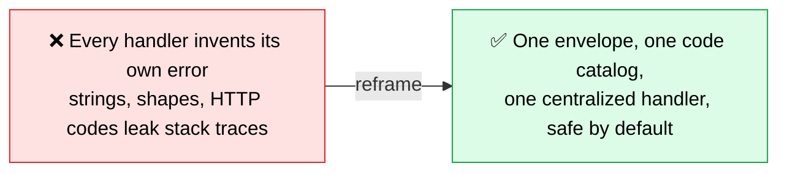
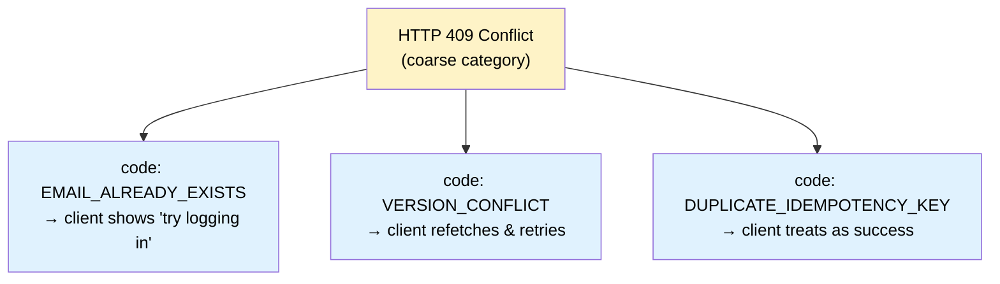
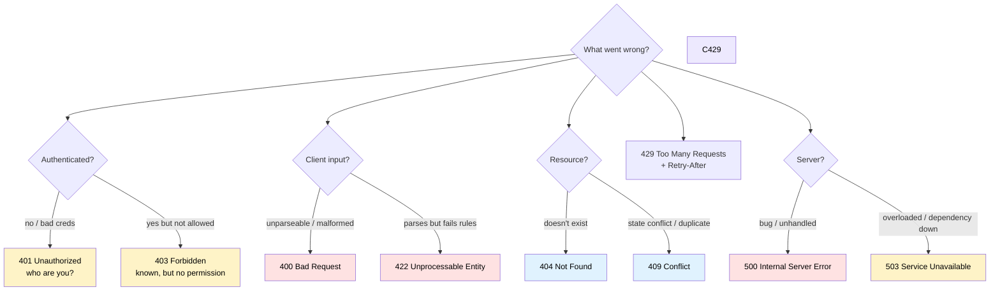
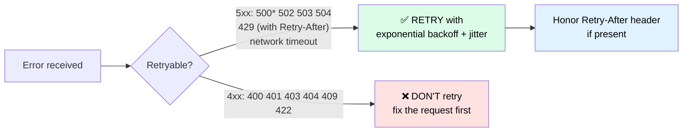
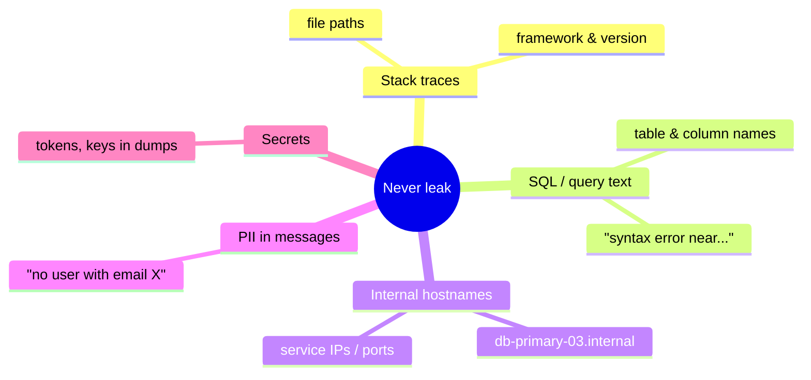
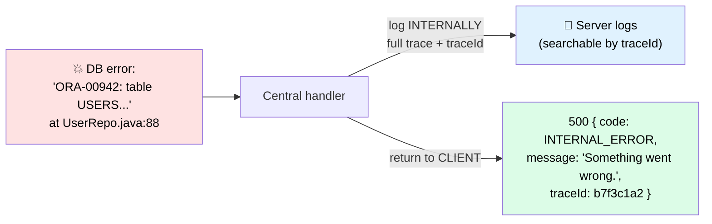
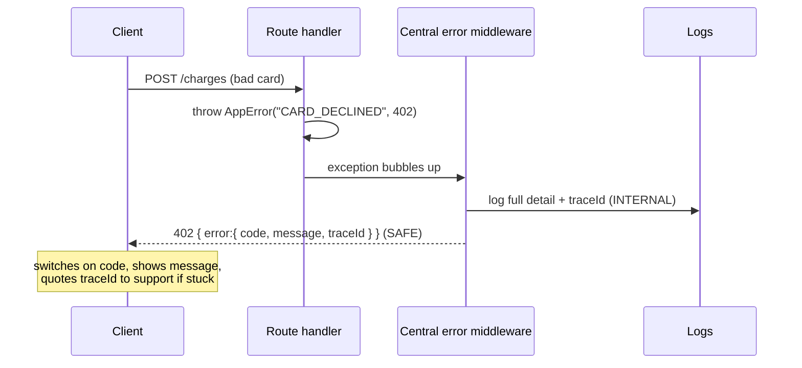
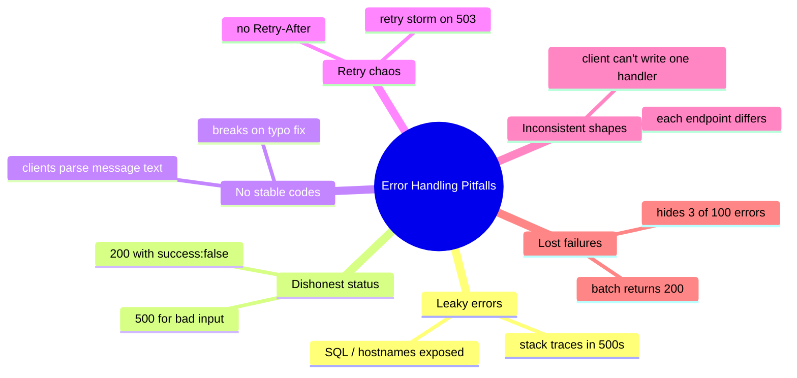

# API Error Handling Design

> **One line:** A well-designed error surface turns every failure into a machine-readable, secure, actionable contract — so clients know *what broke, whether to retry, and how to fix it* without ever seeing your stack trace.

---

## Table of Contents
1. [Why You Must Master This](#1-why-you-must-master-this)
2. [The Mental Model](#2-the-mental-model)
3. [The Single Error Envelope](#3-the-single-error-envelope)
4. [Stable Machine-Readable Error Codes](#4-stable-machine-readable-error-codes)
5. [RFC 7807 / 9457 — problem+json](#5-rfc-7807--9457--problemjson)
6. [Honest Status-Code Selection](#6-honest-status-code-selection)
7. [Retryable vs Non-Retryable Classification](#7-retryable-vs-non-retryable-classification)
8. [Partial-Failure Reporting](#8-partial-failure-reporting)
9. [Error-Message Security](#9-error-message-security)
10. [Worked Example — A Centralized Error Handler](#10-worked-example--a-centralized-error-handler)
11. [Real-Life Use Cases](#11-real-life-use-cases)
12. [Failure Modes](#12-failure-modes)
13. [🏋️ Practice Drills](#-practice-drills)
14. [🎤 Interview Q&A Bank](#-interview-qa-bank)
15. [🎯 Staff+ Nuances](#-staff-nuances)
16. [Cheat Sheet](#16-cheat-sheet)
17. [Connections & Further Reading](#17-connections--further-reading)

---

## 1. Why You Must Master This

Errors are not the unhappy edge of your API — they are *half of its public contract*. Every integration you'll ever have will hit them, and how you shape them decides whether clients recover gracefully or page their on-call at 3 a.m.

- **Inconsistent errors make clients un-programmable** — if `/orders` returns `{error: "..."}` and `/users` returns `{message: "...", errorCode: 42}`, no client can write one error handler. Every endpoint becomes a special case.
- **Silent retry storms** — if a client can't tell "retry me in 2s" (`503`) from "never retry, your request is malformed" (`400`), it either hammers a struggling service into a full outage or gives up on a transient blip.
- **Security leaks hide in error bodies** — a raw stack trace or SQL exception in a `500` hands an attacker your framework version, table names, and internal hostnames. This is a real, recurring OWASP finding.
- **Support burns hours without a trace ID** — "it failed" with no correlation ID means engineers grep blindly across services. One `traceId` the client can quote turns a 2-hour hunt into a 2-minute lookup.

> **The core problem it solves:** *making failure a first-class, consistent, secure part of the API contract* — so clients can programmatically react, safely retry, and get support, while your internals stay hidden.

**Prerequisites:** [API_Design_Fundamentals.md](./API_Design_Fundamentals.md) (the contract mindset) and [REST_API_Design.md](./REST_API_Design.md) (HTTP status semantics).

---

## 2. The Mental Model

Think of an error response like a **good rejection letter from a bank**. A bad one says "Application denied." A good one says: *"Denied — reason code `INSUFFICIENT_INCOME` (that's the machine-readable part), here's the human explanation, here's your case number `#48213` to quote if you call us, and here's whether re-applying later might work."* The applicant can act on every part.

The reframe: stop treating errors as ad-hoc strings thrown wherever they occur, and start treating them as **one typed object emitted from one place**.



> **Hold onto this:** an error response has two audiences — a **machine** (needs a stable code + status to branch on) and a **human** (needs a safe message + a trace ID). Serve both, leak neither.

---

## 3. The Single Error Envelope

**What it is:** one JSON shape that *every* error response in your API uses, no matter which endpoint or service produced it. Success bodies can vary; error bodies must not.

**Why it exists:** a client should write error handling **once**. If the shape is uniform, a shared SDK layer can parse `error.code`, surface `error.message`, and log `error.traceId` for any call. Divergent shapes force per-endpoint branching — the thing that rots into unmaintainable client code.

**How it works — the canonical five fields:**

```json
{
  "error": {
    "code": "INSUFFICIENT_FUNDS",
    "message": "Your card has insufficient funds for this $50.00 charge.",
    "details": [
      { "field": "amount", "issue": "exceeds_available_balance" }
    ],
    "traceId": "b7f3c1a2-9e4d-4a11-8c2e-1f0a9d7b6c53",
    "timestamp": "2026-07-08T14:32:01Z"
  }
}
```

| Field | Audience | Purpose |
|-------|----------|---------|
| `code` | machine | stable string clients `switch` on — **never changes meaning** |
| `message` | human | safe, readable explanation — *no internals* |
| `details` | machine + human | per-field / per-item breakdown (validation, partial failure) |
| `traceId` | support | correlation ID linking the response to your internal logs |
| `timestamp` | support | when it happened (ISO-8601, UTC) — bounds the log search |

**The trade-off:** a rigid envelope is slightly more boilerplate than "just return a string," and it can feel heavyweight for a tiny internal API. But the moment you have >1 consumer or >1 service, uniformity pays for itself. Where the *other* choice wins: a pure-internal RPC mesh may lean on [gRPC status codes](https://grpc.io/docs/guides/status-codes/) + a `details` protobuf instead of JSON — same idea, different wire format.

> **Real system:** Stripe wraps every error in a top-level `error` object with `type`, `code`, `message`, and `param` — the exact "envelope + machine code + human message + field pointer" pattern.

---

## 4. Stable Machine-Readable Error Codes

**What it is:** a short, stable, documented **string** identifier per error condition — `RATE_LIMITED`, `EMAIL_ALREADY_EXISTS`, `CARD_DECLINED` — that lives *inside* the envelope, separate from the HTTP status.

**Why strings and not just the HTTP status?** Because HTTP status is *coarse*. A single `400 Bad Request` can mean "email malformed," "email already taken," or "password too short" — a client that wants to show three different UI messages cannot tell them apart from `400` alone. And a single `409 Conflict` covers both "duplicate email" and "optimistic-lock version mismatch." The status says *category*; the code says *exactly what*.



**How clients switch on them:**

```javascript
switch (err.code) {
  case "RATE_LIMITED":         backoffAndRetry(err.retryAfter); break;
  case "EMAIL_ALREADY_EXISTS": showLoginSuggestion();          break;
  case "CARD_DECLINED":        promptNewCard();                 break;
  default:                     showGenericError(err.traceId);
}
```

**The rules that make codes *stable*:**
- **Never repurpose a code.** Once `CARD_DECLINED` ships, its meaning is frozen forever — clients depend on it. Add a new code instead.
- **Codes are UPPER_SNAKE or dotted namespaces** (`billing.card_declined`) — never localized, never a sentence.
- **The `message` is for humans and *may* change / be localized**; the `code` is for machines and *must not*. This split is the whole point.

**Trade-off:** a code catalog is a governance burden — someone must own it, document it in the [OpenAPI spec](./API_Documentation_OpenAPI.md), and prevent duplicates. But without it, clients parse `message` strings (the classic anti-pattern that breaks the instant you fix a typo in the message).

> **Real system:** Stripe's `code` (e.g. `card_declined`, `expired_card`) is documented and stable; gRPC uses a fixed enum of 16 canonical codes (`NOT_FOUND`, `RESOURCE_EXHAUSTED`, `FAILED_PRECONDITION`…) that every language binding shares.

---

## 5. RFC 7807 / 9457 — problem+json

**What it is:** an IETF-standardized error envelope, `application/problem+json`, defined by **RFC 7807** and updated by **RFC 9457** (2023). Instead of inventing your own shape, you can adopt a spec clients already understand.

**The standard fields:**

| Field | Meaning |
|-------|---------|
| `type` | a URI identifying the error kind (also the "read more" doc link) — the stable machine identifier |
| `title` | short, human, *stable* summary of the `type` |
| `status` | the HTTP status code, duplicated in the body |
| `detail` | human explanation specific to *this* occurrence |
| `instance` | a URI identifying this specific occurrence (great for a trace ID) |

You may add **extension members** (any custom fields) alongside — this is where `traceId`, `code`, or `errors[]` live.

```json
{
  "type": "https://api.example.com/problems/insufficient-funds",
  "title": "Insufficient funds",
  "status": 402,
  "detail": "Your card has insufficient funds for this $50.00 charge.",
  "instance": "/charges/ch_1M2n3o/errors/b7f3c1a2",
  "traceId": "b7f3c1a2-9e4d-4a11-8c2e-1f0a9d7b6c53",
  "balance": 1240
}
```

**Why it matters:** `type` as a dereferenceable URI means the code *and* its documentation are the same thing — a developer pastes it into a browser and reads what to do. **RFC 9457** additionally standardizes a top-level `errors` array for reporting **multiple problems at once** (e.g. several invalid fields), filling 7807's biggest gap.

**Trade-off:** problem+json is a great default when you want interoperability and off-the-shelf client libraries. But many teams keep a *custom* envelope (Section 3) because they want an UPPER_SNAKE `code` and full control over field names. Both are valid — the sin is having *no* standard, not picking the "wrong" one. If you go custom, map cleanly onto 7807 concepts (your `code` ≈ `type`, your `message` ≈ `detail`).

> **Hold onto this:** `type` (stable, machine, also the docs link) vs `detail` (this-occurrence, human) is the *same* code-vs-message split from Section 4 — the standard just formalizes it.

---

## 6. Honest Status-Code Selection

**What it is:** picking the HTTP status that *truthfully* describes the outcome — not defaulting everything to `200` (with an error inside) or `500` (for anything that went wrong). The status is the first thing every proxy, cache, load balancer, and client library inspects, so it must be honest.



| Status | Means | The distinction people get wrong |
|--------|-------|----------------------------------|
| **400** | Malformed request | Syntax/parse-level — body isn't valid JSON, missing required param |
| **401** | Not *authenticated* | "I don't know who you are" — missing/invalid token → client should re-auth |
| **403** | Not *authorized* | "I know who you are, you can't do this" → re-auth won't help |
| **404** | Resource not found | Also used to *hide* existence from unauthorized users (vs leaking `403`) |
| **409** | Conflict with current state | Duplicate, optimistic-lock version mismatch, already-processed |
| **422** | Semantically invalid | Parses fine but violates business rules (e.g. `age: -5`) |
| **429** | Rate-limited | **Must** include `Retry-After` |
| **500** | Server bug | Unexpected/unhandled — *your* fault, not the client's |
| **503** | Temporarily unavailable | Overloaded / deploying / dependency down → retryable, add `Retry-After` |

**The two most common lies:**
1. **`200 OK` with `{"success": false}` inside.** This breaks every caching layer, monitoring dashboard, and retry policy that keys on status. Your error rate looks like 0%. Don't.
2. **`500` for a client's bad input.** A `500` says *you* broke; a validation failure is a `400`/`422`. Mislabeling inflates your error budget and hides real bugs.

**Trade-off — 400 vs 422:** REST purists split "malformed syntax" (`400`) from "valid syntax, invalid semantics" (`422`). Pragmatists use `400` for all client errors and disambiguate with the `code`. Both defensible; **be consistent** and document which you use.

> **Real system:** GitHub's API returns `422` with a per-field `errors` array for validation, reserving `400` for genuinely malformed requests — the pragmatic-but-precise middle ground.

---

## 7. Retryable vs Non-Retryable Classification

**What it is:** telling the client, unambiguously, whether *retrying the exact same request* could ever succeed. This is the single most operationally important property of your error surface.

**Why it exists:** clients retry automatically (SDKs, service meshes, gateways). If they retry a non-retryable error, they waste resources and delay surfacing the real problem to the user. If they *don't* retry a transient blip, they turn a 200ms hiccup into a user-visible failure. Worse — retrying a genuinely transient overload *without backoff* creates a **retry storm** that keeps a recovering service down.



**The classification:**

| Class | Codes | Retry? | Why |
|-------|-------|:------:|-----|
| Transient server | `502`, `503`, `504`, network timeout | ✅ yes | condition is temporary; backoff + jitter |
| Throttling | `429` | ✅ yes | honor `Retry-After`; back off |
| Ambiguous server | `500` | ⚠️ only if **idempotent** | the write may have *succeeded* — retry can duplicate unless you use a key |
| Client error | `400`, `401`, `403`, `404`, `409`, `422` | ❌ no | the request is wrong; retrying identical input can't help |

**Two mechanisms make retries safe and civil:**
- **`Retry-After`** — a response header (seconds, or an HTTP-date) on `429`/`503` telling the client *when* to come back. Honoring it is the difference between graceful backoff and a stampede.
- **Idempotency** — the reason `500` is only conditionally retryable: if the write partially applied, a blind retry double-applies. Pair retries with an idempotency key so the retry is a no-op replay. This is exactly [Idempotency.md](./Idempotency.md) — retries and idempotency are two halves of one story.

**Trade-off:** you *can* let the client infer retryability from the status alone, and mature clients do. But being explicit — an `retryable: true/false` field or a documented policy — removes guesswork, especially for the ambiguous `500`.

> **Real number:** AWS SDKs retry throttling and 5xx with exponential backoff **and jitter** (randomized delay) precisely because synchronized retries without jitter cause the retry storms that keep overloaded services down.

---

## 8. Partial-Failure Reporting

**What it is:** how you report an operation where *some* items succeeded and *some* failed — the defining problem of batch/bulk endpoints. A single top-level status can't tell the truth here.

**The problem:** `POST /batch` with 100 items where 97 succeed and 3 fail. Return `200`? You hid three failures. Return `500`? You hid 97 successes and the client re-sends everything, double-applying the 97. Neither is honest.

**Two accepted answers:**
1. **`207 Multi-Status`** (from WebDAV) — a top-level status signaling "look inside," with a per-item result array.
2. **`200` + a per-item results envelope** — pragmatic and widely used; each item carries its own status and (on failure) the standard error envelope.

```json
{
  "results": [
    { "id": "item-1", "status": 201, "resource": { "orderId": "o_88" } },
    { "id": "item-2", "status": 422,
      "error": { "code": "OUT_OF_STOCK", "message": "SKU 44 is unavailable." } },
    { "id": "item-3", "status": 201, "resource": { "orderId": "o_90" } }
  ]
}
```

Each failed item reuses the *same envelope* from Section 3 — one shape everywhere. The client retries **only the failed items** (by id), which is why per-item idempotency keys matter here too.

This is deliberately brief — the batch design space (atomic-all-or-nothing vs best-effort, ordering, size limits) lives in [Bulk_Batch_APIs.md](./Bulk_Batch_APIs.md). The error-handling point is only: **partial failure needs per-item errors, not one blunt top-level code.**

---

## 9. Error-Message Security

**What it is:** the discipline of never letting an error response leak information useful to an attacker or embarrassing to you — while still being useful to a legitimate developer.

**What must NEVER reach the client:**



**The mechanism — the two-log split:**



The full diagnostic goes to your logs, tagged with a `traceId`. The client gets a *generic* safe message plus the **same** `traceId`. When the developer files a ticket quoting `b7f3c1a2`, support looks up the full trace instantly. You lose nothing in debuggability and leak nothing.

**Specific rules:**
- **Default-deny for `500`.** For unhandled server errors, return a *constant* generic message. Only *expected* errors (validation, not-found) get specific messages — because you authored those and know they're safe.
- **Avoid the enumeration leak.** "No account with email `x@y.com`" lets an attacker enumerate registered users. Return a generic "invalid credentials" on login regardless of which part failed. (This ties directly into [11 · Security & Identity](../11_Security_Identity/).)
- **Strip PII from messages *and* from the `details` you echo back.** Don't reflect a submitted password or full card number in a validation error.
- **Turn off debug/verbose errors in production.** Framework defaults (Django `DEBUG=True`, Rails detailed errors, Spring stack traces) are the #1 source of accidental leaks.

**Trade-off:** generic messages are safer but less helpful to a developer debugging *their* integration. The `traceId` resolves the tension — it's the safe handle that lets you be specific *offline* without being specific *on the wire*.

---

## 10. Worked Example — A Centralized Error Handler

The whole design collapses into one rule: **all errors flow through a single handler that owns the envelope, the status, the logging split, and the redaction.** No `try/catch` in individual controllers builds ad-hoc responses.



A typed error + a single middleware is the entire implementation:

```javascript
// 1. A typed application error carries the machine code + honest status.
class AppError extends Error {
  constructor(code, status, message, details = null) {
    super(message);
    this.code = code; this.status = status; this.details = details;
    this.expected = true;            // marks it as safe-to-surface
  }
}

// 2. ONE middleware turns any thrown error into the envelope.
function errorHandler(err, req, res, next) {
  const traceId = req.traceId;                       // set per-request upstream
  const isExpected = err instanceof AppError;

  // Log the FULL truth internally, always.
  logger.error({ traceId, stack: err.stack, path: req.path });

  const status  = isExpected ? err.status : 500;
  const code    = isExpected ? err.code   : "INTERNAL_ERROR";
  // Generic message for anything we didn't author → no leaks.
  const message = isExpected ? err.message : "An unexpected error occurred.";

  res.status(status).json({
    error: { code, message, details: err.details ?? undefined,
             traceId, timestamp: new Date().toISOString() }
  });
}
```

The payoff, concretely: a `CARD_DECLINED` (expected) surfaces its real message; a null-pointer bug (unexpected) becomes a generic `500 INTERNAL_ERROR` with the stack safely in the logs — **same code path, opposite disclosure**, and the client's `traceId` links the two. One number to remember: **1 handler**, not N controllers, is what keeps the surface consistent and secure.

---

## 11. Real-Life Use Cases

| Situation | How error handling applies | The decision it forces |
|-----------|----------------------------|------------------------|
| **Payment declined (Stripe)** | `402` + `code: card_declined` + safe message | Client shows "try another card," never retries the same card blindly |
| **Rate limit hit** | `429` + `Retry-After: 30` | Client backs off 30s instead of stampeding |
| **Form validation** | `422` + `details[]` per field | UI highlights the exact bad fields |
| **Optimistic-lock clash** | `409` + `code: VERSION_CONFLICT` | Client refetches latest, re-applies, retries |
| **Dependency outage** | `503` + `Retry-After` | Callers back off with jitter; no retry storm |
| **Bulk import** | `207` / per-item errors | Client re-sends only the 3 failed rows, not all 100 |
| **Unhandled bug** | `500` generic + `traceId` | Support resolves via trace, attacker learns nothing |

> Real-world habit: **design the error contract at the same time as the success contract** — write the envelope and code catalog into the [OpenAPI spec](./API_Documentation_OpenAPI.md) *before* implementing, not after the first incident.

---

## 12. Failure Modes



- **Leaky errors.** *SYMPTOM:* pentest flags framework version + table names in a `500` body. *ROOT CAUSE:* production debug mode / uncaught exceptions serialized raw. *FIX:* default-deny generic `500`, log full detail internally with a `traceId`, turn off verbose errors in prod.
- **Dishonest status codes.** *SYMPTOM:* dashboards show 0% error rate but users report failures; clients never retry transient blips. *ROOT CAUSE:* `200 OK` wrapping `{success:false}`, or `500` for validation. *FIX:* return honest statuses so proxies, monitors, and retry logic work.
- **Message-string parsing.** *SYMPTOM:* a client breaks after you fix a typo in an error message. *ROOT CAUSE:* no stable `code`, so clients matched on `message`. *FIX:* ship a stable code catalog; document that `message` is human-only and may change.
- **Retry storm.** *SYMPTOM:* a struggling service never recovers; load *rises* during the incident. *ROOT CAUSE:* clients retry `503` immediately, in lockstep, with no `Retry-After`. *FIX:* send `Retry-After`; clients use exponential backoff **with jitter**.
- **Inconsistent envelopes.** *SYMPTOM:* every integration has bespoke, brittle error parsing. *ROOT CAUSE:* no shared envelope; each team invented its own. *FIX:* one envelope enforced by a central handler + linted in the OpenAPI spec.
- **Swallowed batch failures.** *SYMPTOM:* bulk import silently drops rows. *ROOT CAUSE:* one top-level `200` for a partial result. *FIX:* `207` / per-item errors so the client sees and retries only the failures.

---

## 🏋️ Practice Drills

> *Cover the solutions and attempt first — active recall is the point.*

**Drill 1 — Pick the status.** Choose the honest status: (a) token expired, (b) valid user lacks admin role, (c) `{"age": -3}` on a well-formed body, (d) DB connection pool exhausted, (e) creating a user whose email already exists.

<details><summary>Solution</summary>

(a) **401** — not authenticated, re-auth may help. (b) **403** — authenticated but not authorized. (c) **422** — parses fine, fails a business rule (or `400` if your convention lumps all client errors). (d) **503** — temporary server unavailability, add `Retry-After`. (e) **409** — conflict with current state, with `code: EMAIL_ALREADY_EXISTS`.
</details>

**Drill 2 — Spot the leak.** What's wrong with returning `500 {"error": "PSQLException: relation \"users\" does not exist at OrderService.java:214"}`?

<details><summary>Solution</summary>

It leaks the database engine (Postgres), a table name (`users`), the language/class, and a file+line — a gift to an attacker. Fix: return `500 {error:{code:"INTERNAL_ERROR", message:"An unexpected error occurred.", traceId:"..."}}` and log the full exception internally against that `traceId`.
</details>

**Drill 3 — Retry policy.** A client SDK gets these: `429` with `Retry-After: 5`, `400 VALIDATION_FAILED`, `503`, `500` on a non-idempotent `POST /charges`. Which does it retry, and how?

<details><summary>Solution</summary>

`429` → wait 5s (honor `Retry-After`), then retry. `400` → **never** retry; fix the request. `503` → retry with exponential backoff + jitter. `500` on a non-idempotent charge → **don't** blind-retry (the charge may have gone through); only retry if the original request carried an idempotency key so the retry replays safely.
</details>

**Drill 4 — Design a batch response.** Design the response for `POST /orders/batch` with 3 items where item 2 is out of stock. Show the shape.

<details><summary>Solution</summary>

Return `207` (or `200`) with a `results` array; each entry has an `id`, its own `status`, and successes carry the resource while failures carry the standard envelope — e.g. item 2: `{id:"item-2", status:422, error:{code:"OUT_OF_STOCK", message:"..."}}`. The client re-submits only item 2. See [Bulk_Batch_APIs.md](./Bulk_Batch_APIs.md).
</details>

---

## 🎤 Interview Q&A Bank

**Q1. Why return a machine-readable error code separate from the HTTP status?**
> Status is coarse — one `409` can mean duplicate email *or* version conflict. A stable string code (`EMAIL_ALREADY_EXISTS`) lets the client branch precisely and localize the human message independently. The code never changes; the message can. (signal: strong answers separate machine-audience from human-audience.)

**Q2. What goes in a good error envelope?**
> A stable `code`, a safe human `message`, optional per-field/per-item `details`, a `traceId` linking to internal logs, and a `timestamp`. One shape for every endpoint so clients write error handling once.

**Q3. 401 vs 403?**
> `401` = not authenticated ("I don't know who you are" — re-auth may help). `403` = authenticated but not authorized ("I know you, you still can't"). Re-authing won't fix a `403`.

**Q4. Which errors are safe to retry?**
> Transient `502/503/504`, network timeouts, and `429` (honor `Retry-After`) — with exponential backoff and jitter. Never retry `4xx` (the request is wrong). `500` is ambiguous: retry only if the operation is idempotent, because the write may have partly succeeded.

**Q5. How do you prevent a retry storm?**
> Send `Retry-After` on `429`/`503`, and have clients back off exponentially *with jitter* so retries don't synchronize and re-overload a recovering service. AWS SDKs do exactly this.

**Q6. How do you handle a batch where some items fail?**
> Don't collapse it to one status. Use `207 Multi-Status` (or `200`) with a per-item results array, each item carrying its own status and the standard error envelope — so the client retries only the failed items. (signal: mentions re-sending only failures + idempotency.)

**Q7. How do you keep error responses secure but still debuggable?**
> Split the logs: full stack trace, SQL, hostnames go to *internal* logs tagged with a `traceId`; the client gets a generic message plus that same `traceId`. Default-deny generic messages for `500`, specific messages only for errors you authored. The developer quotes the `traceId` to support.

**Q8. RFC 7807 — what problem does it solve, and 9457?**
> 7807 defines `application/problem+json` with `type/title/status/detail/instance` so clients get a standard, interoperable error shape instead of a bespoke one; `type` is a URI that doubles as the docs link. RFC 9457 (2023) updates it and standardizes a multi-error `errors` array. Use it as a default, or map your custom envelope onto its concepts.

---

## 🎯 Staff+ Nuances

- **The error contract is a versioned API surface.** Adding a *new* code is backward-compatible; changing what an existing code *means*, or its status, is a breaking change — clients branch on it. Govern the code catalog like you govern endpoints, and lint it in the [OpenAPI spec](./API_Documentation_OpenAPI.md).
- **`code` vs `message` is the durable/ephemeral split.** Codes are frozen API; messages are UX copy that PMs and localization teams should be free to edit without a client breaking. If a client is parsing `message`, that's a bug in *your* documentation, not theirs.
- **`500` is genuinely ambiguous for writes — this is where idempotency and error design fuse.** A `500` might mean "failed" *or* "succeeded but the ack was lost." The only way to make it safely retryable is an [idempotency key](./Idempotency.md); without one, document `500` as non-retryable for non-idempotent operations.
- **404-as-privacy is a deliberate choice.** Returning `404` instead of `403` for a resource the caller can't access hides its very existence — sometimes required (don't reveal that user X's record exists). But it complicates debugging; decide per-resource and document it. Ties to [11 · Security & Identity](../11_Security_Identity/).
- **At the [API Gateway](./API_Gateway.md), errors get generated *for* you** — a `502/503/504` from the gateway when your upstream is down, or a `429` from its rate limiter. These often *don't* use your envelope. Normalize them (rewrite gateway errors into your shape) or clients see two different error formats.
- **Distinguish infrastructure errors from application errors.** A `503` from your load balancer (no healthy backends) is shaped and logged differently from a `503` you deliberately return (maintenance). Clients treat both as retryable, but your observability must tell them apart.
- **`Retry-After` can be an HTTP-date, not just seconds** — and a hostile client can ignore it entirely, so pair it with *server-side* rate limiting. Client-honored backoff is cooperative, not enforcement.

---

## 16. Cheat Sheet

```
ENVELOPE   error:{ code, message, details, traceId, timestamp } — ONE shape everywhere.
CODE       stable UPPER_SNAKE string, machine branches on it, NEVER repurpose.
MESSAGE    human, safe, may change / localize. Clients must NOT parse it.
TRACEID    same id in the response AND internal logs → client quotes it to support.

STATUS   400 malformed · 401 who-are-you · 403 not-allowed · 404 missing/hidden
         409 conflict/dup · 422 valid-syntax-bad-rules · 429 rate-limited (+Retry-After)
         500 your bug (generic!) · 503 temp down (+Retry-After)
NEVER    200 with success:false  ·  500 for client's bad input

RETRY    ✅ 502 503 504, timeout, 429(+Retry-After) → backoff + JITTER
         ⚠️ 500 only if idempotent (write may have succeeded)
         ❌ 4xx (400/401/403/404/409/422) — fix request, don't retry

SECURITY never leak: stack traces · SQL · hostnames · PII · secrets
         generic msg for 500 · full detail to LOGS only · debug OFF in prod
         login = generic "invalid credentials" (no user enumeration)

PARTIAL  batch → 207 / per-item errors (reuse envelope) → retry only failures
STANDARD RFC 7807/9457 problem+json: type|title|status|detail|instance (+extensions)
```

---

## 17. Connections & Further Reading

**Prerequisites (learn first):**
- [API_Design_Fundamentals.md](./API_Design_Fundamentals.md) — errors are half the contract; design them with the success path.
- [REST_API_Design.md](./REST_API_Design.md) — HTTP status-code semantics you must select honestly.

**Builds toward / pairs with:**
- [Idempotency.md](./Idempotency.md) — the other half of retries; makes `500`/timeout retries safe.
- [Bulk_Batch_APIs.md](./Bulk_Batch_APIs.md) — partial-failure reporting (`207`, per-item errors) in depth.
- [API_Documentation_OpenAPI.md](./API_Documentation_OpenAPI.md) — document the envelope + code catalog as part of the spec.
- [API_Gateway.md](./API_Gateway.md) — normalizing gateway-generated errors into your envelope.
- [11 · Security & Identity](../11_Security_Identity/) — auth error codes, user-enumeration avoidance, PII handling.

**Gaps this topic exposes (candidates for the section's Gap Analysis):**
- Structured logging & distributed tracing conventions (how `traceId` is generated and propagated across services).
- API versioning & deprecation (how error codes evolve without breaking clients).

**External classics:**
- [RFC 9457 — Problem Details for HTTP APIs](https://www.rfc-editor.org/rfc/rfc9457) (obsoletes RFC 7807).
- [Stripe API — Errors](https://stripe.com/docs/api/errors) — the canonical `type` + `code` + `message` envelope.
- [gRPC — Status codes and their use](https://grpc.io/docs/guides/status-codes/) — the 16 canonical codes.
- [AWS Builders' Library — Timeouts, retries, and backoff with jitter](https://aws.amazon.com/builders-library/timeouts-retries-and-backoff-with-jitter/).

---

## TL;DR
Treat errors as a **first-class part of your API contract**, not an afterthought. Emit **one envelope everywhere** — `code`, `message`, `details`, `traceId`, `timestamp` — from **one centralized handler**, so clients write error handling once. Give machines a **stable string code** to branch on (never repurpose it) and humans a **safe message** (which may change); pick **honest HTTP statuses** (never `200`-with-`success:false`, never `500` for bad input). **Classify retryability** clearly — retry `5xx`/`429` with backoff *and jitter*, honor `Retry-After`, and only retry `500` when the operation is idempotent. Report **partial failures per-item** (`207`), and above all **never leak stack traces, SQL, hostnames, or PII** — log the full truth internally against a `traceId` the client can quote to support. **The error surface is a contract: design it, version it, and secure it like one.**
