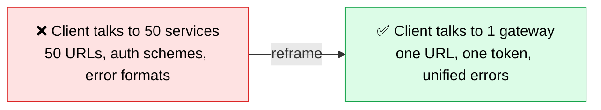
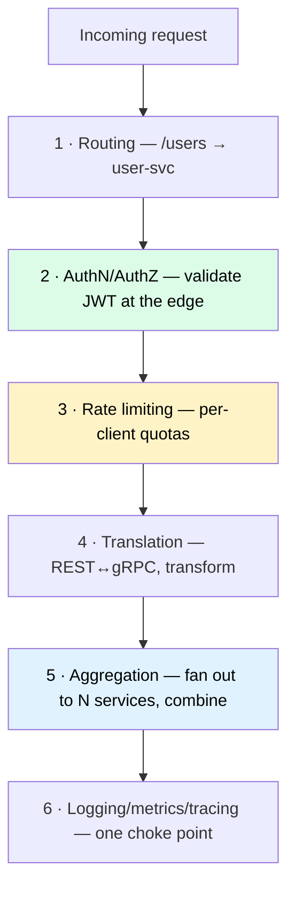
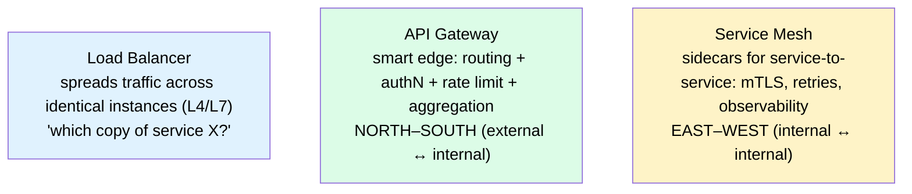
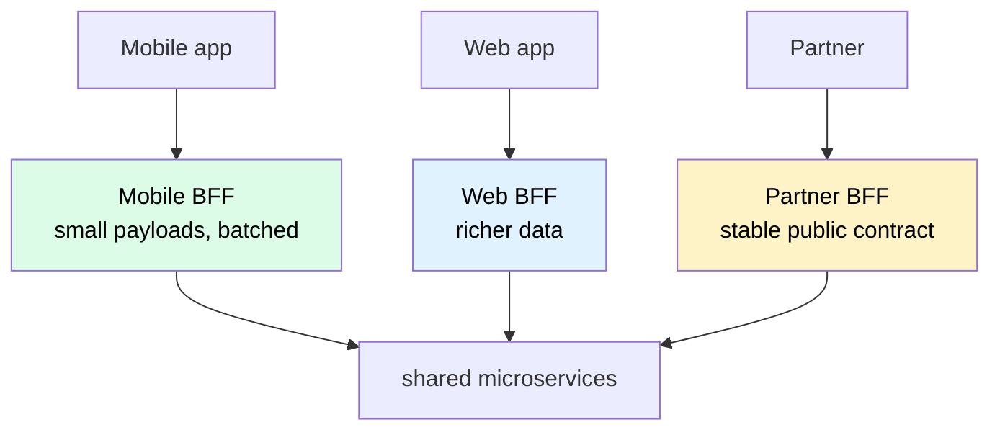
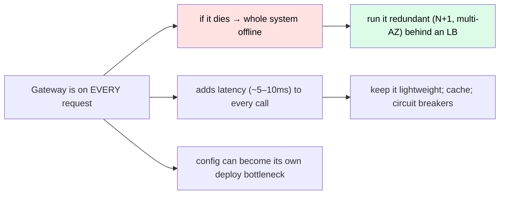
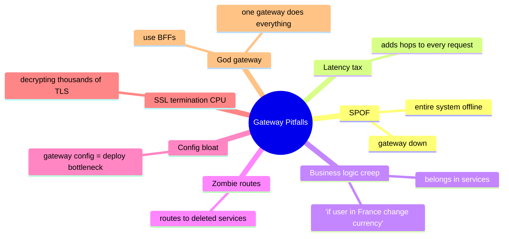

# API Gateway

> **One line:** The API Gateway is the single front door to your microservices — a concierge that handles routing, auth, rate limiting, and aggregation once at the edge, so clients see one tidy interface and your 50 internal services never face the public internet directly.

---

## Table of Contents
1. [Why You Must Master This](#1-why-you-must-master-this)
2. [The Mental Model](#2-the-mental-model)
3. [What a Gateway Actually Does](#3-what-a-gateway-actually-does)
4. [Gateway vs Load Balancer vs Service Mesh](#4-gateway-vs-load-balancer-vs-service-mesh)
5. [The BFF Pattern](#5-the-bff-pattern)
6. [The SPOF & Bottleneck Risk](#6-the-spof--bottleneck-risk)
7. [Worked Example — Request Lifecycle](#7-worked-example--request-lifecycle)
8. [Real-Life Use Cases](#8-real-life-use-cases)
9. [Failure Modes](#9-failure-modes)
10. [🏋️ Practice Drills](#-practice-drills)
11. [🎤 Interview Q&A Bank](#-interview-qa-bank)
12. [🎯 Staff+ Nuances](#-staff-nuances)
13. [Cheat Sheet](#13-cheat-sheet)
14. [Connections & Further Reading](#14-connections--further-reading)

---

## 1. Why You Must Master This

In a microservices architecture you might have 50 services. Without a gateway, every client would juggle 50 URLs, 50 auth schemes, and 50 error formats — a nightmare.

- **Tames chaos** — one entry point instead of clients knowing your whole service topology.
- **Centralizes cross-cutting concerns** — do AuthN, TLS, and rate limiting *once* at the edge instead of in every service.
- **Protocol translation** — speak REST/JSON to clients, gRPC/AMQP to internal services.

> **The core problem it solves:** *client/service coupling and a sprawling attack surface.* Exposing every microservice publicly forces each to implement security and bloats the attack surface; the gateway hides the internal split so you can merge, split, or relocate services without clients noticing.

---

## 2. The Mental Model

An API Gateway is a **hotel concierge.** Instead of going to the basement for laundry, the kitchen for food, and the garage for a car, you make one request to the concierge — who knows where everything is, handles security and tips, and brings back the result. You deal with one trusted interface, not the whole building.





---

## 3. What a Gateway Actually Does



```yaml
# Conceptual gateway config (Kong / Spring Cloud Gateway style)
routes:
  - name: user-service
    paths: ["/v1/users"]
    target: "http://user-svc:8080"
    plugins:
      - jwt-auth: { header: "Authorization" }      # security once, here
      - rate-limiting: { minute: 100 }             # quota once, here
  - name: order-service
    paths: ["/v1/orders"]
    target: "http://order-svc:9000"
```

> These are **cross-cutting concerns** — security, throttling, observability — that you should implement *once* at the edge, not re-implement in every service.

---

## 4. Gateway vs Load Balancer vs Service Mesh

The most common interview confusion — keep these crisp:



| | Load Balancer | API Gateway | Service Mesh |
|---|---------------|-------------|--------------|
| Job | distribute load | smart edge / front door | service-to-service comms |
| Traffic | N-S or E-W | **North-South** | **East-West** |
| Knows about | instances | routes, auth, clients | service identities |
| Example | NGINX, ELB | Kong, Zuul, AWS API GW | Istio, Linkerd |

> An LB often sits *in front of* the gateway. The gateway handles external client concerns; the mesh handles internal traffic. They're complementary layers, not alternatives.

---

## 5. The BFF Pattern

**Backend for Frontend** — a tailored gateway per client type, instead of one gateway trying to serve everyone.



Each BFF shapes responses for its client's needs (mobile wants lean payloads; web wants rich aggregates), avoiding a one-size-fits-none gateway. GraphQL is often used as a BFF (see [GraphQL.md](./GraphQL.md)).

---

## 6. The SPOF & Bottleneck Risk



> Because *every* request passes through it, the gateway is a **single point of failure and a latency tax.** Run it **redundantly** (multiple instances, multi-AZ, behind a load balancer), keep it lightweight, and use **circuit breakers** so a failing downstream service doesn't drag the gateway down (ties to [01 · Availability Math](../01_Planning_Foundations/Availability_Reliability_Math.md)).

---

## 7. Worked Example — Request Lifecycle

```mermaid
sequenceDiagram
    participant C as Client
    participant LB as Load Balancer
    participant GW as API Gateway
    participant Auth as Auth
    participant U as User svc (gRPC)
    participant O as Order svc (gRPC)
    C->>LB: GET /v1/home (one JWT)
    LB->>GW: forward
    GW->>Auth: validate JWT ✅ (once, at edge)
    GW->>GW: rate-limit check (per client)
    par aggregate
        GW->>U: getProfile (REST→gRPC)
        GW->>O: getRecentOrders
    end
    U-->>GW: profile
    O-->>GW: orders
    GW-->>C: 200 unified JSON {profile, orders}
    Note over GW,O: client made ONE call; gateway fanned out, translated, aggregated
```

---

## 8. Real-Life Use Cases

| Situation | How the gateway applies |
|-----------|-------------------------|
| **Netflix (Zuul)** | All incoming traffic flows through Zuul — dynamic routing, auth, resiliency — so the backend can change without TVs/phones noticing. |
| **Mobile + web + partners** | BFF gateways shape responses per client type from shared services. |
| **Centralized security** | One place to enforce TLS, JWT validation, and WAF rules; audit and update policy in a single spot. |
| **Protocol bridging** | REST/JSON externally, gRPC internally — gateway translates ([gRPC.md](./gRPC.md)). |
| **Managed gateways** | AWS API Gateway, Azure API Management, Apigee — priced per million requests. |
| **Legacy strangler** | Route some paths to a new service and others to the old monolith, migrating gradually behind a stable client URL. |

> Real-world habit: **put cross-cutting concerns (auth, rate limit, TLS, observability) in the gateway, and keep business logic in the services.** The gateway routes and protects; it does not *decide* business rules.

---

## 9. Failure Modes



- **SPOF** — every request depends on it; run it redundant and multi-AZ.
- **Latency tax** — adds a hop (~5–10ms); keep it lean.
- **Business-logic creep** — putting domain rules ("if user is in France, change currency") in the gateway. Business logic belongs in services; the gateway does cross-cutting concerns only.
- **Zombie routes & config bloat** — routes to dead services, or so much config it becomes its own deploy bottleneck.
- **SSL termination CPU** — decrypting thousands of TLS handshakes can saturate it; offload/scale accordingly.

---

## 🏋️ Practice Drills

> *Distinguish the layers and place responsibilities correctly.*

**Drill 1 — Which layer?** Place each: (a) "send request to a healthy instance of the user service," (b) "validate the JWT and reject if missing," (c) "encrypt traffic between order-svc and payment-svc," (d) "combine profile + orders into one response."

<details><summary>Solution</summary>

(a) Load Balancer (distribute across instances). (b) API Gateway (edge auth). (c) Service Mesh (east-west mTLS). (d) API Gateway (aggregation). LB = which copy; Gateway = north-south edge concerns; Mesh = internal service-to-service.
</details>

**Drill 2 — Logic placement.** A PM asks to add "users on the Enterprise plan get a 10% discount" to the gateway config. Good idea?

<details><summary>Solution</summary>

No — that's business logic and belongs in the pricing/order service. The gateway handles cross-cutting concerns (routing, auth, rate limit, aggregation). Business rules in the gateway create a god-object that's hard to test, version, and reason about.
</details>

**Drill 3 — Resilience.** The gateway is a SPOF. List three things you do so it doesn't take down the whole system.

<details><summary>Solution</summary>

(1) Run multiple gateway instances across AZs behind a load balancer (N+1 redundancy). (2) Add circuit breakers/timeouts so a failing downstream doesn't exhaust the gateway. (3) Keep it stateless and lightweight so it scales horizontally; add health checks + autoscaling. (Bonus: graceful degradation / cached responses.)
</details>

---

## 🎤 Interview Q&A Bank

**Q1. What does an API Gateway do?**
> Acts as the single entry point for clients: routing, authN/authZ, rate limiting, TLS termination, request/response transformation, aggregation, and centralized logging/metrics — cross-cutting concerns done once at the edge.

**Q2. Gateway vs Load Balancer?**
> A load balancer distributes traffic across identical instances ("which copy of service X?"). A gateway is a smart edge that routes by path, authenticates, rate-limits, and aggregates ("which service, and is this request allowed?"). An LB often sits in front of the gateway.

**Q3. Gateway vs Service Mesh?**
> Gateway handles north-south traffic (external clients ↔ internal); a service mesh handles east-west traffic (service ↔ service) via sidecars doing mTLS, retries, and observability. Complementary layers.

**Q4. Should the gateway contain business logic?**
> No. It handles cross-cutting concerns (security, routing, throttling, aggregation). Business logic belongs in the services to keep the gateway thin, testable, and reusable.

**Q5. What's the BFF pattern?**
> Backend for Frontend — a dedicated gateway per client type (mobile/web/partner) that shapes responses for that client's needs, instead of one generic gateway serving all.

**Q6. What are the downsides of a gateway?**
> It's a single point of failure and a latency hop, and its config can become a bottleneck. Mitigate with redundancy/multi-AZ, keeping it lightweight, circuit breakers, and avoiding logic creep.

**Q7. How does a gateway help during a backend rewrite (strangler pattern)?**
> It can route some paths to a new service and others to the legacy monolith, letting you migrate incrementally while the client-facing URL stays stable.

---

## 🎯 Staff+ Nuances

- **The gateway must not become a distributed monolith's brain.** Every team wanting "just one rule" in the gateway is how it accretes business logic and becomes an undeployable bottleneck owned by no one. Enforce a strict charter: routing + cross-cutting concerns only; reject domain logic.
- **Gateway availability caps system availability (series dependency).** Since every request traverses it, its uptime multiplies into your end-to-end SLO — so it needs *more* nines than the services behind it, via redundancy and independent failure domains (see [01 · Availability Math](../01_Planning_Foundations/Availability_Reliability_Math.md)).
- **Circuit breakers + bulkheads at the gateway prevent cascading failure.** A slow downstream can tie up all gateway worker threads and take down *every* route, not just the broken one. Per-route timeouts, circuit breakers, and bulkhead isolation contain the blast radius (cf. *Release It!*).
- **Centralization is a governance win and a coupling risk.** One place for auth/TLS/policy is great for security and audit — but it also means one config change can break everything. Treat gateway config as versioned, reviewed, canary-deployed code, not a console toggle.
- **Gateway vs mesh is converging but distinct.** Some orgs run a mesh ingress gateway as both; conceptually keep north-south (client-facing concerns: API keys, request shaping, public contracts) separate from east-west (zero-trust mTLS, retries between services). Conflating them couples external and internal concerns.
- **Aggregation has a tail-latency cost.** A gateway fanning out to N services is only as fast as the slowest one (and amplifies their tail latencies). Use parallel calls, per-call deadlines, partial responses, and hedging — and consider GraphQL/BFF when aggregation is the dominant pattern.

---

## 13. Cheat Sheet

```
API GATEWAY = single front door for microservices (the concierge).

DOES (cross-cutting, ONCE at the edge):
  routing · authN/authZ · rate limiting · TLS termination
  request/response transformation · aggregation · logging/metrics/tracing
DOES NOT: business logic (that lives in the services)

LAYERS
  Load Balancer  → which copy of a service (N-S or E-W)
  API Gateway    → smart edge, NORTH–SOUTH (external ↔ internal)
  Service Mesh   → sidecars, EAST–WEST (service ↔ service: mTLS, retries)
  (LB often sits in FRONT of the gateway)

BFF  one gateway per client type (mobile/web/partner) — GraphQL often used here
RISKS  SPOF + latency hop + config bottleneck
FIX   redundant + multi-AZ · lightweight · circuit breakers · versioned config
```

---

## 14. Connections & Further Reading

**Within this repo:**
- [Authentication.md](./Authentication.md) · [Authorization.md](./Authorization.md) · [Rate_Limiting.md](./Rate_Limiting.md) — the concerns the gateway centralizes.
- [REST_API_Design.md](./REST_API_Design.md) · [gRPC.md](./gRPC.md) · [GraphQL.md](./GraphQL.md) — protocol translation & BFF.
- [07 · Load Balancing & Scalability](../07_Load_Balancing_Scalability/) · [10 · Microservices & Distributed Systems](../10_Microservices_Distributed_Systems/) — LB, service mesh, circuit breakers.
- [01 · Availability Math](../01_Planning_Foundations/Availability_Reliability_Math.md) — why the gateway needs extra nines.

**External classics:**
- [NGINX: what is an API gateway?](https://www.nginx.com/learn/api-gateway/) · [Microsoft: Gateway routing pattern](https://learn.microsoft.com/en-us/azure/architecture/patterns/gateway-routing).
- [Netflix Zuul](https://github.com/Netflix/zuul) · [Kong](https://konghq.com/) · [Sam Newman on BFF](https://samnewman.io/patterns/architectural/bff/).

---

## TL;DR
The API Gateway is the **single front door** to your microservices — a concierge that does **routing, authN/authZ, rate limiting, TLS, transformation, and aggregation once at the edge**, hiding the internal service split from clients. Keep it strictly to **cross-cutting concerns (no business logic)**, distinguish it from the **load balancer** (which copy?) and **service mesh** (east-west), use **BFFs** to tailor per client, and because it's on **every request** — a SPOF and latency hop — run it **redundant, lightweight, and circuit-broken** with **more nines than the services behind it**.
