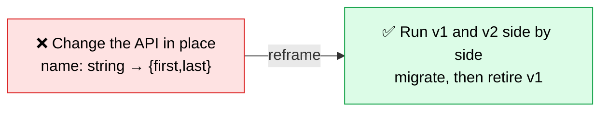
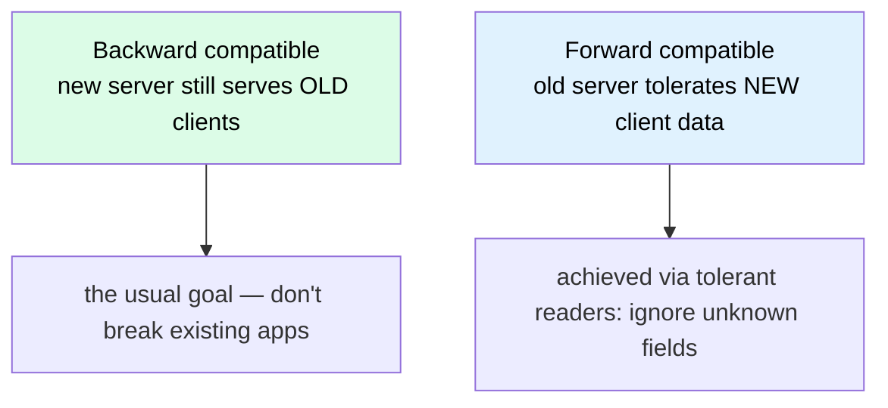
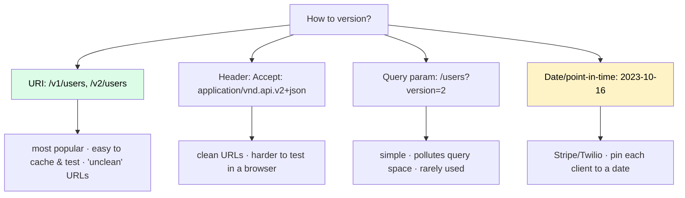
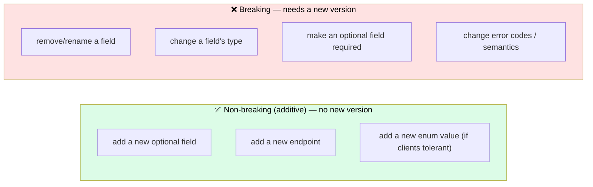
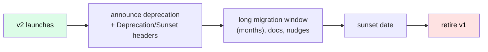
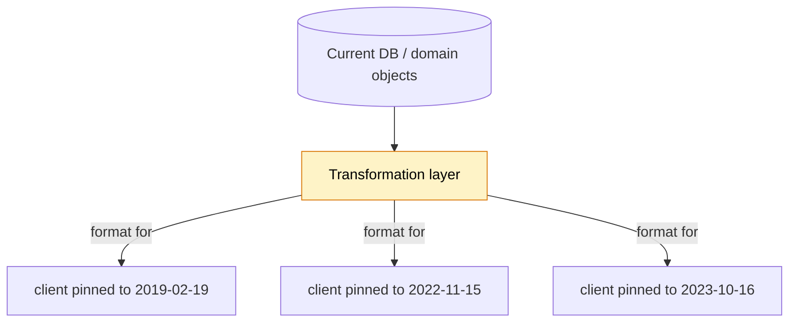
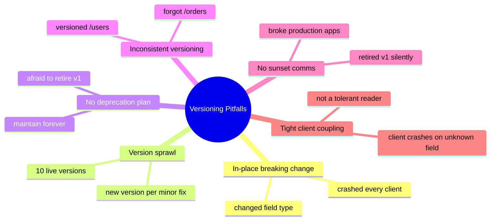

# API Versioning

> **One line:** A public API is an unbreakable promise — versioning is how you fix design mistakes and ship new shapes by building a *new road alongside the old one*, never bulldozing the road while users are still driving on it.

---

## Table of Contents
1. [Why You Must Master This](#1-why-you-must-master-this)
2. [The Mental Model](#2-the-mental-model)
3. [Backward vs Forward Compatibility](#3-backward-vs-forward-compatibility)
4. [The Versioning Strategies](#4-the-versioning-strategies)
5. [Breaking vs Non-Breaking Changes](#5-breaking-vs-non-breaking-changes)
6. [Deprecation & the Transition Wave](#6-deprecation--the-transition-wave)
7. [Worked Example — Stripe's Date-Based Versioning](#7-worked-example--stripes-date-based-versioning)
8. [Real-Life Use Cases](#8-real-life-use-cases)
9. [Failure Modes](#9-failure-modes)
10. [🏋️ Practice Drills](#-practice-drills)
11. [🎤 Interview Q&A Bank](#-interview-qa-bank)
12. [🎯 Staff+ Nuances](#-staff-nuances)
13. [Cheat Sheet](#13-cheat-sheet)
14. [Connections & Further Reading](#14-connections--further-reading)

---

## 1. Why You Must Master This

Once an API is public, you can't change a field type without breaking every mobile app, script, and integration built on it. Versioning is how you evolve without betrayal.

- **The unbreakable contract** — a change that crashes a customer's production system is the fastest way to lose trust and customers.
- **Iterative growth** — you need to release better data models and features without forcing every user to upgrade on your schedule.
- **Reputation & revenue** — for platform companies, API stability *is* the product; breaking it has direct commercial cost.

> **The core problem it solves:** *backward compatibility.* It lets old and new versions coexist. The naive alternative — changing the API in place (e.g., turning `name` from a string into `{first, last}`) — instantly crashes every existing client.

---

## 2. The Mental Model

Versioning is **parallel roads.** When the old road (v1) gets too narrow or badly designed, you don't demolish it while cars are on it — you build a new highway (v2) alongside, let people switch when ready, and only close the old road after a long, well-announced sunset.



---

## 3. Backward vs Forward Compatibility



- **Backward compatibility** — a new version of the server still works for clients written against the old contract. This is what versioning primarily protects.
- **Forward compatibility** — older code tolerates data produced by newer code (e.g., **ignoring unknown fields** — "tolerant reader"). Build clients this way so additive changes never break them.

---

## 4. The Versioning Strategies



| Strategy | Example | Pros | Cons |
|----------|---------|------|------|
| **URI** | `/v1/users` | simplest, cache-friendly, browser-testable | "version in the URL" purists dislike it |
| **Header** | `Accept: …v2+json` | clean URLs, content-negotiation native | invisible, harder to test/debug |
| **Query param** | `?version=2` | trivial | clutters query space, easy to forget |
| **Date-based** | `2023-10-16` | fine-grained, pins clients | needs a transformation layer (advanced) |

> For most teams, **URI versioning at the major level (`/v1`)** is the pragmatic default. Reserve date-based for large platforms with the engineering to support transformation layers.

---

## 5. Breaking vs Non-Breaking Changes

The key skill: knowing which changes need a new version and which don't.



> **Rule of thumb:** *adding* is usually safe (tolerant clients ignore what they don't know); *removing, renaming, or retyping* is breaking. Version only for breaking changes — versioning every minor fix causes version sprawl.

---

## 6. Deprecation & the Transition Wave

A version isn't done when v2 ships — it's done when v1 is *safely retired*. That requires a planned, communicated transition.





Use the `Deprecation` and `Sunset` HTTP headers, dashboards showing per-version traffic, and direct outreach to the highest-volume clients. **Never** retire a version while meaningful traffic still uses it.

---

## 7. Worked Example — Stripe's Date-Based Versioning



Stripe names each API version after the **date** it shipped. Every account is *pinned* to the version it started on. Internally, a **transformation layer** converts today's data objects back into the exact shape each old version expects. New users get the latest; old integrations never break. It's world-class — but it requires maintaining every transformation forever, so only adopt it at platform scale.

---

## 8. Real-Life Use Cases

| Situation | How versioning applies |
|-----------|------------------------|
| **Public platform API** | URI or date-based versioning + long deprecation windows protect thousands of integrators. |
| **Mobile apps** | Old app versions live on users' phones for years — the backend must serve old contracts until those installs die off. |
| **Internal microservices** | Often skip full versioning: coordinate a synchronized deploy, or use tolerant readers + additive Protobuf changes (see [gRPC.md](./gRPC.md)). |
| **GraphQL APIs** | Largely versionless — add fields, mark old ones `@deprecated`, evolve continuously (see [GraphQL.md](./GraphQL.md)). |
| **Partner contracts** | Versioning is contractual; sunset timelines may be legally negotiated. |

> Real-world habit: **default to additive, backward-compatible changes; reserve a new major version for genuine breaking changes; and never ship a v2 without a written deprecation plan for v1.**

---

## 9. Failure Modes



- **In-place breaking change** — the cardinal sin; renaming/retyping a field without a new version.
- **Version sprawl** — releasing a version per minor change until you maintain a dozen.
- **No deprecation strategy** — too scared to retire old versions, so they live (and cost) forever.
- **Inconsistent versioning** — versioning one endpoint but not a related one that shares the same objects.
- **Silent sunsets** — retiring a version without comms breaks customers overnight.

---

## 🏋️ Practice Drills

> *Classify changes and design safe evolution.*

**Drill 1 — Breaking or not?** Classify each: (a) add optional `nickname` field, (b) rename `qty` → `quantity`, (c) add a new `/v1/invoices` endpoint, (d) change `price` from integer cents to a decimal string.

<details><summary>Solution</summary>

(a) Non-breaking (additive optional). (b) **Breaking** (rename — old clients lose `qty`). (c) Non-breaking (new endpoint). (d) **Breaking** (type change). b and d need a new version; a and c don't.
</details>

**Drill 2 — Migrate a field.** You must split `name: string` into `first_name` and `last_name`. Outline a non-breaking rollout.

<details><summary>Solution</summary>

Additively add `first_name` and `last_name` *alongside* `name` (keep populating `name` too). Mark `name` deprecated in docs + `Deprecation` header. Give clients a long window to migrate. Only after traffic to `name` drops near zero, remove it in the next major version.
</details>

**Drill 3 — Choose a strategy.** A 3-engineer startup with a handful of API clients wants versioning. URI, header, or date-based?

<details><summary>Solution</summary>

URI versioning (`/v1`). It's simplest, cache- and browser-friendly, and needs no transformation-layer engineering. Date-based (Stripe-style) is powerful but over-engineering at this scale.
</details>

---

## 🎤 Interview Q&A Bank

**Q1. What's the best way to handle a breaking change in a public API?**
> Introduce a new version (e.g., `/v2`) that coexists with v1, announce deprecation with `Deprecation`/`Sunset` headers, give a long migration window with docs and outreach, then retire v1 only after traffic drops. Never change v1 in place.

**Q2. URI vs header versioning?**
> URI (`/v1/users`) is simplest, cacheable, and browser-testable — the pragmatic default. Header versioning keeps URLs clean and uses content negotiation but is harder to test/debug.

**Q3. What changes are backward-compatible?**
> Additive ones: new optional fields, new endpoints, new enum values (with tolerant clients). Removing/renaming/retyping fields or making optionals required are breaking.

**Q4. How does GraphQL handle versioning?**
> Mostly versionless — add fields and mark old ones `@deprecated`, evolving the schema continuously instead of cutting v2.

**Q5. How does Stripe version its API?**
> Date-based: each version is named by ship date, clients are pinned to the date they started, and a transformation layer reshapes current objects into each old version's format.

**Q6. When can you skip versioning?**
> For internal APIs where you control both client and server (synchronized deploys), or with tolerant readers + additive-only changes (e.g., Protobuf). Don't version early prototypes with no external users.

**Q7. What's a tolerant reader?**
> A client that ignores fields it doesn't recognize, so additive server changes never break it — the basis of forward compatibility.

---

## 🎯 Staff+ Nuances

- **The cheapest versioning is the version you never had to cut.** Disciplined *additive-only* evolution + tolerant readers can avoid breaking changes for years. Most "we need v2" situations are really "we made a field non-optional / renamed something we shouldn't have."
- **Versioning is a cost multiplier — every live version doubles testing, support, and cognitive load.** Treat retiring old versions as real engineering work with an owner and a deadline, or you accumulate permanent debt.
- **Date-based + transformation layer is elegant but expensive.** Stripe can afford to maintain every transformation forever; most orgs can't. Match the strategy to your scale and team size.
- **Internal vs external versioning are different games.** Externally you owe long sunsets and comms; internally you can often coordinate a synchronized cutover or rely on consumer-driven contract tests (Pact) to deploy breaking changes safely in one motion.
- **Communicate deprecation in-band and out-of-band.** `Deprecation`/`Sunset` headers, changelog, email to top consumers, and traffic dashboards — silent retirement is how you cause outages and lose trust.
- **Version the contract, not the implementation.** v1 and v2 should ideally be two views over the same core logic (a transformation/adapter layer), not two forked codebases — forking doubles bug surface and drifts over time.

---

## 13. Cheat Sheet

```
A public API is a PROMISE. Build the new road beside the old one.

STRATEGIES
  URI      /v1/users       ← pragmatic default (cacheable, testable)
  Header   Accept: ...v2   ← clean URLs, harder to test
  Query    ?version=2      ← rarely used
  Date     2023-10-16      ← Stripe/Twilio, needs transformation layer

NON-BREAKING (no new version): add optional field · add endpoint · add enum val
BREAKING (new version): remove/rename/retype field · optional→required · change errors

DEPRECATION: launch v2 → announce (Deprecation/Sunset headers) → long window → retire v1
RULES  version only for breaking changes · be a tolerant reader (ignore unknown fields)
       never break in place · never sunset silently · version the CONTRACT not the fork
```

---

## 14. Connections & Further Reading

**Within this repo:**
- [API_Design_Fundamentals.md](./API_Design_Fundamentals.md) — designing for evolvability up front.
- [REST_API_Design.md](./REST_API_Design.md) · [GraphQL.md](./GraphQL.md) · [gRPC.md](./gRPC.md) — how each style versions.
- [01 · Trade-off Analysis](../01_Planning_Foundations/Trade_off_Analysis.md) — versioning cost vs flexibility.

**External classics:**
- [Stripe: API versioning at scale](https://stripe.com/blog/api-versioning).
- [Microsoft: API versioning strategy](https://learn.microsoft.com/en-us/azure/architecture/best-practices/api-design#versioning-a-restful-web-api).
- [Heroku API design: versioning](https://github.com/interagent/http-api-design).

---

## TL;DR
A public API is an **unbreakable promise** — evolve it by running versions **side by side** (parallel roads), never by changing the contract in place. Prefer **additive, backward-compatible changes** with **tolerant readers**, and cut a **new major version only for genuine breaking changes**. **URI versioning (`/v1`)** is the pragmatic default; date-based (Stripe) is powerful but needs a transformation layer. Every version is a cost — so always pair a v2 launch with a written **deprecation plan and a long, well-communicated sunset** for v1.
