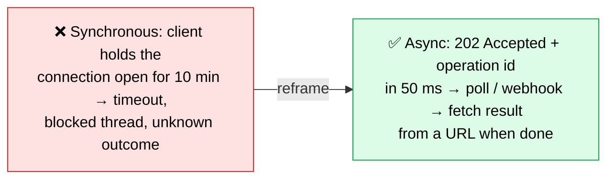
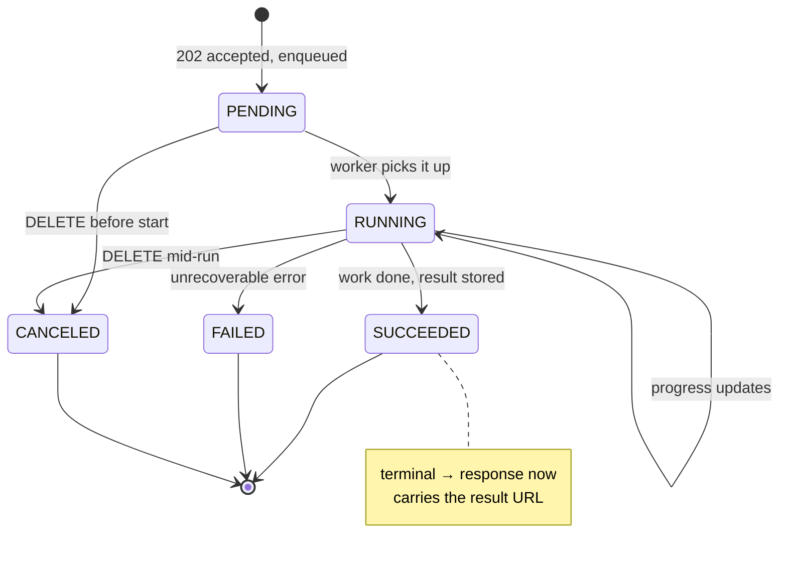
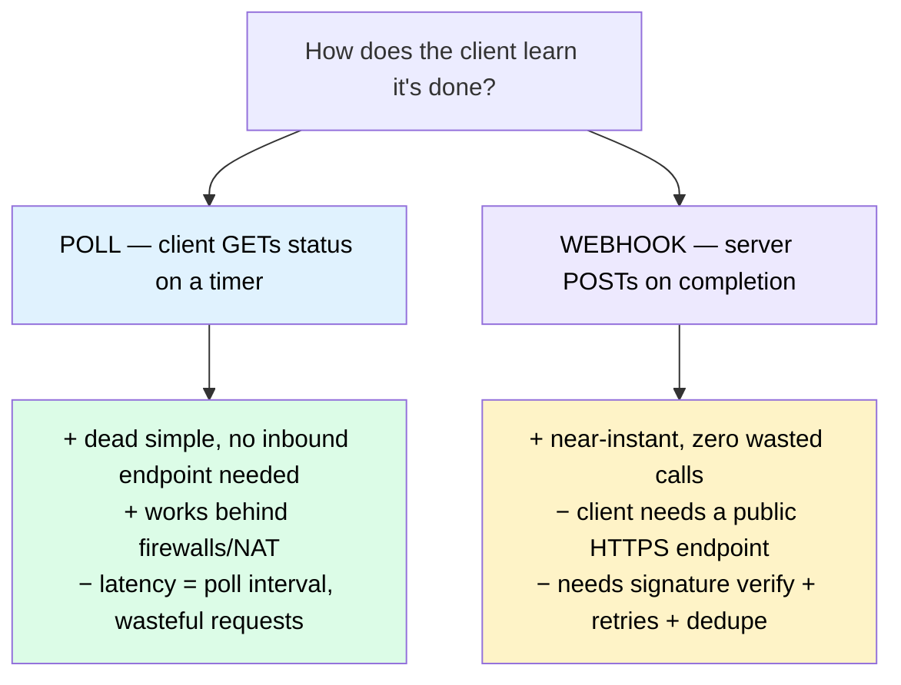
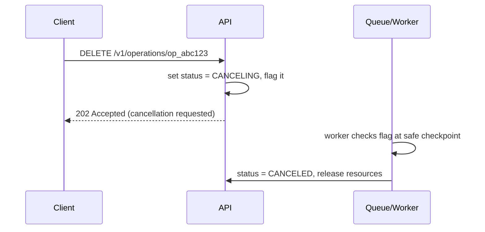
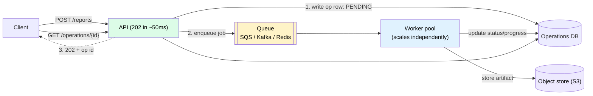
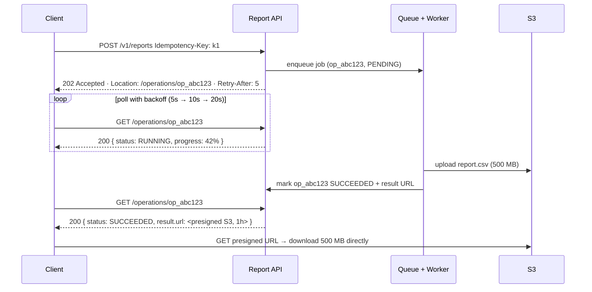
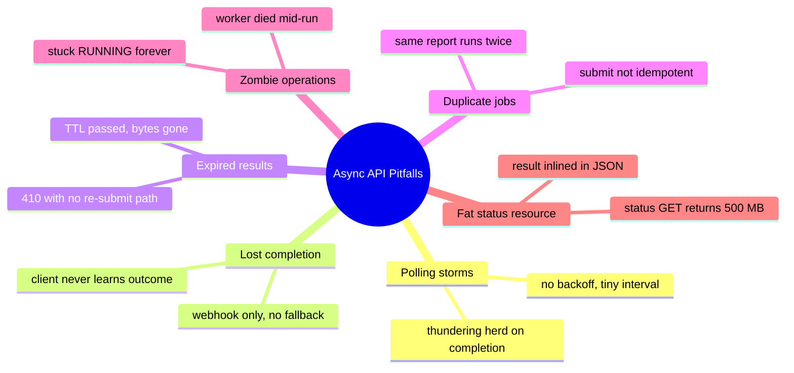

# Async APIs & Long-Running Operations

> **One line:** When a request takes longer than a connection should stay open, stop making the client wait — return `202 Accepted` immediately with an *operation resource* the client can poll or subscribe to, and do the real work in the background.

---

## Table of Contents
1. [Why You Must Master This](#1-why-you-must-master-this)
2. [The Mental Model](#2-the-mental-model)
3. [202 Accepted + the Operation Resource](#3-202-accepted--the-operation-resource)
4. [Completion: Polling vs Callbacks (Webhooks)](#4-completion-polling-vs-callbacks-webhooks)
5. [Progress, Cancellation & Result TTL](#5-progress-cancellation--result-ttl)
6. [The Job-Queue Backing](#6-the-job-queue-backing)
7. [Worked Example — "The Report Takes 10 Minutes"](#7-worked-example--the-report-takes-10-minutes)
8. [Real-Life Use Cases](#8-real-life-use-cases)
9. [Failure Modes](#9-failure-modes)
10. [🏋️ Practice Drills](#-practice-drills)
11. [🎤 Interview Q&A Bank](#-interview-qa-bank)
12. [🎯 Staff+ Nuances](#-staff-nuances)
13. [Cheat Sheet](#13-cheat-sheet)
14. [Connections & Further Reading](#14-connections--further-reading)

---

## 1. Why You Must Master This

Some work simply cannot finish inside one HTTP round-trip: generating a 500 MB report, transcoding a video, restoring an archive, training a model, running a bulk import. Holding the socket open for minutes is fragile and wasteful.

- **Connections die long before the work does** — load balancers (ALB/nginx) idle-timeout at ~60s, browsers/clients at ~30–120s. A 10-minute synchronous request is *guaranteed* to time out somewhere in the middle, and the client never learns if the work succeeded.
- **Blocked threads don't scale** — every in-flight synchronous request pins a worker thread/connection. A few hundred slow reports can exhaust your pool and take down fast endpoints too (head-of-line blocking).
- **Retries become dangerous** — if a synchronous call times out, the client retries, and now the same expensive job runs twice. Async submission with an idempotency key fixes this (see [Idempotency.md](./Idempotency.md)).
- **It's the #1 API-design follow-up** — "the report takes 10 minutes to generate — now what?" is a standard interview probe. The expected answer is *202 + operation resource*, not "increase the timeout."

> **The core problem it solves:** *decoupling request acceptance from request completion.* Accept the work in milliseconds, hand back a handle, and let the client discover the outcome later — instead of forcing the network to hold a line open for the entire duration.

**Prerequisites:** [REST_API_Design.md](./REST_API_Design.md) (status codes, resources), [Idempotency.md](./Idempotency.md) (safe submission).

---

## 2. The Mental Model

Async APIs work like a **restaurant order ticket** (or a coat-check tag). You don't stand at the kitchen pass holding the line until your meal is plated — you get a ticket number and sit down. You can *ask* how it's going, they can *buzz* you when it's ready, and you redeem the ticket for the finished plate.



> **Hold onto this:** the response to a slow request is not the *result* — it's a *receipt for a resource that will eventually hold the result.* Return the receipt fast; deliver the result out-of-band.

---

## 3. 202 Accepted + the Operation Resource

The pattern has two moving parts: a **fast accept** and a **status resource** the client can query.

**Step 1 — Accept.** The submit endpoint validates the request, enqueues the job, and returns immediately:

```
POST /v1/reports        Idempotency-Key: 8f3a-...
→ 202 Accepted
  Location: /v1/operations/op_abc123
  Retry-After: 5
  { "id": "op_abc123", "status": "PENDING" }
```

`202 Accepted` means *"I've taken responsibility for this work but haven't finished it."* The `Location` header points at the **operation resource** — a first-class, GET-able resource that represents the *job itself*, not the result. (Note: `202` differs from `201 Created`, which means the resource already fully exists.)

**Step 2 — Poll the status resource.** The client GETs the operation to watch it move through a lifecycle:



> **Takeaway:** the operation resource is a small state machine. PENDING/RUNNING are non-terminal (keep polling); SUCCEEDED/FAILED/CANCELED are terminal (stop, read the outcome).

A concrete status resource — this is what a `GET /v1/operations/op_abc123` returns:

```json
{
  "id": "op_abc123",
  "status": "RUNNING",
  "operationType": "report.generate",
  "createdAt": "2026-07-08T10:00:00Z",
  "updatedAt": "2026-07-08T10:03:12Z",
  "progress": { "percent": 42, "step": "aggregating", "stepsDone": 3, "stepsTotal": 7 },
  "result": null,
  "error": null,
  "expiresAt": "2026-07-09T10:00:00Z"
}
```

When it finishes, `status` flips to `SUCCEEDED`, `result` gains a URL, and `error` stays null (or the reverse on `FAILED`, carrying a structured error — see [API_Error_Handling_Design.md](./API_Error_Handling_Design.md)). This is exactly the shape of **Google's Long-Running Operations** (`google.longrunning.Operation` with `done`, `response`, `error`) and **AWS** async patterns (S3 Glacier restore, `Describe*` status polls).

---

## 4. Completion: Polling vs Callbacks (Webhooks)

Once work is accepted, the client learns it's done one of two ways: it **asks** (polling) or it **gets told** (callback/webhook).

### Polling — the client pulls

The client repeatedly GETs the operation until it reaches a terminal state. The whole design challenge is *not hammering the server*:

- **Honor `Retry-After`** — the server tells the client when to check next (a header value in seconds, or an HTTP date). The client should obey it rather than inventing its own interval.
- **Back off** — start at ~1–2s, grow exponentially (2s → 4s → 8s …) capped at ~30–60s, ideally with jitter to avoid thundering herds when many jobs finish together.
- **Right-size the interval** — polling a 10-minute job every 500 ms is 1,200 pointless requests. A 5–10s interval with backoff is plenty; the poll is cheap only if the status read is cheap (a single indexed row / cache hit, never a recompute).
- **Cap total polling time** — clients should give up after a sane deadline and surface "still running" rather than loop forever.

### Callbacks (webhooks) — the server pushes

The client registers a `callbackUrl` (or a pre-configured webhook endpoint); when the operation reaches a terminal state, the server POSTs the outcome to it. No polling at all.



| Dimension | Polling | Webhook (callback) |
|-----------|---------|--------------------|
| Who initiates | Client pulls | Server pushes |
| Completion latency | Up to one poll interval | Near-instant |
| Wasted requests | Many (mostly "still running") | Zero |
| Client infra needed | None (any HTTP client) | Public HTTPS endpoint |
| Works behind NAT/firewall | ✅ Yes | ❌ No (needs inbound) |
| Reliability burden | On client (keep polling) | On server (retry, dedupe, sign) |
| Security | Client's own auth | **Must verify signature** — anyone can POST |

**Webhooks are not free.** The receiver must **verify the signature** (HMAC of the payload) so an attacker can't forge "your job succeeded, here's the result," must **dedupe** by event ID because delivery is at-least-once, and must return `2xx` fast (the sender retries with backoff on failure). All of this lives in [../08_Communication_Protocols/Webhooks.md](../08_Communication_Protocols/Webhooks.md).

> **Best practice (Stripe, GitHub, AWS all do this):** offer *both.* Webhook for the fast path, polling as the fallback for when a webhook is missed or the client can't host an endpoint. Never rely on a webhook as the *only* way to learn the outcome.

---

## 5. Progress, Cancellation & Result TTL

### Progress reporting

For long jobs, users want a bar, not a spinner. Two common shapes, both surfaced in the status resource:

- **Percent complete** — `"progress": { "percent": 42 }`. Simple, but often a lie unless you can estimate total work up front.
- **Step / count based** — `"stepsDone": 3, "stepsTotal": 7` or `"rowsProcessed": 42000, "rowsTotal": 100000`. More honest for pipelines and bulk jobs (pairs with [Bulk_Batch_APIs.md](./Bulk_Batch_APIs.md)).

The worker writes progress to the operation record (throttled — update every few seconds or every N%, not every row, to avoid write amplification). Polling clients read it; webhook designs can emit intermediate `operation.progress` events.

### Cancellation — DELETE the operation

A long job the user no longer wants should be cancelable. Model it as **`DELETE /v1/operations/op_abc123`** (or `POST /operations/{id}:cancel` in RPC-style APIs like Google LRO's `CancelOperation`).



Cancellation is usually **cooperative and best-effort**: you flag the operation, and the worker checks that flag at safe checkpoints, then stops and cleans up. It is *not* instantaneous — a job mid-write can't always be killed abruptly. Make cancel idempotent (cancel-twice = still canceled) and return the current state if it already finished.

### Result TTL & retrieval — where the bytes live

The finished artifact (a 500 MB CSV, a video) does **not** belong inline in the status JSON. Store it in object storage and hand back a **URL**:

```json
"result": {
  "url": "https://s3.amazonaws.com/reports/op_abc123.csv?X-Amz-Signature=...&X-Amz-Expires=3600",
  "sizeBytes": 524288000,
  "expiresAt": "2026-07-09T10:00:00Z"
}
```

- **Presigned S3 URL** — a time-limited, signed link (e.g. valid 1 hour) that lets the client download directly from S3 without proxying gigabytes through your API servers. The signature *is* the authorization.
- **Result TTL** — results expire (commonly 24–48h). This bounds storage cost and is often a compliance requirement. After expiry, the operation returns `410 Gone` or a status noting the result is no longer available; the client must re-submit.
- **Separate the handles** — the *operation resource* (small, cheap, long-lived) is distinct from the *result artifact* (large, in object storage, short-lived). Confusing the two ("why is my status endpoint returning 500 MB?") is a classic design mistake.

---

## 6. The Job-Queue Backing

The whole pattern rests on decoupling the API tier from the compute. The submit endpoint's only job is to **accept fast and enqueue**; separate workers do the heavy lifting.



- **Accept fast, process later** — the API writes a PENDING operation row and pushes a message onto a durable queue ([SQS](../09_Message_Queues_Event_Streaming/)/Kafka/Redis). Because the queue is durable, an API crash after enqueue doesn't lose the job.
- **Workers scale independently** — the queue is a shock absorber: a burst of 10,000 report requests fills the queue, and workers drain it at their own pace. The fast API tier never gets overwhelmed by slow work (this is the essence of decoupling and back-pressure).
- **Idempotent submission** — the same `Idempotency-Key` must not enqueue the job twice. On a duplicate submit, return the *existing* operation id (`200` with the same op) instead of creating a second job. This is where async APIs and [Idempotency.md](./Idempotency.md) intersect directly.
- **At-least-once delivery** — queues redeliver on worker crash, so the *worker* must be idempotent too (a redelivered "generate report" shouldn't produce two artifacts). Use the operation id as the dedupe key.
- **AsyncAPI for the event side** — just as OpenAPI documents your REST endpoints, **[AsyncAPI](https://www.asyncapi.com/)** documents the message/event contracts (channels, payloads) for the queue and webhook events. If the completion path is event-driven, describe it with AsyncAPI so consumers have a schema.

---

## 7. Worked Example — "The Report Takes 10 Minutes"

The classic interview prompt. A user requests a sales report that takes ~10 minutes to compute over 100M rows. Walk the numbers:

- A synchronous request would sit behind an ALB with a **60s idle timeout** → it dies ~9 minutes early, every time. Synchronous is simply impossible here.
- 200 concurrent report requests × 10 min each, synchronously, would pin **200 worker threads** for 10 minutes — enough to starve every other endpoint. Async frees the threads instantly.

So: accept in 50 ms, enqueue, poll (or webhook) for completion, download from S3.



**The loop closed:** the 60s connection limit *forced* the architecture — accept fast (`202`), do work off a durable queue, report progress on a cheap status resource, and deliver the 500 MB payload via a **presigned S3 URL** (never through the API tier). One number (60s timeout) dictated the entire design.

---

## 8. Real-Life Use Cases

| Situation | How the async pattern applies | The decision it forces |
|-----------|-------------------------------|------------------------|
| **AWS S3 Glacier restore** | Restore is a long async op; you poll object status until `restore` completes (minutes–hours). | Poll status; never block on the restore call. |
| **Google Cloud LRO** | `google.longrunning.Operations` — every long API returns an `Operation` you poll (`done`/`response`/`error`). | Standardized operation resource across all services. |
| **Stripe async / reports** | Report runs are created async; you poll the report run or receive a webhook on completion. | Offer both poll + webhook; results expire. |
| **Video transcoding (Mux, MediaConvert)** | Upload → 202 → transcode job → webhook when ready → play from CDN URL. | Webhook-driven; artifact in object storage. |
| **Bulk import / export (Shopify, Salesforce)** | Submit bulk job → poll → download result file. | Job-queue backing; paired with [Bulk_Batch_APIs.md](./Bulk_Batch_APIs.md). |
| **LLM batch / fine-tuning jobs** | Submit → operation id → poll status → fetch output when SUCCEEDED. | Long TTL, progress by step count. |

> Real-world habit: **if a task can plausibly exceed ~a few seconds, design it async from day one.** Retrofitting `202` after clients depend on a synchronous response is a breaking change.

---

## 9. Failure Modes



- **Polling storms.** *SYMPTOM:* status endpoint melts under load; latency spikes when many jobs finish. *ROOT CAUSE:* clients poll every 200ms with no backoff or jitter → thundering herd. *FIX:* return `Retry-After`, mandate exponential backoff + jitter, and serve status from a cache/indexed read.
- **Lost completion.** *SYMPTOM:* job succeeded but the client never acts on it. *ROOT CAUSE:* webhook was the *only* notification and it was dropped/misconfigured. *FIX:* always provide a pollable status resource as fallback; make webhooks retried + idempotent.
- **Expired results.** *SYMPTOM:* client fetches result URL, gets `403`/`410`. *ROOT CAUSE:* the presigned URL or result TTL elapsed. *FIX:* return `expiresAt` clearly, `410 Gone` after expiry with a documented re-submit path; let clients re-request a fresh presigned URL.
- **Duplicate jobs.** *SYMPTOM:* the same report generated twice, double cost. *ROOT CAUSE:* client retried the submit; server enqueued twice. *FIX:* idempotent submission keyed by `Idempotency-Key` → return the existing operation id.
- **Zombie operations.** *SYMPTOM:* operation stuck in RUNNING forever. *ROOT CAUSE:* worker crashed mid-run and nothing reaped it. *FIX:* heartbeats + a timeout/lease so orphaned jobs are marked FAILED or re-queued; visibility timeouts (SQS) handle this natively.
- **Fat status resource.** *SYMPTOM:* status polls are slow and huge. *ROOT CAUSE:* the result payload is inlined in the operation JSON. *FIX:* keep status small; put artifacts in object storage behind a URL.

---

## 🏋️ Practice Drills

> *Cover the solutions and attempt first — active recall is the point.*

**Drill 1 — Pick the status code + headers.** A client POSTs a request that will take 8 minutes. What status code and which two headers do you return, and what does the body contain?

<details><summary>Solution</summary>

`202 Accepted`. Headers: `Location: /operations/{id}` (where to poll) and `Retry-After: <seconds>` (when to poll next). Body: the operation resource with at least `{ id, status: "PENDING" }`. The response is a *receipt*, not the result.
</details>

**Drill 2 — Polling cost.** A job runs ~10 minutes. A client polls every 500 ms with no backoff. How many requests is that, and what's the fix?

<details><summary>Solution</summary>

600s / 0.5s = **1,200 requests**, almost all returning "still RUNNING." Fix: exponential backoff (e.g. 5s → 10s → 20s, cap 60s) + jitter, obey `Retry-After`. That drops it to ~a dozen requests. Ensure the status read is a cheap indexed lookup, not a recompute.
</details>

**Drill 3 — Poll vs webhook.** A client runs entirely inside a corporate network behind NAT with no public endpoint, but needs near-real-time completion for thousands of jobs. What do you recommend?

<details><summary>Solution</summary>

They can't receive webhooks (no inbound endpoint), so pure push is out. Use polling — but to approach real-time without a storm, use long-lived, backed-off polling or, better, a server-push channel they *initiate outbound* (SSE/WebSocket/gRPC stream) which traverses NAT. If webhooks were possible, offer both; here, an outbound streaming subscription is the near-real-time answer without an inbound endpoint.
</details>

**Drill 4 — Design a cancel.** Design cancellation for an in-progress transcoding job. What's the endpoint, and why can't it be instant?

<details><summary>Solution</summary>

`DELETE /operations/{id}` (or `:cancel`). Set status → CANCELING and flag it; the worker checks the flag at safe checkpoints, stops, releases resources, then sets CANCELED. It's cooperative/best-effort because a worker mid-encode can't always be killed cleanly — you may still pay for partial work. Make it idempotent and no-op if already terminal.
</details>

---

## 🎤 Interview Q&A Bank

**Q1. The report takes 10 minutes to generate — now what?** *(signal: do they reach for `202` or just "raise the timeout"?)*
> Don't hold the connection — it'll die at the LB's ~60s timeout. Return `202 Accepted` with an operation id and a `Location` to a status resource, enqueue the job to a durable queue, and let workers process it. The client polls the operation (with backoff) or gets a webhook, then downloads the result from a presigned S3 URL. Raising the timeout doesn't scale and blocks threads.

**Q2. What does `202 Accepted` mean, and how is it different from `200`/`201`?**
> `202` means "I've accepted responsibility for the work but haven't completed it" — the result doesn't exist yet. `200 OK` and `201 Created` mean the work is done and the resource exists now. `202` is the signature of async processing.

**Q3. Polling vs webhooks — when do you use which?**
> Polling: client pulls a status resource on a timer — simple, works behind NAT, no inbound endpoint, but wasteful and completion is delayed by the poll interval. Webhooks: server pushes on completion — near-instant and zero waste, but needs a public HTTPS endpoint plus signature verification, retries, and dedupe. Best practice is offer both: webhook for speed, polling as the reliable fallback.

**Q4. How do you keep polling from hammering the server?**
> Return `Retry-After`, require exponential backoff with jitter, cap the interval (~30–60s), and cap total polling time. Serve the status from a cheap indexed read or cache so each poll is near-free. Never recompute state on a poll.

**Q5. Where does the actual result (a 500 MB file) live, and how does the client get it?**
> Not inline in the status JSON. Store it in object storage (S3) and return a time-limited **presigned URL** in the completed operation. The client downloads directly from S3, bypassing your API tier. The result has a TTL (e.g. 24–48h), after which it's `410 Gone` and must be re-requested.

**Q6. How do you handle a retried submission so the job doesn't run twice?**
> Idempotent submission: the client sends an `Idempotency-Key`; on a duplicate, return the *existing* operation id instead of enqueueing again. And because queues are at-least-once, the worker must also be idempotent, using the operation id as its dedupe key.

**Q7. How do you cancel a long-running operation?**
> `DELETE /operations/{id}` (or a `:cancel` action). It's cooperative: flag it CANCELING, the worker checks at safe checkpoints and stops, then it becomes CANCELED. It's best-effort, not instantaneous, and must be idempotent.

**Q8. What stops an operation from being stuck in RUNNING forever if a worker crashes?**
> Leases/heartbeats and visibility timeouts. If a worker stops heartbeating past its lease, a reaper marks the op FAILED or the queue re-delivers the message (SQS visibility timeout) to another worker. Without this you get zombie operations.

---

## 🎯 Staff+ Nuances

- **`202` alone is a broken contract; you owe the client a *resource*.** Returning `202` with no `Location` and no way to learn the outcome is a common junior mistake. The operation must be a real, GET-able, addressable resource — that's what makes the async pattern usable and RESTful.
- **The operation resource outlives the result artifact — model their TTLs separately.** The small status record can live for days/weeks (audit, idempotency replay); the large artifact expires fast to control cost. Conflating them leads to either giant storage bills or premature loss of status history.
- **Prefer "exactly-once *effect*" over chasing exactly-once *delivery*.** Queues are at-least-once and webhooks retry, so both submission and worker execution must be idempotent — same lesson as [Idempotency.md](./Idempotency.md). Design the worker to no-op on a redelivered operation id.
- **Progress percentages are frequently fiction.** Percent-complete needs a reliable estimate of total work; for pipelines, step counts or processed-row counts are more honest. Throttle progress writes (every few seconds / N%) or you'll melt the operations DB with update traffic.
- **Long-poll / SSE / streaming can beat both poll and webhook.** For clients that can't host a webhook but want low latency, a server-initiated stream (SSE, WebSocket, gRPC server-stream — outbound from the client, so NAT-friendly) delivers push semantics without an inbound endpoint. See [../08_Communication_Protocols/Webhooks.md](../08_Communication_Protocols/Webhooks.md) and the protocols section.
- **Document the async contract explicitly** — with OpenAPI for the REST operation endpoints and **AsyncAPI** for the event/queue side. An async API with an undocumented completion event is un-integratable; consumers need the schema of the webhook/queue payloads.
- **Standardize the operation shape across your whole platform.** Google's `google.longrunning.Operation` is the exemplar: one uniform `{ name, done, metadata, response, error }` for *every* long op. A consistent envelope means clients write one polling helper, not one per endpoint.

---

## 13. Cheat Sheet

```
ASYNC PATTERN = accept fast, complete later. Response is a RECEIPT, not the result.

SUBMIT    POST → 202 Accepted · Location: /operations/{id} · Retry-After: N
          body: { id, status: PENDING }  (201 = done now; 202 = not yet)
STATUS    GET /operations/{id} → PENDING → RUNNING → SUCCEEDED | FAILED | CANCELED
          small resource: status, progress, result(url), error, expiresAt

COMPLETION
  POLL    client pulls · obey Retry-After · exp backoff + jitter · cap ~30-60s
          + simple, NAT-friendly   − latency = interval, wasteful
  WEBHOOK server pushes on done · MUST verify signature · dedupe · retried
          + instant, zero waste    − needs public HTTPS endpoint
  → offer BOTH: webhook fast-path, polling fallback

PROGRESS  percent OR stepsDone/stepsTotal · throttle writes (every N%/sec)
CANCEL    DELETE /operations/{id} → cooperative, best-effort, idempotent
RESULT    presigned S3 URL (not inline!) · TTL ~24-48h · 410 Gone after expiry
BACKING   API enqueues to durable queue → worker pool scales independently
          idempotent submit (Idempotency-Key) · idempotent worker (op id)
          document REST w/ OpenAPI, events w/ AsyncAPI

REAL      AWS S3 restore · Google LRO (google.longrunning) · Stripe · MediaConvert
```

---

## 14. Connections & Further Reading

**Prerequisites (learn first):**
- [REST_API_Design.md](./REST_API_Design.md) — status codes, resource modeling; the operation is just another resource.
- [Idempotency.md](./Idempotency.md) — idempotent submission and at-least-once-safe workers.

**Builds toward / pairs with:**
- [API_Error_Handling_Design.md](./API_Error_Handling_Design.md) — the `error` object on a FAILED operation.
- [Bulk_Batch_APIs.md](./Bulk_Batch_APIs.md) — bulk jobs are the canonical long-running operation; share the status/result pattern.
- [Pagination_Filtering.md](./Pagination_Filtering.md) — paging over large result sets once the job is done.
- [../08_Communication_Protocols/Webhooks.md](../08_Communication_Protocols/Webhooks.md) — the callback completion path: signatures, retries, dedupe.
- [../09_Message_Queues_Event_Streaming/](../09_Message_Queues_Event_Streaming/) — the durable queue that backs every async API; at-least-once delivery.

**Gaps this topic exposes (candidates for the section's Gap Analysis):**
- A dedicated note on **SSE / WebSocket / long-polling** as a completion channel (NAT-friendly server push) — sits between this file and the protocols section.
- **AsyncAPI spec** as a first-class doc topic alongside OpenAPI.

**External classics:**
- *Google AIP-151: Long-running operations* — the canonical `Operation` resource design.
- *AWS Builders' Library / S3 restore docs* — real async status-polling in production.
- *Stripe & GitHub webhooks docs* — signature verification, retries, at-least-once delivery.

---

## TL;DR
When work outlives the connection, **don't make the client wait — return `202 Accepted` with an operation resource and do the work off a durable queue.** The client learns the outcome by **polling** a cheap status resource (with `Retry-After` + backoff) or via a **webhook** (which must be signature-verified, retried, and deduped) — offer both, webhook for speed and polling as fallback. Track a small state machine (PENDING → RUNNING → SUCCEEDED/FAILED/CANCELED), report progress, allow cooperative cancellation via `DELETE`, and deliver the large result through a **presigned URL with a TTL**, never inline. Make **submission and the worker idempotent** so retries and at-least-once delivery never run the job twice.
