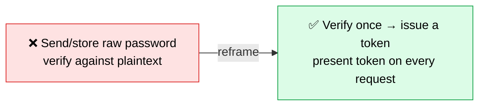
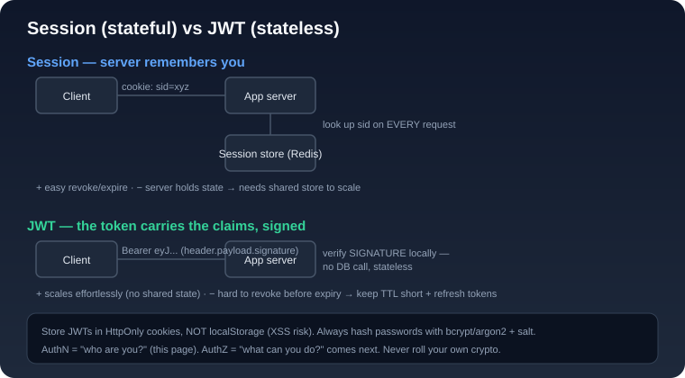
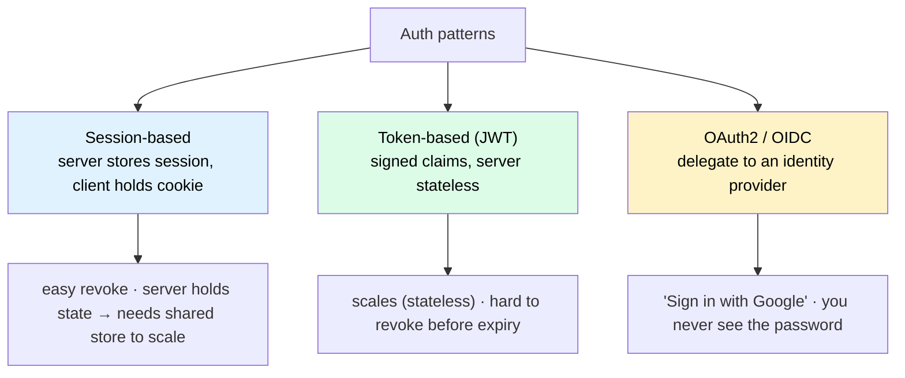
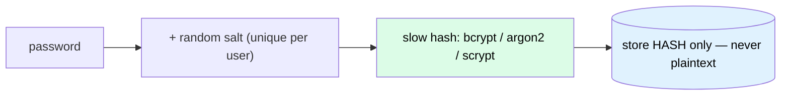
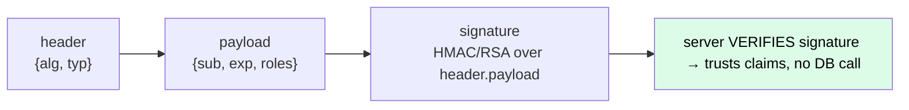
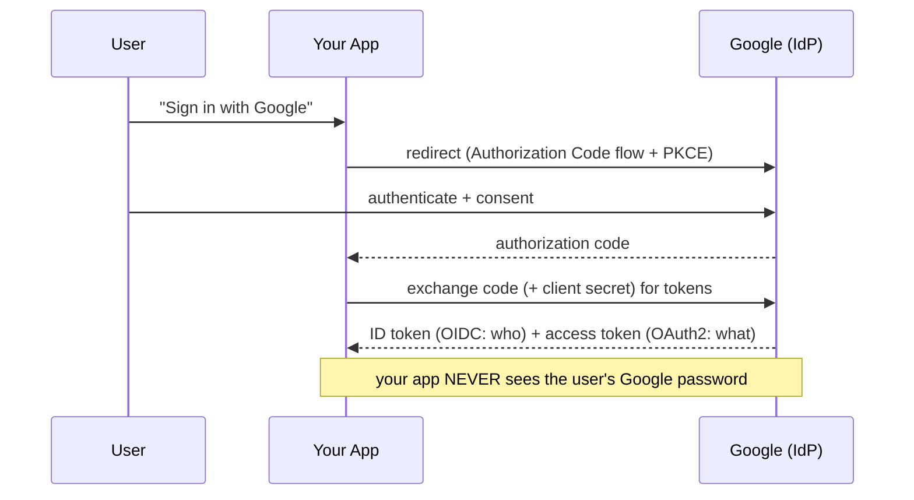
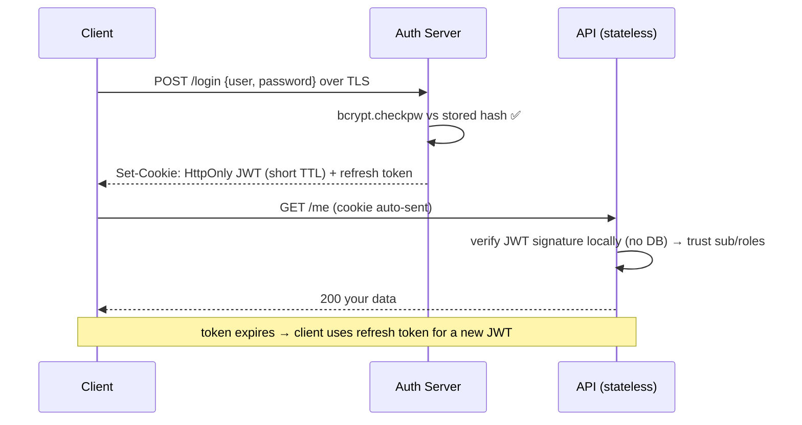
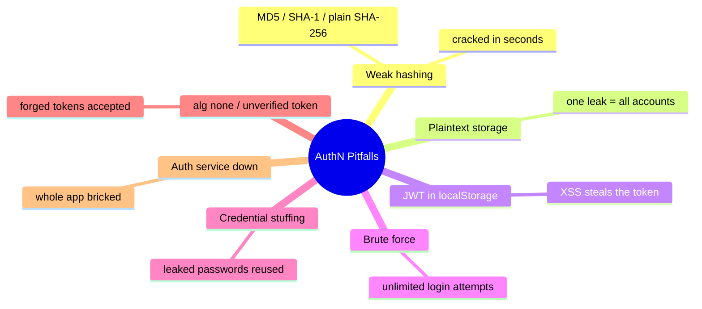

# Authentication

> **One line:** Authentication (AuthN) answers *"who are you?"* — it's the front door of your system, and the rule that keeps you out of the headlines is simple: **never roll your own crypto, never store plaintext passwords, and never trust a token you didn't verify.**

---

## Table of Contents
1. [Why You Must Master This](#1-why-you-must-master-this)
2. [The Mental Model](#2-the-mental-model)
3. [Session vs Token (JWT) vs OAuth/OIDC](#3-session-vs-token-jwt-vs-oauthoidc)
4. [Password Storage Done Right](#4-password-storage-done-right)
5. [JWT Anatomy & Pitfalls](#5-jwt-anatomy--pitfalls)
6. [OAuth2 / OIDC Flow](#6-oauth2--oidc-flow)
7. [Worked Example — Login → Token → Request](#7-worked-example--login--token--request)
8. [Real-Life Use Cases](#8-real-life-use-cases)
9. [Failure Modes](#9-failure-modes)
10. [🏋️ Practice Drills](#-practice-drills)
11. [🎤 Interview Q&A Bank](#-interview-qa-bank)
12. [🎯 Staff+ Nuances](#-staff-nuances)
13. [Cheat Sheet](#13-cheat-sheet)
14. [Connections & Further Reading](#14-connections--further-reading)

---

## 1. Why You Must Master This

AuthN is what keeps the bad guys out. A flaw here means anyone could read your messages, drain your bank account, or steal company secrets.

- **The front door** — break authentication and *everything* behind it is exposed.
- **User trust is fragile** — one plaintext-password breach and your reputation never recovers.
- **Legal mandate** — GDPR, CCPA, HIPAA, PCI-DSS legally require secure authentication and data protection.

> **The core problem it solves:** *identity verification* — confirming a user is who they claim. The naive approach (passwords in query strings, plaintext storage) hands every account to anyone with a network sniffer or a leaked database.

> **AuthN vs AuthZ:** Authentication = *who are you?* (this page). Authorization = *what are you allowed to do?* (see [Authorization.md](./Authorization.md)). They're sequential and distinct — proving identity does not grant permission.

---

## 2. The Mental Model

Authentication is **passport control.** You present documents (password / social login), the officer verifies them against records (your DB), and once satisfied issues a **stamp** (session cookie) or **badge** (JWT). From then on you flash the badge at every door — you don't re-show the passport each time.





---

## 3. Session vs Token (JWT) vs OAuth/OIDC



| Pattern | State lives | Scales by | Revoke | Best for |
|---------|-------------|-----------|--------|----------|
| **Session** | server (DB/Redis) | shared session store | easy (delete session) | classic web apps |
| **JWT** | the token itself | nothing shared (stateless) | hard (until expiry) | APIs, microservices, SPAs |
| **OAuth2/OIDC** | identity provider | delegated | via provider | "sign in with X", third-party access |

---

## 4. Password Storage Done Right



```python
import bcrypt

def register(username, password):
    salt = bcrypt.gensalt()                                  # unique per user
    pw_hash = bcrypt.hashpw(password.encode(), salt)         # slow on purpose
    db.save_user(username, pw_hash)                          # store HASH, not password

def login(username, provided):
    stored = db.get_password_hash(username)
    if bcrypt.checkpw(provided.encode(), stored):
        return issue_token(username)
    return deny()
```

> **Use slow, salted hashes (bcrypt / argon2 / scrypt) — never MD5/SHA-1/SHA-256 alone.** Fast hashes are crackable at billions/sec; the salt defeats rainbow tables; the slowness defeats brute force. This is the single most important AuthN rule.

---

## 5. JWT Anatomy & Pitfalls



A JWT is `header.payload.signature`, base64-encoded. The server **verifies the signature** locally to trust the claims — no session lookup, hence stateless and scalable.

**Pitfalls to call out:**
- **Storage** — keep JWTs in **HttpOnly cookies**, *not* `localStorage` (XSS can read localStorage).
- **`alg: none`** — reject unsigned tokens; pin the expected algorithm.
- **Revocation** — you can't easily invalidate a JWT before it expires → keep TTL **short** + use **refresh tokens** (or a denylist for emergencies).
- **The payload is readable** — it's signed, not encrypted. Never put secrets in it.

---

## 6. OAuth2 / OIDC Flow



- **OAuth2** = *authorization* (delegated access to resources via an access token).
- **OIDC** = an identity layer on top of OAuth2 that adds an **ID token** for *authentication* (who the user is).
- Use the **Authorization Code flow + PKCE** for web/mobile; never the deprecated implicit flow.

---

## 7. Worked Example — Login → Token → Request



---

## 8. Real-Life Use Cases

| Situation | How AuthN applies |
|-----------|-------------------|
| **"Sign in with Google/Apple"** | OAuth2/OIDC — your app trusts the IdP's token and never handles passwords. |
| **Microservice-to-microservice** | mTLS (mutual TLS) or signed service tokens, not user passwords. |
| **SPA / mobile API** | Short-lived JWT access token + refresh token; JWT verified statelessly at each service. |
| **Classic server-rendered web app** | Session cookie backed by Redis — easy revocation, server-side state. |
| **High-security (banking, admin)** | MFA (TOTP/hardware key) + step-up auth for sensitive actions. |
| **Passwordless** | Magic links / one-time codes — removes the password attack surface entirely. |

> Real-world habit: **use a battle-tested library or provider (Auth0, Okta, Firebase Auth, Passport.js, your framework's auth) — never hand-roll crypto or token validation.** Auth is where subtle bugs become breaches.

---

## 9. Failure Modes



- **Weak/unslated hashing** — MD5, SHA-1, or a bare fast hash; use bcrypt/argon2 with a salt.
- **Plaintext storage** — one DB leak compromises every user.
- **JWT in localStorage** — readable by any XSS payload; use HttpOnly cookies.
- **Brute force / credential stuffing** — no rate limiting or lockout on login → attackers guess or reuse leaked creds (tie into [Rate_Limiting.md](./Rate_Limiting.md)).
- **Accepting unverified/`alg:none` tokens** — forged tokens walk right in.
- **Auth as a SPOF** — if the auth service dies, the whole app is locked out for everyone; make it highly available.

---

## 🏋️ Practice Drills

> *Spot the security flaw and the right fix.*

**Drill 1 — Find the bugs.** A signup endpoint stores `sha256(password)` and the login API returns a JWT the client saves in `localStorage`. Name two serious problems.

<details><summary>Solution</summary>

(1) Plain SHA-256 is a *fast* hash with no salt → crackable at billions/sec and vulnerable to rainbow tables. Use bcrypt/argon2 with a unique salt. (2) JWT in `localStorage` is readable by any XSS → store it in an HttpOnly cookie instead. Bonus: ensure TLS so credentials aren't sniffed in transit.
</details>

**Drill 2 — Revocation.** A user clicks "log out everywhere," but they're using stateless JWTs with a 24h TTL. Why is this hard, and how do you handle it?

<details><summary>Solution</summary>

A valid JWT is accepted until it expires — there's no server state to delete. Options: keep access-token TTL short (minutes) + use revocable refresh tokens; maintain a token denylist / token-version claim checked per request; or rotate a per-user signing salt. Short TTL + refresh tokens is the common balance.
</details>

**Drill 3 — AuthN vs AuthZ.** A logged-in free-tier user accesses a premium-only endpoint and it works. Which layer failed?

<details><summary>Solution</summary>

Authorization, not authentication. The user *is* who they say (authenticated), but the system failed to check *what they're allowed to do*. Add an authZ check (role/permission/tier) on the endpoint — see [Authorization.md](./Authorization.md).
</details>

---

## 🎤 Interview Q&A Bank

**Q1. Authentication vs authorization?**
> AuthN verifies identity ("who are you?"); AuthZ enforces permissions ("what can you do?"). AuthN comes first; being authenticated doesn't imply being authorized.

**Q2. How should passwords be stored?**
> As salted hashes using a slow algorithm — bcrypt, argon2, or scrypt. Never plaintext, never fast hashes (MD5/SHA-1/bare SHA-256). The salt defeats rainbow tables; the slowness defeats brute force.

**Q3. Session vs JWT?**
> Sessions store state server-side (easy to revoke, needs a shared store to scale). JWTs are self-contained signed tokens — stateless and scalable, but hard to revoke before expiry. Use short TTLs + refresh tokens with JWTs.

**Q4. Where should you store a JWT in a browser?**
> In an HttpOnly (and Secure, SameSite) cookie — not localStorage, which is readable by XSS. HttpOnly keeps JavaScript from accessing the token.

**Q5. Hashing vs encryption?**
> Hashing is one-way (can't reverse) — used for passwords. Encryption is two-way (decryptable with a key) — used for data you must read back. Passwords are hashed, never encrypted.

**Q6. What's the difference between OAuth2 and OIDC?**
> OAuth2 is for delegated *authorization* (access tokens to resources). OIDC adds an identity layer (an ID token) on top for *authentication* — knowing who the user is. "Sign in with Google" uses OIDC.

**Q7. How do you defend against brute force and credential stuffing?**
> Rate-limit and lock out login attempts, add CAPTCHA/MFA, monitor for leaked-credential reuse, and require strong/breach-checked passwords.

**Q8. How do services authenticate to each other?**
> mTLS (mutual TLS) or signed service tokens (e.g., SPIFFE/short-lived JWTs) on a private network — not user-style passwords.

---

## 🎯 Staff+ Nuances

- **Never build your own crypto or token validation.** This is non-negotiable. Subtle mistakes (timing leaks, `alg` confusion, missing signature checks) are catastrophic. Use vetted libraries/providers and keep them updated.
- **JWT revocation is the design tension nobody escapes.** Stateless tokens trade revocability for scale. The mature answer is *short-lived access tokens + revocable refresh tokens* (and a denylist or token-version claim for emergencies) — not "JWTs everywhere with 24h TTL."
- **The auth service is a critical SPOF — engineer it like one.** Multi-region, cached public keys (JWKS) so services can verify offline, graceful degradation. If auth is down, everything is down (ties to [01 · Availability Math](../01_Planning_Foundations/Availability_Reliability_Math.md)).
- **Tokens are signed, not secret.** Anyone can decode a JWT payload. Put only non-sensitive claims in it, keep it small (it's sent on every request), and never trust client-supplied claims you didn't sign.
- **Step-up / re-authentication for sensitive actions.** Being logged in isn't enough to wire money or change a password — require fresh MFA at the moment of the sensitive action, not just at login.
- **Phishing-resistant MFA is the new bar.** SMS OTP is weak (SIM-swap, phishable); WebAuthn/passkeys (hardware-backed, origin-bound) resist phishing and are becoming the default for high-value accounts.
- **Key rotation and JWKS.** Signing keys must rotate; publish them via a JWKS endpoint so verifiers pick up new keys without redeploys, and overlap old/new keys during rotation to avoid outages.

---

## 13. Cheat Sheet

```
AuthN = WHO ARE YOU?  (AuthZ = what can you do? — separate, comes next)

PASSWORDS  salted + SLOW hash: bcrypt / argon2 / scrypt. NEVER plaintext / MD5 / SHA-1.
PATTERNS   Session (server state, easy revoke) · JWT (stateless, hard revoke) · OAuth2/OIDC (delegate)
JWT        header.payload.signature · verify signature locally · signed NOT secret
           store in HttpOnly cookie (not localStorage) · short TTL + refresh token · reject alg:none
OAUTH      OAuth2 = authorization (access token) · OIDC = + identity (ID token) · use Auth Code + PKCE

DEFEND  rate-limit logins (brute force) · MFA/passkeys · TLS always · breach-check passwords
RULES   never roll your own crypto · auth = HA (it's a SPOF) · service-to-service = mTLS
```

---

## 14. Connections & Further Reading

**Within this repo:**
- [Authorization.md](./Authorization.md) — the step *after* AuthN (what you can do).
- [Rate_Limiting.md](./Rate_Limiting.md) — defends login against brute force; [API_Gateway.md](./API_Gateway.md) — central auth enforcement.
- [11 · Security & Identity](../11_Security_Identity/) — OAuth2/OIDC, JWT, encryption in depth; [01 · Availability Math](../01_Planning_Foundations/Availability_Reliability_Math.md) — auth as a SPOF.

**External classics:**
- [OWASP Authentication Cheat Sheet](https://cheatsheetseries.owasp.org/cheatsheets/Authentication_Cheat_Sheet.html).
- [jwt.io introduction](https://jwt.io/introduction) · [Okta: What is OAuth 2.0?](https://www.okta.com/intro-to-oauth2/).
- [WebAuthn / passkeys guide](https://webauthn.guide/).

---

## TL;DR
Authentication answers **"who are you?"** and is the front door — so the rules are absolute: **store passwords as salted, slow hashes (bcrypt/argon2)**, **never roll your own crypto**, and **verify every token's signature** before trusting it. Choose **sessions** (stateful, easy revoke) or **JWTs** (stateless, scalable but hard to revoke → short TTL + refresh tokens, in HttpOnly cookies), and delegate to **OAuth2/OIDC** for "sign in with X." Defend the front door with **rate limiting and MFA/passkeys**, and treat the **auth service as a critical, highly-available SPOF**.
