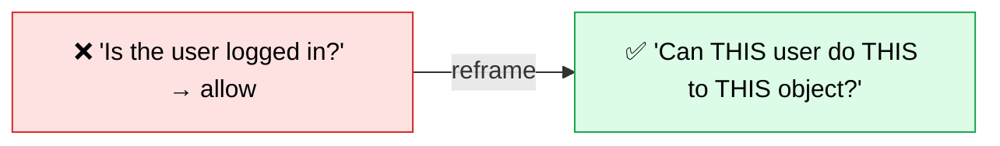
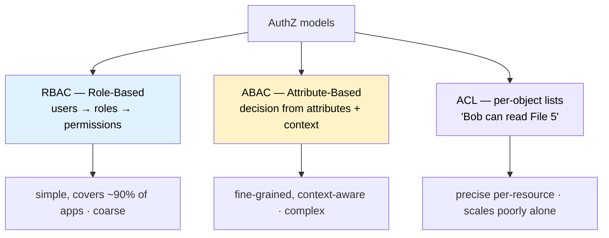
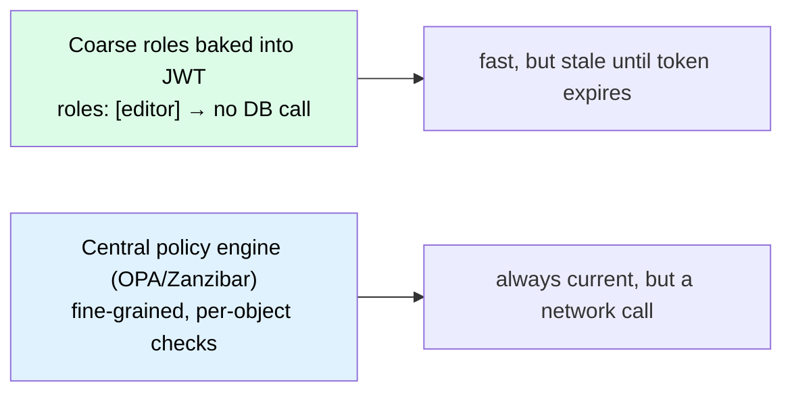
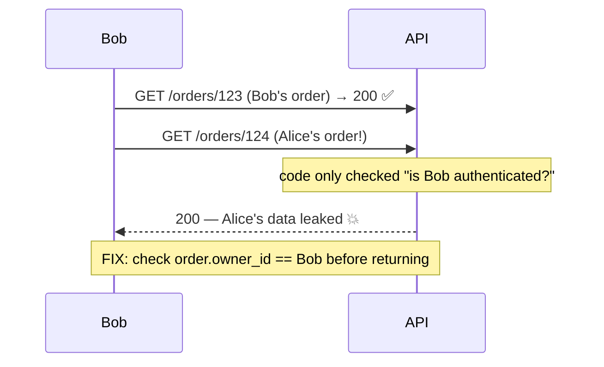
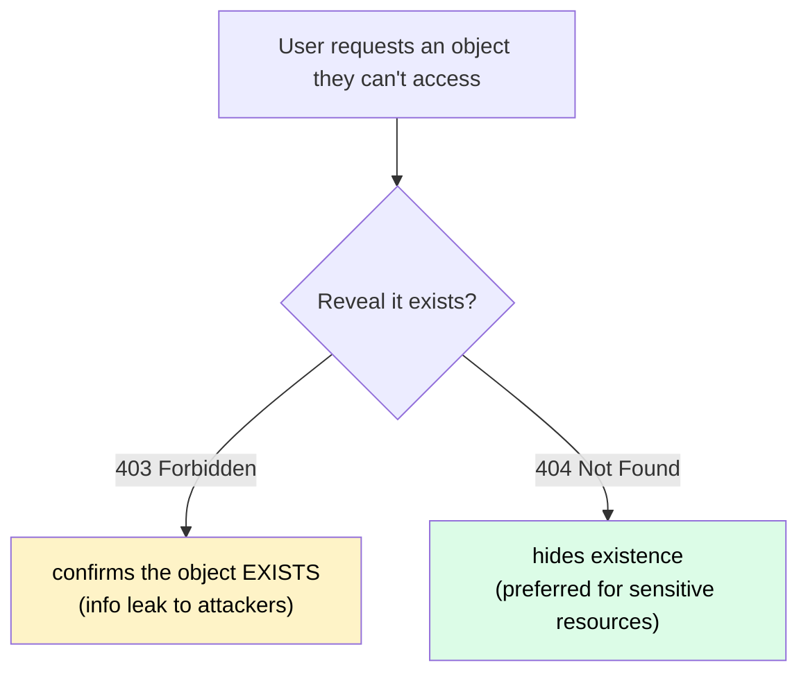
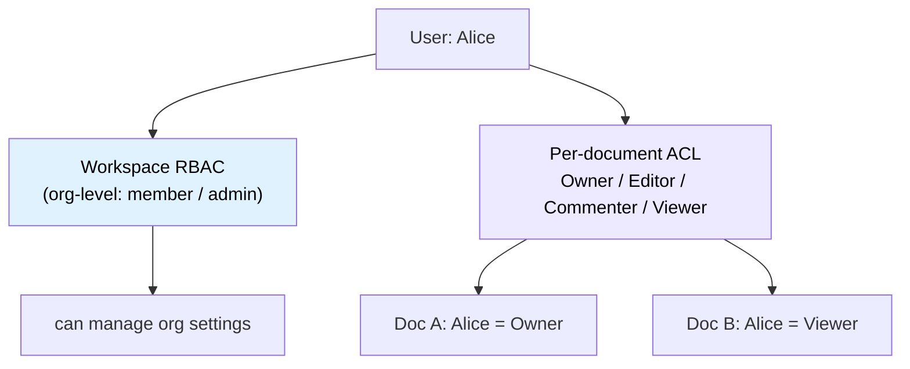
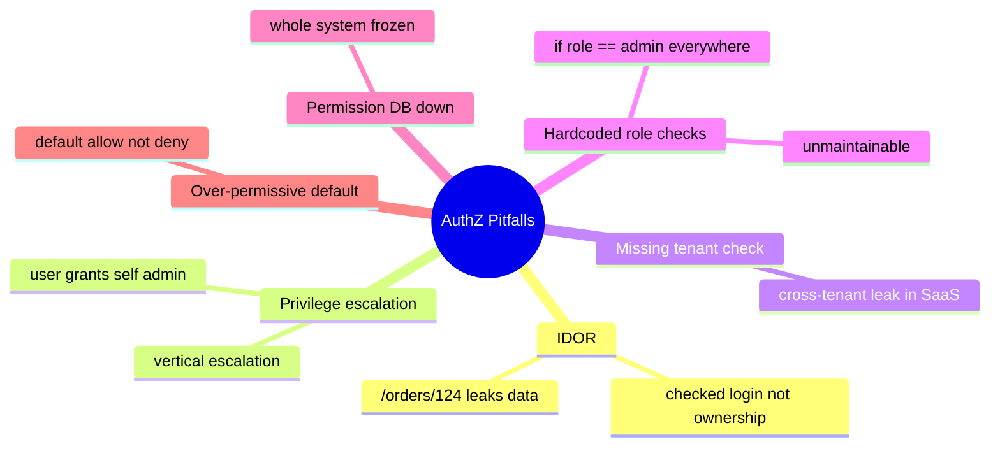

# Authorization

> **One line:** Authorization (AuthZ) answers *"what are you allowed to do?"* — and forgetting that "authenticated" never means "authorized" is the #1 cause of real-world breaches (Broken Access Control tops the OWASP list).

---

## Table of Contents
1. [Why You Must Master This](#1-why-you-must-master-this)
2. [The Mental Model](#2-the-mental-model)
3. [RBAC vs ABAC vs ACL](#3-rbac-vs-abac-vs-acl)
4. [Where to Enforce: Token Claims vs Policy Engine](#4-where-to-enforce-token-claims-vs-policy-engine)
5. [IDOR — The #1 Failure](#5-idor--the-1-failure)
6. [403 vs 404 and Error Leakage](#6-403-vs-404-and-error-leakage)
7. [Worked Example — Google Docs Sharing](#7-worked-example--google-docs-sharing)
8. [Real-Life Use Cases](#8-real-life-use-cases)
9. [Failure Modes](#9-failure-modes)
10. [🏋️ Practice Drills](#-practice-drills)
11. [🎤 Interview Q&A Bank](#-interview-qa-bank)
12. [🎯 Staff+ Nuances](#-staff-nuances)
13. [Cheat Sheet](#13-cheat-sheet)
14. [Connections & Further Reading](#14-connections--further-reading)

---

## 1. Why You Must Master This

Being authenticated (you work at the bank) doesn't mean you're authorized (to delete the database or read the CEO's account). AuthZ enforces that line.

- **Broken Access Control is OWASP #1** — it causes more data leaks than almost any other flaw.
- **Internal threats & mistakes** — a valid user reaching data they shouldn't is as damaging as an external attacker.
- **Product tiers & monetization** — AuthZ is how you enforce Free vs Premium, viewer vs editor, tenant isolation.

> **The core problem it solves:** *permission management* — controlling what a verified identity may do. The naive approach (`if user.role == "admin"`) collapses the moment you need "moderators who delete posts but not users" or per-object ownership.

> **AuthN vs AuthZ:** Authentication proves *who* you are ([Authentication.md](./Authentication.md)); Authorization decides *what* you can do. Never conflate them.

---

## 2. The Mental Model

Authorization is the **hotel key system.** Authentication got you a key to the front door. Authorization decides whether that key opens **Room 402**, the **gym**, or the **server room.** Try the server room with a guest key and the lock simply stays shut.





---

## 3. RBAC vs ABAC vs ACL



| Model | Decision basis | Example | Trade-off |
|-------|----------------|---------|-----------|
| **RBAC** | role → permissions | Editor can `posts:write` | simple, but coarse; role explosion at scale |
| **ABAC** | attributes + context | allow if `dept=HR` AND `doc=confidential` AND `in_office` | powerful & dynamic; complex to author/audit |
| **ACL** | per-object grants | "Alice: owner of doc 7" | precise per-resource; unwieldy as the only model |

Most real systems **combine** them: RBAC for broad roles + ACLs/ABAC for per-object and contextual rules (exactly what Google Docs does).

---

## 4. Where to Enforce: Token Claims vs Policy Engine



- **Claims in the JWT** — bake coarse roles into the token so services check permissions without a DB hit. Fast, but changes don't take effect until the token expires (revocation lag).
- **Centralized policy engine** — services call out to a policy service (Open Policy Agent, Google Zanzibar-style) for fine-grained, always-current decisions. Accurate, but adds latency and a dependency.

```python
def require_permission(permission):
    def decorator(f):
        @wraps(f)
        def wrapper(*args, **kwargs):
            if not permissions.has_perm(current_user.id, permission):
                return {"error": "Forbidden"}, 403   # 403, not 401
            return f(*args, **kwargs)
        return wrapper
    return decorator

@app.route('/admin/items/<id>', methods=['DELETE'])
@require_permission('DELETE_ITEMS')        # role/permission check
def delete_item(id):
    item = db.get(id)
    if item.owner_id != current_user.id:   # ← OBJECT-LEVEL check (prevents IDOR!)
        return {"error": "Not found"}, 404
    ...
```

---

## 5. IDOR — The #1 Failure

**Insecure Direct Object Reference**: the code checks that you're logged in, but not that you *own* the object you're requesting.



> The fix is always the same: **every object access must verify ownership/permission for *this* user on *this* object** — not just that the user is authenticated. Iterating IDs (`/124`, `/125`…) is the most common real-world attack, and it's trivially preventable.

---

## 6. 403 vs 404 and Error Leakage



- **401** = not authenticated. **403** = authenticated but not allowed. **404** = doesn't exist (or "you can't know it exists").
- For sensitive resources, returning **404 instead of 403** denies attackers the knowledge that the object even exists — a deliberate, defensible information-hiding choice.

---

## 7. Worked Example — Google Docs Sharing



Google Docs is a masterclass: **RBAC** governs org-wide capabilities, while **per-document ACLs** (Owner/Editor/Commenter/Viewer) govern each resource. Alice can be Owner of one doc and Viewer of another — permissions are *per object*, which is exactly what prevents an IDOR-style leak. (Google's Zanzibar paper describes the global system behind this.)

---

## 8. Real-Life Use Cases

| Situation | How AuthZ applies |
|-----------|-------------------|
| **Multi-tenant SaaS** | Every query scoped to the tenant; a missing tenant check = cross-tenant data leak (catastrophic). |
| **Document/file sharing** | Per-object ACLs (owner/editor/viewer) layered over org RBAC. |
| **Admin consoles** | Fine-grained permissions ("can refund" ≠ "can delete users") instead of one "admin" flag. |
| **Product tiers** | Feature gating: free vs premium enforced as authorization. |
| **Microservices** | Coarse roles in JWT for speed + a policy engine (OPA) for fine-grained, centralized rules. |
| **Healthcare/finance** | ABAC with context (role + data sensitivity + location + time) for compliance. |

> Real-world habit: **authorize at the object level, default-deny, and never trust an ID from the client without an ownership check.** Centralize policy where you can so rules are auditable.

---

## 9. Failure Modes



- **IDOR** — the dominant failure; always verify object ownership.
- **Privilege escalation** — a path for a user to grant themselves higher privileges (vertical) or access peers' data (horizontal).
- **Missing tenant scoping** — in multi-tenant systems, the worst possible leak.
- **Hardcoded role checks scattered everywhere** — "permission hell"; unmaintainable and easy to get wrong.
- **Permission store as a SPOF** — if it's down and you fail-closed, nobody can do anything; design for availability.
- **Default-allow** — always default-deny; allow only what's explicitly granted.

---

## 🏋️ Practice Drills

> *Find the access-control flaw.*

**Drill 1 — Classic IDOR.** `GET /invoices/{id}` returns the invoice if the user is logged in. A user changes the ID and sees others' invoices. What's missing and how do you fix it?

<details><summary>Solution</summary>

The endpoint checks authentication but not *authorization for this object*. Add an ownership/permission check: `if invoice.account_id != current_user.account_id: return 404`. Optionally return 404 (not 403) so the existence of other invoices isn't revealed.
</details>

**Drill 2 — RBAC or ABAC?** Requirement: "HR staff can view a document only if it's labeled for their department, only during business hours, and only from the office network." Which model?

<details><summary>Solution</summary>

ABAC — the decision depends on multiple attributes/context (role=HR, doc.department, time, source IP). Pure RBAC can't express contextual conditions; you'd encode this as a policy (e.g., in OPA).
</details>

**Drill 3 — 401 vs 403 vs 404.** A non-admin hits `/admin/users`. What status, and when would 404 be the better choice?

<details><summary>Solution</summary>

`403 Forbidden` (authenticated but not permitted); `401` if not authenticated at all. Return `404` instead when you don't want to reveal that the admin resource exists — deliberate information hiding for sensitive endpoints.
</details>

---

## 🎤 Interview Q&A Bank

**Q1. Authentication vs authorization?**
> AuthN proves identity ("who are you?"); AuthZ enforces permissions ("what can you do?"). Authenticated never implies authorized.

**Q2. RBAC vs ABAC?**
> RBAC assigns permissions via roles — simple, covers most apps, but coarse. ABAC decides from attributes and context (user, resource, environment) — fine-grained and dynamic, but more complex to author and audit. Real systems often combine them with ACLs.

**Q3. What is IDOR and how do you prevent it?**
> Insecure Direct Object Reference — accessing another user's object by changing an ID because the code only checked authentication, not ownership. Prevent it by verifying the current user is authorized for *that specific object* on every access.

**Q4. When return 404 instead of 403?**
> For sensitive resources, 404 hides whether the object exists at all, denying attackers information; 403 confirms existence. It's a deliberate information-hiding trade-off.

**Q5. Where should authorization be enforced in microservices?**
> A mix: coarse roles in the JWT for fast local checks, and a centralized policy engine (OPA / Zanzibar-style) for fine-grained, always-current, auditable decisions.

**Q6. Design a permission system for a 50,000-employee company.**
> RBAC for broad roles (with role hierarchies/groups to avoid explosion), ACLs/ReBAC for per-resource sharing, possibly ABAC for context, a central policy service for consistency, and permission caching/claims for performance. Reference Google Zanzibar for relationship-based authz at scale.

**Q7. Horizontal vs vertical privilege escalation?**
> Horizontal: accessing a peer's data at the same privilege level (IDOR). Vertical: gaining higher privileges (user → admin). Both are Broken Access Control.

**Q8. Why is "default-deny" important?**
> New endpoints/resources should be inaccessible until explicitly granted, so forgetting to add a check fails *safe* (denied) rather than *open* (leaked).

---

## 🎯 Staff+ Nuances

- **Broken Access Control is #1 on OWASP for a reason — it's a *logic* bug, not a crypto bug.** No library fully prevents it; it requires disciplined object-level checks on every endpoint. Centralizing authorization (a shared middleware/policy layer) beats scattering `if` checks that someone will inevitably forget.
- **Relationship-Based Access Control (ReBAC / Google Zanzibar) is the modern frontier.** "Can user X view doc Y?" becomes a graph query over relationships (owner, parent folder, group membership) — far more expressive than RBAC for sharing-heavy products, and globally consistent at scale.
- **Policy-as-code decouples rules from app logic.** Open Policy Agent (Rego) lets you express, version, test, and audit authorization policy separately from services — critical when the same rules must apply consistently across dozens of microservices.
- **Authorization latency vs freshness is a real trade-off.** Claims-in-JWT is fast but stale (revoked roles linger until expiry); a central check is fresh but adds a hop and a dependency. Many systems cache decisions with short TTLs to balance both.
- **Multi-tenant isolation is authorization's highest-stakes case.** A single missing `WHERE tenant_id = ?` is a cross-customer breach. Enforce tenant scoping at a layer that's hard to bypass (row-level security, a mandatory query filter, or per-tenant data partitioning), not ad hoc in each handler.
- **Authorization must be tested adversarially.** Unit tests usually check the happy path; access control needs *negative* tests (can user A reach user B's object?) and ideally automated IDOR scanning in CI. The bug is the *absence* of a check, which positive tests never catch.

---

## 13. Cheat Sheet

```
AuthZ = WHAT CAN YOU DO?  (AuthN = who are you? — comes first, separate)
"Authenticated" NEVER means "authorized."  Broken Access Control = OWASP #1.

MODELS
  RBAC  users→roles→perms     simple, coarse, ~90% of apps
  ABAC  attrs + context        fine-grained, dynamic, complex
  ACL   per-object grants      precise per-resource
  ReBAC graph of relationships  Google Zanzibar — sharing at scale
  (real systems COMBINE them)

#1 BUG: IDOR → always check user OWNS this object, not just "is logged in"
STATUS  401 unauth · 403 forbidden · 404 (hide existence of sensitive objects)
ENFORCE default-DENY · object-level checks · centralize policy (OPA/policy engine)
        coarse roles in JWT (fast, stale) + central engine (fresh, hop)
TEST    negative tests! (can A reach B's data?) — positive tests miss missing checks
```

---

## 14. Connections & Further Reading

**Within this repo:**
- [Authentication.md](./Authentication.md) — the step before AuthZ; JWT claims carry roles.
- [API_Gateway.md](./API_Gateway.md) — central enforcement point; [Rate_Limiting.md](./Rate_Limiting.md) — another cross-cutting concern.
- [11 · Security & Identity](../11_Security_Identity/) · [15 · Security Deep Dive & DevSecOps](../15_Security_Deep_Dive_DevSecOps/) — OWASP, zero trust, policy.

**External classics:**
- [OWASP Authorization Cheat Sheet](https://cheatsheetseries.owasp.org/cheatsheets/Authorization_Cheat_Sheet.html) · [OWASP Top 10: Broken Access Control](https://owasp.org/Top10/A01_2021-Broken_Access_Control/).
- [Google Zanzibar paper](https://research.google/pubs/pub48190/) · [Open Policy Agent docs](https://www.openpolicyagent.org/).

---

## TL;DR
Authorization answers **"what can you do?"** and **authenticated never means authorized** — forgetting that is **Broken Access Control, OWASP #1.** Use **RBAC** for broad roles, **ABAC/ACL/ReBAC** for fine-grained and per-object rules, and **always verify object-level ownership** to prevent **IDOR** (the dominant real-world attack). Enforce **default-deny**, centralize policy where possible (OPA / Zanzibar-style), choose **404 over 403** to hide sensitive resources, and **test access control adversarially** — the bug is the missing check that positive tests never catch.
