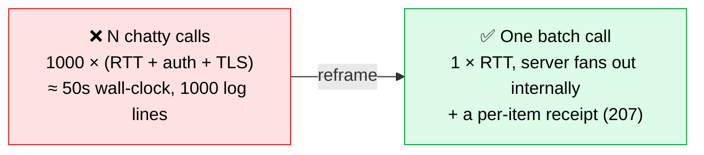
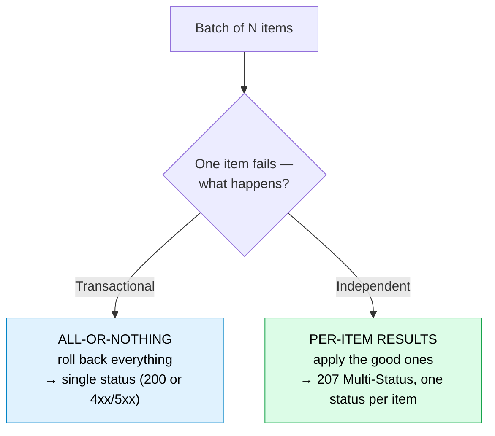
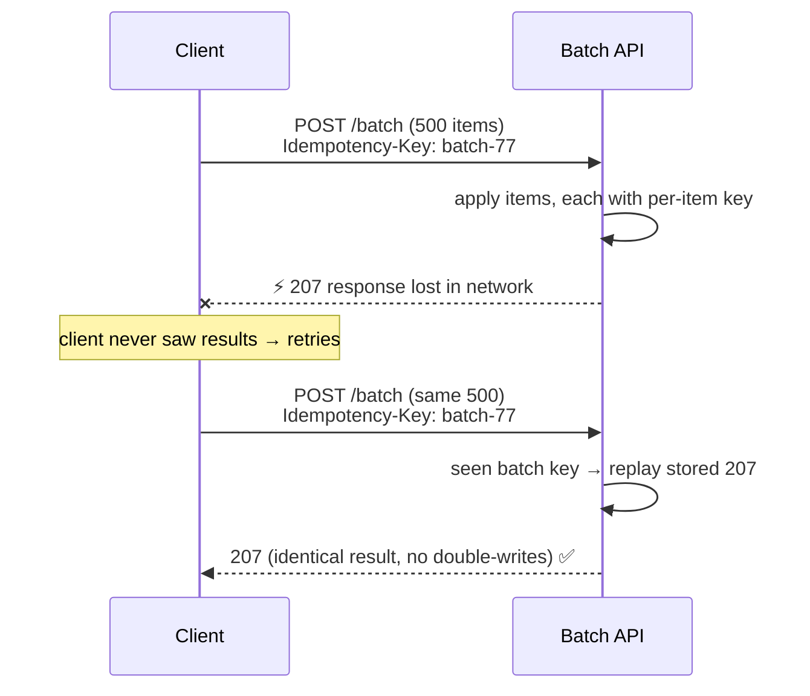
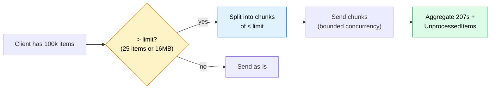
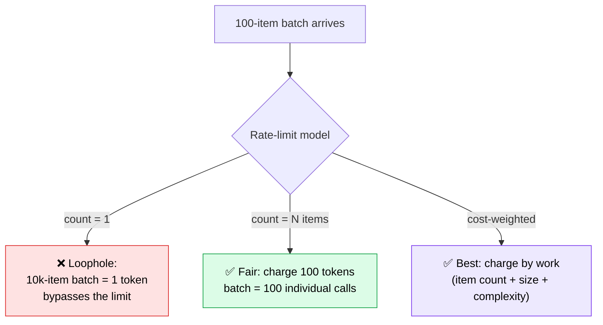
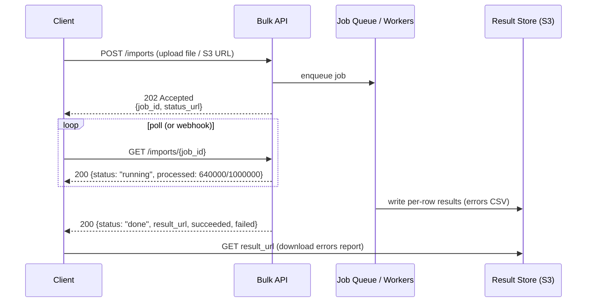
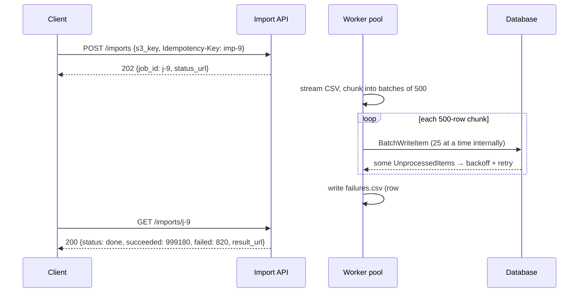
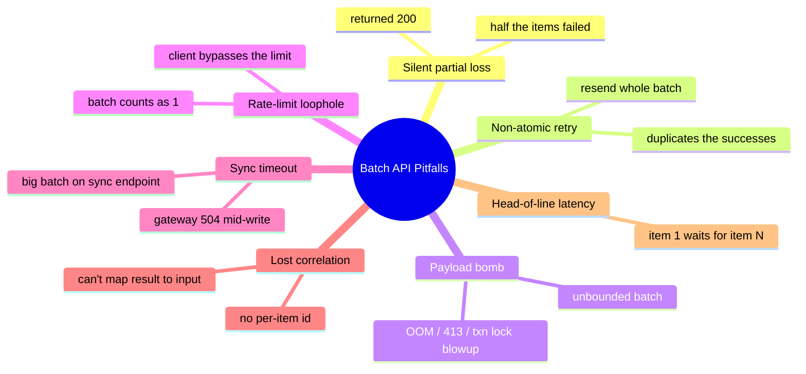

# Bulk & Batch APIs

> **One line:** A batch API lets a client say "do these 500 things in one round trip" instead of paying network latency 500 times — the design fight is what happens when item #237 fails.

---

## Table of Contents
1. [Why You Must Master This](#1-why-you-must-master-this)
2. [The Mental Model](#2-the-mental-model)
3. [Why Batch at All — Round-Trip Amortization](#3-why-batch-at-all--round-trip-amortization)
4. [All-or-Nothing vs Per-Item Results](#4-all-or-nothing-vs-per-item-results)
5. [The 207 Multi-Status Response Shape](#5-the-207-multi-status-response-shape)
6. [Idempotency of Batches](#6-idempotency-of-batches)
7. [Payload Limits & Chunking](#7-payload-limits--chunking)
8. [Rate-Limit Interaction](#8-rate-limit-interaction)
9. [Bulk Async Jobs (Large Import/Export)](#9-bulk-async-jobs-large-importexport)
10. [Worked Example — Importing 1M Contacts](#10-worked-example--importing-1m-contacts)
11. [Real-Life Use Cases](#11-real-life-use-cases)
12. [Failure Modes](#12-failure-modes)
13. [🏋️ Practice Drills](#-practice-drills)
14. [🎤 Interview Q&A Bank](#-interview-qa-bank)
15. [🎯 Staff+ Nuances](#-staff-nuances)
16. [Cheat Sheet](#16-cheat-sheet)
17. [Connections & Further Reading](#17-connections--further-reading)

---

## 1. Why You Must Master This

Nearly every real API grows a batch endpoint the moment a client needs to touch more than a handful of resources — and the naive version quietly corrupts data or melts the server.

- **Chattiness kills latency and throughput** — a mobile client syncing 1,000 records with 1,000 individual `POST`s pays 1,000 × round-trip time (RTT). At 50 ms RTT that's **50 seconds** of pure waiting; batched, it's one 50 ms trip plus server processing.
- **Partial failure is the whole ballgame** — in a 500-item batch, item #237 will eventually violate a constraint. Do you roll everything back, or apply 499 and report the one? Getting this contract wrong means either lost writes or mysterious duplicates on retry.
- **Batches multiply blast radius** — one oversized request can OOM a worker, blow a DB transaction's lock budget, or consume an entire rate-limit bucket in a single call. Batch endpoints are where "one bad client" becomes "site-wide incident."
- **It's a Staff+ interview staple** — "design a bulk import for 10M rows" tests API contracts, idempotency, backpressure, and async job design all at once.

> **The core problem it solves:** *amortizing per-request overhead (network RTT, auth, TLS, connection setup) across many operations* — while giving the client a precise, retry-safe answer about which items succeeded and which didn't.

**Prerequisites:** [REST_API_Design.md](./REST_API_Design.md) (resource/method semantics), [Idempotency.md](./Idempotency.md) (safe retries), [API_Error_Handling_Design.md](./API_Error_Handling_Design.md) (error shapes).

---

## 2. The Mental Model

A batch API is a **shopping list vs. individual trips to the store.** Ten separate trips = ten drives, ten checkouts. One trip with a list = one drive, one checkout — but now you need a receipt that itemizes what was in stock and what wasn't, because "the whole trip failed" is rarely the honest answer.



> **Hold onto this:** batching trades *per-request overhead* for *response complexity*. You save round trips; you must now design a response that answers "which of my items worked?" — and a retry that re-sends only the failures without duplicating the successes.

---

## 3. Why Batch at All — Round-Trip Amortization

**What it is.** Bundling many logical operations into a single HTTP request so the fixed per-request costs are paid once instead of N times.

**What you actually amortize.** Each HTTP call carries overhead that has nothing to do with your data: DNS/TCP/TLS handshake (on a cold connection), the network RTT, gateway auth + rate-limit checks, request logging, and framework middleware. For small payloads this overhead *dominates*.

**The arithmetic (real numbers).** Say RTT = 50 ms, server processing = 5 ms/item, and you have 1,000 items:

| Approach | Wall-clock (serial) | Overhead paid |
|----------|--------------------:|---------------|
| 1,000 individual calls | 1000 × (50 + 5) = **55,000 ms** | RTT + auth + TLS × 1000 |
| 1 batch of 1,000 | 50 + (1000 × 5) = **5,050 ms** | RTT + auth + TLS × 1 |

That's an **~11× speedup**, and it grows as RTT grows (mobile, cross-region). Even with HTTP/2 multiplexing and keep-alive removing handshake cost, you still pay per-request server-side auth, logging, and framework overhead — Elasticsearch's docs note that `_bulk` indexing is often **an order of magnitude faster** than single-doc indexing for exactly this reason.

**The trade-off — when NOT to batch.** Batching hurts when: (a) operations are *interactive* and the user needs each result immediately (batching adds head-of-line latency — item 1 waits for item 1000); (b) items are *huge* (batching just moves the bottleneck to payload size and memory); (c) you need *independent* rate-limiting or isolation per item. For a handful of calls the complexity isn't worth it — batch when N is large and latency-bound.

> **Rule of thumb:** batch when `N × per_request_overhead` is a meaningful fraction of total time. If overhead is 90% of each call, batching is a near-free 10× win.

---

## 4. All-or-Nothing vs Per-Item Results

This is the central design decision. Two contracts, and choosing wrong is a correctness bug.



| Dimension | All-or-nothing (transactional) | Per-item independent |
|-----------|--------------------------------|----------------------|
| Failure semantics | one fails → **all** roll back | one fails → others still apply |
| Response | single status code | **207 Multi-Status** + per-item status |
| Consistency | strong — no partial state | eventual/partial — caller reconciles |
| Retry | resend the whole batch | resend **only the failed** items |
| Best when | items are interdependent (double-entry ledger, order + line items) | items are independent (import 10k unrelated contacts) |
| Cost | holds a DB transaction/locks across all N → limits batch size | no long transaction → scales to bigger batches |
| Real example | DynamoDB `TransactWriteItems` (all-or-nothing, ≤100 items), Salesforce `allOrNone=true` | DynamoDB `BatchWriteItem` (returns `UnprocessedItems`), Elasticsearch `_bulk`, MS Graph `$batch` |

**How to choose.** Ask: *"Is item B meaningless if item A failed?"* If yes → transactional (a bank transfer's debit and credit must both apply or neither). If items are independent rows → per-item, because failing all 10,000 because row 4,127 had a bad email is user-hostile.

**The hybrid.** Many APIs make it a **flag**: Salesforce and Microsoft Graph let the client pass `allOrNone` / continue-on-error. Default to per-item (safer, more useful); offer transactional as opt-in for the caller who needs atomicity.

> The trap: returning a top-level `200 OK` for a per-item batch where half the items failed. The client sees green and moves on — silent data loss. Per-item batches **must** surface per-item status.

---

## 5. The 207 Multi-Status Response Shape

**What it is.** `207 Multi-Status` (from WebDAV, RFC 4918) is the HTTP status that says *"the batch request itself succeeded; look inside for the per-item outcomes."* The outer `207` means "I processed your list"; the inner statuses mean "here's what happened to each element."

**Why it exists.** A single status code cannot describe a mixed result. `200` lies (some failed), `400` lies (some succeeded), `500` lies (nothing crashed). `207` is the honest envelope: the transport worked, results vary.

**The critical rule:** the outer status reflects whether the *batch was processed*, not whether every item succeeded. Clients must **parse the body**, never branch on the outer code alone.

Here's a batch of three `POST /users` items returning a realistic mix — created, conflict, validation error:

```json
HTTP/1.1 207 Multi-Status
Content-Type: application/json

{
  "results": [
    {
      "id": "item-0",
      "status": 201,
      "body": { "id": "usr_a1", "email": "ana@example.com" }
    },
    {
      "id": "item-1",
      "status": 409,
      "error": {
        "code": "conflict",
        "message": "email already exists",
        "field": "email"
      }
    },
    {
      "id": "item-2",
      "status": 422,
      "error": {
        "code": "validation_error",
        "message": "email is not a valid address",
        "field": "email"
      }
    }
  ]
}
```

**Design notes that separate senior from junior:**
- **Echo a client-supplied item id** (`item-0` above, or the client's own `Content-ID`). The client must be able to correlate each result back to *its* input — array position alone is fragile if you ever reorder or drop items.
- **Per-item error follows your standard error shape** — reuse the same `{code, message, field}` contract as your non-batch errors (see [API_Error_Handling_Design.md](./API_Error_Handling_Design.md)). Don't invent a batch-only error format.
- **Status codes are the real HTTP codes** per item (201/409/422/500), so a client can apply the same handling logic it already has.
- **Ordering & count:** return exactly one result per input item, in the same order, so the client can map 1:1 even without ids.

**Real systems.** Microsoft Graph `$batch` wraps each sub-response with its own `status` and `body`. Google APIs historically used `multipart/mixed` batch with an embedded HTTP response per part. Both are the same idea: **one transport response, N embedded outcomes.**

---

## 6. Idempotency of Batches

Retries are inevitable, so a batch must be safe to resend. The subtlety: a batch can be *partially applied* when the response is lost — 499 items committed, then the connection dropped before the client saw the `207`. Now what?



**Two levels of keys — use both:**
1. **Batch-level `Idempotency-Key`** — one key for the whole request. On retry of the *identical* batch, the server replays the stored `207` without re-executing. This handles the "lost response" case cleanly.
2. **Per-item keys** — each item carries its own idempotency key (or a natural unique key). This lets a client resend a *smaller* batch of only the failed items after a partial success, and the already-applied items dedupe individually.

**Why you need both.** The batch key is perfect for an exact resend. But the common recovery is different: the client got a `207`, saw items 1–499 succeeded and 500 failed (transient `500`), and wants to retry *just item 500*. That's a *different* batch, so the batch key won't match — the **per-item key** is what makes that retry safe.

**Design rule.** For per-item batches, prefer **per-item idempotency** as the source of truth and treat the batch key as an optimization for exact-resend. For transactional (all-or-nothing) batches, the batch key alone suffices — the whole thing either committed or didn't.

**Gotcha — reused key, different body.** If a client reuses `batch-77` but with a *different* set of items, the correct response is `409 Conflict` (hash the request and compare). Silently replaying the old result would hide a client bug. See the fingerprint pattern in [Idempotency.md](./Idempotency.md).

> Cross-link: everything in [Idempotency.md](./Idempotency.md) about caching only successes, atomic check-and-set, and shared key stores applies per-item inside a batch.

---

## 7. Payload Limits & Chunking

**Why limits exist.** An unbounded batch is a denial-of-service vector and a memory bomb. The server must parse the whole body, often buffer it, and may hold a transaction open across all items. So every serious batch API caps **both** the item count and the byte size.



**Real caps (memorize a few):**

| System | Item cap | Byte cap |
|--------|---------:|---------:|
| DynamoDB `BatchWriteItem` | **25 items** | 16 MB request, 400 KB/item |
| DynamoDB `TransactWriteItems` | 100 items | 4 MB |
| SQS `SendMessageBatch` | 10 messages | 256 KB total |
| Microsoft Graph `$batch` | 20 requests | — |
| Stripe (list/expand) | 100 per page | — |
| Elasticsearch `_bulk` | no hard count | tune to ~5–15 MB/request |
| Typical REST gateway body | — | 1–10 MB (e.g., API Gateway 10 MB) |

**When you exceed the limit:** the correct status is **`413 Payload Too Large`** (or `400` with a clear error naming the cap). Return the actual limit in the error so the client can chunk correctly — don't make them guess.

**Client-side chunking strategy:**
1. Split by the *tighter* of the two limits (count vs. bytes) — for DynamoDB that's usually the 25-item cap; for a 400 KB item it's bytes.
2. Send chunks with **bounded concurrency** (e.g., 4–8 in flight), not all at once — parallelism must respect rate limits (§8).
3. **Handle partial success within a chunk:** DynamoDB returns `UnprocessedItems` (throttled/failed items) — resend those with **exponential backoff + jitter**, don't drop them.
4. Aggregate the per-chunk `207`s into one report for the caller.

> **Sizing heuristic:** bigger batches amortize overhead better but raise tail latency, memory, and blast radius. There's a sweet spot — Elasticsearch recommends *benchmarking* bulk size on your own hardware rather than maxing it out. Start ~100–500 items or ~5 MB and measure.

---

## 8. Rate-Limit Interaction

**The question every batch API must answer: does a 100-item batch cost 1 request or 100?** If you don't decide this explicitly, clients weaponize batching to bypass your rate limits — one request that does 10,000 operations sails through a "100 req/min" limiter untouched.



**Three models:**
- **Per-request (count = 1)** — simple but a loophole; only safe if batch size is tiny and hard-capped.
- **Per-item (count = N)** — a batch of 100 debits 100 tokens from the bucket. Fair and intuitive; this is what most mature APIs do. Microsoft Graph counts each *inner* request in `$batch` against the per-resource throttling limits.
- **Cost-weighted** — charge by actual work: `tokens = items + bytes/KB + expensive_op_weight`. GitHub's GraphQL API and Shopify use point/cost budgets exactly so a heavy query and a batch can't hide behind a flat count.

**Design rules:**
- **Charge the batch by the work it does**, and make the accounting visible in headers (`X-RateLimit-Remaining` should drop by the item count, not by 1).
- **Reject before executing** if the batch would exceed the remaining budget — return `429` with `Retry-After` *before* doing partial work, or the client can't reason about state.
- **Interaction with chunking:** the client's concurrent-chunk sender (§7) must throttle itself to the token budget, or it'll get a wall of `429`s. Coordinate the two.

> Cross-link: full token-bucket / sliding-window mechanics and `429` + `Retry-After` semantics live in [Rate_Limiting.md](./Rate_Limiting.md). The batch-specific rule is just: **count by work, not by request.**

---

## 9. Bulk Async Jobs (Large Import/Export)

At some scale, a synchronous batch stops working: 10M rows won't fit in a request, won't finish inside an HTTP timeout (typically 30–60 s at the gateway), and shouldn't hold a connection open for minutes. The answer is to make the bulk operation an **async job**: submit → poll → fetch result.



**The contract:**
1. **Submit** — `POST` a file (or a pre-signed S3/GCS URL for very large payloads — don't stream 5 GB through your API tier). Server returns **`202 Accepted`** with a `job_id` and a `status_url`.
2. **Status** — client polls `GET /imports/{job_id}` (or you push a **webhook** on completion — cheaper than polling). Report progress (`processed/total`) so long jobs show a bar.
3. **Result** — on completion, return counts (`succeeded`, `failed`) and a **`result_url`** pointing to a downloadable per-row report (usually a CSV/JSONL of failures with row number + error), because 200k inline errors don't belong in a JSON response.

**Real systems.** Salesforce **Bulk API 2.0** is the canonical shape: create a job, upload CSV, close the job, poll state (`InProgress → JobComplete`), then download `successfulResults` / `failedResults` / `unprocessedRecords` as separate CSVs. Stripe's bulk operations, Shopify's `bulkOperationRunQuery` (GraphQL → JSONL export on a URL), and BigQuery load jobs all follow submit → poll → fetch.

**Design musts:**
- **Idempotent submit** — an `Idempotency-Key` on `POST /imports` so a retried submit doesn't kick off a second 10M-row import.
- **Resumability / checkpointing** — a worker crash at row 640k should resume, not restart. Track progress durably.
- **Backpressure** — bound worker concurrency and DB write rate so a giant import doesn't starve online traffic.

> Cross-link: the submit/poll/callback pattern, `202 Accepted`, status resources, and webhooks-vs-polling are covered in depth in [Async_APIs_Long_Running_Operations.md](./Async_APIs_Long_Running_Operations.md). A bulk import is just a long-running operation with a file attached.

---

## 10. Worked Example — Importing 1M Contacts

A CRM must import 1,000,000 contacts from a customer CSV. Walk the numbers to the architecture.

**Step 1 — can it be synchronous?** 1M rows × ~0.5 ms/row insert = **500 s** of pure work — far past a 60 s gateway timeout. ❌ Sync is out. → **async job.**

**Step 2 — one request or chunked upload?** 1M rows × ~200 B = **200 MB** body, over the 10 MB gateway cap. ❌ → client uploads the CSV to a **pre-signed S3 URL**, then submits the object key.

**Step 3 — the flow:**



**Step 4 — the decision the numbers forced:**
- **200 MB > 10 MB cap** → pre-signed upload, not an inline body.
- **500 s > 60 s timeout** → `202` + async job + polling/webhook.
- **DynamoDB 25-item cap** → the worker chunks internally, and honors `UnprocessedItems` with backoff.
- **820 failures out of 1M** → *per-item* semantics (not all-or-nothing — you don't reject 999,180 good contacts for 820 bad phone numbers), surfaced as a downloadable `failures.csv`.
- **Idempotency-Key `imp-9`** → a retried submit returns the same `job_id`, never a second import.

> The lesson: two numbers (200 MB payload, 500 s runtime) crossed two limits (10 MB, 60 s) and *forced* the async-job + chunking architecture. You didn't choose it for elegance; the arithmetic chose it.

---

## 11. Real-Life Use Cases

| Situation | How batching applies | The decision it forces |
|-----------|----------------------|------------------------|
| **Mobile offline sync** | queued edits flushed as one batch on reconnect | per-item results + per-item idempotency (some edits may conflict) |
| **CRM contact import (CSV)** | 1M rows via async job | `202` + submit/poll/fetch, failures as downloadable report |
| **Bank double-entry posting** | debit + credit as one unit | **all-or-nothing** transactional batch — never partial |
| **Bulk email/notification send** | 10k recipients in one call | per-item 207; dedupe by per-recipient key to avoid double-send |
| **Search indexing (Elasticsearch)** | `_bulk` index of docs | tune batch to ~5–15 MB; retry failed items only |
| **DynamoDB fan-out write** | `BatchWriteItem` 25 at a time | loop chunks, resend `UnprocessedItems` with backoff |
| **Analytics/event ingestion** | client buffers events, flushes batch | per-item, fire-and-forget with idempotency to dedupe |
| **GraphQL query batching** | multiple queries in one HTTP call | per-query results array (see [GraphQL.md](./GraphQL.md)) |

> Real-world habit: **default your batch endpoint to per-item results with per-item idempotency, and reach for all-or-nothing only when items are genuinely interdependent.** Partial success is the common case; design for it first.

---

## 12. Failure Modes



- **Silent partial loss** — *SYMPTOM:* client sees `200`, later finds records missing. *ROOT CAUSE:* per-item batch returned a top-level success and swallowed per-item failures. *FIX:* return `207` with per-item status; client must parse the body, never branch on the outer code.
- **Non-atomic retry duplicates** — *SYMPTOM:* retrying a partially-applied batch double-creates the items that had succeeded. *ROOT CAUSE:* no per-item idempotency; the resend re-runs the already-committed items. *FIX:* per-item idempotency keys (or natural unique keys) so applied items dedupe; resend only the failed subset.
- **Payload bomb** — *SYMPTOM:* worker OOMs or DB transaction deadlocks under a huge batch. *ROOT CAUSE:* no item/byte cap. *FIX:* enforce count + byte limits, return `413` with the limit; require chunking above it.
- **Rate-limit loophole** — *SYMPTOM:* one client's batches saturate a shared cluster despite a "100 req/min" limit. *ROOT CAUSE:* batch counted as a single request. *FIX:* charge the limiter by item count / cost, reject over-budget batches with `429` before executing.
- **Sync timeout mid-write** — *SYMPTOM:* gateway `504` at ~30 s, unclear how much applied. *ROOT CAUSE:* a large batch ran on a synchronous endpoint. *FIX:* move to an async job (`202` + poll); keep sync batches small and bounded.
- **Lost correlation** — *SYMPTOM:* client can't tell which input produced which error. *ROOT CAUSE:* results not keyed to inputs. *FIX:* echo a client-supplied item id and preserve order 1:1.

---

## 🏋️ Practice Drills

> *Cover the solutions and attempt first — active recall is the point.*

**Drill 1 — Choose the contract.** For each, pick all-or-nothing or per-item: (a) posting a journal entry's debit + credit, (b) importing 50k newsletter signups, (c) creating an order with 3 line items, (d) bulk-updating avatars for 200 users.

<details><summary>Solution</summary>

(a) **All-or-nothing** — a debit without its credit corrupts the ledger. (b) **Per-item** — reject only the malformed emails, keep the rest. (c) **All-or-nothing** — an order with a missing line item is invalid. (d) **Per-item** — one bad image shouldn't block the other 199. Rule: atomic when items are interdependent; per-item when independent.
</details>

**Drill 2 — Chunk the write.** You must write 1,000 items to DynamoDB (`BatchWriteItem`, 25-item cap). How many requests, and what do you do with `UnprocessedItems`?

<details><summary>Solution</summary>

1,000 / 25 = **40 requests** minimum. But `BatchWriteItem` can throttle and return some items in `UnprocessedItems` — you must resend *those specific items* with **exponential backoff + jitter**, looping until the set is empty. Bound concurrency so you don't self-throttle. Never drop unprocessed items — that's silent data loss.
</details>

**Drill 3 — Safe retry after partial success.** A 500-item batch returns `207`: items 1–498 = `201`, items 499–500 = `500` (transient). The client retries. Design the retry so nothing double-writes.

<details><summary>Solution</summary>

Retry **only items 499–500**, not the whole batch. Each item carries a per-item idempotency key, so even if 1–498 were somehow resent, the server would replay their stored results instead of re-creating. The clean approach: client filters to the failed subset and resends that smaller batch; per-item keys are the backstop.
</details>

**Drill 4 — Design a bulk export.** A client wants all 20M of their records exported. Sketch the API.

<details><summary>Solution</summary>

`POST /exports` → `202 {job_id, status_url}` (idempotent submit). Worker streams records to a file in object storage (JSONL/CSV), checkpointing progress. Client polls `GET /exports/{job_id}` (or gets a webhook) → `{status, processed/total}`. On done, return a **pre-signed `result_url`** (time-limited) to download. Never inline 20M rows in a response. This is Shopify's `bulkOperationRunQuery` / Salesforce Bulk API shape.
</details>

---

## 🎤 Interview Q&A Bank

**Q1. Why offer a batch endpoint instead of just looping client-side?**
> To amortize per-request overhead — RTT, TLS, auth, logging — across many operations. At 50 ms RTT, 1,000 individual calls cost ~55 s serial vs ~5 s as one batch. It's a latency and throughput win when N is large. (Signal: mentions concrete RTT math, not just "it's faster.")

**Q2. All-or-nothing vs per-item — when do you use each?**
> All-or-nothing (transactional) when items are interdependent — a ledger's debit and credit must both apply or neither. Per-item (returning `207` with per-item status) when items are independent — don't reject 10,000 good imports because one row was malformed. Default to per-item; offer atomic as an opt-in flag.

**Q3. What is `207 Multi-Status` and what does the outer status mean?**
> It signals the batch *request* was processed and per-item outcomes are in the body. The outer code means "I handled your list," not "everything succeeded." Clients must parse the body — a `207` can contain a mix of 201s, 409s, and 422s per item.

**Q4. A batch is partially applied and the response is lost. How does the client retry safely?**
> Two idempotency levels: a batch-level `Idempotency-Key` lets an identical resend replay the stored result; per-item keys let the client resend just the failed subset without duplicating the applied items. Per-item keys are the real safety net for partial success. (Cross-links to idempotency.)

**Q5. Does a 100-item batch count as 1 request or 100 against the rate limit?**
> Charge by work — a 100-item batch should debit ~100 tokens (or a cost-weighted amount), not 1. Counting it as 1 is a loophole that lets clients bypass the limit with giant batches. Reject over-budget batches with `429` before executing.

**Q6. How do you handle payload that's too big for one batch?**
> Enforce item and byte caps; return `413` with the actual limit. The client chunks below the cap (splitting by the tighter of count vs bytes), sends with bounded concurrency respecting the rate limit, handles per-chunk partial failures, and aggregates results. DynamoDB's 25-item cap is the classic example.

**Q7. When does a batch need to become an async job?**
> When it can't finish inside the HTTP timeout (~30–60 s) or fit in the request body — e.g., a 200 MB, 500 s import. Then: `POST` returns `202` with a `job_id`, client polls or gets a webhook, and downloads a result/error report from a URL. That's the Salesforce Bulk API shape.

**Q8. How do you report 200,000 errors from a bulk import?**
> Not inline. Return summary counts (`succeeded`, `failed`) plus a `result_url` to a downloadable failures file (CSV/JSONL with row number + error). Inline error arrays of that size blow up the response and memory.

---

## 🎯 Staff+ Nuances

- **Head-of-line latency is the hidden cost of batching.** Bundling item 1 with item 1,000 means item 1's result waits for all 1,000 to process. For interactive flows this *raises* perceived latency even as it cuts total work. Batch background/bulk work; keep interactive paths chatty-but-fast (or use per-item streaming responses).
- **"Batch" ≠ "transaction."** A batch endpoint that accepts N items is not automatically atomic. Atomicity is a *separate* promise (and a costly one — it holds locks across all N, capping batch size). Say explicitly which you're offering; DynamoDB deliberately ships both (`BatchWriteItem` non-atomic, `TransactWriteItems` atomic, ≤100).
- **Streaming responses (NDJSON) beat buffering huge 207s.** For very large per-item batches, stream results as newline-delimited JSON so the client processes outcomes as they finish and the server doesn't buffer N results in memory. Elasticsearch `_bulk` uses NDJSON for the *request*; the same idea helps responses.
- **Batch amplifies poison-pill and backpressure problems.** One malformed item can crash a worker mid-batch, and a flood of giant batches can starve online traffic. Isolate per-item processing (a bad item fails only itself), and give bulk jobs their own throttled worker pool separate from interactive traffic.
- **Ordering guarantees within a batch are a contract you must state.** Are items applied in order? Concurrently? If a client sends [create X, update X] in one batch and you process concurrently, the update may lose. Either guarantee in-order per-key processing or document that intra-batch ordering isn't guaranteed.
- **Partial-failure observability is hard.** A `207` where 3% of items fail every day is a silent regression if you only alert on HTTP 5xx. Emit per-item success/failure metrics, not just request-level ones — the outer `207` looks healthy while data is being dropped.
- **Idempotency-key storage scales with batch volume.** Per-item keys across millions of batched writes is a lot of keys; size the store from write QPS × TTL and cross-check against [Back_of_the_Envelope_Estimation](../01_Planning_Foundations/Back_of_the_Envelope_Estimation.md).

---

## 16. Cheat Sheet

```
BATCH API = many operations in ONE request. Save round trips; owe a per-item receipt.

WHY BATCH   amortize RTT + TLS + auth + logging over N items.
            1000 calls @50ms RTT ≈ 55s  →  1 batch ≈ 5s  (~11x)
            Batch when N large & latency-bound. NOT for interactive/huge items.

CONTRACT    all-or-nothing (transactional) → 1 status, roll back on any fail
                                              use when items INTERDEPENDENT
            per-item (independent)         → 207 Multi-Status, one status/item
                                              use when items INDEPENDENT (default)
            hybrid: allOrNone flag (Salesforce, MS Graph)

207 SHAPE   outer 207 = "batch processed" (NOT "all ok") → PARSE THE BODY
            results:[{id, status:201/409/422, body|error:{code,message,field}}]
            echo client item id · one result/input · standard error shape

IDEMPOTENCY batch-level key → replay exact resend
            per-item keys   → resend only failed subset, no dupes  (both!)
            reused key + diff body → 409

LIMITS      cap items AND bytes → over cap = 413 (return the limit)
            DynamoDB BatchWriteItem = 25 items/16MB · Transact = 100/4MB
            SQS = 10/256KB · MS Graph $batch = 20 · ES _bulk ≈ 5-15MB
            chunk by tighter limit · bounded concurrency · retry UnprocessedItems

RATE LIMIT  charge by WORK not by request (100 items ≈ 100 tokens / cost-weighted)
            counting batch as 1 = loophole · reject over-budget with 429 first

ASYNC JOB   too big / too slow (>timeout, >body cap):
            POST → 202 {job_id, status_url} → poll/webhook → result_url (CSV)
            idempotent submit · checkpoint/resume · pre-signed upload · Salesforce Bulk API

GOTCHAS     200 hiding failures · non-atomic retry dupes · payload bomb ·
            rate loophole · sync timeout · lost input↔result correlation
```

---

## 17. Connections & Further Reading

**Prerequisites (learn first):**
- [REST_API_Design.md](./REST_API_Design.md) — resource modeling and method/status semantics the batch envelope wraps.
- [Idempotency.md](./Idempotency.md) — batch-level and per-item keys, safe retry of a partially-applied batch, cache-only-successes, atomic check-and-set.
- [API_Error_Handling_Design.md](./API_Error_Handling_Design.md) — the per-item error shape (`{code, message, field}`) a `207` reuses.

**Builds toward / pairs with:**
- [Rate_Limiting.md](./Rate_Limiting.md) — token-bucket mechanics and `429`/`Retry-After`; batches must be charged by work, not by request.
- [Async_APIs_Long_Running_Operations.md](./Async_APIs_Long_Running_Operations.md) — `202 Accepted`, status resources, polling vs webhooks — the backbone of bulk import/export jobs.
- [Pagination_Filtering.md](./Pagination_Filtering.md) — the read-side counterpart to bulk export (cursor over huge result sets).
- [GraphQL.md](./GraphQL.md) — query batching and cost-based rate budgets.

**Gaps this topic exposes (candidates for the section's Gap Analysis):**
- File-upload / multipart-and-pre-signed-URL patterns (deserves its own note — referenced heavily by bulk import).
- Backpressure & flow control for bulk workers vs interactive traffic.

**External classics:**
- *Salesforce Bulk API 2.0 Developer Guide* — the canonical submit/poll/download job model.
- *Elasticsearch `_bulk` API docs* — NDJSON request format and sizing guidance.
- *AWS DynamoDB `BatchWriteItem` / `TransactWriteItems` docs* — the 25-item cap and `UnprocessedItems` retry contract.
- *Microsoft Graph JSON batching docs* — per-request status/body inside one response, throttling per inner request.
- *RFC 4918 §11.1* — the `207 Multi-Status` definition.

---

## TL;DR
A batch API trades **N round trips for one**, but the design work is entirely in the response and the retry. Decide the contract up front: **all-or-nothing (transactional) when items are interdependent, per-item results (`207 Multi-Status`) when they're independent** — and default to per-item, because partial success is the common case. Make retries safe with **both** a batch-level `Idempotency-Key` (exact resend) and **per-item keys** (resend only the failures without duplicating successes). **Cap item count and bytes** (return `413`, require chunking), **charge the rate limiter by work not by request** (a 100-item batch ≠ 1 token), and when a batch is too big or too slow for a synchronous call, **make it an async job** — `202` → poll/webhook → download a per-row result report. The single rule to remember: **a `207` outer status means "batch processed," never "all succeeded" — always parse the body.**
