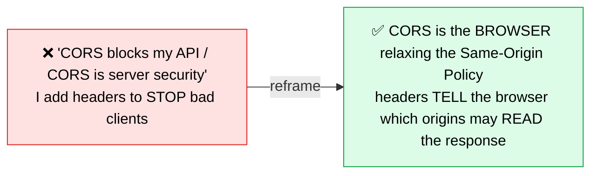
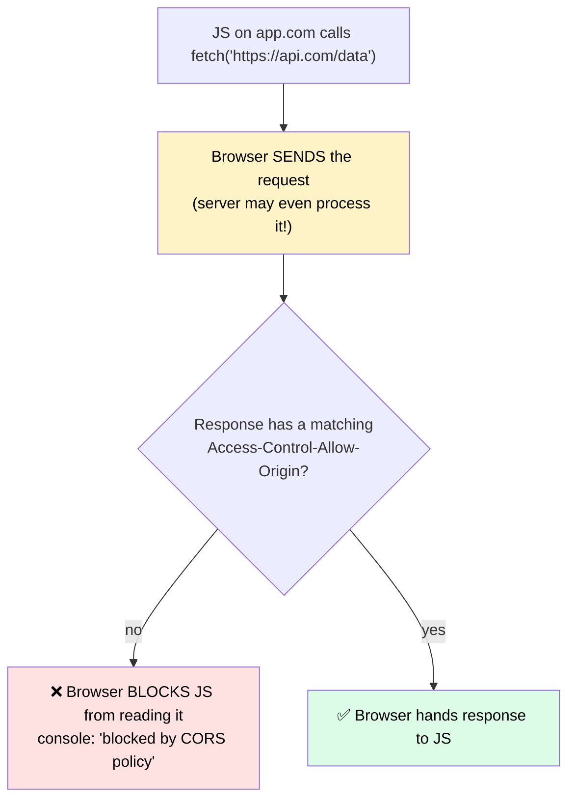
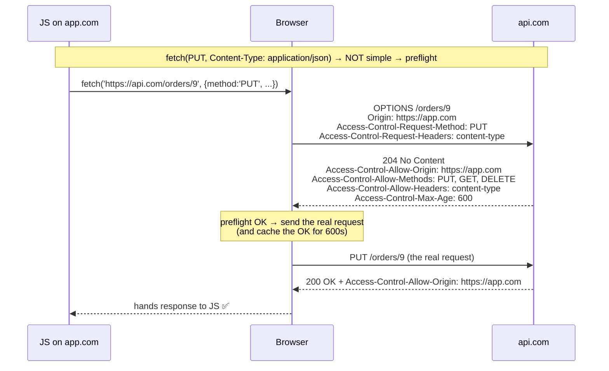
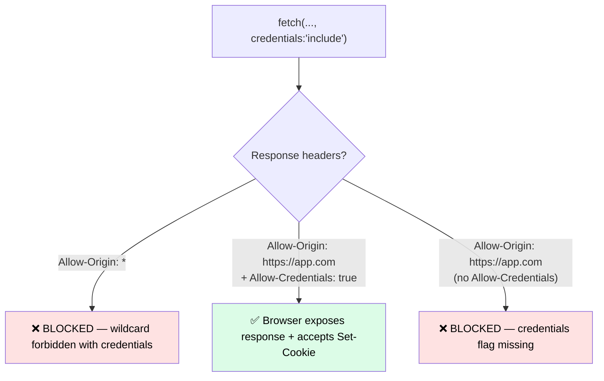
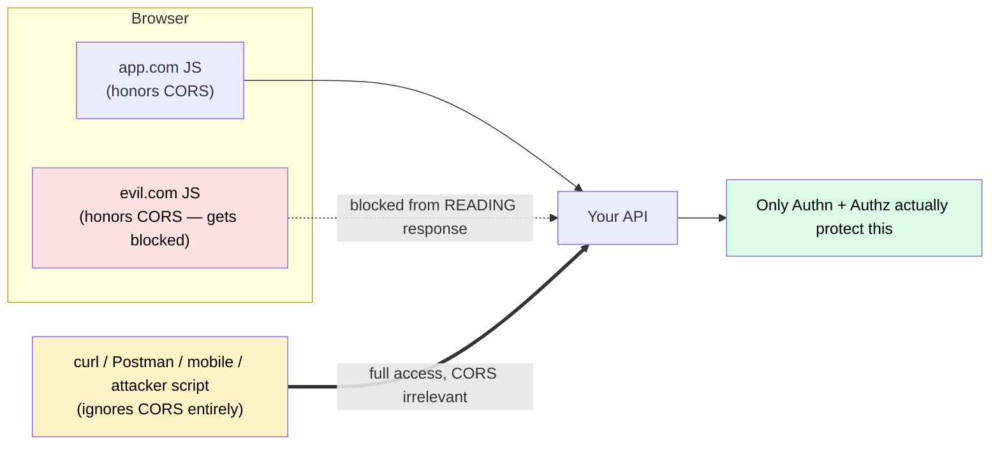
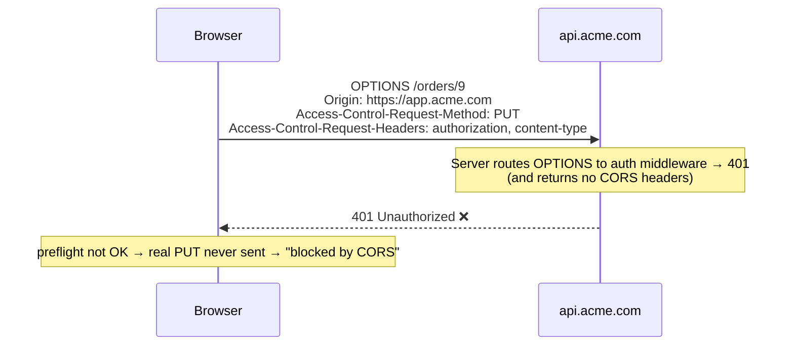
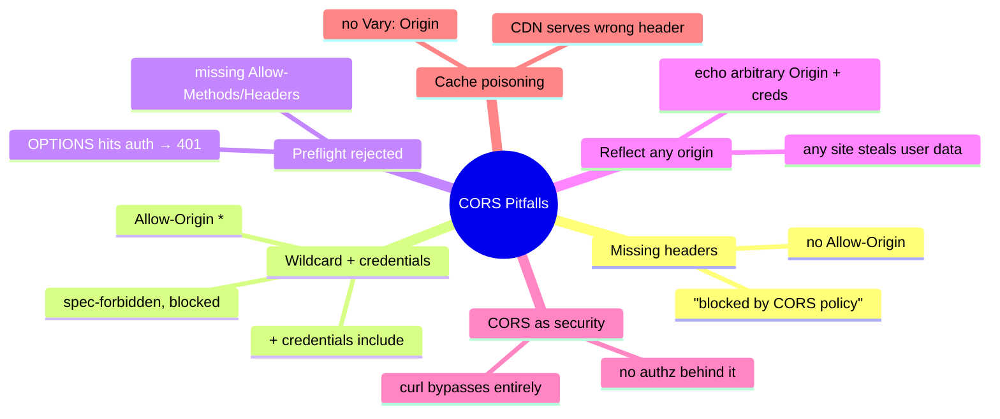

# CORS & the Same-Origin Policy

> **One line:** CORS is not a lock on your API — it is the *browser* choosing to relax its own default paranoia (the Same-Origin Policy) so that JavaScript on `app.com` is allowed to read a response from `api.com`.

---

## Table of Contents
1. [Why You Must Master This](#1-why-you-must-master-this)
2. [The Mental Model](#2-the-mental-model)
3. [What Is an "Origin" and the Same-Origin Policy](#3-what-is-an-origin-and-the-same-origin-policy)
4. [Simple Requests vs Preflighted Requests](#4-simple-requests-vs-preflighted-requests)
5. [The CORS Response Headers](#5-the-cors-response-headers)
6. [Credentialed Requests](#6-credentialed-requests)
7. [The Security Framing — CORS Relaxes, It Does Not Protect](#7-the-security-framing--cors-relaxes-it-does-not-protect)
8. [Worked Example — Debugging a Preflight](#8-worked-example--debugging-a-preflight)
9. [Real-Life Use Cases](#9-real-life-use-cases)
10. [Failure Modes](#10-failure-modes)
11. [🏋️ Practice Drills](#-practice-drills)
12. [🎤 Interview Q&A Bank](#-interview-qa-bank)
13. [🎯 Staff+ Nuances](#-staff-nuances)
14. [Cheat Sheet](#14-cheat-sheet)
15. [Connections & Further Reading](#15-connections--further-reading)

---

## 1. Why You Must Master This

Nearly every web app is split across origins — a React SPA on `app.example.com` calling an API on `api.example.com` — and the moment you do that, the browser gets involved. CORS is the single most misunderstood topic in browser-facing API design, and getting the *security framing* wrong is a Staff-level red flag.

- **It blocks your frontend on day one** — the infamous `blocked by CORS policy: No 'Access-Control-Allow-Origin' header is present` console error stalls more integrations than any other single class of bug.
- **It is routinely misused as security** — engineers add `Access-Control-Allow-Origin: *` "to make it work," or reflect the caller's `Origin` back, and unknowingly open the door to user-data theft.
- **The `*` + credentials trap is a real CVE class** — combining a wildcard origin with credentialed requests is *forbidden by spec* precisely because it would let any site read a logged-in user's data.
- **It shapes real latency** — every preflight is an extra round trip; tuning [Access-Control-Max-Age](#5-the-cors-response-headers) is a genuine performance lever.

> **The core problem it solves:** *how can `app.com`'s JavaScript safely read a response from `api.com` without letting `evil.com`'s JavaScript read your bank's responses?* CORS is the controlled, opt-in exception to the browser's default "you may not read another origin's responses."

**Prerequisites:** [API_Design_Fundamentals.md](./API_Design_Fundamentals.md) (HTTP methods, headers, status codes) and a basic grasp of [Authentication.md](./Authentication.md) (cookies vs tokens).

---

## 2. The Mental Model

Think of the Same-Origin Policy as a **building's default door lock**: by default, code from one origin cannot read what comes back from another. CORS is not a *stronger* lock you bolt onto your server — it is the *building owner (the browser)* being handed a signed note from `api.com` saying "it's fine, let `app.com` read my mail." Without the note, the browser refuses to hand the response to the JavaScript. The note relaxes the rule; it never tightens it.



> **Hold onto this:** CORS is a **browser-enforced, opt-in relaxation** of the Same-Origin Policy. It protects *your users' browsers*, never *your server*. A non-browser client (curl, Postman, a mobile app, an attacker's script) ignores CORS entirely.

---

## 3. What Is an "Origin" and the Same-Origin Policy

An **origin** is the triple **scheme + host + port**. Two URLs are same-origin only if all three match exactly. The path, query string, and fragment do *not* count.

| URL compared to `https://app.com:443` | Same origin? | Why |
|----------------------------------------|:------------:|-----|
| `https://app.com/dashboard` | ✅ | same scheme, host, port (path is irrelevant) |
| `http://app.com` | ❌ | scheme differs (`http` ≠ `https`) |
| `https://api.app.com` | ❌ | host differs (subdomain counts) |
| `https://app.com:8443` | ❌ | port differs |

The **Same-Origin Policy (SOP)** is the browser's default security boundary. Its most important rule for APIs: **JavaScript may *send* a cross-origin request, but it may not *read* the response** unless the response opts in via CORS. This is the subtle part everyone misses.



> The key insight: the request may still *reach and mutate* your server; CORS only governs whether the calling **JavaScript is allowed to read the response**. (Preflight, next section, adds a *pre-check* that can stop the request before it is even sent.)

Note what the SOP does *not* block: ``, `<script src>`, `<link>`, and `<form>` submissions have always been allowed cross-origin — which is exactly why [CSRF](#7-the-security-framing--cors-relaxes-it-does-not-protect) exists independently of CORS.

---

## 4. Simple Requests vs Preflighted Requests

The browser splits cross-origin requests into two classes. A **simple request** goes straight out; a **preflighted request** is preceded by an automatic `OPTIONS` "may I?" probe.

A request is **simple** (no preflight) only if *all* of these hold:
- Method is `GET`, `HEAD`, or `POST`.
- Headers are limited to the [CORS-safelisted](https://developer.mozilla.org/docs/Glossary/CORS-safelisted_request_header) set: `Accept`, `Accept-Language`, `Content-Language`, `Content-Type`.
- `Content-Type` is one of `application/x-www-form-urlencoded`, `multipart/form-data`, or `text/plain`.

Anything else triggers a **preflight**: `PUT`/`DELETE`/`PATCH`, a custom header like `Authorization` or `X-Api-Key`, or (the most common trigger) `Content-Type: application/json`.



> A preflight is a **real extra HTTP round trip** the browser makes *before* your actual request. It is invisible in your JS code but very visible in the Network tab as an `OPTIONS` call. If the preflight fails, the real request is never sent.

---

## 5. The CORS Response Headers

CORS is entirely driven by response headers the *server* sends. These are the note the browser reads.

| Header | On which response | What it says | Example |
|--------|-------------------|--------------|---------|
| `Access-Control-Allow-Origin` | preflight + actual | which origin may read the response | `https://app.com` (or `*`) |
| `Access-Control-Allow-Methods` | preflight | which methods are permitted | `GET, POST, PUT, DELETE` |
| `Access-Control-Allow-Headers` | preflight | which request headers are permitted | `Content-Type, Authorization` |
| `Access-Control-Max-Age` | preflight | how long (seconds) the browser may **cache this preflight** | `600` |
| `Access-Control-Allow-Credentials` | preflight + actual | may the browser send/expose cookies & auth | `true` |
| `Access-Control-Expose-Headers` | actual | which *response* headers JS may read beyond the safelist | `X-Request-Id, ETag` |

Two subtleties worth memorizing:

- **`Access-Control-Max-Age` is a latency knob.** Set it and the browser skips the `OPTIONS` preflight for that method/URL for N seconds. Browsers cap it (Chromium ~2 hours / 7200s, Firefox 24h). Without it, *every* non-simple request pays a double round trip.
- **`Access-Control-Allow-Origin` takes one origin or `*` — never a list.** There is no comma-separated syntax. To support multiple origins you must **check the incoming `Origin` against an allowlist and echo back the single matching value**, adding `Vary: Origin` so caches don't serve one origin's header to another.

```
# Correct multi-origin handling (server-side pseudo-logic)
if request.Origin in ALLOWLIST:
    resp["Access-Control-Allow-Origin"] = request.Origin   # echo the ONE match
    resp["Vary"] = "Origin"                                 # cache-safe
```

> `Vary: Origin` is the quiet bug-preventer: without it, a CDN can cache the response with `app.com`'s allow-origin header and then serve it to `other.com`, breaking CORS intermittently.

---

## 6. Credentialed Requests

By default, `fetch` does **not** send cookies, HTTP auth, or client certs to another origin. To include them you must opt in on the client:

```javascript
fetch('https://api.com/me', { credentials: 'include' })   // send cookies cross-origin
// (XMLHttpRequest equivalent: xhr.withCredentials = true)
```

The moment credentials are involved, the spec enforces two hard rules on the **server's** response — miss either and the browser blocks the read even though the request succeeded:

1. **`Access-Control-Allow-Origin` may NOT be `*`.** It must be a **specific, echoed origin** (e.g. `https://app.com`).
2. **`Access-Control-Allow-Credentials: true` must be present.**



> **Why is `*` + credentials forbidden?** Because the whole point of a credentialed request is that it carries the *user's ambient session cookie*. If a wildcard let *any* origin read that response, then `evil.com` could silently issue `fetch('https://yourbank.com/account', {credentials:'include'})` and read your logged-in balance. Requiring a specific echoed origin forces the server to *consciously name* who it trusts.

---

## 7. The Security Framing — CORS Relaxes, It Does Not Protect

This is the section that separates a Staff+ answer from a junior one. Internalize the chain of facts:

- **CORS is enforced by the browser, not the server.** Your server *sends the request through* and can already have executed it; the browser is the only party that withholds the response from JavaScript.
- **Therefore CORS protects the *user's browser session*, never your backend.** It stops a malicious *website* from reading a victim's authenticated responses. It does nothing about who can call your API.
- **Non-browser clients ignore CORS completely.** curl, Postman, a Go service, a mobile app, or an attacker's script never look at `Access-Control-Allow-Origin`. So **CORS is never a substitute for authentication and authorization** — see [Authentication.md](./Authentication.md) and [Authorization.md](./Authorization.md).
- **Locking CORS down does not "secure" an endpoint.** If `/admin/delete-all` has no authz, a strict CORS policy is irrelevant — anyone with curl calls it. Restricting the allowlist only limits which *browser origins* can read responses; it is defense for your users, not access control for your service.



**CORS vs CSRF — the classic confusion.** CSRF exploits the *sending* of credentialed cross-origin requests (via `<form>`/``, which the SOP never blocked), and it does not require reading the response. CORS governs *reading* responses. A lax CORS policy that reflects arbitrary origins with credentials effectively turns a read-CSRF into full data exfiltration. But CORS is *not* a CSRF defense — for that you need SameSite cookies, CSRF tokens, or double-submit patterns.

**The misconfiguration hall of shame:**
- **Reflecting arbitrary `Origin` + `Allow-Credentials: true`** — echoing back *whatever* origin asks, with credentials on, means *any* site can read a logged-in user's data. This is a real, common vulnerability.
- **`Access-Control-Allow-Origin: *` on an authenticated internal API** — even without credentials, it exposes responses to every origin; combined with IP-allowlisted-but-cookie-authed intranet apps, it leaks data.
- **Overly broad allowlists / bad regex** — `.*\.example\.com` that accidentally matches `evil-example.com`, or trusting `null` origin (sent by sandboxed iframes / `file://`).

---

## 8. Worked Example — Debugging a Preflight

A team ships a React app on `https://app.acme.com` calling `https://api.acme.com`. Login works, but `PUT /orders/9` with a JSON body and an `Authorization` header fails with:

```
Access to fetch at 'https://api.acme.com/orders/9' from origin 'https://app.acme.com'
has been blocked by CORS policy: Response to preflight request doesn't pass access
control check: It does not have HTTP ok status.
```

Walking the preflight explains everything:



The diagnosis chain: JSON body + `Authorization` ⇒ **not a simple request** ⇒ preflight `OPTIONS` fires ⇒ the server's **auth middleware rejects the credential-less `OPTIONS`** with `401` ⇒ browser sees a non-2xx/no-CORS-header preflight ⇒ blocks the real request.

The fix — three concrete server changes:
1. **Answer `OPTIONS` *before* auth**, returning `204` (browsers never send credentials on preflight, so auth-gating it is always wrong).
2. Return `Access-Control-Allow-Methods: GET, PUT, DELETE` and `Access-Control-Allow-Headers: Authorization, Content-Type` on that preflight (echo the requested ones).
3. Add `Access-Control-Max-Age: 600` so subsequent `PUT`s in the next 10 minutes skip the extra round trip — turning a two-round-trip write back into one.

> The load-bearing number: with `Max-Age: 600`, a burst of 50 writes pays the `OPTIONS` cost **once** instead of 50 times — on a 40 ms RTT link that is ~2 seconds of latency removed for free.

---

## 9. Real-Life Use Cases

| Situation | How CORS applies | The decision it forces |
|-----------|------------------|------------------------|
| **SPA + separate API domain** (`app.com` → `api.com`) | Every fetch is cross-origin; JSON bodies trigger preflight | Maintain a server-side origin allowlist; echo + `Vary: Origin` |
| **Cookie-based session auth across subdomains** | Needs `credentials: 'include'` + specific origin + `Allow-Credentials: true` | Cannot use `*`; must name each origin |
| **Public read-only API / CDN assets** | No cookies, safe to share widely | `Access-Control-Allow-Origin: *` is fine (and correct) here |
| **Third-party embeddable widget** | Partner sites on many origins call your API | Dynamic allowlist keyed on registered partner origins |
| **Fonts / WebGL textures / canvas** | Cross-origin fonts and `crossorigin` images need CORS headers to avoid a "tainted" canvas | Serve assets with `Access-Control-Allow-Origin` |
| **Internal microservice-to-microservice** | Server-to-server, no browser involved | CORS is **irrelevant** — do not rely on it for security |

> Real-world habit: **decide `*` vs allowlist by one question — "does this endpoint ever return per-user/credentialed data?"** If yes, never `*`; echo a vetted origin. If it is truly public and cookie-free, `*` is correct and simplest.

---

## 10. Failure Modes



- **"No 'Access-Control-Allow-Origin' header is present"** — *Symptom:* fetch works in Postman, fails in browser. *Root cause:* server sends no CORS headers on the actual response. *Fix:* emit `Access-Control-Allow-Origin` (echoed origin or `*`) on responses to cross-origin requests.
- **Wildcard + credentials blocked** — *Symptom:* `credentials: 'include'` requests blocked despite `Allow-Origin: *`. *Root cause:* spec forbids `*` with credentials. *Fix:* echo the specific origin and add `Allow-Credentials: true`.
- **Preflight returns 401/404/500** — *Symptom:* "Response to preflight request doesn't pass access control check." *Root cause:* `OPTIONS` routed into auth or a route that doesn't handle it. *Fix:* handle `OPTIONS` early, return `204` with the allow-headers, before authn.
- **Arbitrary-origin reflection** — *Symptom:* pen-test flags data exfiltration. *Root cause:* server blindly echoes any `Origin` with `Allow-Credentials: true`. *Fix:* echo only allowlisted origins; never reflect unconditionally.
- **Intermittent CORS failures behind a CDN** — *Symptom:* works for one origin, breaks for another randomly. *Root cause:* cached response carries the wrong `Allow-Origin`. *Fix:* add `Vary: Origin`.
- **Treating CORS as access control** — *Symptom:* "we locked down CORS so the endpoint is secure." *Root cause:* believing CORS gates callers. *Fix:* add real authn/authz; assume any non-browser client bypasses CORS.

---

## 🏋️ Practice Drills

> *Cover the solutions and attempt first — active recall is the point.*

**Drill 1 — Same origin or not?** Relative to `https://shop.com`, classify: (a) `https://shop.com/cart`, (b) `http://shop.com`, (c) `https://api.shop.com`, (d) `https://shop.com:8080`.

<details><summary>Solution</summary>

(a) **Same** — only the path differs, which doesn't count. (b) **Different** — scheme `http` ≠ `https`. (c) **Different** — host differs (subdomain counts). (d) **Different** — port differs. Origin = scheme + host + port, all three must match.
</details>

**Drill 2 — Does this preflight?** Which trigger an `OPTIONS` preflight? (a) `GET` with no custom headers, (b) `POST` with `Content-Type: application/json`, (c) `POST` form submit `application/x-www-form-urlencoded`, (d) `DELETE`.

<details><summary>Solution</summary>

(a) No — simple. (b) **Yes** — `application/json` is not a safelisted content type. (c) No — form-urlencoded is safelisted, method is POST, no custom headers → simple. (d) **Yes** — `DELETE` is not `GET`/`HEAD`/`POST`.
</details>

**Drill 3 — Fix the config.** An API returns `Access-Control-Allow-Origin: *` and the frontend uses `fetch(url, {credentials:'include'})`. Cookies won't attach and the browser blocks the read. Why, and what's the minimal fix?

<details><summary>Solution</summary>

The spec forbids `*` with credentials. Minimal fix: check the incoming `Origin` against an allowlist, echo it back as `Access-Control-Allow-Origin: https://app.com`, add `Access-Control-Allow-Credentials: true`, and set `Vary: Origin` so caches stay correct.
</details>

**Drill 4 — Design it.** Design CORS for a public read API (`GET /prices`) and a private user API (`GET /me`, cookie-authed). What headers for each?

<details><summary>Solution</summary>

Public: `Access-Control-Allow-Origin: *`, no credentials — simple and correct since responses are non-sensitive. Private: allowlist-checked echoed origin, `Access-Control-Allow-Credentials: true`, `Vary: Origin`, and preflight support (`Allow-Methods`, `Allow-Headers`, `Max-Age`). Never `*` on `/me`.
</details>

---

## 🎤 Interview Q&A Bank

**Q1. What is an origin?**
> The triple scheme + host + port. Two URLs are same-origin only if all three match exactly — path and query don't count. `https://a.com` and `https://a.com:8443` are *different* origins.

**Q2. What does the Same-Origin Policy actually block?**
> It lets JavaScript *send* cross-origin requests but blocks it from *reading* the response unless the response opts in via CORS. The request may still reach and even mutate the server — SOP governs reading, not sending. (signal: strong answers stress "read, not send.")

**Q3. When does a request get preflighted?**
> When it's not "simple" — i.e. a method other than GET/HEAD/POST, any non-safelisted header like `Authorization`, or a `Content-Type` other than form-urlencoded/multipart/text-plain. The most common trigger is `Content-Type: application/json`.

**Q4. What is a preflight and what headers matter?**
> An automatic `OPTIONS` request the browser sends before the real one, carrying `Access-Control-Request-Method`/`-Headers`. The server replies with `Access-Control-Allow-Origin`, `-Methods`, `-Headers`, and optionally `-Max-Age` to cache the approval and skip future preflights.

**Q5. Why can't you use `Allow-Origin: *` with credentials?**
> Because credentialed requests carry the user's session cookie. A wildcard would let any site read a logged-in user's private data. The spec requires a specific echoed origin plus `Access-Control-Allow-Credentials: true`, forcing the server to consciously name who it trusts.

**Q6. Is CORS a security mechanism for my API?**
> No — this is the key insight. CORS is enforced by the *browser* and protects *users*, not your server. It relaxes the SOP; it never tightens access. Any non-browser client (curl, Postman, mobile, an attacker) ignores it. CORS is never a substitute for authn/authz. (signal: the single most important answer in this topic.)

**Q7. How is CORS different from CSRF?**
> CSRF abuses the *sending* of credentialed cross-origin requests (forms/images the SOP never blocked) and doesn't need to read the response. CORS governs *reading* responses. CORS is not a CSRF defense — use SameSite cookies / CSRF tokens for that.

**Q8. How do you support many allowed origins?**
> `Access-Control-Allow-Origin` takes one value or `*`, never a list. Maintain a server-side allowlist, validate the incoming `Origin`, echo back the single match, and add `Vary: Origin` so caches don't cross-contaminate.

---

## 🎯 Staff+ Nuances

- **CORS is a *response*-reading gate, not a request gate.** The mutation may already have happened server-side before the browser blocks the read. This is why you cannot rely on CORS to prevent a state change — only authn/authz and CSRF defenses do that. See [Authorization.md](./Authorization.md).
- **`Vary: Origin` is mandatory whenever you echo the origin.** Skipping it is the classic intermittent-CORS bug behind CDNs and shared caches — one origin's `Allow-Origin` header gets cached and served to another. Combine with cache-key awareness at the [API_Gateway.md](./API_Gateway.md).
- **The `null` origin is a trap.** Sandboxed iframes, `file://`, and some redirects send `Origin: null`. Never allowlist `null` — an attacker can trivially produce it from a sandboxed iframe.
- **Preflight caching is capped and per (origin, URL, method, headers).** `Access-Control-Max-Age` is limited by the browser (Chromium ~7200s) and the cache is granular, so heterogeneous requests still re-preflight. For chatty write APIs, consolidating headers/methods reduces distinct preflights.
- **Reflecting `Origin` is fine *only* against a strict allowlist.** Dynamic echo is the correct pattern for multi-tenant/partner APIs, but the vulnerability is unconditional reflection with credentials — audit the regex/matching for `evil-example.com` and suffix-match bugs. This overlaps with [API_Security_Scopes_mTLS.md](../15_Security_Deep_Dive_DevSecOps/API_Security_Scopes_mTLS.md).
- **Gateways vs services — decide where CORS lives.** Centralizing CORS at the [API_Gateway.md](./API_Gateway.md) gives one consistent policy but can mask per-service needs; per-service gives control but risks drift. Most orgs standardize at the edge.
- **`Access-Control-Expose-Headers` is easy to forget.** By default JS can only read a handful of safelisted response headers; custom ones like `X-Request-Id` or pagination headers are invisible until you expose them explicitly.

---

## 14. Cheat Sheet

```
ORIGIN = scheme + host + port  (all 3 must match; path/query don't count)

SOP        JS may SEND cross-origin but may NOT READ the response unless CORS opts in.
           (Request can still reach + mutate the server — CORS gates READING.)

SIMPLE     GET/HEAD/POST + safelisted headers + CT in {form-urlencoded, multipart, text/plain}
PREFLIGHT  anything else → auto OPTIONS first. Triggers: PUT/DELETE/PATCH,
           Authorization/custom headers, Content-Type: application/json

HEADERS (server → browser)
  Access-Control-Allow-Origin       one origin or *  (NEVER a list — echo + Vary: Origin)
  Access-Control-Allow-Methods      preflight: allowed methods
  Access-Control-Allow-Headers      preflight: allowed request headers
  Access-Control-Max-Age            preflight cache seconds (skip future OPTIONS)
  Access-Control-Allow-Credentials  true → send/expose cookies
  Access-Control-Expose-Headers     which response headers JS may read

CREDENTIALS  fetch(..., {credentials:'include'}) ⇒ MUST echo specific origin
             + Allow-Credentials: true.  '*' + credentials = FORBIDDEN (blocked).

SECURITY   CORS RELAXES the SOP. Enforced by BROWSER. Protects USERS, not your server.
           curl/Postman/mobile/attacker IGNORE it. NOT a substitute for authn/authz.
           NOT a CSRF defense (use SameSite / CSRF tokens).

DON'T      reflect arbitrary Origin + credentials · allowlist 'null' · * on user data ·
           OPTIONS behind auth · forget Vary: Origin
```

---

## 15. Connections & Further Reading

**Prerequisites (learn first):**
- [API_Design_Fundamentals.md](./API_Design_Fundamentals.md) — HTTP methods, headers, and status codes CORS is built on.
- [Authentication.md](./Authentication.md) — cookies vs tokens; why credentialed requests exist.

**Builds toward / pairs with:**
- [Authorization.md](./Authorization.md) — the *real* access control that CORS is not.
- [REST_API_Design.md](./REST_API_Design.md) — method semantics that decide simple vs preflighted.
- [API_Gateway.md](./API_Gateway.md) — where centralized CORS policy usually lives.
- [11 · Security & Identity](../11_Security_Identity/) — CSRF, SameSite cookies, session security.
- [API_Security_Scopes_mTLS.md](../15_Security_Deep_Dive_DevSecOps/API_Security_Scopes_mTLS.md) — server-side API authorization CORS must never replace.

**Gaps this topic exposes (candidates for the section's Gap Analysis):**
- A dedicated CSRF / SameSite-cookies deep dive — repeatedly referenced here as the defense CORS is *not*.

**External classics:**
- [MDN: Cross-Origin Resource Sharing (CORS)](https://developer.mozilla.org/docs/Web/HTTP/CORS) — the canonical reference.
- [Fetch Standard (WHATWG) — CORS protocol](https://fetch.spec.whatwg.org/#http-cors-protocol) — the normative spec.
- [PortSwigger Web Security Academy: CORS](https://portswigger.net/web-security/cors) — the misconfiguration attack classes.

---

## TL;DR
The Same-Origin Policy is the browser's default rule that **JavaScript may send a cross-origin request but may not read the response**; CORS is the server sending headers (`Access-Control-Allow-Origin`, `-Methods`, `-Headers`, `-Max-Age`) that tell the *browser* to **relax** that rule for named origins. Non-simple requests (JSON bodies, custom headers, `PUT`/`DELETE`) first pay an `OPTIONS` **preflight** you can cache with `Max-Age`. Credentialed requests forbid `*` — you must echo a specific origin plus `Allow-Credentials: true`. **The one thing to never forget: CORS is enforced by the browser and protects your users, not your server — it relaxes restrictions, never tightens them, and any non-browser client ignores it, so it is never a substitute for authentication and authorization.**
