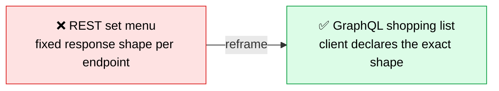
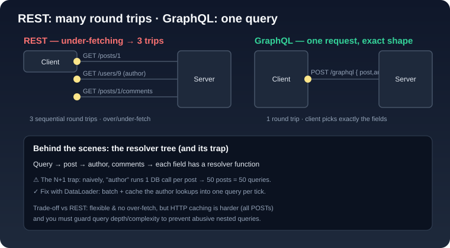
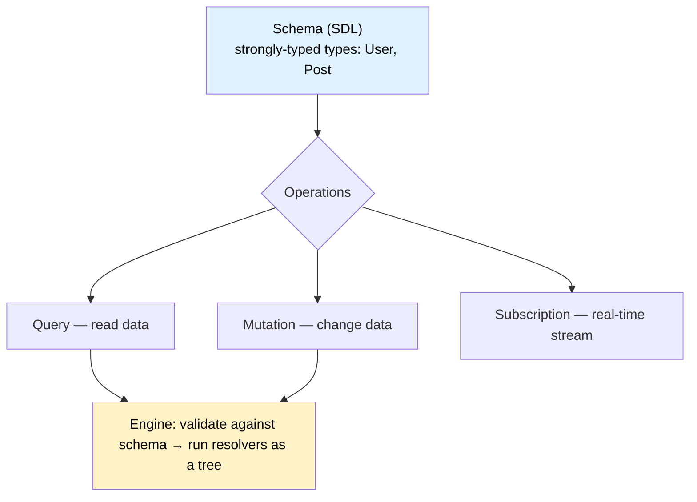
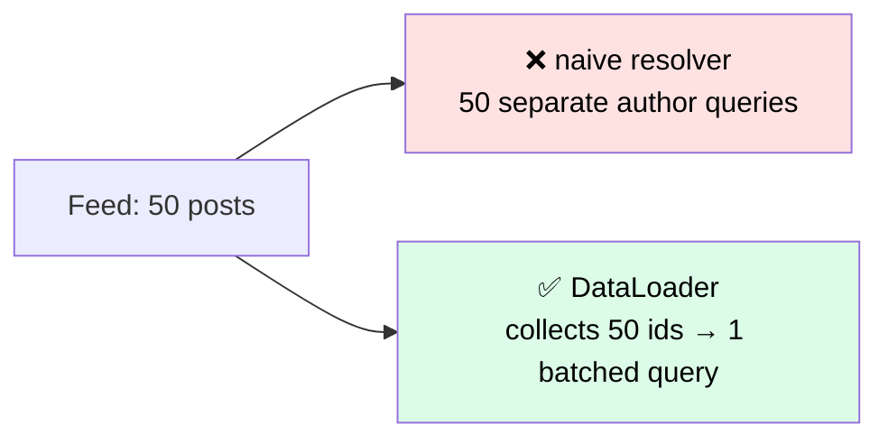
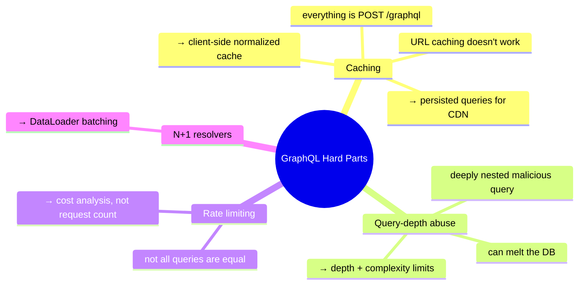
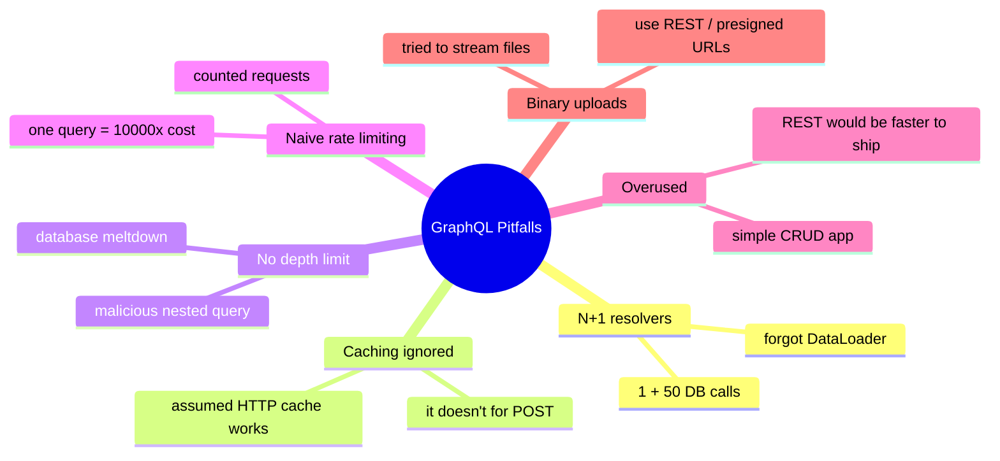

# GraphQL

> **One line:** GraphQL is a *query language for your API* — the client asks for exactly the fields it needs in one request, the server resolves them from anywhere, and over-fetching plus N+1 round trips disappear. The catch: caching, rate-limiting, and the resolver N+1 get harder.

---

## Table of Contents
1. [Why You Must Master This](#1-why-you-must-master-this)
2. [The Mental Model](#2-the-mental-model)
3. [Schema, Queries, Mutations, Subscriptions](#3-schema-queries-mutations-subscriptions)
4. [Resolvers & the N+1 Problem (DataLoader)](#4-resolvers--the-n1-problem-dataloader)
5. [GraphQL vs REST](#5-graphql-vs-rest)
6. [The Hard Parts: Caching, Security, Rate Limiting](#6-the-hard-parts-caching-security-rate-limiting)
7. [Worked Example — A Post Feed](#7-worked-example--a-post-feed)
8. [Real-Life Use Cases](#8-real-life-use-cases)
9. [Failure Modes](#9-failure-modes)
10. [🏋️ Practice Drills](#-practice-drills)
11. [🎤 Interview Q&A Bank](#-interview-qa-bank)
12. [🎯 Staff+ Nuances](#-staff-nuances)
13. [Cheat Sheet](#13-cheat-sheet)
14. [Connections & Further Reading](#14-connections--further-reading)

---

## 1. Why You Must Master This

GraphQL (invented at Facebook for their mobile News Feed) shifts power from the server to the client — and it's now ubiquitous in frontend-heavy and aggregation-heavy systems.

- **Mobile performance** — on a slow network, every byte and round trip counts; GraphQL fetches *exactly* what the screen needs in one request.
- **Frontend velocity** — frontend teams stop waiting for backend teams to add a field to a REST endpoint; if it's in the graph, they can query it.
- **Aggregation / BFF** — GraphQL is a natural gateway/Backend-for-Frontend that stitches data from many microservices into one schema.

> **The core problem it solves:** REST's **over-fetching** (a user object with 40 fields when you wanted `username`) and **under-fetching / N+1 calls** (calling `/posts`, then `/users/1`, `/users/2`… per author). GraphQL collapses that into a single nested query.

---

## 2. The Mental Model

REST is a **set menu** — you get the dish as the kitchen plates it. GraphQL is a **grocery store with a shopping list** — you walk in with a query and take exactly the items and quantities you want. The store doesn't care *why*; it just gives you what's on the list.





---

## 3. Schema, Queries, Mutations, Subscriptions



1. **Schema (SDL)** — define types (`User`, `Post`) and their fields. The schema *is* the contract and the documentation.
2. **Operations** — `Query` (read), `Mutation` (write), `Subscription` (real-time push, usually over WebSockets).
3. **The engine** validates the incoming query against the schema, then executes resolvers field-by-field in a tree.

---

## 4. Resolvers & the N+1 Problem (DataLoader)

A **resolver** is a small function that fetches the data for one field — from a DB, another API, or a cache. This is GraphQL's power *and* its most famous trap.

```graphql
query GetPostDetails($id: ID!) {
  post(id: $id) {
    title
    content
    author { name avatarUrl }   # nested — resolved separately
  }
}
```

```javascript
const resolvers = {
  Query: { post: (_, { id }) => db.posts.findById(id) },
  Post: {
    // ❌ naive: 1 DB call per post's author → N+1
    // ✅ batched + cached via DataLoader → ONE query per tick
    author: (post) => authorLoader.load(post.authorId),
  },
};
```



> **DataLoader** batches the author IDs requested during one execution tick and resolves them in a single `WHERE id IN (...)` query — turning 50 queries into 1. Knowing this is the #1 GraphQL interview signal.

---

## 5. GraphQL vs REST

| Dimension | REST | GraphQL |
|-----------|------|---------|
| Data fetching | fixed per endpoint | client picks exact fields |
| Round trips | often many (N+1) | usually one |
| Over-fetching | common | eliminated |
| **HTTP caching** | **easy (URL = key)** | **hard (all POST /graphql)** |
| Typing/discovery | via OpenAPI (optional) | built-in schema + introspection |
| **Rate limiting** | **easy (count requests)** | **hard (must compute query cost)** |
| File uploads / binary | natural | awkward (use REST/S3) |
| Learning curve | low | higher (server-side) |

> GraphQL trades **server-side simplicity** (especially caching and rate-limiting) for **client-side flexibility**. That trade is worth it for rich, fast-moving frontends; it's overkill for simple CRUD.

---

## 6. The Hard Parts: Caching, Security, Rate Limiting



- **Caching** — because every request is `POST /graphql`, standard HTTP/CDN caching by URL fails. Solutions: client-side normalized caches (Apollo/Relay), **persisted queries** (hash the query → GET-able → CDN-cacheable), and per-object caching.
- **Query-depth / complexity attacks** — a malicious deeply-nested query (`user → posts → author → posts → …`) can crash your DB. Enforce **max depth** and **query cost** limits.
- **Rate limiting** — counting requests is meaningless when one query can cost 10,000× another; you rate-limit by **computed query complexity** (see [Rate_Limiting.md](./Rate_Limiting.md)).

---

## 7. Worked Example — A Post Feed

```mermaid
sequenceDiagram
    participant App as Mobile App
    participant GQL as GraphQL Server
    participant DL as DataLoader
    participant DB as Database
    App->>GQL: one query { posts { title author { name } } }
    GQL->>DB: SELECT posts (1 query)
    GQL->>DL: load author for each of 50 posts
    DL->>DB: SELECT authors WHERE id IN (...) (1 batched query)
    DB-->>GQL: posts + authors
    GQL-->>App: exact shape requested, 1 round trip ✅
    Note over App,GQL: REST would have been 1 + 50 calls; GraphQL = 1 request, 2 queries
```

---

## 8. Real-Life Use Cases

| Situation | How GraphQL applies |
|-----------|---------------------|
| **Mobile news feed (Facebook)** | The origin use case — complex nested posts/authors/likes/comments in one efficient request. |
| **Backend-for-Frontend (BFF)** | One GraphQL layer stitches 10 microservices into a single schema each client queries. |
| **Public APIs (GitHub v4, Shopify)** | Lets diverse integrators fetch precisely what they need without dozens of REST endpoints. |
| **Multi-platform products** | Web, iOS, Android each query the same graph for their own shapes — no per-client endpoints. |
| **Rapidly-evolving frontends** | Add fields to the schema, mark old ones `@deprecated` — versionless evolution (see [API_Versioning.md](./API_Versioning.md)). |

> Real-world habit: **reach for GraphQL when client data needs are diverse and changing; stay on REST for simple, cacheable, resource-shaped APIs.** Don't adopt it for the hype — adopt it when over/under-fetching is a real, measured pain.

---

## 9. Failure Modes



- **The N+1 resolver trap** — forgetting DataLoader turns one feed into dozens of DB calls.
- **Assuming HTTP caching works** — it doesn't for `POST`; you must add a client cache or persisted queries.
- **No depth/complexity limits** — opens you to query-bomb DoS.
- **Counting requests for rate limits** — useless; use query-cost analysis.
- **Overuse** — for 2–3 resources, REST ships faster with less server complexity.

---

## 🏋️ Practice Drills

> *Reason about resolvers, caching, and when to choose GraphQL.*

**Drill 1 — Spot the N+1.** A feed query returns 100 posts, each with `author { name }`. The DB logs show 101 queries. What happened and what's the fix?

<details><summary>Solution</summary>

1 query for the posts + 1 per-post author query = 101 (the N+1). Fix: a `DataLoader` for authors batches the 100 author IDs into a single `WHERE id IN (...)` query → 2 total.
</details>

**Drill 2 — Why can't I CDN-cache this?** A team puts a CDN in front of their GraphQL API and gets a 0% hit rate. Why, and what are two fixes?

<details><summary>Solution</summary>

Every request is `POST /graphql` with the query in the body — CDNs key on URL+method, so all requests look the same/uncacheable. Fixes: (1) **persisted queries** (send a query hash via GET so the URL varies and is cacheable); (2) client-side normalized caching (Apollo/Relay) to avoid refetching objects.
</details>

**Drill 3 — REST or GraphQL?** Choose for: (a) an internal admin CRUD on 3 tables, (b) a consumer mobile app with many screens showing different slices of overlapping data.

<details><summary>Solution</summary>

(a) REST — trivial CRUD, fast to build, cacheable. (b) GraphQL — diverse, overlapping data shapes per screen benefit hugely from client-specified queries and one round trip.
</details>

---

## 🎤 Interview Q&A Bank

**Q1. What problem does GraphQL solve over REST?**
> Over-fetching (too many fields) and under-fetching/N+1 (too many round trips). Clients request exactly the fields they need in a single query.

**Q2. How do you solve the N+1 problem in resolvers?**
> DataLoader: it batches the IDs requested during one execution tick and resolves them in a single query, and caches within the request. Turns 1+N queries into ~2.

**Q3. Why is caching harder in GraphQL?**
> Everything is `POST /graphql`, so URL-based HTTP/CDN caching doesn't apply. You use client-side normalized caches and persisted queries (hashed queries over GET) to regain CDN cacheability.

**Q4. How do you rate-limit GraphQL?**
> By query *complexity/cost*, not request count — assign costs to fields/depth and budget per client, because one query can be vastly more expensive than another.

**Q5. How do you prevent a malicious query from crashing the server?**
> Enforce maximum query depth and a query-complexity limit, set timeouts, and use persisted/allow-listed queries for public clients.

**Q6. Query vs Mutation vs Subscription?**
> Query reads, Mutation writes, Subscription pushes real-time updates (typically over WebSockets).

**Q7. How does GraphQL handle versioning?**
> Largely versionless — you add new fields and mark old ones `@deprecated`, evolving the schema continuously rather than cutting v2.

**Q8. What's Apollo Federation?**
> A way to compose one GraphQL graph across multiple independently-owned microservices (a distributed schema), so teams own their slice of the graph.

---

## 🎯 Staff+ Nuances

- **GraphQL moves complexity, it doesn't remove it.** The client gets simpler; the server gets harder — resolver performance, batching, caching, auth-per-field, and query-cost governance all become *your* problem. Adopt it when client flexibility is worth that server-side tax.
- **Authorization in GraphQL is field-level and subtle.** A single query can touch many types; you must enforce authZ at the resolver/field level, not just the endpoint. A naive "is logged in?" check invites data leaks across the graph (see [Authorization.md](./Authorization.md)).
- **Persisted (allow-listed) queries are the production pattern for public GraphQL.** They restore CDN caching, cap the attack surface (no arbitrary queries), and make cost analysis tractable. Arbitrary public queries are a DoS and security liability.
- **Federation vs a monolithic schema is an org decision (Conway's Law).** Federation lets teams own subgraphs but adds a gateway, composition complexity, and cross-team schema governance. For a small org, one schema is simpler.
- **The N+1 can hide one layer down.** DataLoader fixes the obvious case, but nested batching (authors → their teams → their org) needs loaders at each level, and cache scoping must be per-request to avoid leaking data between users.
- **GraphQL and REST coexist.** Mature systems often use GraphQL for the rich read path / BFF and REST for simple resources, webhooks, and binary uploads. It's not all-or-nothing.

---

## 13. Cheat Sheet

```
GraphQL = a QUERY LANGUAGE for your API; client picks the exact shape.

PARTS  Schema(SDL) · Query(read) · Mutation(write) · Subscription(realtime)
       Resolver = fn per field, executed as a tree

KILLER FEATURE  no over-fetch, no N+1 round trips, strong typing + introspection
KILLER PROBLEM  N+1 RESOLVERS → use DataLoader (batch+cache per request)

HARD PARTS
  caching     → POST-only → persisted queries + client normalized cache
  security    → max depth + query COST limits (not request count)
  authZ       → enforce at field/resolver level
  uploads     → use REST / presigned URLs instead

CHOOSE GraphQL: diverse/changing frontends, BFF, mobile
CHOOSE REST:    simple CRUD, cacheable resources, public simplicity
```

---

## 14. Connections & Further Reading

**Within this repo:**
- [REST_API_Design.md](./REST_API_Design.md) — the style GraphQL reacts to; over/under-fetching context.
- [API_Gateway.md](./API_Gateway.md) — GraphQL often *is* the BFF/gateway.
- [Rate_Limiting.md](./Rate_Limiting.md) — query-cost limiting; [Authorization.md](./Authorization.md) — field-level authZ.
- [08 · Communication Protocols](../08_Communication_Protocols/) — WebSockets for subscriptions; [06 · Caching](../06_Caching_Performance/).

**External classics:**
- [Official GraphQL docs](https://graphql.org/learn/) · [How to GraphQL](https://www.howtographql.com/).
- [DataLoader (GitHub)](https://github.com/graphql/dataloader) · [Apollo Federation docs](https://www.apollographql.com/docs/federation/).
- Lee Byron's original GraphQL talks on the Facebook News Feed motivation.

---

## TL;DR
GraphQL is a **query language for your API**: the client requests the exact fields it needs in one round trip, killing REST's over-fetching and N+1 calls. The price is **server-side complexity** — the resolver **N+1 (use DataLoader)**, **caching** (use persisted queries + client caches since it's all POST), **security** (depth/complexity limits), and **rate-limiting by query cost**. Reach for it when frontends are **diverse and fast-moving**; stay on REST for **simple, cacheable, resource-shaped** APIs.
