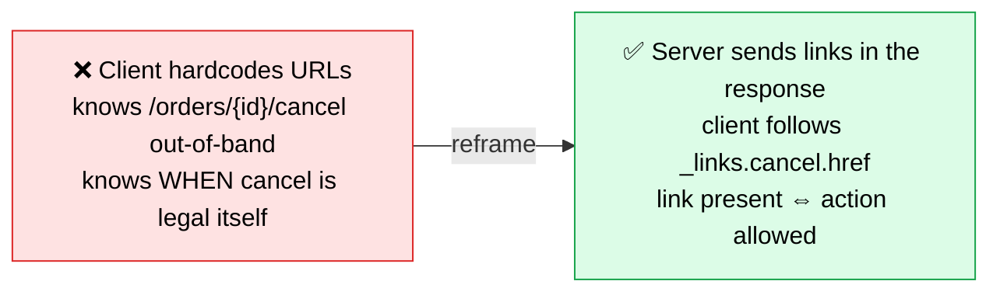
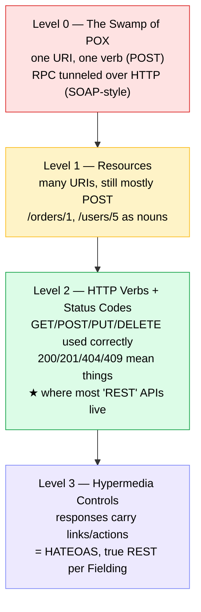
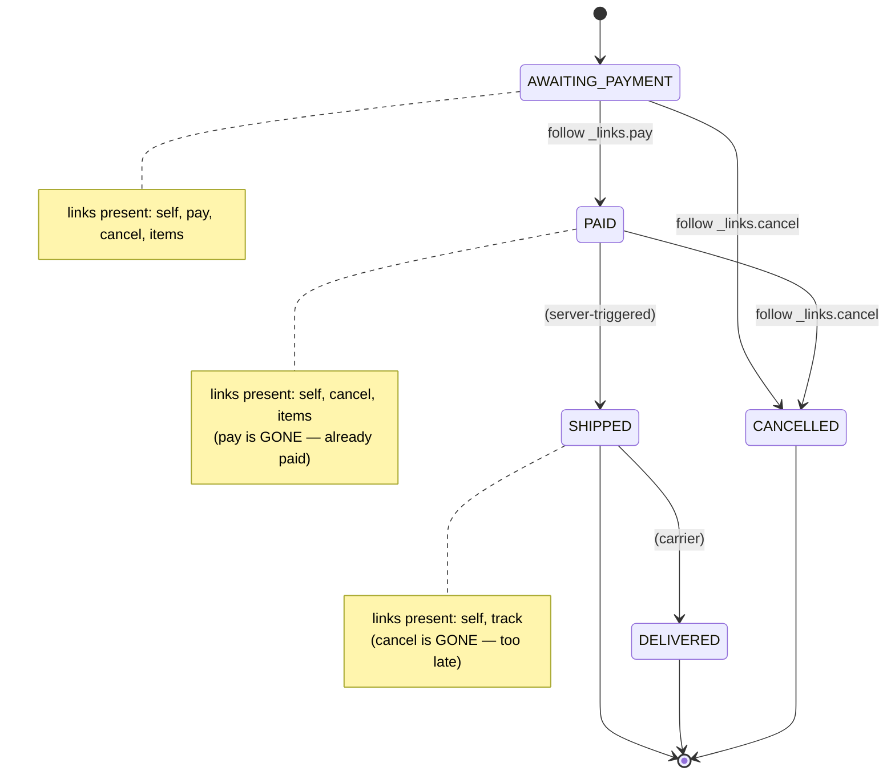
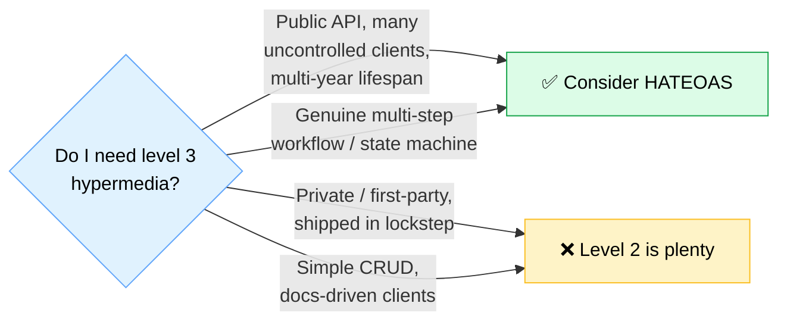
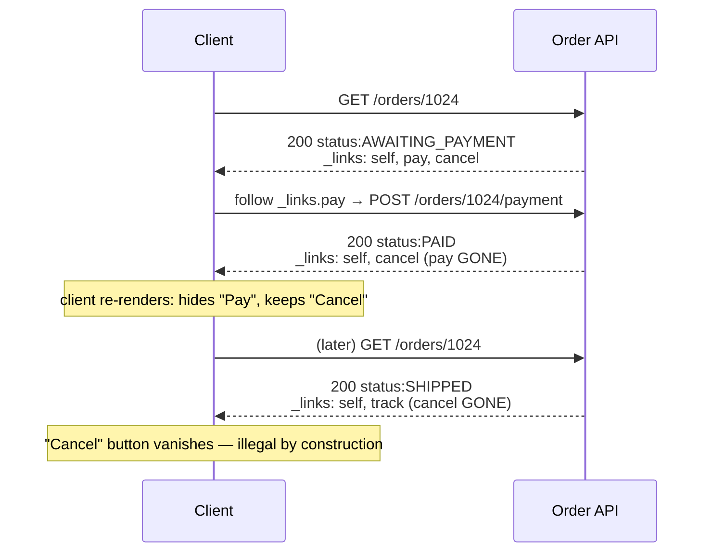
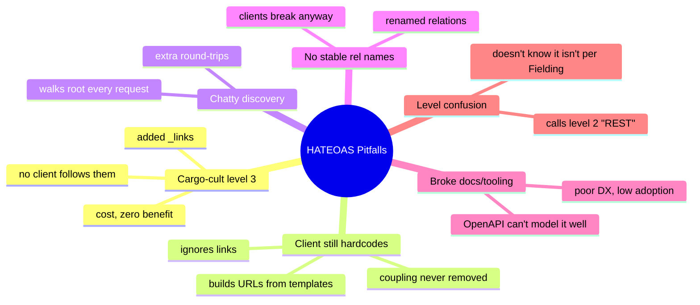

# HATEOAS & Hypermedia

> **One line:** HATEOAS makes an API self-describing — each response ships the links and actions the client can take *next*, so the client follows links like a human clicks buttons instead of hardcoding URLs it had to read in a doc.

---

## Table of Contents
1. [Why You Must Master This](#1-why-you-must-master-this)
2. [The Mental Model](#2-the-mental-model)
3. [What Hypermedia Actually Is](#3-what-hypermedia-actually-is)
4. [The Richardson Maturity Model (Levels 0–3)](#4-the-richardson-maturity-model-levels-03)
5. [Hypermedia Formats — HAL, JSON:API, Siren](#5-hypermedia-formats--hal-jsonapi-siren)
6. [Links as a State Machine](#6-links-as-a-state-machine)
7. [The Honest Trade-off — Why Pragmatic REST Stops at Level 2](#7-the-honest-trade-off--why-pragmatic-rest-stops-at-level-2)
8. [Worked Example — An Order's Lifecycle in Links](#8-worked-example--an-orders-lifecycle-in-links)
9. [Real-Life Use Cases](#9-real-life-use-cases)
10. [Failure Modes](#10-failure-modes)
11. [🏋️ Practice Drills](#-practice-drills)
12. [🎤 Interview Q&A Bank](#-interview-qa-bank)
13. [🎯 Staff+ Nuances](#-staff-nuances)
14. [Cheat Sheet](#14-cheat-sheet)
15. [Connections & Further Reading](#15-connections--further-reading)

---

## 1. Why You Must Master This

HATEOAS ("Hypermedia As The Engine Of Application State") is the most misunderstood letter-soup in API design — and the one interviewers use to separate people who *memorized* "REST = JSON over HTTP" from people who read Roy Fielding.

- **It's the actual definition of REST.** In Fielding's 2000 dissertation, an API without hypermedia controls is *not* REST — he wrote a whole rant ("REST APIs must be hypertext-driven") because everyone shipped level-2 and called it REST. Knowing this lets you speak precisely instead of parroting.
- **It decides the coupling between client and server.** Without hypermedia, every client hardcodes URL templates (`/orders/{id}/cancel`); the day you rename that route, every client breaks. With hypermedia, the server *hands* the client the URL — you can move it freely.
- **It encodes workflow.** State-machine APIs (payments, approvals, orders) are where hypermedia stops being academic and genuinely pays off: the response shows a `cancel` link *only while cancelling is legal*, so the client can't attempt illegal transitions.
- **The pragmatic answer is also tested.** Staff+ signal is knowing *when to skip it* — most public APIs (Stripe, GitHub's core resources) stop at level 2 on purpose. "I'd use level 2 and here's why level 3 isn't worth it here" is often the *stronger* answer.

> **The core problem it solves:** *client–server coupling to URL structure and to workflow rules.* Instead of the client encoding "what can I do next and where," the server tells it in every response — so the API can evolve its URLs and its state machine without a client rewrite.

**Prerequisites:** [REST_API_Design.md](./REST_API_Design.md) (resources, verbs, status codes) and [API_Design_Fundamentals.md](./API_Design_Fundamentals.md) (the contract mindset).

---

## 2. The Mental Model

Think of a **website vs. a phone tree**. On a website you land on a page and it *shows you the links* — you never memorize URLs, you click what's offered, and the site can redesign its URLs overnight without telling you. A phone tree, by contrast, forces you to know "press 4 then 2 then 7" ahead of time; change the menu and every caller's cheat-sheet is wrong. HATEOAS turns your API into the website. A non-hypermedia API is the phone tree.



> **Hold onto this:** in a hypermedia API the **presence of a link is the permission** — the client doesn't decide what's allowed next, the server tells it by *including or omitting the link*.

---

## 3. What Hypermedia Actually Is

**What it is:** a hypermedia API returns, alongside the data, a machine-readable set of **links and actions** that describe the transitions available from the current resource state. "Hypermedia controls" = those links (`self`, `next`, `cancel`, `pay`) plus, in richer formats, the HTTP method and expected fields for each action. The client is written to *discover* URLs from responses, not to construct them from string templates.

**Why it exists / what breaks without it:** without hypermedia, the URL structure becomes part of the published contract. Clients bake in `GET /v1/orders/{id}` and `POST /orders/{id}/cancel`. Now the server can't reorganize routes, can't A/B a new checkout path, can't move a resource to another host — any of those is a breaking change requiring client redeploys you don't control. Hypermedia makes the URL an *implementation detail* the server owns.

**How it works under the hood:** the client is coded against **link relations** (the *names* — `next`, `cancel`, IANA-registered or custom) rather than **link targets** (the *hrefs*). Startup fetches a single well-known entry point ("the root document"); from there the client navigates purely by following named links it finds in responses. The href can change every deploy; as long as the relation name is stable, the client keeps working. This is exactly how a browser works: it knows what a `<a rel="next">` *means*, never where it points until the page arrives.

**The trade-off (and when the other choice wins):** the cost is a *smarter client* and *chattier discovery*. A dumb client that hardcodes `/orders/123` makes one call; a strict-hypermedia client may walk root → orders → order → cancel-link. When you control both ends and ship them together, hardcoding is simpler and faster — the coupling you removed was coupling you didn't actually have.

**Real system:** the **GitHub API** returns `_links` and hypermedia hints (e.g., pagination `Link` headers with `rel="next"`/`rel="last"`), and GitHub explicitly tells clients to *follow* those pagination links rather than construct page URLs — the canonical "consume the link, don't build it" pattern in the wild.

---

## 4. The Richardson Maturity Model (Levels 0–3)

Leonard Richardson's model grades how "RESTful" an API is on four rungs. It's the backbone of any HATEOAS interview answer — level 3 *is* HATEOAS.



| Level | Name | What defines it | Example call |
|:-----:|------|-----------------|--------------|
| **0** | RPC-over-HTTP | Single URI, single verb; HTTP is just a tunnel | `POST /api` `{"method":"getOrder","id":1}` |
| **1** | Resources | Many URIs (nouns), but verbs/status ignored | `POST /getOrder/1` → `200` even on error |
| **2** | HTTP verbs + status codes | Right verb per action, meaningful status codes | `GET /orders/1` → `200`; `DELETE` → `204`; missing → `404` |
| **3** | Hypermedia controls | Responses embed links to next actions (HATEOAS) | `GET /orders/1` → data **+** `_links: {cancel, pay}` |

> Fielding's provocation: **only Level 3 is REST.** Levels 0–2 are "HTTP-based RPC" dressed as REST. In practice the industry redefined "REST" to mean level 2 — which is why saying "we're RESTful" usually means level 2, and the interviewer wants to hear you *know the difference*.

The jumps in one sentence each: **0→1** split one endpoint into resource nouns; **1→2** start using the HTTP verbs and status codes the protocol already gives you (this is the biggest practical win); **2→3** let responses drive the client via links.

---

## 5. Hypermedia Formats — HAL, JSON:API, Siren

Plain JSON has no standard place to put links, so "level 3" needs a **media type** that defines where links/actions live. Three dominate, in increasing richness:

| Format | Media type | Links | Actions (method + fields)? | Vibe |
|--------|-----------|:-----:|:--------------------------:|------|
| **HAL** | `application/hal+json` | `_links`, embeds via `_embedded` | ❌ links only | Minimal, most popular, easy to adopt |
| **JSON:API** | `application/vnd.api+json` | `links` + `relationships` | ⚠️ partial (relationship ops) | Opinionated; great for sparse fieldsets/includes |
| **Siren** | `application/vnd.siren+json` | `links` | ✅ full `actions` (method, href, fields) | Richest; describes *forms*, not just links |

The key distinction: **HAL tells you *where* you can go; Siren tells you *how* to go there** (which verb, which fields to send) — Siren `actions` are effectively machine-readable HTML forms. A HAL example (note `_links` is the whole point):

```json
{
  "id": 1024,
  "status": "AWAITING_PAYMENT",
  "total": 49.90,
  "currency": "USD",
  "_links": {
    "self":   { "href": "/orders/1024" },
    "pay":    { "href": "/orders/1024/payment" },
    "cancel": { "href": "/orders/1024/cancel" },
    "items":  { "href": "/orders/1024/items" }
  },
  "_embedded": {
    "customer": { "id": 7, "name": "Ana", "_links": { "self": { "href": "/customers/7" } } }
  }
}
```

> The client reads `_links.cancel.href` and follows it — it never *builds* `/orders/1024/cancel`. Move that route tomorrow and the client is unaffected, because it consumed the link instead of hardcoding the template. GitHub uses `_links`-style hypermedia plus versioned **media types** (`application/vnd.github+json`) to evolve representations without breaking consumers.

---

## 6. Links as a State Machine

The single most compelling reason to reach for HATEOAS: **the set of links IS the state machine.** A resource in state X only exposes the transitions legal from X. The client never encodes "an order can be cancelled only before it ships" — it just renders whatever links arrive. Business rules live server-side, exactly once.



The mechanism: on each `GET`, the server computes the resource's state, evaluates which transitions are currently permitted, and emits *only those* as links. `AWAITING_PAYMENT` shows `pay` + `cancel`; once `PAID`, the `pay` link disappears and `cancel` remains; once `SHIPPED`, `cancel` disappears and `track` appears. A well-written client is bulletproof against illegal transitions *by construction* — there's no button to press.

> **Trade-off / when the other choice wins:** this only helps if the client is written to *hide/disable actions based on link presence*. A client that ignores links and just POSTs `/cancel` anyway gains nothing (the server still 409s). The payoff is real for generic/long-lived clients driving a genuine workflow; it's near-zero for a single first-party client shipped in lockstep with the server, which can just as easily read the `status` field.

---

## 7. The Honest Trade-off — Why Pragmatic REST Stops at Level 2

Most successful APIs deliberately stop at level 2. This isn't laziness — it's a cost/benefit call, and being able to *articulate* it is the senior signal.

**Why teams skip level 3:**
- **Client complexity.** A hypermedia client must parse a media type, track link relations, and drive state from responses. Most consumers are far simpler if they just call `POST /orders/{id}/cancel` from a doc.
- **Few clients actually follow links.** In practice developers read your docs, copy the URL, and hardcode it — even if you send links. The decoupling you paid for goes unused.
- **Tooling & DX.** OpenAPI/Swagger, codegen, and Postman collections are built around level-2 URL templates. Hypermedia is second-class in the tooling most teams live in (see [API_Documentation_OpenAPI.md](./API_Documentation_OpenAPI.md)).
- **Chattiness.** Strict discovery ("walk from root every time") adds round-trips; teams shortcut with hardcoded URLs anyway, defeating the purpose.
- **Over-engineering.** For a private API between two services you own and deploy together, the coupling HATEOAS removes is coupling you can just... refactor. YAGNI.

**Concrete evidence:** **Stripe** — arguably the most admired API in the industry — is *not* HATEOAS. It's a polished level 2: clean resources, correct verbs, great docs, hardcoded URL patterns. It proves you can have a world-class API without hypermedia.

**When level 3 genuinely pays off:**
- **Long-lived public APIs with many independent clients** you don't control and can't force to redeploy — decoupling from URL structure has real value over years.
- **Workflow / approval / state-machine APIs** where "what can I do next" is the whole point — links encode the rules once, server-side.
- **Payment flows.** **PayPal** returns HATEOAS `links` (e.g., `approve`, `capture`, `self`) in its order/payment responses so the integrator follows the next-step URL through the approval flow rather than assembling it — the textbook "hypermedia drives a multi-step transaction" case.



> Default to **level 2**; reach for **level 3** only when clients are numerous, uncontrolled, long-lived, *or* the domain is a real workflow. "We're level 2 by choice, and here's the workflow endpoint where we added hypermedia" is the mature answer.

---

## 8. Worked Example — An Order's Lifecycle in Links

Watch one order move through states — the *data* barely changes, but the **links** tell the client exactly what's legal now. This is HATEOAS earning its keep.



The payoff, made concrete: the rule *"cancellation is allowed until the order ships"* exists in **exactly one place** — the server's link-emission logic. The client has **zero** business logic; it renders buttons for whatever links arrive. Add a new rule tomorrow (say, "PAID orders over $500 can't self-cancel") and you edit one server function — **no client ships**. In a level-2 world, that rule would be duplicated into every client's `if (order.status === 'PAID' && order.total < 500)` and drift out of sync the moment one client lags a release.

---

## 9. Real-Life Use Cases

| Situation | How hypermedia applies | The decision it forces |
|-----------|------------------------|------------------------|
| **PayPal payment flow** | Response returns `links` (`approve`, `capture`, `self`); integrator follows next-step URL | Follow the link, don't assemble the URL — server owns the flow |
| **GitHub pagination** | `Link` header + `_links` with `rel="next"/"last"` | Consume `rel=next`, never construct `?page=N` yourself |
| **Approval workflows** | Doc shows `approve`/`reject` links *only* to authorized users in valid states | Client-side permission logic disappears; link presence = permission |
| **Long-lived public API** | Clients navigate from a stable root document | Server can reorganize URLs without breaking third parties |
| **Stripe (counter-example)** | *No* HATEOAS — level 2, hardcoded URL patterns, great docs | Proof that skipping level 3 is a legitimate, common choice |
| **State-machine resources (orders, tickets)** | Links reflect current state's legal transitions | Business rules centralized on the server, encoded once |

> Real-world habit: when a resource has a **lifecycle**, ask "should the response tell the client which transitions are legal *right now*?" If yes, that's where hypermedia earns its complexity — everywhere else, level 2.

---

## 10. Failure Modes



- **Cargo-cult hypermedia — SYMPTOM:** you shipped `_links` everywhere but nothing got easier and clients still break on URL changes. **ROOT CAUSE:** no client is actually *written* to follow links — they read the doc and hardcode. **FIX:** either commit (build/require link-following clients, publish only the root URL) or drop to honest level 2; half-measures pay the cost for none of the benefit.
- **Client hardcodes anyway — SYMPTOM:** server moved a route, third-party integrations broke despite hypermedia. **ROOT CAUSE:** consumers construct URLs from templates instead of consuming `href`s. **FIX:** document *only* the entry point and relations; don't publish deep URL templates that invite hardcoding.
- **Discovery chattiness — SYMPTOM:** latency balloons; clients make N calls to do one thing. **ROOT CAUSE:** strict "navigate from root every time." **FIX:** cache the root/link map, allow clients to bookmark stable relations, and embed related resources (`_embedded`) to cut round-trips.
- **Unstable relation names — SYMPTOM:** clients break even though you "used HATEOAS." **ROOT CAUSE:** you treated the *rel name* as changeable (renamed `cancel` → `abort`). **FIX:** the contract is the **relation name**, not the href — version/stabilize rel names like you would a field name.
- **Tooling/DX collapse — SYMPTOM:** low adoption, confused integrators. **ROOT CAUSE:** OpenAPI, codegen, and Postman model level-2 templates, not hypermedia. **FIX:** invest in bespoke docs and client libraries — or accept that this friction is a reason to stay at level 2.

---

## 🏋️ Practice Drills

> *Cover the solutions and attempt first — active recall is the point.*

**Drill 1 — Place each API on the Richardson ladder.** (a) One `POST /api` endpoint carrying `{"op":"getUser"}`. (b) `GET /users/5` → `200`, `DELETE /users/5` → `204`, missing → `404`, no links. (c) `GET /orders/1` returning data plus `_links:{pay,cancel}`. (d) URLs like `/getUser/5` and `/deleteUser/5`, everything via `POST`, always `200`.

<details><summary>Solution</summary>

(a) **Level 0** — single URI, verb-as-tunnel RPC. (b) **Level 2** — proper verbs and status codes, no hypermedia. (c) **Level 3** — hypermedia controls in the response (HATEOAS). (d) **Level 1** — multiple resource-ish URIs but verbs/status codes ignored.
</details>

**Drill 2 — Design the links for a state.** An order resource has states `AWAITING_PAYMENT → PAID → SHIPPED → DELIVERED` (and `CANCELLED`). Cancellation is legal until it ships. Which `_links` do you emit for a `PAID` order, and which are absent vs. an `AWAITING_PAYMENT` one?

<details><summary>Solution</summary>

`PAID` emits: `self`, `cancel`, `items` (maybe `refund` if your domain allows). The `pay` link is **absent** — already paid. Versus `AWAITING_PAYMENT`, which has `self`, `pay`, `cancel`, `items`. Once `SHIPPED`, `cancel` also disappears and `track` appears. The presence/absence of each link *is* the enforced state machine.
</details>

**Drill 3 — Make the call.** You're designing an internal API consumed only by your own mobile app, released in the same sprint as the backend. A teammate insists on full HATEOAS "because that's real REST." What do you argue?

<details><summary>Solution</summary>

Argue for **level 2**. The coupling HATEOAS removes (client hardcoding URLs, needing independent evolution) doesn't exist here — you control and ship both ends together, so you can refactor routes freely without hypermedia. Level 3 would add client complexity, hurt your OpenAPI tooling, and buy nothing. Reserve hypermedia for genuine workflow endpoints or public, uncontrolled, long-lived clients. Being "real REST" per Fielding is not a business goal.
</details>

**Drill 4 — Spot the bug.** A team added `_links` to every response but still ships breaking changes whenever they rename a route. Why isn't HATEOAS helping?

<details><summary>Solution</summary>

Because their clients don't *follow* the links — they read the docs and construct URLs from templates. Emitting `_links` is necessary but not sufficient; the *client* must consume `href`s and be coded against stable **relation names**. Either enforce link-following (publish only the root URL) or admit they're effectively level 2 and stop paying the hypermedia tax.
</details>

---

## 🎤 Interview Q&A Bank

**Q1. What does HATEOAS mean, in one breath?**
> Hypermedia As The Engine Of Application State: each API response includes the links/actions available next, so the client navigates by following server-provided links instead of hardcoding URLs. The presence of a link *is* the permission to take that action.

**Q2. Walk me through the Richardson Maturity Model.**
> Four levels. 0: RPC over HTTP — one URI, HTTP as a tunnel. 1: resources — many URIs as nouns. 2: proper HTTP verbs and status codes — where most "REST" APIs actually live. 3: hypermedia controls — responses carry links; this is true REST per Fielding. Each step adopts more of what HTTP already offers. (signal: strong answers note that "REST" colloquially means level 2, and that only level 3 is REST by the original definition.)

**Q3. Is level 2 "really" REST?**
> By Fielding's dissertation, no — REST *requires* hypermedia, so level 2 is HTTP-based RPC. But the industry redefined REST to mean level 2, so in practice "RESTful" means clean resources plus correct verbs and status codes. I'd say level 2 out loud and note the distinction if it matters.

**Q4. Why do most APIs skip level 3?**
> Cost outweighs benefit for most: hypermedia needs smarter clients, few clients actually follow links (they hardcode from docs anyway), tooling like OpenAPI/codegen is level-2-centric, and for first-party APIs shipped in lockstep the decoupling is coupling you didn't have. Stripe is a world-class API that's deliberately level 2.

**Q5. When does HATEOAS genuinely pay off?**
> Three cases: long-lived public APIs with many clients you don't control (URL decoupling has real value over years); genuine workflow/state-machine APIs where "what can I do next" is the point; and multi-step transactional flows — PayPal returns `approve`/`capture` links so the integrator follows the flow. (signal: naming a concrete workflow use case beats reciting the definition.)

**Q6. How does hypermedia encode a state machine?**
> The server emits only the links for transitions legal in the resource's current state — an `AWAITING_PAYMENT` order shows `pay` and `cancel`; once `SHIPPED`, `cancel` is gone. Business rules live once on the server; the client just renders whatever links arrive, so illegal actions are impossible by construction.

**Q7. HAL vs Siren — what's the difference?**
> HAL (`_links`) tells you *where* you can go — links only, minimal, most adopted. Siren adds `actions` describing *how* — the HTTP method and fields to submit, effectively machine-readable forms. JSON:API sits between, strong on relationships and sparse fieldsets. Pick HAL for simplicity, Siren when the client must drive actions generically.

**Q8. What's the contract in a hypermedia API — the URL or the link relation?**
> The **relation name**, not the href. Clients code against `rel="next"` or `rel="cancel"`; the target URL is free to change. So you version and stabilize relation names like field names, and you can move routes without breaking anyone who actually follows links.

---

## 🎯 Staff+ Nuances

- **The rel name is the real contract — and its most-broken invariant.** Teams "do HATEOAS," then rename `cancel`→`abort` and break every client, concluding "hypermedia doesn't work." It worked; they versioned the wrong thing. Treat relation names with the same stability discipline as response fields.
- **Hypermedia decouples URLs but not *representations*.** You still change field shapes, add required params, deprecate actions. Real evolution combines hypermedia *and* versioned media types — GitHub pairs `_links` with `application/vnd.github+json` so it can evolve payloads independently of link structure (see [API_Versioning.md](./API_Versioning.md)).
- **HATEOAS is a partial answer to what GraphQL and OpenAPI also attack: client/server coupling.** GraphQL lets the client ask for exactly what it needs (coupling via schema/introspection); hypermedia lets the server drive navigation. Different axes — know which coupling you're actually trying to remove ([GraphQL.md](./GraphQL.md)).
- **"Presence of a link = permission" leaks authorization into representation.** Convenient, but two users can get *different* `_links` for the same resource. That's a feature (the client renders exactly what's allowed) but means responses aren't cacheable across users and auth logic now shapes serialization — a subtlety many implementations get wrong.
- **Level 2 is a deliberate destination, not a failure to reach 3.** The senior move is naming the trade-off explicitly: "level 2 across the API, hypermedia only on the approval workflow." Blanket level 3 is as much an anti-pattern as blanket level 0.
- **Discovery vs. performance is a real tension.** Pure "navigate from root every call" is elegant and slow. Production hypermedia clients cache the link map and use `_embedded` to fold related resources into one response — otherwise you trade coupling for latency.
- **Fielding lost the vocabulary war on purpose-worth-knowing.** Being able to say "colloquial REST = level 2; Fielding's REST = level 3" — without being pedantic about it — signals you've read the source, not just the blog posts.

---

## 14. Cheat Sheet

```
HATEOAS = Hypermedia As The Engine Of Application State
          responses carry the LINKS/ACTIONS available next.
          PRESENCE OF A LINK = PERMISSION to take that action.

RICHARDSON MATURITY MODEL
  L0  RPC-over-HTTP    one URI, HTTP as tunnel (SOAP-ish)      ❌ not REST
  L1  Resources        many noun URIs, verbs/status ignored
  L2  Verbs + status   GET/POST/PUT/DELETE + 200/201/404/409   ★ where "REST" lives
  L3  Hypermedia       data + _links to next actions           = true REST (Fielding)

FORMATS
  HAL       application/hal+json      _links (+ _embedded)   links only, popular
  JSON:API  application/vnd.api+json  links + relationships  sparse fields/includes
  Siren     application/vnd.siren+json actions (method+fields) richest = forms

CONTRACT = the RELATION NAME (rel="next"/"cancel"), NOT the href. Stabilize rel names.

WHEN LEVEL 3 PAYS OFF        WHEN TO STAY AT LEVEL 2 (default)
  public API, many clients     first-party client, shipped in lockstep
  you don't control            simple CRUD, docs-driven consumers
  long-lived (years)           tooling = OpenAPI/codegen/Postman
  workflow / state machine     nobody will actually follow the links
  multi-step payment (PayPal)  Stripe proves L2 can be world-class

STATE MACHINE = emit only links legal in the current state
  AWAITING_PAYMENT → self,pay,cancel · PAID → self,cancel · SHIPPED → self,track
GOTCHAS  cargo-cult _links nobody follows · clients hardcode anyway · rename rels = break
```

---

## 15. Connections & Further Reading

**Prerequisites (learn first):**
- [REST_API_Design.md](./REST_API_Design.md) — resources, HTTP verbs, and status codes; levels 0–2 are the runway HATEOAS builds on.
- [API_Design_Fundamentals.md](./API_Design_Fundamentals.md) — the contract mindset; hypermedia is a choice about *what* you make contractual (relations vs URLs).

**Builds toward / pairs with:**
- [API_Versioning.md](./API_Versioning.md) — hypermedia decouples URLs but not representations; you still version payloads and rel names.
- [GraphQL.md](./GraphQL.md) — a different attack on client/server coupling (client-driven queries vs server-driven navigation).
- [API_Documentation_OpenAPI.md](./API_Documentation_OpenAPI.md) — why tooling is level-2-centric, and a big practical reason teams skip level 3.

**Gaps this topic exposes (candidates for the section's Gap Analysis):**
- A dedicated note on **link relations & media-type design** (IANA registered rels, custom rel namespacing, content negotiation) — the mechanics of stable hypermedia contracts.

**External classics:**
- *Architectural Styles and the Design of Network-based Software Architectures* (Roy Fielding, 2000) — the dissertation that defines REST and mandates hypermedia.
- *"REST APIs must be hypertext-driven"* (Roy Fielding, blog, 2008) — the famous rant that level-2 APIs aren't REST.
- Leonard Richardson's *Maturity Model* talk (QCon 2008) — the origin of levels 0–3.
- PayPal & GitHub API docs — real HATEOAS `links`/`_links` in production.

---

## TL;DR
HATEOAS means **responses carry the links to the actions available next**, so clients follow server-provided links instead of hardcoding URLs — and the **presence of a link is the permission** to act. It's **level 3** of the Richardson Maturity Model (0 = RPC-over-HTTP, 1 = resources, 2 = verbs + status codes, 3 = hypermedia); by Fielding only level 3 is true REST, but the industry calls **level 2** "REST" and that's where most APIs — including Stripe — deliberately live, because hypermedia costs client complexity and tooling for decoupling few clients use. **Default to level 2; reach for hypermedia only when clients are numerous, uncontrolled, and long-lived, or the domain is a genuine workflow/state machine** (PayPal's payment links) — and when you do, remember the real contract is the stable **relation name**, not the URL.
