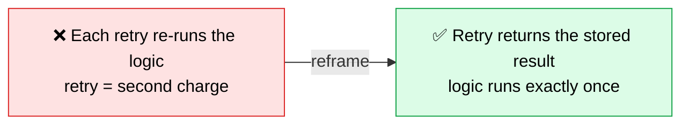
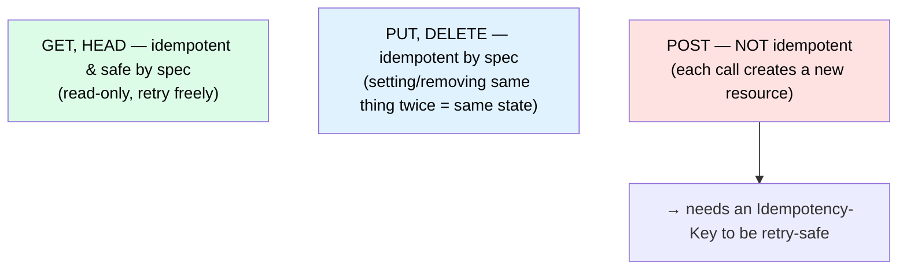
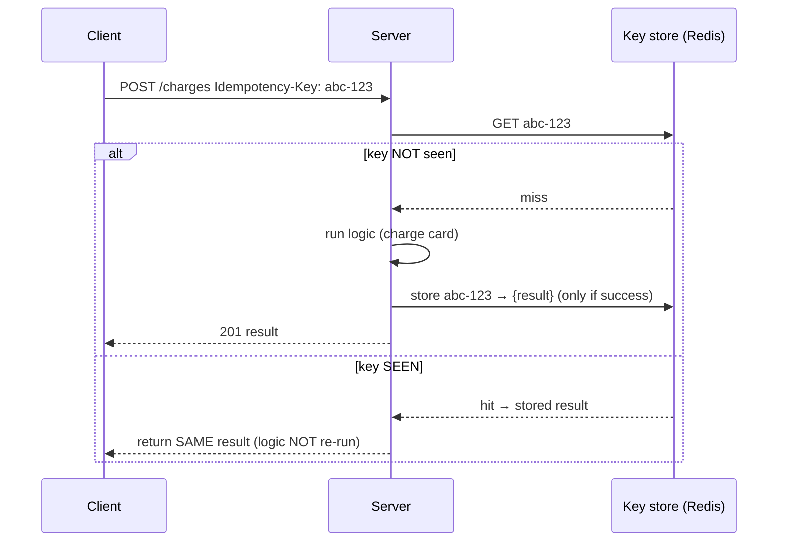
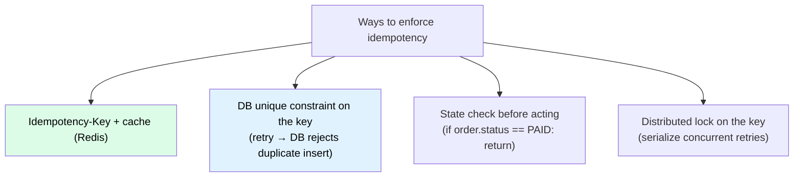
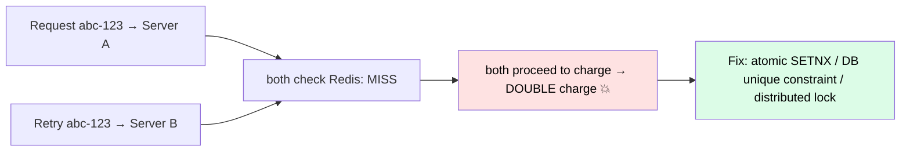
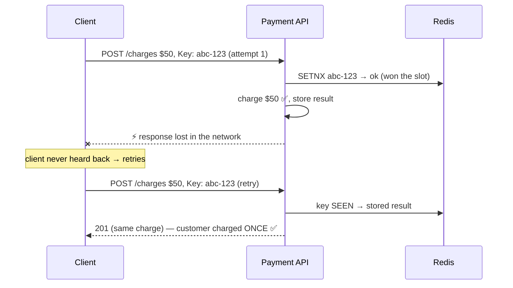
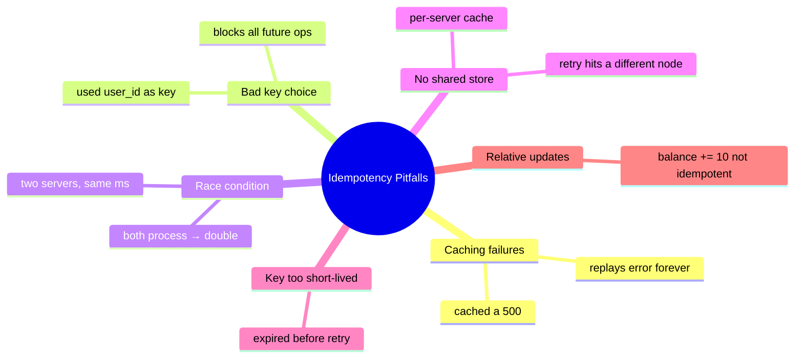

# Idempotency

> **One line:** Idempotency is the safety net of distributed systems — it makes the effect of *N identical requests* the same as *one*, so a client can retry a flaky "charge my card" call without ever double-charging.

---

## Table of Contents
1. [Why You Must Master This](#1-why-you-must-master-this)
2. [The Mental Model](#2-the-mental-model)
3. [Idempotency of HTTP Methods](#3-idempotency-of-http-methods)
4. [How Idempotency Keys Work](#4-how-idempotency-keys-work)
5. [Implementation Patterns](#5-implementation-patterns)
6. [The Race Condition (and locking)](#6-the-race-condition-and-locking)
7. [Worked Example — Safe Payment Retry](#7-worked-example--safe-payment-retry)
8. [Real-Life Use Cases](#8-real-life-use-cases)
9. [Failure Modes](#9-failure-modes)
10. [🏋️ Practice Drills](#-practice-drills)
11. [🎤 Interview Q&A Bank](#-interview-qa-bank)
12. [🎯 Staff+ Nuances](#-staff-nuances)
13. [Cheat Sheet](#13-cheat-sheet)
14. [Connections & Further Reading](#14-connections--further-reading)

---

## 1. Why You Must Master This

In distributed systems, networks fail *constantly*, and the standard fix is to retry — but retrying a write is only safe if it's idempotent.

- **The double-charge nightmare** — user clicks "Buy," the network flickers, they click again → charged twice without idempotency.
- **Network flakiness is the norm** — a request can succeed on the server but the *response* gets lost, leaving the client unsure whether to retry.
- **Consistency** — a partial failure mid-process can leave data half-written and duplicated on retry, corrupting state.

> **The core problem it solves:** *safely handling retries.* It guarantees that multiple identical requests have the same effect as one. The naive view — "only `GET` needs to be safe" — misses that the real damage happens on `POST` (create) and `PATCH` (update).

---

## 2. The Mental Model

Idempotency is an **elevator button.** Press "5th floor" once and the elevator goes to 5. Press it ten more times and it *still* just goes to 5 — the first press changed state; the rest confirm it and do nothing.





---

## 3. Idempotency of HTTP Methods



| Method | Idempotent by spec? | Why |
|--------|:-------------------:|-----|
| GET / HEAD | ✅ | read-only |
| PUT | ✅ | replacing with same value → same state |
| DELETE | ✅ | deleting twice → still deleted |
| **POST** | ❌ | each call creates another resource |
| PATCH | ⚠️ depends | idempotent only if the patch is absolute, not relative (`+1`) |

> The action item: **make `POST` retry-safe explicitly** with an idempotency key. PUT/DELETE you get for free — *if* you implement them per spec.

---

## 4. How Idempotency Keys Work



1. The **client generates a unique key** (a UUID) per logical operation and sends it: `Idempotency-Key: abc-123`.
2. The server checks a fast store (Redis/DB):
   - **New key** → process, store the result, return it.
   - **Seen key** → skip the logic, return the *stored* result from the first success.
3. Keys expire after ~24–48h.

```python
def idempotent_request(f):
    @wraps(f)
    def wrapper(*args, **kwargs):
        key = request.headers.get('Idempotency-Key')
        if not key:
            return f(*args, **kwargs)
        cached = redis.get(f"idem:{key}")
        if cached:
            return json.loads(cached), 200          # replay stored result
        result, status = f(*args, **kwargs)
        if status < 400:                            # ✅ cache ONLY successes
            redis.setex(f"idem:{key}", 86400, json.dumps(result))
        return result, status
    return wrapper
```

> **Critical:** cache only successful responses. Caching a `500` would replay the failure forever, when the whole point is to let the client retry past a transient error.

---

## 5. Implementation Patterns



- **Idempotency key + cache** — the canonical API pattern (above).
- **DB unique constraint** — make the key a `UNIQUE` column; a duplicate insert is rejected atomically by the database. Robust and race-free.
- **State check** — before acting, check if the operation already happened (`if order.status == 'PAID': return`). Good for natural keys.
- **Distributed lock** — serialize concurrent requests with the same key (see next section).

---

## 6. The Race Condition (and locking)



If two identical requests hit two servers in the same millisecond, both may see "key not found" and both process. Solve with an **atomic** operation — `SET key NX` (set-if-not-exists), a DB unique constraint, or a distributed lock — so exactly one wins the race and the other replays its result.

---

## 7. Worked Example — Safe Payment Retry



This is exactly how Stripe's idempotent charge API works: pass an `idempotency_key`, and a retry after a crash returns the original result instead of creating a second charge.

---

## 8. Real-Life Use Cases

| Situation | How idempotency applies |
|-----------|-------------------------|
| **Payments (Stripe)** | `Idempotency-Key` on charge creation → network retries never double-charge. |
| **Order placement** | Prevents duplicate orders from double-clicks or client retries. |
| **Message consumers (Kafka/SQS)** | At-least-once delivery means messages can repeat; idempotent processing makes consumers safe ("exactly-once effect"). |
| **Webhooks** | Providers retry webhooks; receivers must dedupe by event ID (idempotency). |
| **Saga / distributed transactions** | Each step must be idempotent so the orchestrator can safely retry compensations. |
| **Infrastructure (Terraform)** | `apply` is idempotent — converges to desired state regardless of how many times you run it. |

> Real-world habit: **assume every request can arrive more than once.** Design write endpoints, queue consumers, and webhook handlers to be idempotent from day one — retries are not an edge case, they're the norm.

---

## 9. Failure Modes



- **Caching failures** — caching a `5xx` replays the error; only cache successes.
- **Bad key choice** — using a non-unique value (like `user_id`) as the key blocks the user from ever doing a *second* operation. The key must be per-operation.
- **Race conditions** — concurrent retries on different servers; needs atomic SETNX / unique constraint / lock.
- **No shared store** — a per-server in-memory cache fails when the retry lands on another node; use a shared Redis/DB.
- **Relative updates** — `balance += 10` is inherently non-idempotent; prefer absolute sets or guard with a key.

---

## 🏋️ Practice Drills

> *Reason about retry-safety and key design.*

**Drill 1 — Which are idempotent?** Classify: (a) `PUT /users/5 {name:"Ana"}`, (b) `POST /orders`, (c) `DELETE /sessions/9`, (d) `PATCH /accounts/2 {balance_delta: +10}`.

<details><summary>Solution</summary>

(a) Idempotent (replacing with same value → same state). (b) **Not** idempotent (creates a new order each call → needs a key). (c) Idempotent (deleting twice → still gone). (d) **Not** idempotent — a relative delta applies repeatedly; make it absolute or guard with an idempotency key.
</details>

**Drill 2 — Why did the second charge still go through?** A team caches idempotency results in each server's local memory. Behind a load balancer, retries sometimes double-charge. Why, and fix?

<details><summary>Solution</summary>

The retry can hit a *different* server whose local cache doesn't have the key, so it processes again. Fix: use a **shared** store (Redis/DB) for keys, and make the check-and-set **atomic** (SETNX or a DB unique constraint) to also handle the race.
</details>

**Drill 3 — Key choice.** A dev uses the user's ID as the idempotency key for `POST /payments`. What breaks?

<details><summary>Solution</summary>

The first payment stores the key; every *future* payment by that user is treated as a duplicate and silently returns the old result — the user can never pay again. The key must be unique per operation (a fresh UUID per intent), not per user.
</details>

---

## 🎤 Interview Q&A Bank

**Q1. What does idempotency mean?**
> Performing the same operation multiple times has the same effect as performing it once. It makes retries safe.

**Q2. Which HTTP methods are idempotent?**
> GET, HEAD, PUT, DELETE (by spec). POST is not — each call creates a new resource — so it needs an idempotency key to be retry-safe. PATCH depends on whether the change is absolute or relative.

**Q3. How does an idempotency key work?**
> The client sends a unique key per operation; the server processes new keys and stores the result, but for a seen key it returns the stored result instead of re-running the logic. Keys expire after ~24–48h.

**Q4. Should you cache failed responses for an idempotency key?**
> No — only cache successful results. Caching a transient `5xx` would replay the failure and defeat the purpose of letting the client retry.

**Q5. How do you handle two identical requests arriving simultaneously?**
> Make the check-and-store atomic: `SET key NX`, a DB unique constraint on the key, or a distributed lock — so exactly one processes and the other replays the result.

**Q6. How do you make a Kafka/SQS consumer safe given at-least-once delivery?**
> Make processing idempotent — dedupe by message/event ID or use an idempotency key — so reprocessing a duplicate has no extra effect ("exactly-once effect" without exactly-once delivery).

**Q7. How would you safely run a distributed transaction across services?**
> Use the Saga pattern with idempotent steps and compensations, so the orchestrator can retry any step or rollback without causing duplicates.

---

## 🎯 Staff+ Nuances

- **"Exactly-once delivery" is largely a myth; "exactly-once *effect*" via idempotency is achievable.** Networks and brokers give you at-least-once; you turn that into correctness by making the *consumer* idempotent. Frame it this way in interviews — it signals distributed-systems maturity.
- **The idempotency key should capture intent, not transport.** It must be generated by the client *once per logical operation* and reused across retries — not regenerated per HTTP attempt (which would defeat it) and not derived from a non-unique entity (which would over-block).
- **Store the request fingerprint, not just the key.** Robust implementations also hash the request body and reject a reused key with a *different* body (`409 Conflict`) — catching client bugs where the same key is sent for different operations.
- **Idempotency and exactly-once interplay with the outbox pattern.** Writing the state change and the "publish event" in one DB transaction (transactional outbox) plus idempotent consumers is the standard recipe for reliable event-driven systems.
- **TTL is a correctness/cost trade-off.** Too short and a legitimate slow retry misses the cached result (double-execution); too long and you store millions of keys. 24–48h is typical; size the store from your write QPS (see [01 · BotE Estimation](../01_Planning_Foundations/Back_of_the_Envelope_Estimation.md)).
- **Idempotency ≠ deduplication of *side effects* outside your DB.** If your handler sends an email *and* writes a row, a crash between them can still double-send. Make external side effects idempotent too (provider-side keys) or move them behind the same transactional boundary.

---

## 13. Cheat Sheet

```
IDEMPOTENT = N identical requests have the SAME effect as one. (Elevator button.)

BY SPEC   GET HEAD PUT DELETE = idempotent · POST = NOT (needs a key) · PATCH = depends
KEY FLOW  client sends Idempotency-Key (UUID per OPERATION) →
          new key: run + store result · seen key: replay stored result
CACHE     only SUCCESS (status < 400). Never cache a 5xx.
RACE      atomic check-and-set: SETNX / DB UNIQUE constraint / distributed lock
STORE     shared (Redis/DB), not per-server memory · TTL ~24–48h

PATTERNS  idempotency key · DB unique constraint · state check · lock
USE FOR   payments, orders, queue consumers (at-least-once), webhooks, sagas
GOTCHAS   key per-op not per-user · relative updates (+10) aren't idempotent
```

---

## 14. Connections & Further Reading

**Within this repo:**
- [REST_API_Design.md](./REST_API_Design.md) — method semantics (safe/idempotent); [API_Design_Fundamentals.md](./API_Design_Fundamentals.md) — contract-level concern.
- [gRPC.md](./gRPC.md) — deadlines + retries need idempotency.
- [09 · Message Queues & Event Streaming](../09_Message_Queues_Event_Streaming/) — at-least-once delivery, outbox, exactly-once effect.
- [10 · Microservices & Distributed Systems](../10_Microservices_Distributed_Systems/) — Saga pattern.

**External classics:**
- [Stripe: designing robust idempotency keys](https://stripe.com/blog/idempotency).
- [AWS Builders' Library: making retries safe with idempotent APIs](https://aws.amazon.com/builders-library/making-retries-safe-with-idempotent-APIs/).
- [IETF draft: the Idempotency-Key header](https://datatracker.ietf.org/doc/html/draft-ietf-httpapi-idempotency-key-header).

---

## TL;DR
Idempotency makes **N identical requests behave like one**, so clients can safely retry across the network failures that are inevitable in distributed systems. GET/PUT/DELETE are idempotent by spec; **POST is not — make it retry-safe with a client-generated `Idempotency-Key`** stored in a shared store, replaying the result for repeat keys and **caching only successes**. Guard the **race** with atomic SETNX / a DB unique constraint, choose keys **per-operation** (never per-user), and remember the real goal in event systems is **exactly-once *effect*, not delivery**.
