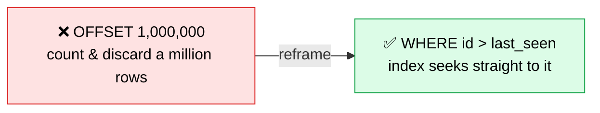
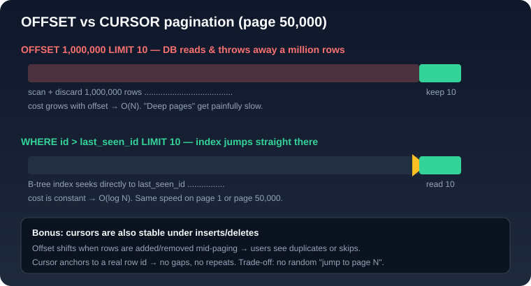
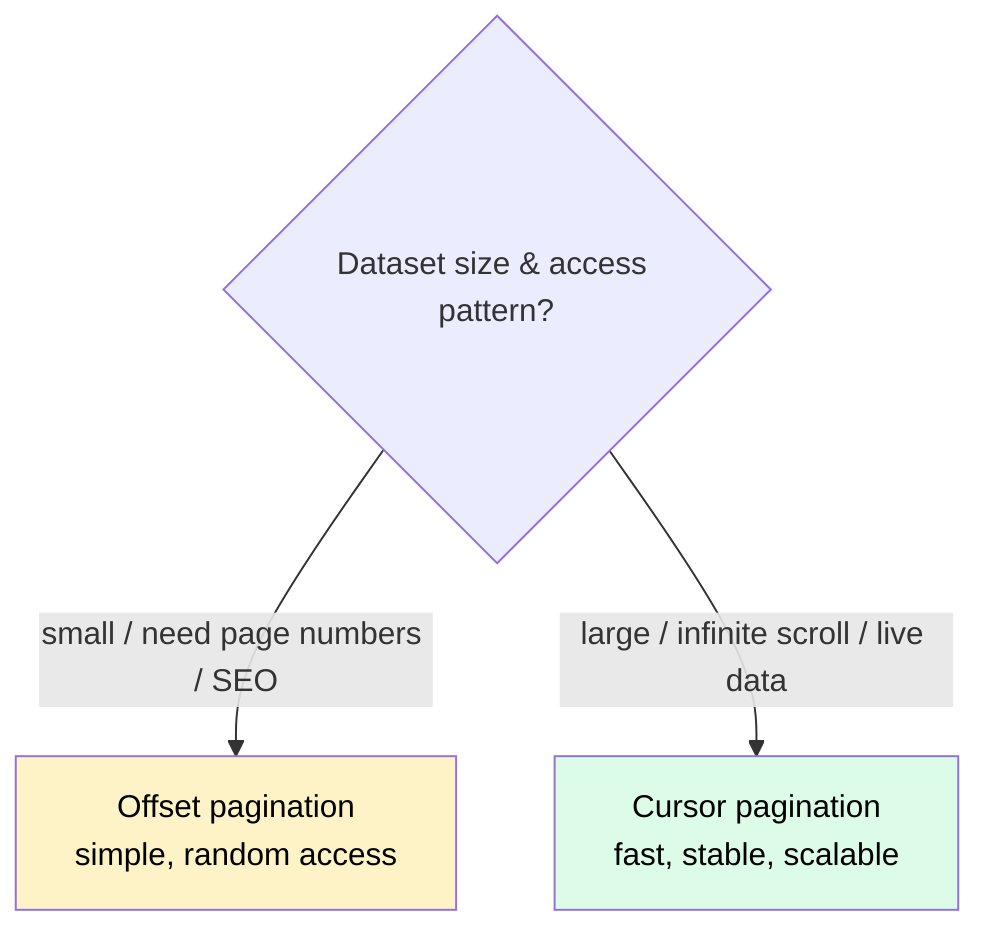
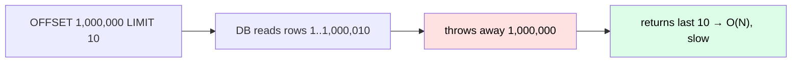
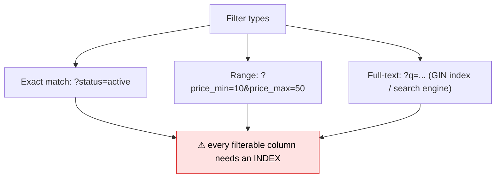
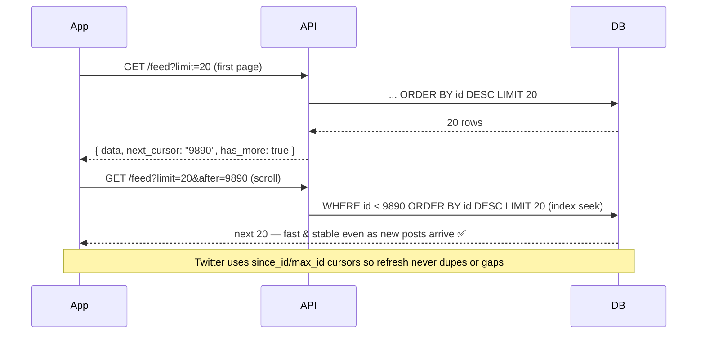
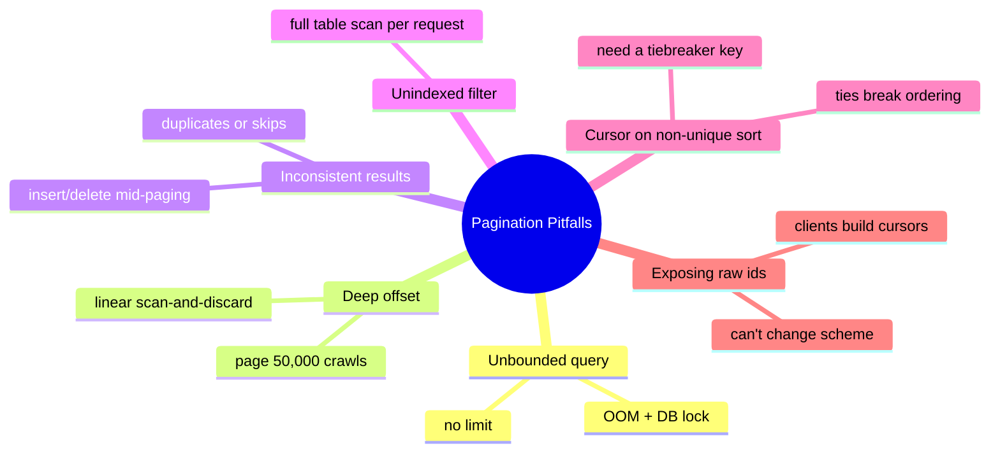

# Pagination & Filtering

> **One line:** Never let a client ask for "everything" — bound every list with pagination, and the moment your dataset is large, prefer **cursors** (jump straight to the next page via an index) over **offset** (which makes the DB count past a million rows it then throws away).

---

## Table of Contents
1. [Why You Must Master This](#1-why-you-must-master-this)
2. [The Mental Model](#2-the-mental-model)
3. [Offset vs Cursor Pagination](#3-offset-vs-cursor-pagination)
4. [Why Offset Gets Slow (and inconsistent)](#4-why-offset-gets-slow-and-inconsistent)
5. [Filtering, Sorting & Indexes](#5-filtering-sorting--indexes)
6. [Designing the API Surface](#6-designing-the-api-surface)
7. [Worked Example — A Feed Endpoint](#7-worked-example--a-feed-endpoint)
8. [Real-Life Use Cases](#8-real-life-use-cases)
9. [Failure Modes](#9-failure-modes)
10. [🏋️ Practice Drills](#-practice-drills)
11. [🎤 Interview Q&A Bank](#-interview-qa-bank)
12. [🎯 Staff+ Nuances](#-staff-nuances)
13. [Cheat Sheet](#13-cheat-sheet)
14. [Connections & Further Reading](#14-connections--further-reading)

---

## 1. Why You Must Master This

An unbounded list endpoint is a time bomb. `SELECT *` on a table that grows to 10M rows will crash the server, lock the database, and freeze the client.

- **The OOM disaster** — returning millions of rows at once exhausts server memory and DB resources.
- **User experience** — nobody scrolls 10,000 items; users "sip" data in chunks.
- **Bandwidth & cost** — shipping 100 MB of JSON when the client needs the first 10 items is slow and expensive.

> **The core problem it solves:** *unbounded queries.* It stops a simple list from becoming a performance bottleneck as data grows. And the naive fix — `LIMIT 10 OFFSET 1000000` — is itself a trap, because the DB must read and discard a million rows to find the next ten.

---

## 2. The Mental Model

Pagination is **reading a book.** *Offset* says "turn to page 450" — easy on a thin book, but you (the DB) count every page from the start to get there. *Cursor* says "continue from my bookmark" — instant, no matter how many pages came before. Filtering is the **index at the back of the book** — instead of reading everything, jump to the keyword.





---

## 3. Offset vs Cursor Pagination

| | **Offset** | **Cursor (keyset)** |
|---|-----------|---------------------|
| Request | `?limit=20&offset=40` | `?limit=20&after=eyJpZCI6NTIxfQ` |
| How | skip N rows, return next page | `WHERE id > last_seen ORDER BY id LIMIT n` |
| Speed at deep pages | **O(N)** — degrades badly | **O(log N)** — constant |
| Stable under inserts/deletes | ❌ duplicates/skips | ✅ anchored to a row |
| Jump to arbitrary page | ✅ "go to page 50" | ❌ only next/prev |
| Best for | small datasets, admin tables, SEO page links | feeds, infinite scroll, large/real-time data |



---

## 4. Why Offset Gets Slow (and inconsistent)



Two problems compound:
1. **Deep-offset slowness** — the DB can't teleport to row 1,000,000; it scans and discards everything before it. Page 50,000 is painfully slow.
2. **Inconsistency under churn** — if a row on page 1 is deleted while you're moving to page 2, every subsequent item shifts by one, so you see a **duplicate or skip an item**. Cursors avoid this by anchoring to a real, stable key.

---

## 5. Filtering, Sorting & Indexes



> **The cardinal rule:** any column you let users filter or sort by **must be indexed**, or each request triggers a full table scan. Unindexed filters are a silent path to O(N) queries and database meltdown. For free-text, use a proper full-text index (Postgres GIN) or a search engine (Elasticsearch), not `LIKE '%...%'`.

---

## 6. Designing the API Surface

A clean, consistent contract for lists:

```python
# Efficient keyset (cursor) pagination
def get_posts(after_id=None, limit=20):
    if after_id:
        # B-tree index jumps straight to the row — O(log N)
        rows = db.execute(
            "SELECT * FROM posts WHERE id > %s ORDER BY id ASC LIMIT %s",
            (after_id, limit))
    else:
        rows = db.execute(
            "SELECT * FROM posts ORDER BY id ASC LIMIT %s", (limit,))
    return rows

# Response envelope — consistent, self-describing
{
    "data": [ ... ],
    "next_cursor": "521",   # opaque token (often base64-encoded) of the last item
    "has_more": true
}
```

> Keep cursors **opaque** (base64-encode them) so clients treat them as tokens, not as IDs they construct themselves — that lets you change the underlying scheme without breaking them. Always cap `limit` to a server maximum (e.g., 100).

---

## 7. Worked Example — A Feed Endpoint



---

## 8. Real-Life Use Cases

| Situation | How pagination/filtering applies |
|-----------|----------------------------------|
| **Social feeds (Twitter/X)** | `since_id` / `max_id` cursors → pull-to-refresh never duplicates or gaps even with 10k new posts. |
| **Infinite scroll UIs** | Cursor pagination under the hood; "load more" fetches the next page by cursor. |
| **Admin dashboards** | Offset pagination for numbered pages and "jump to page N" (datasets are small/bounded). |
| **Search / catalog filtering** | Indexed filters + range queries; full-text via Elasticsearch/GIN. |
| **Data export APIs** | Cursor pagination to stream millions of rows without OOM. |
| **Sharded data** | Cursors must encode shard + key; "global page N" is impractical across shards. |

> Real-world habit: **never expose an unbounded list; default to a sane page size; cursor for scale, offset for page numbers; and index every filterable/sortable column.**

---

## 9. Failure Modes



- **Unbounded query** — no limit → OOM. Always enforce a server-side max.
- **Deep-offset slowness** — O(N) scan; switch to cursors for large data.
- **Inconsistent results** — offset shifts under churn → duplicates/skips; cursors fix it.
- **Unindexed filters** — full scan per request; index every filterable column.
- **Cursors on non-unique sort fields** — sorting by `created_at` alone breaks on ties; add a unique tiebreaker (`created_at, id`).

---

## 🏋️ Practice Drills

> *Pick the strategy and spot the performance trap.*

**Drill 1 — Why is page 5,000 slow?** A `?limit=20&offset=100000` query times out, but `?offset=0` is instant. Explain and fix.

<details><summary>Solution</summary>

Offset makes the DB read and discard 100,000 rows before returning 20 → O(N). Fix with cursor pagination: `WHERE id > last_seen_id ORDER BY id LIMIT 20`, which uses the index to jump directly → O(log N), constant regardless of depth.
</details>

**Drill 2 — Duplicate item bug.** Users on infinite scroll occasionally see the same post twice. The API uses offset pagination. Why?

<details><summary>Solution</summary>

New posts inserted at the top (or deletions) while the user pages shift every row's offset, so an item that was on "page 1" slides to "page 2" and reappears. Switch to cursor pagination anchored to a stable row key — the cursor isn't affected by inserts above it.
</details>

**Drill 3 — Cursor tiebreaker.** You paginate by `ORDER BY created_at DESC` with a cursor, but rows with identical timestamps get skipped/repeated. Fix?

<details><summary>Solution</summary>

`created_at` isn't unique, so the cursor is ambiguous at ties. Add a unique tiebreaker: `ORDER BY created_at DESC, id DESC` and encode both in the cursor (`WHERE (created_at, id) < (?, ?)`). Now ordering is total and stable.
</details>

---

## 🎤 Interview Q&A Bank

**Q1. Offset vs cursor pagination — when each?**
> Offset for small/bounded datasets needing page numbers or "jump to page N" (admin UIs, SEO). Cursor for large or frequently-changing data (feeds, infinite scroll) — it's O(log N) and stable under inserts/deletes.

**Q2. Why is OFFSET slow on large tables?**
> The DB must scan and discard all rows before the offset to find the requested page → O(N). At deep offsets it crawls.

**Q3. How do you paginate data that's constantly being inserted?**
> Cursor/keyset pagination anchored to a stable, indexed key (e.g., `id` or `created_at,id`). New inserts don't shift the cursor, so no duplicates or gaps. (Twitter's `since_id`/`max_id`.)

**Q4. What must you do before allowing a filter on a column?**
> Index it. Otherwise every filtered request is a full table scan. For free-text, use a full-text index or search engine, not `LIKE '%x%'`.

**Q5. How do you make cursors robust?**
> Make them opaque (base64) so clients can't construct them, sort by a unique key (or add a tiebreaker like `id`), and cap the page size server-side.

**Q6. What's a downside of cursor pagination?**
> No arbitrary "jump to page 50" — only next/prev. It also requires sorting by a unique, indexed, ideally immutable key, so it's awkward for sorting by arbitrary non-unique fields.

**Q7. Why is `COUNT(*)` of a huge filtered set a problem?**
> Exact total counts can require scanning the whole result set, which is expensive. Often you return "has_more" or an approximate count instead of an exact total.

---

## 🎯 Staff+ Nuances

- **"Total count" is the hidden O(N) cost.** UIs love "Page 3 of 4,182," but computing an exact count on a large filtered set can be as expensive as the query itself. Prefer `has_more` flags, approximate counts (`reltuples` / search-engine estimates), or count only when the user explicitly asks.
- **Cursors must be a total order.** Sorting by a non-unique column silently breaks pagination at ties. Always append a unique tiebreaker (`(sort_col, id)`) and encode the full tuple in the cursor.
- **Pagination across shards kills "page N".** With data spread over shards, there's no cheap global offset; cursors must encode per-shard position (or you scatter-gather and merge). This is a core reason large systems abandon offset entirely.
- **Opaque cursors are a versioning gift.** Encoding the cursor as an opaque token (not a raw ID) means you can change the underlying keyset scheme — add a tiebreaker, switch sort key — without breaking clients. Treat it like an internal contract.
- **Deletes + cursors can still surprise.** If the row a cursor points at is deleted, your `WHERE id > cursor` still works (it points to a value, not a row), but UIs caching "20 per page" may show uneven pages. Design the client to tolerate variable page sizes.
- **Rate-limit and bound expensive filters.** A filterable API is an attack surface: unindexed combos, huge `limit`s, or deep scans can be weaponized. Cap `limit`, whitelist sortable/filterable fields, and tie into [Rate_Limiting.md](./Rate_Limiting.md).

---

## 13. Cheat Sheet

```
NEVER allow an unbounded list. Always paginate + cap limit (e.g. max 100).

OFFSET  ?limit&offset  · simple · random access (page N) · O(N), shifts under churn
        → small/bounded data, admin tables, SEO page links
CURSOR  WHERE id > last  · O(log N) · stable under inserts · next/prev only
        → feeds, infinite scroll, large/real-time data, sharded data

RESPONSE  { data, next_cursor (opaque), has_more }
RULES
  index EVERY filterable/sortable column (else full scan)
  cursor sort key must be UNIQUE → add tiebreaker (created_at, id)
  free-text → full-text index / search engine, not LIKE '%x%'
  exact COUNT(*) on big sets is O(N) → prefer has_more / approximate
```

---

## 14. Connections & Further Reading

**Within this repo:**
- [API_Design_Fundamentals.md](./API_Design_Fundamentals.md) — bounded responses, avoiding fat payloads.
- [Rate_Limiting.md](./Rate_Limiting.md) — protecting expensive list/filter endpoints.
- [05 · Databases & Storage](../05_Databases_Storage/) — indexing, query plans; [01 · BotE Estimation](../01_Planning_Foundations/Back_of_the_Envelope_Estimation.md) — sizing result sets.

**External classics:**
- [Slack Engineering: evolving API pagination](https://slack.engineering/evolving-api-pagination-at-slack/).
- [Stripe: cursor-based pagination](https://stripe.com/docs/api/pagination) · [Use the Index, Luke! — keyset pagination](https://use-the-index-luke.com/no-offset).

---

## TL;DR
**Never allow unbounded queries** — bound every list and cap the page size. Use **cursor (keyset) pagination** for large or live data: it's **O(log N)**, stable under inserts/deletes, and the right call for feeds and infinite scroll. Use **offset** only for small datasets that need page numbers. **Index every filterable/sortable column**, give cursors a **unique sort key (with a tiebreaker)**, keep them **opaque**, and avoid exact `COUNT(*)` on huge sets.
