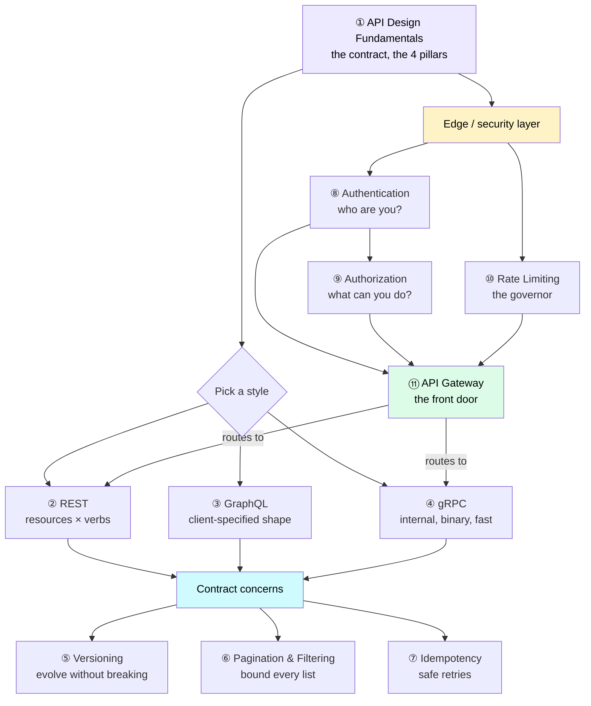
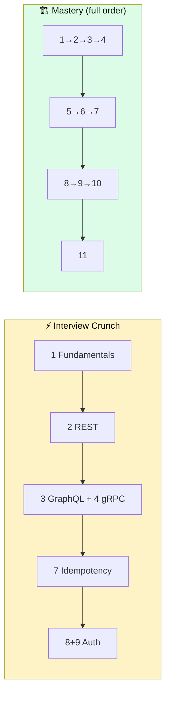

# 02 · API & Interface Design 🔌

> **The contract between services.** An API is a *promise to the consumer* — once others build on it, it's forever. This section covers how to design that promise (REST/GraphQL/gRPC), evolve it safely (versioning, idempotency, pagination), and protect it at the edge (auth, rate limiting, gateways). Master it and every service you build becomes something others can depend on.

---

## 🎯 What You'll Be Able To Do

- **Choose the right interface style** — REST vs GraphQL vs gRPC — and defend the trade-off.
- **Design a contract that lasts** — consumer-first, evolvable, with honest status codes and consistent errors.
- **Make writes safe** — idempotency keys, bounded lists, backward-compatible versioning.
- **Secure the edge** — authentication, object-level authorization (no IDOR), and rate limiting.
- **Architect the front door** — an API gateway that centralizes cross-cutting concerns without becoming a SPOF or a god-object.

---

## 🗺️ How the 11 Topics Interlock



> **The spine:** *Fundamentals → pick a style → harden the contract (versioning, pagination, idempotency) → protect the edge (authN → authZ, rate limiting) → put it all behind a gateway.*

---

## 📚 The Complete File Index

| # | Topic | One-line | Key takeaway |
|---|-------|----------|--------------|
| 1 | [API Design Fundamentals](./API_Design_Fundamentals.md) | An API is a contract | Design the dashboard, hide the engine; never expose the DB schema |
| 2 | [REST API Design](./REST_API_Design.md) | Resources × HTTP verbs | Stateless + cacheable; honest status codes; `401`≠`403` |
| 3 | [GraphQL](./GraphQL.md) | Client picks the exact shape | Kills over/under-fetch; beware N+1 resolvers → DataLoader |
| 4 | [gRPC](./gRPC.md) | Typed RPC over Protobuf + HTTP/2 | ~10× faster internally; REST at edge, gRPC east-west |
| 5 | [API Versioning](./API_Versioning.md) | Evolve without breaking | Parallel roads; additive changes; version only for breaking changes |
| 6 | [Pagination & Filtering](./Pagination_Filtering.md) | Never allow unbounded lists | Cursor for scale (O(log N)), offset for page numbers; index filters |
| 7 | [Idempotency](./Idempotency.md) | Safe retries | N requests = 1 effect; `Idempotency-Key` for POST; cache only successes |
| 8 | [Authentication](./Authentication.md) | Who are you? | Salted slow hashes; never roll your own crypto; HttpOnly JWTs |
| 9 | [Authorization](./Authorization.md) | What can you do? | Authenticated ≠ authorized; object-level checks prevent IDOR (OWASP #1) |
| 10 | [Rate Limiting](./Rate_Limiting.md) | The governor | Token bucket; shared Redis; return `429` + `Retry-After`, never `500` |
| 11 | [API Gateway](./API_Gateway.md) | The front door | Cross-cutting concerns once at the edge; not a SPOF, not a god-object |

---

## 🧭 Suggested Study Paths



| Goal | Path | Why |
|------|------|-----|
| **⚡ Interview in 48h** | 1 → 2 → 3/4 (compare) → 7 → 8/9 | Styles + the trade-off + idempotency + auth = the most-asked 80% |
| **🏗️ Deep mastery** | 1 → 2 → 3 → 4 → 5 → 6 → 7 → 8 → 9 → 10 → 11 | Follows the dependency spine end to end |
| **🔐 Security focus** | 8 → 9 → 10 → 11 | AuthN → AuthZ → rate limiting → gateway enforcement |
| **🚀 "Designing a public API"** | 1 → 2 → 5 → 6 → 7 → 10 | Contract, evolution, bounded lists, safe writes, quotas |

> **Study each file by** doing the 🏋️ **Practice Drills before the solutions**, rehearsing the 🎤 **Interview Q&A out loud**, and reading 🎯 **Staff+ Nuances** for senior-level depth.

---

## 🔑 The Decision Table (whole-section cheat card)

```
STYLE   REST = public/cacheable/resource · GraphQL = flexible frontends/BFF · gRPC = internal/fast/streaming
VERBS   GET(safe,idem) POST(create,NOT idem→key) PUT(replace,idem) PATCH(partial) DELETE(idem)
CODES   200·201·204·304 · 400·401(unauth)·403(forbidden)·404·409·422·429(rate)·500·503
EVOLVE  additive = safe · remove/rename/retype = breaking → new version · be a tolerant reader
LISTS   cursor (O(log N), stable) for scale · offset for page numbers · index every filter
RETRIES POST needs Idempotency-Key · cache only successes · atomic check (SETNX/unique)
AUTHN   salted slow hash (bcrypt/argon2) · JWT in HttpOnly cookie · short TTL + refresh · OAuth2/OIDC
AUTHZ   authenticated ≠ authorized · object-level checks (anti-IDOR) · default-deny · RBAC/ABAC/ReBAC
LIMITS  token bucket · shared Redis (watch hot key) · key by identity not IP · 429 + Retry-After
GATEWAY cross-cutting concerns only · N-S edge (vs LB=copies, mesh=E-W) · redundant (it's a SPOF)
```

---

## 🎨 Conventions & Authoring

- Every file follows the root [TEMPLATE.md](../TEMPLATE.md). Animated SVGs live in [/assets](../assets/).
- Each file ends with the three mastery sections: 🏋️ Practice Drills, 🎤 Interview Q&A Bank, 🎯 Staff+ Nuances.

---

## ➡️ Where This Connects

- ⬅️ Built on [01 · Planning & Foundations](../01_Planning_Foundations/) — estimation, latency, availability, and CAP shape these API decisions.
- ➡️ [08 · Communication Protocols](../08_Communication_Protocols/) — HTTP/1.1 vs 2 vs 3, WebSockets, the wire under REST/gRPC.
- ➡️ [10 · Microservices & Distributed Systems](../10_Microservices_Distributed_Systems/) — gateways, service mesh, circuit breakers.
- ➡️ [11 · Security & Identity](../11_Security_Identity/) — OAuth2/OIDC, JWT, encryption in depth.
- ➡️ [06 · Caching & Performance](../06_Caching_Performance/) — making REST GETs fly.

---
*Part of the [System Design & Architecture Master Repository](../README.md). The contract is the product; the implementation behind it is disposable.*
