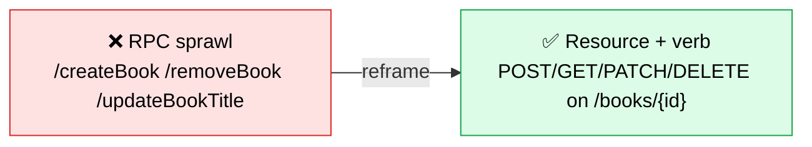
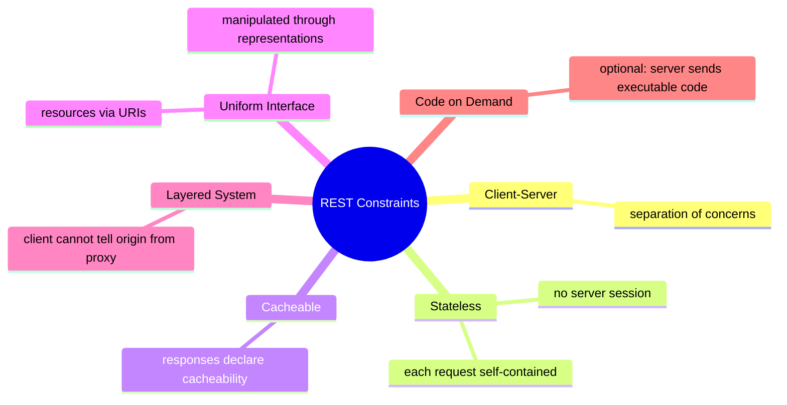
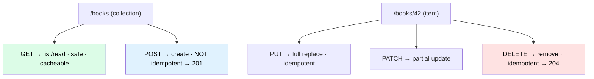
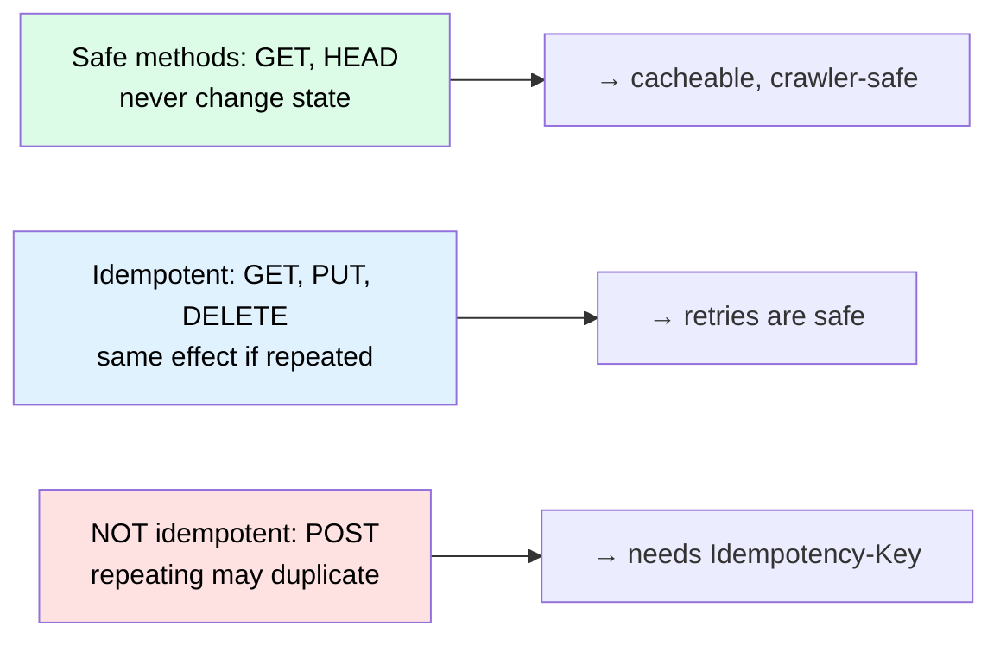
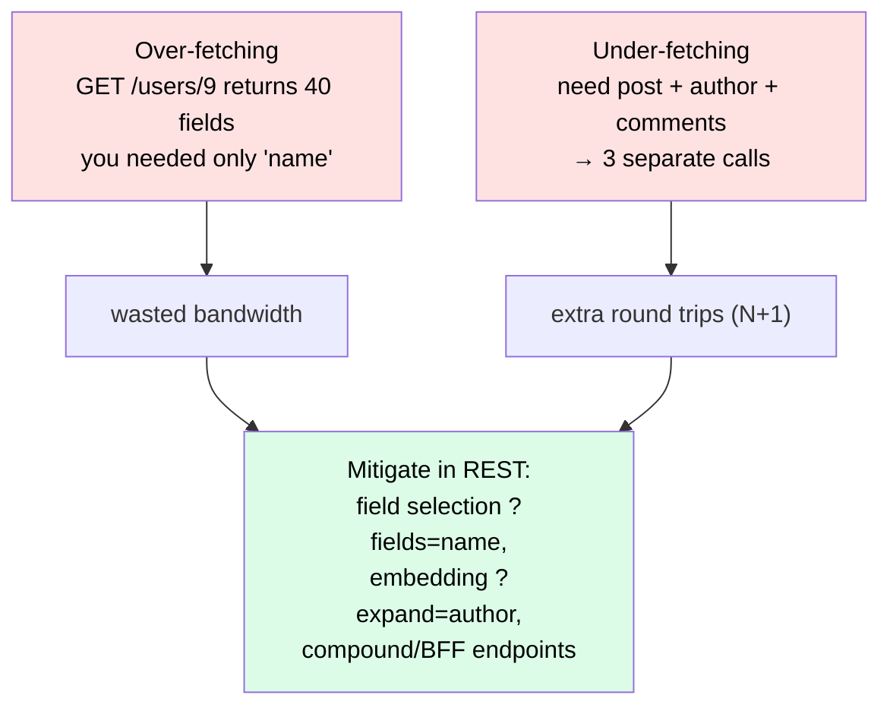
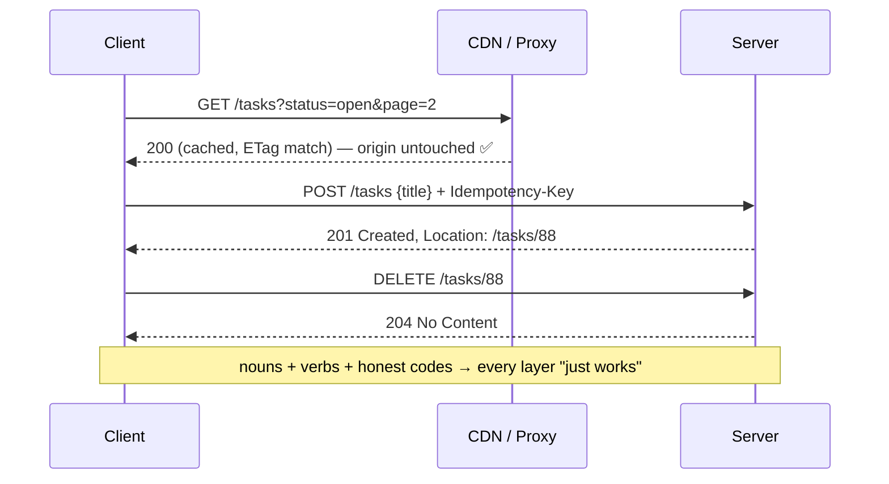
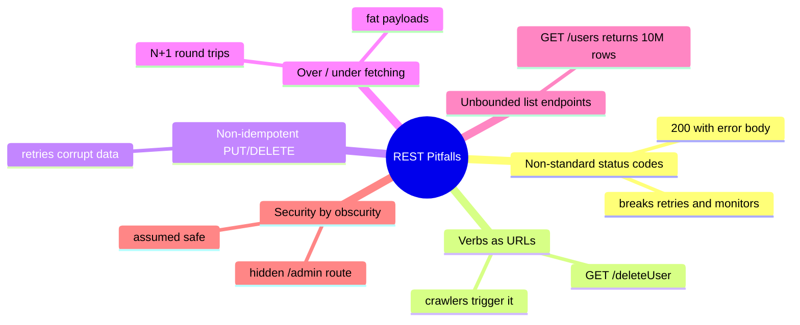

# REST API Design

> **One line:** REST is the language of the web — model your system as **resources (nouns)** manipulated by **standard HTTP verbs**, lean on statelessness and caching, and any client in any language can talk to you with zero custom tooling.

---

## Table of Contents
1. [Why You Must Master This](#1-why-you-must-master-this)
2. [The Mental Model](#2-the-mental-model)
3. [The 6 REST Constraints](#3-the-6-rest-constraints)
4. [Verbs, Resources & Status Codes](#4-verbs-resources--status-codes)
5. [Idempotency & Safety of Methods](#5-idempotency--safety-of-methods)
6. [Over-fetching & Under-fetching](#6-over-fetching--under-fetching)
7. [Worked Example — A Tasks API](#7-worked-example--a-tasks-api)
8. [Real-Life Use Cases](#8-real-life-use-cases)
9. [Failure Modes](#9-failure-modes)
10. [🏋️ Practice Drills](#-practice-drills)
11. [🎤 Interview Q&A Bank](#-interview-qa-bank)
12. [🎯 Staff+ Nuances](#-staff-nuances)
13. [Cheat Sheet](#13-cheat-sheet)
14. [Connections & Further Reading](#14-connections--further-reading)

---

## 1. Why You Must Master This

REST (Representational State Transfer) is the **default architectural style of the internet.** If you build a web service, it's probably RESTful — and interviewers expect fluency.

- **Universal interoperability** — any language (Python, JS, Go, Java) talks to a REST API over plain HTTP, no special client libraries.
- **Scales by design** — REST's statelessness constraint means any server handles any request, so you scale horizontally without session juggling.
- **Free infrastructure leverage** — every proxy, CDN, and load balancer already understands HTTP verbs, status codes, and cache headers.

> **The core problem it solves:** *server coupling and non-standard protocols.* It stops clients from needing to know the server's internal state machine, and prevents dangerous misuse like using `GET` to delete data (which crawlers can trigger accidentally).

---

## 2. The Mental Model

REST is about **resources (nouns)** acted on by **standard actions (verbs).** Think of a library: each book is a *resource*; you browse it (`GET`), donate one (`POST`), update its cover (`PUT`/`PATCH`), or discard it (`DELETE`). You never need a bespoke `DiscardBookNow` button — you apply the standard *discard* action to that *book*.





---

## 3. The 6 REST Constraints



The first five are what make REST scalable and cacheable; **statelessness** and **cacheability** are the two that interviewers care about most because they directly enable horizontal scale and CDN offload.

---

## 4. Verbs, Resources & Status Codes



| Verb | Action | Idempotent? | Safe? | Typical success |
|------|--------|:-----------:|:-----:|-----------------|
| GET | read | ✅ | ✅ | 200 |
| POST | create | ❌ | ❌ | 201 Created |
| PUT | replace | ✅ | ❌ | 200 / 204 |
| PATCH | partial update | ⚠️ usually no | ❌ | 200 |
| DELETE | remove | ✅ | ❌ | 204 No Content |

**Status codes are part of the contract** — `401` (not authenticated) ≠ `403` (authenticated but forbidden); `400` (bad request) ≠ `422` (semantically invalid); `429` means rate-limited. Use them precisely so proxies, monitors, and clients can react automatically.

---

## 5. Idempotency & Safety of Methods



> **Why this matters:** networks fail and clients retry. If `PUT`/`DELETE` are idempotent (as the spec requires), a retried request can't corrupt data. `POST` isn't idempotent, so creating money-moving resources needs an explicit idempotency key — see [Idempotency.md](./Idempotency.md).

---

## 6. Over-fetching & Under-fetching

REST's main ergonomic weakness — and the reason GraphQL exists:



You can mitigate within REST (sparse fieldsets, embedding, compound endpoints), but if your frontend is highly variable, that's the signal to consider [GraphQL](./GraphQL.md).

---

## 7. Worked Example — A Tasks API

```python
# Flask-style RESTful controller for a "Task" resource
@app.route('/tasks/<int:task_id>', methods=['GET', 'PATCH', 'DELETE'])
def handle_task(task_id):
    if request.method == 'GET':
        return get_task(task_id), 200            # safe, cacheable

    if request.method == 'PATCH':                # partial update
        updated = db.update_task(task_id, request.json)
        return updated, 200

    if request.method == 'DELETE':
        db.remove_task(task_id)
        return '', 204                           # No Content, idempotent
```



---

## 8. Real-Life Use Cases

| Situation | How REST applies |
|-----------|------------------|
| **Public web APIs (GitHub, Stripe)** | Resource URLs (`/users/{u}/followers`), standard codes, Link-header pagination — intuitive and cacheable. |
| **CDN-cacheable reads** | `GET` responses with `Cache-Control`/`ETag` are served from the edge → origin load near zero for static-ish data. |
| **Mobile/web CRUD apps** | The 80% case — simple resources, standard verbs, minimal tooling. |
| **Webhooks & integrations** | Partners POST events to your REST endpoints; universal HTTP means anyone can integrate. |
| **Microservice public edge** | REST/JSON at the boundary (familiar to all), often gRPC internally (see [gRPC.md](./gRPC.md)). |

> Real-world habit: **use HTTP the way it was designed** — correct verbs, honest status codes, cache headers on reads. You inherit a planet's worth of caching and tooling for free.

---

## 9. Failure Modes



- **Non-standard status codes** — `200 OK` carrying an error breaks automated retry and monitoring.
- **Verbs in the URL** — `GET /deleteUser?id=5` can be triggered by a crawler or prefetch; mutations must use non-safe methods.
- **Non-idempotent PUT/DELETE** — violates the spec; network retries then corrupt data.
- **Over/under-fetching** — see §6.
- **Unbounded lists** — `GET /users` with no pagination is an OOM waiting to happen; always paginate ([Pagination_Filtering.md](./Pagination_Filtering.md)).

---

## 🏋️ Practice Drills

> *Map the right verb, code, and resource. Try before peeking.*

**Drill 1 — Verb & code.** A client updates only a user's email. Which verb, which success code, and is it idempotent?

<details><summary>Solution</summary>

`PATCH /users/{id}` with `{"email": "..."}` → `200 OK`. PATCH on the same body is effectively idempotent here (setting email to the same value repeatedly is harmless), though PATCH isn't guaranteed idempotent in general. (Use `PUT` if you replace the whole resource.)
</details>

**Drill 2 — 401 vs 403 vs 404.** A user requests `/orders/124` which belongs to someone else. Which status, and why might 404 be safer than 403?

<details><summary>Solution</summary>

`403 Forbidden` if they're authenticated but not allowed; `401` if not authenticated at all. Returning `404 Not Found` can be *safer* — it doesn't even confirm the resource exists, denying attackers information (relates to IDOR; see [Authorization.md](./Authorization.md)).
</details>

**Drill 3 — Fix the RPC API.** Redesign `POST /getOrders`, `POST /addOrder`, `POST /cancelOrder?id=5` as REST.

<details><summary>Solution</summary>

`GET /orders` (list, with pagination/filters), `POST /orders` (create → 201), and `POST /orders/5/cancellations` or `PATCH /orders/5 {"status":"cancelled"}`. Cancellation-as-a-sub-resource is RESTful and auditable.
</details>

---

## 🎤 Interview Q&A Bank

**Q1. What are the key REST constraints?**
> Client-server, stateless, cacheable, uniform interface, layered system, and (optional) code-on-demand. Statelessness and cacheability are what make REST scale and offload to CDNs.

**Q2. PUT vs PATCH?**
> PUT replaces the entire resource (idempotent); PATCH applies a partial modification. Use PATCH when sending only changed fields.

**Q3. Which HTTP methods are idempotent, and why care?**
> GET, PUT, DELETE (and HEAD) are idempotent; POST is not. It matters because network retries are safe only for idempotent operations — otherwise you risk duplicates/corruption.

**Q4. 401 vs 403?**
> 401 = not authenticated (who are you?). 403 = authenticated but not allowed (you can't do this). Distinct failures clients handle differently.

**Q5. How do you handle over-fetching/under-fetching in REST?**
> Sparse fieldsets (`?fields=`), resource embedding/expansion (`?expand=author`), compound or BFF endpoints — or switch to GraphQL if the frontend's needs are highly variable.

**Q6. How does REST achieve scalability?**
> Statelessness: any node can serve any request, so you scale horizontally; and cacheability lets CDNs/proxies serve reads without hitting the origin.

**Q7. What's HATEOAS and do real APIs use it?**
> Hypermedia As The Engine Of Application State — responses include links to related actions/resources. Most "pragmatic REST" APIs (Stripe) skip full HATEOAS but keep resource/verb conventions.

---

## 🎯 Staff+ Nuances

- **Almost nobody ships "pure" REST — and that's fine.** Fielding's full constraints (especially HATEOAS) are rarely implemented. "Pragmatic REST" (resource/verb conventions, standard codes, JSON) is the de-facto standard; know the difference so you can defend the pragmatic choice.
- **Caching is REST's superpower — design for it.** `ETag` + `If-None-Match` (304 Not Modified) and `Cache-Control` can cut origin load by 90%+. GET responses that are accidentally personalized or uncacheable throw that away. Be deliberate about cache keys and `Vary` headers.
- **Statelessness has a cost you must place elsewhere.** "Self-contained requests" means session/auth state moves to tokens (JWT) or a shared store — pushing complexity into [Authentication.md](./Authentication.md). REST doesn't remove state; it relocates it.
- **Compound documents prevent the N+1 without abandoning REST.** Standards like JSON:API let a single response embed related resources (`include=author,comments`), getting GraphQL-like efficiency while keeping URL-based caching.
- **Idempotency for POST is a contract decision, not an HTTP given.** The spec says POST isn't idempotent; production payment APIs add an `Idempotency-Key` header to make it safely retryable. Decide this at design time for every mutating endpoint.
- **Error taxonomy is an API feature.** A consistent, documented error envelope with stable machine-readable `code`s (not just prose messages) is what lets clients build robust retry/branching logic. Treat it as carefully as the success schema.

---

## 13. Cheat Sheet

```
REST = RESOURCES (nouns) × HTTP VERBS, statelessly, cacheably.

VERBS   GET(read,safe,idem) POST(create,NOT idem→201) PUT(replace,idem)
        PATCH(partial) DELETE(remove,idem→204)
CODES   2xx ok · 201 created · 204 no content · 304 not modified
        400 bad · 401 unauth · 403 forbidden · 404 · 409 conflict · 422 · 429 · 500 · 503
IDEMPOTENT  GET PUT DELETE HEAD  ·  NOT: POST (add Idempotency-Key)
SCALE   stateless → horizontal · ETag/Cache-Control → CDN offload

DO   correct verbs · honest codes · paginate lists · cache GETs
DON'T  GET that mutates · 200-on-error · unbounded lists · verbs in URLs
WEAKNESS  over/under-fetch → sparse fields, ?expand, compound docs, or GraphQL
```

---

## 14. Connections & Further Reading

**Within this repo:**
- [API_Design_Fundamentals.md](./API_Design_Fundamentals.md) — the principles REST implements.
- [GraphQL.md](./GraphQL.md) · [gRPC.md](./gRPC.md) — the alternatives and when to switch.
- [Idempotency.md](./Idempotency.md) · [Pagination_Filtering.md](./Pagination_Filtering.md) · [API_Versioning.md](./API_Versioning.md) — REST contract concerns.
- [06 · Caching & Performance](../06_Caching_Performance/) — making GETs fly; [08 · Communication Protocols](../08_Communication_Protocols/) — HTTP under the hood.

**External classics:**
- [Roy Fielding's dissertation (REST)](https://www.ics.uci.edu/~fielding/pubs/dissertation/rest_arch_style.htm) — the source.
- [MDN HTTP overview](https://developer.mozilla.org/en-US/docs/Web/HTTP) · [JSON:API spec](https://jsonapi.org/).
- [Stack Overflow: REST API best practices](https://stackoverflow.blog/2020/03/02/best-practices-for-rest-api-design/).

---

## TL;DR
REST models your system as **resources manipulated by standard HTTP verbs**, using **statelessness** to scale horizontally and **cacheability** to offload reads to CDNs. Use the right verb, honest status codes (`401`≠`403`, `429` for limits), and respect idempotency (GET/PUT/DELETE safe to retry; POST needs an idempotency key). Its weakness is **over/under-fetching** — mitigate with sparse fields and compound documents, or reach for GraphQL when the frontend's data needs are highly variable.
