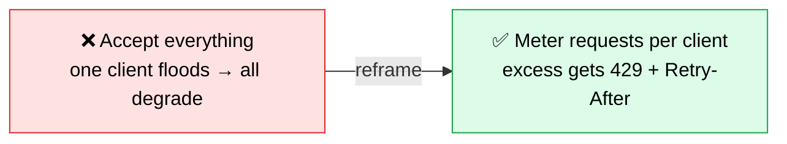
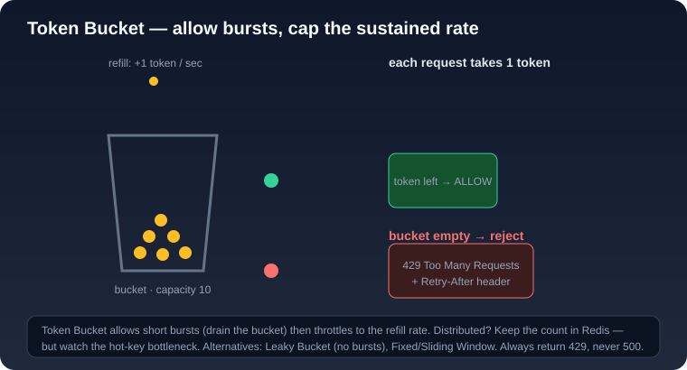
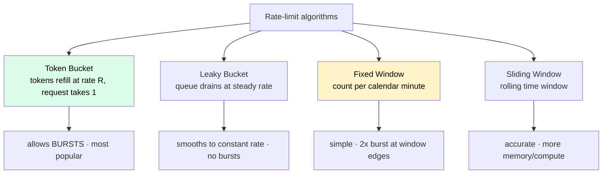
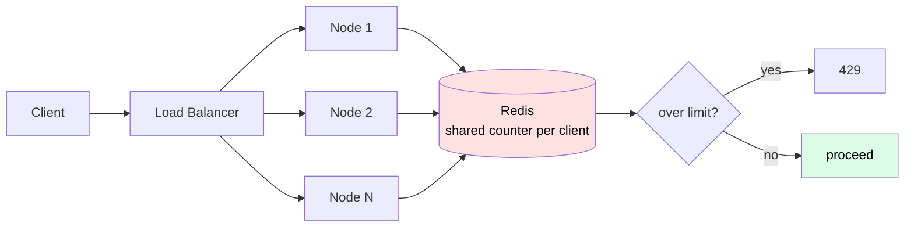
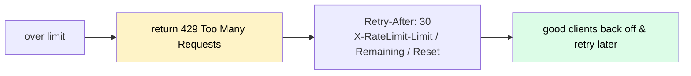
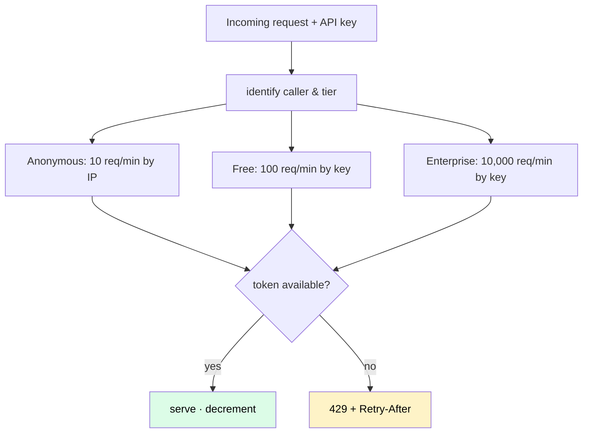
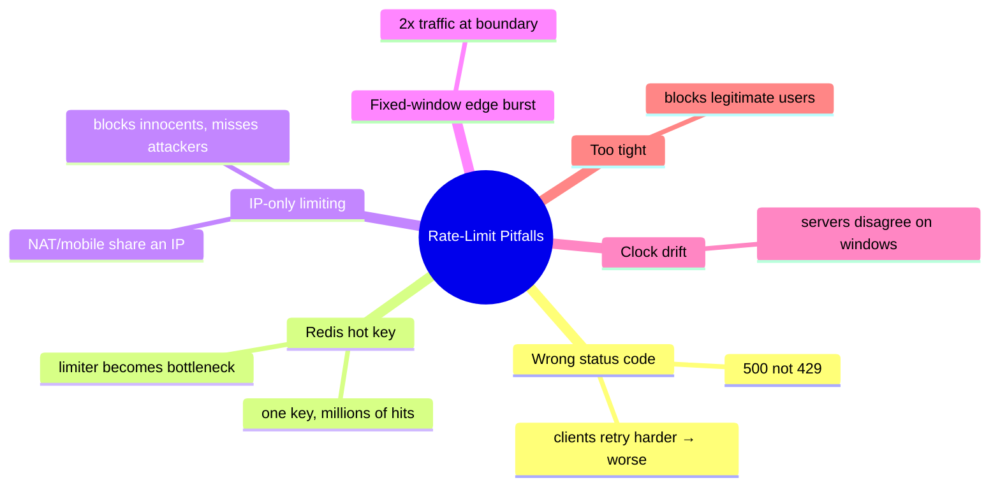

# Rate Limiting

> **One line:** Rate limiting is the governor on your API engine — a turnstile that lets requests in only as fast as the system can safely handle, protecting you from noisy neighbors, brute-force attacks, and cascading failures, and returning a polite `429` instead of falling over.

---

## Table of Contents
1. [Why You Must Master This](#1-why-you-must-master-this)
2. [The Mental Model](#2-the-mental-model)
3. [The Four Algorithms](#3-the-four-algorithms)
4. [Token Bucket in Depth](#4-token-bucket-in-depth)
5. [Distributed Rate Limiting](#5-distributed-rate-limiting)
6. [The Client Contract: 429, Retry-After, Headers](#6-the-client-contract-429-retry-after-headers)
7. [Worked Example — Tiered API Limits](#7-worked-example--tiered-api-limits)
8. [Real-Life Use Cases](#8-real-life-use-cases)
9. [Failure Modes](#9-failure-modes)
10. [🏋️ Practice Drills](#-practice-drills)
11. [🎤 Interview Q&A Bank](#-interview-qa-bank)
12. [🎯 Staff+ Nuances](#-staff-nuances)
13. [Cheat Sheet](#13-cheat-sheet)
14. [Connections & Further Reading](#14-connections--further-reading)

---

## 1. Why You Must Master This

A single greedy client making 10,000 req/s can starve everyone else. Rate limiting bounds that.

- **The noisy-neighbor problem** — one abusive user shouldn't degrade the service for everyone.
- **DDoS & abuse defense** — your first line against floods, scraping, and brute-force login attempts.
- **SaaS monetization** — it's how you enforce Free (100 req/day) vs Enterprise tiers.
- **Stability / cascading-failure prevention** — stops a bug in Service A from spamming Service B and taking the whole system down.

> **The core problem it solves:** *resource exhaustion.* It keeps CPU, memory, and DB connections from being saturated by any one client. The naive approaches — no limiting, or limiting only by raw IP — fail behind NAT/mobile carriers (many users share one IP) and against distributed attacks.

---

## 2. The Mental Model

A rate limiter is a **subway turnstile.** A thousand people can arrive at once, but they enter only as fast as the turnstile allows — so the platform (your server) never exceeds its safe fire-code capacity. Jump it too fast and you're blocked (a `429`).





---

## 3. The Four Algorithms



| Algorithm | Behavior | Bursts? | Trade-off |
|-----------|----------|:-------:|-----------|
| **Token Bucket** | bucket of tokens refilled at rate R; each request takes one | ✅ allowed | the popular default; tolerates spikes |
| **Leaky Bucket** | requests queue, processed at a steady rate; overflow dropped | ❌ smoothed | enforces constant output rate |
| **Fixed Window** | count requests per fixed window (e.g., per minute) | ⚠️ edge bursts | simple but allows ~2× at window boundaries |
| **Sliding Window** | rolling window (log or weighted counter) | controlled | most accurate, more memory/compute |

---

## 4. Token Bucket in Depth

```python
import time

class TokenBucket:
    def __init__(self, capacity, fill_rate):
        self.capacity = capacity        # max tokens (burst size)
        self.fill_rate = fill_rate      # tokens added per second (sustained rate)
        self.tokens = capacity
        self.ts = time.time()

    def allow(self):
        now = time.time()
        # lazily refill based on elapsed time (no background timer needed)
        self.tokens = min(self.capacity, self.tokens + (now - self.ts) * self.fill_rate)
        self.ts = now
        if self.tokens >= 1:
            self.tokens -= 1
            return True
        return False                    # → respond 429 Too Many Requests

limiter = TokenBucket(capacity=10, fill_rate=1)   # burst 10, then 1/sec
```

> **Why token bucket wins:** `capacity` controls the **burst** allowance and `fill_rate` the **sustained** rate — two independent knobs. Refill is computed lazily from elapsed time, so there's no background timer. It tolerates the bursty reality of traffic while still capping long-run throughput.

---

## 5. Distributed Rate Limiting

A limit must apply across *all* your servers, not per-node — otherwise 50 nodes each allow the full limit.



- **Central store (Redis)** holds the counter/bucket per client so the limit is global. Use atomic ops (`INCR`+`EXPIRE`, or a Lua script) to avoid races.
- **The hot-key risk:** if millions of requests for one key hit a single Redis node, Redis becomes the bottleneck. Mitigate with **local token buckets per node** (approximate, allocate a share of the budget locally) or **sharded/clustered Redis**.

---

## 6. The Client Contract: 429, Retry-After, Headers



> **Return `429`, never `500`.** A `500` tells clients "server bug — retry immediately," which *adds* load during an incident. `429` + `Retry-After` tells well-behaved clients exactly when to come back. Expose `X-RateLimit-Limit / Remaining / Reset` (as GitHub/Twitter do) so clients can self-throttle proactively.

---

## 7. Worked Example — Tiered API Limits



The same token-bucket machinery, parameterized per tier and keyed by API key (authenticated) or IP (anonymous). This is exactly how commercial APIs enforce plans — rate limiting *is* the monetization mechanism.

---

## 8. Real-Life Use Cases

| Situation | How rate limiting applies |
|-----------|---------------------------|
| **Public APIs (GitHub, Twitter, Stripe)** | Per-key quotas + `X-RateLimit-*` headers + `429` keep massive public systems stable. |
| **Login endpoints** | Throttle attempts to defeat brute-force/credential-stuffing (pairs with [Authentication.md](./Authentication.md)). |
| **DDoS / scraping defense** | Edge rate limiting (Cloudflare/WAF) absorbs floods before they reach origin. |
| **SaaS plan enforcement** | Free vs Pro vs Enterprise tiers = different limits on the same engine. |
| **Protecting a fragile dependency** | Cap calls to a downstream/legacy service so a spike can't topple it (cascading-failure prevention). |
| **GraphQL** | Limit by *query complexity/cost*, not request count (see [GraphQL.md](./GraphQL.md)). |

> Real-world habit: **rate-limit at the edge/gateway by an authenticated key (not just IP), return 429 with Retry-After, and pick limits from real capacity math** (peak QPS a node sustains — see [01 · QPS Estimation](../01_Planning_Foundations/QPS_TPS_Estimation.md)).

---

## 9. Failure Modes



- **Wrong status code** — returning `500` instead of `429` makes clients retry aggressively, worsening the overload.
- **Redis hot key** — a single counter key for millions of requests bottlenecks the limiter itself; use local buckets or sharded Redis.
- **IP-only limiting** — NAT/mobile carriers put many users behind one IP (blocks innocents) while attackers rotate IPs (evades you); prefer authenticated keys.
- **Fixed-window edge bursts** — clients can send 2× the limit straddling a window boundary; sliding window or token bucket fixes it.
- **Clock drift** — servers disagreeing on window boundaries causes inconsistent limits.
- **Limits too tight** — legitimate users blocked during normal peaks; tune from real data.

---

## 🏋️ Practice Drills

> *Pick the algorithm, the key, and the response.*

**Drill 1 — Burst vs smooth.** You want to allow short bursts (a client syncing 20 items at once) but cap sustained traffic at 5 req/s. Which algorithm and parameters?

<details><summary>Solution</summary>

Token Bucket with `capacity=20` (burst) and `fill_rate=5` (sustained). The client can spend up to 20 tokens instantly, then is throttled to the 5/s refill. Leaky bucket would *smooth* the burst away, which you don't want here.
</details>

**Drill 2 — Edge-burst bug.** With a fixed 100/min window, a client sends 100 requests at 12:00:59 and 100 more at 12:01:00 — 200 in two seconds. Why, and how to fix?

<details><summary>Solution</summary>

Fixed windows reset on the boundary, so requests bunched at the end of one window and start of the next both count as "within limit" → ~2× burst. Fix with a sliding window (log or weighted counter) or token bucket, which account for the rolling time, not calendar windows.
</details>

**Drill 3 — Distributed correctness.** Behind a load balancer, each of 10 nodes enforces "100/min" locally. A client gets ~1000/min through. Why and fix?

<details><summary>Solution</summary>

Per-node limits multiply by node count. Use a shared store (Redis) with atomic increments so the limit is global, or give each node a coordinated share of the budget (local buckets summing to the global limit) to avoid a Redis hot key.
</details>

---

## 🎤 Interview Q&A Bank

**Q1. Token Bucket vs Leaky Bucket?**
> Token Bucket refills tokens at a fixed rate and lets requests consume them — it *allows bursts* up to the bucket capacity. Leaky Bucket processes a queue at a steady rate, *smoothing* output with no bursts. Token bucket is the popular default for APIs.

**Q2. How do you rate-limit in a distributed system?**
> Keep the counter/bucket in a shared store (Redis) with atomic operations so the limit is global across all nodes. Watch for the hot-key bottleneck — mitigate with local per-node buckets or sharded Redis.

**Q3. What status code for a rate-limited request, and why not 500?**
> `429 Too Many Requests` with a `Retry-After` header. `500` signals a server bug and makes clients retry immediately, amplifying the overload; `429` tells well-behaved clients to back off.

**Q4. Why is limiting by IP alone insufficient?**
> NAT and mobile carriers put many legitimate users behind one IP (you'd block innocents), while attackers rotate IPs (you'd miss them). Prefer limiting by an authenticated API key/user ID, with IP as a coarse fallback.

**Q5. What's the fixed-window edge-burst problem?**
> Counting per fixed calendar window lets a client send the full limit at the end of one window and again at the start of the next — ~2× the intended rate in a short span. Sliding window or token bucket avoids it.

**Q6. How do you handle a sudden 10× traffic spike?**
> Rate limit + load shedding at the edge to protect core capacity, autoscale for legitimate growth, a queue/waiting room for events, and a CDN/cache to absorb reads. Return 429 to excess rather than collapsing.

**Q7. How do you rate-limit GraphQL?**
> By computed query *cost/complexity*, not request count, because one query can be vastly more expensive than another.

---

## 🎯 Staff+ Nuances

- **Rate limiting and load shedding are different tools for different failures.** Rate limiting enforces *fairness/quotas per client*; load shedding drops *lowest-priority work under global overload* to protect the system. Mature systems do both, and prioritize critical traffic (health checks, paying customers) when shedding.
- **Pick limits from capacity math, not vibes.** The limit should derive from the peak QPS a node sustains *left of the knee* (see [01 · QPS Estimation](../01_Planning_Foundations/QPS_TPS_Estimation.md) and [Capacity Planning](../01_Planning_Foundations/Capacity_Planning.md)). A limit that doesn't map to real capacity either wastes headroom or fails to protect.
- **Distributed accuracy vs latency is the core trade-off.** A strictly-global Redis counter is accurate but adds a hop and a hot-key risk; per-node local buckets are fast and resilient but only approximate. Many large systems accept approximate limiting (each node gets a share of the budget) for resilience.
- **The 429 should be *cheap* to produce.** If generating a rejection costs nearly as much as serving the request, an attacker can still exhaust you. Reject as early and as cheaply as possible — ideally at the edge/gateway/WAF before the request touches app logic.
- **Layer your limits.** Edge/CDN (volumetric DDoS) → gateway (per-key quotas) → service (protect a specific dependency) → DB (connection limits). No single layer is sufficient; defense in depth.
- **Expose the limit to clients and document it.** `X-RateLimit-*` headers + clear docs let good clients self-throttle, which reduces 429s for everyone. Opaque limits just generate support tickets and retries.

---

## 13. Cheat Sheet

```
RATE LIMIT = the governor. Meter requests; reject excess with 429 (NOT 500).

ALGORITHMS
  Token Bucket   refill rate R, cap = burst   ← popular default, allows bursts
  Leaky Bucket   steady drain, no bursts
  Fixed Window   simple, ~2x edge burst
  Sliding Window accurate, more memory

DISTRIBUTED  shared Redis counter (atomic INCR+EXPIRE / Lua)
             ⚠ hot key → local per-node buckets or sharded Redis
KEY BY       authenticated API key / user id  (NOT raw IP — NAT/mobile)
RESPONSE     429 + Retry-After + X-RateLimit-Limit/Remaining/Reset

SET LIMITS from real capacity (peak QPS left of the knee)
LAYERS  edge/WAF → gateway → service → DB · reject early & cheap
RELATED  load shedding (drop low-priority under overload) · GraphQL → limit by query COST
```

---

## 14. Connections & Further Reading

**Within this repo:**
- [API_Gateway.md](./API_Gateway.md) — the usual enforcement point; [Authentication.md](./Authentication.md) — limit login brute force.
- [GraphQL.md](./GraphQL.md) — query-cost limiting.
- [01 · QPS Estimation](../01_Planning_Foundations/QPS_TPS_Estimation.md) · [Capacity Planning](../01_Planning_Foundations/Capacity_Planning.md) — where the limit numbers come from.
- [07 · Load Balancing & Scalability](../07_Load_Balancing_Scalability/) · [11 · Security & Identity](../11_Security_Identity/) — DDoS, the broader context.

**External classics:**
- [Stripe: scaling your API with rate limiters](https://stripe.com/blog/rate-limiters).
- [Cloudflare rate-limiting blog](https://blog.cloudflare.com/counting-things-a-lot-of-different-things/) · [Kong: scalable rate-limiting algorithms](https://konghq.com/blog/how-to-design-a-scalable-rate-limiting-algorithm).

---

## TL;DR
Rate limiting is the **governor on your API** — a turnstile that admits requests only as fast as you can safely serve them, defending against noisy neighbors, brute force, DDoS, and cascading failures. **Token Bucket** (independent burst + sustained knobs) is the default; enforce limits **globally via a shared Redis counter** (watch the hot key), key by **authenticated identity not raw IP**, and always reply **`429` + `Retry-After` + `X-RateLimit-*`** — never `500`. Set limits from **real capacity math**, reject **early and cheaply at the edge**, and layer it with **load shedding** for overload.
