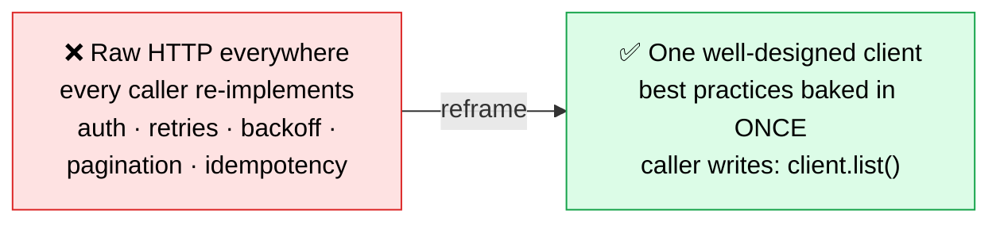
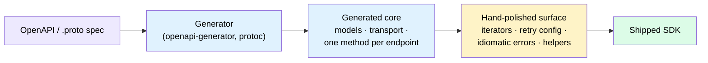
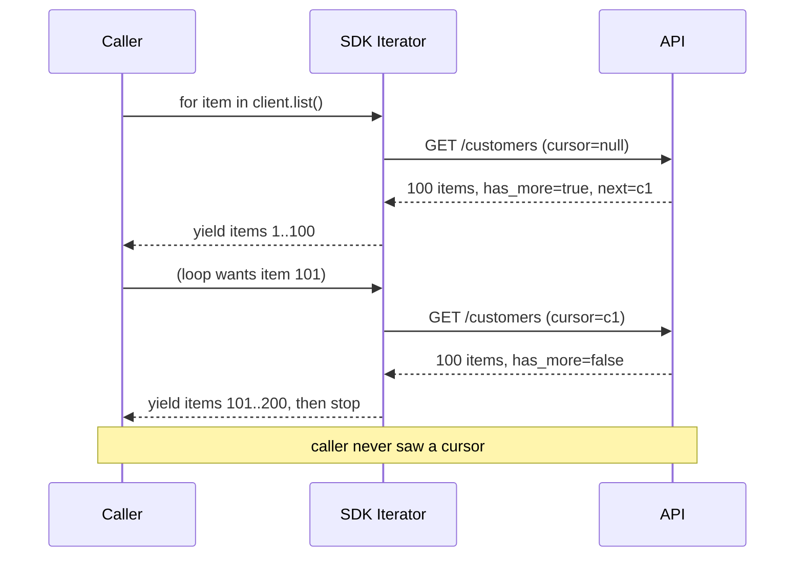
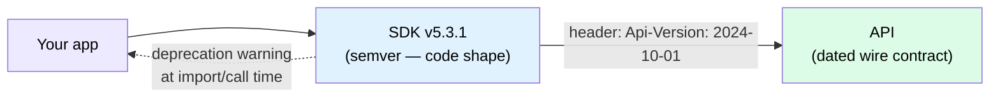
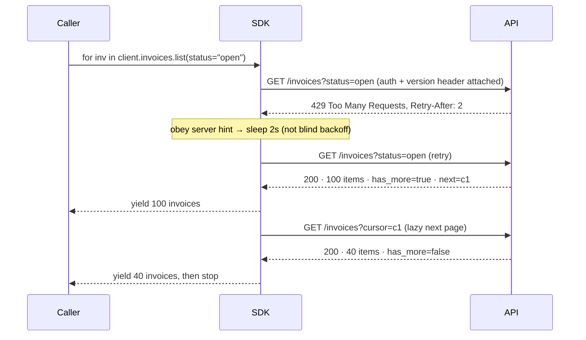
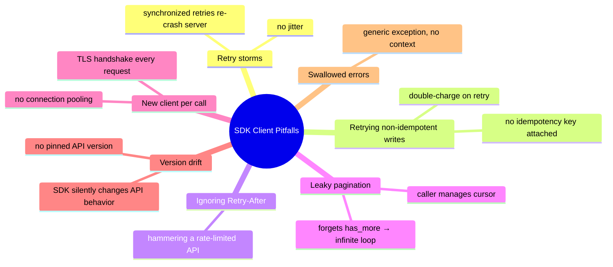

# SDK & Client Design

> **One line:** An SDK is the *client half* of your API contract — it turns "read the docs, hand-roll HTTP, hope you got retries right" into `client.charges.create(...)`, baking your best practices into every integration so no user has to reinvent them.

---

## Table of Contents
1. [Why You Must Master This](#1-why-you-must-master-this)
2. [The Mental Model](#2-the-mental-model)
3. [Generated vs Handwritten SDKs](#3-generated-vs-handwritten-sdks)
4. [Resilience Baked In — Retries, Backoff & Idempotency](#4-resilience-baked-in--retries-backoff--idempotency)
5. [Pagination Iterators](#5-pagination-iterators)
6. [Auth, Config & Connection Handling](#6-auth-config--connection-handling)
7. [Versioning the SDK Alongside the API](#7-versioning-the-sdk-alongside-the-api)
8. [Worked Example — A Resilient List Call](#8-worked-example--a-resilient-list-call)
9. [Real-Life Use Cases](#9-real-life-use-cases)
10. [Failure Modes](#10-failure-modes)
11. [🏋️ Practice Drills](#-practice-drills)
12. [🎤 Interview Q&A Bank](#-interview-qa-bank)
13. [🎯 Staff+ Nuances](#-staff-nuances)
14. [Cheat Sheet](#14-cheat-sheet)
15. [Connections & Further Reading](#15-connections--further-reading)

---

## 1. Why You Must Master This

A great API with a bad client experience still fails. The SDK is where every design decision you made gets *consumed* — and where every gap you left gets re-implemented (badly) by thousands of users.

- **The client is part of the contract.** Users don't experience your OpenAPI spec; they experience `pip install`, autocomplete, and the first error message. That surface *is* your API to them.
- **It slashes integration time.** A raw REST integration means reading docs, wiring auth, handling pagination, and getting retries right. An SDK collapses that to minutes — Stripe's whole pitch is "seven lines to take a payment."
- **It encodes best practices exactly once.** Retry-with-backoff, idempotency keys, token refresh, and Retry-After handling are *hard to get right*. Put them in the SDK and every user gets them for free; leave them out and every user re-derives them, mostly wrong.
- **A bad client silently DDoSes you.** The classic incident: users hand-roll retries with no backoff, a blip causes a retry storm, and the retries take down the service that was already recovering.

> **The core problem it solves:** *making correct API usage the default.* A well-designed SDK means the easy path (call the method) is also the *safe* path (retries, idempotency, pagination, auth all handled) — so correctness doesn't depend on every caller being an expert.

**Prerequisites:** [API_Design_Fundamentals.md](./API_Design_Fundamentals.md) (the contract the SDK wraps) and [Idempotency.md](./Idempotency.md) (what the SDK auto-attaches on writes).

---

## 2. The Mental Model

Think of the SDK as a **concierge** standing between the caller and your API. The caller says "list all my customers"; the concierge quietly handles the elevator (auth), the retries when the front desk is busy, the paperwork stamped on each request (idempotency key), and fetching page after page — and just hands back the customers.



> **Hold onto this:** the SDK's job is to make the *easy* call the *correct* call. If using the API safely requires reading a wiki, the SDK has failed.

---

## 3. Generated vs Handwritten SDKs

The first fork: do you **generate** the SDK from a machine-readable spec (OpenAPI / Protobuf), or **handwrite** it by hand for each language?

**Generated** — a tool like [openapi-generator](https://openapi-generator.tech/) or `protoc` reads your [OpenAPI/proto spec](./API_Documentation_OpenAPI.md) and emits client code: types, methods, serialization. gRPC's entire model is generated stubs — you compile the `.proto` and get a typed client in every language (see [gRPC.md](./gRPC.md)).

**Handwritten** — engineers craft the client surface deliberately: idiomatic naming, ergonomic helpers, hand-tuned errors.

| Dimension | Generated (OpenAPI/proto) | Handwritten |
|-----------|---------------------------|-------------|
| Coverage | ✅ 100% of endpoints, instantly | ❌ manual — lags the API |
| Speed to ship a new language | ✅ minutes (re-run the generator) | ❌ weeks per language |
| Consistency with the spec | ✅ can't drift — it *is* the spec | ⚠️ can drift; needs discipline |
| Idiomatic feel | ❌ often clunky, non-native naming | ✅ feels hand-crafted per language |
| Ergonomics (iterators, helpers) | ❌ generic, one-size-fits-all | ✅ tailored (auto-paging, sugar) |
| Maintenance cost | ✅ low (regenerate) | ❌ high (N languages by hand) |

> The action item: **the hybrid wins at scale.** Generate the *core* — the transport, models, and one method per endpoint — from the spec so coverage is free and can't drift. Then hand-polish the *surface*: iterators, retry config, idiomatic errors, and convenience helpers. This is how Stripe, AWS, and Twilio ship: a generated foundation with a hand-crafted ergonomic layer on top.



---

## 4. Resilience Baked In — Retries, Backoff & Idempotency

This is the single highest-value thing an SDK does: **make transient failures invisible without endangering the server.** Networks fail constantly; the SDK should retry — but *only* correctly.

The rules a good retry layer follows:

1. **Retry only retryable errors.** Network timeouts, connection resets, `429`, and `5xx` are retryable. A `400`/`401`/`404` is a *your-request-is-wrong* error — retrying it just wastes calls. Retry only [idempotent](./Idempotency.md) operations, or writes carrying an idempotency key (below).
2. **Exponential backoff + jitter.** Wait `base * 2^attempt`, but add randomness. Without jitter, a thousand clients that failed at the same instant all retry at the same instant → a synchronized **retry storm** (a thundering herd) that re-crashes the recovering server. Jitter spreads them out. See [Rate_Limiting.md](./Rate_Limiting.md).
3. **Respect `Retry-After`.** If the server says "come back in 2s" (via a `429`/`503` header), *obey it* — that number beats your own backoff math because the server knows its own load.
4. **Auto-attach an `Idempotency-Key` on writes.** So a retried `POST` is safe (no double-charge). The SDK generates the key *once per logical call* and reuses it across that call's retries — exactly the [idempotency contract](./Idempotency.md). Stripe's SDKs do this automatically.
5. **Cap it.** Max ~3–5 attempts and a total deadline, so a permanently-down dependency fails fast instead of hanging forever.

```python
import time, random, uuid

RETRYABLE = {429, 500, 502, 503, 504}

def request_with_retry(method, path, body=None, max_attempts=4):
    # one idempotency key per LOGICAL call, reused across retries
    idem_key = str(uuid.uuid4()) if method in ("POST", "PATCH") else None
    for attempt in range(max_attempts):
        resp = http.send(method, path, body=body, idempotency_key=idem_key)
        if resp.status < 400:
            return resp                                  # success
        if resp.status not in RETRYABLE or attempt == max_attempts - 1:
            raise ApiError(resp)                         # give up: non-retryable or out of tries
        # server's hint wins; otherwise exponential backoff + full jitter
        delay = resp.headers.get("Retry-After")
        wait = float(delay) if delay else random.uniform(0, 2 ** attempt)
        time.sleep(wait)
```

> **Why jitter matters (a real number):** 10,000 clients, 1s fixed backoff → 10,000 simultaneous retries every second. With full jitter over a 0–2s window, that same load spreads to ~5,000/s peak — the difference between the server recovering and re-dying. AWS's ["Exponential Backoff and Jitter"](https://aws.amazon.com/blogs/architecture/exponential-backoff-and-jitter/) is the canonical reference; the AWS SDKs implement it by default.

---

## 5. Pagination Iterators

An API returns lists in pages (cursor-based; see [Pagination_Filtering.md](./Pagination_Filtering.md)). The naive client makes the caller manage the cursor by hand:

```python
# ❌ Every caller re-writes this loop — and gets the termination wrong
cursor = None
while True:
    page = client.get("/customers", params={"cursor": cursor})
    for c in page["data"]:
        process(c)
    if not page["has_more"]:
        break
    cursor = page["next_cursor"]
```

The SDK's job is to **hide the cursor behind a lazy iterator** so the caller just loops over items — the SDK fetches the next page transparently, only when needed:

```python
# ✅ The SDK hides paging entirely — caller sees a flat stream of items
for customer in client.customers.list():        # auto-pages under the hood
    process(customer)

class AutoPager:
    def __init__(self, client, path, params):
        self._client, self._path, self._params = client, path, dict(params)
    def __iter__(self):
        cursor = None
        while True:
            page = self._client.get(self._path, {**self._params, "cursor": cursor})
            yield from page["data"]              # stream this page's items
            if not page["has_more"]:
                return                           # done — no more pages
            cursor = page["next_cursor"]         # fetch next page lazily on demand
```

Because it's **lazy** (a generator), memory stays flat — you never hold all pages at once — and the caller can `break` early after N items without fetching the rest. This is exactly what [GitHub's Octokit](https://github.com/octokit) `paginate`, the [AWS SDK paginators](https://boto3.amazonaws.com/v1/documentation/api/latest/guide/paginators.html), and the Google API client's auto-paging iterators all do.



> One item, one line: **the caller should never type the word "cursor."** Auto-paging is the clearest signal of a hand-polished (vs raw-generated) SDK surface.

---

## 6. Auth, Config & Connection Handling

The SDK owns the boring-but-critical plumbing so every caller doesn't:

- **Credentials.** Accept an API key or OAuth token, read it from an env var by default (never hard-coded), and attach it to every request. For OAuth, **auto-refresh** the token when it nears expiry and *retry the in-flight call* transparently — the caller never sees a `401` from an expired token. See [Authentication.md](./Authentication.md).
- **Base URL / environments.** One config switch between prod, sandbox, and a self-hosted host — not string-concatenated URLs scattered through user code.
- **Timeouts.** Sane defaults (e.g. connect 10s, read 30s) *and* per-call overrides. A missing timeout is a classic outage cause: one hung upstream call ties up a thread forever, exhausting the pool.
- **Connection pooling / keep-alive.** Reuse TCP+TLS connections across calls. Re-establishing TLS per request adds a full handshake round-trip (tens of ms) to *every* call; a pooled connection amortizes it to ~zero. This alone can halve p99 latency for chatty clients.
- **Sensible defaults, overridable.** Retry counts, backoff base, user-agent (so *you* can identify SDK version in your logs), and pagination page size — all configured once at client construction.

```python
client = Api(
    api_key=os.environ["API_KEY"],   # from env, never hard-coded
    base_url="https://api.example.com",
    timeout=30,                       # read timeout (seconds)
    max_retries=4,
    api_version="2024-10-01",         # pin the API version (see §7)
)
```

> **Rule of thumb:** construct the client **once** and reuse it (it holds the connection pool); constructing a new client per request throws away pooling and tanks throughput.

---

## 7. Versioning the SDK Alongside the API

Two version numbers coexist and must not be confused:

- **The SDK's own version** (semver: `MAJOR.MINOR.PATCH`). MAJOR = breaking change to the *SDK's* method signatures; MINOR = new methods; PATCH = fixes. This is about the *client code shape*.
- **The API version** the SDK talks to (e.g. `2024-10-01`). This is about the *wire contract*. See [API_Versioning.md](./API_Versioning.md).

The two are **decoupled on purpose.** Stripe **pins the API version** inside the SDK: upgrading the SDK does *not* silently change the API behavior your integration sees, because the pinned version travels in a header. You upgrade the SDK for bug fixes and new ergonomics *without* being force-migrated onto new API semantics — you opt into those separately by bumping the pinned version.



Good SDK versioning practice:

- **Follow semver strictly** so users can pin `~5.3` and trust minor upgrades won't break them.
- **Pin the API version** in the client (a header or config), so the API team can ship new versions without breaking old SDKs.
- **Emit deprecation warnings** *in the client* — a runtime `DeprecationWarning` or a log line when a soon-to-be-removed method or field is used, ideally naming the replacement and the removal date. This is the earliest, loudest place a user will notice a deprecation. See [API_Versioning.md](./API_Versioning.md).
- **Keep SDK releases lockstep-capable with API releases:** when the API ships a new dated version, the SDK ships a minor version that *supports* pinning to it — but doesn't *force* it.

---

## 8. Worked Example — A Resilient List Call

A user writes one line: `for inv in client.invoices.list(status="open"): ...`. Watch everything the SDK does underneath — and how a single number (the `Retry-After` header) drives the behavior.



The caller's one line silently got: auth injection, API-version pinning, a `429` transparently retried *after honoring the server's 2s hint*, and two pages of cursor pagination flattened into a single stream of 140 items. That is the entire value proposition of an SDK in one trace — **the correct behavior was the default behavior.**

---

## 9. Real-Life Use Cases

| Situation | How SDK design applies | The decision it forces |
|-----------|------------------------|------------------------|
| **Stripe payments** | SDK auto-attaches `Idempotency-Key` and retries writes safely | Build idempotency into the client, not just docs |
| **AWS SDK (boto3)** | Built-in exponential backoff + jitter and paginators for every list API | Ship resilience + auto-paging as defaults |
| **Twilio** | Handwritten idiomatic clients per language over a generated core | Invest in ergonomics for the top languages |
| **GitHub Octokit** | `octokit.paginate()` hides `Link`-header cursor pagination | Never make the caller manage cursors |
| **gRPC services** | `protoc` generates typed stubs in every language from one `.proto` | Generate for coverage; deadlines/retries need idempotency |
| **Internal microservice clients** | A shared client library bakes in auth, timeouts, tracing headers | Standardize resilience across all service-to-service calls |

> Real-world habit: **before publishing an API, write the SDK call you wish existed and work backwards.** If the ideal client code is ugly, the API design is the problem — fix it before shipping.

---

## 10. Failure Modes



- **Retry storm.** *Symptom:* an API blip escalates into a full outage that won't recover. *Root cause:* clients retry with fixed (no-jitter) backoff, so all retries land simultaneously. *Fix:* exponential backoff **with full jitter**, capped attempts, and honor `Retry-After`.
- **Double-charge on retry.** *Symptom:* customers charged twice during network flakiness. *Root cause:* the SDK retries a `POST` with no idempotency key. *Fix:* auto-generate one key per logical call, reuse it across retries ([Idempotency.md](./Idempotency.md)).
- **Infinite / truncated pagination.** *Symptom:* loop never ends, or silently stops at page 1. *Root cause:* hand-rolled cursor logic mishandles `has_more`/`next_cursor`. *Fix:* provide a tested auto-pager; never expose the cursor.
- **Connection churn.** *Symptom:* high p99 latency and CPU on TLS. *Root cause:* a fresh client (and pool) per request → TLS handshake every call. *Fix:* construct the client once; reuse the pool.
- **Silent behavior change on upgrade.** *Symptom:* an SDK patch bump changes production API behavior. *Root cause:* the API version isn't pinned in the client. *Fix:* pin the dated API version in a header/config, decoupled from the SDK's semver.
- **Opaque errors.** *Symptom:* users can't tell a `429` from a `400` from a network drop. *Root cause:* the SDK throws one generic exception. *Fix:* typed error classes (`RateLimitError`, `AuthError`, `ApiError`) carrying status, request ID, and the retry decision.

---

## 🏋️ Practice Drills

> *Cover the solutions and attempt first — active recall is the point.*

**Drill 1 — Which errors should the SDK retry?** Classify: (a) `429 Too Many Requests`, (b) `400 Bad Request`, (c) a TCP connection reset, (d) `404 Not Found`, (e) `503` with `Retry-After: 5`.

<details><summary>Solution</summary>

Retry (a) `429` — with backoff, honoring any `Retry-After`. **Don't** retry (b) `400` — the request is malformed; retrying repeats the same error. Retry (c) connection reset — transient network. **Don't** retry (d) `404` — the resource isn't there. Retry (e) `503`, and specifically **sleep 5s** because the server told you to. Rule: retry `429`/`5xx`/network errors on idempotent (or key-carrying) calls; never retry `4xx` client errors except `429`.
</details>

**Drill 2 — Design an auto-pager.** Sketch an iterator so a caller writes `for x in client.list(): ...` with no cursor visible, that stays memory-flat over a million items.

<details><summary>Solution</summary>

A lazy generator: fetch page 1, `yield` each item, and only fetch the next page (using `next_cursor`) when the consumer asks for the item past the current page's end; stop when `has_more` is false. Because it yields item-by-item and holds only one page at a time, memory is O(page size), not O(total) — and the caller can `break` early without fetching the rest. See §5.
</details>

**Drill 3 — Backoff math.** 5,000 clients all get a `503` at t=0 and retry with fixed 1s backoff. What happens, and how does jitter change it?

<details><summary>Solution</summary>

With fixed backoff, all 5,000 retry at exactly t=1s — a synchronized spike that re-overwhelms the recovering server, which returns `503` again, and the herd re-synchronizes at t=2s: a self-perpetuating retry storm. With **full jitter** (`sleep = random(0, 2^attempt)`), the 5,000 retries spread uniformly across the window, roughly halving the peak rate and letting the server drain the backlog. Jitter, not the backoff base, is what breaks the synchronization.
</details>

**Drill 4 — Generated or handwritten?** You must ship SDKs for 8 languages next quarter, but your two flagship languages need best-in-class ergonomics. What do you do?

<details><summary>Solution</summary>

Hybrid. Generate all 8 from the OpenAPI/proto spec for instant, drift-free coverage. Then hand-polish the surface (auto-pagers, retry config, idiomatic errors, helpers) on the two flagship languages first, and backport that polish to the rest over time. Coverage is free; ergonomics is where you spend human effort, prioritized by usage.
</details>

---

## 🎤 Interview Q&A Bank

**Q1. Why ship an SDK at all instead of just documenting the REST API?**
> Because the client is part of the contract. An SDK cuts integration from days to minutes and, more importantly, encodes hard-to-get-right behavior — retries with backoff, idempotency keys, pagination, auth refresh — exactly once, so every user gets it correct by default instead of re-implementing it (badly). *(signal: names "correctness by default," not just convenience.)*

**Q2. Generated vs handwritten SDKs — which and why?**
> Generated from OpenAPI/proto gives instant, drift-free coverage across many languages but feels clunky; handwritten is idiomatic and ergonomic but slow and hard to maintain per language. At scale you do both: generate the core (models, transport, one method per endpoint) and hand-polish the surface (iterators, retry config, idiomatic errors). That's Stripe/AWS/Twilio's model.

**Q3. How should an SDK handle retries?**
> Retry only retryable errors — `429`, `5xx`, network failures — and only on idempotent calls or writes carrying an idempotency key. Use exponential backoff **with jitter** to avoid synchronized retry storms, honor the server's `Retry-After` header over your own math, and cap attempts with a total deadline so a dead dependency fails fast.

**Q4. Why is jitter necessary if you already have exponential backoff?**
> Exponential backoff spaces out *one* client's retries, but if thousands of clients failed at the same instant they'll all back off by the same amount and retry simultaneously — a synchronized thundering herd that re-crashes the recovering server. Jitter randomizes each client's wait so the load spreads out.

**Q5. How does an SDK make retried writes safe?**
> It auto-attaches an `Idempotency-Key` on `POST`/`PATCH`, generated once per logical call and reused across that call's retries. The server then treats a retry as the same operation and returns the original result instead of, say, charging twice. That's the client half of the idempotency contract.

**Q6. How do you hide pagination from the caller?**
> Expose a lazy auto-paging iterator so the caller writes `for item in client.list()` and never touches a cursor. Under the hood the SDK fetches page 1, yields items, and fetches the next page only when the consumer advances past the current one, stopping when `has_more` is false — memory stays flat and early `break` is cheap.

**Q7. How do you version an SDK against a changing API?**
> Keep two decoupled version lines: the SDK's own semver (code shape) and the API's dated wire version, pinned in a header inside the client. Users upgrade the SDK for fixes/ergonomics without silently changing API behavior, and opt into new API semantics separately. Emit deprecation warnings in the client naming the replacement and removal date.

**Q8. What's the most common way a client library causes an outage?**
> Retry storms: clients retry aggressively with no jitter (or no cap), so a small blip becomes a synchronized flood that prevents recovery. The fix lives in the SDK — backoff with jitter, capped attempts, honoring `Retry-After` — which is exactly why you centralize resilience in the client instead of leaving it to callers.

---

## 🎯 Staff+ Nuances

- **The SDK is a load-shaping tool for *your own* infrastructure.** Because every well-behaved client ships your retry/backoff policy, the SDK is effectively client-side rate limiting and admission control. Shipping a bad default (aggressive retries, no jitter) means you built a distributed DDoS against yourself — and you can't hotfix code already installed in the wild, so defaults are near-irreversible. Get them right before v1.
- **Idempotency keys and retries are one feature, not two.** A retry without a key is a double-write risk; a key without retries is unused ceremony. The SDK must own both together — generate the key once per logical call and reuse it across the retry loop. See [Idempotency.md](./Idempotency.md).
- **Typed errors are an API design decision, not an afterthought.** `RateLimitError` vs `AuthError` vs `ValidationError` (each carrying the request ID) lets users write correct handling *and* lets your support team debug from a single ID. Generic exceptions push that cost onto every user forever.
- **Deprecations must surface at the loudest layer the user touches — the client.** A changelog entry gets ignored; a runtime `DeprecationWarning` at call time, naming the replacement, gets fixed. The SDK is your last-mile deprecation channel. See [API_Versioning.md](./API_Versioning.md).
- **Auto-pagination hides a real cost: N sequential round-trips.** For a million rows that's 10,000 calls at 100/page. Offer knobs — larger page sizes, parallel prefetch, or a bulk/export endpoint — so power users aren't trapped in a slow serial loop the iterator quietly created.
- **gRPC flips the default toward generated.** Because the `.proto` *is* the contract and `protoc` emits typed stubs everywhere, the generated client is first-class — but deadlines, retry policy, and idempotency still need deliberate configuration (see [gRPC.md](./gRPC.md)). "Generated" never means "resilience for free."
- **Observability belongs in the SDK.** A version-stamped `User-Agent`, request IDs, and optional tracing headers let you correlate a user's problem to an SDK version and a specific request in your logs — invaluable when 40% of your traffic is old SDK versions you can't force-upgrade.

---

## 14. Cheat Sheet

```
SDK = the CLIENT HALF of your API contract. Make the EASY call the CORRECT call.

GEN vs HAND   generated = coverage+speed, clunky · handwritten = idiomatic, slow
              → HYBRID: generate the core, hand-polish the surface (iterators, errors)

RETRIES       retry ONLY 429 / 5xx / network · never 4xx (except 429)
              only idempotent calls OR writes with an idempotency key
BACKOFF       exponential + FULL JITTER (jitter breaks synchronized retry storms)
              honor Retry-After (server hint beats your math) · cap ~3-5 + deadline
IDEMPOTENCY   auto-attach Idempotency-Key on POST/PATCH · one key per LOGICAL call,
              reused across retries → retry-safe writes (no double-charge)

PAGINATION    hide the cursor: for item in client.list()  · lazy generator
              yield per item, fetch next page on demand, stop on !has_more → O(page) mem

AUTH/CONFIG   key/token from ENV · auto-refresh OAuth · base_url switch · timeouts
              CONNECTION POOL: build client ONCE, reuse (TLS handshake per call = slow)

VERSIONING    SDK semver (code shape) ≠ API version (wire, pinned in header) — DECOUPLE
              emit DeprecationWarning in the client, naming replacement + removal date

REAL SYSTEMS  Stripe (idem+retry) · AWS boto3 (backoff+jitter, paginators) ·
              Octokit paginate · gRPC protoc stubs · openapi-generator
```

---

## 15. Connections & Further Reading

**Prerequisites (learn first):**
- [API_Design_Fundamentals.md](./API_Design_Fundamentals.md) — the server-side contract the SDK wraps and consumes.
- [Idempotency.md](./Idempotency.md) — the key the SDK auto-attaches so retried writes are safe.

**Builds toward / pairs with:**
- [Pagination_Filtering.md](./Pagination_Filtering.md) — the cursor semantics an auto-pager hides.
- [API_Versioning.md](./API_Versioning.md) — the dated wire version the SDK pins and warns against.
- [Authentication.md](./Authentication.md) — the tokens/keys the SDK stores and refreshes.
- [Rate_Limiting.md](./Rate_Limiting.md) — the `429`/`Retry-After` the retry layer must honor.
- [API_Documentation_OpenAPI.md](./API_Documentation_OpenAPI.md) — the spec that generates the SDK core.
- [gRPC.md](./gRPC.md) — generated stubs as the default client model.

**Gaps this topic exposes (candidates for the section's Gap Analysis):**
- Client-side observability / distributed tracing propagation through SDKs.
- SDK testing strategy (mocking the API, contract tests against the spec).

**External classics:**
- [Stripe: idempotent requests](https://stripe.com/docs/api/idempotent_requests) — auto-retry + idempotency keys in a shipped SDK.
- [AWS: Exponential Backoff and Jitter](https://aws.amazon.com/blogs/architecture/exponential-backoff-and-jitter/) — the canonical retry-storm reference.
- [AWS SDK paginators](https://boto3.amazonaws.com/v1/documentation/api/latest/guide/paginators.html) — auto-paging done right.

---

## TL;DR
An SDK is the **client half of your API contract**, and its job is to make the *easy* call the *correct* call — so correctness never depends on every caller being an expert. Ship a **hybrid**: generate the core from OpenAPI/proto for drift-free coverage, then hand-polish the surface. **Bake in resilience** — retry only `429`/`5xx`/network errors, with **exponential backoff + jitter**, honoring `Retry-After`, and **auto-attach an idempotency key** so retried writes never double-execute. **Hide pagination** behind a lazy iterator so the caller never types "cursor," own auth/timeouts/connection pooling, and **decouple the SDK's semver from the pinned API version** while emitting deprecation warnings in the client. Remember: **your SDK's defaults are near-irreversible once installed — a bad retry default is a DDoS against your own servers, so get the defaults right before v1.**
