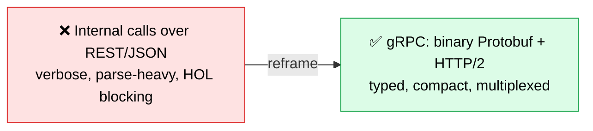
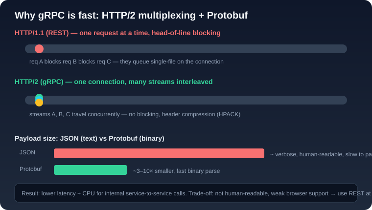
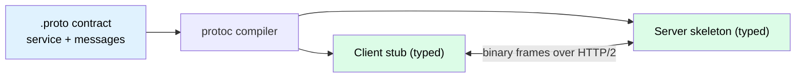
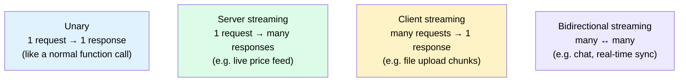
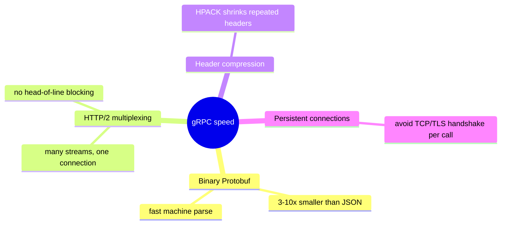
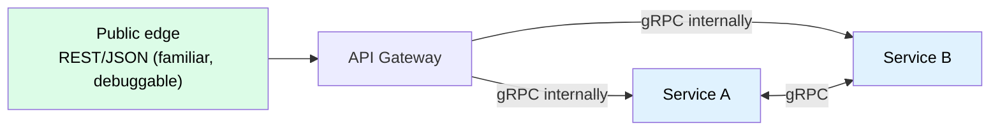
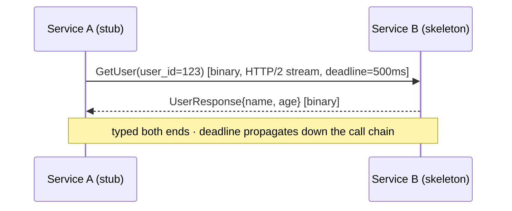
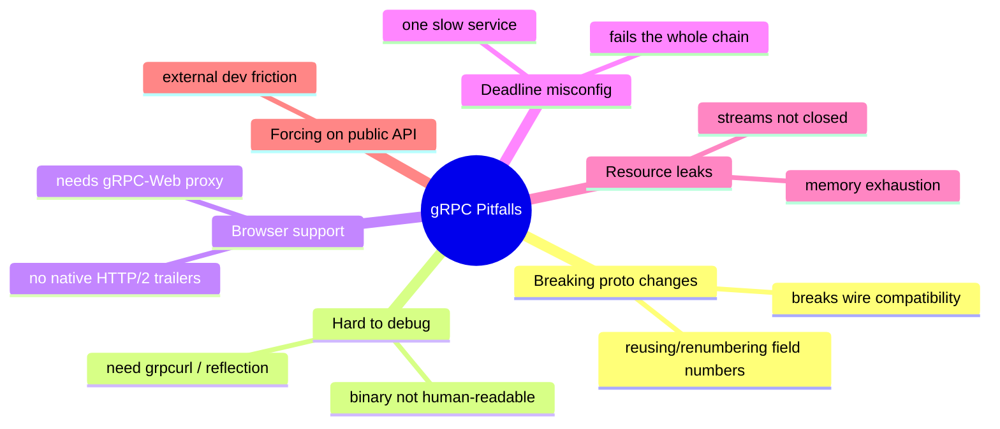

# gRPC

> **One line:** gRPC makes a remote service call feel like a local function — define the contract once in a `.proto` file, generate typed clients for every language, and ride binary Protobuf over multiplexed HTTP/2 for up to ~10× less latency and CPU than REST/JSON internally.

---

## Table of Contents
1. [Why You Must Master This](#1-why-you-must-master-this)
2. [The Mental Model](#2-the-mental-model)
3. [How It Works: Protobuf + HTTP/2](#3-how-it-works-protobuf--http2)
4. [The Four Call Types](#4-the-four-call-types)
5. [Why gRPC Is Fast](#5-why-grpc-is-fast)
6. [gRPC vs REST — When Each](#6-grpc-vs-rest--when-each)
7. [Worked Example — A User Service](#7-worked-example--a-user-service)
8. [Real-Life Use Cases](#8-real-life-use-cases)
9. [Failure Modes](#9-failure-modes)
10. [🏋️ Practice Drills](#-practice-drills)
11. [🎤 Interview Q&A Bank](#-interview-qa-bank)
12. [🎯 Staff+ Nuances](#-staff-nuances)
13. [Cheat Sheet](#13-cheat-sheet)
14. [Connections & Further Reading](#14-connections--further-reading)

---

## 1. Why You Must Master This

When Service A calls Service B *inside* your data center thousands of times per second, JSON parsing and HTTP/1.1 header overhead is pure waste. gRPC is the de-facto standard for high-performance internal communication.

- **Internal speed** — binary Protobuf + HTTP/2 can be several times faster and lighter than REST/JSON; at Netflix/Uber scale that's millions in infrastructure savings.
- **Polyglot type safety** — define the contract once in Protobuf; auto-generate clean, typed client/server code for Go, Java, Python, Node, C++, etc.
- **First-class streaming** — native client/server/bidirectional streaming, which is clumsy to build over plain REST.

> **The core problem it solves:** *serialization overhead and connection inefficiency.* JSON is human-readable but slow for machines, and HTTP/1.1 suffers head-of-line blocking. gRPC fixes both with a compact binary format on a single multiplexed connection.

---

## 2. The Mental Model

REST is like sending **airmail letters** — write everything out (JSON), stuff an envelope (headers), mail it. gRPC is a **pneumatic tube system** inside a building — drop a small canister (binary) in the tube and it arrives instantly. Tubes aren't for the public street; they're perfect for the building's internal plumbing.





---

## 3. How It Works: Protobuf + HTTP/2



1. **Service definition** — written in a `.proto` file using the Protocol Buffers language.
2. **Code generation** — `protoc` generates client *stubs* and server *skeletons* in your languages.
3. **HTTP/2 transport** — binary framing, header compression (HPACK), and multiplexing over one connection.

```protobuf
// user.proto — the single source of truth for the contract
syntax = "proto3";

service UserService {
  rpc GetUser (UserRequest) returns (UserResponse);
}
message UserRequest  { string user_id = 1; }   // field NUMBERS are the contract
message UserResponse { string name = 1; int32 age = 2; }
```

> The **field numbers** (`= 1`, `= 2`), not the names, are the wire contract — which is exactly why changing them breaks compatibility (see Failure Modes).

---

## 4. The Four Call Types



This native streaming model (built on HTTP/2 streams) is a major advantage over REST, where streaming requires SSE/WebSockets bolted on.

---

## 5. Why gRPC Is Fast



- **Protobuf** is compact binary — far smaller and faster to (de)serialize than text JSON.
- **HTTP/2 multiplexing** lets many concurrent calls share one TCP connection without head-of-line blocking.
- **HPACK** compresses repetitive headers; **persistent connections** avoid per-call handshakes.

---

## 6. gRPC vs REST — When Each

| Dimension | REST / JSON | gRPC / Protobuf |
|-----------|-------------|-----------------|
| Payload | text, verbose | binary, compact |
| Transport | HTTP/1.1 (usually) | HTTP/2 (multiplexed) |
| Contract | optional (OpenAPI) | enforced (`.proto`) |
| Streaming | bolt-on (SSE/WS) | native, 4 modes |
| Browser support | universal | limited (needs gRPC-Web proxy) |
| Human-readable | ✅ (curl/inspect) | ❌ (binary) |
| Best for | **public APIs** | **internal microservices** |



> The classic **double-layer** pattern: REST at the public edge, gRPC for east-west internal traffic.

---

## 7. Worked Example — A User Service

```python
# Python gRPC client — calling remote GetUser feels like a local function
import grpc, user_pb2, user_pb2_grpc

channel = grpc.insecure_channel('user-svc:50051')   # reused, persistent
stub = user_pb2_grpc.UserServiceStub(channel)
resp = stub.GetUser(user_pb2.UserRequest(user_id='123'), timeout=0.5)  # deadline!
print(resp.name)
```



---

## 8. Real-Life Use Cases

| Situation | How gRPC applies |
|-----------|------------------|
| **Microservice mesh (Netflix, Uber, Google)** | Nearly all internal service-to-service calls — lower latency + CPU at massive scale. |
| **Polyglot backends** | One `.proto` generates typed clients for Go, Java, Python services to interoperate safely. |
| **Real-time streaming** | Bidirectional streams for chat, telemetry, live dashboards, collaborative editing. |
| **Mobile (gRPC over HTTP/2)** | Efficient typed contracts to mobile clients where bandwidth is precious. |
| **Service mesh data plane** | Istio/Linkerd manage and observe gRPC traffic; deadlines/retries handled by sidecars. |

> Real-world habit: **REST for the public boundary, gRPC for everything internal.** Don't force external developers onto Protobuf — the friction isn't worth it.

---

## 9. Failure Modes



- **Breaking Protobuf changes** — reusing or renumbering a field number breaks backward compatibility silently. Only ever *add* new fields with new numbers; never reuse old ones.
- **Debuggability** — you can't eyeball a binary message in a sniffer; use `grpcurl` + server reflection.
- **Browser limits** — browsers can't do raw gRPC (HTTP/2 trailers); use **gRPC-Web** with a proxy.
- **Deadline propagation** — gRPC propagates deadlines across a call chain; one slow hop can fail the whole chain (good for cutting tail latency, dangerous if misconfigured).
- **Stream/resource leaks** — not closing streams exhausts server memory.

---

## 🏋️ Practice Drills

> *Reason about Protobuf evolution, transport, and call types.*

**Drill 1 — Safe schema change.** You need to add a `phone` field to `UserResponse { string name = 1; int32 age = 2; }`. How do you do it without breaking existing clients?

<details><summary>Solution</summary>

Add `string phone = 3;` — a **new field with a new number**. Old clients ignore unknown fields; new clients read it. Never reuse number 1 or 2, never renumber existing fields, and never change a field's type. (Reserve removed field numbers with `reserved`.)
</details>

**Drill 2 — Pick the call type.** Which gRPC mode fits: (a) fetch one user, (b) stream a stock ticker, (c) upload a large file in chunks, (d) a live chat?

<details><summary>Solution</summary>

(a) Unary, (b) Server streaming, (c) Client streaming, (d) Bidirectional streaming.
</details>

**Drill 3 — Why faster?** Give three concrete reasons gRPC outperforms REST/JSON for internal calls.

<details><summary>Solution</summary>

(1) Binary Protobuf is smaller and faster to parse than text JSON; (2) HTTP/2 multiplexes many calls on one connection with no head-of-line blocking; (3) HPACK header compression + persistent connections avoid per-call overhead/handshakes.
</details>

---

## 🎤 Interview Q&A Bank

**Q1. Why is gRPC faster than REST?**
> Binary Protobuf (smaller, faster to parse than JSON) + HTTP/2 (multiplexing, no head-of-line blocking, header compression) + persistent connections. Less bytes, less CPU, fewer round trips.

**Q2. What are the four gRPC call types?**
> Unary (1→1), server streaming (1→many), client streaming (many→1), and bidirectional streaming (many↔many).

**Q3. How do you evolve a Protobuf schema safely?**
> Only add fields with new numbers; never reuse or renumber existing field numbers or change types. Mark removed numbers `reserved`. Old clients ignore unknown fields.

**Q4. Why can't browsers use gRPC directly?**
> Browsers don't expose the low-level HTTP/2 framing/trailers gRPC needs. You use gRPC-Web through a proxy (e.g., Envoy) to bridge.

**Q5. When would you NOT use gRPC?**
> Public-facing APIs where consumers expect REST/JSON, simple apps, or browser-first scenarios — the tooling friction outweighs the performance gain.

**Q6. What are gRPC deadlines and why do they matter?**
> A deadline/timeout that propagates down the entire call chain, so a slow downstream service fails fast instead of hanging every caller — key for controlling tail latency and avoiding cascading failures.

**Q7. REST or gRPC for a system with both public clients and internal services?**
> The double-layer pattern: REST/JSON at the public edge (familiar, debuggable, cacheable) and gRPC for internal east-west traffic (fast, typed, streaming).

---

## 🎯 Staff+ Nuances

- **The contract is the artifact — manage `.proto` files like a public API.** Store them centrally (a schema registry / shared repo), review changes, and run backward-compatibility checks (e.g., Buf) in CI. A careless field renumber is a production outage.
- **Deadlines + retries are distributed-systems hygiene, and gRPC makes them first-class.** Propagated deadlines prevent work on already-doomed requests; but naive retries amplify load during an incident — pair them with backoff, jitter, and idempotency (see [Idempotency.md](./Idempotency.md)).
- **Protobuf's forward/backward compatibility model is the real feature.** Tolerant readers (ignore unknown fields) + append-only field numbers give you *versionless* evolution for internal services — often removing the need for explicit versioning entirely (contrast [API_Versioning.md](./API_Versioning.md)).
- **gRPC pairs naturally with a service mesh.** Offloading retries, mTLS, load balancing, and observability to a sidecar (Istio/Linkerd) keeps that logic out of every service — but adds a data-plane hop and operational complexity.
- **Client-side load balancing matters with HTTP/2.** Because gRPC reuses long-lived connections, a naive L4 load balancer pins all traffic to one backend. Use L7-aware balancing or client-side LB / lookaside so connections spread across replicas.
- **Observability is harder with binary.** You lose "just read the JSON" debugging; invest early in reflection, structured logging of decoded messages, and tracing so you're not blind in production.

---

## 13. Cheat Sheet

```
gRPC = typed RPC over Protobuf (binary) + HTTP/2 (multiplexed). Internal speed.

FLOW   .proto → protoc → client stub + server skeleton → binary over HTTP/2
CALLS  unary · server-stream · client-stream · bidirectional
FAST   binary < JSON · multiplexing (no HOL block) · HPACK · persistent conns

PROTO EVOLUTION  add fields w/ NEW numbers only · never reuse/renumber · 'reserved'
DEADLINES  propagate down the chain → fail fast, control tail latency

USE gRPC: internal microservices, polyglot, streaming, high QPS
USE REST: public APIs, browsers (else gRPC-Web proxy), human-debuggable
DOUBLE LAYER: REST at the edge, gRPC east-west internally
```

---

## 14. Connections & Further Reading

**Within this repo:**
- [REST_API_Design.md](./REST_API_Design.md) · [GraphQL.md](./GraphQL.md) — the alternatives; the double-layer pattern.
- [API_Gateway.md](./API_Gateway.md) — protocol translation (REST↔gRPC) at the edge.
- [Idempotency.md](./Idempotency.md) — safe retries with deadlines.
- [08 · Communication Protocols](../08_Communication_Protocols/) — HTTP/2 deep dive; [10 · Microservices & Distributed Systems](../10_Microservices_Distributed_Systems/) — service mesh.

**External classics:**
- [Official gRPC docs](https://grpc.io/docs/) · [Protocol Buffers guide](https://protobuf.dev/).
- [Buf](https://buf.build/) — Protobuf linting & breaking-change detection.
- [gRPC-Web](https://github.com/grpc/grpc-web) — browser support.

---

## TL;DR
gRPC makes remote calls feel local: define the contract once in a **`.proto`**, generate typed clients for any language, and run **binary Protobuf over multiplexed HTTP/2** for big latency/CPU wins on internal traffic — plus native **four-mode streaming**. Evolve schemas by **only adding new field numbers** (never reuse them), lean on **propagated deadlines** to control tail latency, and use the **double-layer pattern**: REST at the public edge, gRPC east-west internally. Trade-offs: binary isn't human-readable and browsers need gRPC-Web.
