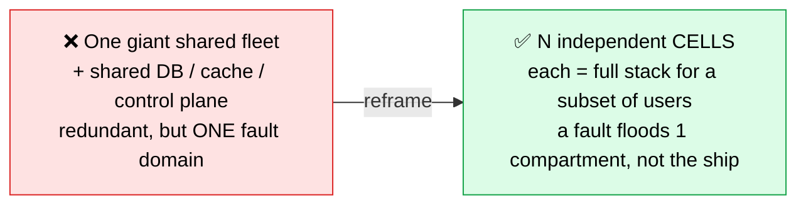
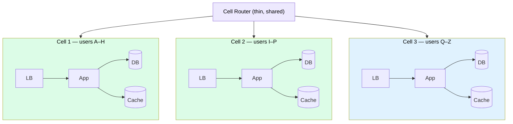
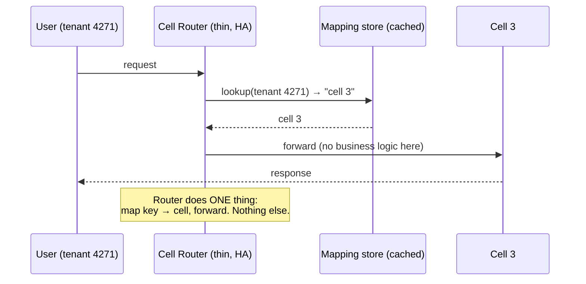
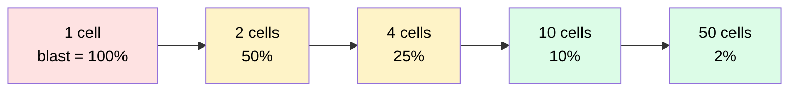
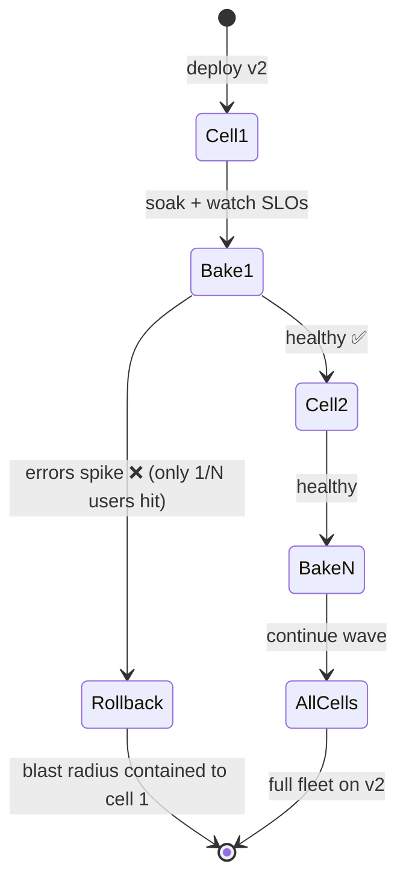
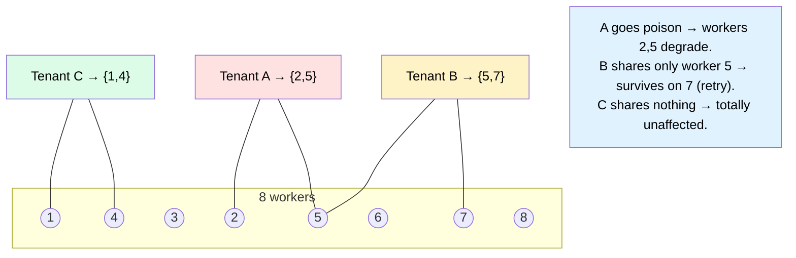
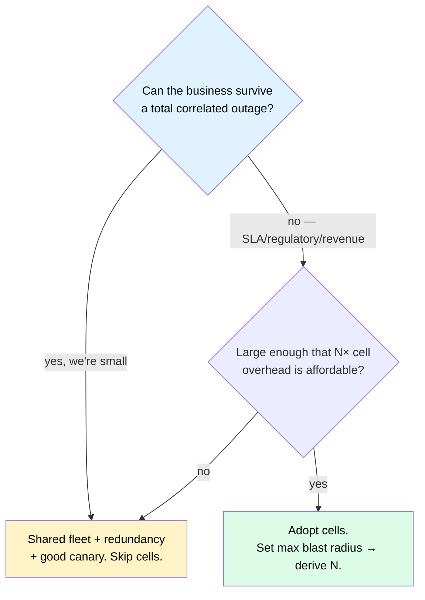
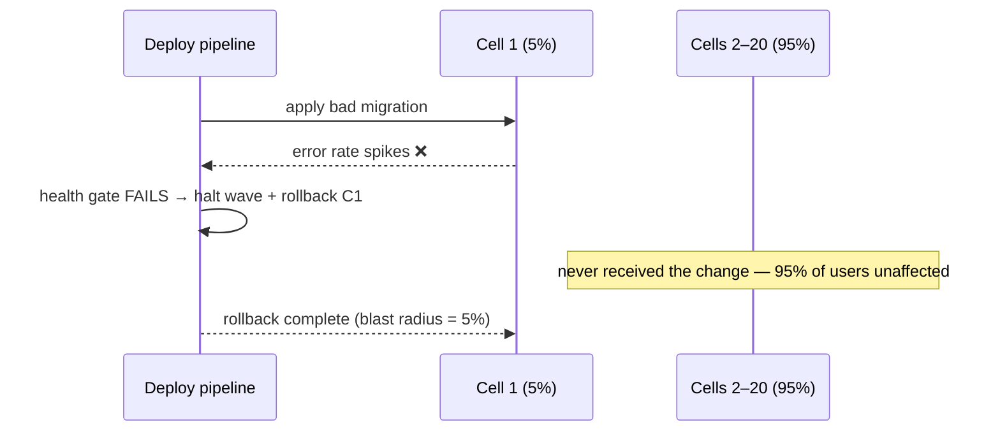
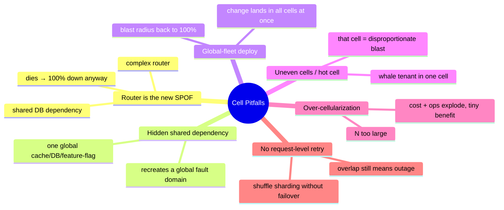

# Cell-Based Architecture

> **One line:** Cell-based architecture is a ship's hull divided into watertight bulkhead compartments — you slice the whole stack into independent, self-contained cells so a flood (bad deploy, poison request, hot key) drowns *one* compartment instead of sinking the whole ship.

---

## Table of Contents
1. [Why You Must Master This](#1-why-you-must-master-this)
2. [The Mental Model](#2-the-mental-model)
3. [What a Cell Actually Is](#3-what-a-cell-actually-is)
4. [The Cell Router — the Mapping Layer](#4-the-cell-router--the-mapping-layer)
5. [Blast-Radius Math](#5-blast-radius-math)
6. [Deployment Safety — Cell-by-Cell](#6-deployment-safety--cell-by-cell)
7. [Shuffle Sharding](#7-shuffle-sharding)
8. [Trade-offs, Costs & When Cells Are Overkill](#8-trade-offs-costs--when-cells-are-overkill)
9. [Worked Example — Sizing a Cell Fleet](#9-worked-example--sizing-a-cell-fleet)
10. [Real-Life Use Cases](#10-real-life-use-cases)
11. [Failure Modes](#11-failure-modes)
12. [🏋️ Practice Drills](#-practice-drills)
13. [🎤 Interview Q&A Bank](#-interview-qa-bank)
14. [🎯 Staff+ Nuances](#-staff-nuances)
15. [Cheat Sheet](#15-cheat-sheet)
16. [Connections & Further Reading](#16-connections--further-reading)

---

## 1. Why You Must Master This

Cell-based architecture is the answer to the scariest question in an availability review: *"What is the largest thing that can fail at once?"* On a shared fleet, the honest answer is **everything** — and that's the problem cells exist to fix.

- **One poison pill kills 100%.** On a single shared fleet, a poison-pill request, a memory leak, a bad config push, or a hot key doesn't stay local — it saturates connection pools, trips a global circuit, or corrupts a shared cache, and *every* user goes down together. Correlated failure is the default, not the exception.
- **The most common outage cause is your own deploy.** Google's SRE data and virtually every public postmortem agree: bad changes (deploys/config) cause the majority of outages. If a deploy lands everywhere at once, its blast radius is 100%. Cells make "everywhere at once" structurally impossible.
- **It's the strongest availability lever you can pull.** Retries, timeouts, and circuit breakers reduce the *chance* of failure. Cells reduce the *scope* of failure — they turn a total outage into a partial one, which is the difference between a full-company incident and a rounding error on your SLO.
- **It's a Staff+ differentiator.** Anyone can say "add a load balancer." Saying "I'll cap the blast radius at 1/N by cellularizing, route on tenant hash, and canary deploys cell-by-cell" is the language of someone who has run large systems.

> **The core problem it solves:** *correlated, unbounded blast radius* — the fact that on a shared fleet any single fault can take down all users at once. Cells put a hard ceiling on how much can fail together.

**Prerequisites:** [System_Decomposition.md](./System_Decomposition.md) (cells group decomposed services into a deployable unit) and [High_Availability_Design.md](./High_Availability_Design.md) (redundancy vs. isolation).

---

## 2. The Mental Model

Think of the **Titanic vs. a modern warship.** The Titanic's hull was one big space — one breach and water spread everywhere until it sank. A modern ship's hull is divided into **watertight bulkhead compartments**: puncture one, that compartment floods, the ship stays afloat. Cells are those compartments for your software. The naive instinct is "make the shared fleet bigger and more redundant" — but a bigger shared pool just means a bigger thing that fails all at once.



> **Hold onto this:** availability isn't only about *reducing the probability* of failure (retries, redundancy) — it's about *bounding the scope* when failure inevitably happens. Cells are scope control. Redundancy asks "will it fail?"; cells ask "how much fails when it does?"

---

## 3. What a Cell Actually Is

A **cell** is a complete, independent, self-contained instance of your entire stack — load balancer, compute, caches, queues, **and its own data store** — that serves a fixed **subset** of users/tenants. Cells **share nothing at runtime**: cell A never reads cell B's database, never calls cell B's services, never shares a cache. Each cell is a full **fault domain**.

The critical distinction — and the #1 point interviewers probe:

| Approach | What's replicated | What's shared | Blast radius of one fault |
|----------|-------------------|---------------|---------------------------|
| **Horizontal scaling** | Stateless app servers | **The database, cache, everything stateful** | ~100% — the shared DB/cache is one fault domain for all users |
| **Sharding** (see [Sharding_Partitioning.md](../05_Databases_Storage/Sharding_Partitioning.md)) | The **data layer** only | The **app tier, deploy pipeline, control plane** in front | ~100% for app/deploy faults; ~1/shards for a data fault |
| **Cell-based** | The **entire stack** (compute + data + routing) | *Nothing at runtime* (only a thin router in front) | **~1/N** for essentially any cell-scoped fault |

Sharding partitions **data**; cells partition **failure**. A sharded system with one shared app fleet still goes down 100% on a bad app deploy — the shards don't help because the fault is above them. A cell contains the app tier *and* the data tier *and* the deploy, so the same bad deploy is contained to one cell.



> Each cell is a mini version of the whole product. Kill cell 2 and users I–P are affected; A–H and Q–Z never notice. AWS calls this "reducing the scope of impact" — it's the central idea of their availability whitepaper.

**Real example:** Salesforce runs customers on isolated **PODs** (self-contained instances with their own app + DB serving a set of orgs). Slack shards customers across cells. Roblox and DoorDash have publicly described cellularizing to cap blast radius. AWS builds most foundational services (Route 53, ELB, DynamoDB internals) on cells.

---

## 4. The Cell Router — the Mapping Layer

Something must decide *which cell* a given request belongs to. That's the **cell router** (a.k.a. the mapping or partitioning layer): a thin, extremely-highly-available tier that maps `user / tenant / key → cell`.

The router is subtle because it is **the new single point of failure**. You've isolated the cells beautifully — but if the router dies, *every* cell becomes unreachable and you're back to a 100% outage. The governing rule:

> **The router must be dramatically simpler and more reliable than the cells it routes to.** It should do the least possible work — ideally just a lookup and a forward — with no business logic, no shared database dependency, and no heavy state. Complexity is the enemy of reliability; the router earns its right to be a chokepoint only by being trivially simple.

Mapping strategies:

| Strategy | How it maps | Pros | Cons |
|----------|-------------|------|------|
| **Hash** | `cell = hash(tenant_id) % N` | Stateless, no lookup table, even spread | Resharding when N changes is painful; can't move a hot tenant without rehashing |
| **Lookup table** | Explicit `tenant → cell` map (e.g. in DynamoDB/config) | Move any tenant to any cell (rebalancing!), pin big tenants to dedicated cells | The table itself must be ultra-HA; extra hop/cache |
| **Geography** | Route by region/locality | Latency + data-residency (GDPR) wins | Uneven load; a hot region overloads its cells |

Most large systems use a **lookup table** (often cached at the edge) precisely because it makes **rebalancing** possible — you can migrate a hot or noisy tenant to another cell by editing one row, which a modulo hash cannot do.



Two patterns keep the router safe: make routing logic so simple it "can't" fail, and where possible push routing to a layer that *statically partitions* (e.g., separate DNS names/endpoints per cell, or a token that embeds the cell id) so a data-plane router failure can't take everything down.

---

## 5. Blast-Radius Math

This is the arithmetic that makes cells a *quantitative* decision, not a vibe. With **N** equal cells and a fault that is scoped to a single cell (a bad deploy caught after one cell, a poison key, a corrupted cache):

```
blast radius per cell-scoped failure ≈ 1 / N  of users/traffic
```

- **1 cell** (shared fleet): a fault hits **100%** of users.
- **4 cells**: **25%** each.
- **10 cells**: **10%** each.
- **50 cells**: **2%** each.

The relationship is **diminishing returns**: going 1→2 cells halves your worst case (a 50-point improvement); going 25→50 only takes you from 4% to 2% (a 2-point improvement) while *doubling* your operational surface.



The trade-off in one line: **more cells = smaller blast radius, but more overhead** — more infrastructure to run, more per-cell minimum capacity you pay for, and a bigger routing table. So you don't pick N to be "as large as possible." You pick it from a **maximum tolerable blast radius** you set as a target:

```
N  ≥  1 / (max tolerable blast radius)
e.g. "no single failure may affect more than 5% of users"  →  N ≥ 20
```

This top-down constraint also defines a **cell-size ceiling**: a cell may grow only until it holds `max_blast_radius × total_users`. Cross that line — a cell now holds 8% of users when your target is 5% — and you must **split the cell**, not just add capacity to it. Cell size is capped by *risk*, not by hardware.

---

## 6. Deployment Safety — Cell-by-Cell

Recall §1: **bad changes are the leading cause of outages.** A shared fleet deploys the bad change everywhere simultaneously → 100% blast radius, self-inflicted. Cells turn deployment into a naturally staged rollout: you deploy **one cell at a time**, treating each cell as a canary stage.



The mechanism: push v2 to cell 1 only, **bake** (let real traffic run while you watch error rate, latency, and business metrics), and only proceed to cell 2 if cell 1 stays healthy. A bad deploy therefore:

1. **Is caught early** — you see the regression at 1/N of traffic, not 100%.
2. **Is contained** — the other N−1 cells are still on the good version and serving normally.
3. **Rolls back cheaply** — revert one cell.

This is *defense in depth for change*: even if your pre-prod tests miss a bug (they will), production exposure is bounded to one cell. The waves can also widen (1 cell → 3 cells → rest) to trade rollout speed against caution. Pair this with per-cell health gates so promotion is automatic and a failing cell halts the wave.

> Combine with [High_Availability_Design.md](./High_Availability_Design.md): cell-by-cell deploy is how blue/green and canary scale to a large fleet without a global "big bang" cutover.

---

## 7. Shuffle Sharding

Plain cells isolate **at cell granularity**: everyone in cell 2 shares cell 2's fate. **Shuffle sharding** pushes isolation *per tenant* by giving each tenant a **random combination** of workers (or cells) instead of one fixed cell — so that any two tenants rarely share their *entire* set. A single noisy or poisoned tenant then degrades only the handful of tenants who overlap with it, not a whole cell.

The combinatorics are the magic. Suppose you have **N = 8** workers and assign each tenant a **virtual shard of k = 2** workers, chosen randomly:

```
distinct virtual shards = C(N, k) = C(8, 2) = 28 combinations
```

A poison-pill tenant takes down its 2 workers. Another tenant is *fully* knocked out only if **both** of its 2 workers are the same 2 — probability `1 / C(8,2) = 1/28 ≈ 3.6%`. Everyone else keeps at least one healthy worker and, with a retry, stays up. Scale the numbers and it gets dramatic:

```
N = 100 workers, k = 5 per tenant  →  C(100,5) ≈ 75,000,000 combinations
Two tenants fully overlapping ≈ 1 in 75 million.
```



**Why it beats plain cells:** with 8 plain cells, a noisy tenant harms the ~1/8 of tenants sharing its cell. With shuffle sharding over the same 8 workers (k=2), it fully harms only ~1/28 — and the design degrades *gracefully* (partial overlap = reduced capacity, not outage). This is exactly what **AWS Route 53 and ELB** use to isolate customers, and what AWS documents in its shuffle-sharding writeups. The cost: it needs **request-level fault tolerance** (retry the tenant's other workers) and works best for stateless-ish work.

---

## 8. Trade-offs, Costs & When Cells Are Overkill

Cells are not free. The honest ledger:

| Cost / challenge | Why it hurts | Mitigation |
|------------------|--------------|------------|
| **Global / cross-cell data** | Some data is inherently global (username uniqueness, global search, aggregate billing). It can't live in one cell without recreating a shared fault domain. | Keep a *thin, well-guarded* global tier; make cells authoritative for their own data and treat global state as eventually-consistent, read-mostly. |
| **Rebalancing / migration** | A cell gets hot (a tenant grows 10×) and must be split or a tenant moved — moving live data + traffic between cells is genuinely hard. | Lookup-table routing (move a row); tenant-level migration tooling; leave headroom so splits are rare. |
| **Per-cell minimum capacity** | Every cell needs its own LB, DB primary+replica, cache, monitoring — a floor of fixed cost. N cells = N× that floor even at low utilization. | Right-size N; don't over-cellularize; use smaller instances per cell. |
| **Operational complexity** | N environments to deploy, observe, and debug; dashboards must be per-cell; on-call must reason about "which cell?" | Strong automation, per-cell observability, and a fleet control plane are prerequisites, not nice-to-haves. |

**When cells are overkill:** small scale. If you have one database that comfortably holds all users and a shared fleet whose worst-case outage the business can absorb, cells add cost and complexity for isolation you don't yet need. The rule of thumb: adopt cells when a **100% correlated outage is unacceptable** (regulatory, revenue, safety, or SLA-breaking) *and* you're large enough that the per-cell overhead is a small fraction of total spend. Below that, invest in redundancy, good deploys, and monitoring first.



---

## 9. Worked Example — Sizing a Cell Fleet

**Scenario:** A B2B SaaS with **10 million users** and an SLA promising no incident affects more than **5% of customers**. The current design: one shared app fleet + one big Postgres. A single bad migration last quarter took down **100%** for 40 minutes. Design the cell layout.

**Step 1 — Derive N from the blast-radius target.**
```
max tolerable blast radius = 5%  = 0.05
N ≥ 1 / 0.05 = 20 cells   →  choose N = 20 (each ≈ 500k users, 5%)
```

**Step 2 — Set the cell-size ceiling.**
```
ceiling per cell = 0.05 × 10,000,000 = 500,000 users
When a cell exceeds 500k (organic growth or a whale tenant), SPLIT it — do not just scale it up.
```

**Step 3 — Choose routing.** Use a **lookup table** (`tenant_id → cell`), cached at the edge, backed by a highly-available store. Reason: it lets us pin large tenants to dedicated cells and **rebalance** a hot cell by moving rows — a modulo hash couldn't. Keep the router logic to lookup-and-forward only.

**Step 4 — Fix the deploy.** Migrations and app releases now roll **cell-by-cell** with a bake + SLO gate. Re-run the incident: the bad migration would have hit **cell 1 only (5%)**, tripped the health gate, halted the wave, and been rolled back — a 5% / few-minute event instead of 100% / 40 minutes.



**The close:** the number **5% SLA → N = 20** drove every downstream decision — cell count, cell-size ceiling, lookup routing for rebalancing, and staged deploys. That is blast-radius math turning a policy into an architecture.

---

## 10. Real-Life Use Cases

| Situation | How cell-based architecture applies | The decision it forces |
|-----------|--------------------------------------|------------------------|
| **AWS foundational services** | Route 53, ELB, DynamoDB internals are built as cells + shuffle sharding ("reduce scope of impact"). | Isolate customers so one abuser/poison request can't harm the region. |
| **Slack** | Customers sharded into cells to contain failures and enable regional isolation. | Route by team/workspace; deploy per cell. |
| **Salesforce PODs** | Each POD is a self-contained instance (app + DB) serving a set of orgs. | Onboard new orgs onto a POD; cap POD size. |
| **DoorDash / Roblox** | Publicly described cellularization to bound blast radius as they scaled. | Set max blast radius → derive cell count. |
| **Multi-region / data residency** | Geography-based cells keep EU data in EU cells (GDPR). | Router maps user → region-appropriate cell. |
| **Noisy-neighbor B2B tenants** | Shuffle sharding so one heavy tenant degrades only its overlap set. | Give each tenant a random virtual shard; add retries. |

> Real-world habit: **before shipping an availability design, state your maximum tolerable blast radius out loud, then show the arithmetic (N ≥ 1/target) that your cell count satisfies.** If you can't name the number, you haven't finished the design.

---

## 11. Failure Modes



- **The router becomes the SPOF.** *Symptom:* everything is down even though individual cells are healthy. *Root cause:* the routing tier is complex or shares a dependency (a DB, a heavy service) and it failed. *Fix:* make the router trivially simple, remove its runtime dependencies, cache the mapping, and prefer static partitioning (per-cell endpoints / cell-id in token) so a router data-plane failure can't take everything down.
- **A hidden shared dependency.** *Symptom:* a "cell-isolated" system still has correlated outages. *Root cause:* one shared component sneaked in — a global cache, a shared feature-flag service, a single auth DB, a common config push. *Fix:* audit for *anything* touched by all cells; either replicate it per-cell or make it read-mostly and fail-static.
- **Global-fleet deploys.** *Symptom:* self-inflicted 100% outage from a bad change despite having cells. *Root cause:* the deploy pipeline still pushes to every cell at once. *Fix:* enforce cell-by-cell rollout with bake + SLO health gates.
- **Hot / uneven cell.** *Symptom:* one cell is a disproportionate share of load and its failure exceeds your blast-radius target. *Root cause:* a whale tenant or skewed hash. *Fix:* lookup-table routing to pin/move big tenants; split the cell when it crosses the size ceiling.
- **Over-cellularization.** *Symptom:* cost and on-call load balloon for negligible availability gain. *Root cause:* N chosen "as large as possible" instead of from a target. *Fix:* derive N from max tolerable blast radius; remember diminishing returns past ~10–20.

---

## 🏋️ Practice Drills

> *Cover the solutions and attempt first — active recall is the point.*

**Drill 1 — Cells vs. sharding.** Your system already shards its database by `user_id` into 16 shards, all fronted by one shared, auto-scaled app fleet with one CI/CD pipeline. A bad app deploy goes out. How many users are affected, and does sharding help?

<details><summary>Solution</summary>

**~100%.** Sharding partitions *data*, not *failure* above the data layer. The fault (a bad app deploy) lives in the shared app tier / shared pipeline, which sits in front of all 16 shards — so every user is served by the broken code. Sharding only bounds *data-layer* faults (a corrupt shard = ~1/16). To bound this you need **cells**: the app tier + pipeline + data must all be inside the fault domain, and the deploy must roll cell-by-cell.
</details>

**Drill 2 — Pick N.** Leadership sets an SLA: "no single failure may affect more than 2% of customers." How many equal cells do you need, and what's the trade-off of going higher?

<details><summary>Solution</summary>

`N ≥ 1 / 0.02 = 50` cells (each ≈ 2%). Going higher (say 100) drops the blast radius to 1% — a **1-point** improvement — while **doubling** infrastructure floor cost, the routing table size, and operational surface. That's the diminishing-returns zone; 50 meets the target, so stop there unless another driver (data residency, tenant isolation) justifies more.
</details>

**Drill 3 — Shuffle-shard combinatorics.** With 8 workers and a virtual shard of 2 per tenant, what's the chance two given tenants are *fully* knocked out by the same fault, and why does that beat 8 plain cells?

<details><summary>Solution</summary>

Distinct shards = `C(8,2) = 28`, so the chance a second tenant has the *exact same* 2 workers is `1/28 ≈ 3.6%`. With 8 plain cells, a noisy tenant harms ~`1/8 = 12.5%` of tenants (everyone in its cell). Shuffle sharding cuts full-impact probability from 12.5% → 3.6% *and* degrades gracefully — partially-overlapping tenants lose one worker and survive on the other with a retry. Caveat: it requires request-level failover (retry the healthy worker).
</details>

**Drill 4 — Design the router.** You're adding a cell router in front of 20 cells. List three rules that keep it from becoming the outage that cells were supposed to prevent.

<details><summary>Solution</summary>

(1) **Keep it trivially simple** — lookup-and-forward only, no business logic. (2) **Remove runtime dependencies** — no shared DB call on the hot path; cache the `tenant→cell` map and fail static (serve last-known mapping) if the mapping store is unavailable. (3) **Prefer static partitioning where possible** — per-cell DNS/endpoints or a cell-id embedded in the auth token, so even a router data-plane failure can't black-hole all traffic. Bonus: make it far more redundant/tested than any single cell, since it's shared by all.
</details>

---

## 🎤 Interview Q&A Bank

**Q1. What is a cell in cell-based architecture, and how is it different from a shard?**
> A cell is a complete, self-contained copy of the *entire* stack — compute, cache, and its own data store — serving a subset of users and sharing nothing with other cells at runtime. A shard partitions only the *data*; the app tier and deploy pipeline in front are still shared, so an app/deploy fault hits everyone. Cells are fault domains; shards are data partitions. *(Signal: strong answers stress "full stack, shares nothing" and that cells bound *failure*, not just data.)*

**Q2. What problem does cell-based architecture actually solve?**
> Unbounded, correlated blast radius. On a shared fleet, one poison request, hot key, or bad deploy can take down 100% of users at once. Cells cap that: with N cells, a cell-scoped fault hits ~1/N of users. It trades reduced *probability* of failure for bounded *scope* of failure.

**Q3. How do you choose the number of cells?**
> Top-down from a maximum tolerable blast radius. If policy says no failure may affect >5% of users, then `N ≥ 1/0.05 = 20`. You don't maximize N — it's diminishing returns (10→50 cells only moves blast radius 10%→2%) against linear growth in cost and ops. Pick the smallest N that meets the target.

**Q4. Isn't the cell router just a new single point of failure?**
> Yes — that's the central risk. You mitigate it by making the router dramatically simpler and more reliable than any cell: lookup-and-forward only, no business logic, no hot-path shared-DB dependency, cache the mapping and fail static, and prefer static partitioning (per-cell endpoints or a cell-id in the token) so a router failure can't black-hole everything. The router earns its chokepoint status by being trivially simple.

**Q5. What is shuffle sharding and when would you use it?**
> Assign each tenant a *random combination* of k workers from N instead of one fixed cell, so two tenants rarely share their whole set. A poison tenant then fully impacts only the ~`1/C(N,k)` of tenants that overlap completely; everyone else keeps a healthy worker and survives on a retry. Use it for noisy-neighbor isolation in multi-tenant systems — it's what AWS Route 53/ELB do. Requires request-level failover.

**Q6. How does cell-based architecture change how you deploy?**
> You deploy cell-by-cell, treating each cell as a canary: push to one cell, bake while watching SLOs, and only proceed if healthy. Since bad deploys are the leading outage cause, this caps a bad change to ~1/N of users, catches it early, and rolls back cheaply — instead of a global "big bang" that fails 100% at once.

**Q7. What are the downsides of cells, and when would you *not* use them?**
> Costs: global data that can't live in one cell, hard cell rebalancing/migration, a fixed per-cell capacity floor (N× infrastructure), and real operational complexity (N environments to run and observe). Skip cells at small scale — if a total outage is survivable and you're small, redundancy + good canary + monitoring beat the overhead. Adopt cells when a 100% correlated outage is unacceptable *and* you're large enough that per-cell overhead is a small fraction of spend.

**Q8. Where can isolation secretly leak in a "cellularized" system?**
> Hidden shared dependencies: a global cache, one shared auth/feature-flag/config service, a single deploy pipeline, or a global DB for cross-cell data. Any component touched by all cells recreates a global fault domain and silently defeats the isolation. The design discipline is auditing for *anything* shared on the hot path and making it per-cell or fail-static.

---

## 🎯 Staff+ Nuances

- **Cell isolation must extend to the *control plane*, not just the data plane.** It's easy to isolate serving traffic and forget that a shared deploy pipeline, a global config-push system, or one central feature-flag service is a control-plane fault domain spanning every cell. AWS's hard-won lesson: a *static stability* control plane (cells keep serving on last-known-good config even if the control plane is down) matters more than data-plane isolation. A cell that can't take new writes but keeps serving is a partial outage; a cell that dies because its control plane died is a total one.
- **"Fail static" is the router's superpower.** The router should never *hard-depend* on its mapping store at request time. Cache the `tenant→cell` map and, if the store is unavailable, keep routing on the last-known mapping. A stale route is almost always better than no route. This is why lookup-table routing isn't as fragile as it first sounds — the table is a *control-plane* input, cached into a *data-plane* decision.
- **Cell size is capped by risk, not by hardware.** The instinct is to grow a cell until the machines are full. Wrong lever: a cell's ceiling is `max_blast_radius × total_users`. When a cell crosses it — even with capacity to spare — you *split*, because the cell now represents more risk than policy allows. This inverts normal capacity planning (see [07_Load_Balancing_Scalability](../07_Load_Balancing_Scalability/)).
- **Shuffle sharding needs graceful degradation to pay off.** The combinatorics only help if a tenant whose worker set *partially* overlaps a poison tenant can still succeed on its non-overlapping workers. That demands request-level retry/failover and roughly stateless work. Without it, partial overlap = outage and you've bought complexity for nothing. Shuffle sharding is a *fault-tolerance* pattern first, an isolation pattern second.
- **Cross-cell operations are where clean designs re-couple.** Anything global — unique-username checks, global search, aggregate analytics, cross-tenant billing — tempts you to add a shared service every cell calls. Do it carelessly and you've rebuilt the single fault domain you cellularized to escape. Keep global state thin, read-mostly, eventually-consistent, and *never* on the critical write path of a cell.
- **Cells compose with, but don't replace, regions/AZs.** A cell is usually *within* a region; you still need multi-AZ redundancy inside each cell and multi-region for disaster recovery. Interviewers probe whether you conflate "cell" (blast-radius unit) with "availability zone" (physical redundancy unit) — they're orthogonal ([High_Availability_Design.md](./High_Availability_Design.md)).
- **The migration path is Strangler-Fig-shaped.** You rarely build cells day one. You cellularize an existing shared fleet by standing up cell 1, routing a slice of tenants to it, and peeling more over time — the same incremental pattern as decomposing a monolith ([System_Decomposition.md](./System_Decomposition.md)). Big-bang cellularization is as risky as a big-bang rewrite.

---

## 15. Cheat Sheet

```
CELL = a full, self-contained copy of the WHOLE stack (compute + cache + DB)
       serving a SUBSET of users, sharing NOTHING at runtime.  It's a FAULT DOMAIN.

CELLS vs …
  horizontal scaling → replicates app tier only; DB/cache SHARED → fault = ~100%
  sharding           → partitions DATA only; app+deploy shared   → app fault = ~100%
  cells              → partition FAILURE (full stack)            → fault = ~1/N

BLAST-RADIUS MATH
  per cell-scoped failure ≈ 1/N of users
  1→100%  2→50%  4→25%  10→10%  20→5%  50→2%   (DIMINISHING returns)
  choose N:  N ≥ 1 / (max tolerable blast radius)
  cell-size ceiling = max_blast_radius × total_users  → cross it = SPLIT (not scale up)

ROUTER (the new SPOF — treat with fear)
  map user/tenant/key → cell.  Rules: simpler + more reliable than any cell.
  lookup-and-forward only · no hot-path shared DB · cache the map · FAIL STATIC
  mapping: hash (stateless, hard to rebalance) · lookup table (rebalance! HA table)
           · geography (latency/GDPR, uneven load)

DEPLOY cell-by-cell (canary per cell): push 1 → bake + SLO gate → proceed / rollback.
  Bad deploys = #1 outage cause → contains them to 1/N.

SHUFFLE SHARDING: random k workers of N per tenant → C(N,k) combos.
  full overlap prob = 1/C(N,k).  8 workers, k=2 → 1/28 ≈ 3.6% (vs 1/8 plain cells).
  Needs request-level RETRY/failover. AWS Route 53 / ELB use it.

COSTS: global/cross-cell data · rebalancing/migration · N× capacity floor · ops complexity.
SKIP cells when: small scale + total outage survivable → redundancy + canary first.
```

---

## 16. Connections & Further Reading

**Prerequisites (learn first):**
- [System_Decomposition.md](./System_Decomposition.md) — cells group decomposed services into one deployable, isolated unit; cellularization follows the same incremental (Strangler-Fig) migration.
- [High_Availability_Design.md](./High_Availability_Design.md) — redundancy vs. isolation; cells scale canary/blue-green to a large fleet; cells ≠ AZs.

**Builds toward / pairs with:**
- [Sharding_Partitioning.md](../05_Databases_Storage/Sharding_Partitioning.md) — contrast: sharding partitions *data*, cells partition *failure* (the #1 interview distinction).
- [07_Load_Balancing_Scalability](../07_Load_Balancing_Scalability/) — the router is a specialized LB; cell-size ceiling inverts normal capacity planning.
- [10_Microservices_Distributed_Systems](../10_Microservices_Distributed_Systems/) — bulkheads, circuit breakers, and static stability at the service level.

**Gaps this topic exposes (candidates for the section's Gap Analysis):**
- A dedicated **Static Stability / Fail-Static** note (control-plane resilience) — referenced heavily here but deserves its own file.
- **Multi-region & data residency** patterns — geography-based routing touches this but it's a topic of its own.

**External classics:**
- *Reducing the Scope of Impact with Cell-Based Architecture* (AWS Well-Architected / Whitepaper) — the canonical treatment of cells and blast radius.
- *Workload Isolation Using Shuffle Sharding* (AWS Builders' Library, Colm MacCárthaigh) — the combinatorics and Route 53/ELB use.
- *Site Reliability Engineering* (Google) — bad changes as the dominant outage cause; the case for staged rollout.

---

## TL;DR
Cell-based architecture slices your **entire stack** (compute + cache + data) into **N independent, share-nothing cells**, each serving a subset of users, so that any single fault — a poison request, hot key, or bad deploy — is contained to **~1/N of users** instead of 100%. It's *scope control*, complementary to the *probability control* of redundancy, and the key distinction from sharding is that cells partition **failure**, not just **data**. **Derive N from a maximum tolerable blast radius (`N ≥ 1/target`)**, cap cell size by risk (split when a cell exceeds `blast_radius × total_users`), route with a **trivially simple, fail-static router** (the new SPOF), deploy **cell-by-cell** to contain the #1 outage cause, and add **shuffle sharding** (random k-of-N workers, `1/C(N,k)` overlap) for per-tenant noisy-neighbor isolation. The cost is real — global data, rebalancing, N× capacity floor, and operational complexity — so **skip cells at small scale and adopt them only when a total correlated outage is unacceptable.**
