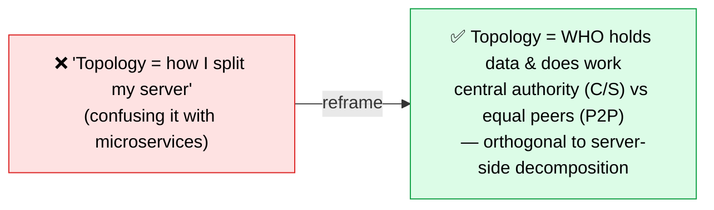
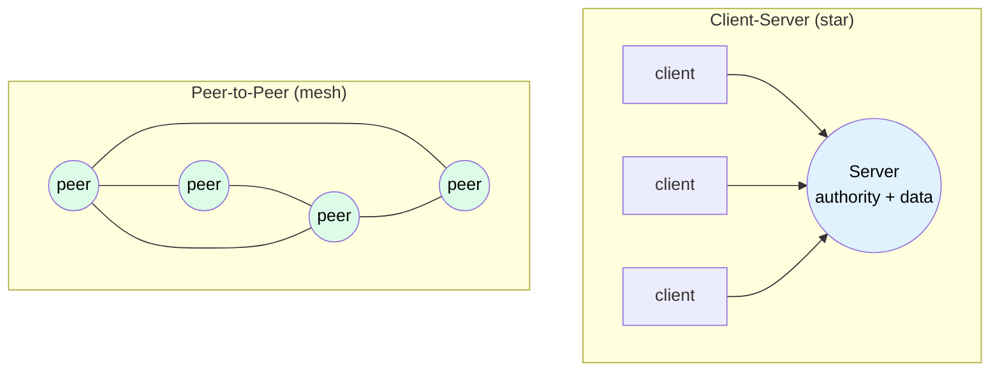
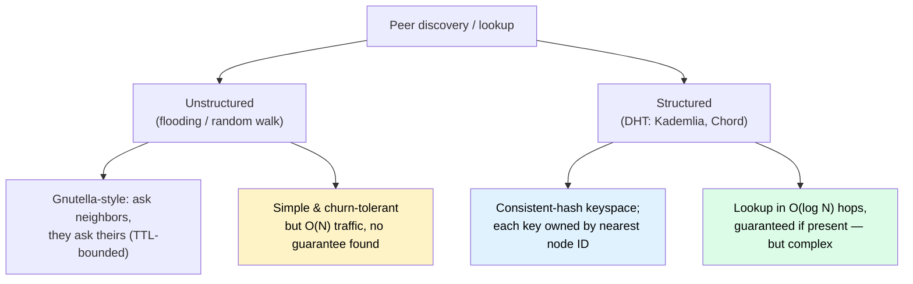
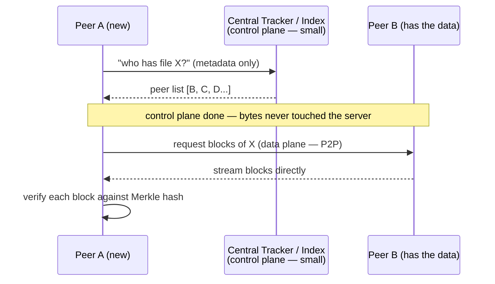
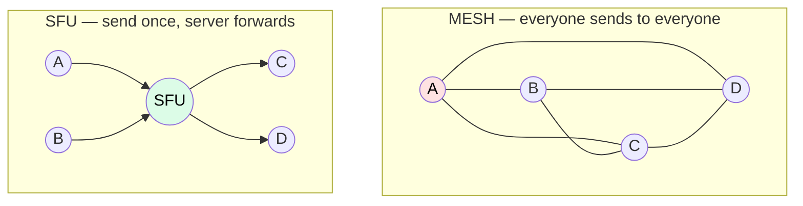
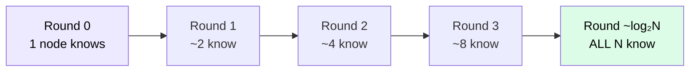
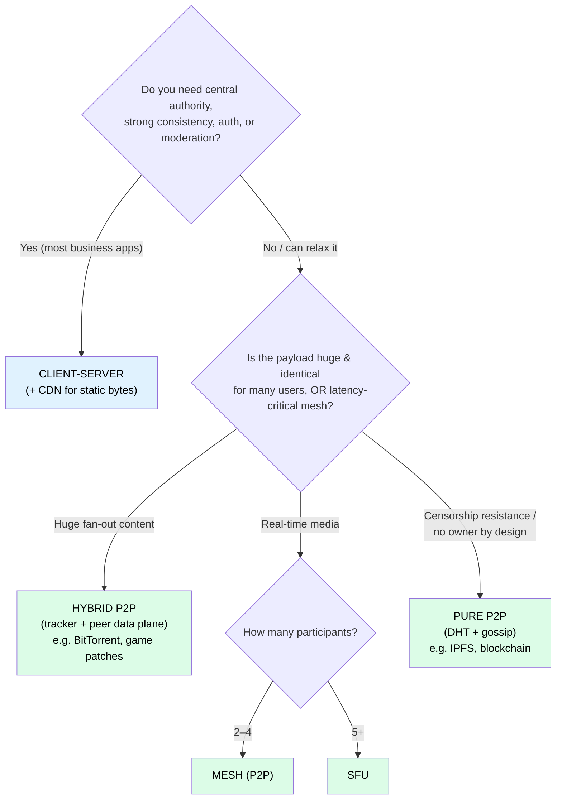
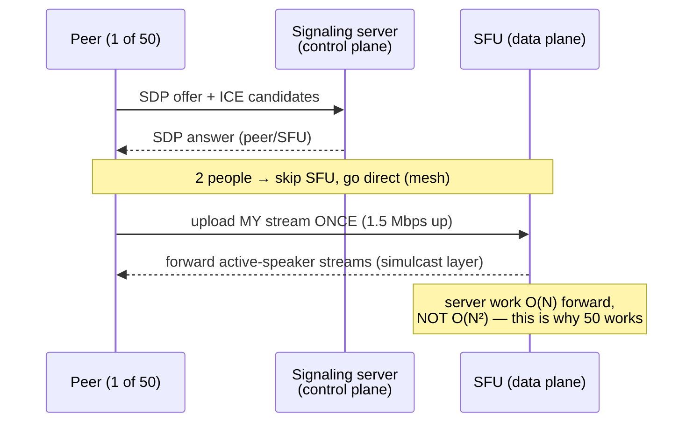
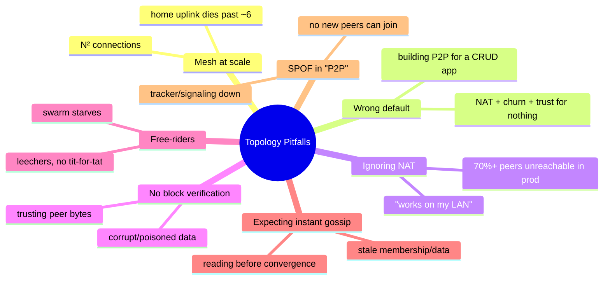

# Client-Server vs Peer-to-Peer

> **One line:** The topology axis is about *who holds the data and does the work* — a central library everyone borrows from (client-server) vs neighbors lending books directly to each other (peer-to-peer).

---

## Table of Contents
1. [Why You Must Master This](#1-why-you-must-master-this)
2. [The Mental Model](#2-the-mental-model)
3. [Client-Server — the Default](#3-client-server--the-default)
4. [Pure Peer-to-Peer — Discovery, Churn, Trust](#4-pure-peer-to-peer--discovery-churn-trust)
5. [Hybrid / Super-Peer Architectures](#5-hybrid--super-peer-architectures)
6. [Live Video — Mesh vs SFU vs MCU](#6-live-video--mesh-vs-sfu-vs-mcu)
7. [Gossip / Epidemic Dissemination](#7-gossip--epidemic-dissemination)
8. [Decision Guide — When P2P Actually Wins](#8-decision-guide--when-p2p-actually-wins)
9. [Worked Example — Design a Video Call](#9-worked-example--design-a-video-call)
10. [Real-Life Use Cases](#10-real-life-use-cases)
11. [Failure Modes](#11-failure-modes)
12. [🏋️ Practice Drills](#-practice-drills)
13. [🎤 Interview Q&A Bank](#-interview-qa-bank)
14. [🎯 Staff+ Nuances](#-staff-nuances)
15. [Cheat Sheet](#15-cheat-sheet)
16. [Connections & Further Reading](#16-connections--further-reading)

---

## 1. Why You Must Master This

Topology is the *first fork* in "design a file-sharing service" or "design a video call" — and picking wrong makes the rest of your design either impossibly expensive or impossibly complex.

- **It decides who pays for bandwidth.** In client-server, *you* pay for every byte every user downloads — Netflix-scale egress is millions of dollars a month. In P2P, users donate their upstream and your cost stays flat as the crowd grows. Getting this wrong turns a viable product into a bankrupt one.
- **It decides your scaling ceiling and SPOF.** A central server is a bottleneck *and* a single point of failure; a pure P2P swarm gets *faster* as it grows but you lose central authority, consistency, and control.
- **It's orthogonal to monolith-vs-microservices.** That axis is about how you split the *server side*. Topology is about whether there even *is* an authoritative server. Confusing the two is a classic interview tell.

> **The core problem it solves:** *where work and data live* — concentrate it (simple, authoritative, but a bottleneck) or distribute it across equal peers (scales with the crowd, but consistency, trust, and NAT become your problem).

**Prerequisites:** [Monolith_vs_Microservices.md](./Monolith_vs_Microservices.md) (server-side decomposition — a different axis) and [Stateless_vs_Stateful_Services.md](./Stateless_vs_Stateful_Services.md) (who holds state).

---

## 2. The Mental Model

Client-server is a **central library**: one authority owns every book, everyone requests from it, and if the library closes, nobody reads. Peer-to-peer is a **neighborhood book swap**: everyone who has a book can lend it, there's no central desk, and the more neighbors join, the more copies circulate.

The naive instinct is "topology = how I split my backend." Reframe it: topology is a *different question* — does an authoritative server even exist, or are all nodes equals?





> **Hold onto this:** in client-server, capacity is bought by *you* and shared *among* users (more users = worse). In P2P, capacity is *donated by* users (more users = more supply). That single inversion drives every trade-off below.

---

## 3. Client-Server — the Default

**What it is.** An asymmetric topology: **clients** initiate requests and hold no authoritative state; **servers** own the data, enforce the rules, and respond. The browser, the mobile app, the SQL client — all clients. This is the default for ~99% of business software.

**Why it exists / what breaks without it.** You need *one place* that is the source of truth. When money moves, when a username must be unique, when a permission must be enforced, you need a single authority that can say "no." Remove it and every client has an equally valid opinion about the balance in your bank account — which is chaos.

**How it works under the hood.** Client opens a connection (TCP/TLS, usually HTTP) to a well-known address (DNS → load balancer → server pool). The server authenticates, executes business logic against its owned datastore, returns a response. State lives server-side; the client is a *view*. Scaling is *vertical* (bigger box) then *horizontal* (more boxes behind a load balancer) — see [Stateless_vs_Stateful_Services.md](./Stateless_vs_Stateful_Services.md) for why stateless servers scale horizontally so much more easily.

**The trade-off.**

| Dimension | Client-Server | Why |
|-----------|---------------|-----|
| Simplicity | ✅ Simple | one authority, one code path |
| Consistency | ✅ Strong possible | single source of truth |
| Security / control | ✅ Central | one place to authn/authz, audit, monetize |
| Scaling | ⚠️ You pay | capacity is bought; users compete for it |
| Bandwidth cost | ❌ Scales with users | every byte served leaves *your* egress |
| Availability | ❌ SPOF risk | server down = everyone down (mitigate: [High_Availability_Design.md](./High_Availability_Design.md)) |

**When the other choice wins:** when the content is *identical for everyone and huge* (a game patch, a Linux ISO, a viral video) your egress bill explodes — that's exactly where P2P/hybrid starts to win.

> **The tell:** the server is both the brain (authority) and the bottleneck (every byte flows through it). CDNs ([08_Caching_CDN](../08_Caching_CDN/)) are the first step *away* from pure client-server — pushing bytes to edge caches so origin isn't the bottleneck.

---

## 4. Pure Peer-to-Peer — Discovery, Churn, Trust

**What it is.** A symmetric topology: every node is *both* client and server ("servent"). There is no central authority — peers request from and serve to each other directly. Capacity, storage, and bandwidth are contributed by participants.

**Why it exists.** To make capacity *scale with demand* and to remove the SPOF and the bandwidth bill. When 10 million people want the same file, client-server needs 10M× the origin bandwidth; P2P lets those 10M peers serve each other, so supply grows exactly as fast as demand.

**How discovery works — the hard part.** With no central index, "who has the block I need?" is the core problem. Two families:



- **Unstructured (flooding):** ask your neighbors, who ask theirs, up to a TTL (original Gnutella). Dead simple and robust to churn, but traffic is O(N) and a rare file may never be found.
- **Structured (DHT):** hash keys and node IDs into one space; each key is "owned" by the node with the closest ID. **Kademlia** (used by BitTorrent's trackerless DHT, IPFS, Ethereum) routes a lookup in **O(log N) hops** by halving the ID-distance each step. Guaranteed lookup, but fragile under heavy churn and complex to build.

**The costs P2P imposes:**

| Problem | What it means |
|---------|---------------|
| **Consistency** | No single authority → hard to agree on "the current value." You get eventual consistency at best. |
| **Trust / security** | Peers are untrusted strangers; a peer can serve corrupt data → need per-block **cryptographic hashes** (Merkle trees in BitTorrent/IPFS) to verify. |
| **NAT traversal** | Most peers sit behind NAT/firewalls and can't accept inbound connections → need STUN/TURN/hole-punching. |
| **Churn** | Peers join/leave constantly; routing tables and replicas must self-heal continuously. |
| **Free-rider problem** | Leechers take without giving → BitTorrent's **tit-for-tat** "choking" rewards uploaders with faster downloads. |
| **Control / monetization** | No chokepoint to bill, moderate, or shut off — great for censorship resistance, terrible for a business that needs authority. |

**Real systems:** BitTorrent (file sharing), IPFS (content-addressed storage), the original Skype (P2P calls), Bitcoin/Ethereum (P2P transaction gossip), Spotify's *original* client (P2P assisted streaming until ~2014, then dropped for CDN + client-server as control mattered more than bandwidth savings).

> **The tell:** P2P trades *control and consistency* for *free, self-scaling capacity*. Every P2P design is really a plan for handling discovery, churn, trust, and NAT.

---

## 5. Hybrid / Super-Peer Architectures

Pure P2P is rare in production because discovery and coordination are painful. The pragmatic winner is the **hybrid**: a small central **control plane** (tracker / signaling / index) plus a distributed **data plane** (peers move the actual bytes).



- **BitTorrent tracker:** the `.torrent` names blocks + hashes; the **tracker** only tells you *which peers* have them. All actual file bytes move peer-to-peer. The server carries kilobytes of metadata for terabytes of transfer.
- **WebRTC signaling server:** peers exchange SDP offers/answers and ICE candidates *through your server* to set up the connection; once connected, **media flows peer-to-peer** and never touches your server. (See §6.)
- **Old Skype supernodes:** well-connected peers with public IPs were promoted to **supernodes** that handled directory/routing for ordinary nodes behind NAT — a self-organizing hierarchy. (Microsoft later moved this to cloud servers for control and lawful-intercept reasons.)

**Why this is the sweet spot:** you keep central *coordination* (easy discovery, auth, moderation hooks) while offloading the *expensive part* (bulk data movement) to peers. The tracker is tiny and cheap; the bandwidth savings are enormous.

> **The tell:** almost every real "P2P" system is actually hybrid — a lightweight central brain plus a P2P muscle. Pure decentralization is an ideology; hybrid is an engineering decision.

---

## 6. Live Video — Mesh vs SFU vs MCU

The classic "design a video call" fork. With `N` participants each producing one stream, the three topologies differ by *where streams are combined/forwarded* — and the connection math decides everything.



| Topology | Each peer uploads | Server does | Dies at | Used by |
|----------|-------------------|-------------|---------|---------|
| **Mesh (P2P)** | N−1 copies of its stream | nothing (signaling only) | ~4–6 peers | small WebRTC calls |
| **SFU** | 1 copy (server fans out) | forwards packets (light CPU) | ~50+ | Zoom, Google Meet, Jitsi, Discord |
| **MCU** | 1 copy | *decodes + mixes* into one composite stream (heavy CPU) | limited by CPU/$ | legacy conferencing, low-power clients |

**The connection-count math (this is what interviewers want):**
- **Mesh:** total connections = `N·(N−1)/2`, and *each peer* uploads `N−1` streams. At `N=5` that's 4 uplinks per person; at `N=10`, 9 uplinks — home upstream (often ~5–10 Mbps) chokes. Mesh is pure P2P: **zero media server cost, lowest latency, but O(N²) total and O(N) per-peer uplink.** Great for 1:1 and tiny groups.
- **SFU (Selective Forwarding Unit):** each peer uploads its stream **once** to the server, which *selectively forwards* it to the others (no decoding). Per-peer uplink drops to **O(1)**; server work is **O(N)** forwarding. This is why Zoom/Meet can host 100+ people. Clients still decode N−1 streams (so the *download* side scales with N — hence "active speaker" / simulcast layer selection).
- **MCU (Multipoint Control Unit):** the server *decodes every stream, mixes them into one composite*, and sends each peer a single merged stream. Client only up/downloads **one** stream (kind to phones and weak networks), but the server burns heavy CPU per conference and adds transcoding latency.

**Simulcast (the real-world SFU trick):** each peer sends *multiple resolution layers*; the SFU forwards the layer each receiver can handle. This keeps SFU's forwarding cheap while adapting to slow receivers — the reason modern SFUs beat MCUs for most cases.

> **The tell:** "How many people?" decides the fork. 2 → mesh/P2P. 3–6 → mesh maybe. Anything real (10, 50, 100) → **SFU**. Weak clients / must record a single file → MCU.

---

## 7. Gossip / Epidemic Dissemination

**What it is.** A decentralized communication *pattern* (not a full topology) where each node periodically picks a **random** peer and exchanges state — like a rumor (or a virus) spreading through a crowd. Nobody broadcasts to everyone; information *diffuses*.

**Why it exists.** Broadcasting from one coordinator is O(N) load on that node and a SPOF. A central registry of "who's alive" doesn't scale to thousands of nodes and itself needs replication. Gossip removes the coordinator: the *whole cluster* collectively disseminates state with no central point.

**How it works under the hood.** Every ~1 second, each node picks a random peer and swaps a digest of what it knows (membership, heartbeats, or data versions). New information reaches all `N` nodes in **~O(log N)** rounds because the number of informed nodes roughly *doubles* each round — the same exponential curve as an epidemic.



**Where it's used:**
- **Membership & failure detection:** Cassandra and (old) DynamoDB use gossip so every node learns which nodes are up/down and their token ranges — no central coordinator. (SWIM is the modern refinement.)
- **Eventually-consistent replication:** anti-entropy gossip reconciles replica divergence in Dynamo-style stores.
- **Blockchain propagation:** Bitcoin/Ethereum flood new transactions and blocks peer-to-peer via gossip.

**The trade-off.** Gossip is **robust** (no SPOF, tolerates churn, load spreads evenly — each node talks to only a few peers per round) and **scales logarithmically**. The price is **eventual, not instant, propagation** and some **redundant messages** (a node may hear the same rumor twice). You use it when *eventual* convergence is acceptable and *resilience at scale* matters more than immediacy.

> **The tell:** gossip is how big decentralized clusters agree on *soft* state (who's alive, which replica is newest) without a coordinator — logarithmic, robust, eventually consistent.

---

## 8. Decision Guide — When P2P Actually Wins



**P2P / hybrid wins when:**
- **Huge fan-out of identical content** — a game/OS patch, viral video, dataset. Peers absorb the bandwidth; your cost stays flat. (Blizzard, Windows Update, Facebook internal deploys with BitTorrent-style tooling.)
- **Bandwidth offload is existential** — you can't afford the egress bill (early Spotify, video startups).
- **Censorship resistance / no owner by design** — IPFS, blockchain, dApps.
- **Low-latency local mesh** — 1:1 WebRTC calls, LAN game sync, AirDrop.

**Client-server wins when (the default):**
- You need **authority, consistency, and control** — payments, inventory, permissions, anything with a "source of truth."
- You must **moderate, audit, or monetize** at a chokepoint.
- The content is **per-user / dynamic** (a personalized feed can't be swapped between peers).
- **Simplicity matters** — you don't want to solve NAT, churn, trust, and DHTs for a CRUD app.

> **Real-world habit:** default to **client-server + CDN**; reach for **hybrid P2P** only when a specific pressure (bandwidth cost, fan-out, real-time mesh, or censorship resistance) forces it — and even then, keep a central control plane.

---

## 9. Worked Example — Design a Video Call

**Prompt:** "Design a group video call. Start with 2 people, then support 50."

**Step 1 — 2 people → mesh (pure P2P).** One connection, each uploads 1 stream. No media server needed — just a signaling server to exchange SDP/ICE, then WebRTC media flows peer-to-peer. Lowest latency, zero media cost.

**Step 2 — scale to 50, run the mesh math and watch it die:**
- Total connections = `N·(N−1)/2 = 50·49/2 =` **1,225 connections**.
- Each peer uploads `N−1 = 49` copies of its stream. At ~1.5 Mbps per stream that's **~73 Mbps uplink per person** — no home connection survives it.

**Step 3 — the number forces the architecture. Switch to an SFU:**
- Each peer uploads its stream **once**: 50 uplinks total, **1.5 Mbps per person** uplink. ✅
- The SFU forwards streams: **O(N)** server work, no decoding.
- Download side still scales with N, so add **simulcast + active-speaker selection**: the SFU forwards only the ~top-few speakers at full res and low-res thumbnails for the rest.



**The loop closes:** the number `73 Mbps per peer` (mesh at N=50) → the decision `move media through an SFU`. Same product, different topology, chosen by arithmetic. MCU only if you must serve very weak clients or record one composite file (accept the transcode CPU + latency).

---

## 10. Real-Life Use Cases

| Situation | Topology chosen | The decision it forces |
|-----------|-----------------|------------------------|
| **CRUD business app** (bank, SaaS) | Client-server | Need one source of truth + auth; never P2P. |
| **Static assets at scale** (images, JS) | Client-server + CDN | Push bytes to edge; origin stops being the bottleneck. |
| **Distributing a huge file to millions** (game patch, ISO) | Hybrid P2P (BitTorrent) | Central tracker + peer data plane → flat bandwidth cost. |
| **1:1 / tiny video call** | Mesh (P2P) | ≤4 peers: direct, lowest latency, no media server. |
| **Group video / webinar** | SFU | 5+ peers: mesh uplink explodes; forward once. |
| **Weak clients / record one file** | MCU | Accept server CPU to give clients a single stream. |
| **Cluster membership / failure detection** | Gossip | No coordinator; logarithmic, churn-tolerant convergence. |
| **Content-addressed / censorship-resistant storage** | Pure P2P (DHT) | IPFS/blockchain: no owner by design. |

> **Real-world habit:** name the topology *first* in a design answer, justify it by the pressure (cost, fan-out, real-time, authority), and only then draw the boxes.

---

## 11. Failure Modes



- **Mesh past ~6 people.** *Symptom:* video freezes/drops as the call grows. *Root cause:* O(N) uplink per peer saturates home upstream. *Fix:* switch to an SFU at 5+ participants.
- **Building P2P for a CRUD app.** *Symptom:* months sunk into DHT/NAT/consistency for an app that needed a database. *Root cause:* chose topology by novelty, not pressure. *Fix:* default to client-server; only go P2P when a real pressure forces it.
- **Ignoring NAT.** *Symptom:* "works on my LAN," most connections fail in production. *Root cause:* peers behind NAT can't accept inbound. *Fix:* STUN for hole-punching, **TURN relay** as fallback (yes, a server — pure P2P is often unattainable).
- **Trusting peer bytes.** *Symptom:* corrupt/poisoned downloads. *Root cause:* no verification of untrusted peers. *Fix:* per-block cryptographic hashes / Merkle tree (BitTorrent, IPFS).
- **No incentive mechanism.** *Symptom:* everyone leeches, swarm starves. *Root cause:* no cost to free-riding. *Fix:* tit-for-tat choking — reward uploaders.
- **Reading gossip state too early.** *Symptom:* node thinks a peer is dead/uses stale data. *Root cause:* gossip is *eventually* consistent (O(log N) rounds to converge). *Fix:* design for eventual convergence; don't treat gossip as instant.
- **"P2P" with a fragile tracker.** *Symptom:* swarm can't onboard new peers. *Root cause:* the central control plane (tracker/signaling) is a SPOF. *Fix:* make the tracker HA ([High_Availability_Design.md](./High_Availability_Design.md)) or add trackerless DHT fallback.

---

## 🏋️ Practice Drills

> *Cover the solutions and attempt first — active recall is the point.*

**Drill 1 — Mesh math.** A WebRTC group call uses a full mesh. How many total peer connections at 8 participants, and how many streams does each peer upload? Why does this force an SFU?

<details><summary>Solution</summary>

Total connections = `N·(N−1)/2 = 8·7/2 =` **28**. Each peer uploads `N−1 = 7` copies of its own stream. At ~1.5 Mbps each that's ~10.5 Mbps uplink per person — already beyond most home upstream. An SFU drops each peer's upload to **1 stream** (server forwards), turning per-peer uplink from O(N) into O(1). That's why mesh dies around 4–6 and real calls use an SFU.
</details>

**Drill 2 — Is it really P2P?** BitTorrent has a tracker server. Does that make it client-server? Where does the actual file data flow?

<details><summary>Solution</summary>

It's **hybrid**. The tracker is a lightweight *control plane* — it only returns a list of peers who have the file (kilobytes of metadata). The actual file *data plane* is pure P2P: peers exchange blocks directly with each other, verified against Merkle hashes in the `.torrent`. So the server carries metadata for terabytes of peer-to-peer transfer. (Trackerless BitTorrent replaces even the tracker with a Kademlia DHT.)
</details>

**Drill 3 — Pick the topology.** You must ship a 40 GB game update to 20 million players on release day. Client-server from your origin, or something else? Estimate the pressure.

<details><summary>Solution</summary>

Client-server origin egress = `40 GB × 20M =` **800 PB** in a short window — a catastrophic bandwidth bill and origin meltdown. Use **hybrid P2P** (BitTorrent-style, as Blizzard/Steam-adjacent tooling does) or **CDN + P2P**: a central tracker plus peer-to-peer block exchange so players seed each other. Your cost stays roughly flat as the crowd grows, because supply (peer uplink) scales with demand. This is the textbook "huge fan-out of identical content" case where P2P wins.
</details>

**Drill 4 — Gossip convergence.** A 1,000-node Cassandra cluster uses gossip every second. Roughly how many rounds until a new node's membership is known cluster-wide, and what's the catch?

<details><summary>Solution</summary>

Roughly **O(log₂ 1000) ≈ 10 rounds** (~10 seconds), because the number of informed nodes roughly doubles each round. The catch: it's **eventual**, not instant — for a window, some nodes don't yet know about the new node, and there are redundant messages (a node may hear the same update twice). That's the accepted price for having *no coordinator* and O(log N) scaling with churn tolerance.
</details>

---

## 🎤 Interview Q&A Bank

**Q1. Client-server vs peer-to-peer — what's the fundamental difference?**
> In client-server, an authoritative server owns state and does the work while clients just request; capacity is bought by you and shared among users, so more users = more contention and cost. In P2P every node is both client and server, so capacity is *donated* by participants and scales with the crowd. The trade: client-server gives you consistency, control, and simplicity; P2P gives you free self-scaling bandwidth at the cost of consistency, trust, NAT, and control. (Signal: naming the *bandwidth inversion* is the strong answer.)

**Q2. Isn't P2P just microservices without a central server?**
> No — different axis. Monolith-vs-microservices is about how you decompose the *server side*; topology is about whether an authoritative server exists at all. You can have a P2P system of monoliths or a client-server system of microservices. Conflating them is a common mistake.

**Q3. Design a video call for 50 people. Mesh, SFU, or MCU?**
> Not mesh — at 50, mesh needs 1,225 connections and ~73 Mbps uplink per peer (O(N) per peer), which no home connection survives. Use an **SFU**: each peer uploads once, the server forwards (O(N) server work, O(1) per-peer uplink), plus simulcast and active-speaker selection to bound the download side. MCU only if clients are very weak or you must record one composite — accept its transcode CPU and latency. (Signal: doing the connection-count math out loud.)

**Q4. How does a P2P system find who has the data with no central index?**
> Two approaches. Unstructured flooding (Gnutella): ask neighbors who ask theirs up to a TTL — simple and churn-tolerant but O(N) traffic and no guarantee. Structured DHT (Kademlia/Chord): hash keys and node IDs into one space, each key owned by the nearest node ID, lookup in **O(log N) hops** with a guarantee if present — used by BitTorrent's trackerless DHT and IPFS. DHTs scale better but are complex and churn-sensitive.

**Q5. What is gossip and where would you use it?**
> A decentralized pattern where each node periodically exchanges state with a random peer; information spreads exponentially, reaching all N nodes in ~O(log N) rounds with no coordinator. Used for cluster membership and failure detection (Cassandra, DynamoDB) and blockchain transaction propagation. Robust and churn-tolerant, but eventually consistent — you accept a convergence window, not instant propagation.

**Q6. Why is almost every real "P2P" system actually hybrid?**
> Because pure decentralization makes discovery, auth, moderation, and NAT painful. Hybrids keep a small central control plane (tracker, signaling server, supernodes) for coordination while offloading the expensive bulk data movement to peers. BitTorrent's tracker and WebRTC's signaling server are tiny; the bandwidth savings are huge. You get coordination *and* offload.

**Q7. What are the hardest problems in a pure P2P design?**
> NAT traversal (most peers can't accept inbound → STUN/TURN), churn (constant join/leave → self-healing routing/replicas), trust (untrusted peers → cryptographic block verification), consistency (no authority → eventual at best), and incentives (free-riders → tit-for-tat). Any credible P2P answer addresses these, not just "peers talk to peers."

**Q8. When would you refuse to use P2P?**
> For anything needing a source of truth, strong consistency, auth, moderation, or monetization at a chokepoint — i.e., most business apps. There, client-server (plus a CDN for static bytes) is simpler, safer, and controllable. P2P earns its complexity only under specific pressure: huge fan-out of identical content, existential bandwidth cost, real-time mesh, or censorship resistance.

---

## 🎯 Staff+ Nuances

- **Topology is orthogonal to server-side decomposition — say it out loud.** The senior mistake is treating "P2P" as an alternative to microservices. They're independent axes; a strong answer names both explicitly and picks each for its own reason (see [Monolith_vs_Microservices.md](./Monolith_vs_Microservices.md)).
- **"Pure P2P" is almost always a lie in production.** NAT alone forces a TURN relay (a server) for the ~10–20% of peer pairs that can't hole-punch; discovery forces a tracker or bootstrap nodes. The real design question isn't P2P *vs* client-server but *how thin can the central control plane be* while peers carry the data.
- **The download side of an SFU still scales with N.** SFU fixes the *uplink* (O(1) per peer) but each client still *decodes* N−1 streams. That's why real SFUs add simulcast, active-speaker switching, and layer selection — otherwise the client CPU/downlink becomes the new bottleneck. Interviewers who've built video probe exactly here.
- **Gossip is for *soft* state, not consensus.** Gossip gives you eventually-consistent dissemination (membership, heartbeats, replica versions) — it is *not* agreement. When you need a single agreed value (leader, commit), you need consensus (Raft/Paxos), which is a different, stronger, more expensive primitive. Conflating "gossip" with "consensus" is a red flag.
- **P2P shifts cost off your balance sheet onto users — and that has product/legal consequences.** Free bandwidth isn't actually free: it burns users' battery, data caps, and upstream, and it removes your chokepoint for moderation and lawful requests. Skype and Spotify both *retreated* from P2P toward servers as control and UX outweighed bandwidth savings — a topology decision reversed by non-technical pressure.
- **DHT churn resilience is the make-or-break.** A Kademlia network looks elegant on a whiteboard but degrades badly if a large fraction of nodes join/leave faster than routing tables heal. Production DHTs (BitTorrent, IPFS) invest heavily in replication factor, bucket refresh, and republish intervals — the "O(log N) lookup" only holds when the table is healthy.
- **CDNs are the mainstream compromise between the two topologies.** A CDN ([08_Caching_CDN](../08_Caching_CDN/)) keeps client-server's authority and simplicity but distributes *copies* to the edge — capturing much of P2P's bandwidth-offload benefit without its trust/consistency cost. For most "distribute static content at scale" problems, the right answer is *CDN*, not *P2P*.

---

## 15. Cheat Sheet

```
TOPOLOGY = WHO HOLDS DATA & DOES WORK (orthogonal to monolith-vs-microservices).

CLIENT-SERVER (default, ~99% of apps)
  ✓ simple · authoritative · consistent · central auth/audit/monetize
  ✗ server = bottleneck + SPOF · YOU pay egress (scales with users)
  → add a CDN to push static bytes to the edge (first step away from pure C/S)

PEER-TO-PEER (every node = client + server)
  ✓ capacity DONATED by users (more users = more supply) · resilient · cheap bw · censorship-resistant
  ✗ consistency (eventual) · trust (verify blocks w/ Merkle hash) · NAT · churn · free-riders · no control
  DISCOVERY:  unstructured flooding (Gnutella, O(N), no guarantee)
              structured DHT (Kademlia/Chord, O(log N) hops, guaranteed) — BitTorrent DHT, IPFS
  FREE-RIDERS: tit-for-tat choking (reward uploaders)

HYBRID / SUPER-PEER (the pragmatic winner)
  small central CONTROL plane (tracker / signaling / supernodes) + P2P DATA plane
  BitTorrent tracker · WebRTC signaling · old Skype supernodes

LIVE VIDEO (N participants, each 1 stream)
  MESH  P2P, each uploads N-1, total N(N-1)/2   → dies ~4-6      (1:1 calls)
  SFU   upload ONCE, server forwards O(N)        → 50-100+        (Zoom, Meet, Discord)  ← default for groups
  MCU   server decodes+mixes to 1 stream, heavy CPU → weak clients / recording
  simulcast = send multiple layers, SFU forwards the one each receiver can take

GOSSIP / EPIDEMIC (pattern, not full topology)
  random peer exchange every ~1s → all N nodes in ~O(log N) rounds
  membership/failure detection (Cassandra, DynamoDB), blockchain propagation
  robust + logarithmic BUT eventually consistent (NOT consensus — that's Raft/Paxos)

DECISION: authority/consistency/control needed? → CLIENT-SERVER (+CDN)
          huge identical fan-out / bw offload / censorship / real-time mesh? → HYBRID/P2P
```

---

## 16. Connections & Further Reading

**Prerequisites (learn first):**
- [Monolith_vs_Microservices.md](./Monolith_vs_Microservices.md) — the *server-side decomposition* axis; topology is orthogonal to it.
- [Stateless_vs_Stateful_Services.md](./Stateless_vs_Stateful_Services.md) — who holds state, and why stateless client-server scales horizontally.

**Builds toward / pairs with:**
- [High_Availability_Design.md](./High_Availability_Design.md) — removing the SPOF in a client-server or hybrid control plane (the tracker/signaling server).
- [08 · Caching & CDN](../08_Caching_CDN/) — the mainstream compromise: client-server authority + edge-distributed copies for bandwidth offload.
- [10 · Microservices & Distributed Systems](../10_Microservices_Distributed_Systems/) — gossip, DHTs, and eventual consistency live in depth here.

**Gaps this topic exposes (candidates for the section's Gap Analysis):**
- A dedicated **DHT / consistent hashing** deep-dive (Kademlia, Chord) — referenced here, deserves its own file.
- **WebRTC / real-time media** as a standalone topic (STUN/TURN/ICE, simulcast, SFU internals).
- **Gossip & anti-entropy protocols** (SWIM) as a distributed-systems primitive, distinct from consensus.

**External classics:**
- *BitTorrent Economics Paper* (Cohen) — tit-for-tat and choking.
- *Kademlia: A Peer-to-peer Information System Based on the XOR Metric* (Maymounkov & Mazières).
- *Epidemic Algorithms for Replicated Database Maintenance* (Demers et al., 1987) — the foundational gossip paper.
- *Dynamo: Amazon's Highly Available Key-value Store* (DeCandia et al.) — gossip membership + anti-entropy in production.

---

## TL;DR
**Topology is about *who holds the data and does the work* — a central authority (client-server) or equal peers (P2P) — and it's orthogonal to monolith-vs-microservices.** Default to **client-server + CDN**: simple, authoritative, consistent, controllable — you pay the bandwidth and own the source of truth. Reach for **P2P/hybrid** only under real pressure (huge identical fan-out, existential bandwidth cost, real-time mesh, or censorship resistance), and even then keep a thin central control plane (BitTorrent tracker, WebRTC signaling) — pure P2P forces you to solve discovery (flooding vs O(log N) DHTs), NAT, churn, trust, and free-riders. For live video the fork is arithmetic: **mesh dies at ~6** (O(N) uplink per peer), so groups use an **SFU** (upload once, forward O(N)); **MCU** only for weak clients. **Gossip** disseminates *soft* state to N nodes in O(log N) rounds with no coordinator — robust and eventually consistent, but not consensus. **Name the topology first, justify it by the pressure, then draw the boxes.**
