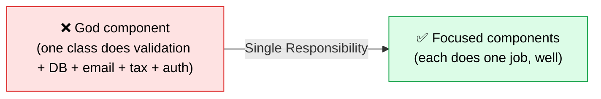
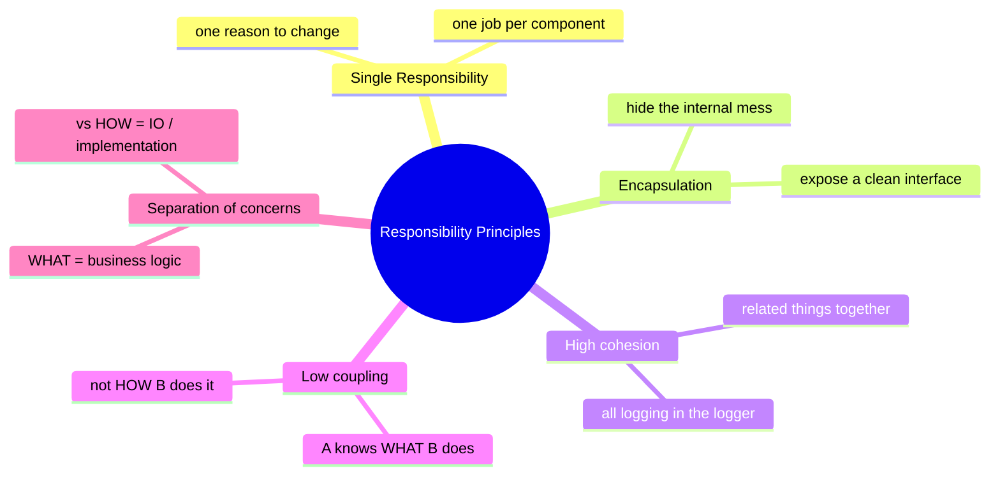
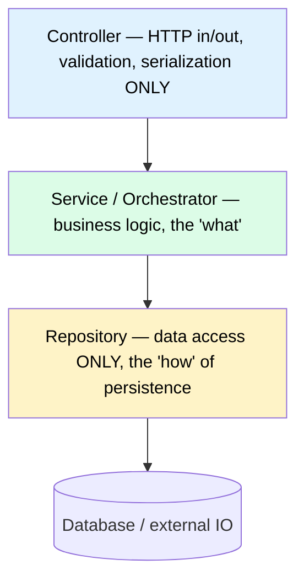
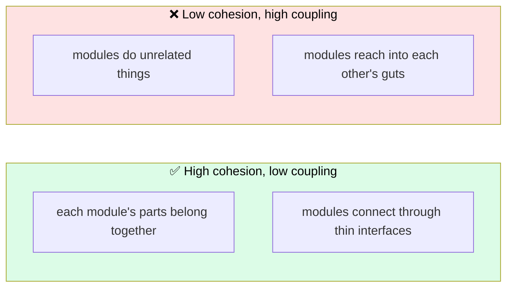
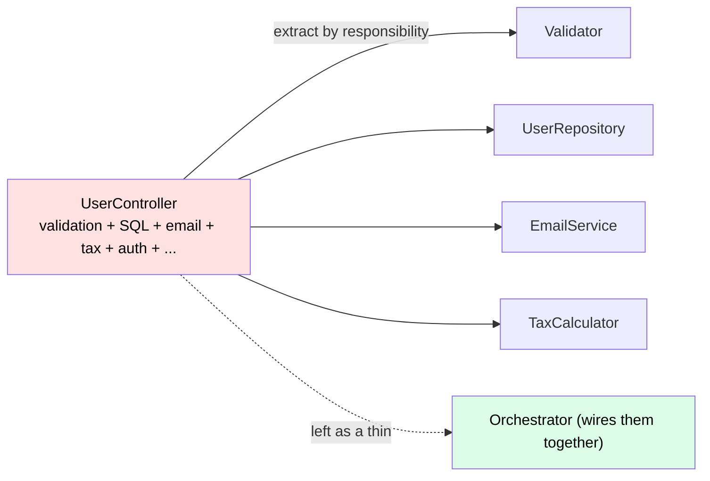
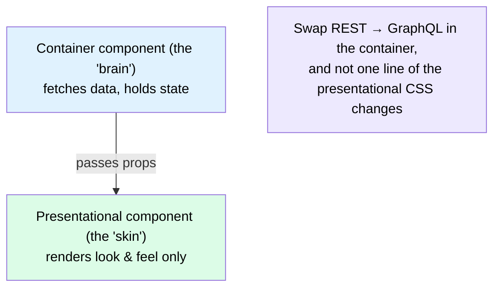
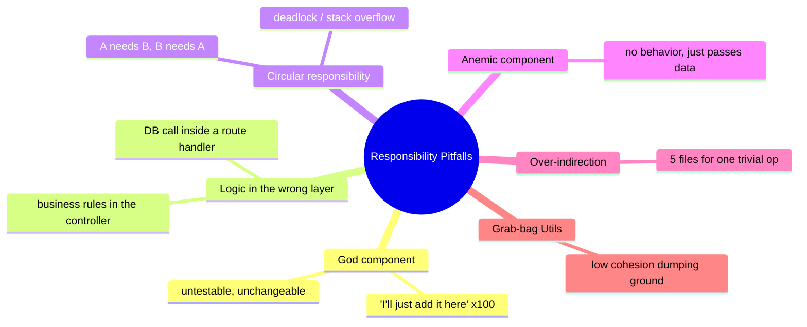

# Component Responsibilities

> **One line:** A professional kitchen — the chef plans, the prep cook chops, the dishwasher cleans, and nobody does someone else's job. Every component gets *one clear responsibility*, so the system stays testable, debuggable, and changeable instead of collapsing into a "God component."

---

## Table of Contents
1. [Why You Must Master This](#1-why-you-must-master-this)
2. [The Mental Model](#2-the-mental-model)
3. [The Principles: SRP, Cohesion, Coupling](#3-the-principles-srp-cohesion-coupling)
4. [The Layered Flow](#4-the-layered-flow)
5. [Cohesion vs Coupling (the core tension)](#5-cohesion-vs-coupling-the-core-tension)
6. [Refactoring a God Component](#6-refactoring-a-god-component)
7. [Worked Example — Container vs Presentational](#7-worked-example--container-vs-presentational)
8. [Real-Life Use Cases](#8-real-life-use-cases)
9. [Failure Modes](#9-failure-modes)
10. [🏋️ Practice Drills](#-practice-drills)
11. [🎤 Interview Q&A Bank](#-interview-qa-bank)
12. [🎯 Staff+ Nuances](#-staff-nuances)
13. [Cheat Sheet](#13-cheat-sheet)
14. [Connections & Further Reading](#14-connections--further-reading)

---

## 1. Why You Must Master This

This is decomposition *at the component level* — the difference between a codebase you can reason about and one where every file does everything.

- **The God component** — without clear responsibilities, one class (`App`, `UserController`, `Utils`) slowly absorbs every feature until it's untestable and unchangeable.
- **Merge conflicts** — if everyone edits the same "shared" component for unrelated reasons, the team burns time resolving git conflicts instead of shipping.
- **Debugging speed** — if *only* `PaymentProcessor` touches the card API, a failed transaction has one place to look, not ten.

> **The core problem it solves:** *low cohesion and tight coupling.* It stops an `Emailer` that also calculates tax, and stops Component A from needing to know *how* Component B works (only *what* it does). The classic anti-pattern it forbids: business logic stuffed into the network layer (a DB call inside an Express/Flask route).

---

## 2. The Mental Model

A professional kitchen: the **chef** (orchestrator) runs the menu, the **prep cook** (data access) chops vegetables, the **dishwasher** (cleanup) handles messes. If the chef starts washing dishes, the food goes cold; if the prep cook tries to run the menu, chaos. Everyone has **one clear job**.





---

## 3. The Principles: SRP, Cohesion, Coupling



- **Single Responsibility (SRP)** — a component should have *one reason to change*. If the email format and the tax rules both force edits to the same class, it has two responsibilities.
- **Encapsulation** — hide the internal mess; expose a clean, minimal interface.
- **High cohesion** — keep related functions together (all logging lives in the logging module).
- **Low coupling** — A depends on *what* B does (its interface), never *how* (its internals).
- **Separation of concerns** — split the *what* (business logic) from the *how* (IO/implementation).

---

## 4. The Layered Flow

The canonical responsibility split for a service: each layer has one job and depends only on the layer below.



```python
# BAD: God service — validation + DB + notification all fused
class SignupService:
    def signup(self, user):
        if "@" not in user.email: raise Error()       # validation
        db.save(user)                                  # data access
        smtp.send("Welcome!")                          # notification

# GOOD: one job each, orchestrated
class SignupOrchestrator:
    def signup(self, user):
        Validator.check(user)            # validation component
        UserRepository.save(user)        # data-access component
        EmailService.send_welcome(user)  # notification component
```

> **Dependencies point one way — down.** The Controller knows the Service; the Service knows the Repository. Nothing reaches *up* or sideways into another component's internals. This is what makes each layer independently testable (mock the layer below).

---

## 5. Cohesion vs Coupling (the core tension)

The whole discipline reduces to two dials you push in opposite directions:



- **High cohesion** = the things inside a component genuinely belong together (a `PaymentProcessor` that only does payments).
- **Low coupling** = components interact through narrow, stable interfaces, not by reaching into each other's internals.

> Aim for **high cohesion + low coupling**. The failure modes are the opposites: a grab-bag `Utils` class (low cohesion) and a web of components that all import each other's internals (high coupling).

---

## 6. Refactoring a God Component



The refactor: identify each *reason the class changes*, extract that into its own component, and leave a thin orchestrator that wires them. The signal you've gone too far the other way: an "anemic" component with no behavior, or jumping through five files to follow one trivial operation (too much indirection).

---

## 7. Worked Example — Container vs Presentational



Frontend's version of the same principle: **presentational** components handle look/feel only; **container** components fetch data and hold state. Because the responsibilities are split, teams (e.g., at Airbnb) swapped their data layer from REST to GraphQL without rewriting a single line of CSS — the presentational components didn't care *how* data arrived, only *that* it did.

---

## 8. Real-Life Use Cases

| Situation | How clear responsibilities help |
|-----------|---------------------------------|
| **Service codebase** | Controller / Service / Repository split → each layer unit-testable in isolation. |
| **Frontend** | Container vs presentational → swap the data source without touching the UI. |
| **Hexagonal / ports & adapters** | Business logic at the protected center; IO (DB, queue, HTTP) as swappable adapters. |
| **Reusable infrastructure** | One `EmailService` reused by signup, password reset, and marketing. |
| **Debugging a prod incident** | "Only `PaymentProcessor` touches the card API" → one place to look. |
| **Onboarding** | New engineers learn the system component-by-component, not all-at-once. |

> Real-world habit: **before adding code, ask "whose job is this?"** If the answer is "this component's *other* job," you're growing a God component — extract instead. Keep IO at the edges and business logic in the center.

---

## 9. Failure Modes



- **The God component** — grows one "too small for its own class" addition at a time until it owns everything.
- **Logic in the wrong layer** — business rules in the controller, or a DB query inside a route handler; mixes the *what* and the *how*.
- **Circular responsibility** — A needs B to finish but B needs info only A has → deadlock or stack overflow.
- **Anemic components** — no behavior, just shuttling data (often a sign of over-decomposition).
- **Over-indirection** — the opposite failure: so many tiny components that following one operation means hopping through five files.

---

## 🏋️ Practice Drills

> *Decide whose job it is.*

**Drill 1 — Where does this belong?** A Flask route handler validates input, runs a raw SQL query, applies a 10%-discount business rule, and sends a confirmation email — all inline. List the responsibilities and where each should go.

<details><summary>Solution</summary>

Four responsibilities, four homes: (1) input validation → a Validator (or controller-level schema check); (2) the SQL → a Repository; (3) the discount rule → the Service/domain layer (business logic); (4) the email → an EmailService. The route handler should only translate HTTP↔calls and delegate — it currently violates separation of concerns by holding all four.
</details>

**Drill 2 — God component or fine?** A `UserController` has grown to 1,200 lines handling auth, profile edits, password reset, billing, and admin actions. Two devs keep hitting merge conflicts in it. Diagnosis and fix?

<details><summary>Solution</summary>

It's a God component — multiple reasons to change (auth, billing, admin all evolve separately) living in one class, which is also why two devs collide there. Fix: split by responsibility into focused components/services (AuthService, ProfileService, BillingService…), each with one reason to change, leaving thin controllers that delegate. Merge conflicts drop because changes now land in different files.
</details>

**Drill 3 — Too far?** After refactoring, a simple "get user name" call now passes through Controller → Service → Mapper → Repository → DAO → Entity, and three of those just forward the call. What went wrong?

<details><summary>Solution</summary>

Over-indirection / anemic layers — several components add no behavior, just pass the call through. SRP doesn't mean "maximize the number of components"; it means one *meaningful* responsibility each. Collapse the pass-through layers (e.g., drop the redundant Mapper/DAO) so each remaining component earns its place. Balance cohesion against needless indirection.
</details>

---

## 🎤 Interview Q&A Bank

**Q1. What is the Single Responsibility Principle?**
> A component should have one reason to change — one cohesive job. If two unrelated forces (say, email formatting and tax rules) both require editing the same class, it has two responsibilities and should be split.

**Q2. How do you decide if a component is doing too much?**
> Count its reasons to change. Multiple unrelated reasons (it changes when auth changes *and* when billing changes) = too much. Other signals: it's hard to name without "and," it's a merge-conflict hotspot, or you can't unit-test one behavior without dragging in unrelated dependencies.

**Q3. Cohesion vs coupling?**
> Cohesion = how related a component's internal parts are (high is good — everything belongs together). Coupling = how dependent components are on each other's internals (low is good — they interact through thin interfaces). The goal is high cohesion + low coupling.

**Q4. Where should business logic live, and where shouldn't it?**
> In the service/domain layer (the "what"). It should *not* live in the controller/route (which only handles HTTP) or the repository (which only handles persistence). Mixing business logic into the IO layers couples your rules to the framework and the database.

**Q5. What's separation of concerns?**
> Splitting the *what* (business logic) from the *how* (implementation/IO), so each can change independently. Controller handles transport, Service handles rules, Repository handles persistence — change the database without touching the rules.

**Q6. How do clear responsibilities improve testability?**
> Each component can be tested in isolation by mocking the one below it — test the Service's logic with a fake Repository, no real database needed. A God component, by contrast, requires standing up everything to test anything.

**Q7. Can you over-apply SRP?**
> Yes — over-decomposition into anemic, pass-through components creates excessive indirection (five files to follow one operation) without behavioral benefit. SRP means one *meaningful* responsibility, not the maximum number of classes.

---

## 🎯 Staff+ Nuances

- **"Responsibility" = a reason to change, defined by the people who request changes.** SRP is often misread as "do one thing." Uncle Bob's sharper version: a module should answer to *one actor/stakeholder*. Code that the billing team and the compliance team both need to edit for different reasons belongs in *two* components, even if they look similar — because they change for different reasons, on different schedules.
- **Cohesion is the more important dial, and the harder one.** Low coupling is relatively easy to achieve with interfaces; *high cohesion* — putting the things that change together *together* — is the subtle skill, and it's the same judgment as drawing bounded contexts one level up (see [System_Decomposition.md](./System_Decomposition.md)). Get cohesion right and low coupling tends to follow.
- **Push IO to the edges; keep the core pure (Hexagonal / Clean / Onion).** The highest-leverage responsibility rule is dependency direction: business logic at the protected center depends on *nothing* external; databases, queues, and HTTP are adapters at the boundary that depend *inward*. This makes the core testable without infrastructure and swappable underneath (REST→GraphQL, Postgres→Dynamo) without touching the rules.
- **Indirection has a cost — pay it only for variation that exists.** Every layer/abstraction you add is a tax on reading the code (the five-files-to-follow-one-op problem). Ousterhout's lens: deep modules (simple interface, substantial behavior) are good; shallow modules (interface as complex as the implementation) are pure cost. Add an abstraction when you have *real* variation to absorb, not speculatively.
- **The God component grows by a thousand reasonable decisions.** Nobody adds a God class on purpose; each "this is too small to justify a new file, I'll just add it here" is locally reasonable. The discipline is catching the *pattern* in review ("this class now changes for three unrelated reasons") rather than any single addition. Architecture decays incrementally; defend it incrementally.
- **Component boundaries should mirror, not fight, the decomposition above them.** Component responsibilities (this file) and system decomposition ([System_Decomposition.md](./System_Decomposition.md)) are the same principle at two zoom levels — SRP for a class, bounded context for a service. When they disagree (a "component" that spans two bounded contexts), the larger boundary wins; realign the component.

---

## 13. Cheat Sheet

```
ONE CLEAR JOB PER COMPONENT. The kitchen brigade: chef plans, prep chops, dishwasher cleans.

PRINCIPLES
  SRP            one REASON TO CHANGE (one actor/stakeholder), not literally "one thing"
  encapsulation  hide internals, expose a thin interface
  high cohesion  related things together   (the harder, more important dial)
  low coupling   depend on WHAT, not HOW
  SoC            split the WHAT (logic) from the HOW (IO)

LAYERS  Controller (HTTP) → Service (business logic) → Repository (data) → DB
        dependencies point ONE WAY: down. Logic lives in the Service, never the controller/route.

ARCHITECTURE  Hexagonal/Clean/Onion: pure core, IO as adapters at the edges (swap DB without touching rules)
TEST  mock the layer below → each component testable in isolation

TRAPS: God component (1000 small additions) · logic in the route · circular responsibility ·
       anemic pass-through · over-indirection (5 files for 1 op) · grab-bag Utils (low cohesion)
```

---

## 14. Connections & Further Reading

**Within this repo:**
- [System_Decomposition.md](./System_Decomposition.md) — the same principle one zoom level up; [Modular_Monolith.md](./Modular_Monolith.md) — module boundaries.
- [04 · Low-Level Design](../04_Low_Level_Design/) — SOLID, design patterns, class-level responsibility (the home of this topic's theory).
- [02 · API Design Fundamentals](../02_API_Interface_Design/API_Design_Fundamentals.md) — clean interfaces between components.

**External classics:**
- [Uncle Bob — The Clean Architecture](https://blog.cleancoder.com/uncle-bob/2012/08/13/the-clean-architecture.html) · [PresentationDomainDataLayering (Fowler)](https://martinfowler.com/bliki/PresentationDomainDataLayering.html).
- *A Philosophy of Software Design* (John Ousterhout) — deep vs shallow modules, complexity.
- *Clean Code* / *Clean Architecture* (Robert C. Martin) — SRP, dependency direction.

---

## TL;DR
Give every component **one clear responsibility** — defined as *one reason to change* (one stakeholder), not literally "one thing." Aim for **high cohesion** (related things together — the hard dial) and **low coupling** (depend on *what*, not *how*), split the **what (business logic) from the how (IO)**, and keep **dependencies pointing one way: down** (Controller → Service → Repository), with IO pushed to the edges (Hexagonal/Clean). The two opposite failures are the **God component** (grows by a thousand reasonable additions) and **over-indirection** (anemic pass-through layers) — add abstraction only for variation that actually exists.
