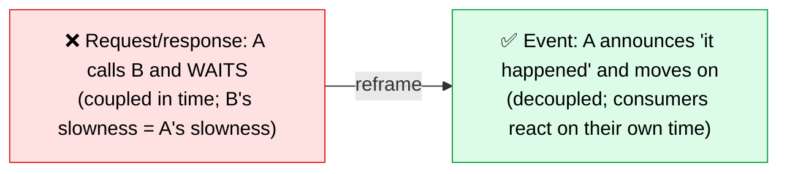
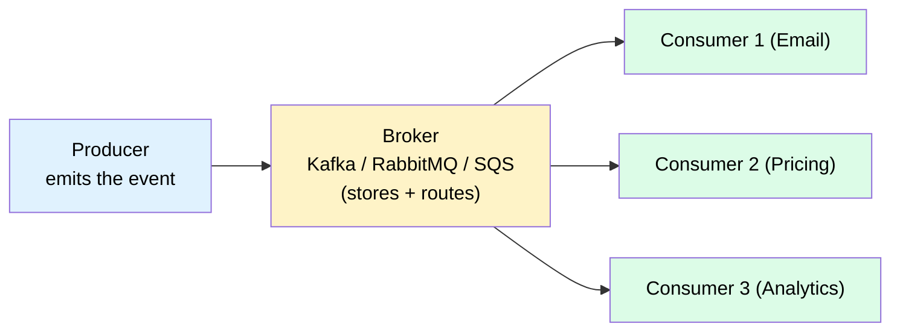
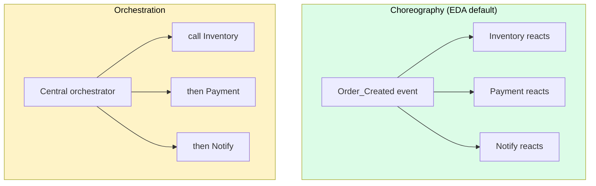
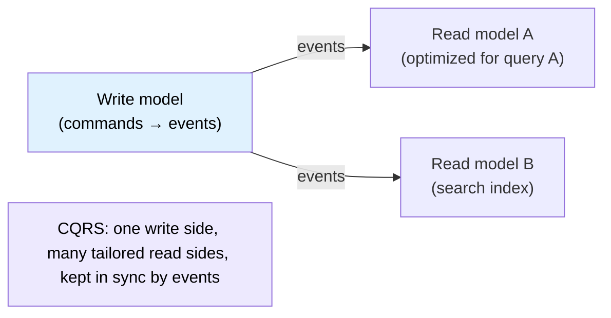
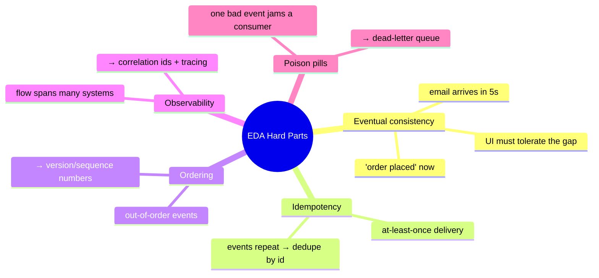
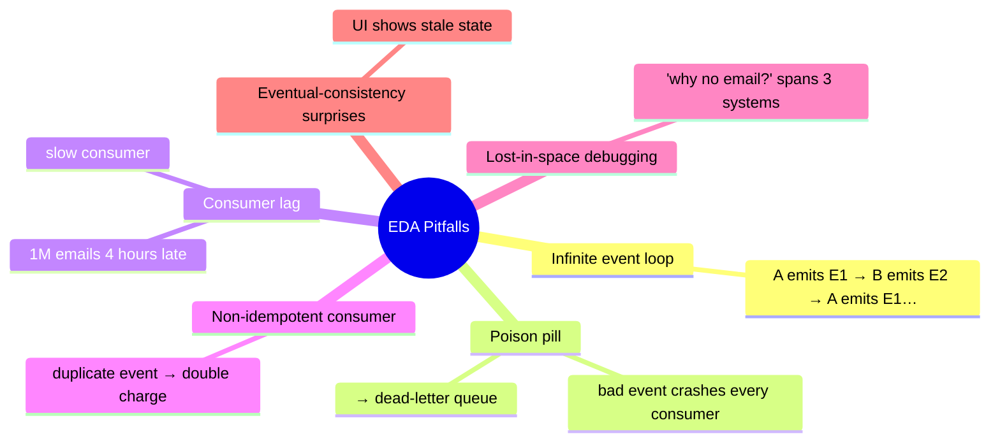

# Event-Driven Architecture (EDA)

> **One line:** Instead of Service A *asking* Service B to do something and waiting, A *announces* that something happened ("Order_Created") and goes back to work — any number of services react on their own time. It trades immediate consistency for decoupling, resilience, and scale.

---

## Table of Contents
1. [Why You Must Master This](#1-why-you-must-master-this)
2. [The Mental Model](#2-the-mental-model)
3. [The Building Blocks](#3-the-building-blocks)
4. [Choreography vs Orchestration](#4-choreography-vs-orchestration)
5. [Patterns: Pub/Sub, Event Sourcing, CQRS](#5-patterns-pubsub-event-sourcing-cqrs)
6. [The Hard Parts: Consistency, Idempotency, Ordering](#6-the-hard-parts-consistency-idempotency-ordering)
7. [Worked Example — Uber Trip](#7-worked-example--uber-trip)
8. [Real-Life Use Cases](#8-real-life-use-cases)
9. [Failure Modes](#9-failure-modes)
10. [🏋️ Practice Drills](#-practice-drills)
11. [🎤 Interview Q&A Bank](#-interview-qa-bank)
12. [🎯 Staff+ Nuances](#-staff-nuances)
13. [Cheat Sheet](#13-cheat-sheet)
14. [Connections & Further Reading](#14-connections--further-reading)

---

## 1. Why You Must Master This

EDA is the backbone of nearly every high-scale, real-time system. It's how you stop a slow downstream service from dragging down your user-facing path.

- **Decoupling in time and space** — in request/response, A waits for B; in EDA, A publishes an event and moves on. Producer and consumer don't need to be up at the same time, or even know each other exists.
- **Resilience** — if the Email service is down, events queue up until it returns. Checkout stays fast and healthy.
- **Scale** — add more consumers to handle load without touching the producer; the producer does the same amount of work for 1 or 1M subscribers.

> **The core problem it solves:** *tight synchronous coupling and cascading failures.* Synchronous HTTP-everywhere means one slow database can stall the whole user-facing site. EDA breaks that chain by making interactions asynchronous and buffered.

---

## 2. The Mental Model

EDA is **newspaper delivery.** The publisher doesn't know who you are — they print the news and drop it at distribution. You (the subscriber) don't wait at the printing press; you check your doorstep (the queue/stream) when you're ready. One subscriber or a million — the publisher's job is identical.





---

## 3. The Building Blocks



- **Event** — an immutable fact about the *past* ("Order_Created", "User_LoggedIn"). It already happened; consumers can't reject it.
- **Producer** — the service that emits the event (and doesn't care who consumes it).
- **Broker** — the "post office" (Kafka, RabbitMQ, SQS) that stores and routes events.
- **Consumer** — a service that reacts (send an email, recompute a price).

```python
# Producer: Checkout — fire and forget
def complete_order(order_id):
    db.save(order_id)
    event_bus.publish("ORDER_COMPLETED", {"order_id": order_id, "amount": 100})
    return "Order placed"          # returns immediately; doesn't wait on email/analytics

# Consumer: Email service — separate process, reacts on its own time
def listen():
    for event in event_bus.subscribe("ORDER_COMPLETED"):
        send_email(event.data["order_id"])   # must be idempotent — events can repeat!
```

> **Command vs event** — a *command* ("SendEmail") targets one handler and expects it to act; an *event* ("OrderCompleted") is a broadcast fact with zero or many listeners. EDA is built on events.

---

## 4. Choreography vs Orchestration



- **Choreography** — each service knows what to do when an event happens; no central conductor. Maximally decoupled, but the end-to-end flow is implicit (harder to see "the whole process").
- **Orchestration** — a central coordinator drives the steps. Easier to reason about and monitor; reintroduces a coupling point.

> For multi-step distributed transactions, the **Saga** pattern uses either style: choreographed sagas (services react to each other's events) or orchestrated sagas (a saga coordinator). See [10 · Microservices](../10_Microservices_Distributed_Systems/).

---

## 5. Patterns: Pub/Sub, Event Sourcing, CQRS

| Pattern | What it is | Use when |
|---------|-----------|----------|
| **Pub/Sub** | one event fan-outs to many consumers | many services react to the same fact |
| **Point-to-point (queue)** | one event → exactly one consumer | work-queue / task distribution |
| **Event Sourcing** | store state as the *sequence of events*, not current value | you need a full audit trail / time-travel / rebuild state |
| **CQRS** | separate the write model from read model(s), synced via events | reads and writes have very different shapes/scale |



> Event Sourcing + CQRS are powerful but advanced — they add real complexity (rebuilding state, schema evolution of old events). Don't reach for them unless the audit-trail or read/write-divergence need is genuine.

---

## 6. The Hard Parts: Consistency, Idempotency, Ordering



- **Eventual consistency** — the cost of decoupling. The user sees "Order Placed" but the confirmation email lands seconds later. Design the UX to tolerate the gap (see [05 · Databases / CAP](../01_Planning_Foundations/CAP_Theorem_PACELC.md)).
- **Idempotency** — brokers deliver *at-least-once*, so the same event can arrive twice. Consumers **must** be idempotent (dedupe by event id). This is non-negotiable (see [02 · Idempotency](../02_API_Interface_Design/Idempotency.md)).
- **Ordering** — events can arrive out of order; use sequence/version numbers or partition keys (Kafka) to preserve per-entity order.
- **Poison pills** — one malformed event that crashes every consumer and backs up the queue; route failures to a **dead-letter queue (DLQ)**.

---

## 7. Worked Example — Uber Trip

```mermaid
sequenceDiagram
    participant Rider
    participant Trip as Trip Service
    participant Bus as Event Stream
    participant Driver as Driver Selection
    participant Price as Pricing
    participant Notify as Notification
    Rider->>Trip: request ride
    Trip->>Bus: emit TRIP_REQUESTED (fire &amp; forget)
    Bus-->>Driver: find nearby cars
    Bus-->>Price: compute surge
    Bus-->>Notify: send "Finding your ride"
    Note over Driver,Notify: none of these talk to each other — they all react to one event, in parallel
```

A ride request emits one event; Driver Selection, Pricing, and Notification each react independently and concurrently. Adding a new reactor (say, Fraud Detection) means subscribing to the event — zero changes to the producer.

---

## 8. Real-Life Use Cases

| Situation | How EDA applies |
|-----------|-----------------|
| **Order/checkout pipelines** | "Order placed" fans out to inventory, payment, shipping, email, analytics — checkout stays fast. |
| **Real-time location/IoT (Uber, telemetry)** | High-frequency events streamed to many consumers. |
| **Notifications & activity feeds** | One action → many downstream reactions (push, email, feed update). |
| **Audit/compliance** | Event Sourcing gives an immutable, replayable history of every state change. |
| **Decoupling a slow dependency** | Put the slow consumer behind a queue so a spike or outage never touches the user path. |
| **Data integration / CDC** | Database change events stream to search indexes, caches, and warehouses. |

> Real-world habit: **use events to decouple anything that doesn't need an immediate answer; keep synchronous request/response for "the user is waiting right now" reads.** And make every consumer idempotent from line one.

---

## 9. Failure Modes



- **Infinite loops** — A emits E1 → B reacts with E2 → A reacts with E1… Guard with loop detection / not re-emitting on reaction.
- **Poison pills** — a bad event that crashes consumers and backs up the queue; DLQ + skip-and-alert.
- **Consumer lag** — a slow consumer falls hours behind; monitor lag, scale consumers, partition.
- **Non-idempotent consumers** — the #1 correctness bug; at-least-once delivery + non-idempotent handler = duplicate side effects (double charges).
- **Debuggability** — "why didn't the email send?" now spans three systems; you *need* correlation IDs and distributed tracing.

---

## 🏋️ Practice Drills

> *Reason about coupling, delivery, and consistency.*

**Drill 1 — Sync or event?** (a) "Show my current account balance" on a banking screen. (b) "Send a welcome email after signup." Which should be synchronous request/response, which event-driven?

<details><summary>Solution</summary>

(a) Synchronous — the user is waiting for the result *right now*, and they expect it to be current; an async event with eventual consistency would be wrong UX. (b) Event-driven — nothing blocks on the email; emit `UserSignedUp` and let the email service react. If email is down, signup still succeeds and the email sends later.
</details>

**Drill 2 — The double-charge.** Your payment consumer occasionally charges a card twice. The broker guarantees at-least-once delivery. What's the root cause and fix?

<details><summary>Solution</summary>

At-least-once means the same `PaymentRequested` event can be delivered more than once (retries, rebalances). A non-idempotent consumer processes both → double charge. Fix: make the consumer idempotent — dedupe on the event id / an idempotency key, so reprocessing a seen event is a no-op. ("Exactly-once *effect*" via idempotency, not exactly-once delivery.)
</details>

**Drill 3 — The stuck queue.** One malformed event sits at the head of the queue; every consumer crashes trying to parse it, and 50k events pile up behind it. What's this called and how do you handle it?

<details><summary>Solution</summary>

A poison pill. Handle by catching the processing failure and routing the bad event to a dead-letter queue (DLQ) after N retries, then continuing — so one bad message can't block the whole stream. Alert on DLQ growth and inspect/repair offline.
</details>

---

## 🎤 Interview Q&A Bank

**Q1. What is event-driven architecture?**
> A style where services communicate by producing and reacting to immutable events (facts about the past) through a broker, instead of direct synchronous calls. It decouples producers from consumers in time and space.

**Q2. How does EDA improve resilience over synchronous calls?**
> The broker buffers events, so a down or slow consumer doesn't block the producer — events wait in the queue until the consumer recovers. This prevents cascading failures where one slow service stalls the user-facing path.

**Q3. How do you handle duplicate events?**
> Make consumers idempotent — dedupe by event id or use an idempotency key so reprocessing a seen event has no extra effect. Brokers deliver at-least-once, so duplicates are expected, not exceptional. The goal is exactly-once *effect*, not exactly-once delivery.

**Q4. Choreography vs orchestration?**
> Choreography: services react to each other's events with no central coordinator (decoupled, but the flow is implicit). Orchestration: a central coordinator drives the steps (clearer/monitorable, but a coupling point). Sagas can use either.

**Q5. How do you do a transaction across services without a distributed lock?**
> The Saga pattern: break the transaction into local steps, each emitting an event that triggers the next, with compensating actions to undo on failure. Combined with idempotent, eventually-consistent steps.

**Q6. What's the biggest downside of EDA?**
> Eventual consistency and reduced observability. State converges over time (the user may see "placed" before the email arrives), and tracing a flow across many async consumers is hard — you need correlation IDs and distributed tracing.

**Q7. Kafka vs RabbitMQ — when each?**
> Kafka: high-throughput, ordered, replayable event *log* — great for event sourcing, streams, many consumers re-reading. RabbitMQ: a traditional *broker/queue* with rich routing and per-message ack — great for task queues and complex routing. (See section 09.)

**Q8. When would you NOT use EDA?**
> When the caller needs an immediate, consistent answer (e.g., "check my balance"), or for a small team where the broker + schema + tracing overhead outweighs the decoupling benefit. Synchronous request/response is simpler there.

---

## 🎯 Staff+ Nuances

- **Events are facts, commands are requests — and the distinction shapes coupling.** An event ("OrderPlaced") says *what happened* and the producer doesn't care who listens (low coupling). A command ("SendEmail") says *what to do* and targets a handler (higher coupling, closer to RPC). Modeling everything as commands recreates synchronous coupling over a broker; prefer fact-events for decoupling.
- **At-least-once + idempotency is the realistic contract.** "Exactly-once delivery" is largely a myth across a network/broker; mature systems get *exactly-once effect* by combining at-least-once delivery with idempotent consumers (and often the transactional **outbox** pattern to atomically commit state + the event). Don't design assuming the broker won't duplicate.
- **The dual-write problem is the silent EDA bug.** Writing to your DB *and* publishing an event are two operations — a crash between them loses the event or fakes one. The fix is the **transactional outbox** (write the event to a DB table in the same transaction; a relay publishes it) or CDC off the DB log. Naively calling `publish()` after `commit()` is a data-loss bug at scale.
- **Choreography scales decoupling but erodes comprehension.** With pure choreography, no single place describes the end-to-end business process — it's emergent from who-subscribes-to-what. For critical multi-step flows (payments, fulfillment), an *orchestrated* Saga with a visible coordinator is often worth the coupling for the observability and clear ownership. Match the style to the need.
- **Event schema is a contract — version it.** Producers and consumers are decoupled at runtime but coupled through the event *shape*. Use a schema registry, make changes additive/backward-compatible, and treat a breaking event change like a breaking API change (see [02 · API Versioning](../02_API_Interface_Design/API_Versioning.md)).
- **Ordering is per-partition, not global.** Kafka guarantees order only within a partition, so route events that must stay ordered (per user, per order) to the same partition via the key. Expecting global ordering across partitions is a classic mistake that surfaces as rare, hard-to-reproduce out-of-order bugs.
- **EDA shifts complexity from the call graph to the data flow.** You remove synchronous coupling but add: eventual-consistency handling, idempotency, DLQs, replay tooling, schema evolution, and distributed tracing. That's a real operational tax — justified at scale, overkill for a simple app.

---

## 13. Cheat Sheet

```
EDA = react to facts that HAPPENED, instead of asking for things to happen. Newspaper delivery.

PARTS  Event (immutable past fact) · Producer · Broker (Kafka/RabbitMQ/SQS) · Consumer
STYLES choreography (no conductor, decoupled) · orchestration (central coordinator, clearer)
PATTERNS pub/sub (fan-out) · point-to-point (one consumer) · event sourcing · CQRS

✓ decoupled in time+space · resilient (queue buffers outages) · scale consumers independently
✗ eventual consistency · hard to trace · duplicate events · poison pills

HARD PARTS (must handle):
  idempotent consumers (at-least-once delivery → dedupe by id)   ← non-negotiable
  transactional OUTBOX (avoid the dual-write data-loss bug)
  ordering per-partition (key by entity) · DLQ for poison pills · correlation ids for tracing

USE EDA: decouple anything not needing an instant answer · spiky/async workloads
USE SYNC: "user is waiting right now" reads needing current data
```

---

## 14. Connections & Further Reading

**Within this repo:**
- [SOA.md](./SOA.md) — dumb-pipe choreography vs the smart ESB; [Monolith_vs_Microservices.md](./Monolith_vs_Microservices.md) — decoupling services.
- [02 · Idempotency](../02_API_Interface_Design/Idempotency.md) — the must-have for consumers; [CAP & PACELC](../01_Planning_Foundations/CAP_Theorem_PACELC.md) — eventual consistency.
- [09 · Message Queues & Event Streaming](../09_Message_Queues_Event_Streaming/) — Kafka vs RabbitMQ, CDC, backpressure; [10 · Microservices](../10_Microservices_Distributed_Systems/) — Sagas.

**External classics:**
- [Martin Fowler — What do you mean by "Event-Driven"?](https://martinfowler.com/articles/201701-event-driven.html).
- [Confluent — What is Apache Kafka?](https://www.confluent.io/what-is-apache-kafka/) · [Enterprise Integration Patterns](https://www.enterpriseintegrationpatterns.com/).
- *Designing Data-Intensive Applications* (Kleppmann) — streams, logs, exactly-once.

---

## TL;DR
EDA replaces "A calls B and waits" with "A announces a fact and moves on" — services **produce and react to immutable events** through a **broker**, decoupling them in time and space for **resilience and scale**. The price is **eventual consistency** and harder observability, and the non-negotiable rules are **idempotent consumers** (at-least-once delivery duplicates events), the **transactional outbox** (to avoid the dual-write data-loss bug), **per-partition ordering**, and **DLQs** for poison pills. Use events to decouple anything that doesn't need an immediate answer; keep synchronous request/response for "the user is waiting right now."
