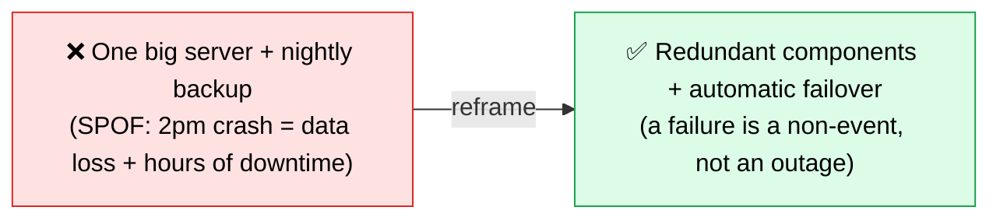
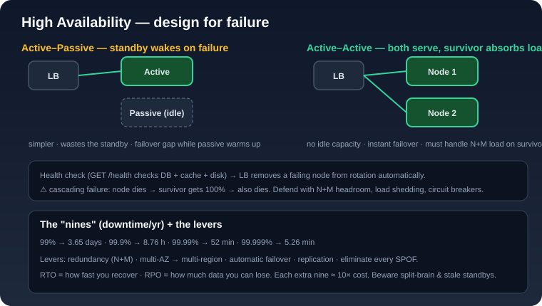
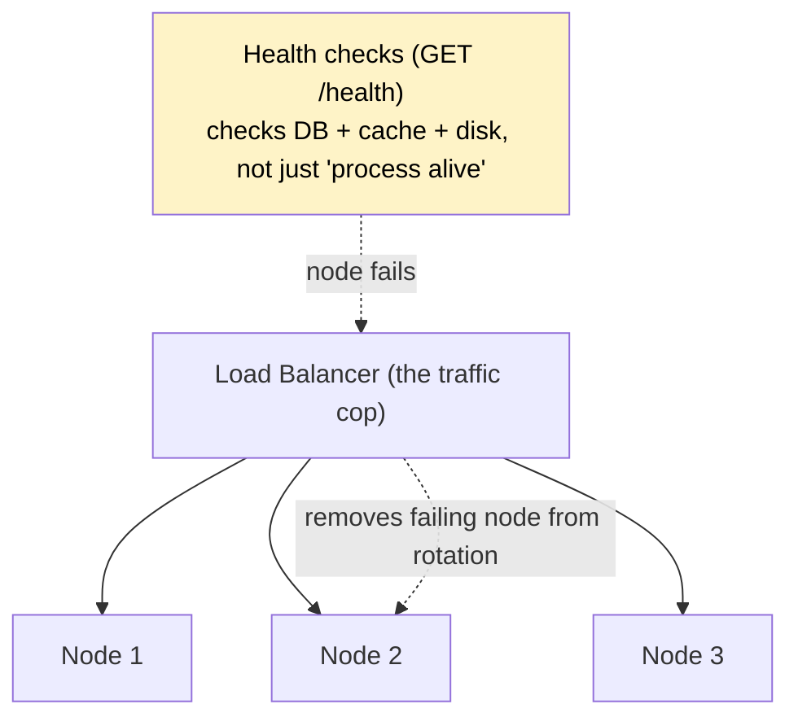
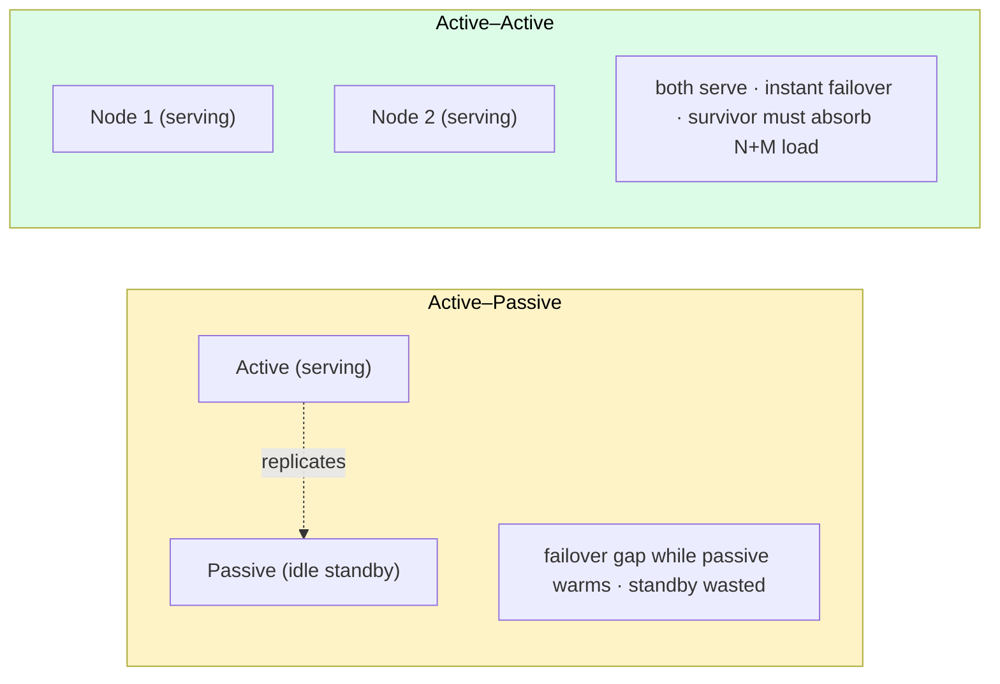
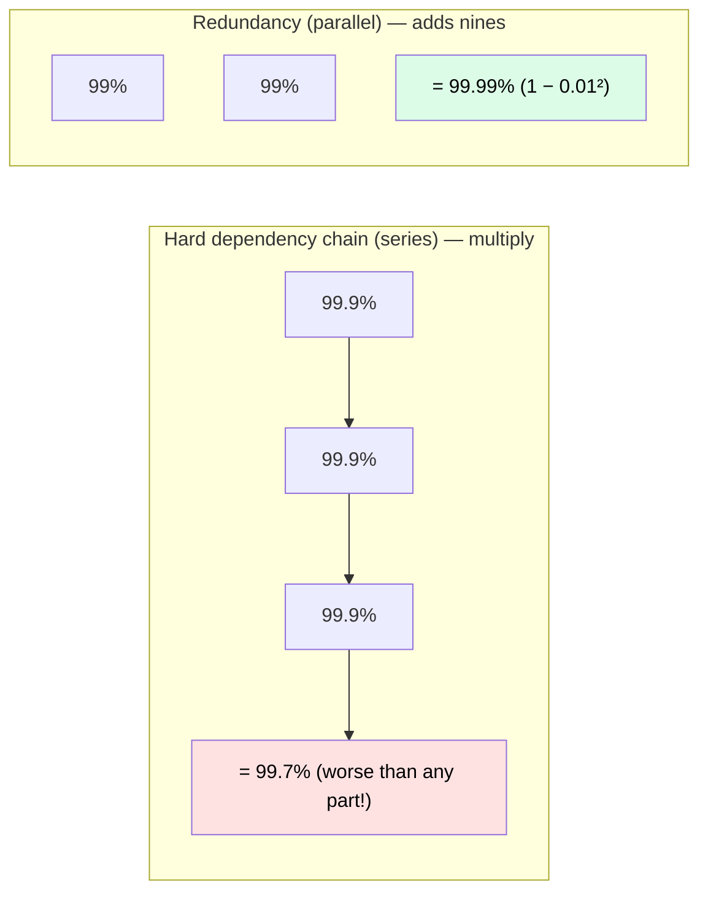
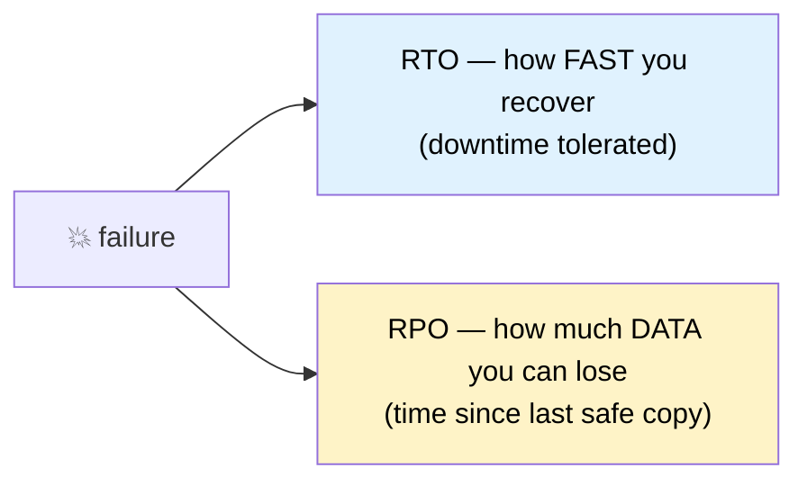
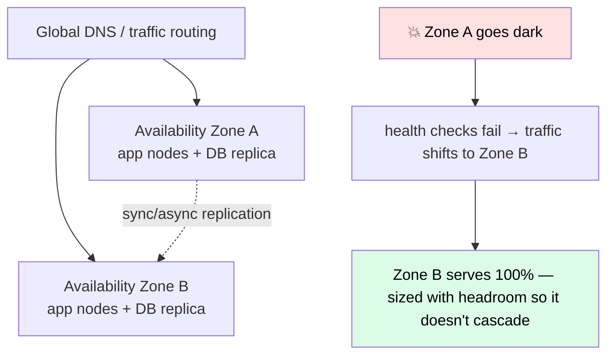
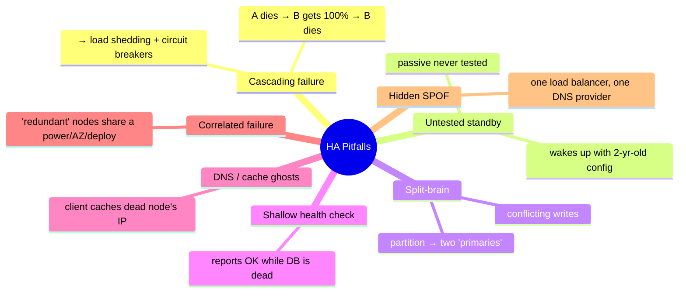

# High Availability Design

> **One line:** A twin-engine airplane — if one engine (server, database, zone) catches fire, the other carries the load and the passengers never notice. HA is the art of **assuming everything will break** and designing redundancy + automatic failover so the *system* survives even when the *hardware* doesn't.

---

## Table of Contents
1. [Why You Must Master This](#1-why-you-must-master-this)
2. [The Mental Model](#2-the-mental-model)
3. [How HA Works: Redundancy + Failover](#3-how-ha-works-redundancy--failover)
4. [Active-Active vs Active-Passive](#4-active-active-vs-active-passive)
5. [The Availability Math (and call chains)](#5-the-availability-math-and-call-chains)
6. [RTO, RPO & the Spectrum to DR](#6-rto-rpo--the-spectrum-to-dr)
7. [Worked Example — Surviving a Zone Outage](#7-worked-example--surviving-a-zone-outage)
8. [Real-Life Use Cases](#8-real-life-use-cases)
9. [Failure Modes](#9-failure-modes)
10. [🏋️ Practice Drills](#-practice-drills)
11. [🎤 Interview Q&A Bank](#-interview-qa-bank)
12. [🎯 Staff+ Nuances](#-staff-nuances)
13. [Cheat Sheet](#13-cheat-sheet)
14. [Connections & Further Reading](#14-connections--further-reading)

---

## 1. Why You Must Master This

Availability is the feature users notice only when it's missing — and the cost of missing it scales with what you do.

- **Business continuity** — 4 hours down costs a bank millions, puts an airline on the news, and for 911 dispatch costs lives. "Being up" is often the most important feature.
- **Hardware is fickle** — drives fail, power supplies blow, datacenters flood or lose connectivity. HA keeps the *system* up when *hardware* falls down.
- **Trust** — in a world of infinite competition, an outage is a reason to switch.

> **The core problem it solves:** the *single point of failure (SPOF).* It prevents one faulty cable, crashed server, or dead zone from taking the whole system offline. The naive alternative — one big server with nightly backups — means a 2 PM crash loses everything since the last backup (RPO) and takes hours to restore (RTO).

---

## 2. The Mental Model

HA is a **twin-engine airplane.** If one engine (server/DB/zone) fails, the plane doesn't fall — the other engine takes the extra load and passengers barely notice. The two ingredients: **redundancy** (more than one engine) and **automatic failover** (the survivor takes over without a pilot manually doing it).





---

## 3. How HA Works: Redundancy + Failover



- **Redundancy (N+M)** — if you need N nodes for the load, run N+M so M can fail without impact.
- **Load balancer** — the traffic cop that detects a dead node and instantly stops routing to it.
- **Health checks** — a real `GET /health` that verifies *dependencies* (DB, cache, disk), not just "is the process running." A node that can't reach its DB should report unhealthy and be pulled.
- **Failover** — automatic promotion of a survivor (next section).

```python
@app.route("/health")
def health_check():
    try:
        db.execute("SELECT 1")                  # is the DB reachable?
        redis.ping()                            # is the cache reachable?
        if disk_free_mb() < 100: raise Error("Disk full")
        return "OK", 200
    except Exception as e:
        log.error(f"unhealthy: {e}")
        return "Degraded", 500                  # LB sees 500 → removes this node
```

> A shallow health check ("HTTP 200 if the web server is up") is a classic trap: the node keeps receiving traffic while its database connection is dead, serving errors to users. Check what the node actually *depends on*.

---

## 4. Active-Active vs Active-Passive



| | Active-Passive | Active-Active |
|---|----------------|---------------|
| Standby | idle until failover | also serving traffic |
| On failure | passive promotes (a gap while it warms) | survivor absorbs 100% instantly |
| Cost efficiency | pays for idle hardware | no idle capacity |
| Complexity | simpler | must handle full load on survivors + data sync both ways |
| Capacity caveat | — | each node must have headroom for the lost node's load (or cascade) |

> The active-active capacity trap: if two nodes each run at 60% and one dies, the survivor jumps to 120% → it also dies. Size for **N+M load on the survivors**, not just steady state.

---

## 5. The Availability Math (and call chains)

Availability isn't a vibe — it's arithmetic, and it's why synchronous service chains are dangerous.



- **Series (every dependency must work):** multiply. Three 99.9% services in a chain → `0.999³ ≈ 99.7%`. Every hard dependency you add *lowers* availability.
- **Parallel (redundant, any one suffices):** `1 − (1−A)ⁿ`. Two 99% replicas → 99.99%. Redundancy is the only lever *up*.
- **The nines** (downtime/year): 99% → 3.65 days · 99.9% → 8.76 h · 99.99% → 52 min · 99.999% → 5.26 min. Each extra nine ≈ **10× cost**.

> This is exactly why a synchronous A→B→C microservice chain is fragile, and why you remove hard dependencies (async, caching, fallbacks) or add redundancy. Full treatment in [01 · Availability & Reliability Math](../01_Planning_Foundations/Availability_Reliability_Math.md).

---

## 6. RTO, RPO & the Spectrum to DR



- **RTO (Recovery Time Objective)** — how quickly you must be back up.
- **RPO (Recovery Point Objective)** — how much data loss is acceptable (the gap to your last durable copy).
- **HA vs DR vs Fault Tolerance:** *HA* = survive component failure with minimal downtime (automatic). *Disaster Recovery (DR)* = survive a catastrophe (a whole region gone) — often with manual steps and longer RTO/RPO. *Fault tolerance* = **zero** downtime and **zero** data loss — the strictest and most expensive, rarely needed.

---

## 7. Worked Example — Surviving a Zone Outage



Spread app nodes and DB replicas across **multiple availability zones**; replicate data between them. When a zone fails, health checks detect it and traffic shifts to the healthy zone — *if* the surviving zone has the headroom to absorb the load. Amazon takes this to multi-*region*: even if an entire region (`us-east-1`) goes dark, traffic reroutes elsewhere and DynamoDB/Aurora replicate cross-region in milliseconds.

---

## 8. Real-Life Use Cases

| Situation | HA approach |
|-----------|-------------|
| **Stateless web/API tier** | Active-active behind a load balancer, N+M nodes, multi-AZ. Easy because stateless. |
| **Relational database** | Primary + standby replica with automatic failover (RDS Multi-AZ); read replicas for scale. |
| **Critical financial / payments** | Multi-region active-active, strict RPO≈0, quorum writes; correctness over availability (CP). |
| **Internal dev tools** | Single instance is fine — don't pay for HA where downtime is cheap. |
| **DNS / edge** | Multiple providers + health-checked failover (a single DNS provider is a real SPOF — see 2016 Dyn outage). |
| **Disaster recovery** | Cross-region backups + a documented, *tested* runbook to meet a longer RTO/RPO. |

> Real-world habit: **enumerate every SPOF in the design and ask "what happens when this dies?"** — then add redundancy + automatic failover where the downtime cost justifies it. Match the number of nines to the business impact, not to engineering pride.

---

## 9. Failure Modes



- **Cascading failure** — the dead node's load overwhelms the survivor, which also dies. Defend with N+M headroom, **load shedding**, and **circuit breakers**.
- **Untested standby** — the passive node was never exercised; on failover it fails because its config is two years stale. Defend with **chaos engineering** (deliberately kill nodes).
- **Split-brain** — a partition leaves two nodes both acting as primary, writing conflicting data. Defend with quorum/consensus (see [CAP](../01_Planning_Foundations/CAP_Theorem_PACELC.md)).
- **Shallow health checks** — "HTTP 200" while the DB is unreachable → traffic keeps flowing to a broken node.
- **DNS/cache ghosts** — clients cache the dead node's IP and keep hitting it; use low TTLs and health-aware routing.
- **Hidden / correlated SPOFs** — "redundant" nodes that share one power feed, one AZ, one deploy pipeline, or one DNS provider aren't really redundant (breaks the parallel-availability math).

---

## 🏋️ Practice Drills

> *Find the SPOF and do the availability math.*

**Drill 1 — Availability of a chain.** A request must pass through a load balancer (99.99%), an API service (99.95%), and a database (99.95%), all hard dependencies. Roughly what's the end-to-end availability?

<details><summary>Solution</summary>

Multiply (series): `0.9999 × 0.9995 × 0.9995 ≈ 0.9989` ≈ **99.89%** — worse than any single component, and below a 99.9% SLO. Every hard dependency drags availability down. To improve: make the weakest links redundant (DB primary+standby with auto-failover → its availability rises), or remove a hard dependency (cache, async, graceful degradation).
</details>

**Drill 2 — The active-active capacity trap.** Two active-active nodes each run at 65% CPU. One dies. What happens, and how should they have been sized?

<details><summary>Solution</summary>

The survivor must absorb the dead node's load → `65% + 65% = 130%` → it saturates and also dies (cascading failure). They should have been sized so a single loss keeps the survivor under ~100% (here, run each ≤ ~45–50%), i.e., N+1 headroom. Add load shedding/circuit breakers so an overloaded node degrades instead of dying.
</details>

**Drill 3 — Spot the hidden SPOF.** A team proudly runs 3 redundant app servers… all in the same availability zone, behind a single load balancer, resolving through one DNS provider. Where are the SPOFs?

<details><summary>Solution</summary>

Three: (1) the single AZ — a zone outage kills all three "redundant" servers at once (correlated failure breaks the redundancy math); (2) the single load balancer — itself a SPOF in front of everything; (3) the single DNS provider (cf. the 2016 Dyn outage). Real redundancy requires independent *failure domains*: multi-AZ servers, a redundant/managed LB, and multi-provider DNS.
</details>

---

## 🎤 Interview Q&A Bank

**Q1. How do you ensure a system survives a datacenter (zone) outage?**
> Run redundant components across multiple availability zones (and replicate data between them), front them with health-checked load balancing/DNS that fails traffic over to a healthy zone, and size the surviving zone with enough headroom to absorb the load without cascading. For catastrophe survival, extend to multi-region (DR).

**Q2. Active-active vs active-passive?**
> Active-passive keeps an idle standby that's promoted on failure (simpler, but wastes the standby and has a failover gap). Active-active runs all nodes serving traffic (no idle cost, instant failover) but each must have headroom to absorb a failed node's share, and data must sync across all active nodes.

**Q3. What's the availability of three 99.9% services in a hard-dependency chain?**
> Multiply: 0.999³ ≈ 99.7% — lower than any single one. Hard dependencies compound downward. Redundancy (parallel) is the only way to raise availability: `1 − (1−A)ⁿ`.

**Q4. RTO vs RPO?**
> RTO = how fast you must recover (downtime tolerated). RPO = how much data loss you can accept (gap to the last durable copy). A bank ledger wants RPO≈0; an analytics dashboard can tolerate hours of both.

**Q5. What is split-brain and how do you prevent it?**
> During a network partition, two nodes each believe they're the primary and accept conflicting writes. Prevent with quorum/consensus (a majority must agree on the leader) — accepting reduced availability during the partition to preserve consistency (CAP: choose CP for this).

**Q6. What makes a good health check?**
> One that verifies the node's real dependencies (DB, cache, disk), not just "the process is alive." A shallow check lets the LB route traffic to a node that returns 200 but can't actually serve requests.

**Q7. How do you prevent a cascading failure during failover?**
> Size for N+M (survivors have headroom), add load shedding (drop low-priority work under overload), circuit breakers (stop hammering a failing dependency), and backpressure. Without headroom, failover just moves the outage to the next node.

**Q8. Why is each "nine" so expensive?**
> Each nine ≈ 10× the cost: 99.9%→99.99% may need multi-AZ + auto-failover; 99.99%→99.999% needs multi-region active-active and removing humans from the recovery loop (5 min/year leaves no time to react manually). Match nines to business impact.

---

## 🎯 Staff+ Nuances

- **Redundancy only adds nines if failures are *independent*.** The parallel-availability formula assumes nodes fail independently — but "redundant" nodes sharing an AZ, a power feed, a base image, a config push, or a DNS provider fail *together*. The dominant cause of major outages is correlated failure (a bad deploy to all replicas, a region-wide event), not independent hardware death. Design across independent failure domains, and treat your deploy pipeline as a SPOF.
- **The biggest availability risk is usually *you*, not hardware.** Most outages are triggered by configuration changes and deployments, not disk failures. HA against hardware is necessary but insufficient — progressive delivery (canary, blue-green), automated rollback, and config validation protect against the failure mode that actually dominates incident reports.
- **Failover is a control-plane problem, and the control plane is a SPOF.** Detecting failure and promoting a standby requires a coordinator (the thing that decides "A is dead, promote B"). That coordinator must itself be HA and must avoid split-brain (two coordinators both promoting) — which is why consensus systems (Raft/Paxos, etcd, ZooKeeper) sit underneath real failover. "Just add a standby" hand-waves the hard part.
- **MTTR usually beats MTBF as the cheaper lever.** Availability = MTBF/(MTBF+MTTR). You can't prevent all failures, but you can recover faster — fast detection + automated failover/rollback often improves availability more cheaply than making components fail less often. And detection time, not repair time, usually dominates MTTR — invest in alerting (see [01 · Availability Math](../01_Planning_Foundations/Availability_Reliability_Math.md)).
- **Graceful degradation buys "available" far more cheaply than another nine of redundancy.** A system that serves stale cache / read-only mode / partial results when a backend is down is "available" for most users even mid-incident. Designing degraded modes (the Comments service is down but the Video still plays) is higher-leverage than chasing perfect redundancy everywhere.
- **Test failure or you don't have HA — you have hope.** An untested standby, an unexercised failover, a runbook nobody's run: all fail exactly when needed. Chaos engineering (deliberately killing nodes/zones in production, à la Netflix's Chaos Monkey) is how you convert "should fail over" into "does fail over." HA you haven't tested is a theory.
- **The CAP choice is an availability decision in disguise.** For stateful systems, "stay available during a partition" (AP) vs "stay correct, reject writes" (CP) *is* an HA decision with a consistency cost. A payments ledger deliberately sacrifices availability under partition to avoid double-spends; a shopping cart does the opposite. HA isn't free of trade-offs — see [CAP & PACELC](../01_Planning_Foundations/CAP_Theorem_PACELC.md).

---

## 13. Cheat Sheet

```
HA = assume everything breaks; survive it with REDUNDANCY + AUTOMATIC FAILOVER. Twin-engine plane.

INGREDIENTS  N+M redundancy · load balancer · DEEP health checks (DB+cache+disk) · auto failover · multi-AZ→region
FAILOVER     active-passive (idle standby, gap on promote) vs active-active (all serve, instant, needs headroom)

AVAILABILITY MATH
  series (hard deps): A₁×A₂×…  → goes DOWN (3×99.9% = 99.7%)  → remove deps / add redundancy
  parallel (redundant): 1−(1−A)ⁿ → goes UP (2×99% = 99.99%)
  nines/yr: 99%=3.65d · 99.9%=8.76h · 99.99%=52m · 99.999%=5.26m · each nine ≈ 10× cost

RTO (how fast you recover) · RPO (how much data you can lose) · HA<DR<fault-tolerance (zero/zero)
TRAPS: cascading failure (size N+M, shed load, circuit-break) · untested standby (chaos eng) ·
       split-brain (quorum) · shallow health check · correlated/hidden SPOF (shared AZ/LB/DNS/deploy)
REALITY: most outages = bad config/deploy, not hardware. MTTR > MTBF as the cheap lever. Degrade gracefully.
```

---

## 14. Connections & Further Reading

**Within this repo:**
- [01 · Availability & Reliability Math](../01_Planning_Foundations/Availability_Reliability_Math.md) — series/parallel, MTBF/MTTR in depth; [SLA/SLO/SLI](../01_Planning_Foundations/SLA_SLO_SLI.md) — the nines & error budgets.
- [Stateless_vs_Stateful_Services.md](./Stateless_vs_Stateful_Services.md) — stateless tiers make HA easy; [CAP & PACELC](../01_Planning_Foundations/CAP_Theorem_PACELC.md) — availability vs consistency during partitions.
- [07 · Load Balancing & Scalability](../07_Load_Balancing_Scalability/) — LBs, active-active; [05 · Databases](../05_Databases_Storage/) — replication & failover; [13 · Cloud-Native](../13_Cloud_Native_Infrastructure/) — multi-AZ/region, DR.

**External classics:**
- [AWS Well-Architected — Reliability Pillar](https://docs.aws.amazon.com/wellarchitected/latest/reliability-pillar/welcome.html) · [Google SRE Book — Availability table](https://sre.google/sre-book/availability-table/).
- *Release It!* (Michael Nygard) — circuit breakers, bulkheads, cascading failure.
- Netflix Chaos Monkey / *Chaos Engineering* (Rosenthal & Jones).

---

## TL;DR
High availability means **assuming everything will break** and surviving it through **redundancy (N+M) and automatic failover** — health-checked load balancing across **independent failure domains** (multi-AZ → multi-region). Availability is **arithmetic**: hard-dependency chains **multiply down** (3×99.9% = 99.7%), redundancy **adds nines** (`1−(1−A)ⁿ`), and each nine costs ~10×. Choose **active-active vs active-passive**, size survivors for **N+M load** (or cascade), define **RTO/RPO**, and remember the real risks: **correlated failures, bad deploys, untested standbys, and shallow health checks**. Recover faster (MTTR), **degrade gracefully**, and **test failure with chaos engineering** — untested HA is just hope.
