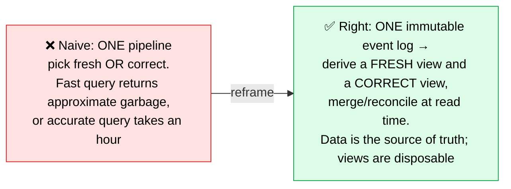
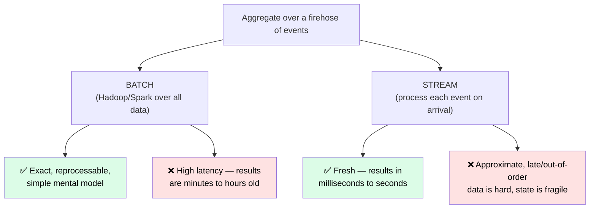
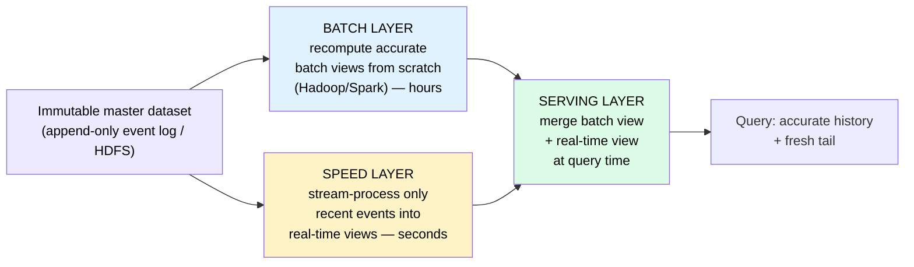
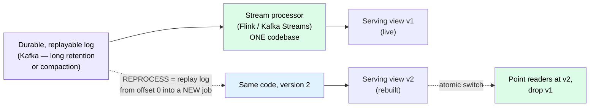
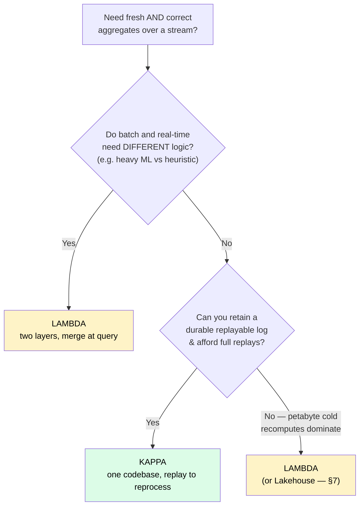
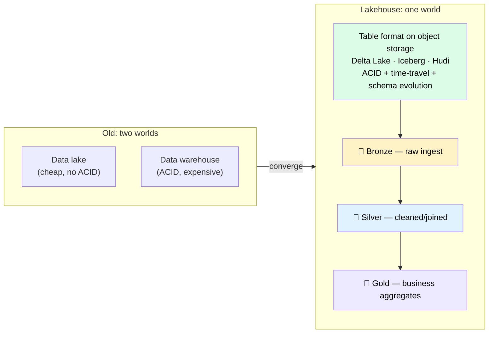
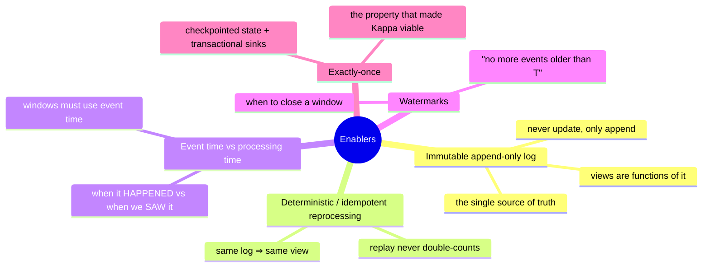
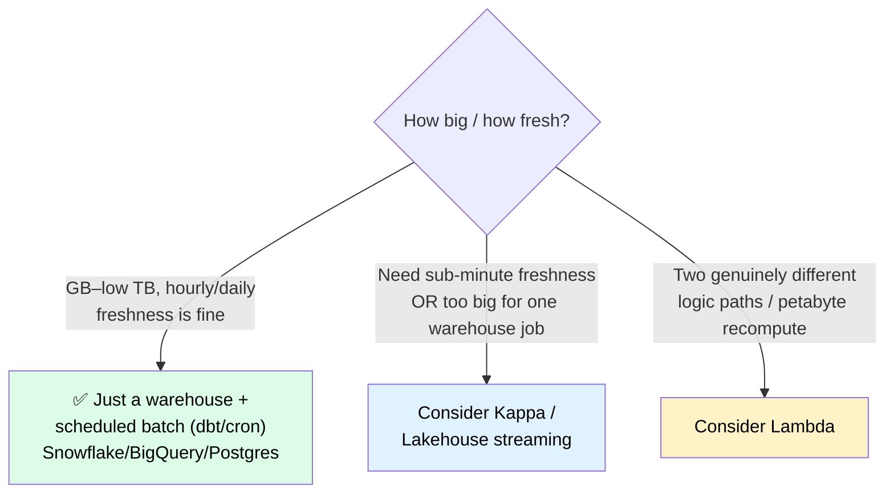
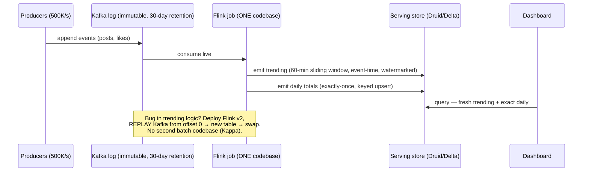
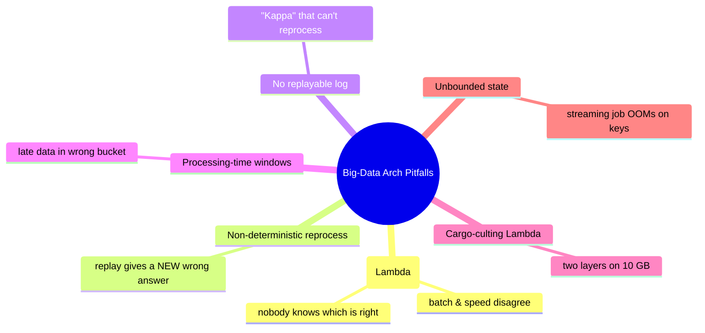

# Lambda, Kappa & Big-Data Architecture

> **One line:** Big-data architecture is a restaurant that must serve a fresh dish *now* and a perfectly-audited final bill *later* — Lambda cooks in two kitchens (fast + accurate), Kappa runs one kitchen that can re-cook the whole night from the receipt tape, and the lakehouse is the modern kitchen where both finally merge into one.

---

## Table of Contents
1. [Why You Must Master This](#1-why-you-must-master-this)
2. [The Mental Model](#2-the-mental-model)
3. [The Core Tension — Fresh vs Correct](#3-the-core-tension--fresh-vs-correct)
4. [Lambda Architecture (Nathan Marz)](#4-lambda-architecture-nathan-marz)
5. [Kappa Architecture (Jay Kreps)](#5-kappa-architecture-jay-kreps)
6. [Lambda vs Kappa — The Decision](#6-lambda-vs-kappa--the-decision)
7. [The Modern Successors — Lakehouse & Streaming-First](#7-the-modern-successors--lakehouse--streaming-first)
8. [The Key Enablers (what makes any of this work)](#8-the-key-enablers-what-makes-any-of-this-work)
9. [When You Need NONE of This](#9-when-you-need-none-of-this)
10. [Worked Example — A Real-Time Analytics Dashboard](#10-worked-example--a-real-time-analytics-dashboard)
11. [Real-Life Use Cases](#11-real-life-use-cases)
12. [Failure Modes](#12-failure-modes)
13. [🏋️ Practice Drills](#-practice-drills)
14. [🎤 Interview Q&A Bank](#-interview-qa-bank)
15. [🎯 Staff+ Nuances](#-staff-nuances)
16. [Cheat Sheet](#16-cheat-sheet)
17. [Connections & Further Reading](#17-connections--further-reading)

---

## 1. Why You Must Master This

The moment an interview prompt says *"real-time analytics,"* *"trending topics,"* *"a metrics dashboard,"* *"recommendations over the full history,"* or *"count/aggregate over a firehose of events,"* you are being asked to choose a big-data architecture style. This is the pattern layer above [Stream_Processing.md](../09_Message_Queues_Event_Streaming/Stream_Processing.md) — it decides *how many pipelines you build and how you reprocess,* not how a single job windows its data.

- **It's the difference between a fresh-but-wrong number and a correct-but-stale one.** Every aggregation system lives on this tension; picking the wrong style means either your dashboard lies or it's an hour behind.
- **The classic trap is doubling your codebase.** Lambda's original sin — maintaining the *same business logic twice* in two frameworks — has burned real teams into month-long "why don't batch and speed agree?" bug hunts. Knowing why Kappa exists is knowing how to avoid that.
- **It's a live, evolving debate.** Lambda (2011) → Kappa (2014) → Lakehouse (2020+) is a real arc; Staff+ interviewers want to hear you place a design on that arc, not recite a 2013 blog post.

> **The core problem it solves:** computing accurate aggregates and views over a huge, unbounded stream of events while satisfying **two conflicting demands at once** — *low latency* (the number must be fresh, seconds old) **and** *completeness/correctness* (the number must be exactly right, and re-derivable if the logic changes).

**Prerequisites:** [Stream_Processing.md](../09_Message_Queues_Event_Streaming/Stream_Processing.md) (windowing, event time), [Batching_vs_Streaming.md](../14_Performance_Optimization_Scalability/Batching_vs_Streaming.md) (the processing-mechanics view of the same trade-off), and [Event_Driven_Architecture.md](./Event_Driven_Architecture.md) (the log as source of truth).

---

## 2. The Mental Model

Think of a **bank statement.** You want to see your balance *right now* the instant you tap your card (fresh, maybe off by a pending transaction), **and** you want a month-end statement that is *provably exact, reconciled to the penny* (complete, auditable). The naive instinct is "just pick one." Real systems refuse to choose — the whole field is about serving both from one pile of immutable events.



> **Hold onto this:** the raw event log is the single source of truth and is *immutable*; every view (batch or real-time) is a **disposable, recomputable function of that log**. Once you believe "views are cheap and throwaway, the log is sacred," Lambda vs Kappa vs Lakehouse becomes just *how many views and how you rebuild them.*

---

## 3. The Core Tension — Fresh vs Correct

Batch and streaming sit at opposite ends of a single trade-off, and neither alone satisfies a serious analytics requirement.



- **What batch gives you:** you have *all* the data, so you can compute the exactly-correct answer, and if you find a bug you just re-run the job. The cost is **latency** — a nightly job means your view is up to 24 hours stale.
- **What streaming gives you:** you touch each event once as it arrives, so the answer is *fresh*. The cost is **correctness under adversity** — late-arriving and out-of-order events, a crashed operator losing in-flight state, and approximate structures (HyperLogLog for distinct counts, Count-Min sketches for frequencies) that trade exactness for memory.
- **Why "just use streaming" isn't enough historically:** early stream processors (Storm ~2011) offered *at-least-once* delivery with no exactly-once state, so a replay double-counted. That gap — "streaming can't be trusted for the *correct* number" — is the entire reason Lambda was invented. Modern engines (Flink, Kafka Streams, Spark Structured Streaming) largely closed it, which is why Kappa later became viable.

> The tension is not batch *versus* stream as tools — it's **completeness versus latency** as requirements. Every architecture below is a different answer to "how do I get both from the same events?"

---

## 4. Lambda Architecture (Nathan Marz)

Coined by **Nathan Marz** (of Twitter/BackType, creator of Apache Storm) around 2011 and detailed in *Big Data* (2015). Lambda's answer to the tension: **run two pipelines and merge them at query time.**



**The three layers:**

| Layer | Job | Latency | Correctness | Tech (classic) |
|-------|-----|---------|-------------|----------------|
| **Batch** | Recompute *all* views from the immutable master dataset, from scratch, on a schedule | High (mins–hours) | Exact, authoritative | Hadoop MapReduce, Spark, Hive |
| **Speed** | Process *only the recent events* the batch layer hasn't absorbed yet, into approximate real-time views | Low (ms–sec) | Approximate, transient | Storm, Samza, Spark Streaming |
| **Serving** | Answer queries by **merging** the batch view (accurate history) with the speed view (fresh tail) | Query-time | Batch corrects speed | Cassandra, HBase, Druid, Elasticsearch |

**How it works under the hood:** the master dataset is **immutable and append-only** — you never update, only add events. The batch layer periodically recomputes every view from the *entire* dataset (so any bug is self-healing on the next run). While that multi-hour batch runs, the speed layer covers the gap by incrementally processing just the newest events. At query time the serving layer stitches them: *"batch view up to time T, plus real-time view for (T, now)."* When the next batch run absorbs those recent events, the corresponding speed-layer state is **discarded** — the accurate batch result overwrites the approximation. This "batch eventually corrects the speed layer" property is Lambda's whole elegance: temporary errors in the fast path get healed.

**The killer downside — logic maintained TWICE.** The batch layer and speed layer implement the *same* business logic in *two different codebases and frameworks* (e.g., a Spark job in Scala + a Storm topology). Every rule change must be made in both, kept semantically identical, and tested to agree. In practice they drift, and you get the maddening class of bug: *"the real-time number and the batch number disagree and nobody knows which is right."* This dual-code burden is the single most-cited reason to avoid Lambda — and the reason Kappa was proposed.

> **When Lambda still wins:** when your batch and speed logic genuinely *must* differ (e.g., an expensive ML model trained in batch vs a cheap heuristic in the speed layer), or when a full historical recompute over petabytes is cheaper as a batch job than as a stream replay.

---

## 5. Kappa Architecture (Jay Kreps)

Proposed by **Jay Kreps** (co-creator of Apache Kafka, CEO of Confluent) in his 2014 essay *"Questioning the Lambda Architecture."* His argument: the batch layer exists only to *reprocess* — so if you can make your stream processor reprocess by **replaying the log**, you can delete the batch layer entirely. **Everything is a stream. One codebase.**



**How reprocessing works (the heart of Kappa):** there is no separate batch layer. When you need to fix a bug or change logic, you:
1. Keep the raw events in a **durable, replayable log** (Kafka with long/infinite retention, or a compacted topic keyed by entity).
2. Spin up a *new instance* of the same stream job (version 2) and **replay the log from offset 0**, writing to a **new** output table/topic.
3. When version 2 catches up to the live head, **atomically switch** readers to the new view and tear down the old one.

So "reprocessing" — the only thing the batch layer did — becomes just *running your streaming code again over the retained log.* One framework, one language, one set of business rules. This is the direct cure for Lambda's dual-code disease.

**The trade-offs Kappa buys:**

| Requirement | Consequence |
|-------------|-------------|
| A **durable, replayable log** | You must retain raw events long enough to reprocess (Kafka retention/compaction, or tier to object storage). Storage cost, not free. |
| **Reprocessing = full replay** | Recomputing years of history means streaming *all* of it back through — can be slower/pricier than an equivalent partitioned batch scan over columnar files. |
| **Very large historical recomputes** | The weak spot: a one-off recompute over petabytes of cold data is exactly what batch/MapReduce is good at; pure replay can struggle. |
| **Determinism required** | Correct reprocessing demands the job be deterministic/idempotent — same input log ⇒ same output view. |

> **When Kappa wins:** the *common* case today — event-native domains (clickstream, IoT, logs, transactions) where the log already exists, logic is the same fast or slow, and freshness matters. It's the default for streaming-first shops (LinkedIn, Uber, Netflix pipelines).

---

## 6. Lambda vs Kappa — The Decision



| Dimension | **Lambda** | **Kappa** |
|-----------|------------|-----------|
| **Code paths** | Two (batch + speed), same logic duplicated | One (stream only) |
| **Correctness model** | Batch is authoritative; speed is approximate, corrected later | Reprocess by replay; the stream *is* authoritative |
| **Reprocessing** | Re-run the batch job over the master dataset | Replay the log from offset 0 into a new job, then swap |
| **Operational complexity** | High — two frameworks, two deploys, must keep them in sync | Lower — one framework, but needs robust log retention |
| **Storage** | Master dataset (HDFS/S3) + serving stores | Durable log (Kafka + tiered storage) |
| **Weak spot** | Logic drift between layers; double maintenance | Huge one-off historical recomputes; replay cost/time |
| **Best fit** | Batch & real-time genuinely differ; giant cold recomputes | Event-native domains; same logic; freshness matters (the modern default) |

> **The one-liner to say in an interview:** *"Kappa is Lambda minus the batch layer — you reprocess by replaying the log instead of maintaining a second codebase. I default to Kappa unless batch and real-time logic must genuinely differ or I have petabyte-scale historical recomputes, where a batch/lakehouse path earns its keep."*

---

## 7. The Modern Successors — Lakehouse & Streaming-First

The 2020s trend is **collapsing the two layers into one** — through storage that is simultaneously batch- and stream-friendly, and engines that treat batch as a special case of streaming.



**The Lakehouse (Databricks, ~2020).** Open **table formats** — **Delta Lake, Apache Iceberg, Apache Hudi** — put a transaction log *on top of* cheap object storage (S3/GCS/ADLS). That gives you **ACID transactions, time-travel/versioning, schema evolution, and upserts** on files that were previously a dumb "data lake." Crucially the *same* table can be read as a batch scan **and** written to / read from as a stream — so one storage layer serves both the accurate-history and the fresh-tail roles. This dissolves Lambda's need for two separate serving stores.

**Streaming-first / unified engines.** **Apache Beam** popularized the slogan *"batch is a bounded stream"* — you write one pipeline, and a bounded input is just a stream that ends. **Apache Flink** embodies this natively (true streaming with exactly-once state; batch is a finite stream). **Spark Structured Streaming** offers the same DataFrame code for batch and stream. The upshot: the *code* unifies (Kappa's dream) even when you still occasionally run in "batch mode" over history.

**Medallion architecture (bronze/silver/gold).** The lakehouse organizing pattern: **Bronze** = raw, immutable ingested events (the master dataset / log); **Silver** = cleaned, deduplicated, conformed; **Gold** = business-level aggregates ready to serve. Each layer is a *table you can reprocess by re-running the transform* — Kappa's "views are functions of the log" idea, materialized as governed tables.

> **The trend in one sentence:** the industry is **collapsing Lambda's two layers into one** — unified storage (lakehouse table formats) plus unified compute (Beam/Flink "batch = bounded stream"), so you get Kappa's single codebase *and* batch's cheap historical recompute. In a modern interview, proposing a lakehouse + streaming engine is often the strongest answer.

---

## 8. The Key Enablers (what makes any of this work)

None of these architectures function without a handful of primitives. Naming them is a strong Staff+ signal.



- **Immutable, append-only log.** The master dataset (Lambda) / Kafka topic (Kappa) / bronze table (lakehouse). Because it's never mutated, any view can be rebuilt by replaying it — this is the foundation of *all* reprocessing.
- **Idempotent / deterministic reprocessing.** Replaying the log must produce the *identical* view (no wall-clock, no random tie-breaks, upserts keyed by event id). Without determinism, "just replay it" produces a *different* wrong answer.
- **Event time vs processing time.** A click at 11:59:58 that arrives at 12:00:03 belongs to the 11:59 window, not 12:00. Correct aggregates window by **event time** (when it happened), not processing time (when it arrived) — otherwise late data lands in the wrong bucket. (See [Stream_Processing.md](../09_Message_Queues_Event_Streaming/Stream_Processing.md).)
- **Watermarks.** A watermark is the engine's assertion *"I've probably seen all events up to time T."* It's how a streaming window decides *when it's safe to close and emit* despite out-of-order arrivals — the mechanism that lets a stream approach batch-level correctness.
- **Exactly-once semantics.** Checkpointed operator state + transactional/idempotent sinks so a crash-and-replay neither loses nor double-counts. This property — delivered by Flink, Kafka Streams, Spark SS — is precisely what was *missing* in 2011 and what made Kappa a credible replacement for Lambda's batch safety net.

---

## 9. When You Need NONE of This

The most common real-world mistake is **cargo-culting Lambda onto small data.** These architectures exist for *huge, unbounded, high-velocity* event volumes. If that's not you, don't build them.



If your data fits in a warehouse and daily/hourly freshness is acceptable, the right answer is boring and correct: **ingest into Snowflake/BigQuery/Postgres and run scheduled batch transforms (dbt, Airflow, a cron job).** No speed layer, no Kafka replay, no medallion tables. You reach for Lambda/Kappa/lakehouse only when *either* volume exceeds what a single batch job can chew *or* the freshness requirement drops below the batch cadence. Reaching sooner is over-engineering that buys operational pain and buys nothing.

> **The habit:** state the volume and the freshness SLA *first*. If it's "10 GB, refreshed hourly," say "a warehouse and scheduled batch — Lambda/Kappa would be over-engineering." That answer scores higher than reflexively drawing two layers.

---

## 10. Worked Example — A Real-Time Analytics Dashboard

**Prompt:** *"Design 'trending hashtags in the last hour' and a 'total posts per day' report for a social network doing 500K events/sec."*

**Requirements → the two demands:**
- Trending = **fresh** (a spike must show within seconds) → needs a speed/stream path.
- Daily totals = **correct** (finance/analytics rely on exact numbers, must survive replays) → needs an authoritative path.

500K events/sec × 86,400 s ≈ **43.2 billion events/day**. A nightly batch alone can't give seconds-fresh trending; a naive stream alone risks approximate daily totals that can't be re-derived when the logic changes. So we need both demands satisfied — the classic setup.



**The decision the numbers force:** because trending and daily-totals use the *same* event stream and the *same* counting logic (just different windows), there is **no need for two codebases** → choose **Kappa**: one Flink job, exactly-once state for correct daily totals, event-time windows + watermarks for trending, Kafka retention for reprocessing. Had daily totals instead required an expensive graph/ML computation impractical to stream, *that* would justify a Lambda batch layer — or better, a **lakehouse gold table** recomputed in batch while Flink serves the fresh tail. Either way you say *why* the number drove the split, not just "I'll use Lambda."

---

## 11. Real-Life Use Cases

| Situation | How the architecture applies | The decision it forces |
|-----------|------------------------------|------------------------|
| **Twitter/LinkedIn real-time counts** (origin of both ideas) | High-velocity events; Lambda born here (Marz), Kappa born here (Kreps at LinkedIn) | Log as source of truth; one-vs-two pipelines |
| **Uber surge pricing / ETA** | Freshness critical; same logic fast & slow | Kappa (Flink) — one streaming codebase |
| **Netflix playback & recs pipelines** | Massive event volume, reprocessing common | Kafka + Flink/Spark streaming-first |
| **Databricks lakehouse customers** | Want batch + stream on one governed store | Delta Lake + medallion (bronze/silver/gold) |
| **Fraud detection** | Real-time score + accurate historical model | Often Lambda: heavy batch model + light speed heuristic |
| **A 20-person startup's KPI dashboard** | 10 GB, hourly refresh is fine | **None of the above** — warehouse + dbt |

> **Real-world habit:** identify whether the *fast* and *slow* answers use the **same** logic. Same logic ⇒ Kappa/lakehouse (one codebase). Genuinely different logic ⇒ Lambda earns its second layer.

---

## 12. Failure Modes



- **Logic drift between Lambda layers.** *Symptom:* the real-time dashboard and the batch report show different numbers. *Root cause:* the same rule was implemented twice and the two copies diverged. *Fix:* share logic via a common library, or eliminate the second path entirely — go Kappa/lakehouse.
- **Non-deterministic reprocessing.** *Symptom:* replaying the log produces a *different* result than the live run. *Root cause:* the job uses wall-clock time, random ordering, or non-idempotent writes. *Fix:* window by event time, key upserts by event id, remove all wall-clock/random dependence.
- **"Kappa" with no durable replay.** *Symptom:* you can't fix a historical bug because the events are gone. *Root cause:* short Kafka retention / no tiered storage — the log isn't actually replayable. *Fix:* long retention, compacted topics, or tier raw events to object storage (a bronze table).
- **Windowing by processing time.** *Symptom:* late events land in the wrong time bucket; counts jitter. *Root cause:* windows keyed on arrival, not occurrence. *Fix:* event-time windows + watermarks + a defined allowed-lateness policy.
- **Cargo-culting Lambda onto small data.** *Symptom:* a two-layer Kafka+Spark rig maintained for 10 GB of daily data. *Root cause:* pattern-matching "analytics" to "Lambda." *Fix:* warehouse + scheduled batch; delete the speed layer.
- **Unbounded streaming state.** *Symptom:* the stream job's memory grows until it OOMs. *Root cause:* keyed state (e.g., per-user counters) never expires. *Fix:* state TTL, windowed state, or RocksDB-backed state with retention.

---

## 🏋️ Practice Drills

> *Cover the solutions and attempt first — active recall is the point.*

**Drill 1 — Name the layers.** In Lambda, which layer is authoritative for correctness, which covers the freshness gap, and what does the third layer do at query time?

<details><summary>Solution</summary>

The **batch layer** is authoritative — it recomputes exact views from the immutable master dataset. The **speed layer** covers the gap by stream-processing only the recent events the batch hasn't absorbed yet (approximate, transient). The **serving layer** merges them at query time: batch view for history + speed view for the fresh tail. When the next batch run absorbs the recent events, the matching speed-layer state is discarded — batch corrects speed.
</details>

**Drill 2 — Kill the batch layer.** A team runs Lambda and is drowning in "batch and real-time disagree" bugs. What's the architectural move, and what one capability must their infrastructure have for it to work?

<details><summary>Solution</summary>

Move to **Kappa**: delete the batch layer, keep the single stream-processing codebase, and reprocess by **replaying the log** into a new job then swapping the serving view. The required capability is a **durable, replayable log** (Kafka with long retention/compaction, or events tiered to object storage) — plus deterministic/idempotent processing so a replay reproduces the exact view.
</details>

**Drill 3 — Size the decision.** A startup asks you to build "real-time analytics" for 8 GB/day of orders, refreshed hourly for a KPI dashboard. Do you draw Lambda?

<details><summary>Solution</summary>

No. 8 GB/day with hourly freshness fits comfortably in a warehouse (BigQuery/Snowflake/Postgres) with scheduled batch transforms (dbt/Airflow/cron). Lambda/Kappa/lakehouse are for *huge, high-velocity* streams or *sub-minute* freshness. Proposing two layers here is over-engineering — state the volume and SLA, then pick the boring correct option.
</details>

**Drill 4 — Design a small streaming metric.** Sketch "unique visitors in the last 24h" over a firehose. What makes it *fresh* and what keeps it *correct/reprocessable*?

<details><summary>Solution</summary>

Kappa-style: events → Kafka (long retention) → Flink job with a **24h sliding event-time window**, using **HyperLogLog** for approximate distinct-count (memory-bounded freshness). Correctness/reprocessing: **exactly-once** checkpointed state so crashes don't double-count, **watermarks** to handle late arrivals, and the retained Kafka log so you can replay to rebuild the metric if the definition changes. If leadership later needs *exact* uniques for billing, add a nightly batch/gold-table recompute over the same log (the log is the shared source of truth).
</details>

---

## 🎤 Interview Q&A Bank

**Q1. What problem do Lambda and Kappa architectures solve?**
> Computing aggregates/views over a huge unbounded event stream while satisfying two conflicting demands: **low latency** (fresh numbers) and **completeness/correctness** (exact, re-derivable numbers). Batch gives correctness but is slow; streaming gives freshness but historically couldn't be trusted for exactness. Both architectures are strategies to get both from one immutable log.

**Q2. Explain Lambda's three layers.** *(signal: do they know batch corrects speed?)*
> Batch layer recomputes exact views from the immutable master dataset (high latency, authoritative). Speed layer stream-processes only recent events into approximate real-time views (low latency, transient). Serving layer merges the two at query time. The elegance: when batch catches up it overwrites the speed layer's approximation — batch eventually corrects speed.

**Q3. What is Lambda's biggest drawback?**
> You maintain the **same business logic twice** — once in the batch framework, once in the speed framework — in two codebases that inevitably drift, producing "batch and real-time disagree" bugs. That dual-maintenance burden is why Kappa was proposed.

**Q4. What is Kappa and how does it reprocess?** *(signal: do they mention replay + durable log?)*
> Kappa (Jay Kreps, 2014) says everything is a stream and deletes the batch layer. Since the batch layer only existed to reprocess, Kappa reprocesses by **replaying the durable log from offset 0** into a new instance of the same streaming code, writing a new view, then atomically switching readers to it. One codebase, no duplication — but it needs a durable, replayable log and can be costly for petabyte-scale historical recomputes.

**Q5. When would you still choose Lambda over Kappa?**
> When batch and real-time genuinely need **different logic** (e.g., an expensive ML model in batch vs a cheap heuristic in the speed layer), or when you have **massive one-off historical recomputes** where a partitioned batch scan over columnar files beats replaying the entire log. Otherwise Kappa (or a lakehouse) is the modern default.

**Q6. What replaced Lambda/Kappa in the 2020s?**
> The **lakehouse** — table formats (Delta Lake, Iceberg, Hudi) that put ACID, time-travel, and upserts on cheap object storage so one table serves both batch and stream — plus **unified engines** (Beam/Flink: "batch is a bounded stream"). Organized as **medallion** bronze/silver/gold tables. The trend is collapsing Lambda's two layers into one storage + one codebase.

**Q7. What primitives make reprocessing correct?** *(signal: names the enablers)*
> An immutable append-only log (the source of truth), deterministic/idempotent processing (same log ⇒ same view, no double-counting), event-time windowing with watermarks (so late/out-of-order data lands correctly), and exactly-once semantics (checkpointed state + transactional sinks). Exactly-once is specifically what made Kappa viable — it was missing in 2011.

**Q8. When do you need none of these?**
> When the data is small (GB–low TB) and batch freshness (hourly/daily) is acceptable — just a warehouse plus scheduled transforms (dbt/cron). Lambda/Kappa/lakehouse are for high-velocity streams or sub-minute freshness; applying them to small data is over-engineering.

---

## 🎯 Staff+ Nuances

- **The batch layer's *only* real job is reprocessing.** Kreps' core insight: everything the batch layer does that the speed layer doesn't is "recompute from scratch to fix bugs." Once you can reprocess by replay, the batch layer is pure redundancy. Framing the debate as "how do you reprocess?" — not "batch vs stream" — is the Staff+ tell.
- **"Lambda vs Kappa" is increasingly a false binary.** The honest modern answer is often *neither in their pure form*: a lakehouse with Flink gives you Kappa's single codebase **and** batch's cheap historical recompute over the same governed tables. Interviewers reward placing the design on the 2011→2014→2020s arc rather than picking a 2013 camp.
- **Determinism is subtler than it looks.** "Just replay the log" silently assumes the computation is a pure function of the log. Joins against slowly-changing external dimension tables, wall-clock defaults, non-associative aggregations, and non-idempotent sinks all break replay reproducibility. Reprocessing correctness is a *design constraint you must engineer for*, not a free property.
- **Exactly-once is exactly-once *effect*, not *delivery*.** It's achieved via idempotent/transactional sinks + checkpointed state, not by magically delivering each message once. Say "effectively-once with transactional sinks" — conflating it with network delivery is a classic weak-answer signal.
- **Reprocessing cost is the hidden Kappa tax.** Replaying years of events through a live stream job competes with production traffic and can take days. Mitigations: parallel "catch-up" jobs, tiered storage with columnar cold data, or accepting a *bounded* replay window. This is exactly where a lakehouse batch path quietly re-earns its place.
- **The serving layer is where latency is really won or lost.** Merging batch + speed views (Lambda) or serving materialized gold tables (lakehouse) needs a store tuned for the query pattern — Druid/Pinot for time-series rollups, Cassandra/HBase for key lookups, Elasticsearch for search. A great pipeline behind a mismatched serving store still feels slow. (See [09 · Message Queues & Event Streaming](../09_Message_Queues_Event_Streaming/).)
- **This is the architecture-style decision; the mechanics live elsewhere.** *How* a single job windows, watermarks, and manages state is [Stream_Processing.md](../09_Message_Queues_Event_Streaming/Stream_Processing.md); the raw batch-vs-stream trade-off as a processing choice is [Batching_vs_Streaming.md](../14_Performance_Optimization_Scalability/Batching_vs_Streaming.md). This file decides *how many pipelines and how you reprocess* — keep the two levels distinct in your answer.

---

## 16. Cheat Sheet

```
THE TENSION: fresh (low latency) VS correct (complete, reprocessable) over a huge event stream.
  Batch = exact but stale.  Stream = fresh but historically un-trustworthy.  Get BOTH from one log.

LAMBDA (Nathan Marz, 2011)  — TWO pipelines, merge at query
  Batch layer  : recompute exact views from immutable master dataset (slow, authoritative)
  Speed layer  : stream-process recent events → approximate real-time views (fast, transient)
  Serving layer: merge batch + speed at query time; batch later CORRECTS speed
  ✗ KILLER FLAW: same logic maintained TWICE in two frameworks → they drift → disagreeing numbers

KAPPA (Jay Kreps, 2014)     — ONE pipeline, replay to reprocess
  Everything is a stream; single codebase (Flink/Kafka Streams)
  Reprocess = replay durable log from offset 0 → new view → atomic swap  (no batch layer)
  Needs: durable replayable log (Kafka retention/compaction), deterministic/idempotent jobs
  ✗ Weak spot: huge one-off historical recomputes; replay cost/time

PICK:  same logic fast & slow → KAPPA (default).   Different logic / petabyte recompute → LAMBDA.
       Modern → LAKEHOUSE collapses both.

LAKEHOUSE / STREAMING-FIRST (2020s) — collapse the two layers
  Table formats: Delta Lake · Iceberg · Hudi = ACID + time-travel + upsert on object storage
  Unified compute: Beam/Flink "batch is a bounded stream"; Spark Structured Streaming
  Medallion: 🥉 bronze (raw) → 🥈 silver (clean) → 🥇 gold (aggregates); each = reprocessable table

ENABLERS: immutable append-only log · deterministic/idempotent reprocess · event-time (not processing-time)
          · watermarks (when to close a window) · exactly-once (checkpoint + transactional sink)

NEED NONE OF IT: small data (GB–TB) + hourly/daily freshness → warehouse + dbt/cron. Don't cargo-cult Lambda.
```

---

## 17. Connections & Further Reading

**Prerequisites (learn first):**
- [Stream_Processing.md](../09_Message_Queues_Event_Streaming/Stream_Processing.md) — windowing, event time, watermarks, exactly-once: the *mechanics* this file's styles orchestrate.
- [Event_Driven_Architecture.md](./Event_Driven_Architecture.md) — the immutable log as source of truth, the substrate every style sits on.

**Builds toward / pairs with:**
- [Batching_vs_Streaming.md](../14_Performance_Optimization_Scalability/Batching_vs_Streaming.md) — the same fresh-vs-correct trade-off at the *processing-choice* level; this file is the *architecture-style* decision (how many pipelines, how to reprocess) that sits above it.
- [09 · Message Queues & Event Streaming](../09_Message_Queues_Event_Streaming/) — Kafka retention/compaction, the durable log Kappa depends on.
- [14 · Performance & Scalability](../14_Performance_Optimization_Scalability/) — serving-store choices (Druid/Pinot/Cassandra) that make the merged view fast.

**Gaps this topic exposes (candidates for the section's Gap Analysis):**
- A dedicated **Lakehouse & Table Formats** deep-dive (Delta/Iceberg/Hudi internals, the transaction log, time-travel).
- **CDC (Change Data Capture)** as the bridge from OLTP databases into the event log that feeds these pipelines.

**External classics:**
- Jay Kreps — *"Questioning the Lambda Architecture"* (2014, O'Reilly Radar) — the founding Kappa essay.
- Nathan Marz & James Warren — *Big Data* (Manning, 2015) — the canonical Lambda text.
- Martin Kleppmann — *Designing Data-Intensive Applications*, ch. 10–11 (batch & stream processing, the unification argument).
- Armbrust et al. — *"Lakehouse: A New Generation of Open Platforms…"* (Databricks, CIDR 2021).

---

## TL;DR
Big-data analytics architectures all resolve one tension — **fresh vs correct** aggregates over a huge event stream — by treating an **immutable append-only log as the single source of truth** and every view as a disposable, recomputable function of it. **Lambda** (Marz) runs two pipelines — an accurate slow batch layer and an approximate fast speed layer merged at query time — but its fatal flaw is maintaining the **same logic twice**. **Kappa** (Kreps) deletes the batch layer: one streaming codebase, and you *reprocess by replaying the durable log*, at the cost of needing that replayable log and struggling with giant historical recomputes. The modern move **collapses the two layers** into a **lakehouse** (Delta/Iceberg/Hudi: ACID + time-travel on object storage, organized bronze/silver/gold) plus **unified engines** where "batch is a bounded stream." **Default to Kappa/lakehouse when fast and slow use the same logic; keep Lambda only when they genuinely differ — and for small data with relaxed freshness, build none of it: just a warehouse and scheduled batch.**
