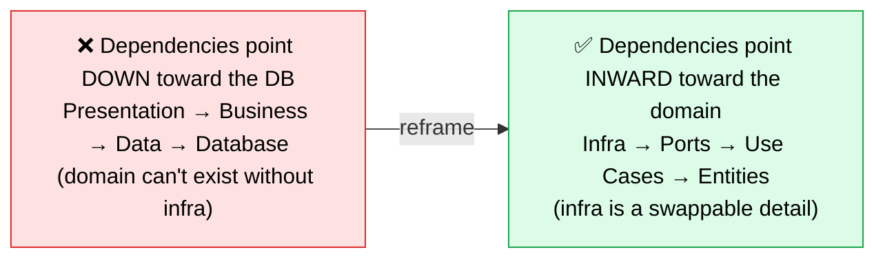
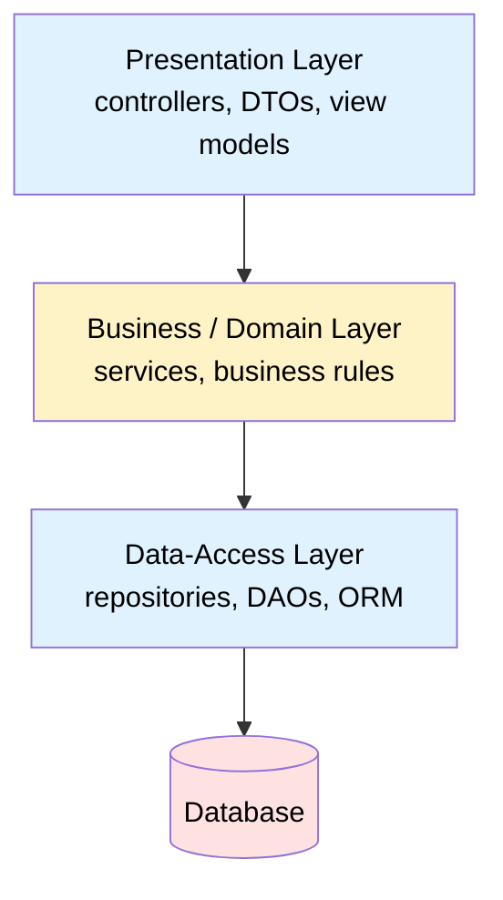
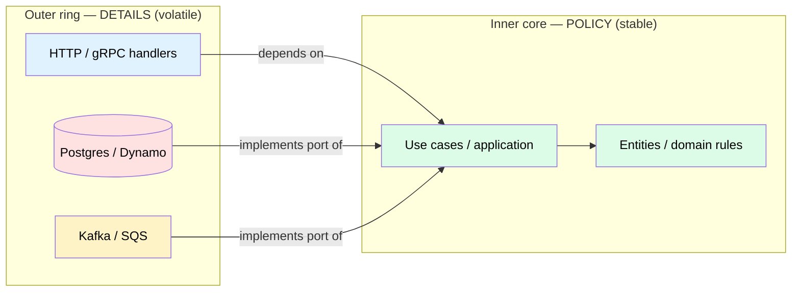
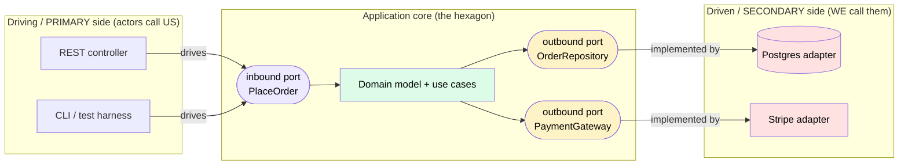
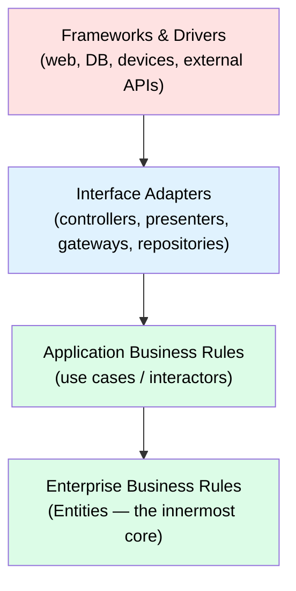
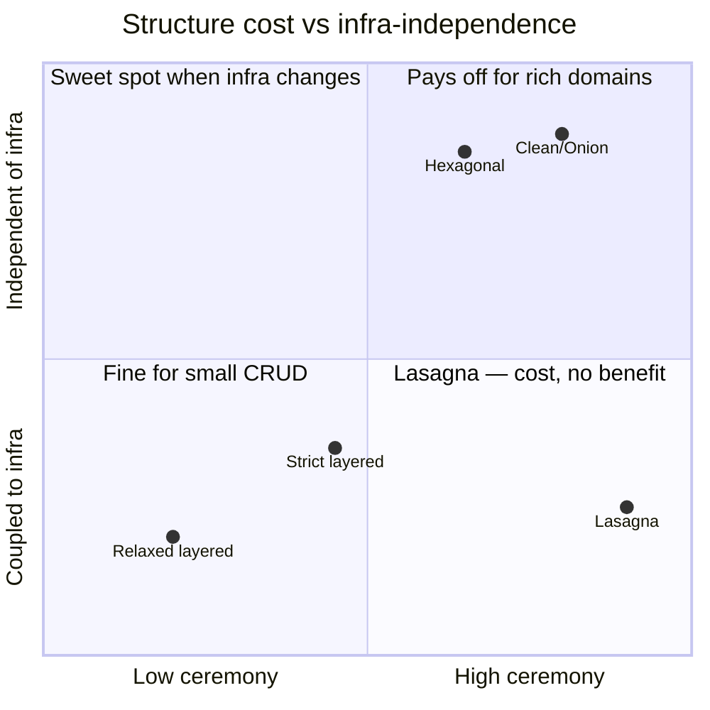
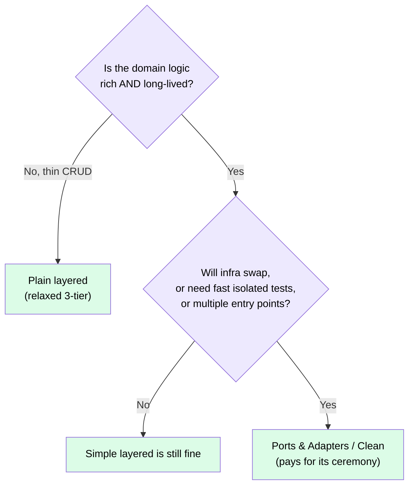
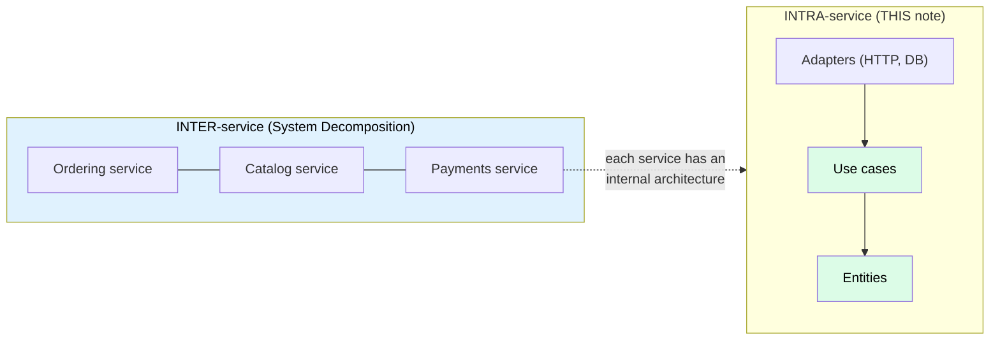
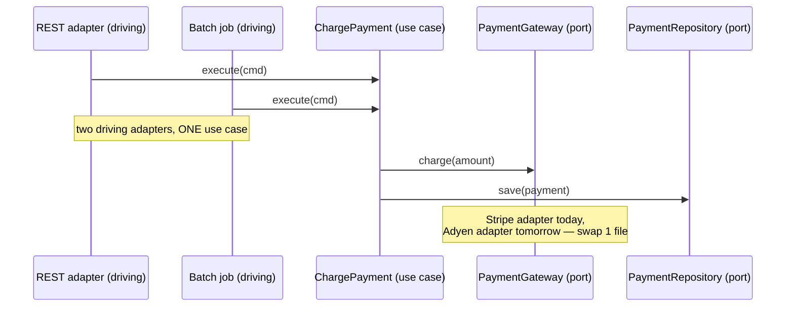
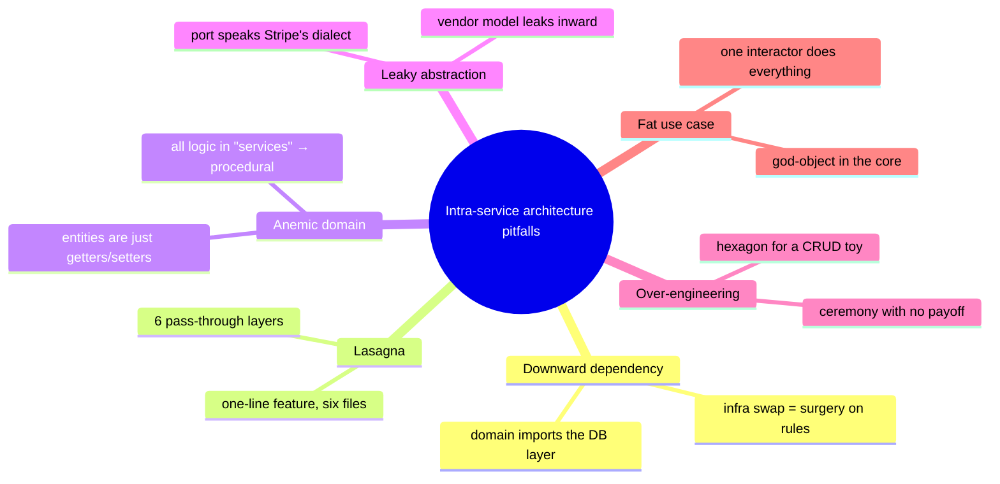

# Layered, Hexagonal & Clean Architecture

> **One line:** These are the four ways to draw the boxes *inside a single service* — like organizing one house: a classic layered service stacks floors on top of the database (basement), while hexagonal/clean flip it so the **business logic is the load-bearing center** and the database is just plumbing you can re-pipe without touching the walls.

---

## Table of Contents
1. [Why You Must Master This](#1-why-you-must-master-this)
2. [The Mental Model](#2-the-mental-model)
3. [Classic N-Tier / Layered Architecture](#3-classic-n-tier--layered-architecture)
4. [The Dependency Rule — the idea all three "clean" styles share](#4-the-dependency-rule--the-idea-all-three-clean-styles-share)
5. [Hexagonal / Ports & Adapters](#5-hexagonal--ports--adapters)
6. [Onion / Clean Architecture](#6-onion--clean-architecture)
7. [Layered vs Hexagonal vs Clean — the comparison](#7-layered-vs-hexagonal-vs-clean--the-comparison)
8. [When Layering Is Overkill (and when it's essential)](#8-when-layering-is-overkill-and-when-its-essential)
9. [Intra-service vs Inter-service — where this fits](#9-intra-service-vs-inter-service--where-this-fits)
10. [Worked Example — a Payments service, two ways](#10-worked-example--a-payments-service-two-ways)
11. [Real-Life Use Cases](#11-real-life-use-cases)
12. [Failure Modes](#12-failure-modes)
13. [🏋️ Practice Drills](#-practice-drills)
14. [🎤 Interview Q&A Bank](#-interview-qa-bank)
15. [🎯 Staff+ Nuances](#-staff-nuances)
16. [Cheat Sheet](#16-cheat-sheet)
17. [Connections & Further Reading](#17-connections--further-reading)

---

## 1. Why You Must Master This

Every "draw the boxes inside one service" question lands here. [System Decomposition](./System_Decomposition.md) tells you *how many* services and where their boundaries go; this note tells you how to structure the code **inside each one** so it stays changeable for a decade.

- **The database outlives no decision, the domain outlives everything.** Teams swap Postgres for DynamoDB, REST for gRPC, and one cloud for another — but the business rules ("a refund can't exceed the captured amount") persist. If your code points *down* at the database, every infra swap is open-heart surgery. Get the direction of dependencies wrong and you pay for it for years.
- **Testability is decided by architecture, not by effort.** If your domain logic imports the SQL client, you can only test it with a database running. If it depends on an *interface*, you test the whole rulebook in-memory in milliseconds. Whole test pyramids are won or lost on this one choice.
- **"Lasagna" is a real, common failure.** Over-layered services where every call passes through 5 near-identical pass-through methods (`Controller → Service → Manager → Repository → DAO`) add ceremony and zero value. Knowing when *not* to layer is as important as knowing how.

> **The core problem it solves:** *infrastructure leaking into business logic* — the entanglement where your core rules can't be understood, tested, or changed without dragging along a database, a web framework, and a message broker. The fix is controlling **which way the dependency arrows point.**

**Prerequisites:** [System Decomposition](./System_Decomposition.md) (inter-service boundaries) and basic OOP interfaces. The deep dive on the principles that make this work — SOLID's Dependency Inversion, DDD — lives in [04 · Low-Level Design](../04_Low_Level_Design/).

---

## 2. The Mental Model

Think of one service as a **building**. The naive layered design stacks floors on a foundation of *the database*: the presentation floor rests on the business floor, which rests on the data floor, which rests on the DB. Pull out the foundation (change the DB) and every floor above cracks.

The reframe: make the **business logic the load-bearing core** and push the database, the web, and the message queue to the *outer walls* — replaceable cladding. Now infrastructure depends on the domain, never the reverse.



> **Hold onto this:** Layered points **down at the database**. Hexagonal/Clean point **in at the domain**. That single reversal of the arrow — achieved through Dependency Inversion — is 80% of the entire topic. Everything else is naming and emphasis.

---

## 3. Classic N-Tier / Layered Architecture

**What it is.** The oldest and most common intra-service structure: stack the code in horizontal tiers, each only talking to the one below it.



**Why it exists.** It maps to how people first think about a request: take input (presentation), decide what to do (business), read/write state (data). It's easy to teach, easy to staff, and the default in most frameworks (Spring MVC, Rails, ASP.NET MVC).

**How it works under the hood — strict vs relaxed.**
- **Strict layering:** a layer may only call the layer *immediately* below. Presentation must go through Business to reach Data — never straight to the DB.
- **Relaxed layering:** a layer may call *any* lower layer (Presentation can hit Data directly for a read). Faster to write, but the layers blur and coupling creeps.

**The flaw — dependency direction.** In classic layering the arrows point **downward, toward the database**. The business layer `import`s the data layer, which `import`s the DB driver. So the domain — your most valuable, longest-lived code — *depends on* the most volatile, replaceable thing in the system. Swap the ORM and the ripple reaches business logic. Test a rule and you need a live DB.

**The "lasagna" anti-pattern.** Add layers "for cleanliness" until you have `Controller → Facade → Service → Manager → Repository → DAO → Mapper`, each mostly forwarding the call unchanged. Symptoms: a one-line feature touches six files; most methods are one-liners that just delegate; nobody can say what any single layer *decides*. That's lasagna — layers as pure ceremony.

> **Trade-off / when it still wins:** for a small CRUD service with thin logic, plain relaxed layering is *the right call* — it's simpler than ports/adapters and everyone understands it. The downward-dependency flaw only bites when the domain is rich and long-lived. **Real example:** the vast majority of internal admin tools and line-of-business apps are — correctly — three-tier and nothing more.

---

## 4. The Dependency Rule — the idea all three "clean" styles share

Hexagonal, Onion, and Clean are not three different architectures. They are **the same idea drawn three ways.** That idea is the **Dependency Rule**:

> Source-code dependencies must point **only inward**, toward higher-level policy. Nothing in an inner circle may know anything about an outer circle.

The domain sits at the **center**; infrastructure lives at the **edges**; and the arrows always point *in*.



**How the arrow gets reversed — Dependency Inversion (the "D" in SOLID).** In the runtime, the use case *does* call the database. But at *compile time* the dependency points the other way, because the interface is owned by the domain:

```python
# The PORT lives in the DOMAIN. It knows nothing of SQL, HTTP, or Kafka.
class OrderRepository(Protocol):          # defined by the core
    def save(self, order: Order) -> None: ...
    def find(self, id: OrderId) -> Order | None: ...

# The domain depends only on that abstraction:
class PlaceOrder:                          # use case, pure logic
    def __init__(self, orders: OrderRepository):   # <- interface, not Postgres
        self._orders = orders
    def execute(self, cmd: PlaceOrderCommand) -> OrderId:
        order = Order.create(cmd.items)    # business rules, fully testable
        self._orders.save(order)
        return order.id

# The ADAPTER lives OUTSIDE and depends INWARD by implementing the port:
class PostgresOrderRepository(OrderRepository):   # detail, in the outer ring
    def save(self, order): self._conn.execute("INSERT ...")
    def find(self, id):    ...
```

The domain declares *what it needs* (the port); infrastructure supplies *how* (the adapter). Wiring happens once, at the outermost edge (the "composition root" / `main`). **Under the hood this is just Dependency Injection** — the concrete `PostgresOrderRepository` is constructed at startup and passed in, so the core never names it.

> **Real number:** because `PlaceOrder` depends on an interface, its unit tests run against an in-memory fake repository in **microseconds** with zero I/O — versus tens of milliseconds and a container per test when logic is welded to the DB. That gap is what lets a mature service keep thousands of fast domain tests.

---

## 5. Hexagonal / Ports & Adapters

**What it is.** Alistair Cockburn's 2005 framing (his preferred name is *Ports & Adapters*; "hexagonal" is just the drawing). The application is a hexagon; the outside world plugs in through **ports** (interfaces the app defines) via **adapters** (concrete implementations).

The hexagon shape carries one message: there is **no top or bottom.** The UI is not "above" the database; both are just *outside*, connected the same way.



**Two kinds of ports — the key distinction interviewers probe:**

| | **Driving / Primary (inbound)** | **Driven / Secondary (outbound)** |
|---|---|---|
| Who initiates? | The outside world calls the app | The app calls the outside world |
| Example port | `PlaceOrder`, `GetBalance` | `OrderRepository`, `PaymentGateway`, `EmailSender` |
| Example adapter | REST controller, CLI, message consumer, scheduled job | Postgres repo, Stripe client, SMTP sender |
| Who defines the interface? | The application (its API) | **The application** (what it needs) — not the vendor |

**Why the interface is domain-owned matters.** The outbound port `PaymentGateway` is written in *your* domain's language (`charge(amount, currency) -> ChargeResult`), not Stripe's. The Stripe adapter translates. Swap to Adyen tomorrow: write one new adapter, touch zero domain code. This is also an **anti-corruption layer** — the vendor's model never leaks inward.

**Testability via test doubles.** Every port is a seam. In tests you drive the primary port directly and pass fake secondary adapters:

```python
# Full use-case test — no DB, no network, no framework:
repo = InMemoryOrderRepository()
gateway = FakePaymentGateway(succeeds=True)
place = PlaceOrder(repo, gateway)
order_id = place.execute(PlaceOrderCommand(items=[...]))
assert repo.find(order_id).status == "PAID"
```

> **Trade-off / when the OTHER choice wins:** ports & adapters costs you interfaces, DI wiring, and mapping code you wouldn't write in plain layering. For a thin CRUD service that will never swap its DB, that's overhead with no payoff. It **wins when** infra is likely to change, when you need fast isolated tests, or when the domain is rich and long-lived. **Real systems:** Netflix and many Spring Boot / .NET shops structure long-lived services this way.

---

## 6. Onion / Clean Architecture

**What it is.** Jeffrey Palermo's **Onion Architecture** (2008) and Robert C. Martin's **Clean Architecture** (2012) draw the same inward-dependency idea as **concentric rings**:



**The rings, outside → in:**
1. **Frameworks & Drivers** — the volatile edge: Spring, the ORM, the HTTP server, Kafka. "Details."
2. **Interface Adapters** — translators: controllers convert HTTP → use-case calls; repositories convert domain objects ↔ rows; presenters format output.
3. **Application Business Rules (Use Cases)** — application-specific orchestration ("place an order" = validate → reserve stock → charge → persist).
4. **Entities** — enterprise-wide rules that would be true even without this app ("an order's total is the sum of its line items"). The most stable code in the building.

**Why rings.** The visual enforces the Dependency Rule by geometry: an arrow can only point inward. An outer ring may depend on an inner one; the reverse is forbidden. Crossing inward you pass through boundary interfaces (same DIP trick as §4).

**How it differs from hexagonal — honestly, mostly emphasis and vocabulary:**

| | Hexagonal (Ports & Adapters) | Onion / Clean |
|---|---|---|
| Core metaphor | Symmetric hexagon, in/out sides | Concentric rings, center-out |
| Names the seams | **ports & adapters** | **boundaries & interface adapters** |
| Emphasis | *symmetry* of driving vs driven | *layering of policy* (entities vs use cases split out) |
| Extra structure | ports only | explicitly separates **Entities** from **Use Cases**, adds **presenters** |
| Origin | Cockburn (2005) | Palermo (2008) / Martin (2012) |

They are **interchangeable in practice.** Clean adds the entities-vs-use-cases split and the presenter role; hexagonal is more minimal. If you deeply understand one, you understand the other — and many real codebases blend them ("hexagonal core with clean's entity/use-case split").

> **Real example:** Uber, Netflix, and countless enterprise Java/.NET services describe themselves as "clean" or "hexagonal" interchangeably. Robert Martin's own point in *Clean Architecture* is that hexagonal, onion, DCI, and BCE are "all the same thing."

---

## 7. Layered vs Hexagonal vs Clean — the comparison



| Dimension | **Layered (N-tier)** | **Hexagonal (Ports/Adapters)** | **Clean / Onion** |
|---|---|---|---|
| Dependency direction | **Down → DB** (flaw) | **Inward → domain** | **Inward → domain** |
| Coupling to infra | High — domain imports data layer | Low — infra behind ports | Low — infra in outer ring |
| Testability of core | Poor (needs DB) | Excellent (fakes at ports) | Excellent (fakes at boundaries) |
| Complexity / boilerplate | Low | Medium (interfaces + DI) | Medium–High (rings + presenters) |
| Learning curve | Everyone knows it | Moderate | Steeper (more roles) |
| Swap DB / vendor | Painful, ripples up | One new adapter | One new adapter |
| Best when | thin-logic CRUD, short-lived | infra swaps, heavy testing | rich domain, long-lived, DDD |
| Risk | lasagna, downward coupling | over-abstraction on tiny apps | ceremony overkill on tiny apps |

**The one-sentence verdict:** *layered is simplest and points the wrong way; hexagonal and clean point the right way and differ mainly in vocabulary.*

---

## 8. When Layering Is Overkill (and when it's essential)

The mistake is treating "clean architecture everywhere" as a virtue. It's a **trade of simplicity for changeability** — only worth it when you'll cash in the changeability.



- **Layering is overkill / becomes lasagna when:** the service is a thin wrapper over CRUD, logic is "validate then save," the DB will never change, and there's one caller. Adding ports, use-case objects, presenters, and mappers here means six files per feature and pure pass-through — the reader learns nothing about *what the code decides*.
- **Ports & adapters / clean shine when:** infrastructure is likely to swap (multiple DBs, external vendors, or you're mid-migration); you need a fast, DB-free test pyramid; the service has **multiple driving adapters** (REST + gRPC + a Kafka consumer + a cron job all invoking the same use case); or the domain is genuinely complex and expected to live for years (DDD territory).

> **Rule of thumb:** start layered. Introduce a port the *first time* you feel real pain — a second data source, a mocked external call, a vendor swap. Don't pre-build hexagons for a domain you don't understand yet. Architecture earned beats architecture imposed.

---

## 9. Intra-service vs Inter-service — where this fits

This whole note is about structure **inside one service**. It is a *different axis* from [System Decomposition](./System_Decomposition.md) and [Monolith vs Microservices](./Monolith_vs_Microservices.md), which are about structure **between services.** They compose — you make both choices independently.



- **Inter-service** decides the boxes and their boundaries (bounded contexts, who owns which data). Covered in [System Decomposition](./System_Decomposition.md).
- **Intra-service** (here) decides how each box is built inside. A [modular monolith](./Modular_Monolith.md) can have hexagonal modules; a microservice can be internally lasagna. The two decisions are orthogonal.

> A hexagonal *module* inside a [modular monolith](./Modular_Monolith.md) is often the best of both worlds: clean internal dependencies **and** low operational cost, extractable to a service later because its ports are already the seam.

---

## 10. Worked Example — a Payments service, two ways

**The requirement:** charge a customer, record the payment, notify them. Six months in, product says: "We're moving from Stripe to Adyen, and Finance wants the same logic runnable as a nightly batch job, not just an API." Watch how each architecture absorbs the change.

**Version A — Layered (dependency points down):**

```python
class PaymentService:                       # business layer
    def charge(self, req):
        stripe.Charge.create(amount=req.amount)   # <- Stripe hard-wired IN the logic
        db.execute("INSERT INTO payments ...")    # <- SQL hard-wired IN the logic
        smtp.send(req.email, "Paid")
```

The change explodes: Stripe is named *inside* the business method, so swapping to Adyen edits the business logic. There's no seam to attach a batch entry point — the logic assumes an HTTP request shape. And you cannot test `charge` without Stripe + a DB + SMTP.

**Version B — Ports & Adapters (dependencies point in):**



```python
class ChargePayment:                        # use case — pure, testable
    def __init__(self, gateway: PaymentGateway, repo: PaymentRepository, notifier: Notifier):
        self._gw, self._repo, self._notifier = gateway, repo, notifier
    def execute(self, cmd):
        result = self._gw.charge(cmd.amount, cmd.currency)   # port, not Stripe
        payment = Payment.record(cmd, result)
        self._repo.save(payment)
        self._notifier.paid(payment)
```

**Close the loop — count the blast radius of the change:**

| Change requested | Layered (Version A) | Hexagonal (Version B) |
|---|---|---|
| Stripe → Adyen | edit business logic + retest everything | **+1 adapter file**, 0 domain edits |
| Add nightly batch entry | rewrite around new input shape | **+1 driving adapter**, same use case |
| Unit-test the charge rule | needs Stripe + DB + SMTP | fakes at 3 ports, runs in **µs** |

The number that forces the decision: **two swappable dependencies + two entry points = four seams.** Below that threshold, layered is fine; at or above it, ports & adapters has already paid for itself.

---

## 11. Real-Life Use Cases

| Situation | How the architecture applies | The decision it forces |
|---|---|---|
| **Internal admin CRUD tool** | Thin logic over a stable DB | Plain relaxed **layered** — don't build hexagons |
| **Payments / billing core** | Vendor swaps, strict rules, heavy testing | **Hexagonal/Clean** — ports for gateway + repo |
| **Service consumed by REST + gRPC + Kafka** | Multiple driving adapters, one rulebook | **Ports & adapters** — many inbound adapters, one use case |
| **Mid-migration (Postgres → Dynamo)** | Two data backends live at once | **Outbound port** with two adapters, switch by config |
| **Rich domain / DDD service** | Complex, long-lived business rules | **Clean/Onion** — entities separate from use cases |
| **Modular monolith module** | Want clean deps now, extractable later | **Hexagonal module** — ports become the future service API |
| **Legacy service drowning in lasagna** | 6 pass-through layers, no clarity | **Collapse layers** — merge pass-throughs; add a port only where change happens |

> **Real-world habit:** default to layered; the moment you introduce a *second implementation of anything* (second DB, mocked vendor, second entry point), extract a **port** at that seam — and nowhere else.

---

## 12. Failure Modes



- **Downward dependency (the classic flaw).** *Symptom:* changing the ORM breaks business tests; you can't test a rule without a DB. *Root cause:* the domain `import`s the data layer. *Fix:* invert it — define a repository *port* in the domain; the DB implements it (§4).
- **Lasagna (too many layers).** *Symptom:* a trivial feature edits `Controller→Facade→Service→Manager→Repository→DAO`, each a one-line delegate. *Root cause:* layers added for "cleanliness" with no distinct responsibility. *Fix:* collapse pass-through layers; a layer earns its place only if it *decides* something.
- **Anemic domain model.** *Symptom:* entities are bags of getters/setters; all logic sits in "service" classes. *Root cause:* procedural code wearing OOP clothes. *Fix:* push behavior into entities (`order.cancel()` not `orderService.cancel(order)`). See DDD in [04 · Low-Level Design](../04_Low_Level_Design/).
- **Leaky port.** *Symptom:* the port signature is `chargeViaStripeToken(tok)` — Stripe's vocabulary. *Root cause:* the port was shaped by the vendor, not the domain. *Fix:* express ports in *domain* terms; the adapter translates (anti-corruption layer).
- **Over-engineering.** *Symptom:* a 200-line CRUD service has ports, use cases, presenters, and 4 mappers. *Root cause:* cargo-culting clean architecture. *Fix:* delete the ceremony; plain layered was correct.
- **Fat use case / god interactor.** *Symptom:* one `DoEverything` use case with 12 dependencies. *Root cause:* no decomposition inside the core. *Fix:* split by [component responsibility](./Component_Responsibilities.md); one use case per business action.

---

## 🏋️ Practice Drills

> *Cover the solutions and attempt first — active recall is the point.*

**Drill 1 — Which way do the arrows point?** In a classic 3-tier service, the business layer calls the data-access layer which calls the DB. In hexagonal, the use case calls the database *at runtime* too. So what's actually different? Name the mechanism.

<details><summary>Solution</summary>

The **runtime** call direction is the same (logic → DB). What differs is the **compile-time / source dependency**: in layered, the business layer *imports* the data layer (arrow points down/out). In hexagonal, the domain defines a `Repository` **port** (interface) that it owns, and the DB adapter *implements* it — so the source dependency points **inward** toward the domain. The mechanism is **Dependency Inversion + Dependency Injection**: the concrete adapter is constructed at the composition root and injected, so the core never names it.
</details>

**Drill 2 — Primary or secondary?** Classify each as a driving (primary) or driven (secondary) adapter: (a) a REST controller, (b) a Postgres repository, (c) a Kafka *consumer*, (d) a Kafka *producer*, (e) a nightly cron job, (f) a Stripe client.

<details><summary>Solution</summary>

Driving/primary (the outside world calls the app): **(a) REST controller, (c) Kafka consumer, (e) cron job.** Driven/secondary (the app calls the outside world): **(b) Postgres repo, (d) Kafka producer, (f) Stripe client.** The tell is *who initiates the call*. Note Kafka appears on both sides depending on direction — consuming drives the app; producing is driven by it.
</details>

**Drill 3 — Spot the lasagna vs the load-bearing layer.** A reviewer sees `OrderController → OrderFacade → OrderService → OrderManager → OrderRepository`. `Facade` and `Manager` each contain only `return next.call(args)`. Is this good layering? What do you cut?

<details><summary>Solution</summary>

It's lasagna. A layer justifies itself only if it *makes a decision or transformation* — validation, orchestration, mapping, a policy. `Facade` and `Manager` here are pure pass-through, so delete both: `Controller → Service → Repository`. Keep `Controller` (HTTP↔domain translation), `Service`/use case (orchestration + rules), `Repository` (persistence port). Layers are for responsibilities, not for looking thorough.
</details>

**Drill 4 — Design a small thing.** Sketch the ports for a `UrlShortener` service that must (1) be callable via REST *and* a CLI, (2) store mappings in Redis today but maybe DynamoDB later, (3) be fully unit-testable without either.

<details><summary>Solution</summary>

Inbound (driving) port: `ShortenUrl.execute(longUrl) -> shortCode` and `Resolve.execute(shortCode) -> longUrl`. Driving adapters: `RestController` and `CliCommand`, both calling those ports. Outbound (driven) port: `MappingStore` with `save(code, url)` / `get(code)`. Driven adapters: `RedisMappingStore` (today), `DynamoMappingStore` (later) — swap by config. Tests: drive `ShortenUrl` directly, inject an `InMemoryMappingStore`; no Redis, no HTTP, runs in microseconds. The domain (code-generation strategy, collision rules) lives in entities, ignorant of all adapters.
</details>

---

## 🎤 Interview Q&A Bank

**Q1. What's the core flaw in classic layered architecture?**
> Dependencies point **downward, toward the database** — the business layer depends on the data layer depends on the DB. So your most valuable, longest-lived code (the domain) depends on the most volatile, replaceable thing (infrastructure). Any infra swap ripples up into business logic, and you can't test rules without a live DB. (signal: strong answers name the *dependency direction*, not just "it's tightly coupled.")

**Q2. What is the Dependency Rule and how do you actually reverse the arrow?**
> Source dependencies must point only **inward**, toward higher-level policy; nothing inner knows anything outer. You reverse the natural arrow with **Dependency Inversion**: the domain defines the interface (a *port*, e.g. `OrderRepository`), and the infrastructure *implements* it. At runtime the concrete adapter is injected at the composition root, so the core never names Postgres or Stripe.

**Q3. Explain ports and adapters, and the primary/secondary split.**
> The app core defines **ports** (interfaces). **Adapters** are concrete implementations that plug into them. **Driving/primary** adapters call the app (REST controllers, CLI, message consumers) through inbound ports. **Driven/secondary** adapters are called by the app (DB repos, Stripe, email) through outbound ports. Crucially, the app owns *both* interfaces — the outbound port is in your domain's language, so vendors are swappable and can't leak inward.

**Q4. Hexagonal vs Clean/Onion — what's the real difference?**
> Mostly emphasis and vocabulary — they're the same inward-dependency idea. Hexagonal (Cockburn) stresses the *symmetry* of driving vs driven sides and calls seams "ports & adapters." Clean/Onion (Martin/Palermo) draws concentric rings and additionally *separates Entities from Use Cases* and adds presenters. Martin himself says hexagonal, onion, and clean are "all the same thing." Pick either; don't argue the drawing.

**Q5. When would you NOT use hexagonal/clean?**
> When the service is thin CRUD over a stable DB with one caller and no vendor swaps. Then ports, use-case objects, and mappers are pure ceremony — six files for a one-line feature. Start layered; introduce a port the first time you get a *second* implementation of something (second DB, mocked vendor, second entry point). Architecture should be earned, not imposed.

**Q6. What is the "lasagna" anti-pattern?**
> Too many layers, most of them pass-through. `Controller→Facade→Service→Manager→Repository→DAO` where several layers just forward the call unchanged. A layer earns its place only if it *decides or transforms* something; otherwise it's ceremony that spreads one feature across six files. Fix: collapse the pass-throughs.

**Q7. How does this relate to microservices / system decomposition?**
> They're orthogonal axes. Decomposition is **inter-service** (how many services, where the boundaries are). Layered/hexagonal/clean is **intra-service** (how one service is built inside). A modular monolith can have hexagonal modules; a microservice can be internally lasagna. Bonus: hexagonal ports make a monolith module cheap to *extract* into a service later, because the seam already exists.

**Q8. Where do the business rules live in clean architecture, and why there?**
> In the innermost rings: **Entities** hold enterprise-wide rules (true regardless of this app), **Use Cases** hold application-specific orchestration. They're centermost because they're the most stable and valuable code — putting them at the core, depended-upon-by-nothing-outer, means frameworks and databases can churn at the edges without touching them.

---

## 🎯 Staff+ Nuances

- **The port belongs to the consumer, not the provider (ISP).** A subtle DIP corollary: define outbound ports in the *domain's* terms and keep them *thin* — `OrderRepository` should expose only what the use cases need, not a generic 30-method DAO. A fat, provider-shaped port re-couples you to the infrastructure you were trying to hide. This is Dependency Inversion *and* Interface Segregation working together (see [04 · Low-Level Design](../04_Low_Level_Design/)).
- **"Screaming architecture" — the top-level packages should name the domain, not the framework.** Robert Martin's test: open the source tree and it should *scream* "Payments! Orders! Refunds!", not "Controllers! Services! Repositories!". Package-by-feature (vertical) over package-by-layer (horizontal) is how clean architecture manifests on disk, and it mirrors [decomposition](./System_Decomposition.md) fractally *inside* the service.
- **Mapping cost is real and worth naming.** Pure clean architecture wants distinct models per ring — domain entity, persistence entity, DTO — with mappers between them. That's genuine boilerplate. Pragmatists collapse domain+persistence for simple aggregates and only split when an ORM annotation would otherwise pollute the domain. Knowing *when to collapse the models* is a senior judgment call, not a violation.
- **Transactions and the "use case owns the unit of work."** A classic leak: where does the DB transaction boundary live? It belongs at the **use case / application** ring (one use case = one transaction, typically), *not* inside entities and *not* smeared across adapters. Getting this wrong produces either god-transactions or lost-update bugs. This is also where the Saga pattern takes over once a transaction must span services ([10 · Microservices](../10_Microservices_Distributed_Systems/)).
- **Hexagonal makes the extract-to-microservice migration nearly free.** Because a module already talks to the outside only through ports, promoting it to a service means swapping the in-process adapter for a network adapter (HTTP/gRPC) behind the *same* port — the domain never notices. This is the strongest practical argument for hexagonal modules inside a [modular monolith](./Modular_Monolith.md): it de-risks future [decomposition](./Monolith_vs_Microservices.md).
- **Beware "clean architecture" as a cult.** The most common Staff+ mistake in the *other* direction: mandating ports/use-cases/presenters org-wide, so every 100-line service carries a hexagon. Architecture is a cost/benefit trade, not a moral stance. The senior move is to articulate *the specific changeability you're buying* — and to say "plain layered" out loud when nothing justifies the ceremony.
- **The domain must have zero framework imports — enforce it mechanically.** The invariant ("no `import stripe`, `import sqlalchemy`, or `@RestController` in the domain package") should be a *build-time check* (ArchUnit in Java, import-linter in Python, dependency-cruiser in JS), not tribal knowledge. Architecture that isn't enforced by CI decays into lasagna within a year.

---

## 16. Cheat Sheet

```
THE ONE IDEA: control which way SOURCE dependencies point.
  LAYERED   → arrows point DOWN toward the DB   (domain depends on infra — the flaw)
  HEX/CLEAN → arrows point IN toward the DOMAIN  (infra depends on domain — the fix)
  Mechanism: Dependency Inversion + Injection — domain owns the INTERFACE (port),
             infra IMPLEMENTS it, wired at the composition root (main).

LAYERED (N-tier): Presentation → Business → Data → DB
  strict = call only next layer down · relaxed = call any lower layer
  LASAGNA = too many pass-through layers (Controller→Facade→Service→Manager→Repo→DAO)
  a layer earns its place ONLY if it decides/transforms something.

HEXAGONAL (Ports & Adapters, Cockburn):
  PORT = interface the DOMAIN defines · ADAPTER = concrete impl at the edge
  DRIVING/primary  (world calls us): REST, CLI, Kafka consumer, cron  → inbound port
  DRIVEN/secondary (we call world):  Postgres, Stripe, SMTP           → outbound port
  outbound port speaks DOMAIN's language → vendor swappable, no leak (anti-corruption).

CLEAN/ONION (Martin/Palermo): rings, deps point inward
  Entities (enterprise rules) ← Use Cases (app rules) ← Interface Adapters ← Frameworks
  vs hexagonal = mostly EMPHASIS/naming; clean adds Entity/UseCase split + presenters.

CHOOSE:
  thin CRUD, stable DB, one caller           → plain LAYERED (don't over-build)
  vendor/DB swaps · fast DB-free tests ·      → HEXAGONAL / CLEAN
    multiple entry points · rich long domain
  START layered; add a PORT at the first seam that gets a 2nd implementation.

INTRA-service (this) ⟂ INTER-service (System Decomposition). Orthogonal axes.
```

---

## 17. Connections & Further Reading

**Prerequisites (learn first):**
- [System Decomposition](./System_Decomposition.md) — the *inter*-service axis; this note is the *intra*-service counterpart.
- Dependency Inversion, SOLID, and DDD live in [04 · Low-Level Design](../04_Low_Level_Design/) — the principles that make ports & adapters work.

**Builds toward / pairs with:**
- [Component Responsibilities](./Component_Responsibilities.md) — decomposing responsibilities *inside* the service core.
- [Modular Monolith](./Modular_Monolith.md) — hexagonal modules make future extraction cheap; [Monolith vs Microservices](./Monolith_vs_Microservices.md) — when a port becomes a network boundary.
- [10 · Microservices & Distributed Systems](../10_Microservices_Distributed_Systems/) — where the transaction boundary in a use case grows into a Saga.

**Gaps this topic exposes (candidates for the section's Gap Analysis):**
- A dedicated *Dependency Injection & Composition Root* note (mechanism used here but not owned by any file).
- *CQRS & the read/write model split* — a natural next step once use cases are first-class.

**External classics:**
- *Clean Architecture* (Robert C. Martin) — the Dependency Rule and the concentric rings.
- [Alistair Cockburn — Hexagonal Architecture](https://alistair.cockburn.us/hexagonal-architecture/) — the original ports & adapters.
- [Jeffrey Palermo — The Onion Architecture](https://jeffreypalermo.com/2008/07/the-onion-architecture-part-1/) · *Domain-Driven Design* (Eric Evans) — the rich domain these styles protect.

---

## TL;DR
Inside one service, the only thing that really matters is **which way your source dependencies point.** Classic **layered** (presentation → business → data) points them *down at the database*, so your most valuable code depends on your most replaceable infrastructure — untestable without a DB and painful to change. **Hexagonal (ports & adapters)** and **clean/onion** flip the arrow to point *inward at the domain* using **Dependency Inversion**: the domain defines interfaces (ports), infrastructure implements them (adapters), and everything wires up at the edge. Hexagonal vs clean is mostly vocabulary. **Start layered; add a port at the first seam that gets a second implementation** — don't build hexagons for CRUD (that's over-engineering) and don't stack pass-through layers (that's lasagna). Remember this is the **intra-service** axis, orthogonal to [decomposition](./System_Decomposition.md)'s inter-service one.
