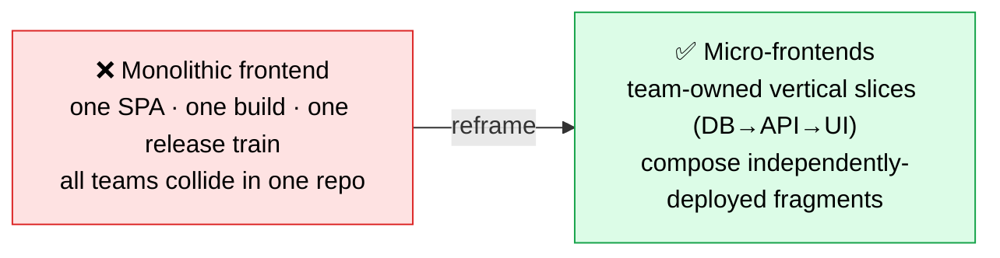
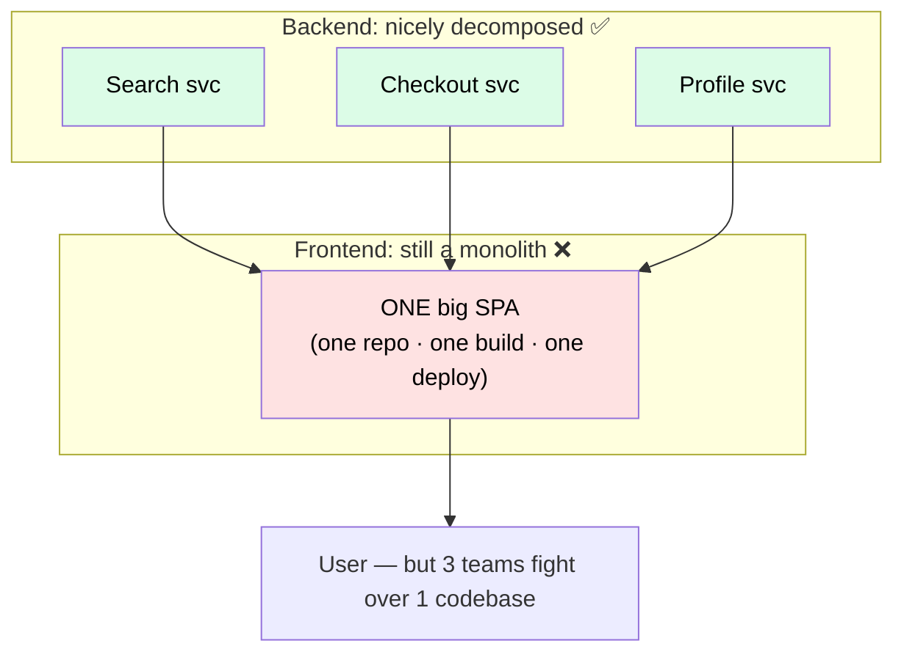
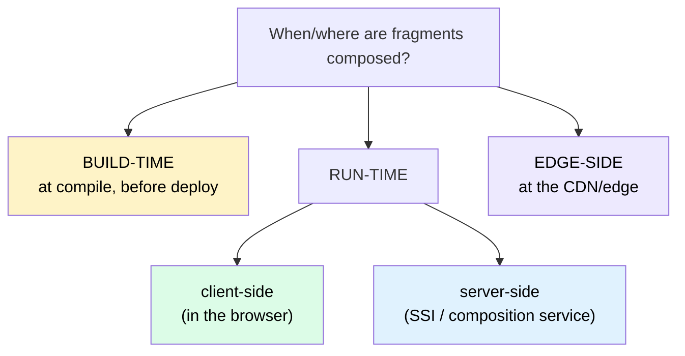
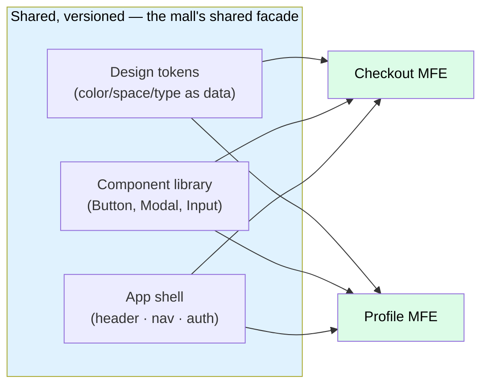
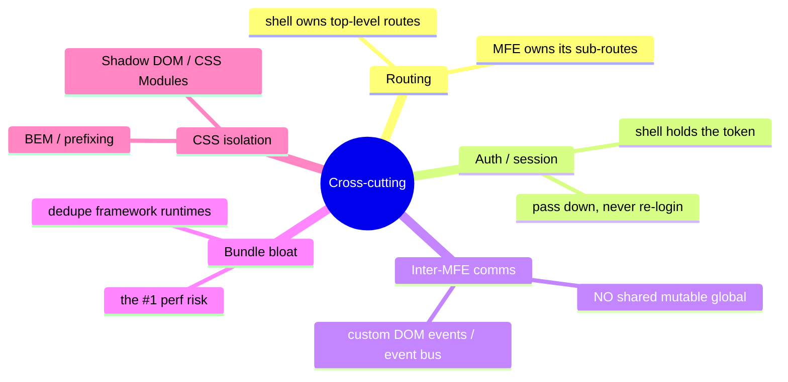
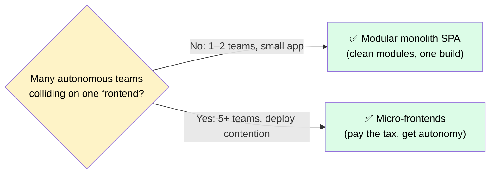
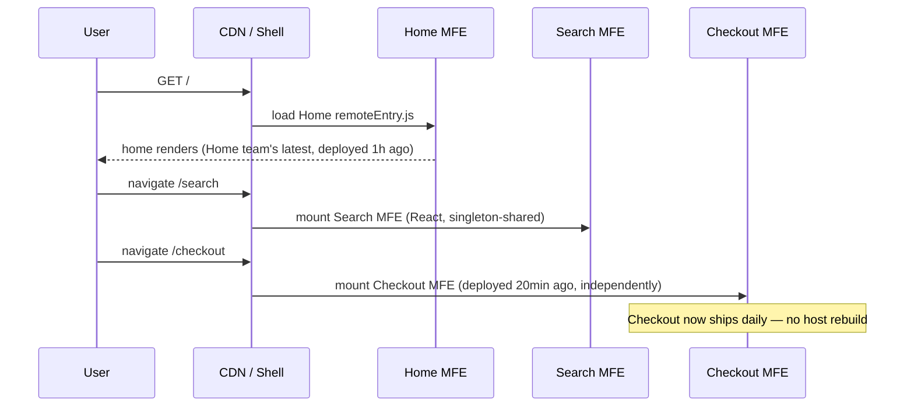
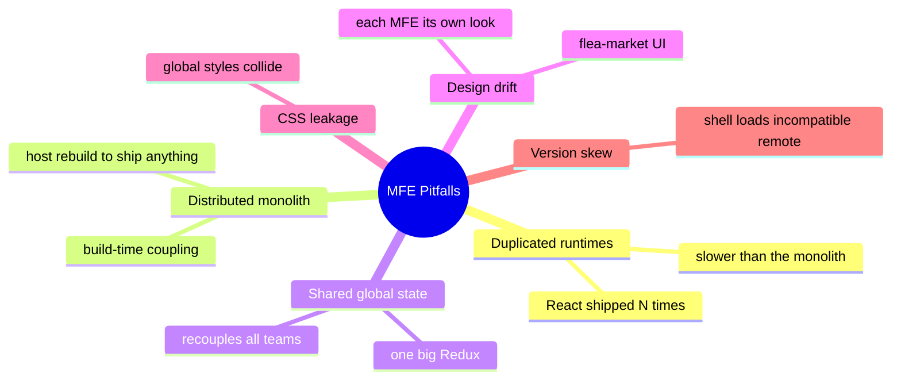

# Micro-Frontends

> **One line:** A micro-frontend architecture is a shopping mall — independently-run stores (each team's feature), each stocked and remodelled on its own schedule, presented behind one shared facade (roof, signage, entrances) so shoppers experience a single building.

---

## Table of Contents
1. [Why You Must Master This](#1-why-you-must-master-this)
2. [The Mental Model](#2-the-mental-model)
3. [The Frontend Bottleneck (the problem)](#3-the-frontend-bottleneck-the-problem)
4. [Composition Strategies — the Core Taxonomy](#4-composition-strategies--the-core-taxonomy)
5. [Comparison Across Composition Types](#5-comparison-across-composition-types)
6. [Shared Design System & Consistency](#6-shared-design-system--consistency)
7. [Cross-Cutting Concerns](#7-cross-cutting-concerns)
8. [When Micro-Frontends Are Overkill](#8-when-micro-frontends-are-overkill)
9. [Worked Example — Splitting an E-commerce SPA](#9-worked-example--splitting-an-e-commerce-spa)
10. [Real-Life Use Cases](#10-real-life-use-cases)
11. [Failure Modes](#11-failure-modes)
12. [🏋️ Practice Drills](#-practice-drills)
13. [🎤 Interview Q&A Bank](#-interview-qa-bank)
14. [🎯 Staff+ Nuances](#-staff-nuances)
15. [Cheat Sheet](#15-cheat-sheet)
16. [Connections & Further Reading](#16-connections--further-reading)

---

## 1. Why You Must Master This

You decomposed the backend beautifully into services — and then all twelve teams still queue behind **one** frontend release train. Micro-frontends are how the decomposition story finishes at the UI, and interviewers use this topic to check whether you think full-stack about team autonomy or stop at the API gateway.

- **The backend win is fake without it** — if Checkout, Search, and Profile are separate services but ship as one SPA, a typo in the Profile UI still blocks the Checkout deploy. The coordination bottleneck just moved up a layer.
- **Conway's Law doesn't stop at the API** — team-aligned vertical slices (DB → API → UI) let one team own a feature *end-to-end*. Cutting the slice off at the backend re-couples everyone at the browser.
- **It's a genuine "when NOT to" test** — a strong candidate names the overhead (duplicated framework runtimes, ops, tooling) and says "one team, one app → don't." Blindly recommending MFEs is a weak-signal answer.

> **The core problem it solves:** *the monolithic frontend as the last shared bottleneck* — many autonomous teams forced through one build, one release train, and one shared codebase at the UI layer.

**Prerequisites:** [System_Decomposition.md](./System_Decomposition.md) (the same bounded-context thinking, applied to the UI) and [Monolith_vs_Microservices.md](./Monolith_vs_Microservices.md) (the backend analogue of this exact trade-off).

---

## 2. The Mental Model

A monolithic SPA is a **department store**: one company owns the whole floor, one renovation crew, one closing time — to change the shoe section you shut the whole store. A micro-frontend app is a **shopping mall**: each store is leased and run by a different team, restocked and remodelled independently, but a shared facade (roof, signage, common entrances, the mall app) makes it feel like one building to the shopper.



> **Hold onto this:** micro-frontends are **not** a frontend framework choice — they are an *organizational* boundary (Conway's Law) pushed up through the UI. The whole game is: keep teams independent while keeping the *user's* experience seamless. Every technique below trades one for the other.

---

## 3. The Frontend Bottleneck (the problem)

Backend microservices promise independent deploy, independent scale, independent tech choices. But the classic SPA quietly undoes all three at the UI:

- **One release train** — every team's code lands in one bundle. To ship, you merge into `main`, wait for the shared CI/CD, and coordinate a joint release. One team's failing test blocks everyone's launch.
- **One shared runtime** — a memory leak or a global CSS rule from Team A degrades Team B's page. There is no fault isolation inside one SPA.
- **One tech lock-in** — the whole app is React 17 forever, because upgrading is an all-or-nothing migration across every team's code.



> **The tell:** the org chart has 8 product teams but the release calendar has 1 slot. That gap *is* the frontend bottleneck. Micro-frontends restore the vertical slice: Team Checkout owns its DB, its API, **and** its checkout UI, and deploys the whole column without asking anyone.

---

## 4. Composition Strategies — the Core Taxonomy

The single most important thing to know: **where and when do the pieces get stitched together?** That question defines four strategies. Everything else (which library, which framework) is detail.



### 4a. Build-time composition

Each micro-frontend is published as a **versioned npm package**; the host (container) app lists them as dependencies and bundles them in at build time.

- **How under the hood:** `npm install @acme/checkout@2.3.0`, `import { Checkout } from '@acme/checkout'`, webpack bundles it into the host artifact. Ship = rebuild + redeploy the host.
- **Trade-off:** dead simple, great tree-shaking and a single optimized bundle — but it **couples releases**. To ship a one-line fix in Checkout, the host must bump the version, rebuild, and redeploy. That is *not* independent deployment; it's a distributed monolith with extra steps.
- **Real use:** fine for a design-system component library or a small org; a genuine anti-pattern if your goal is per-team deploy autonomy.

### 4b. Run-time composition — client-side

An **app shell** (container) loads remote bundles in the browser *at runtime*. This is the modern default.

- **Webpack 5 Module Federation** — the shell declares `remotes`; each MFE exposes modules and is fetched over HTTP when needed. Shared libs (React) are deduplicated across remotes at runtime.

```js
// host (shell) webpack.config.js
new ModuleFederationPlugin({
  name: "shell",
  remotes: {
    checkout: "checkout@https://checkout.acme.com/remoteEntry.js",
    profile:  "profile@https://profile.acme.com/remoteEntry.js",
  },
  shared: { react: { singleton: true }, "react-dom": { singleton: true } },
});
// checkout MFE exposes its entry
new ModuleFederationPlugin({
  name: "checkout",
  filename: "remoteEntry.js",
  exposes: { "./Widget": "./src/CheckoutWidget" },
  shared: { react: { singleton: true } },
});
```

- **single-spa** — a top-level router registers applications by URL prefix and mounts/unmounts them; lets React, Vue, and Angular coexist on one page.

```js
// single-spa root config
registerApplication({
  name: "@acme/profile",
  app: () => System.import("@acme/profile"),
  activeWhen: ["/account"],
});
start();
```

- **iframes** — the brute-force option: hard isolation of CSS/JS/globals, but painful cross-frame comms, double scrollbars, deep-linking/SEO pain, and duplicated runtimes. Used where isolation trumps polish (embedding a 3rd-party or legacy app, e.g. Spotify's early desktop client).
- **Web Components** — wrap each MFE as a custom element (`<checkout-widget>`) with Shadow DOM for native CSS isolation; framework-agnostic and standards-based.
- **Trade-off:** true independent deploy (drop a new `remoteEntry.js`, no host rebuild) — but you own runtime orchestration: version skew, loading states, error boundaries per fragment, and the big one, **duplicated framework runtimes** (see §7).

### 4c. Run-time composition — server-side

A **composition service** (or the web server via **SSI — Server Side Includes**) fetches each team's HTML fragment and stitches the page *on the server*, sending assembled HTML to the browser.

- **How under the hood:** Zalando's **Tailor** (the layout/composition service) streams fragments in parallel; **Mosaic** is the broader framework around it. The server requests `<fragment src="checkout.acme/frag">`, splices the returned HTML, flushes to the client.
- **Trade-off:** excellent **first-paint and SEO** (crawlers get complete HTML), works without JS — but you run and scale a composition tier, and rich client interactivity still needs hydration.
- **Real use:** content/commerce sites where SEO and TTFB dominate — Zalando, IKEA.

### 4d. Edge-side composition (ESI)

**Edge Side Includes** is a markup spec the CDN/edge understands: the origin returns a page containing `<esi:include src="..."/>` tags, and the **edge** (Akamai, Varnish, Fastly) fetches and inlines each fragment before responding.

```html
<body>
  <esi:include src="https://header.acme.com/frag" />
  <esi:include src="https://checkout.acme.com/frag" />
</body>
```

- **Trade-off:** each fragment is cached independently at the edge (a fast-changing price fragment can have a 10s TTL while the header caches for a day) → great cache efficiency and low latency near the user. But ESI is an old, limited spec (weak error handling, uneven vendor support) and adds edge-config complexity.

---

## 5. Comparison Across Composition Types

| Dimension | Build-time | Client run-time | Server run-time | Edge-side (ESI) |
|-----------|-----------|-----------------|-----------------|-----------------|
| **Release coupling** | ❌ high (host rebuild) | ✅ none | ✅ low (redeploy fragment) | ✅ low |
| **Independent deploy** | ❌ no | ✅ yes | ✅ yes | ✅ yes |
| **First paint / latency** | ✅ one optimized bundle | ⚠️ extra runtime fetches | ✅ fast TTFB | ✅ fast, edge-cached |
| **SEO** | ✅ good | ⚠️ needs SSR/prerender | ✅ excellent | ✅ excellent |
| **Runtime tech diversity** | ⚠️ limited | ✅ high (single-spa) | ✅ high | ✅ high |
| **Ops / infra complexity** | ✅ lowest | ⚠️ orchestration in browser | ❌ run a composition tier | ❌ edge config |
| **Fault isolation** | ❌ shared bundle | ⚠️ error boundaries needed | ⚠️ fragment timeouts | ✅ per-fragment |
| **Typical user** | design system, small org | most SPAs (Module Federation) | SEO commerce (Zalando, IKEA) | CDN-heavy content sites |

> **The heuristic:** SEO/first-paint critical → compose on the **server or edge**. Rich app-like interactivity with autonomous teams → **client run-time** (Module Federation / single-spa). Just sharing components → **build-time**. There is no universal winner; the axis is *where does correctness/latency matter most*.

---

## 6. Shared Design System & Consistency

The mall's failure mode: every store screams a different brand and the building feels like a flea market. Independent teams naturally drift into inconsistent buttons, spacings, and colors. The fix is a **shared design system** — but shared code is coupling, so this is a balancing act.



- **Design tokens** — the lowest-coupling unit: color/spacing/typography published as *data* (JSON/CSS variables), not code. Teams consume tokens without importing anyone's components, so a rebrand is a token bump.
- **Versioned component library** — a shared `@acme/ui` (Button, Modal) published as a package. Consistency for free, but now every MFE depends on it: a breaking change forces coordinated upgrades (the coupling returns).
- **Shared app shell** — the container owns the global header, nav, and auth so those never differ between features.

> **The central tension — shared library vs duplication:** a *shared* component library maximizes consistency but re-introduces cross-team coupling (the very thing MFEs fight). *Duplicating* components per team maximizes autonomy but risks drift and bloat. The pragmatic answer: **share tokens + a few truly-common primitives (versioned, backward-compatible), duplicate everything feature-specific.** Treat the design system as an internal product with its own team and SemVer contract, never as a live shared dependency you can break under people.

---

## 7. Cross-Cutting Concerns

The pieces work alone; the hard part is making them cooperate without re-coupling.



- **Routing** — two levels. The **shell** owns top-level routes (`/checkout` → mount Checkout MFE); each MFE owns its *internal* sub-routes (`/checkout/payment`). Keep them decoupled or a URL change in one breaks the other. single-spa's `activeWhen` and Module Federation + a shared router are the usual mechanisms.
- **Shared auth / session** — the **shell authenticates once** and passes the token/session down (via context, a cookie, or an injected auth client). MFEs must never each run their own login. Getting this wrong = the user re-authenticates walking from Search to Checkout.
- **Inter-MFE communication** — favor **decoupled events**: browser `CustomEvent` on `window`, or a tiny shared **event bus** (pub/sub). Team A emits `cart:item-added`; Team B listens — neither imports the other. **Anti-pattern:** a shared mutable global store (one big Redux) — that recouples every team through shared state and is the front-end version of a shared database.
- **Duplicated framework runtimes (the big perf risk)** — if 5 MFEs each bundle their own React, the user downloads React 5×. This is the number-one micro-frontend performance failure. Fixes: Module Federation `shared: { react: { singleton: true } }`, import maps, or externalizing common libs to a shared runtime. Left unmanaged, MFEs can be *slower* than the monolith they replaced.
- **CSS isolation** — one team's `.button { }` must not restyle another's. Options: **Shadow DOM** (hard native isolation, via Web Components), **CSS Modules / CSS-in-JS** (scoped hashes), or disciplined **BEM / prefix conventions** (`.checkout__button`). Global un-namespaced CSS is a guaranteed cross-team bug.

---

## 8. When Micro-Frontends Are Overkill

The honest section. Micro-frontends are an **organizational-scaling** tool, and they charge a real tax whether or not you need scaling.



The costs you pay *upfront, regardless of size*:

- **Duplicated dependencies** → larger total payload unless carefully deduped.
- **Tooling & ops** → multiple build pipelines, deploys, versioning, monitoring, a composition/shell layer to run.
- **Distributed debugging** → a bug now spans several independently-deployed fragments and version combinations.
- **Consistency effort** → the design-system governance from §6 becomes a standing cost.

> **When it's overkill:** single team, or a small/simple app. The overhead (tooling, duplicated deps, orchestration, ops) dwarfs any benefit — you get all the distributed-systems pain with none of the team-autonomy payoff. **Default to a well-modularized monolith SPA** (a [Modular_Monolith.md](./Modular_Monolith.md) at the UI); adopt micro-frontends only when *multiple autonomous teams* are demonstrably blocked by shared-frontend deploy contention. MFEs pay off at **org scale**, not app scale.

---

## 9. Worked Example — Splitting an E-commerce SPA

**Setup:** A retailer's React SPA is owned by 4 teams — Home, Search, Checkout, Account. Deploy cadence has collapsed to **one release every 2 weeks** because every merge must be jointly regression-tested. Checkout wants to ship daily.

**Decision walkthrough:**



**The arithmetic that forces the architecture:**

- **Framework dedup math:** 4 MFEs × React+ReactDOM (~130 KB gzipped each) = **520 KB** if duplicated. With `singleton: true` sharing → **130 KB once**. That 390 KB saving is *why* Module Federation's shared config is non-negotiable — naive MFEs would be ~4× heavier than the monolith.
- **Deploy math:** monolith release lead time = 14 days (coordinated). After split, Checkout's lead time drops to **< 1 day** because it deploys a new `remoteEntry.js` with no host rebuild. That single number — 14 days → 1 day — is the whole business case.
- **Composition choice:** SEO matters for Home/Search (organic traffic) but not the logged-in Checkout. → compose Home/Search **server/edge-side** for TTFB+SEO, Checkout **client-side** for app-like interactivity. The number that decides it: organic-search share of revenue.

**Conclusion:** the deploy-contention number (14→1 days) justifies MFEs *for these 4 teams*; the payload number (520→130 KB) mandates runtime dependency sharing; the SEO-revenue number picks server/edge vs client composition per fragment.

---

## 10. Real-Life Use Cases

| Situation | How micro-frontends apply | The decision it forces |
|-----------|---------------------------|------------------------|
| **Many teams, one SPA, deploy gridlock** | Split into team-owned MFEs, compose at runtime | Client-side (Module Federation / single-spa) |
| **SEO-critical commerce** (Zalando, IKEA) | Server/edge composition of HTML fragments | Composition service (Tailor/Mosaic) or ESI |
| **Incremental framework migration** | New MFE in React alongside legacy Angular via single-spa | Runtime composition, framework-agnostic |
| **Embedding a legacy or 3rd-party app** | iframe for hard isolation | Accept iframe UX cost for safety |
| **Streaming app, global teams** (DAZN) | Team-per-feature vertical slices to the UI | MFEs aligned to Conway's Law |
| **Shared brand across MFEs** | Versioned design tokens + component library | Design system as an internal product |
| **Single small team / simple app** | *Don't.* Modular monolith SPA | Reject MFEs — overhead > benefit |

> **Real-world habit:** decide micro-frontends by **counting autonomous teams blocked on one deploy**, not by architectural fashion. Then pick the composition point by **where latency/SEO matters most**, and always share the framework runtime.

---

## 11. Failure Modes



- **Duplicated framework runtimes** — *Symptom:* bundle size and load time balloon after the split; app is slower than the monolith. *Root cause:* each MFE bundles its own React/Vue. *Fix:* `shared: { singleton: true }` (Module Federation), import maps, or externalized shared runtime.
- **Accidental distributed monolith** — *Symptom:* "independent" MFEs still require a coordinated host redeploy to ship. *Root cause:* build-time composition (or a shared package everyone imports at build). *Fix:* move to runtime composition; MFEs must be deployable without a host rebuild.
- **Shared mutable global state** — *Symptom:* changing Team A's state breaks Team B; teams must coordinate on the store shape. *Root cause:* one giant shared Redux/global. *Fix:* communicate via events/pub-sub; each MFE owns its state.
- **Design drift** — *Symptom:* buttons and spacing differ per feature; UI feels like separate apps. *Root cause:* no shared design system / no governance. *Fix:* versioned design tokens + component library owned as a product.
- **CSS leakage** — *Symptom:* one team's deploy restyles another's page. *Root cause:* global un-scoped CSS. *Fix:* Shadow DOM, CSS Modules, or strict BEM/prefixing.
- **Version skew** — *Symptom:* shell loads a remote that expects an incompatible shared-lib version → runtime crash. *Root cause:* no contract on shared singletons. *Fix:* SemVer + `requiredVersion` on shared deps, contract tests between shell and remotes.

---

## 🏋️ Practice Drills

> *Cover the solutions and attempt first — active recall is the point.*

**Drill 1 — Independent deploy or not?** A team publishes each MFE as an npm package; the host app imports them and is rebuilt/redeployed on every change. Is this independent deployment?

<details><summary>Solution</summary>

No. This is **build-time composition** — a distributed monolith. Shipping any MFE change requires bumping its version, then rebuilding and redeploying the host. Independent deployment means dropping a new artifact (e.g. `remoteEntry.js`) with **no host rebuild** — that requires *runtime* composition (Module Federation, single-spa, server/edge). Build-time is fine for a shared component library, not for per-team deploy autonomy.
</details>

**Drill 2 — The payload math.** Five MFEs each bundle React + ReactDOM at ~130 KB gzipped. What's the total React cost duplicated vs shared as a singleton, and why does it matter?

<details><summary>Solution</summary>

Duplicated: 5 × 130 KB = **650 KB** of React alone; shared singleton: **130 KB** once — a 520 KB saving. It matters because duplicated framework runtimes are the #1 MFE performance failure: naively split MFEs can be *slower* than the monolith they replaced. Fix with `shared: { react: { singleton: true } }`, import maps, or an externalized shared runtime.
</details>

**Drill 3 — Pick the composition point.** A commerce site earns 60% of revenue from organic search on product pages, and has a logged-in, highly interactive checkout. Where do you compose each?

<details><summary>Solution</summary>

Product/listing pages: **server- or edge-side composition** — crawlers need complete HTML and TTFB drives conversion, and per-fragment edge caching (short TTL on price, long on header) is a win. Checkout: **client-side composition** (Module Federation) — SEO is irrelevant behind login, and it's app-like/interactive. The 60% organic-revenue number is what forces SSR/edge on the storefront; you can mix composition strategies per fragment.
</details>

**Drill 4 — Should they even do this?** A 6-engineer startup with one product team wants micro-frontends "because Netflix does it." Advise them.

<details><summary>Solution</summary>

Don't. MFEs solve *multi-team deploy contention*; with one team there is no contention to solve, and you'd pay the full tax — duplicated deps, multiple pipelines, a shell/composition layer, distributed debugging, design governance. Recommend a **modular monolith SPA** (clean feature modules, one build). Revisit MFEs only when several autonomous teams are demonstrably blocked on the shared frontend. MFEs pay off at *org* scale, not app scale.
</details>

---

## 🎤 Interview Q&A Bank

**Q1. What are micro-frontends and what problem do they solve?**
> Extending microservice-style decomposition to the UI: independently-developed, independently-deployed frontend pieces owned by feature teams (DB→API→UI vertical slices, Conway's Law). They solve the last shared bottleneck — a monolithic SPA where many teams collide in one repo, one build, and one release train even though the backend is decomposed.

**Q2. What are the composition strategies?** *(signal: do they know the taxonomy by *where/when* stitching happens)*
> Build-time (publish MFEs as npm packages, host imports them — simple but couples releases), run-time client-side (a shell loads remote bundles in the browser: Module Federation, single-spa, iframes, Web Components), run-time server-side (a composition service/SSI stitches HTML fragments — Zalando's Tailor/Mosaic), and edge-side (ESI at the CDN assembles fragments). The axis is *where the pieces come together*.

**Q3. Build-time vs runtime composition — when does each win?**
> Build-time when you just share components or run a small org — you get one optimized bundle but must rebuild the host to ship anything (not truly independent). Runtime when teams need independent deploy — drop a new remote with no host rebuild; the cost is runtime orchestration and deduping framework runtimes.

**Q4. What's the single biggest performance risk?**
> Duplicated framework runtimes — each MFE bundling its own React/Vue, so the user downloads it N times and the app ends up slower than the monolith. Fix with singleton sharing (Module Federation `shared`), import maps, or an externalized shared runtime.

**Q5. How do MFEs stay visually consistent without re-coupling?**
> A design system: versioned design *tokens* (color/spacing as data — lowest coupling) plus a shared component library and a shared app shell for header/nav/auth. The tension is shared library (consistency, but coupling) vs duplication (autonomy, but drift). Practical answer: share tokens + a few backward-compatible primitives, treat the design system as an internal product with SemVer.

**Q6. How should micro-frontends communicate?**
> Decoupled events — browser `CustomEvent` or a small pub/sub event bus — so no MFE imports another. Avoid a shared mutable global store (one big Redux); that's the front-end equivalent of a shared database and recouples every team. Auth/session is handled once by the shell and passed down.

**Q7. When are micro-frontends overkill?** *(signal: strong candidates volunteer this)*
> Single team or small/simple app. You pay the full tax — duplicated deps, multiple pipelines, orchestration, distributed debugging, design governance — with no autonomy payoff. Default to a modular monolith SPA; adopt MFEs only when multiple autonomous teams are blocked by shared-frontend deploy contention. It's an org-scaling tool, not an app-scaling one.

**Q8. How does this relate to backend decomposition?**
> Same principle — bounded contexts and Conway's Law — applied one layer up. The point is the *complete* vertical slice: a team owns DB → API → UI. Decomposing only the backend re-couples every team at the browser, so the frontend must be sliced along the same team boundaries.

---

## 🎯 Staff+ Nuances

- **MFEs are an org solution masquerading as a tech choice.** The real decision variable is *number of autonomous teams blocked on one deploy*, not React vs Vue. If your team count doesn't justify the tax, the "right" MFE implementation is still the wrong architecture. Frame the recommendation around team topology, not tooling (ties to [System_Decomposition.md](./System_Decomposition.md)'s Inverse Conway Maneuver).
- **The distributed monolith is easier to build than the independent one.** Build-time composition and a shared "kitchen-sink" library both *feel* like MFEs but silently re-couple releases. The honest test of a real MFE architecture: can one team deploy to production without any other team rebuilding? If not, you have distributed-monolith costs with monolith coupling.
- **Version skew of shared singletons is the quiet killer.** With `singleton: true`, exactly one React loads — but if the shell has React 17 and a remote was built against 18 hooks, you get runtime crashes that never appear in isolated CI. Staff-level answer: contract tests between shell and remotes, `requiredVersion`/`strictVersion`, and a shared-dependency upgrade *policy*, not ad-hoc bumps.
- **Composition point is a per-fragment decision, not an app-wide one.** Mature setups mix strategies: edge/SSR the SEO-critical storefront, client-compose the interactive logged-in area, iframe the untrusted 3rd-party widget. Treating "which composition strategy" as one global choice is a junior tell.
- **Performance budgets must be enforced at the boundary.** Because each team ships independently, no one owns total page weight by default — bloat accumulates silently. Assign a per-MFE performance budget (KB, TTI) as a deploy gate, or the sum-of-parts regresses without any single team's diff looking bad.
- **A shared shell is a single point of failure and a coordination point.** The container owning routing/auth/layout is convenient but becomes the one thing every team depends on — its release cadence and its team become a soft bottleneck. Keep the shell thin (routing, auth, mounting) and resist letting business logic accrete there.
- **Micro-frontends don't remove the modular-monolith option — they're the distributed end of a spectrum.** Just as with [Monolith_vs_Microservices.md](./Monolith_vs_Microservices.md), get the boundaries right in a modular SPA first (cheap, in-process), and split to MFEs only when deploy contention proves the need. A boundary validated in a modular monolith is a safe MFE extraction; a guessed one distributed across remotes is expensive to undo.

---

## 15. Cheat Sheet

```
MICRO-FRONTENDS = microservice decomposition applied to the UI.
  Team owns the FULL vertical slice: DB → API → UI (Conway's Law).
  Solves: the monolithic SPA as the last shared bottleneck (1 build, 1 release train).

COMPOSITION TAXONOMY — "where/when are fragments stitched?"
  BUILD-TIME    npm package, host imports  → simple, but COUPLES releases (host rebuild). ✗ autonomy
  RUN-TIME client   shell loads remotes in browser (Module Federation, single-spa,
                    iframes, Web Components) → true independent deploy. DEFAULT.
  RUN-TIME server   composition svc / SSI stitches HTML (Zalando Tailor/Mosaic) → SEO + TTFB.
  EDGE-SIDE (ESI)   CDN assembles fragments → per-fragment edge caching, low latency.

PICK BY: SEO/first-paint critical → server/edge. App-like + autonomous teams → client. Just components → build-time.

CONSISTENCY: design TOKENS (data, low coupling) + versioned component lib + shared shell (header/nav/auth).
  Tension: shared lib = coupling ⇄ duplication = drift. Share tokens+primitives, duplicate features.

CROSS-CUTTING: shell owns top routes + auth (login once, pass down);
  comms via CustomEvent / event bus — NO shared global Redux;
  DEDUPE framework runtimes (singleton:true) ← #1 perf risk; CSS isolation via Shadow DOM/CSS Modules.

OVERKILL WHEN: single team / small app → overhead (dup deps, ops, orchestration) ≫ benefit.
  Default = MODULAR MONOLITH SPA. MFEs pay off at ORG scale, not app scale.

TRAPS: duplicated runtimes (slower than monolith) · distributed monolith (build-time coupling) ·
       shared global state (recouples) · design drift · CSS leakage · version skew of singletons.
```

---

## 16. Connections & Further Reading

**Prerequisites (learn first):**
- [System_Decomposition.md](./System_Decomposition.md) — the same bounded-context / Conway's-Law decomposition, here applied to the UI.
- [Monolith_vs_Microservices.md](./Monolith_vs_Microservices.md) — the backend analogue of this exact autonomy-vs-overhead trade-off.

**Builds toward / pairs with:**
- [Component_Responsibilities.md](./Component_Responsibilities.md) — decomposition at the component level; where the shell/fragment boundaries live.
- [Modular_Monolith.md](./Modular_Monolith.md) — the default alternative: a well-modularized single SPA before you distribute.
- [10 · Microservices & Distributed Systems](../10_Microservices_Distributed_Systems/) — MFEs inherit distributed-systems concerns (version skew, partial failure) at the UI.

**Gaps this topic exposes (candidates for the section's Gap Analysis):**
- A dedicated **Design Systems / component-library governance** note (SemVer contracts, tokens pipeline).
- **Frontend performance budgets & Core Web Vitals** as a first-class topic.

**External classics:**
- [micro-frontends.org](https://micro-frontends.org/) (Michael Geers) and *Micro Frontends in Action* (Geers) — the canonical treatment.
- [Martin Fowler — Micro Frontends](https://martinfowler.com/articles/micro-frontends.html) (Cam Jackson) — strategies and trade-offs.
- [Webpack Module Federation](https://webpack.js.org/concepts/module-federation/) · [single-spa](https://single-spa.js.org/) · [Zalando Mosaic / Tailor](https://www.mosaic9.org/) — reference implementations.

---

## TL;DR
Micro-frontends extend service decomposition to the UI so each team owns a **full vertical slice (DB → API → UI)** and can deploy without colliding in one monolithic SPA's single release train. The core taxonomy is **where fragments are composed**: build-time (npm import — simple but couples releases), run-time client-side (a shell loads remotes — Module Federation / single-spa — true independent deploy, the default), run-time server-side (a composition service stitches HTML — best SEO/TTFB), and edge-side (ESI at the CDN — per-fragment caching). Keep the UI seamless with a **design system** (tokens + versioned library + shared shell), and manage cross-cutting concerns with **shell-owned routing/auth, event-based comms (never a shared global store), and deduped framework runtimes** — duplicated runtimes are the #1 performance trap. **Default to a modular monolith SPA; micro-frontends pay off only at org scale with many autonomous teams — for a single team they are overkill.**
