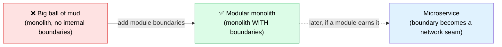
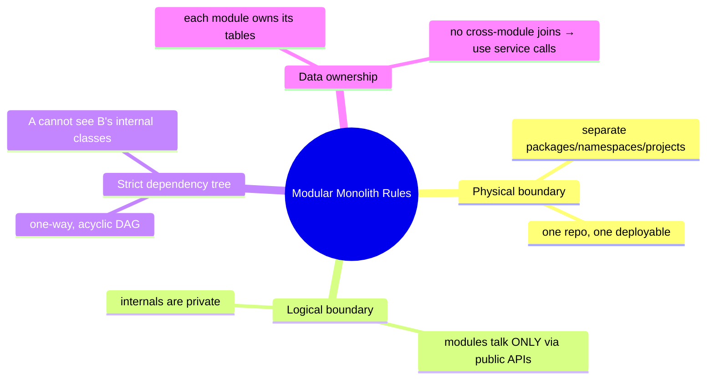
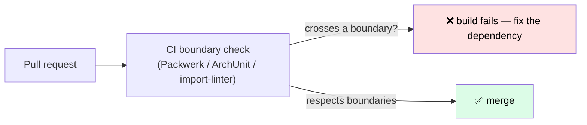
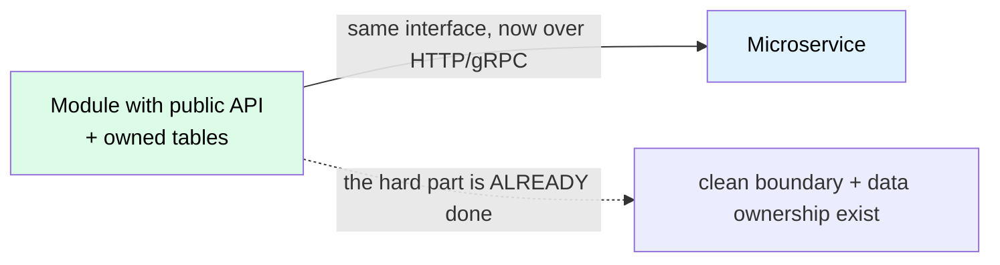
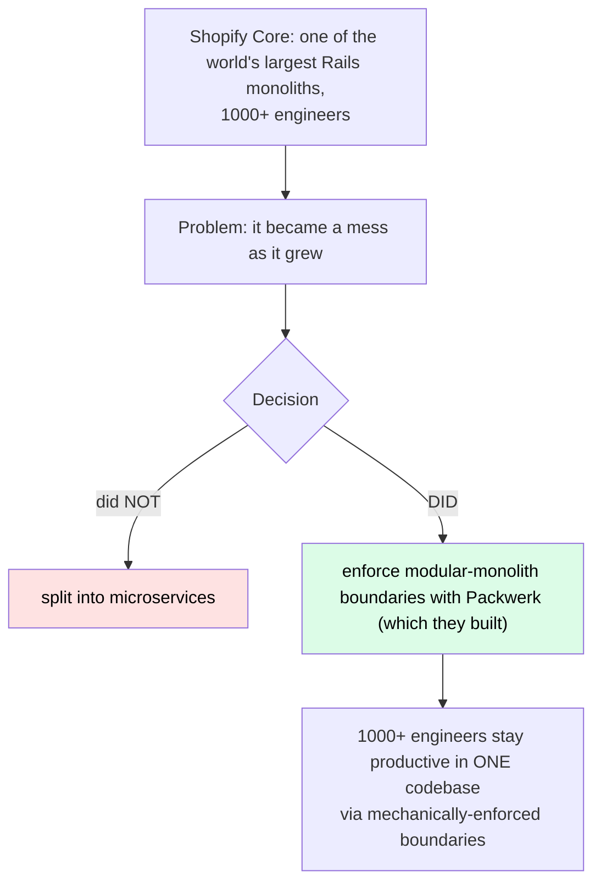
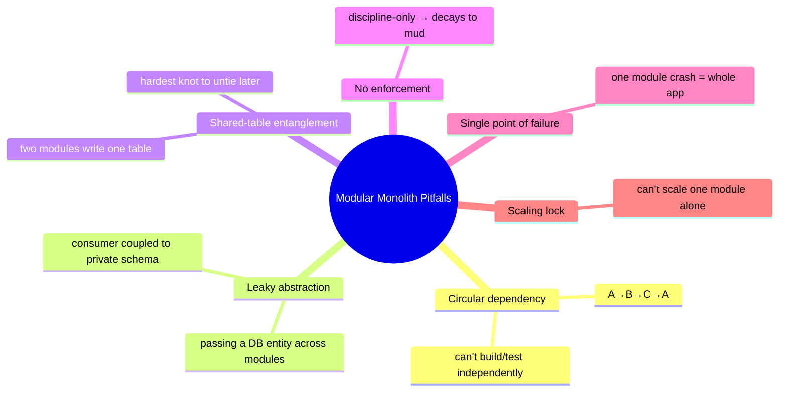

# Modular Monolith

> **One line:** The "third way" — a single deployable built from LEGO-block modules that talk only through public APIs, giving you the clean boundaries of microservices with the one-click-deploy simplicity (and ACID transactions) of a monolith.

---

## Table of Contents
1. [Why You Must Master This](#1-why-you-must-master-this)
2. [The Mental Model](#2-the-mental-model)
3. [The Four Rules of Modularity](#3-the-four-rules-of-modularity)
4. [Enforcing Boundaries (tooling)](#4-enforcing-boundaries-tooling)
5. [Why It's the Best Default](#5-why-its-the-best-default)
6. [The Clean Extraction Path](#6-the-clean-extraction-path)
7. [Worked Example — Shopify Core](#7-worked-example--shopify-core)
8. [Real-Life Use Cases](#8-real-life-use-cases)
9. [Failure Modes](#9-failure-modes)
10. [🏋️ Practice Drills](#-practice-drills)
11. [🎤 Interview Q&A Bank](#-interview-qa-bank)
12. [🎯 Staff+ Nuances](#-staff-nuances)
13. [Cheat Sheet](#13-cheat-sheet)
14. [Connections & Further Reading](#14-connections--further-reading)

---

## 1. Why You Must Master This

Most teams jump to microservices because their monolith is a *mess* — but the mess is almost always poor **internal boundaries**, not the fact that it's a monolith. The modular monolith fixes the actual problem without paying the network tax.

- **Refactoring safety** — it's vastly easier to fix a boundary inside one codebase (a compiler-checked refactor) than after you've split it across 20 network-separated services (a multi-team migration project).
- **Operational zen** — you get clean architecture *and* one-click deploy, one test command, no service mesh.
- **It's the honest middle** — most "we need microservices" situations are really "we need boundaries." This gives you boundaries first.

> **The core problem it solves:** the false dichotomy between "big ball of mud" and "drowning in Kubernetes." It stops Payments code from importing and mutating UI state, *without* forcing a 5-person team to operate distributed infrastructure before they have 100 users.

---

## 2. The Mental Model

A modular monolith is a **LEGO set on one baseplate.** Each feature (Payments, Auth, Shipping) is a distinct block with its own studs and holes; they all sit on one baseplate (one deploy, ideally one DB). Because the blocks are distinct, you can pop one off and replace it — or move it to a different baseplate (extract to a service) — without breaking the rest.





---

## 3. The Four Rules of Modularity



1. **Physical boundary** — code is separated into modules (packages/namespaces/projects) in one repo, one deployable.
2. **Logical boundary** — a module exposes a **public API** (interface/service); everything else is private. Other modules use the API, never the internals.
3. **Strict, acyclic dependencies** — module A can't import B's internal classes, and there are no cycles (a clean DAG).
4. **Data ownership** — each module owns its tables. Cross-module joins are banned in favor of calling the owning module's API. *This is the rule that makes later extraction possible.*

```python
# module: catalog/public.py — the ONLY entry point other modules may use
class CatalogService:
    def get_product(self, product_id):
        return _internal_db_query(product_id)   # private internals stay hidden

# module: orders/processor.py
from catalog.public import CatalogService       # ✅ depend on the public API
cat = CatalogService()

# ❌ BANNED — reaching into internals (a linter/build tool must block this)
# from catalog.internals.db import CatalogDB
# CatalogDB.execute("DROP TABLE products")
```

---

## 4. Enforcing Boundaries (tooling)

Discipline alone fails — someone always reaches across a boundary "just this once." Enforce it mechanically in CI:

| Language | Tool |
|----------|------|
| Ruby | **Packwerk** (built by Shopify for exactly this) |
| Java | **ArchUnit**, Java Platform Module System (JPMS) |
| Python | **import-linter** |
| C#/.NET | **NetArchTest**, project references |
| TypeScript | **dependency-cruiser**, ESLint boundaries plugin |



> Without enforcement, a modular monolith silently decays back into a ball of mud. The CI check *is* the architecture.

---

## 5. Why It's the Best Default

| Benefit | Why it beats microservices here |
|---------|----------------------------------|
| **Easy testing** | one `test` command; no integration environments, no spinning up 12 services |
| **Low latency** | in-process function calls (ns), not network hops (ms) |
| **Atomic commits** | change an API and every caller in one PR — no cross-repo version dance |
| **ACID transactions** | one DB → real transactions across modules; no Sagas/eventual consistency |
| **Lowest cost** | minimal DevOps; runs on one box; no mesh/discovery/tracing infra |

> The killer advantage: **you can change a boundary in a single compiler-checked refactor.** Get the boundary wrong in microservices and fixing it is a multi-service, multi-team migration.

---

## 6. The Clean Extraction Path

The payoff: a well-built modular monolith is *already shaped* for extraction. When a module genuinely earns its own service (different scaling profile, a team that needs independent deploys), you promote its in-process API to a network API.



Because the module already (a) talks only through a public API and (b) owns its own tables, extraction is "swap the in-process call for a network call." The expensive, error-prone part — untangling data and dependencies — was done cheaply, in-process, up front.

---

## 7. Worked Example — Shopify Core



Shopify is the proof that "the monolith is a mess" doesn't require microservices. They kept the single Rails codebase and fixed the *boundaries* with tooling — and thousands of engineers ship in it productively.

---

## 8. Real-Life Use Cases

| Situation | How the modular monolith fits |
|-----------|-------------------------------|
| **Growing startup with a messy monolith** | Add module boundaries + a CI enforcer before considering any service split. Usually that *is* the fix. |
| **Pre-microservices preparation** | Build modular so the eventual extraction is a clean promotion of existing boundaries. |
| **Mid-size SaaS, one product team** | The sweet spot: clean architecture, ACID transactions, trivial ops. |
| **Domain still being learned** | Boundaries are cheap to redraw in-process — exactly what you want while the domain is fluid. |
| **Shopify / GitHub / Basecamp** | Large, successful products that deliberately stay (modular) monoliths. |

> Real-world habit: **reach for a modular monolith before microservices, and enforce boundaries in CI from day one.** Extract a module to a service only when it has a proven, specific reason — and the extraction will be cheap because you did the boundary work early.

---

## 9. Failure Modes



- **Circular dependencies** — A→B→C→A breaks independent reasoning and the future extraction path. Keep the dependency graph acyclic.
- **Leaky abstractions** — passing a database entity (not a DTO) across a module boundary couples the consumer to the owner's private schema. Expose DTOs, not entities.
- **Shared-table entanglement** — two modules writing the same table is the single hardest knot to untie if you ever extract — it silently re-couples "independent" modules.
- **No enforcement** — without a CI boundary check, the boundaries erode. The tool is non-negotiable.
- **Inherent monolith limits** — still one process (a crash takes everything down) and you can't scale one module independently; that's when extraction is warranted.

---

## 🏋️ Practice Drills

> *Spot the boundary violation and the fix.*

**Drill 1 — Is this a real fix?** A team's monolith is a tangled mess, so they propose splitting it into 15 microservices. Is microservices the fix for "messy code"?

<details><summary>Solution</summary>

No — messy code is poor *boundaries*, and splitting bad boundaries across the network just makes them bad *and* distributed. Introduce module boundaries + a CI enforcer first (modular monolith). If specific modules then earn a service for scale/team reasons, extract those — with the boundary work already done.
</details>

**Drill 2 — Find the entanglement.** Two modules, `orders` and `analytics`, both `INSERT`/`UPDATE` the same `orders` table directly. Why is this the worst kind of coupling, and what's the rule it breaks?

<details><summary>Solution</summary>

It breaks the data-ownership rule (each module owns its tables). Shared-table writes mean the two modules are silently coupled through schema — change the table and both break, and you can never extract one without the other. Fix: one module owns the table; the other calls its public API (or subscribes to its events).
</details>

**Drill 3 — Leaky abstraction.** `catalog.get_product()` returns the raw `ProductRow` ORM entity, and `orders` reads `product.internal_cost_cents` from it. What leaked, and how do you seal it?

<details><summary>Solution</summary>

The internal DB schema leaked across the boundary — `orders` is now coupled to catalog's private columns. Return a DTO (`ProductView` with only public fields) instead of the ORM entity, so catalog can change its schema freely. Exposing entities is a classic boundary leak.
</details>

---

## 🎤 Interview Q&A Bank

**Q1. What is a modular monolith?**
> A single deployable application internally divided into modules with strict boundaries: each module exposes a public API, hides its internals, owns its data, and depends on others only through their public APIs. Clean architecture, monolith simplicity.

**Q2. How do you prevent a monolith from becoming a big ball of mud?**
> Enforce module boundaries mechanically in CI — Packwerk (Ruby), ArchUnit (Java), import-linter (Python), dependency-cruiser (TS). Modules talk only through public APIs, own their tables, and form an acyclic dependency graph. Discipline alone always erodes; the CI check is what holds.

**Q3. Why prefer a modular monolith over microservices?**
> You get clean boundaries without the network tax: in-process calls, ACID transactions, one test command, atomic cross-module commits, and trivial ops. Crucially, you can fix a wrong boundary with a compiler-checked refactor instead of a multi-service migration.

**Q4. How does it make a future microservices migration easier?**
> Each module already talks through a public API and owns its data, so extraction is promoting an in-process call to a network call. The hard part — untangling data and dependencies — was done cheaply in-process up front.

**Q5. What's the data rule, and why does it matter most?**
> Each module owns its tables; no cross-module joins. It matters most because shared tables are the hardest coupling to remove later — two modules on one table can never be independently deployed or extracted.

**Q6. What's the difference vs package-by-layer?**
> A modular monolith packages **by feature** (Orders, Payments, Shipping — vertical slices that own their data), not by technical layer (all controllers / all services / all repos). Package-by-layer spreads one feature across every layer and provides no real boundary.

**Q7. What are its honest limitations?**
> Still one process (a crash or memory leak takes the whole app down), can't scale one module independently, and is single-language. Those are exactly the signals that a specific module has earned extraction to a service.

---

## 🎯 Staff+ Nuances

- **The boundary, not the deployment, is what matters.** Microservices' real value is *enforced* boundaries (the network makes cheating impossible). A modular monolith gets the same boundaries via tooling — so most teams chasing microservices actually want enforced modularity, which is far cheaper to obtain.
- **Data ownership is the load-bearing rule.** Modules can share a *physical* database while each *owns* a disjoint set of tables (schema-per-module). The moment two modules write the same table, they're one module — and you've lost the extraction path. Police this harder than the code-import rules.
- **Module boundaries should follow DDD bounded contexts, not technical layers.** Package-by-feature (vertical) gives you cohesive, independently-evolvable units; package-by-layer gives you nicely-sorted spaghetti. The boundary work here is identical to the work you'd do for microservices — which is why it transfers cleanly. See [System_Decomposition.md](./System_Decomposition.md).
- **Async-in-process is a useful intermediate.** Modules can communicate via an in-process event bus (domain events) instead of direct calls — this further decouples them and means a later extraction to a real broker (Kafka/SQS) is a transport swap, not a redesign. See [Event_Driven_Architecture.md](./Event_Driven_Architecture.md).
- **The modulith is the honest answer to "monolith-first."** Fowler's "MonolithFirst" advice is often misread as "write a messy monolith, rewrite later." The disciplined version is "write a *modular* monolith" — you get the iteration speed *and* the clean seams, so the eventual decomposition is extraction, not rewrite.
- **Know the exit signals.** Extract a module to a service only for: a genuinely different scaling profile, a team that must deploy on its own cadence, a hard tech-stack need, or a fault-isolation requirement. "It would be cleaner as a service" is not one of them — in-process is cleaner *and* simpler.

---

## 13. Cheat Sheet

```
MODULAR MONOLITH = one deployable, internally modular. The "third way".
  ✓ clean boundaries + one-click deploy + ACID txns + in-process speed + low ops cost
  ✗ one process (SPOF) · can't scale modules alone · single language

THE 4 RULES
  1. physical boundary  (packages/namespaces, one repo+deploy)
  2. logical boundary   (talk ONLY via public APIs; internals private)
  3. acyclic deps       (one-way DAG; no A→B→C→A)
  4. data ownership     (each module owns its tables; no cross-module joins)  ← most important

ENFORCE IN CI  Packwerk (Ruby) · ArchUnit (Java) · import-linter (Py) · dependency-cruiser (TS)
PACKAGE BY FEATURE, not by layer.   Cross-boundary = pass DTOs, never ORM entities.

EXTRACTION PATH: module (public API + owned tables) → promote in-process call to network call
EXIT SIGNALS: different scaling profile · team needs own deploy · tech-stack need · fault isolation
```

---

## 14. Connections & Further Reading

**Within this repo:**
- [Monolith_vs_Microservices.md](./Monolith_vs_Microservices.md) — the broader choice this sits between.
- [System_Decomposition.md](./System_Decomposition.md) — how to draw module boundaries (DDD bounded contexts).
- [Component_Responsibilities.md](./Component_Responsibilities.md) — boundaries at the component level; [Event_Driven_Architecture.md](./Event_Driven_Architecture.md) — in-process events.
- [04 · Low-Level Design](../04_Low_Level_Design/) — SOLID & DDD that underpin module design.

**External classics:**
- [Shopify — Enforcing modularity with Packwerk](https://www.shopify.com/engineering/enforcing-modularity-inside-shopify-core) · [Packwerk](https://github.com/Shopify/packwerk).
- [ArchUnit](https://www.archunit.org/) (Java boundary enforcement).
- Simon Brown — *Modular Monolith* talks/book; Martin Fowler — [MonolithFirst](https://martinfowler.com/bliki/MonolithFirst.html).

---

## TL;DR
A modular monolith is **one deployable made of strictly-bounded modules** — the clean architecture of microservices with the simplicity, in-process speed, and ACID transactions of a monolith. Follow four rules — **physical + logical boundaries, acyclic dependencies, and (most importantly) data ownership** — and **enforce them in CI** (Packwerk/ArchUnit/import-linter), because discipline alone decays to mud. It's the **best default for most teams**: cheap to refactor boundaries now, and a clean **extraction path** to microservices later when a module actually earns it.
