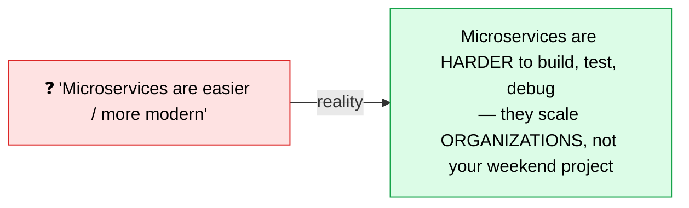
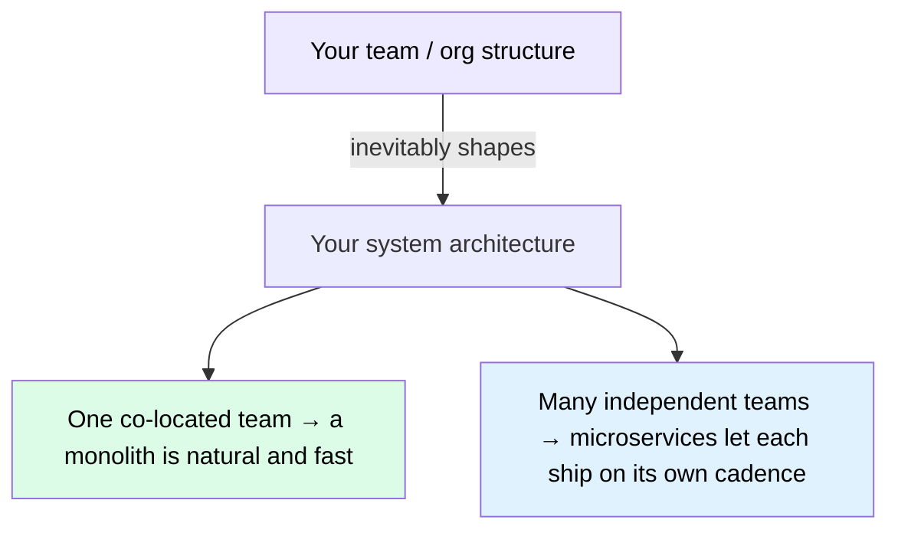
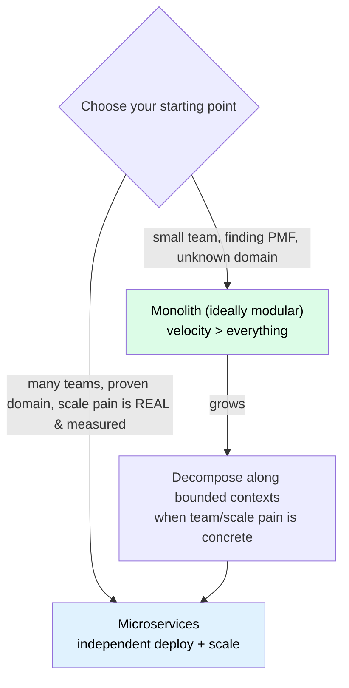
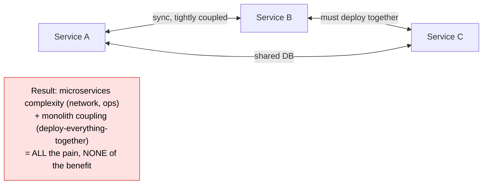
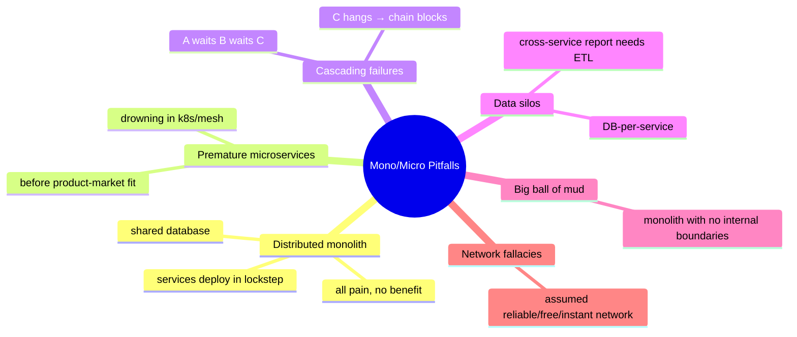

# Monolith vs Microservices

> **One line:** A monolith is a Swiss Army knife (one unit, fast, simple — but a broken blade sidelines the whole tool); microservices are a toolbox (each tool upgraded independently — but you now own the box, the network between tools, and the logistics of carrying them all to the job).

---

## Table of Contents
1. [Why You Must Master This](#1-why-you-must-master-this)
2. [The Mental Model](#2-the-mental-model)
3. [How They Actually Differ](#3-how-they-actually-differ)
4. [Conway's Law — Architecture Follows Org](#4-conways-law--architecture-follows-org)
5. [The Decision: When to Use Which](#5-the-decision-when-to-use-which)
6. [The Distributed Monolith (worst of both)](#6-the-distributed-monolith-worst-of-both)
7. [Worked Example — Amazon's 2002 Mandate](#7-worked-example--amazons-2002-mandate)
8. [Real-Life Use Cases](#8-real-life-use-cases)
9. [Failure Modes](#9-failure-modes)
10. [🏋️ Practice Drills](#-practice-drills)
11. [🎤 Interview Q&A Bank](#-interview-qa-bank)
12. [🎯 Staff+ Nuances](#-staff-nuances)
13. [Cheat Sheet](#13-cheat-sheet)
14. [Connections & Further Reading](#14-connections--further-reading)

---

## 1. Why You Must Master This

The monolith-vs-microservices choice is one of the highest-stakes early decisions in a system's life — and the one most often made for the wrong reasons (résumé-driven development, hype, cargo-culting big tech).

- **The "big-bang" re-architecture** — pick wrong and you either drown in a "big ball of mud" (monolith too long) or in distributed-systems overhead (microservices too early). Both can kill a startup.
- **Blast radius** — a bug in a monolith can take down the whole app; a bug in one microservice ideally takes down one feature.
- **Organizational flow** — architecture follows **Conway's Law**. If your system shape doesn't match your team shape, you'll spend more time in meetings than in the IDE.

> **The core problem it solves:** *deployment velocity and independent evolution at organizational scale.* 500 engineers can't all merge into one codebase without a "merge train from hell." Microservices let teams deploy independently — at the cost of real, permanent operational complexity.

---

## 2. The Mental Model





---

## 3. How They Actually Differ

| Dimension | Monolith | Microservices |
|-----------|----------|---------------|
| Process / deploy | one process, one deploy | many processes, independent deploys |
| Inter-component calls | in-memory (nanoseconds) | network: HTTP/gRPC (milliseconds) |
| Data | one shared database | database-per-service |
| Failure | one bug can crash everything | fault isolation (graceful degradation) |
| Scaling | scale the whole app | scale the hot service only |
| Tech stack | one language/runtime | polyglot (Go + Python + Rust…) |
| Transactions | ACID DB transaction | distributed (Sagas, eventual consistency) |
| Ops burden | low (one thing to run) | high (service discovery, mesh, tracing) |

```python
# Monolith: fast in-memory function call
def checkout(user_id, cart):
    user = UserService.get_user(user_id)                 # direct call, ns
    return PaymentService.charge(user, cart.total)

# Microservices: network RPC — now you need timeouts, retries, circuit breakers
def checkout(user_id, cart):
    user = requests.get(f"http://user-svc/v1/users/{user_id}", timeout=2).json()
    resp = requests.post("http://payment-svc/v1/charge", json=cart, timeout=5)
    return resp.status_code == 200   # ...and what if payment succeeded but the response was lost? (idempotency!)
```

> Notice what the network call *added*: timeouts, retries, partial-failure handling, idempotency concerns. That complexity doesn't disappear — microservices move it from the compiler to *you*.

---

## 4. Conway's Law — Architecture Follows Org



> **The deepest truth here:** microservices are an *organizational* solution, not a *technical* one. The right number of services is roughly "one per team that needs to deploy independently." Splitting finer than your team boundaries buys complexity with no organizational payoff.

---

## 5. The Decision: When to Use Which



**Monolith-first** is the default for most teams: ship a (modular) monolith to find product-market fit, *then* decompose the parts that actually hurt. You can't draw correct service boundaries for a domain you don't understand yet — and the cost of a wrong network boundary is far higher than a wrong in-process boundary. See [Modular_Monolith.md](./Modular_Monolith.md) and [System_Decomposition.md](./System_Decomposition.md).

---

## 6. The Distributed Monolith (worst of both)



The most common microservices failure: services so tightly coupled (shared database, synchronous chains, lock-step deploys) that you have the operational complexity of microservices *and* the deploy-everything-at-once rigidity of a monolith. If you can't deploy one service without deploying others, you built a distributed monolith.

---

## 7. Worked Example — Amazon's 2002 Mandate

```mermaid
sequenceDiagram
    participant Bezos
    participant Teams
    Bezos->>Teams: "All teams expose data &amp; functionality through service interfaces — no exceptions."
    Teams->>Teams: every team becomes an independent service with a contract
    Note over Teams: monolithic retail site → set of independent services
    Teams->>Teams: those service interfaces, hardened, became sellable products
    Note over Teams: → AWS was born as a side effect of the org restructure
```

Bezos's famous API mandate is the canonical proof that this is an *organizational* decision. By forcing service interfaces between teams, Amazon got independent deployability — and the hardened interfaces eventually became AWS itself.

---

## 8. Real-Life Use Cases

| Situation | The right call |
|-----------|----------------|
| **Early-stage startup (<10 eng)** | Monolith (modular). Don't touch Kubernetes/service mesh — velocity is survival. |
| **Scaling org (many teams)** | Microservices along team boundaries so teams deploy independently. |
| **One component needs to scale 100×** | Extract just that service (e.g., video encoding) — scale it to 100 nodes while login stays at 2. |
| **Mixed tech needs** | Microservices: the ML part in Python, the high-concurrency part in Go. |
| **Segment's reversal** | Famously moved *back* from microservices to a monolith — the per-service overhead outweighed the benefit at their scale. Direction isn't always "forward." |
| **Cross-service reporting** | DB-per-service breaks SQL joins → you need a data warehouse / ETL / CDC pipeline. |

> Real-world habit: **start monolith-first, keep it modular, and only extract a service when you have a concrete, measured reason** (a team that needs independent deploys, or a component with a wildly different scaling profile). "We might need to scale someday" is not a reason.

---

## 9. Failure Modes



- **Distributed monolith** — the cardinal failure; see §6.
- **Premature microservices** — adopting them before product-market fit; the ops overhead crushes a small team.
- **Cascading failures** — synchronous chains where one slow service blocks everything upstream. Needs circuit breakers, timeouts, backpressure.
- **Data silos** — DB-per-service makes cross-service reporting hard; budget for a warehouse/CDC.
- **Big ball of mud** — the monolith failure mode: no internal boundaries (the modular monolith is the antidote).

---

## 🏋️ Practice Drills

> *Justify the choice. Attempt before opening the solution.*

**Drill 1 — Right call?** A 6-person startup pre-PMF wants to "build it right from day one" with 12 microservices on Kubernetes. Good idea?

<details><summary>Solution</summary>

No. Pre-PMF, velocity is everything and the domain boundaries aren't known yet — drawing them as *network* boundaries now means expensive rework. They'll spend their runway on service discovery, mesh, and distributed tracing instead of finding customers. Start with a modular monolith; extract services later when team/scale pain is real.
</details>

**Drill 2 — Spot the distributed monolith.** You have 8 services, but deploying any one requires deploying the other 7 together, and they share one database. What did you build, and what's the fix?

<details><summary>Solution</summary>

A distributed monolith — microservices complexity with monolith coupling. Causes: shared database and synchronous lock-step dependencies. Fix: give each service its own data, replace synchronous chains with async events where possible, and define stable versioned contracts so services can deploy independently. (If you can't decouple them, you may be better off as an explicit modular monolith.)
</details>

**Drill 3 — Selective extraction.** Your monolith is fine except the video-transcoding path, which needs 100× the CPU of everything else and is written in a language ill-suited to it. What do you do — full microservices migration?

<details><summary>Solution</summary>

No — extract *only* the transcoding service. It has a genuinely different scaling profile and tech need, so it earns its own service (scale to 100 nodes, write it in the right language). Leave the rest as a monolith. Decompose by concrete pain, not wholesale.
</details>

---

## 🎤 Interview Q&A Bank

**Q1. When would you choose a monolith over microservices?**
> Small team, early stage / unproven domain, or when independent deployability and independent scaling aren't yet needed. A monolith maximizes velocity and avoids distributed-systems overhead. Start there and decompose when there's a concrete reason.

**Q2. What's the single biggest hidden cost of microservices?**
> Operational and distributed-systems complexity: service discovery, network failure handling, distributed transactions (Sagas), eventual consistency, distributed tracing, and the people (DevOps/SRE) to run it all. The compiler no longer catches cross-service breakage.

**Q3. What is a distributed monolith?**
> Services that are so tightly coupled (shared DB, synchronous chains, lock-step deploys) that you must deploy them together — you pay microservices' complexity but get none of the independent-deploy benefit. The worst outcome.

**Q4. How does Conway's Law apply here?**
> Systems mirror the communication structure of the org that builds them. Microservices work when service boundaries match team boundaries (one team owns one service, deploys independently). Splitting finer than teams adds complexity with no payoff.

**Q5. How do you decide *where* to split a monolith?**
> Along DDD bounded contexts / business capabilities, and along team ownership lines — not by technical layer. Extract the parts with real, measured pain (scaling profile, deploy contention) first. See System Decomposition.

**Q6. Microservices broke your ability to run a report that joins data across services. Why, and what do you do?**
> Each service owns its own database (no cross-service joins). Solve with a data warehouse fed by ETL or Change Data Capture (CDC), or a read-model built from events — not by reaching into another service's DB.

**Q7. "Microservices are always better." React.**
> They're not — they trade simplicity for organizational scalability. For a small team or simple domain, a monolith is faster, cheaper, and more reliable. Segment even reverted from microservices to a monolith. It's a trade-off, not an upgrade.

---

## 🎯 Staff+ Nuances

- **Microservices solve an *organizational* problem, not a technical one.** The real driver is independent deployability for many teams. If you have one team, you get all the cost and none of the benefit. Right-size the service count to team count, not to a microservices ideal.
- **The unit of decomposition is the bounded context, and the unit of independence is the database.** Two "services" sharing a database are one service wearing two hats — the shared schema couples their deploys forever. DB-per-service is the line that actually makes them independent (and the hardest part to retrofit).
- **Synchronous call chains recreate the monolith's coupling over the network — with worse failure modes.** A → B → C synchronous chain has the availability of the *product* of all three (see [High_Availability_Design.md](./High_Availability_Design.md)) plus added latency. Prefer async/event-driven between services where the domain allows (see [Event_Driven_Architecture.md](./Event_Driven_Architecture.md)).
- **The fallacies of distributed computing are the hidden tax.** "The network is reliable / latency is zero / bandwidth is infinite / topology doesn't change" are all false. Every cross-service call must assume failure: timeouts, retries with backoff + jitter, idempotency, circuit breakers. None of that exists in a monolith.
- **Modular monolith is the strictly-better default for most teams.** It gives you clean bounded contexts *now* (cheap to refactor in-process) and a clean extraction path *later* — without paying the network tax until a boundary has proven it needs to be a service. See [Modular_Monolith.md](./Modular_Monolith.md).
- **"Strangler fig," not big-bang.** Successful monolith→microservices migrations peel off one capability at a time behind a facade, never a rewrite. A big-bang rewrite is the classic way to spend two years and ship nothing.

---

## 13. Cheat Sheet

```
MONOLITH = one process/DB/deploy. Swiss Army knife.
  ✓ simple deploy/test/refactor · low latency · ACID txns
  ✗ one bug = whole app · scale all-or-nothing · merge contention · big ball of mud

MICROSERVICES = many processes, DB-per-service. Toolbox.
  ✓ independent deploy + scale · fault isolation · polyglot
  ✗ ops complexity · network failure handling · Sagas/eventual consistency · $$$

CHOOSE MONOLITH: small team · pre-PMF · unknown domain · velocity matters
CHOOSE MICRO:   many teams · proven domain · MEASURED scale/deploy pain
DEFAULT:        monolith-first (keep it MODULAR) → decompose by pain

LAWS  Conway (architecture mirrors org) · right #services ≈ #independent teams
TRAPS distributed monolith (deploy lockstep + shared DB) · premature micro ·
      cascading sync chains · DB-per-service breaks joins → ETL/CDC
MIGRATE via Strangler Fig (peel one capability at a time), never big-bang rewrite
```

---

## 14. Connections & Further Reading

**Within this repo:**
- [Modular_Monolith.md](./Modular_Monolith.md) — the recommended middle path; [System_Decomposition.md](./System_Decomposition.md) — how to split.
- [SOA.md](./SOA.md) — the enterprise predecessor; [Event_Driven_Architecture.md](./Event_Driven_Architecture.md) — decoupling services.
- [High_Availability_Design.md](./High_Availability_Design.md) — availability math for call chains.
- [10 · Microservices & Distributed Systems](../10_Microservices_Distributed_Systems/) — Sagas, service mesh, circuit breakers; [01 · Trade-off Analysis](../01_Planning_Foundations/Trade_off_Analysis.md).

**External classics:**
- [Martin Fowler — MonolithFirst](https://martinfowler.com/bliki/MonolithFirst.html) · [microservices.io](https://microservices.io/patterns/microservices.html).
- [Segment — Goodbye microservices](https://segment.com/blog/goodbye-microservices/) (the reversal story).
- *Building Microservices* (Sam Newman).

---

## TL;DR
A **monolith** is one unit — simple, fast, ACID, but all-or-nothing to scale and one bug can sink it. **Microservices** trade that simplicity for **independent deployability and scaling** at the price of permanent **distributed-systems and operational complexity**. The choice is **organizational** (Conway's Law): right-size service count to *team* count. **Default to a modular monolith**, decompose by **measured pain** along bounded contexts, migrate via the **Strangler Fig** — and never build the **distributed monolith** (lock-step deploys + shared DB = all the cost, none of the benefit).
