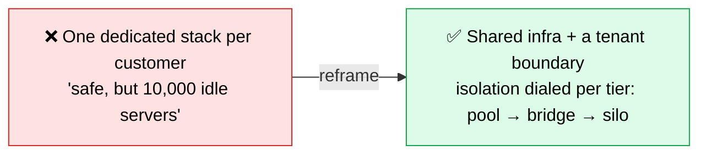
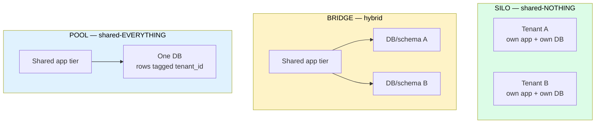
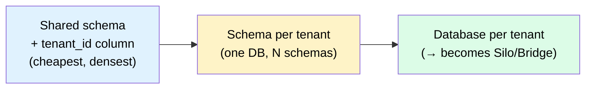
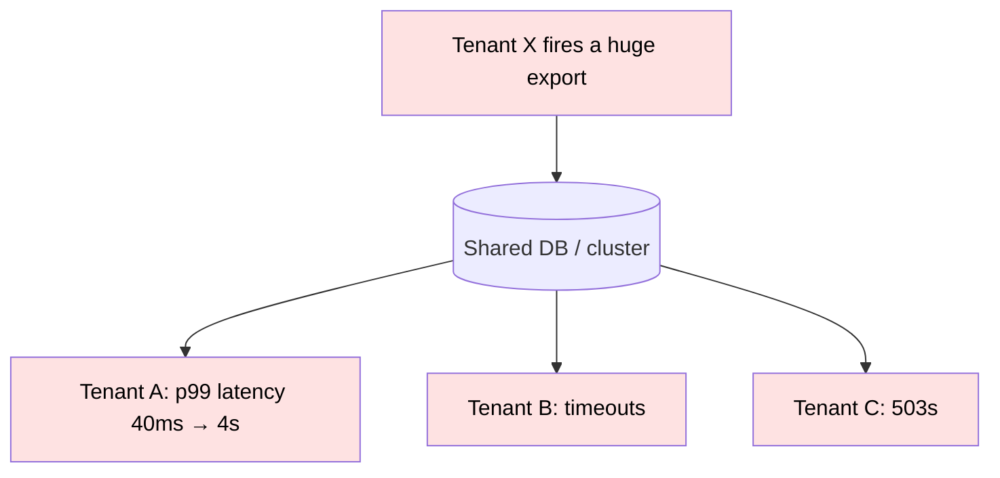
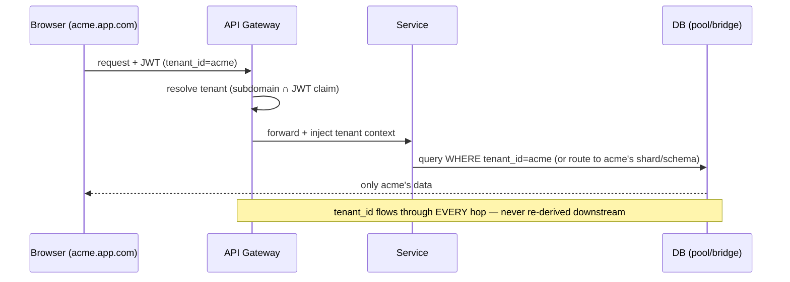
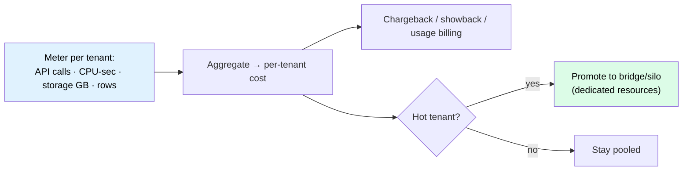
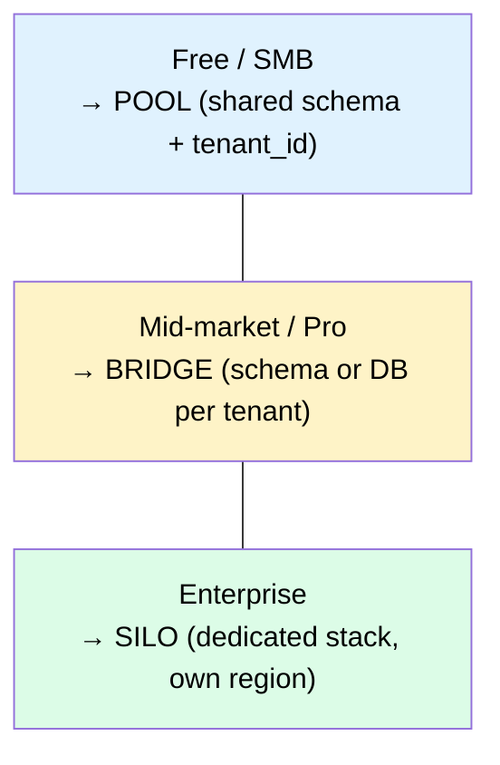
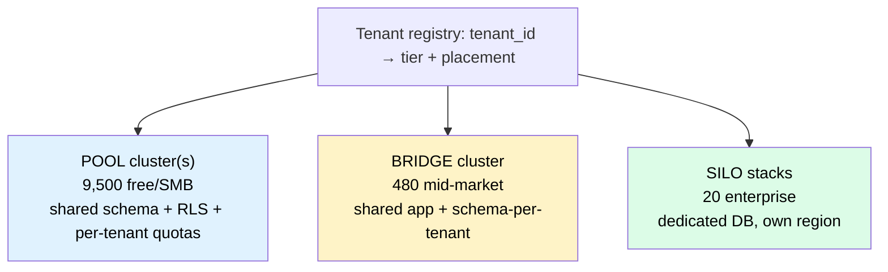
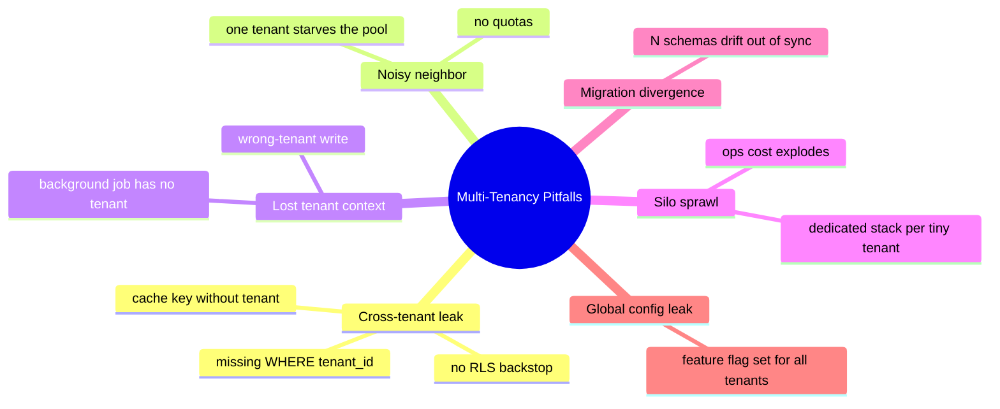

# Multi-Tenancy Architecture

> **One line:** Multi-tenancy is an **apartment building** — many tenants share the same foundation, plumbing, and elevators (infra) at a fraction of the cost of everyone owning a house (a dedicated stack), but you'd better have real walls between the units so one tenant can never wander into another's living room.

---

## Table of Contents
1. [Why You Must Master This](#1-why-you-must-master-this)
2. [The Mental Model](#2-the-mental-model)
3. [The Three Models — Silo · Pool · Bridge](#3-the-three-models--silo--pool--bridge)
4. [Data Isolation Levels (the Pool spectrum)](#4-data-isolation-levels-the-pool-spectrum)
5. [The Noisy-Neighbor Problem](#5-the-noisy-neighbor-problem)
6. [Tenant-Aware Routing & Context Propagation](#6-tenant-aware-routing--context-propagation)
7. [Per-Tenant Scaling & Cost Attribution](#7-per-tenant-scaling--cost-attribution)
8. [Tiering — Isolation as a Paid Feature](#8-tiering--isolation-as-a-paid-feature)
9. [Worked Example — a B2B SaaS at 10k Tenants](#9-worked-example--a-b2b-saas-at-10k-tenants)
10. [Real-Life Use Cases](#10-real-life-use-cases)
11. [Failure Modes](#11-failure-modes)
12. [🏋️ Practice Drills](#-practice-drills)
13. [🎤 Interview Q&A Bank](#-interview-qa-bank)
14. [🎯 Staff+ Nuances](#-staff-nuances)
15. [Cheat Sheet](#15-cheat-sheet)
16. [Connections & Further Reading](#16-connections--further-reading)

---

## 1. Why You Must Master This

Multi-tenancy is the architecture that makes **SaaS economically possible**, and it's a staple of any B2B system-design interview ("design Slack / Shopify / a CRM").

- **The economics only close if you share.** Running one dedicated stack per customer costs you (say) $200/mo in idle infra × 10,000 customers = $2M/mo even when most are idle. Pack 500 small tenants onto one shared cluster and that drops by orders of magnitude — density is the whole business model.
- **The catastrophic failure is a data leak, not an outage.** A single query that forgets `WHERE tenant_id = ?` shows Tenant A's invoices to Tenant B. That's a breach, a SOC 2 finding, and often a company-ending headline — far worse than downtime.
- **Noisy neighbors turn one bad tenant into everyone's outage.** One customer running a 10M-row export can starve CPU/IO for the other 499 tenants on the box unless you've built isolation.
- **It's the frame for enterprise deals.** "Can we get a dedicated instance / our data in our own region?" is a sales question you answer with *tenancy model*, not a feature flag.

> **The core problem it solves:** *how to serve many customers from shared infrastructure cheaply, while guaranteeing each one that their data, performance, and blast radius are isolated from every other customer.*

**Prerequisites:** [System_Decomposition.md](./System_Decomposition.md) (services own their data) and [05_Databases_Storage/Sharding_Partitioning.md](../05_Databases_Storage/Sharding_Partitioning.md) (tenant as a partition key).

---

## 2. The Mental Model

Housing. A **silo** is a single-family house per family — total privacy, your own everything, expensive and mostly empty. A **pool** is an open-plan dormitory — cheapest per person, dense, but you hear everyone and a locked drawer is the only thing between your stuff and theirs. A **bridge** is a condo/duplex — you share the building's structure and utilities (compute) but have your own locked unit (schema/DB).

The naive instinct is "give every customer their own copy so nothing can leak." That's safe but bankrupts you. The right frame is: **share by default, isolate by tier and by need** — treat isolation as a dial you turn up only where the risk or the contract demands it.



> **Hold onto this:** every read and write in a multi-tenant system carries a **tenant_id**, and the entire architecture exists to make sure that id is *always present* and *never crossable*. Tenancy is a boundary problem, not a feature.

---

## 3. The Three Models — Silo · Pool · Bridge

There are three canonical ways to place tenants on infrastructure. They sit on a **spectrum of shared-nothing → shared-everything**, trading cost density against isolation strength.



- **Silo (shared-nothing):** a complete, separate stack — app instances *and* database — per tenant. Strongest isolation: a bug, a load spike, or a breach is physically contained to one tenant. But you pay for idle capacity per tenant and ops (deploys, migrations, monitoring) multiply by tenant count. Used for regulated/enterprise customers (a bank on your platform) or when data residency law forces it.
- **Pool (shared-everything):** every tenant shares the same app instances and the same database; rows are separated only by a `tenant_id` column. Cheapest and densest — thousands of tenants on one cluster. Risk: isolation is now *software-enforced* (one bad query leaks data) and one tenant can hog shared resources (noisy neighbor).
- **Bridge (hybrid):** share the expensive/stateless tier (compute) but separate the sensitive stateful tier — e.g., **shared app servers + one schema or database per tenant**. Captures most of pool's compute density while giving DB-level isolation and easy per-tenant backup/restore/delete.

| Dimension | **Silo** (shared-nothing) | **Bridge** (hybrid) | **Pool** (shared-everything) |
|-----------|---------------------------|---------------------|------------------------------|
| Isolation | Strongest (physical) | Strong (DB/schema) | Weakest (row-level, software) |
| Cost / density | Worst — pay per idle tenant | Medium | Best — thousands per cluster |
| Blast radius | 1 tenant | 1 tenant's data; shared compute | All tenants on the cluster |
| Ops complexity | High × N (N deploys, N migrations) | Medium (N schemas to migrate) | Low (one deploy, one migration) |
| Noisy-neighbor risk | None | Compute only | Compute + storage |
| Compliance / residency | Easiest to satisfy | Good | Hardest (shared store) |
| Onboard a new tenant | Slow (provision a stack) | Medium (create schema) | Instant (insert a row) |
| Best for | Enterprise, regulated | Mid-market, mixed | Free/SMB, high volume |

> **Takeaway:** it's not either/or. Mature SaaS runs **all three at once** — pool the long tail, bridge the mid-market, silo the whales.

---

## 4. Data Isolation Levels (the Pool spectrum)

"Pool" itself is a spectrum of how strongly the *data* is separated. From cheapest/weakest to strongest:



**1. Shared schema + tenant_id row** — all tenants' rows in the same tables, discriminated by a `tenant_id` column. Densest and cheapest, but every single query *must* filter by tenant, and one missing filter is a cross-tenant leak. Harden it with **Row-Level Security (RLS)** so the database enforces the filter even if application code forgets:

```sql
-- Postgres RLS: the DB itself refuses to return other tenants' rows
ALTER TABLE invoices ENABLE ROW LEVEL SECURITY;

CREATE POLICY tenant_isolation ON invoices
  USING (tenant_id = current_setting('app.current_tenant')::uuid);

-- App sets the tenant once per connection/transaction:
SET app.current_tenant = '7f3a...';
-- Now even a buggy "SELECT * FROM invoices" only returns THIS tenant's rows.
```

**2. Schema per tenant** — one database, but each tenant gets its own set of tables in a private namespace (`tenant_7f3a.invoices`). Stronger isolation, easy per-tenant backup/drop, but migrations now run N times and thousands of schemas strain the catalog.

**3. Database per tenant** — a full separate database (this shades into Bridge/Silo). Strongest isolation, trivial per-tenant restore and delete-on-churn, but the most connections, instances, and ops to manage.

> **The catastrophic bug — the missing tenant filter.** In shared-schema pool, this is *the* nightmare:

```python
# ☠️ LEAK: forgot the tenant filter — returns EVERY tenant's orders
db.query("SELECT * FROM orders WHERE status = 'open'")

# ✅ Every query is tenant-scoped — enforced centrally, never hand-written per query
db.query("SELECT * FROM orders WHERE tenant_id = %s AND status = 'open'", ctx.tenant_id)
```

The fix is never "remember to add the filter." It's **defense in depth**: a mandatory data-access layer that injects `tenant_id` on every query, *plus* database-enforced RLS as a backstop, *plus* automated tests that assert cross-tenant reads return zero rows. See [02_API_Interface_Design/Authorization.md](../02_API_Interface_Design/Authorization.md) for the tenant-scoping layer this pairs with.

---

## 5. The Noisy-Neighbor Problem

In pool/bridge, tenants share finite resources — CPU, memory, DB connections, IO, cache. A **noisy neighbor** is one tenant whose load degrades everyone else's experience: a 50M-row report, a runaway integration hammering your API, or a viral event.



Mitigations, roughly cheapest → strongest:

| Mitigation | How it works | Trade-off |
|------------|--------------|-----------|
| **Per-tenant quotas / rate limits** | Cap requests/sec, query cost, or job concurrency per tenant | Must tune limits; can throttle legit spikes |
| **Fair scheduling / throttling** | Weighted queues so no tenant monopolizes workers | Adds scheduler complexity |
| **Resource pools per tier** | Separate connection pools / worker pools per tenant tier | Less sharing = lower density |
| **Cell / pod isolation** | Partition tenants into independent "cells" (each a full stack); a bad tenant only hurts its cell | More infra & routing to manage |
| **Move to a silo** | Relocate the heavy tenant onto dedicated infra | Costs a full stack |

**Cell-based (pod) architecture** is the heavyweight answer: shard tenants across many independent cells (e.g., Slack's and Salesforce's "pods"/"instances"), each a self-contained stack serving a subset of tenants. A noisy neighbor — or an outage — is contained to one cell, so blast radius is `1/number_of_cells` instead of "everyone." Ties directly to the cell pattern in [System_Decomposition.md](./System_Decomposition.md).

> **Rule of thumb:** you cannot prevent noisy neighbors in a pool — you can only *bound* them (quotas), *contain* them (cells), or *evict* them (promote to silo).

---

## 6. Tenant-Aware Routing & Context Propagation

Every request must be resolved to a tenant *before* any business logic runs, and that tenant identity must ride the whole request. Two problems: **identify** the tenant, then **propagate** it.

**Identify** — common sources, in order of trust:
- **Subdomain / custom domain:** `acme.app.com` → tenant `acme`. Familiar to users, but spoofable alone.
- **JWT claim:** the auth token carries `tenant_id` as a signed claim — the most trustworthy source because it's cryptographically bound to the authenticated session.
- **Header / path:** `X-Tenant-ID` or `/t/{tenant}/...` — convenient for internal/service calls but must be validated against the caller's authorization.



**Route** — once resolved, the tenant decides *where* the request goes: which cell/pod, which shard, which schema, or (for a silo tenant) which dedicated cluster. A **tenant registry** maps `tenant_id → placement` (shard, cell, tier, region).

**Propagate** — the tenant must travel with the request across every service hop and into async work, or a downstream service will operate without a tenant and either error or, worse, leak. Carry it in a request-scoped context and forward it on every outbound call and every queued message:

```python
# Middleware resolves tenant once, stashes it in request-scoped context
def tenant_middleware(request):
    tenant = resolve_from_jwt(request.headers["Authorization"])
    TenantContext.set(tenant.id)          # thread/async-local
    request.tenant = tenant

# Every DB call and every outbound RPC/queue message reads from context
publish("orders.created", payload, headers={"tenant_id": TenantContext.get()})
```

> **The trap:** forgetting to propagate tenant into background jobs / event consumers. The web request had it; the worker that processes the queued message doesn't — so it either fails or processes against the *wrong* tenant. Tenant must be part of the message envelope, not just the HTTP request.

---

## 7. Per-Tenant Scaling & Cost Attribution

Because tenants share infra, you can no longer read a customer's cost off a single invoice — you must **meter** it. This drives both pricing and placement decisions.



- **Metering:** tag every unit of work with `tenant_id` and emit usage events (requests, compute-seconds, storage bytes, egress). Aggregate per tenant. This is the raw material for everything else.
- **Cost attribution — chargeback vs showback:** *chargeback* actually bills the tenant (or an internal team) for what they consumed; *showback* just reports it (visibility without a bill). Both need per-tenant metering; you can't attribute what you don't measure.
- **Per-tenant scaling:** most tenants are tiny and stay pooled. When one grows "hot" (say it's now 30% of a cluster's load), you **move it to its own bridge/silo** — dedicated shard, schema, or cluster — so it scales independently and stops threatening its neighbors. The tenant registry makes this a placement change, not a rewrite.

> **Real number:** SaaS load is brutally skewed — commonly ~**80% of resource consumption comes from the top ~5% of tenants**. That skew is exactly why you pool the long tail (dense, cheap) and silo the whales (isolated, individually scaled).

---

## 8. Tiering — Isolation as a Paid Feature

The unifying strategy: **map customer tiers to tenancy models**, and sell stronger isolation as a premium.



- **Free / SMB → pool.** Density and instant onboarding matter most; these tenants are individually cheap and churn-prone, so a wasted silo per free trial is pure loss.
- **Mid-market → bridge.** They want data separation and reliable performance but not a full dedicated bill; schema/DB-per-tenant on shared compute fits.
- **Enterprise → silo.** They'll pay for a dedicated instance, data residency ("keep our data in the EU"), a private VPC, custom compliance, and their own maintenance window. Isolation *is* the enterprise product.

This is why real platforms are heterogeneous: **Salesforce** groups customers into shared pods but offers dedicated/Government Cloud instances; **Shopify** pools most merchants but runs **Shopify Plus** with isolation; **Slack** shards workspaces across pods and offers enterprise-grid isolation. The tier decides the model.

> **Design habit:** make the tenancy model a *property of the tenant record* (`tier`, `placement`) so a tenant can be promoted pool → bridge → silo without an app rewrite — only a migration and a registry update.

---

## 9. Worked Example — a B2B SaaS at 10k Tenants

You run a project-management SaaS. **10,000 tenants**; distribution: 9,500 free/SMB (tiny), 480 mid-market, 20 enterprise. Let's derive the architecture from the numbers.

**Option A — silo everyone.** 10,000 stacks. Even at a lean $150/mo each = **$1.5M/mo**, mostly idle (a 3-user free tenant doesn't need a dedicated DB). Rejected on cost.

**Option B — pool everyone.** One big cluster, shared schema + `tenant_id`. Cheap, but: (1) an enterprise bank customer won't accept row-level-only isolation for compliance; (2) the top 20 tenants generate ~80% of load and will noisy-neighbor the 9,500 small ones. Rejected on isolation + fairness.

**Option C — tier it (chosen).**



Sizing sketch: pool the 9,500 across, say, 5 cells of ~1,900 tenants (blast radius = 20% if a cell fails, and noisy neighbors are bounded by per-tenant quotas + contained to one cell). Bridge the 480 as schemas on ~2 clusters. Silo the 20 at ~$150/mo = $3k/mo. **The enterprise contracts fund their own isolation; the long tail stays dense and near-free.** Total infra is a small fraction of Option A, while every tier gets the isolation it actually needs.

**The loop closes:** the *number* (80% of load from the top 20 tenants + one compliance-bound bank) forces the *decision* (don't pool uniformly — tier, and make isolation a placement attribute).

---

## 10. Real-Life Use Cases

| Situation | How multi-tenancy applies | The decision it forces |
|-----------|---------------------------|------------------------|
| **New SMB SaaS MVP** | Pool: shared schema + `tenant_id` + RLS | Ship dense and cheap; add RLS from day one |
| **Enterprise deal wants "our own instance"** | Promote that tenant to a silo | Tenancy model must be per-tenant, not global |
| **EU data-residency requirement** | Silo/bridge in an EU region; registry routes by region | Placement includes *region*, not just shard |
| **One tenant keeps causing latency spikes** | Quotas now; move to dedicated cell/silo if persistent | Meter per tenant to even see it |
| **Usage-based pricing** | Meter per-tenant consumption → chargeback | Every unit of work tagged with `tenant_id` |
| **Churned tenant, GDPR delete** | DB/schema-per-tenant makes delete a `DROP` | Isolation level determines deletion cost |

> **Real-world habit:** store `tenant_id` on every row and every event, and store `tier`/`placement` on the tenant record — so pooling, metering, routing, and promotion all fall out of data you already have.

---

## 11. Failure Modes



- **Cross-tenant data leak** — SYMPTOM: Tenant A sees B's records (or a *shared cache* returns B's cached value under an unscoped key). ROOT CAUSE: a query/cache key missing `tenant_id`, no DB-enforced backstop. FIX: mandatory tenant-scoping data layer + RLS + tenant-prefixed cache keys + automated cross-tenant tests.
- **Noisy neighbor outage** — SYMPTOM: all tenants slow when one runs heavy load. ROOT CAUSE: unbounded shared resources. FIX: per-tenant quotas/rate limits, fair scheduling, cell isolation, promote the offender.
- **Lost tenant context** — SYMPTOM: a background worker errors or writes to the wrong tenant. ROOT CAUSE: tenant not propagated into async jobs/events. FIX: put `tenant_id` in the message envelope; assert it on consume.
- **Silo sprawl** — SYMPTOM: ops cost and deploy time balloon. ROOT CAUSE: siloing tenants that should be pooled. FIX: reserve silos for tiers that pay for them; pool the long tail.
- **Schema/migration drift** — SYMPTOM: some per-tenant schemas fail a release. ROOT CAUSE: N schemas migrated non-atomically. FIX: automated, versioned, idempotent migrations run across all schemas with drift detection.

---

## 🏋️ Practice Drills

> *Cover the solutions and attempt first — active recall is the point.*

**Drill 1 — Name the model.** A SaaS runs one shared app tier, but each customer's data lives in its own Postgres database. Which model is this, and what's the main thing it buys vs pure pool?

<details><summary>Solution</summary>

This is **Bridge** (hybrid): shared compute, isolated storage (database-per-tenant). Versus pure pool it buys **DB-level data isolation** — no risk of a missing `WHERE tenant_id`, trivial per-tenant backup/restore/delete, easier compliance — while still sharing the expensive stateless app tier for density. The cost: N databases to migrate and more connections/instances to manage.
</details>

**Drill 2 — Find the leak.** In a shared-schema pool, this endpoint is reported leaking data:
```sql
SELECT * FROM documents WHERE folder_id = :folder_id
```
What's wrong and how do you fix it defensively (not just "add a filter")?

<details><summary>Solution</summary>

No `tenant_id` filter — if `folder_id` is guessable/enumerable, a user can read another tenant's documents. Adding `AND tenant_id = :tenant_id` fixes this one query but not the next forgotten one. Defense in depth: (1) a data-access layer that injects `tenant_id` into *every* query from request context; (2) Postgres **Row-Level Security** so the DB refuses cross-tenant rows even if code forgets; (3) automated tests that query as Tenant A for Tenant B's data and assert zero rows.
</details>

**Drill 3 — Design the tiering.** You have 50,000 tenants: 49,000 free, 900 paid, 100 enterprise (3 are banks with data-residency requirements). Sketch the tenancy models and where the bank tenants go.

<details><summary>Solution</summary>

**Pool** the 49,000 free (shared schema + RLS + per-tenant quotas), sharded across several cells to bound blast radius and noisy neighbors. **Bridge** the 900 paid (schema-or-DB-per-tenant on shared compute) for stronger isolation and per-tenant backup. **Silo** the 100 enterprise on dedicated stacks; the 3 banks get silos **in their required region** with their own compliance controls. Store `tier` + `placement` (+ `region`) on each tenant record so routing and promotion are registry lookups. The enterprise contracts fund their isolation; the free tail stays dense.
</details>

**Drill 4 — The disappearing tenant.** A web request works, but the async job it enqueues sometimes writes data under the wrong tenant. Diagnose and fix.

<details><summary>Solution</summary>

The tenant context lives in request-scoped (thread/async-local) state on the web tier, but it isn't carried into the queued message — so the worker either has no tenant or inherits a stale one from a pooled thread. FIX: put `tenant_id` explicitly in the **message envelope** at publish time, and on the consumer set the tenant context from the message before doing any work (and assert it's present). Never rely on ambient context surviving across the queue boundary.
</details>

---

## 🎤 Interview Q&A Bank

**Q1. What are silo, pool, and bridge tenancy models?**
> Silo = shared-nothing, a full stack (app + DB) per tenant — strongest isolation, highest cost/ops. Pool = shared-everything, all tenants in one DB separated by a `tenant_id` column — cheapest and densest but weakest (software-enforced) isolation and noisy-neighbor risk. Bridge = hybrid, shared compute but separate schema/DB per tenant — most of pool's density with DB-level isolation. Real systems mix all three by tier. (signal: strong answers immediately frame it as a cost-vs-isolation spectrum and mention mixing.)

**Q2. How do you prevent cross-tenant data leaks in a shared-schema pool?**
> Defense in depth: a mandatory data-access layer that injects `tenant_id` on every query (never hand-written), database-enforced **Row-Level Security** as a backstop for when code forgets, tenant-prefixed cache keys, and automated tests that attempt cross-tenant reads and assert zero rows. Never rely on "remember to add the WHERE clause."

**Q3. What's the noisy-neighbor problem and how do you mitigate it?**
> In a pool, tenants share finite CPU/IO/connections, so one heavy tenant can degrade everyone. Mitigate with per-tenant quotas/rate limits, fair scheduling, separate resource pools per tier, and **cell/pod isolation** so a bad tenant only hurts its cell. The nuclear option is promoting the offender to a dedicated silo. You can bound, contain, or evict — not fully prevent.

**Q4. How does a request find its tenant, and why is propagation hard?**
> Resolve from subdomain, a signed JWT claim (most trustworthy), or a validated header/path — then look up placement in a tenant registry (shard/cell/region). Propagation is hard because the tenant must ride *every* hop and into async work; the classic bug is a background job or event consumer that lost the tenant and writes to the wrong one. Put `tenant_id` in the message envelope, not just the HTTP request.

**Q5. When would you give a tenant its own silo?**
> When the contract or law demands it (enterprise/regulated, data residency), or when metering shows the tenant is "hot" — consuming enough of a shared cluster to threaten neighbors. Since ~80% of load often comes from the top few percent of tenants, siloing whales while pooling the long tail is the standard move. It should be a placement change (registry + migration), not a rewrite.

**Q6. How do you attribute cost per tenant when everything is shared?**
> Meter per tenant: tag every request, compute-second, and stored byte with `tenant_id`, emit usage events, aggregate. That feeds chargeback (actually bill them) or showback (just report), usage-based pricing, and placement decisions (promote the expensive ones). You can't attribute what you don't measure — instrument from day one.

**Q7. Pool vs bridge vs silo — how do you choose?**
> Map it to customer tier and requirements. Free/SMB → pool (density, instant onboarding). Mid-market → bridge (data isolation without a dedicated bill). Enterprise/regulated → silo (dedicated, residency, compliance). Sell isolation as a premium feature and make the model a per-tenant attribute so tenants can be promoted as they grow.

**Q8. What's the ops cost difference across the models?**
> Pool: one deploy, one migration, one thing to monitor — lowest ops. Bridge: N schemas/DBs to migrate (drift risk) and more connections. Silo: everything multiplied by tenant count — N deploys, N migrations, N monitors — highest ops, which is why you reserve it for tenants who pay for it.

---

## 🎯 Staff+ Nuances

- **The tenant boundary must live below the application, not in it.** Junior designs enforce isolation with `WHERE tenant_id` in application code; that's one forgotten clause from a breach. Staff designs push the boundary into infrastructure — RLS in the database, tenant-scoped connection pools, a data-access layer that makes an un-scoped query *impossible to write*. Treat the app layer as fallible and make the platform enforce isolation. (pairs with [02_API_Interface_Design/Authorization.md](../02_API_Interface_Design/Authorization.md).)
- **Caching is the silent leak.** Everyone remembers to scope SQL and forgets the cache. An unkeyed cache entry (`user:profile` instead of `tenant:acme:user:profile`) serves one tenant's data to another with no query involved. Every cache key, every CDN cache, every memoization must include the tenant.
- **"Silo" and "pool" are per-resource, not per-system.** A single product can pool the app tier, bridge the primary DB, and silo the search index — the model is chosen *per component* based on that component's isolation and cost profile. Don't assume one model applies to the whole stack.
- **Migrations are the hidden tax of bridge/silo.** A shared-schema pool migrates once; schema-per-tenant migrates N times and *will* partially fail at scale, leaving tenants on different schema versions. You need versioned, idempotent, resumable migrations and drift detection before you choose bridge — the density win is real but the ops bill is deferred, not avoided.
- **Cells cap blast radius but reshuffle the placement problem.** Cell-based isolation (Slack/Salesforce pods) is the strongest scalable containment, but now you own tenant→cell placement, cross-cell tenant moves, and per-cell capacity balancing. A tenant outgrowing its cell or a cell hot-spotting becomes a rebalancing project. (ties to cell architecture in [System_Decomposition.md](./System_Decomposition.md).)
- **The hardest tenancy change is model *migration*.** Moving a tenant pool → silo (or across regions for residency) means moving live data with minimal downtime, dual-writing during cutover, and updating the registry atomically. Design for this from the start (per-tenant `placement`, tenant-scoped data export) or it becomes a bespoke, risky project every time an enterprise deal closes.
- **Sharding by tenant_id is usually right but bites on skew.** Tenant is the natural shard key (co-locates a tenant's data, isolates blast radius), but a single whale tenant can exceed one shard's capacity — then you must sub-shard *within* that tenant (by user, by object) or silo it. Uniform tenant-sharding assumes uniform tenants, which is false. (see [05_Databases_Storage/Sharding_Partitioning.md](../05_Databases_Storage/Sharding_Partitioning.md).)

---

## 15. Cheat Sheet

```
THREE MODELS (cost-density  ←→  isolation)
  POOL   shared-everything   1 DB + tenant_id col   cheapest · densest · weakest isolation · noisy-neighbor
  BRIDGE hybrid              shared app + schema/DB per tenant   medium · DB-level isolation
  SILO   shared-nothing      full stack per tenant   priciest · strongest · zero blast radius
  → Real SaaS runs ALL THREE by TIER: pool the tail · bridge mid-market · silo the whales.

POOL DATA ISOLATION (weak → strong)
  shared schema + tenant_id   →   schema per tenant   →   database per tenant
  HARDEN: mandatory tenant-scoping data layer + Row-Level Security (RLS) + tenant-prefixed cache keys
  ☠️ THE BUG: a query missing WHERE tenant_id  → cross-tenant leak. Also: unkeyed CACHE entries.

NOISY NEIGHBOR (can't prevent — bound / contain / evict)
  quotas & rate limits · fair scheduling · per-tier resource pools · CELL/POD isolation · promote to silo

ROUTING & CONTEXT
  identify: subdomain | JWT claim (most trusted) | validated header/path
  route via TENANT REGISTRY: tenant_id → shard / cell / region / tier
  PROPAGATE tenant_id through every hop AND into async jobs (message envelope) — classic bug: lost in workers

SCALING & COST
  METER per tenant (requests · CPU-sec · storage) → chargeback (bill) vs showback (report)
  ~80% of load from top ~5% of tenants → pool the long tail, silo the hot ones
  make tenancy model a per-tenant attribute (tier, placement) → promote without a rewrite

TIERING:  free/SMB → POOL   ·   mid-market → BRIDGE   ·   enterprise/regulated → SILO (isolation = paid feature)
```

---

## 16. Connections & Further Reading

**Prerequisites (learn first):**
- [System_Decomposition.md](./System_Decomposition.md) — services own their data; cell-based architecture underpins tenant isolation.
- [05_Databases_Storage/Sharding_Partitioning.md](../05_Databases_Storage/Sharding_Partitioning.md) — tenant_id as the shard/partition key, and the skew problem.

**Builds toward / pairs with:**
- [02_API_Interface_Design/Authorization.md](../02_API_Interface_Design/Authorization.md) — tenant scoping sits alongside per-user authz; both gate every request.
- [10_Microservices_Distributed_Systems/](../10_Microservices_Distributed_Systems/) — propagating tenant context across service and event boundaries.
- [06_Caching](../06_Caching/) — tenant-prefixed cache keys to avoid the silent cross-tenant cache leak.

**Gaps this topic exposes (candidates for the section's Gap Analysis):**
- Cell-based / pod architecture as its own deep-dive (placement, rebalancing, blast-radius math).
- Data-residency & sovereignty patterns (region-pinned tenants, cross-region compliance).

**External classics:**
- *AWS SaaS Lens & SaaS Tenant Isolation Strategies* (AWS Well-Architected) — the silo/pool/bridge vocabulary and isolation patterns.
- *Multi-tenant SaaS patterns* (Microsoft Azure Architecture Center) — deployment/data models per tier.
- Salesforce, Shopify Plus, and Slack engineering posts on pods/instances — real heterogeneous tenancy at scale.

---

## TL;DR
Multi-tenancy makes SaaS affordable by **packing many customers onto shared infrastructure** while guaranteeing each one data, performance, and blast-radius isolation. Choose along a cost-vs-isolation spectrum — **pool** (one DB, `tenant_id` column: cheap, dense, weakest), **bridge** (shared compute + schema/DB per tenant: hybrid), **silo** (full stack per tenant: strongest, priciest) — and in practice **run all three by tier**: pool the long tail, silo the whales, and sell isolation as a premium feature. In pool mode, enforce the tenant boundary **below the application** (mandatory tenant-scoped data layer + database Row-Level Security + tenant-prefixed cache keys) because the catastrophic bug is a single query missing `WHERE tenant_id`. Bound noisy neighbors with quotas and cell isolation, resolve and **propagate `tenant_id` through every hop and every async job**, and **meter per tenant** so you can attribute cost and promote hot tenants to dedicated infra. **Make the tenancy model a per-tenant attribute, so a customer can move pool → bridge → silo without rewriting the system.**
