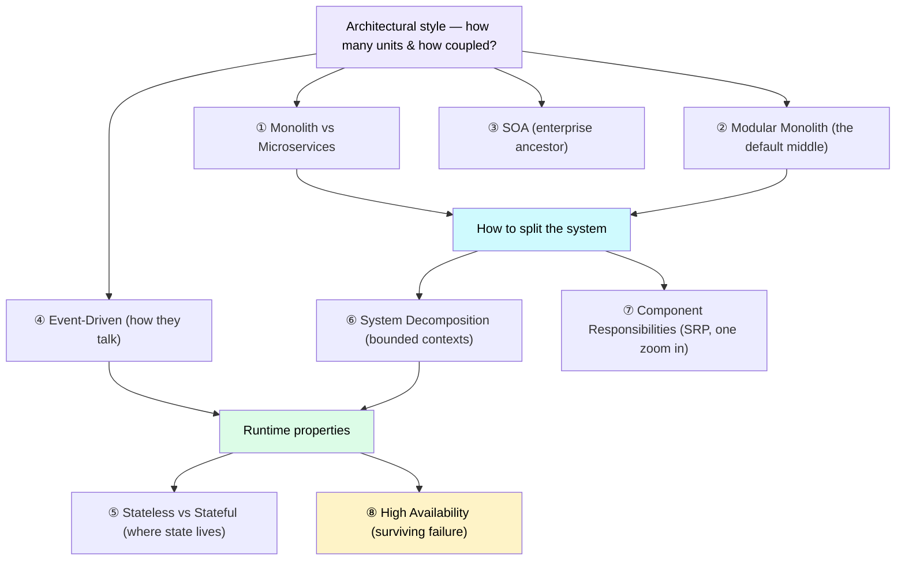
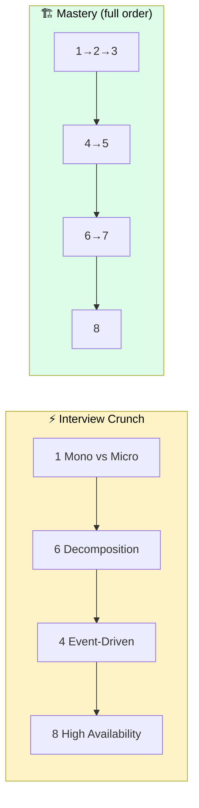

# 03 · High-Level Design 🏛️

> **The bird's-eye view.** Once requirements and estimates are set, HLD is where you choose the *shape* of the system: how many deployable units, how they're split, how they talk, where state lives, and how it survives failure. These are the boxes-and-arrows decisions that everything else hangs off — get them right and the rest is implementation; get them wrong and no amount of clean code saves you.

---

## 🎯 What You'll Be Able To Do

- **Choose an architectural style** — monolith, modular monolith, SOA, microservices, event-driven — and defend the trade-off with Conway's Law and concrete pain, not hype.
- **Draw service/module boundaries** by business capability (bounded context), not by technical layer.
- **Decide where state lives** — keep the app tier stateless, push state down to purpose-built layers.
- **Choose how components talk** — synchronous request/response vs asynchronous events.
- **Design for failure** — redundancy, failover, and the availability math that proves your SLO is reachable.

---

## 🗺️ How the 8 Topics Interlock



> **The spine:** *pick a style → decompose into the right boundaries → decide where state lives and how components communicate → design it to survive failure.* Decomposition (⑥) and component responsibility (⑦) are the same principle at two zoom levels; statelessness (⑤) is what makes HA (⑧) easy.

---

## 📚 The Complete File Index

| # | Topic | One-line | Key takeaway |
|---|-------|----------|--------------|
| 1 | [Monolith vs Microservices](./Monolith_vs_Microservices.md) | Swiss Army knife vs toolbox | Organizational choice (Conway); monolith-first; avoid the distributed monolith |
| 2 | [Modular Monolith](./Modular_Monolith.md) | The "third way" | Clean boundaries + monolith simplicity; enforce in CI; data ownership is key |
| 3 | [SOA](./SOA.md) | Services + a central ESB | Smart pipe + shared DB; microservices = smart endpoints, dumb pipes, isolated data |
| 4 | [Event-Driven Architecture](./Event_Driven_Architecture.md) | Announce facts, don't ask | Decoupled + resilient; needs idempotency, outbox, per-partition ordering |
| 5 | [Stateless vs Stateful Services](./Stateless_vs_Stateful_Services.md) | Vending machine vs tailor | Scale the logic, shard the memory; externalize state to make the app tier stateless |
| 6 | [System Decomposition](./System_Decomposition.md) | Split by capability, not layer | Bounded contexts; data is the real boundary; Strangler Fig for legacy |
| 7 | [Component Responsibilities](./Component_Responsibilities.md) | One clear job each | SRP = one reason to change; high cohesion + low coupling; IO at the edges |
| 8 | [High Availability Design](./High_Availability_Design.md) | Twin-engine airplane | Redundancy + auto failover; availability is arithmetic; assume everything breaks |

---

## 🧭 Suggested Study Paths



| Goal | Path | Why |
|------|------|-----|
| **⚡ Interview in 48h** | 1 → 6 → 4 → 8 (+ skim 2, 5) | Style choice + how to split + how they talk + how it survives = the most-asked 80% |
| **🏗️ Deep mastery** | 1 → 2 → 3 → 4 → 5 → 6 → 7 → 8 | Style → comms → state → boundaries → resilience, in dependency order |
| **🧩 "Design the architecture"** | 1 → 2 → 6 → 7 | Choosing the shape and drawing the boundaries |
| **🛡️ Resilience focus** | 5 → 8 (+ [01 · Availability Math](../01_Planning_Foundations/Availability_Reliability_Math.md), [CAP](../01_Planning_Foundations/CAP_Theorem_PACELC.md)) | Stateless design → failover → the math that proves the SLO |

> **Study each file by** doing the 🏋️ **Practice Drills before the solutions**, rehearsing the 🎤 **Interview Q&A out loud**, and reading 🎯 **Staff+ Nuances** for senior-level depth.

---

## 🔑 The Decision Card (whole-section cheat sheet)

```
STYLE   monolith (small team, fast) · modular monolith (DEFAULT: boundaries + simplicity) ·
        microservices (many teams, measured pain) · SOA (legacy enterprise integration) ·
        event-driven (decouple anything not needing an instant answer)
LAW     Conway: architecture mirrors org · right #services ≈ #independent teams
DECOMPOSE by business capability (bounded context), NOT technical layer · DATA is the real boundary
        legacy → Strangler Fig (peel one capability at a time, never big-bang rewrite)
COMPONENTS  SRP = one reason to change · high cohesion + low coupling · IO at the edges · logic in the Service
STATE   scale the logic (stateless), shard the memory (stateful) · externalize to Redis/DB · JWT for identity
COMMS   sync request/response (user waiting now) · async events (decouple, resilience, scale)
        events need: idempotent consumers · transactional outbox · per-partition ordering · DLQ
HA      redundancy (N+M) + AUTO failover · multi-AZ→region · DEEP health checks
        availability = ARITHMETIC: series multiplies DOWN · parallel adds nines · each nine ≈ 10×
        RTO (recover fast) · RPO (data loss) · most outages = bad deploys · test failure (chaos eng)
ANTI-PATTERNS  distributed monolith · God ESB / God component · over-decomposition (nanoservices) ·
               hidden local state behind a LB · synchronous call chains · correlated/hidden SPOFs
```

---

## 🎨 Conventions & Authoring

- Every file follows the root [TEMPLATE.md](../TEMPLATE.md). Animated SVGs live in [/assets](../assets/).
- Each file ends with the three mastery sections: 🏋️ Practice Drills, 🎤 Interview Q&A Bank, 🎯 Staff+ Nuances.

---

## ➡️ Where This Connects

- ⬅️ Built on [01 · Planning & Foundations](../01_Planning_Foundations/) — estimation, CAP, availability math, and trade-off analysis underpin every HLD choice.
- ⬅️ [02 · API & Interface Design](../02_API_Interface_Design/) — the contracts between the components you design here.
- ➡️ [04 · Low-Level Design](../04_Low_Level_Design/) — SOLID, DDD, and design patterns that implement these boundaries.
- ➡️ [05 · Databases & Storage](../05_Databases_Storage/) — sharding & replication for stateful layers; [07 · Load Balancing & Scalability](../07_Load_Balancing_Scalability/).
- ➡️ [09 · Message Queues](../09_Message_Queues_Event_Streaming/) · [10 · Microservices & Distributed Systems](../10_Microservices_Distributed_Systems/) — the runtime for EDA and microservices.

---
*Part of the [System Design & Architecture Master Repository](../README.md). The shape of the system is decided here; everything downstream is implementation.*
