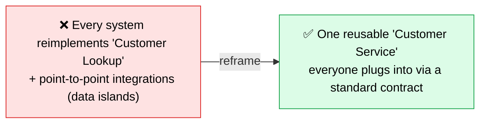
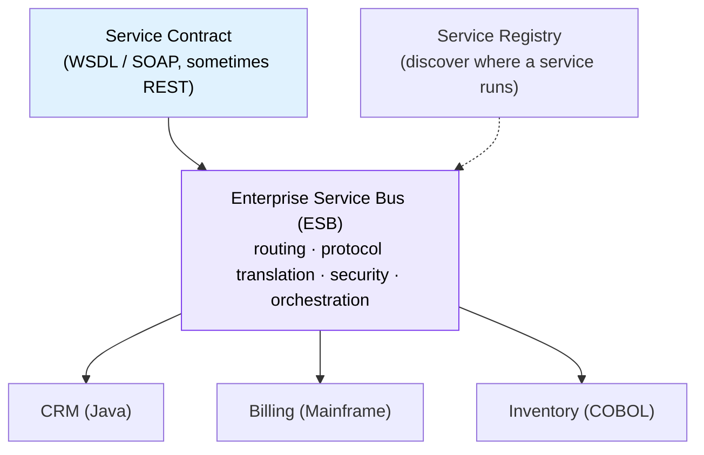
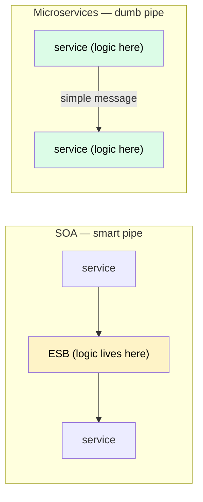
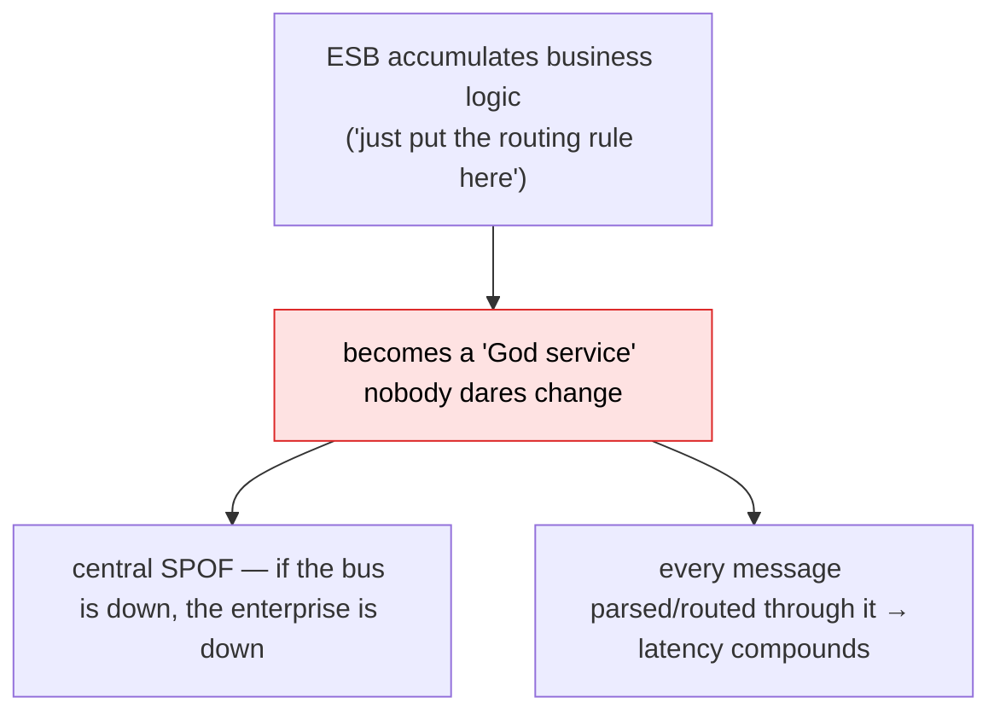
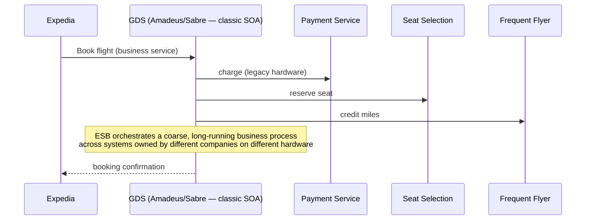
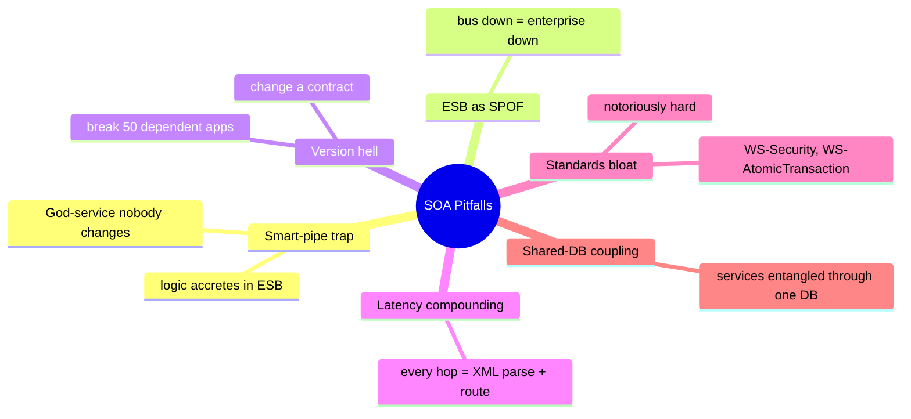

# SOA (Service-Oriented Architecture)

> **One line:** SOA is city infrastructure for the enterprise — coarse-grained business services (Power, Water, "Process Claim") that any system plugs into through standard contracts, wired together by a central Enterprise Service Bus. It's the heavyweight ancestor that microservices reacted against.

---

## Table of Contents
1. [Why You Must Master This](#1-why-you-must-master-this)
2. [The Mental Model](#2-the-mental-model)
3. [How It Works: Contracts, ESB, Registry](#3-how-it-works-contracts-esb-registry)
4. [SOA vs Microservices (the exam question)](#4-soa-vs-microservices-the-exam-question)
5. [The Smart-Pipe Problem](#5-the-smart-pipe-problem)
6. [Worked Example — Airline Booking (GDS)](#6-worked-example--airline-booking-gds)
7. [Real-Life Use Cases](#7-real-life-use-cases)
8. [Failure Modes](#8-failure-modes)
9. [🏋️ Practice Drills](#-practice-drills)
10. [🎤 Interview Q&A Bank](#-interview-qa-bank)
11. [🎯 Staff+ Nuances](#-staff-nuances)
12. [Cheat Sheet](#12-cheat-sheet)
13. [Connections & Further Reading](#13-connections--further-reading)

---

## 1. Why You Must Master This

SOA was the dominant enterprise integration style for ~15 years, and understanding it is essential for two reasons: working in large legacy-heavy environments, and articulating *exactly* how microservices differ (a top interview discriminator).

- **The enterprise backbone** — before microservices, SOA was how banks, insurers, and airlines integrated hundreds of siloed systems.
- **Reusability** — SOA's goal was reusable "business services" so every team didn't rebuild "Customer Lookup."
- **Legacy reality** — in any large org, 20-year-old mainframes still talk to modern web apps through SOA-era plumbing.

> **The core problem it solves:** *siloed, incompatible systems.* It lets a COBOL mainframe and a Java web app exchange data through standardized contracts, ending the "data islands" where Marketing and Sales hold different versions of the same customer.

---

## 2. The Mental Model

SOA is **city infrastructure.** The city provides standardized services — electricity, water, sewage. It doesn't matter whether your house is wood (Java) or brick (COBOL); the plug (the contract) is the same. You don't build your own power plant — you plug into the city's "Power Service."





---

## 3. How It Works: Contracts, ESB, Registry



- **Service contract** — a formal definition of what a service does (classically **WSDL** describing **SOAP/XML** operations).
- **ESB (Enterprise Service Bus)** — the central middleman: routing, protocol transformation (SOAP↔JSON), security, and orchestration of multi-service workflows.
- **Granularity** — SOA services are **coarse/business-level** ("Process Insurance Claim"), not technical ("Upload Image").
- **Service registry** — a directory so apps can discover where a service runs.

```xml
<!-- The classic SOAP envelope — SOA's lingua franca for a decade -->
<soapenv:Envelope xmlns:soapenv="http://schemas.xmlsoap.org/soap/envelope/">
  <soapenv:Body>
    <urn:GetCustomerBalance>
      <urn:CustomerID>12345</urn:CustomerID>
    </urn:GetCustomerBalance>
  </soapenv:Body>
</soapenv:Envelope>
```

---

## 4. SOA vs Microservices (the exam question)

This comparison is *the* thing interviewers probe. Microservices are SOA's reaction — same "build with services" idea, opposite choices on granularity, the pipe, and data.

| Dimension | SOA | Microservices |
|-----------|-----|---------------|
| **Granularity** | coarse (business services) | fine (single capability) |
| **The pipe** | **smart pipe** (ESB orchestrates) | **dumb pipe** (services choreograph) |
| **Communication** | orchestration via ESB | choreography (events) / direct calls |
| **Data** | often **shared** enterprise DB | **database-per-service** |
| **Protocol** | SOAP/XML, WS-* standards | REST/JSON, gRPC |
| **Governance** | centralized, heavyweight | decentralized, lightweight |
| **Goal** | enterprise reuse & integration | independent team deployability |



> **The one-liner:** *SOA puts smarts in the pipe (ESB) and shares data; microservices put smarts in the endpoints, keep the pipe dumb, and isolate data.*

---

## 5. The Smart-Pipe Problem



The fatal SOA anti-pattern: teams keep adding "just one more rule" to the ESB until it holds critical business logic nobody fully understands — a centralized God-service that's a single point of failure *and* a performance bottleneck. Microservices' "dumb pipe" rule exists specifically to prevent this.

---

## 6. Worked Example — Airline Booking (GDS)



When you book on Expedia, it talks to a **Global Distribution System** (Amadeus, Sabre) — textbook SOA. "Book Flight" is a coarse business service that the ESB orchestrates across Payment, Seat, and Frequent-Flyer systems, potentially spanning multiple companies and legacy mainframes.

---

## 7. Real-Life Use Cases

| Situation | How SOA shows up |
|-----------|------------------|
| **Banking / insurance core** | Coarse business services ("Process Claim", "Open Account") integrating decades of legacy systems via an ESB. |
| **Airline / travel (GDS)** | Amadeus/Sabre orchestrating booking across many companies' systems. |
| **Telecom OSS/BSS** | Order management orchestrated across billing, provisioning, and CRM. |
| **Enterprise integration (MuleSoft/IBM)** | ESB products (millions in licensing) gluing ERP, CRM, and bespoke systems. |
| **Legacy modernization** | Wrapping a mainframe in a SOAP/REST contract so modern apps can consume it without a rewrite. |

> Real-world habit in legacy environments: **treat the ESB as a routing/translation layer, not a logic store.** The moment business rules accrete in the bus, you're building the God-service that makes SOA brittle.

---

## 8. Failure Modes



- **Smart-pipe trap / God ESB** — the defining failure (see §5).
- **ESB as SPOF** — centralizing orchestration makes the whole enterprise brittle if the bus fails.
- **Version hell** — change a service contract and break the 50 apps that depended on it (versioning matters intensely here).
- **Latency compounding** — every message hop adds XML parsing + ESB routing; long chains get slow.
- **WS-* standards bloat** — WS-Security, WS-AtomicTransaction, etc. are notoriously painful to implement.

---

## 🏋️ Practice Drills

> *Distinguish SOA from microservices and spot the anti-pattern.*

**Drill 1 — SOA or microservices?** A system has fine-grained services, each with its own database, communicating via REST and events with no central bus. Which architecture, and what are the three giveaways?

<details><summary>Solution</summary>

Microservices. Giveaways: (1) fine granularity, (2) database-per-service (vs SOA's shared DB), (3) dumb pipes / choreography (no ESB orchestrating). SOA would have coarse business services, a shared enterprise DB, and a smart ESB.
</details>

**Drill 2 — Spot the God-service.** Over years, your ESB has accumulated routing rules, currency conversion, tax logic, and customer-eligibility checks. Why is this dangerous and what's the principle it violates?

<details><summary>Solution</summary>

It's the smart-pipe trap: business logic belongs in services, not the integration layer. The ESB is now a God-service SPOF nobody dares change, and a performance bottleneck. The microservices principle "smart endpoints, dumb pipes" exists precisely to avoid this — move the logic back into the owning services.
</details>

**Drill 3 — Why not SOA for a startup?** A 5-person startup considers SOA with an ESB. Why is this overkill?

<details><summary>Solution</summary>

SOA solves *enterprise integration of many heterogeneous legacy systems* — a problem a startup doesn't have. The ESB licensing, WS-* complexity, and heavyweight governance are pure overhead for a greenfield single-stack app. Use a (modular) monolith or simple REST/microservices instead.
</details>

---

## 🎤 Interview Q&A Bank

**Q1. How is SOA different from microservices?**
> Three key differences: granularity (SOA coarse/business-level, microservices fine/single-capability), the pipe (SOA's smart ESB orchestrates; microservices use dumb pipes + choreography), and data (SOA often shares an enterprise DB; microservices use database-per-service). SOA aims at enterprise reuse; microservices at independent team deployability.

**Q2. What is an ESB and what's the risk?**
> The Enterprise Service Bus is SOA's central middleman: routing, protocol translation, security, orchestration. The risk is the smart-pipe trap — business logic accretes in it until it becomes a God-service SPOF and bottleneck nobody dares change.

**Q3. "Smart endpoints, dumb pipes" — what does it mean and which architecture says it?**
> Microservices. Logic lives in the service endpoints; the communication layer is kept simple (just transport). It's a direct reaction to SOA's ESB, where the pipe held the smarts and became brittle.

**Q4. Why did enterprises adopt SOA?**
> To integrate many heterogeneous, siloed legacy systems through standardized contracts and to reuse coarse business services across departments — ending data islands and point-to-point integration sprawl.

**Q5. What protocols are associated with SOA?**
> Classically SOAP/XML with WSDL contracts and the WS-* standards (WS-Security, WS-AtomicTransaction…). Microservices moved to lightweight REST/JSON and gRPC.

**Q6. When is SOA still the right answer?**
> Large enterprises integrating many established heterogeneous systems (banking, insurance, telecom, travel) where coarse reusable business services and centralized governance genuinely help. It's overkill for greenfield single-stack apps.

**Q7. Is SOA "dead"?**
> No — its *centralized-ESB* form fell out of favor, but its core ideas (service contracts, loose coupling, reusable services) live on, refined, in microservices. Microservices are best understood as SOA done with decentralized governance and dumb pipes.

---

## 🎯 Staff+ Nuances

- **Microservices *are* SOA, refined.** Same thesis ("build from services with contracts and loose coupling"); the differences are decentralized governance, fine granularity, dumb pipes, and DB-per-service. Framing them as opposites misses that microservices inherited SOA's good ideas and discarded the centralized ESB.
- **The ESB's sin was centralizing *logic*, not centralizing *transport*.** A message bus for transport is fine (microservices use Kafka/SQS). The failure was orchestration and business rules living in the bus. The modern equivalent — keeping logic in services and using the broker only as a dumb pipe — is exactly the lesson EDA encodes (see [Event_Driven_Architecture.md](./Event_Driven_Architecture.md)).
- **Orchestration vs choreography is the deep distinction.** SOA orchestrates (a central conductor — the ESB — tells services what to do); microservices favor choreography (each service reacts to events autonomously). Orchestration is easier to reason about and monitor; choreography is more decoupled and resilient. Mature systems use *both* deliberately (orchestrated Sagas where you need a clear owner, choreography where you need autonomy).
- **Shared data is the coupling that outlives the ESB.** Even orgs that retired their ESB stay coupled through the shared enterprise database — the hardest SOA legacy to untangle, and the reason DB-per-service is microservices' load-bearing constraint.
- **API gateways are not ESBs — keep them dumb.** A modern API gateway does cross-cutting concerns (auth, routing, rate limiting) but should *not* hold business logic. Teams that pile orchestration into the gateway are rebuilding the God-ESB under a new name (see [02 · API Gateway](../02_API_Interface_Design/API_Gateway.md)).
- **Contract governance is the real enterprise discipline.** SOA's version-hell taught the industry to treat service contracts as versioned, backward-compatible artifacts — the same lesson now enforced via consumer-driven contract testing (Pact) and schema registries in microservices.

---

## 12. Cheat Sheet

```
SOA = enterprise integration via COARSE business services + a central ESB. City infrastructure.

PARTS  Service Contract (WSDL/SOAP) · ESB (route/translate/secure/orchestrate) · Service Registry
GOAL   reuse + integrate heterogeneous legacy systems · end data islands

SOA vs MICROSERVICES
  granularity:  coarse        vs  fine
  the pipe:     SMART (ESB)    vs  DUMB (transport only)
  comms:        orchestration  vs  choreography (events)
  data:         shared DB      vs  DB-per-service
  protocol:     SOAP/XML/WS-*  vs  REST/JSON, gRPC
  governance:   centralized    vs  decentralized

#1 TRAP: smart-pipe → logic accretes in ESB → God-service SPOF + bottleneck
ONE-LINER: SOA = smart pipe + shared data · microservices = smart endpoints, dumb pipes, isolated data
STILL USE for: bank/insurance/telecom/travel legacy integration. Overkill for greenfield single-stack.
```

---

## 13. Connections & Further Reading

**Within this repo:**
- [Monolith_vs_Microservices.md](./Monolith_vs_Microservices.md) — SOA's descendant; [Event_Driven_Architecture.md](./Event_Driven_Architecture.md) — dumb-pipe choreography.
- [02 · API Gateway](../02_API_Interface_Design/API_Gateway.md) — the modern edge (keep it dumb, unlike the ESB).
- [09 · Message Queues & Event Streaming](../09_Message_Queues_Event_Streaming/) — modern brokers as dumb pipes; [10 · Microservices & Distributed Systems](../10_Microservices_Distributed_Systems/).

**External classics:**
- [IBM — Microservices vs SOA](https://www.ibm.com/think/topics/soa-vs-microservices) · [Oracle — What is SOA?](https://www.oracle.com/in/cloud/cloud-native/what-is-soa/).
- Martin Fowler — "smart endpoints and dumb pipes" (Microservices article).
- *Service-Oriented Architecture: Concepts, Technology, and Design* (Thomas Erl).

---

## TL;DR
SOA integrates the enterprise through **coarse-grained business services** plugged into a **central Enterprise Service Bus** (routing, translation, orchestration) — the heavyweight ancestor of microservices. The two differ on three axes: **granularity (coarse vs fine), the pipe (smart ESB vs dumb transport), and data (shared DB vs DB-per-service)**. SOA's signature failure is the **smart-pipe trap** — logic accreting in the ESB until it's a God-service SPOF — which is exactly why microservices insist on **"smart endpoints, dumb pipes."** Still right for big legacy enterprise integration; overkill for greenfield.
