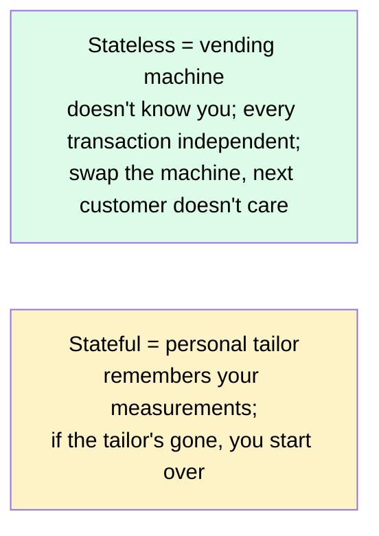
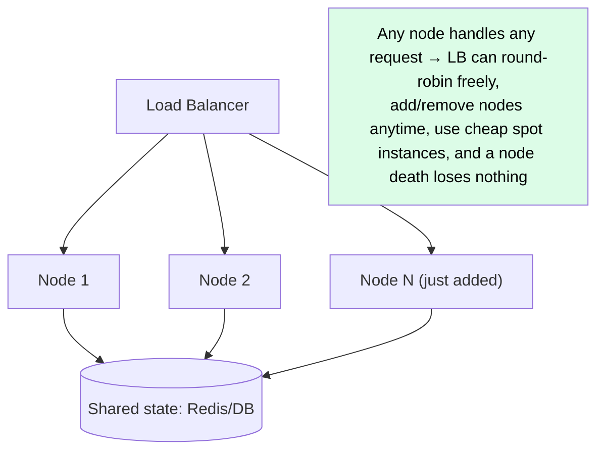
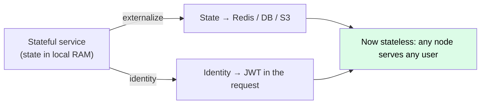
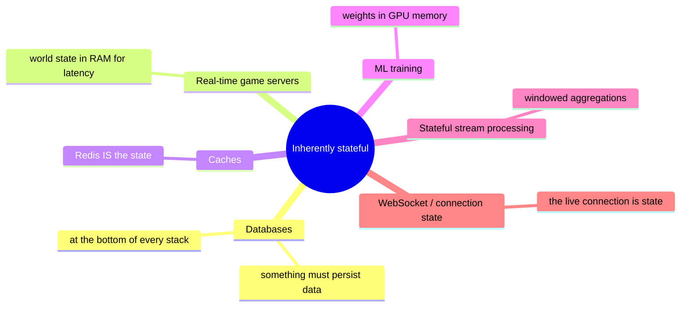
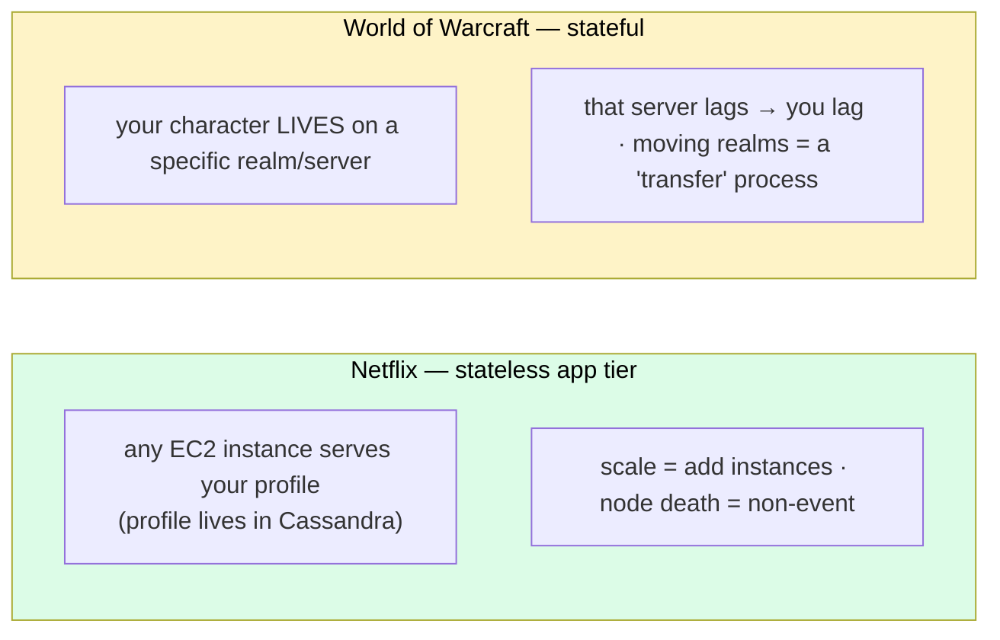
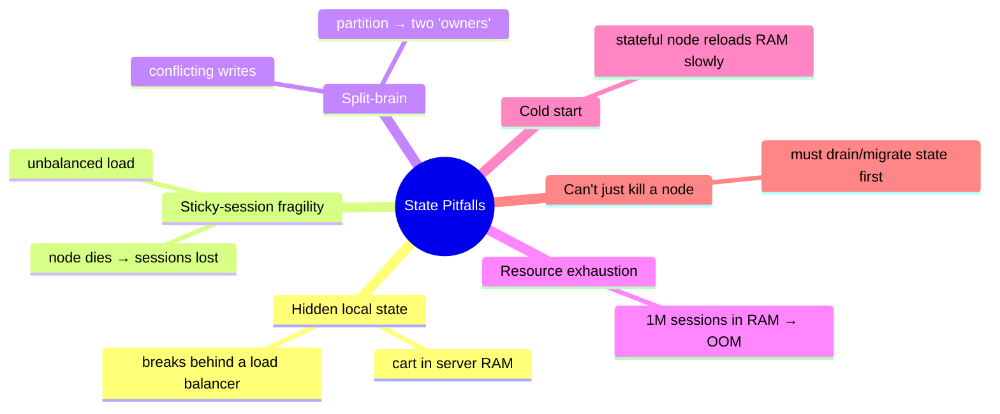

# Stateless vs Stateful Services

> **One line:** A stateless service is a vending machine (any unit serves anyone, remembers nothing — so you scale it by just adding more); a stateful service is a personal tailor (remembers you, but if it's gone you start over). The art: **scale the logic (stateless), shard the memory (stateful).**

---

## Table of Contents
1. [Why You Must Master This](#1-why-you-must-master-this)
2. [The Mental Model](#2-the-mental-model)
3. [How They Actually Work](#3-how-they-actually-work)
4. [Why Stateless Scales So Easily](#4-why-stateless-scales-so-easily)
5. [Making a Service Stateless (externalize state)](#5-making-a-service-stateless-externalize-state)
6. [When You Genuinely Need State](#6-when-you-genuinely-need-state)
7. [Worked Example — Netflix vs WoW](#7-worked-example--netflix-vs-wow)
8. [Real-Life Use Cases](#8-real-life-use-cases)
9. [Failure Modes](#9-failure-modes)
10. [🏋️ Practice Drills](#-practice-drills)
11. [🎤 Interview Q&A Bank](#-interview-qa-bank)
12. [🎯 Staff+ Nuances](#-staff-nuances)
13. [Cheat Sheet](#13-cheat-sheet)
14. [Connections & Further Reading](#14-connections--further-reading)

---

## 1. Why You Must Master This

Statelessness is the property that makes horizontal scaling, cloud-native deployment, and high availability *easy*. Get it right and scaling is "add more nodes"; get it wrong and every new node is a complexity bomb.

- **The scaling wall** — stateless is "easy mode": 100× traffic → 100 nodes. Stateful is "hard mode" where each new node adds sharding and coordination complexity.
- **Reliability & recovery** — a dead stateless node loses nothing; a dead stateful node can mean data loss or corruption.
- **Cloud-native assumption** — Kubernetes, Lambda, and autoscaling all *assume* your app tier is stateless.

> **The core problem it solves:** *the sticky-session trap.* It prevents the design where a user is bound to "Server A" because their cart/session lives in Server A's RAM — so when A reboots (or the load balancer routes elsewhere), they're logged out or lose data.

---

## 2. The Mental Model





---

## 3. How They Actually Work

| | Stateless | Stateful |
|---|-----------|----------|
| Memory of past requests | none — each request self-contained | preserved across requests |
| Where state lives | request itself (JWT) + shared store (Redis/DB) | local RAM/disk on the node |
| Routing | any node serves any request | user pinned to a specific node |
| Node death | non-event (no data lost) | data loss / corruption risk |
| Scaling | add nodes (linear) | shard (exponential complexity) |
| Latency | higher (fetch state each call) | lower (state is local) |
| Examples | web/API tier, Lambda | databases, game servers, caches, TCP termination |

```python
# STATEFUL — state stuck in this node's RAM
sessions = {}
def add_to_cart(user_id, item):
    sessions.setdefault(user_id, []).append(item)   # only THIS machine knows; LB breaks it

# STATELESS — state in a shared store, any node can serve any user
def add_to_cart(user_id, item):
    cart = redis.get(f"cart:{user_id}") or []
    cart.append(item)
    redis.set(f"cart:{user_id}", cart)              # any node can now handle this user
```

---

## 4. Why Stateless Scales So Easily



Because no node "owns" a user, the load balancer can spread traffic however it likes, autoscaling can add/kill nodes at will, and a crash is invisible to users. This is the "shared-nothing" property — and it's exactly what cloud autoscaling and Kubernetes are built around. The trade-off: every request pays a round trip to fetch state (latency + load on the shared store).

---

## 5. Making a Service Stateless (externalize state)

The universal recipe: **move state out of the node** into a shared store, and carry identity in the request.



- **Session/cart** → Redis or DB.
- **Uploaded files** → object storage (S3), not local disk.
- **Who is this user** → a signed JWT in the request (see [02 · Authentication](../02_API_Interface_Design/Authentication.md)).
- **Sticky sessions** are the band-aid alternative — the LB pins a user to one node so a stateful app *looks* scalable. It reintroduces the original problem (that node's death loses the session) and unbalances load; prefer true externalization.

---

## 6. When You Genuinely Need State

Statelessness isn't always possible or desirable — some workloads are inherently stateful:



The rule isn't "never have state" — it's "**push state down to the layer designed for it** (the database, the cache, the purpose-built stateful service) and keep the app tier stateless." Stateful systems scale via **sharding** (partition the state across nodes) and **replication** (for HA) — far harder than just adding nodes, which is why you minimize how much of the system needs it.

---

## 7. Worked Example — Netflix vs WoW



Netflix's app tier is stateless — any server serves your movie list because your profile is in a distributed DB, so they scale by adding EC2 instances. WoW is intrinsically stateful — your character's world state lives on one realm; you can't seamlessly hop servers mid-combat. Different problems, different choices.

---

## 8. Real-Life Use Cases

| Situation | Stateless or stateful? |
|-----------|------------------------|
| **REST/API tier, web servers** | Stateless — JWT + shared cache; scale freely. |
| **Shopping cart / session** | Externalize to Redis → stateless app tier. |
| **AWS Lambda / serverless** | Must be stateless (no guaranteed local state between invocations). |
| **Databases** | Stateful by definition — sharded + replicated. |
| **Multiplayer game servers** | Stateful — world state in RAM for latency. |
| **WebSocket / chat gateways** | The connection is state; use sticky routing or a shared presence store. |
| **Stream processing (Flink/Kafka Streams)** | Stateful — windowed aggregations checkpointed to durable storage. |

> Real-world habit: **make the app/API tier stateless by default; externalize anything that smells like per-user memory; and isolate the unavoidable state into purpose-built systems** (DB, cache, dedicated stateful service) that handle sharding/replication for you.

---

## 9. Failure Modes



- **Hidden local state** — the classic bug: storing a cart/session/file in node-local RAM or disk; works for one node, breaks the instant a load balancer is added.
- **Sticky-session fragility** — pinning users to nodes means a node death loses their sessions and load skews.
- **Split-brain** — in stateful systems, a network partition can leave two nodes both believing they own a piece of state, producing conflicting writes (see [CAP](../01_Planning_Foundations/CAP_Theorem_PACELC.md)).
- **Resource exhaustion** — a node holding millions of sessions in RAM OOMs.
- **Deploy/cold-start friction** — you can't just kill a stateful node to deploy; you must drain connections or migrate state, and a fresh node is slow until its RAM/cache warms.

---

## 🏋️ Practice Drills

> *Find the state and decide where it belongs.*

**Drill 1 — Find the bug.** A web app stores logged-in users' shopping carts in a Python dict in server memory. It works in dev but users intermittently "lose their cart" in production behind a load balancer. Why, and what's the fix?

<details><summary>Solution</summary>

The cart is node-local state. The load balancer routes the user's next request to a *different* node, which has no memory of their cart → it appears empty. Fix: externalize the cart to a shared store (Redis/DB) keyed by user id, making the app tier stateless so any node can serve any user. (Sticky sessions would patch it but lose carts on node death.)
</details>

**Drill 2 — Stateless-ify.** You're told to make a legacy auth service horizontally scalable, but it keeps session state in local memory. Outline the change.

<details><summary>Solution</summary>

Externalize session state: move sessions to Redis (or issue stateless JWTs the client sends each request, so no server session is needed at all). Once the node holds no per-user state, put it behind a load balancer and scale by adding nodes — node death becomes a non-event. JWTs trade a DB lookup for stateless verification; Redis sessions keep easy revocation.
</details>

**Drill 3 — Where does the state go?** Design a real-time multiplayer game. You can't avoid in-RAM world state for latency. How do you keep most of the system scalable while accepting the stateful core?

<details><summary>Solution</summary>

Keep the *world simulation* stateful (per-match/realm server, state in RAM for low latency), but make everything around it stateless: matchmaking, auth, profile, leaderboards, chat — all behind stateless services backed by shared stores. Shard the stateful game servers by match/realm and replicate/checkpoint their state for recovery. Push state down to the one layer that truly needs it; keep the rest stateless.
</details>

---

## 🎤 Interview Q&A Bank

**Q1. Stateless vs stateful — define and contrast.**
> A stateless service keeps no memory of past requests — each request is self-contained (state comes from the request, e.g. a JWT, plus a shared store). A stateful service preserves state locally across requests. Stateless scales by adding nodes and survives node death trivially; stateful scales by sharding and risks data loss on node failure.

**Q2. How do you make a service stateless?**
> Externalize state to a shared store (Redis/DB/S3) and carry identity in the request (JWT). Once nodes hold no per-user state, any node serves any request and you scale horizontally.

**Q3. What's wrong with sticky sessions?**
> They pin a user to one node so a stateful app *looks* scalable, but the node's death loses that user's session, and load becomes unbalanced. They mask the problem rather than solving it; externalizing state is the real fix.

**Q4. Why do Kubernetes/Lambda prefer stateless apps?**
> Because they freely create, destroy, and reschedule instances. If a node held important local state, killing it would lose data. Stateless apps make autoscaling and self-healing safe.

**Q5. How do stateful systems scale?**
> By sharding (partitioning state across nodes, often via consistent hashing) and replication (copies for HA). This is far more complex than adding stateless nodes — hence "scale the logic, shard the memory."

**Q6. What is split-brain?**
> In a stateful/replicated system, a network partition can leave two nodes each believing they're the primary owner of some state, accepting conflicting writes. Avoided with quorum/consensus and a single-leader discipline (CAP: you sacrifice availability to stay consistent).

**Q7. Can a system be fully stateless?**
> No — *something* must persist data. The goal is to push state down to purpose-built stateful layers (databases, caches) and keep the application/API tier stateless. State doesn't disappear; you relocate it to where it's managed properly.

---

## 🎯 Staff+ Nuances

- **Statelessness is a relocation, not an elimination.** "Make it stateless" really means "move the state to a shared store." You've traded local-RAM speed for a network round trip *and* concentrated load on that store — which then becomes your scaling bottleneck and SPOF. The session store is now the thing you must make HA. State is conserved; you choose where it lives.
- **The shared store is where the hard distributed-systems problems migrate to.** Pushing state out of the app tier doesn't remove sharding, replication, and consistency concerns — it concentrates them in Redis/the DB. You've made the *easy* tier trivially scalable by making one *hard* tier carry all the difficulty. That's usually the right trade (one hard problem beats N), but name it.
- **"Stateless" usually means *no session affinity required*, not literally zero state.** A node may hold caches, connection pools, and in-flight request state — what makes it "stateless" is that none of that is *authoritative* or *user-pinned*, so losing the node loses nothing important. Precision here separates strong candidates.
- **Sticky sessions have legitimate uses — WebSockets and connection-oriented protocols.** A live WebSocket *is* state bound to one node; you can't round-robin a persistent connection. The pattern then is affinity for the connection + a shared presence/pub-sub layer (Redis) so other nodes can reach that user. Don't reflexively call sticky sessions an anti-pattern.
- **Cold-start and warm-up are the hidden cost of stateful nodes.** A freshly-started cache/DB node serves slowly until its working set is loaded (cold cache). HA failover to a cold standby can cause a latency cliff or a thundering herd on the backing store — design warm standbys or gradual traffic ramp.
- **Externalizing to a shared store interacts with consistency.** If two stateless nodes read-modify-write the same Redis key concurrently, you get lost updates — exactly the race the local-memory version hid. Use atomic operations, optimistic concurrency, or per-key locks. Stateless app tiers don't remove concurrency bugs; they move them to the shared store.

---

## 13. Cheat Sheet

```
STATELESS = no memory of past requests; state in request (JWT) + shared store. Vending machine.
  ✓ scale by adding nodes (linear) · node death = non-event · cloud-native / spot instances
  ✗ fetch state every call → latency + load on the shared store (new bottleneck/SPOF)

STATEFUL = state in local RAM/disk; user pinned to a node. Personal tailor.
  ✓ ultra-low latency · strong real-time consistency
  ✗ scale via SHARDING (hard) · node death = data loss/split-brain · slow cold start · drain to deploy

MAKE STATELESS: externalize state → Redis/DB/S3 · identity → JWT in the request
RULE: scale the logic (stateless), shard the memory (stateful). Push state DOWN to purpose-built layers.

INHERENTLY STATEFUL: databases · caches · game servers · ML training · stream processing · WebSockets
TRAPS: hidden local state behind a LB · sticky-session fragility · split-brain · OOM · cold start
NUANCE: "stateless" = no session affinity needed, not literally zero state.
```

---

## 14. Connections & Further Reading

**Within this repo:**
- [High_Availability_Design.md](./High_Availability_Design.md) — stateless design makes HA/failover easy.
- [02 · Authentication](../02_API_Interface_Design/Authentication.md) — JWT (stateless) vs server sessions (stateful).
- [CAP & PACELC](../01_Planning_Foundations/CAP_Theorem_PACELC.md) — split-brain / consistency for stateful systems.
- [06 · Caching & Performance](../06_Caching_Performance/) — Redis as the externalized store; [07 · Load Balancing & Scalability](../07_Load_Balancing_Scalability/) — consistent hashing for sharded state.

**External classics:**
- [The Twelve-Factor App — Processes (statelessness)](https://12factor.net/processes).
- [Microsoft — Stateless vs stateful microservices](https://learn.microsoft.com/en-us/azure/service-fabric/service-fabric-overview-stateless-stateful).
- *Designing Data-Intensive Applications* (Kleppmann) — partitioning & replication.

---

## TL;DR
A **stateless** service keeps no per-request memory — state lives in the **request (JWT) + a shared store** — so any node serves any request, scaling is "add nodes," and node death loses nothing (the cloud-native default). A **stateful** service keeps state locally for speed but scales only via **sharding** and risks **data loss/split-brain** on failure. The discipline is **"scale the logic, shard the memory"**: make the app tier stateless by **externalizing state**, and push the unavoidable state **down** into purpose-built systems (DB, cache, game server) — remembering that statelessness *relocates* the hard problems to the shared store rather than removing them.
